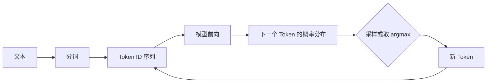
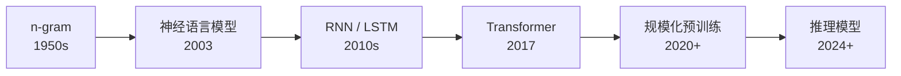

# 第 1 章 语言模型的本质：从预测下一个 Token 到压缩与智能

## 本章导读

一个只会做一件事的模型——根据前文预测下一个 Token——为什么能写代码、解数学题、调用工具？本章先放下"智能"这个模糊的词，从一个可以精确验证的等式出发：训练语言模型就是在做压缩，而困惑度就是平均每个 Token 的编码长度。理解了这把尺子，后面所有架构与训练技巧才有统一的度量。

## 难度标签

⭐⭐ 基础 ｜ 数学要求：概率论、信息论初步 ｜ 代码要求：PyTorch 基础

## 学习目标

读完本章你将能够：

- 写出自回归分解，并说明它为什么是精确的而不是近似；
- 推导交叉熵、困惑度与每 Token 比特数之间的关系；
- 解释 n-gram 的参数量为什么随阶数指数增长，以及加性平滑解决了什么问题；
- 比较自回归、掩码、填充中间、去噪、多 Token 预测与强化学习六类训练目标；
- 从零实现并跑通 n-gram、神经 n-gram 与 RNN 三种语言模型基线。

## 1.1 一条规则

先做一个思想实验。给你一句话的前半段：

> 今天的天气真____

你会很自然地想到"好""不错""热""冷"这些词，而不会想到"因为""虽然""傅里叶"。这种"根据前文猜下一个词"的能力，就是语言模型做的全部事情。

Shannon 在 1951 年的论文《Prediction and Entropy of Printed English》里做过一个更严格的版本：他让人逐字母猜测英文文本的下一个字符，记录猜中需要多少次尝试，用这些次数来估计英文的熵。他得到的估计大约在每字符 0.6 到 1.3 比特之间。这个实验说明了一件重要的事：**预测下一个字符的难度，可以被量化成信息量**。

现代语言模型把这件事变成了一个概率分布。给定前文 $$x_{<t}$$，模型输出词表上每个 Token 的概率：

| 候选 | 概率（示意） |
| --- | --- |
| 好 | 0.42 |
| 不错 | 0.21 |
| 热 | 0.11 |
| 冷 | 0.08 |
| 其他 | 0.18 |

模型不会只给一个答案，它给的是一整个分布。生成时，我们从分布里采样一个 Token，把它接到前文后面，再预测下一个。这个过程循环下去，就得到了完整的文本：



这个循环里有两个容易混淆的细节。

第一，**训练和推理的输入不同**。训练时，我们把真实文本的每个位置都作为监督信号，模型在位置 $$t$$ 看到的是真实的前文，这叫"教师强制"（teacher forcing）。推理时，模型看到的是自己刚刚生成的 Token；一旦前面生成错了，错误会沿着序列累积。这个差异叫"暴露偏差"（exposure bias），第 20 章讨论解码策略时还会回到它。

第二，**模型输出的分布蕴含着压缩能力**。如果模型给真实 Token 分配的概率是 $$p$$，那么用最优编码表示这个 Token 需要约 $$-\log_2 p$$ 比特。概率 0.5 对应 1 比特，概率 0.9 对应 0.152 比特，概率 0.01 对应 6.64 比特。模型预测得越准，平均编码长度越短——**预测和压缩是同一件事的两种说法**。


"压缩即智能"是一个有影响力的假说，不是一个已经证明的定理。一个模型可以很好地压缩训练分布，却仍然在事实上出错、在分布外失效。本章会用它建立直觉，但不会把它当作结论。


## 1.2 从 n-gram 到 Transformer

语言模型的历史，可以看成不断去掉假设的历史。

### 1.2.1 计数时代：n-gram

最直接的做法是数数。假设我们只根据前一个词预测下一个词，那么只需要统计训练语料里每个"前一个词 → 下一个词"出现了多少次，再用频率估计概率。这就是二元模型（bigram）。推广到前 $$n-1$$ 个词，就是 n-gram 模型。

n-gram 的核心假设是**马尔可夫假设**：下一个词只依赖前 $$n-1$$ 个词，更早的历史一律忽略。这个假设让问题变得可计算，代价是上下文被硬性截断。更严重的问题在参数量：词表大小为 $$n_{vocab}$$ 时，n-gram 需要区分 $$n_{vocab}^{n}$$ 种组合。中文词表 5 万、三元模型就需要约 $$1.25 \times 10^{14}$$ 个参数——还没算存储和统计所需的数据量。

### 1.2.2 神经语言模型：共享统计强度

2003 年，Bengio 等人提出用神经网络做语言模型。关键变化不是"用了神经网络"，而是**用低维稠密向量表示词，让相似的词共享参数**。

在计数模型里，"猫"和"狗"是两个完全独立的符号；训练集里见过"猫在垫子上"，对预测"狗在垫子上"没有任何帮助。在神经语言模型里，每个词对应一个向量，"猫"和"狗"的向量在训练中会靠得很近，于是从前者学到的模式可以迁移到后者。这就是分布式表示（distributed representation）的价值：它把"记住每个组合"换成了"学习一个可复用的函数"。

### 1.2.3 循环网络与注意力

RNN 进一步去掉了"固定窗口"的假设。它维护一个隐状态 $$\mathbf{h}_t$$，每读入一个 Token 就更新一次，理论上可以把任意长的历史压缩进这个状态。但 RNN 必须按时间步串行计算，训练无法在序列维上并行；而且梯度要穿过很多步，长距离依赖容易消失。

Transformer 用注意力机制同时解决了这两个问题：每个位置可以直接看到序列中所有位置，任意两个位置之间的路径长度都是 1；训练时所有位置可以并行计算。代价是注意力的计算量随序列长度平方增长。这个取舍是第 3 章的主题。



## 1.3 数学原理

### 1.3.1 自回归分解

设一个长度为 $$T$$ 的 Token 序列为 $$x_1, x_2, \dots, x_T$$，由概率的链式法则，其联合概率为

$$
p(x_1, x_2, \dots, x_T) = \prod_{t=1}^{T} p(x_t \mid x_1, \dots, x_{t-1}) = \prod_{t=1}^{T} p(x_t \mid x_{<t})
\qquad \text{(1.1)}
$$

这个等式是**精确的**，没有做任何独立性假设。所谓"自回归"（autoregressive），只是把联合分布拆成一串条件分布的乘积；每个条件分布都以全部历史为条件。

取对数，乘积变成求和：

$$
\log p(x_{1:T}) = \sum_{t=1}^{T} \log p(x_t \mid x_{<t})
\qquad \text{(1.2)}
$$

这两行是整本书的地基。第 3 章的 Transformer、第 20 章的解码、第 24 章的测试时扩展，都在操作这个分解里的某一项。

### 1.3.2 最大似然、交叉熵与 KL 散度

训练语言模型，就是让模型给真实数据的概率尽量大。给定数据集，负对数似然（negative log-likelihood，NLL）为

$$
\mathcal{L}(\theta) = -\frac{1}{T}\sum_{t=1}^{T}\log p_\theta(x_t \mid x_{<t})
\qquad \text{(1.3)}
$$

这个量还有另一个名字：交叉熵（cross-entropy）。设真实分布为 $$p_{\text{data}}$$，模型分布为 $$p_\theta$$，则

$$
\begin{aligned}
H(p_{\text{data}}, p_\theta)
&= -\mathbb{E}_{x \sim p_{\text{data}}}[\log p_\theta(x)] \\
&= -\mathbb{E}_{p_{\text{data}}}[\log p_{\text{data}}(x)] + \mathbb{E}_{p_{\text{data}}}\left[\log \frac{p_{\text{data}}(x)}{p_\theta(x)}\right] \\
&= H(p_{\text{data}}) + \mathrm{KL}(p_{\text{data}} \,\Vert\, p_\theta)
\end{aligned}
\qquad \text{(1.4)}
$$

第一项是数据本身的熵，和模型参数 $$\theta$$ 无关；第二项是 KL 散度，衡量模型分布与真实分布的差距，恒大于等于零。因此**最小化交叉熵等价于最小化 KL 散度**，也就是让模型分布逼近真实分布。

在有限数据集上，$$p_{\text{data}}$$ 由样本的经验分布给出。对每个位置而言，真实的下一个 Token 是一个 one-hot 分布，它的熵为零；此时 (1.4) 的第一项消失，交叉熵退化为负对数似然 (1.3)。两种写法描述的是同一件事，只是抽象层次不同。

这一步推导解释了一个常见困惑：为什么语言模型训练不用"准确率"作损失？因为下一个 Token 的准确率是离散的、不可导的，而且它对概率的细微变化不敏感；交叉熵是可导的，并且直接度量了分布之间的距离。

### 1.3.3 困惑度到底在度量什么

困惑度（perplexity，PPL）定义为交叉熵的指数。

$$
\mathrm{PPL} = \exp\left(\mathcal{L}\right)
\qquad \text{(1.5)}
$$

把 (1.3) 代入，得到更常用的形式

$$
\mathrm{PPL} = \left(\prod_{t=1}^{T}\frac{1}{p_\theta(x_t \mid x_{<t})}\right)^{1/T}
\qquad \text{(1.6)}
$$

它可以理解为"模型平均每次要在多少个等概率候选里猜"。这个解释在均匀分布时是严格的：如果词表大小为 $$n_{vocab}$$，模型对每个 Token 都给出 $$1/n_{vocab}$$ 的概率，那么 $$\mathcal{L} = -\frac{1}{T}\sum_{t=1}^{T}\log\frac{1}{n_{vocab}} = \log n_{vocab}$$，因此 $$\mathrm{PPL} = n_{vocab}$$。

如果模型不是均匀分布，PPL 仍然是"有效分支因子"的一种度量，但不再等于候选个数。一个 PPL 为 10 的模型，不意味着它在 10 个词里选，而意味着它的预测等价于在 10 个等概率选项之间犹豫。

交叉熵的单位是 nat（以 $$e$$ 为底）。换成信息论常用的比特。

$$
\text{bits per token} = \frac{\mathcal{L}}{\ln 2}
\qquad \text{(1.7)}
$$

例如交叉熵 2.0 nats 约等于 2.89 比特/Token。这就是压缩率的直接来源：一个 32000 词的词表，如果每个 Token 用 15 比特固定编码，而模型把交叉熵降到 2 nats，那么平均编码长度只有约 2.89 比特，压缩了五倍多。


**PPL 不能跨分词器比较。** 同一段中文，按字分词和按 BPE 分词得到的 Token 数不同，PPL 的分母不同，数值不可比。看到论文里的 PPL 时，先确认它的分词方式和评测集；跨模型比较时，更可靠的是在相同评测集上的任务指标。


### 1.3.4 n-gram：极大似然与平滑

n-gram 模型把条件概率近似为有限窗口：$$p(x_t \mid x_{<t}) \approx p(x_t \mid x_{t-n+1}, \dots, x_{t-1})$$。

在训练集上做极大似然估计，令 $$c(\cdot)$$ 表示计数，则

$$
p_{\text{MLE}}(x_t \mid \text{ctx}) = \frac{c(\text{ctx}, x_t)}{c(\text{ctx})}
\qquad \text{(1.8)}
$$

这个公式可以从带约束的优化推出来。对每个上下文，最大化 $$\sum_{c} n_c \log p_c$$，约束为 $$\sum_c p_c = 1$$。构造拉格朗日函数 $$\mathcal{J} = \sum_c n_c \log p_c - \lambda\left(\sum_c p_c - 1\right)$$。

对 $$p_c$$ 求偏导并令其为零，得 $$p_c = n_c / \lambda$$；再代入约束，得到 $$\lambda = \sum_c n_c$$，于是 $$p_c = n_c / \sum_c n_c$$，正是 (1.8)。

极大似然有一个致命问题：**没见过的组合概率为零**。只要测试集里出现一个训练集没见过的二元组，它的 $$-\log 0 = \infty$$，整个困惑度就变成无穷大。加性平滑（add-k smoothing）用一个先验把零概率抬起来。

$$
p_{\text{add-}k}(x_t \mid \text{ctx}) = \frac{c(\text{ctx}, x_t) + k}{c(\text{ctx}) + k\, n_{vocab}}
\qquad \text{(1.9)}
$$

$$k=1$$ 时叫拉普拉斯平滑。从贝叶斯角度看，(1.9) 等价于给每个上下文加一个对称的 Dirichlet 先验 $$\mathrm{Dir}(k, \dots, k)$$，取后验均值。$$k$$ 越大，平滑越强，模型越接近均匀分布；$$k$$ 越小，越接近原始计数，但零概率风险越高。

n-gram 的参数量是

$$
\left|\theta_{n\text{-gram}}\right| = \mathcal{O}\left(n_{vocab}^{\,n}\right)
\qquad \text{(1.10)}
$$

这个指数是 n-gram 的死穴。词表 5 万、三元模型有 $$1.25 \times 10^{14}$$ 个可能的上下文；即使训练语料有 1 万亿 Token，平均每个上下文也只见到不到 0.01 次。数据稀疏不是工程问题，而是模型形式的必然结果。


在实现 n-gram 时，如果没有平滑，测试集上的第一个未登录组合就会让交叉熵变成 `inf`。调试时如果看到 `inf` 或 `nan`，先检查是不是出现了零概率，而不是先去调学习率。


### 1.3.5 神经语言模型与参数共享

神经语言模型不再为每个上下文存一个计数，而是学习一个参数化的函数。以最简单的循环网络为例，输入嵌入为

$$
\mathbf{e}_t = \mathbf{E} z_t
\qquad \text{(1.11)}
$$

隐状态为

$$
\mathbf{h}_t = \tanh\left(\mathbf{W}_x \mathbf{e}_t + \mathbf{W}_h \mathbf{h}_{t-1} + \mathbf{b}\right)
\qquad \text{(1.12)}
$$

输出 logits 为

$$
\boldsymbol{\ell}_t = \mathbf{W}_o \mathbf{h}_t
\qquad \text{(1.13)}
$$

下一 Token 的分布为

$$
p_\theta(\cdot \mid x_{\le t}) = \mathrm{softmax}(\boldsymbol{\ell}_t)
\qquad \text{(1.14)}
$$

其中 $$z_t$$ 是 Token 的整数 ID，$$\mathbf{E} \in \mathbb{R}^{n_{vocab} \times d}$$ 是嵌入矩阵，$$d$$ 是隐藏维度。参数量约为 $$|\theta| = n_{vocab} d + 3d^2 + d\,n_{vocab}$$。

第一项是输入嵌入，第二项是循环层，第三项是输出投影。注意：**参数量与序列长度无关，也与上下文组合数无关**。这正是它绕开 n-gram 指数爆炸的原因。

代价是训练必须通过时间反向传播（backpropagation through time，BPTT）。序列越长，计算图和梯度链越长，显存和数值稳定性都成问题。实践中通常截断到固定长度，这又把"无限上下文"的承诺打了折扣。

### 1.3.6 复杂度对比

设序列长度为 $$T$$，隐藏维度为 $$d_{model}$$，层数为 $$n_l$$。三类模型的前向计算量大致为：

| 模型 | 每 Token 计算量 | 序列维并行 | 注意力/上下文内存 |
| --- | --- | --- | --- |
| n-gram | $$\mathcal{O}(1)$$ 查表 | 不需要 | $$\mathcal{O}(n_{vocab}^{\,n})$$ 参数 |
| RNN | $$\mathcal{O}(d_{model}^2)$$ | 否（时间步串行） | $$\mathcal{O}(d_{model})$$ 状态 |
| Transformer | $$\mathcal{O}(T d_{model} + d_{model}^2)$$ | 是 | $$\mathcal{O}(T^2)$$ 注意力矩阵 |

单层 Transformer 的前向计算量可以写成

$$
\mathcal{O}\left(T^2 d_{model} + T d_{model}^2\right)
\qquad \text{(1.15)}
$$

第一项来自注意力，第二项来自前馈网络。序列越长，第一项越占主导；这也是长上下文昂贵的根本原因。FlashAttention（第 21 章）优化的是这一项的显存与访存，而不是把它变成线性复杂度。

## 1.4 训练目标的设计空间

到这里，我们默认了"预测下一个 Token"是唯一的目标。其实语言模型可以有不同的训练目标，而目标的选择会深刻影响模型能学什么、怎么用。

### 1.4.1 自回归目标

这就是 (1.3) 的逐位置形式。

$$
\mathcal{L}_{\text{AR}}(\theta) = -\sum_{t=1}^{T}\log p_\theta(x_t \mid x_{<t})
\qquad \text{(1.16)}
$$

它的监督信号最密集：每个位置都提供一个训练样本。训练和推理的形式完全一致，生成时只需要反复调用同一个条件分布。

### 1.4.2 掩码语言模型

BERT 式的掩码语言模型（masked language modeling，MLM）随机遮住一部分 Token，让模型根据双向上下文还原，损失为

$$
\mathcal{L}_{\text{MLM}}(\theta) = -\sum_{t \in \mathcal{M}}\log p_\theta(x_t \mid x_{\bar{\mathcal{M}}})
\qquad \text{(1.17)}
$$

其中 $$\mathcal{M}$$ 是被遮住的位置集合，$$\bar{\mathcal{M}}$$ 是其余位置。它能看到右侧上下文，表示能力更强，但**不能直接做从左到右的生成**：推理时没有"未来 Token"可看。要做生成，必须额外设计解码顺序或改用其他目标。

### 1.4.3 填充中间

代码补全需要模型根据"光标前"和"光标后"的内容补中间。填充中间（fill-in-the-middle，FIM）把文档切成前缀、后缀、中间三段，训练模型在给定前缀和后缀时生成中间，损失为

$$
\mathcal{L}_{\text{FIM}}(\theta) = -\sum_{t \in \text{middle}}\log p_\theta(x_t \mid \text{prefix}, \text{suffix}, x_{\text{middle},<t})
\qquad \text{(1.18)}
$$

实现时用三个特殊 Token 把三段隔开。常见有两种排列：



`<PRE> 前缀 <SUF> 后缀 <MID> 中间`

前缀在后缀之前，符合自然阅读顺序。


`<SUF> 后缀 <PRE> 前缀 <MID> 中间`

把后缀提前，缓解模型对"前缀总在开头"的位置偏见。



训练时通常把一部分文档转成 FIM 格式，其余保持原样，避免模型只会做补全、不会做续写。

### 1.4.4 去噪目标

T5 式的去噪目标把文本中的连续片段替换成哨兵 Token，让模型还原被破坏的片段，损失为

$$
\mathcal{L}_{\text{denoise}}(\theta) = -\sum_{\text{span} \in \mathcal{S}}\log p_\theta(\text{span} \mid \text{corrupted text})
\qquad \text{(1.19)}
$$

它天然适合编码器-解码器结构，在翻译、摘要这类"输入到输出"的任务上很有效；但对纯解码器架构，FIM 是更自然的选择。

### 1.4.5 多 Token 预测

标准自回归每次只监督下一个 Token。多 Token 预测（multi-token prediction，MTP）让模型一次预测未来 $$m$$ 个 Token，损失为

$$
\mathcal{L}_{\text{MTP}}(\theta) = -\sum_{t=1}^{T}\sum_{i=1}^{m}\log p_\theta(x_{t+i} \mid x_{\le t})
\qquad \text{(1.20)}
$$

一种直接做法是并行加 $$m$$ 个独立的预测头；DeepSeek-V3 采用的是顺序预测模块，让第 $$i$$ 个预测依赖前一个预测的结果，从而保持因果链。MTP 增加了训练计算量，但提高了每个 Token 的监督密度，并且训练出的额外预测头可以在推理时复用为投机解码的草稿（第 22 章）。

### 1.4.6 强化学习目标

前面五种目标都有"标准答案"，可以直接算交叉熵。强化学习（reinforcement learning，RL）优化的则是奖励目标

$$
J(\theta) = \mathbb{E}_{y \sim \pi_\theta}\left[r(y)\right] - \beta\,\mathrm{KL}\left(\pi_\theta \,\Vert\, \pi_{\text{ref}}\right)
\qquad \text{(1.21)}
$$

其中 $$\pi_\theta$$ 是策略（也就是语言模型），$$r(y)$$ 是奖励，$$\pi_{\text{ref}}$$ 是参考策略，$$\beta$$ 控制偏离参考策略的惩罚。奖励可以来自人类偏好模型，也可以来自可验证的答案检查器。这个目标的后训练细节在第 16 至 18 章展开，这里只需要记住：**它优化的不是"像训练数据"，而是"得到更高的奖励"**。

### 1.4.7 六种目标的对比

| 目标 | 监督信号 | 能否直接生成 | 优点 | 代价与限制 | 典型使用 |
| --- | --- | --- | --- | --- | --- |
| 自回归 AR | 每个位置的下一 Token | 是 | 训练/推理一致，信号密集 | 只能从左到右，存在暴露偏差 | GPT、Llama、Qwen |
| 掩码 MLM | 被遮住的位置 | 否 | 双向上下文 | 不能直接生成，需要适配 | BERT |
| 填充中间 FIM | 中间片段 | 是（需特殊标记） | 适合代码补全 | 需改造数据与词表 | StarCoder2、DeepSeek-Coder |
| 去噪 | 被破坏的片段 | 否（编码器-解码器） | 适合翻译、摘要 | 结构复杂 | T5 |
| 多 Token 预测 | 未来 $$m$$ 个 Token | 是（主头） | 提升数据效率，可复用为投机解码 | 训练算力增加 | DeepSeek-V3 |
| 强化学习 | 奖励 | 是 | 能优化不可微目标 | 不稳定，需要 KL 约束 | RLHF、RLVR |


自回归之所以成为主流，不是因为它在理论上最优，而是因为它的**训练形式与推理形式完全一致**。其他目标要么需要额外的解码设计，要么需要额外的结构；它们不是"更差的 AR"，而是为不同使用场景做的不同取舍。


## 1.5 方案对比：四种模型家族的取舍

| 模型 | 有效上下文 | 参数量 | 训练并行性 | 长依赖 | 数据效率 | 代表 |
| --- | --- | --- | --- | --- | --- | --- |
| n-gram | 固定 $$n-1$$ | $$\mathcal{O}(n_{vocab}^{\,n})$$ | 无需训练 | 无 | 高（小数据可用） | 统计机器翻译 |
| 神经 n-gram | 固定 $$n-1$$ | $$\mathcal{O}(n_{vocab} d + d^2)$$ | 高 | 无 | 中 | Bengio et al. 2003 |
| RNN / LSTM | 理论无限 | $$\mathcal{O}(d^2)$$ | 低（时间步串行） | 中（梯度消失） | 中 | ELMo |
| Transformer | 理论无限 | $$\mathcal{O}(n_l d_{model}^2)$$ | 高（序列维并行） | 强（路径长度 1） | 低（需要大数据） | GPT、Llama |

这张表里没有"全面更好"的一列。n-gram 在小数据、低延迟场景仍然可用；RNN 在流式、低功耗场景有优势；Transformer 用平方级的注意力开销换来了并行训练和长距离建模能力。选型的核心不是"哪个更先进"，而是"你的约束落在哪一列"。

## 1.6 代码实现：三种基线

### 1.6.1 为什么用可控语料

在真实语料上，我们不知道数据的真实熵，只能比较不同模型的相对高低。为了验证"困惑度 = 交叉熵的指数"这个等式，需要一个**真实熵已知**的数据生成过程。

本节构造一个二阶马尔可夫链：词表有 6 个符号，下一个符号以 0.8 的概率等于前一个符号，以 0.2 的概率等于 $$(a+b+1) \bmod 6$$，其中 $$a, b$$ 是前两个符号。这个过程的 $$H_1$$、$$H_2$$、$$H_3$$ 可以在 36 个二阶状态上精确求出。然后采样 12 万个 Token，用前 80% 训练、后 20% 测试。

代码放在 `examples/ch01_lm_basics.py`。它不是 TinyLM 的正式模块——TinyLM 的 Transformer 从第 3 章开始——但它建立的计算流程（交叉熵、困惑度、教师强制）会一直沿用到全书。

### 1.6.2 完整代码

```python
"""第 1 章配套代码：n-gram、神经 n-gram 与 RNN 三种语言模型基线。
运行：python ch01_lm_basics.py
"""
import math
import random
from collections import Counter

import numpy as np
import torch
import torch.nn as nn
import torch.nn.functional as F

torch.manual_seed(0)
np.random.seed(0)
random.seed(0)

# ---------- 1. 可控语料：二阶马尔可夫链 ----------
C = 6  # 词表大小

def transition(a: int, b: int):
    """给定前两个符号 (a, b)，返回下一个符号的分布。"""
    t1 = b
    t2 = (a + b + 1) % C
    if t1 == t2:
        t2 = (t2 + 1) % C
    return [(t1, 0.8), (t2, 0.2)]

T = {(a, b): transition(a, b) for a in range(C) for b in range(C)}

def exact_entropies():
    """在 36 个二阶状态上求平稳分布，得到精确的 H1/H2/H3。"""
    P = np.zeros((C * C, C * C))
    for a in range(C):
        for b in range(C):
            i = a * C + b
            for c, p in T[(a, b)]:
                P[i, b * C + c] += p
    pi = np.ones(C * C) / (C * C)
    for _ in range(10_000):
        pi = pi @ P
    pi /= pi.sum()

    H3 = 0.0
    for a in range(C):
        for b in range(C):
            H3 -= pi[a * C + b] * sum(p * math.log(p) for _, p in T[(a, b)])

    marg = np.zeros(C)
    for a in range(C):
        for b in range(C):
            marg[b] += pi[a * C + b]
    H1 = -sum(x * math.log(x) for x in marg)

    H2 = 0.0
    for b in range(C):
        pb = sum(pi[a * C + b] for a in range(C))
        cond = np.zeros(C)
        for a in range(C):
            for c, p in T[(a, b)]:
                cond[c] += pi[a * C + b] * p
        cond /= pb
        H2 -= pb * sum(x * math.log(x) for x in cond if x > 0)
    return H1, H2, H3

H1, H2, H3 = exact_entropies()
print(f"真实熵: H1={H1:.4f}  H2={H2:.4f}  H3={H3:.4f} (nats)")
print(f"真实 PPL: {math.exp(H1):.4f}  {math.exp(H2):.4f}  {math.exp(H3):.4f}")

rng = random.Random(42)
N = 120_000
seq = [0, 1]
for _ in range(N - 2):
    a, b = seq[-2], seq[-1]
    outcomes, probs = zip(*T[(a, b)])
    seq.append(rng.choices(outcomes, weights=probs)[0])

split = int(0.8 * N)
train, test = seq[:split], seq[split:]

# ---------- 2. n-gram（公式 1.8、1.9） ----------
class NGram:
    def __init__(self, n: int, k: float = 0.1):
        self.n, self.k = n, k  # k：加性平滑常数

    def fit(self, tokens):
        self.count = Counter()
        self.context_count = Counter()
        for i in range(self.n - 1, len(tokens)):
            ctx = tuple(tokens[i - self.n + 1:i]) if self.n > 1 else ()
            self.count[ctx + (tokens[i],)] += 1
            self.context_count[ctx] += 1
        return self

    def cross_entropy(self, tokens):
        total = 0.0
        for i in range(self.n - 1, len(tokens)):
            ctx = tuple(tokens[i - self.n + 1:i]) if self.n > 1 else ()
            num = self.count[ctx + (tokens[i],)] + self.k
            den = self.context_count[ctx] + self.k * C
            total -= math.log(num / den)          # 公式 (1.9)
        return total / (len(tokens) - self.n + 1)

for n in (1, 2, 3):
    ce = NGram(n).fit(train).cross_entropy(test)
    print(f"{n}-gram:  CE={ce:.4f}  PPL={math.exp(ce):.4f}")

# ---------- 3. 神经 n-gram（公式 1.11–1.14） ----------
def make_xy(tokens, order):
    x = torch.tensor([tokens[i - order:i] for i in range(order, len(tokens))])
    y = torch.tensor(tokens[order:])
    return x, y

xb1, yb1 = make_xy(train, 1); xt1, yt1 = make_xy(test, 1)
xb2, yb2 = make_xy(train, 2); xt2, yt2 = make_xy(test, 2)

class NeuralBigram(nn.Module):
    def __init__(self, d=16):
        super().__init__()
        self.emb = nn.Embedding(C, d)      # 公式 (1.11)
        self.out = nn.Linear(d, C)         # 公式 (1.13)(1.14)

    def forward(self, x):
        return self.out(self.emb(x).squeeze(1))

m = NeuralBigram()
opt = torch.optim.Adam(m.parameters(), lr=0.02)
for _ in range(3_000):
    idx = torch.randint(0, len(xb1), (512,))
    loss = F.cross_entropy(m(xb1[idx]), yb1[idx])   # 公式 (1.3)
    opt.zero_grad(); loss.backward(); opt.step()
with torch.no_grad():
    ce = F.cross_entropy(m(xt1), yt1).item()
print(f"神经二元: CE={ce:.4f}  PPL={math.exp(ce):.4f}")

class NeuralTrigram(nn.Module):
    def __init__(self, d=16):
        super().__init__()
        self.emb = nn.Embedding(C, d)
        self.mlp = nn.Sequential(nn.Linear(2 * d, 64), nn.ReLU(), nn.Linear(64, C))

    def forward(self, x):
        return self.mlp(self.emb(x).flatten(1))

m3 = NeuralTrigram()
opt = torch.optim.Adam(m3.parameters(), lr=0.02)
for _ in range(3_000):
    idx = torch.randint(0, len(xb2), (512,))
    loss = F.cross_entropy(m3(xb2[idx]), yb2[idx])
    opt.zero_grad(); loss.backward(); opt.step()
with torch.no_grad():
    ce = F.cross_entropy(m3(xt2), yt2).item()
print(f"神经三元: CE={ce:.4f}  PPL={math.exp(ce):.4f}")

# ---------- 4. RNN（公式 1.12） ----------
class RNNLM(nn.Module):
    def __init__(self, d=32):
        super().__init__()
        self.emb = nn.Embedding(C, d)
        self.rnn = nn.RNN(d, d, batch_first=True)   # 公式 (1.12)
        self.out = nn.Linear(d, C)                  # 公式 (1.13)(1.14)

    def forward(self, x, h=None):
        z, h = self.rnn(self.emb(x), h)
        return self.out(z), h

r = RNNLM()
opt = torch.optim.Adam(r.parameters(), lr=0.01)
tr = torch.tensor(train)
for _ in range(3_000):
    starts = torch.randint(1, len(tr) - 65, (32,))
    xb = torch.stack([tr[i - 1:i + 63] for i in starts])
    yb = torch.stack([tr[i:i + 64] for i in starts])
    logits, _ = r(xb)
    loss = F.cross_entropy(logits.reshape(-1, C), yb.reshape(-1))
    opt.zero_grad(); loss.backward(); opt.step()

with torch.no_grad():
    te = torch.tensor(test).unsqueeze(0)
    h, total, count = None, 0.0, 0
    for i in range(0, len(test) - 1, 256):
        end = min(i + 256, len(test) - 1)
        logits, h = r(te[:, i:end], h)
        target = te[:, i + 1:end + 1]
        total += F.cross_entropy(logits.reshape(-1, C), target.reshape(-1),
                                 reduction="sum").item()
        count += target.numel()
    ce = total / count
print(f"RNN:     CE={ce:.4f}  PPL={math.exp(ce):.4f}")

# ---------- 5. 采样 ----------
def sample(model, length=24):
    ctx = tuple(random.choices(range(C), k=model.n - 1)) if model.n > 1 else ()
    out = []
    for _ in range(length):
        weights = [model.count[ctx + (c,)] + model.k for c in range(C)]
        c = random.choices(range(C), weights=weights)[0]
        out.append(c)
        ctx = (ctx + (c,))[-(model.n - 1):] if model.n > 1 else ()
    return "".join(chr(ord("a") + x) for x in out)

print("三元模型采样:", sample(NGram(3).fit(train)))
```

### 1.6.3 实验结果

在普通 CPU 上运行上述脚本，输出为：

```text
真实熵: H1=1.3959  H2=0.6098  H3=0.5004 (nats)
真实 PPL: 4.0384  1.8400  1.6494
1-gram:  CE=1.3933  PPL=4.0281
2-gram:  CE=0.6055  PPL=1.8321
3-gram:  CE=0.4994  PPL=1.6477
神经二元: CE=0.6096  PPL=1.8398
神经三元: CE=0.5057  PPL=1.6581
RNN:     CE=0.5028  PPL=1.6534
三元模型采样: ccccccccfffffffffffffffa
```

整理成表：

| 模型 | 测试交叉熵（nats/Token） | 困惑度 | 对照的真实熵 |
| --- | --- | --- | --- |
| 1-gram | 1.3933 | 4.0281 | $$H_1 = 1.3959$$ |
| 2-gram | 0.6055 | 1.8321 | $$H_2 = 0.6098$$ |
| 3-gram | 0.4994 | 1.6477 | $$H_3 = 0.5004$$ |
| 神经二元 | 0.6096 | 1.8398 | $$H_2 = 0.6098$$ |
| 神经三元 | 0.5057 | 1.6581 | $$H_3 = 0.5004$$ |
| RNN | 0.5028 | 1.6534 | $$H_3 = 0.5004$$ |

### 1.6.4 结果说明了什么

**第一，n-gram 的交叉熵确实收敛到了对应阶数的真实条件熵。** 1-gram 的 1.3933 对 $$H_1=1.3959$$，2-gram 的 0.6055 对 $$H_2=0.6098$$，3-gram 的 0.4994 对 $$H_3=0.5004$$，误差都在 0.005 以内。这说明"交叉熵是压缩长度的度量"不是比喻：模型每 Token 少用一点码长，等价于对数据分布拟合得更好一点。

**第二，神经模型和计数模型在学习同一个最优解。** 神经二元的 0.6096 与 $$H_2=0.6098$$ 几乎重合。参数化的形式不同，但最小化交叉熵的目标相同，所以在数据充足时它们收敛到同一个条件分布。

**第三，RNN 在没有被显式告知"看前两个符号"的情况下，逼近了三阶熵。** 它的 0.5028 距离 $$H_3=0.5004$$ 只差 0.0024。隐状态自动学会了保留对预测有用的历史信息。这正是 RNN 相对 n-gram 的优势：上下文长度不再是超参数，而是由状态容量和数据决定。

采样结果 `ccccccccfffffffffffffffa` 也符合预期：转移概率 0.8 倾向于重复上一个符号，所以模型会长时间停在同一个符号上，偶尔跳到下一个。低阶模型学到的"语言"就是这样一种局部持续性。


这个实验是可控的合成过程，不是自然语言。它的价值在于**真值已知**，可以验证公式；不要用它推断"RNN 和 Transformer 一样好"。自然语言的条件熵远高于 0.5 nats，且长程结构更复杂。


复现方式：把代码保存为 `ch01_lm_basics.py`，运行 `python ch01_lm_basics.py`。脚本只依赖 PyTorch 和 NumPy，CPU 上几十秒内完成。若想观察平滑的影响，把 `NGram(n, k=0.1)` 中的 `k` 改成 `1.0` 和 `0.01`，比较测试集困惑度。

## 1.7 工业实践

### 1.7.1 DeepSeek-V3 的多 Token 预测

DeepSeek-V3 的技术报告（DeepSeek-AI，2024）在预训练阶段加入了多 Token 预测目标。据报告描述，它使用顺序预测模块而不是相互独立的并行头：每个额外的预测模块都以上一个预测结果为输入，从而保持因果链。这样做的直接收益是提高训练时的监督密度；在推理阶段，这些额外模块可以复用为投机解码的草稿模型，也可以直接丢弃，不影响主模型的输出。

这个设计体现了本章的一个核心观点：**训练目标不只是"让损失下降"，它还会改变模型在推理时的可用性**。MTP 的额外头在训练时是监督信号，在推理时是加速工具，同一份参数承担了两种角色。

### 1.7.2 代码模型的填充中间

代码补全的典型场景是"光标在中间"：用户已经写了函数签名和部分实现，希望模型补全中间。纯自回归目标只教模型从左到右续写，无法利用光标之后的信息。主流代码模型因此会在预训练中混入 FIM 数据。

StarCoder2（Lozhkov et al.，2024）、DeepSeek-Coder（Guo et al.，2024）和 Codestral 都公开描述了 FIM 训练。常见做法是把约一半的训练文档转换为 FIM 格式，并在 PSM 与 SPSM 两种排列之间混合，避免模型只适应一种位置关系。具体的比例和特殊 Token 设计因模型而异，使用时应以各自的模型卡和技术报告为准。

### 1.7.3 自回归目标的规模化

GPT-3（Brown et al.，2020）的工作表明，仅用下一个 Token 预测训练的模型，在参数量足够大时可以通过提示完成翻译、问答、算术等任务，而不需要针对每个任务重新训练。这不是因为目标函数里写了"翻译"，而是因为**为了在广泛文本上降低交叉熵，模型被迫学到了可复用的模式**。这也是"压缩"视角最有力的经验证据之一：更好地压缩文本，往往意味着更好地建模了文本背后的结构。

## 1.8 论文导读

**1. Shannon, C. E. (1951). Prediction and Entropy of Printed English. *Bell System Technical Journal*.**

核心贡献：用人类猜测实验估计英文的熵，建立了"预测难度"与"信息量"的联系。推荐阅读：第 1 至 3 节的猜测实验设计，以及熵的上界和下界估计。这是本章直觉的历史源头。

**2. Bengio, Y., Ducharme, R., Vincent, P., & Jauvin, C. (2003). A Neural Probabilistic Language Model. *JMLR*.**

核心贡献：提出用分布式表示做语言模型，正面攻击 n-gram 的维度灾难。推荐阅读：第 1 节对"为什么计数模型不够"的论述，以及第 2 节的网络结构。注意它用的是前馈网络而不是 RNN。

**3. Vaswani, A., et al. (2017). Attention Is All You Need. *NeurIPS*.**

核心贡献：提出 Transformer，用自注意力替代循环结构，实现序列维并行训练。推荐阅读：3.2 节（缩放点积注意力）、3.3 节（前馈网络）和第 4 节的复杂度对比表。第 3 章会逐行推导。

**4. Delétang, G., et al. (2023). Language Modeling Is Compression. arXiv:2309.10668.**

核心贡献：系统展示语言模型可以直接用作无损压缩器，并讨论压缩率与模型能力的关系。推荐阅读：压缩与预测的等价性论证，以及不同规模模型的压缩实验。读的时候注意作者对"压缩等于智能"的谨慎表述。

**5. Gloeckle, F., et al. (2024). Better & Faster Large Language Models via Multi-token Prediction. arXiv:2404.19737.**

核心贡献：系统研究多 Token 预测对训练效率、推理速度和代码任务的影响。推荐阅读：方法部分（并行头与顺序头的区别）和推理阶段的投机解码实验。对照 DeepSeek-V3 的技术报告看，能看出同一思想的不同工程实现。

## 1.9 常见误区

**误区一：困惑度越低，模型越好用。**

困惑度衡量的是模型在某个数据分布上的似然，不是回答是否有用、是否真实、是否安全。一个在评测集上 PPL 很低的模型，可能只是记住了训练数据；一个 PPL 稍高的模型，可能更擅长遵循指令。跨分词器的 PPL 更是不可比。看到 PPL 时，先问三个问题：在什么数据上、用什么分词器、和谁比。

**误区二：困惑度就是平均候选词数。**

只有在均匀分布时，PPL 才严格等于候选数。对非均匀分布，PPL 是"有效分支因子"：一个 PPL 为 10 的模型，不代表它在 10 个词里等概率选择，而代表它的不确定性等价于 10 个等概率选项。把它当成精确的候选数会高估模型的不确定性。

**误区三：自回归模型只是在背诵训练集。**

交叉熵训练确实会给训练样本很高的概率，但模型要在未见过的文本上降低损失，就必须学到可迁移的结构。第 1.6 节的实验里，模型在测试集上的交叉熵接近真实条件熵，说明它学到的是生成过程的规律，而不是逐条记忆。当然，大规模模型确实会记住一部分训练数据， memorization 和 generalization 是同时存在的，不能走极端。

**误区四：上下文越长，模型一定越强。**

n-gram 的阶数越高，参数量指数增长，数据稀疏越严重；Transformer 的上下文越长，注意力计算量平方增长，而且"大海捞针"式评测显示模型对中间位置的信息利用并不均匀。长上下文是有代价的能力，不是免费的升级。

**误区五：训练目标只是实现细节。**

目标决定了模型能接收什么监督信号、推理时能不能直接生成、需要什么样的数据结构。MLM 看不到"生成"的形式，FIM 需要特殊 Token 和格式改造，RL 需要奖励和参考策略。把目标当成"随便选一个能收敛的"会错过这些结构性约束。

## 1.10 本章小结

- 自回归分解 (1.1) 是精确的链式法则，没有独立性假设；语言模型的核心就是建模每个位置的条件分布。
- 训练语言模型等价于最小化交叉熵，而交叉熵等于数据熵加 KL 散度 (1.4)；数据熵与参数无关，所以最小化交叉熵就是最小化分布差距。
- 困惑度是交叉熵的指数 (1.5)，可以理解为有效分支因子；它与压缩率直接对应，每 Token 的比特数是交叉熵除以 $$\ln 2$$。
- n-gram 用计数估计条件概率，参数量随阶数指数增长 (1.10)，零概率问题必须用平滑 (1.9) 解决。
- 神经语言模型用共享参数替代计数表，RNN 用隐状态承载历史；Transformer 用注意力实现并行和长距离建模，代价是平方级计算量。
- 训练目标不止自回归一种：MLM、FIM、去噪、MTP、RL 各自服务于不同的使用场景，选择目标就是选择监督信号与推理形式的匹配方式。
- 可控实验验证了"交叉熵 ≈ 真实条件熵"：n-gram、神经模型和 RNN 都收敛到了对应阶数的熵，说明困惑度确实在度量压缩。


**本章的取舍**：自回归目标用"只能从左到右生成"换来了"训练与推理形式完全一致、每个位置都有监督信号"；n-gram 用"上下文固定、参数指数增长"换来了"极低的数据和计算门槛"；RNN 用"串行训练"换来了"无固定窗口的历史建模"；Transformer 用"平方级注意力开销"换来了"序列维并行与任意位置直连"。理解语言模型，就是理解这些交换的边界在哪里。


## 1.11 习题

### 习题 1（推导）

证明困惑度可以写成 $$\mathrm{PPL} = \exp(\mathcal{L})$$，并证明当模型对大小为 $$n_{vocab}$$ 的词表输出均匀分布时，$$\mathrm{PPL} = n_{vocab}$$。进一步说明：若交叉熵为 $$\mathcal{L}$$ nats，则平均每个 Token 的编码长度是多少比特？

<details>

<summary>展开参考答案</summary>

由定义，交叉熵为 $$\mathcal{L} = -\frac{1}{T}\sum_{t=1}^{T}\ln p_\theta(x_t \mid x_{<t})$$。

两边取指数，得 $$\exp(\mathcal{L}) = \exp\left(-\frac{1}{T}\sum_{t=1}^{T}\ln p_t\right) = \left(\prod_{t=1}^{T}\frac{1}{p_t}\right)^{1/T}$$。

这正是 (1.6)，所以 $$\mathrm{PPL} = \exp(\mathcal{L})$$。

若 $$p_t = 1/n_{vocab}$$ 对所有 $$t$$ 成立，则 $$\mathcal{L} = -\frac{1}{T}\sum_{t=1}^{T}\ln\frac{1}{n_{vocab}} = \ln n_{vocab}$$。

因此 $$\mathrm{PPL} = \exp(\ln n_{vocab}) = n_{vocab}$$。

单位换算：1 nat 等于 $$1/\ln 2 \approx 1.4427$$ 比特，所以平均编码长度为 $$\frac{\mathcal{L}}{\ln 2}$$ 比特/Token。

这个长度是最优前缀码的期望长度下界，算术编码可以逼近它。

</details>

### 习题 2（编程）

在本章代码的基础上，实现一个 FIM 数据转换函数：给定一段 Token 序列，以概率 $$r$$ 把它转成 PSM 格式，并保证可以从转换后的序列无损还原出原文。要求：

1. 支持可配置的 FIM 比例 $$r$$；
2. 前缀、后缀、中间三段都非空；
3. 写一个单元测试，随机生成 1000 条序列，验证"转换后再解析"能还原原文；
4. 思考：如果模型只在 FIM 数据上训练，不做任何普通自回归数据，会出现什么问题？

### 习题 3（开放思考）

"压缩即智能"的支持者认为，能在广泛数据上把交叉熵降得很低的模型，必然学到了世界的结构；反对者认为，压缩只要求拟合统计相关性，不要求理解因果，一个记住了所有训练数据的模型也可以压缩得很好，却不具备可迁移的推理能力。

请分别给出支持双方的具体证据或实验设计，并说明：如果要设计一个实验来区分"压缩"和"理解"，你会控制哪些变量？提示：可以从分布外泛化、反事实数据、组合泛化三个角度思考。
