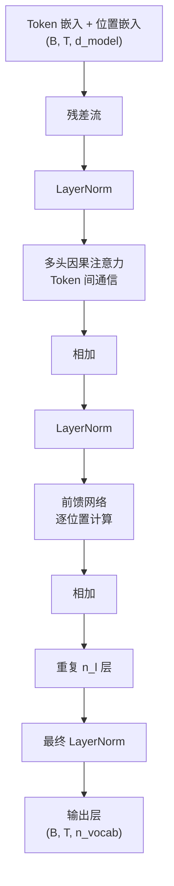

# 第 3 章 Transformer 架构详解

## 本章导读

2017 年的 Transformer 用注意力替换循环，让序列维可以并行计算；今天几乎所有大语言模型都是它的后裔。本章拆开一个 Transformer 块：残差流如何承载信息，注意力如何在 Token 之间通信，前馈网络如何在每个位置计算，以及这些选择如何决定参数量与计算量。

## 难度标签

⭐⭐⭐ 核心 ｜ 数学要求：线性代数、softmax、复杂度分析 ｜ 代码要求：PyTorch 中级

## 学习目标

读完本章你将能够：

- 用残差流解释 Transformer 的堆叠方式，并区分 Pre-LN 与 Post-LN 的取舍；
- 从点积相似度出发推导缩放因子 $$1/\sqrt{d_k}$$，写出因果多头注意力的完整计算；
- 说明前馈网络为何占每层约三分之二的参数，并推导参数量与 FLOPs；
- 解释位置编码为何不可省略，以及注意力的排列等变性意味着什么；
- 从零实现 TinyLM 的 Transformer 基线，并通过形状、因果性、参数计数与训练实验验证。

## 3.1 直觉：一条信息如何流过模型

把一个 Token 序列送进 Transformer，张量的形状从头到尾不变：$$(B,T,d_{model})$$。每一层不"替换"输入，而是在输入上加一个增量。这条贯穿所有层、宽度固定为 $$d_{model}$$ 的向量序列，叫**残差流**（residual stream）。

每一层做两件事。第一件是**多头注意力**：每个位置从其他位置读取信息，写到自己的残差流上。第二件是**前馈网络**：每个位置独立地做一次非线性变换，再把结果加回残差流。两个子层都只"追加"，不覆盖。于是信息有两条前进路径：一条是逐层的非线性计算，另一条是残差连接提供的直通路径。梯度也可以沿直通路径回传，这是深层网络能训练的前提。



把注意力理解成"通信"、把前馈理解成"计算"，是理解 Transformer 最有用的一组类比。注意力决定"这个位置应该看谁"，前馈决定"看到之后怎么处理"。层数越深，模型越有机会做多跳推理：第一层把相关信息聚到某个位置，第二层再基于聚合结果继续查询。残差流则像一块所有层共享的白板，每一层都能读到当前的全部内容，也可以在上面补充自己的发现。

举个具体的例子。句子"小明把书递给小刚，因为他要复习"中，"他"指谁需要结合语义。一种常见的直观解释是：浅层注意力先把"小明""小刚""复习"等相关位置的信息聚到"他"的位置，深层前馈再根据聚合结果做出判断。这只是帮助理解的示意，不是对模型真实计算的逐层解剖；但它说明了"深度"为什么有意义：每一层都能在上一层的表示上再做一次查询，而不必在一个固定窗口里一次算完。

这个结构还有一个计算上的关键优势。因果掩码保证每个位置只能看到自己和左侧的位置，因此一次前向就能同时算出所有位置的下一 Token 分布，训练不需要像 RNN 那样逐 Token 展开。第 1 章的 (1.15) 把这一点写成 $$\mathcal{O}(T^2d_{model}+Td_{model}^2)$$：第一项来自注意力两两比较，第二项来自线性投影。序列维的并行，正是 Transformer 能在大规模语料上训练的直接原因。


残差流不是一个抽象比喻。在代码里，它就是那个贯穿所有层、形状始终为 $$(B,T,d_{model})$$ 的张量。第 28 章讨论可解释性时，会把探针、激活替换和因果干预都建立在这条流上。


## 3.2 数学原理

### 3.2.1 残差流与归一化

记第 $$l$$ 层的输入为 $$\mathbf{X}^{(l)}\in\mathbb{R}^{B\times T\times d_{model}}$$。为了书写简洁，下面省略批维，把第 $$t$$ 个位置的向量记作 $$\mathbf{x}_t\in\mathbb{R}^{d_{model}}$$。

层归一化（LayerNorm）对每个位置的向量单独做标准化。先计算该位置在特征维上的均值与方差，得 $$\mu_t=\frac{1}{d_{model}}\sum_{i=1}^{d_{model}}x_{t,i}$$、$$\sigma_t^2=\frac{1}{d_{model}}\sum_{i=1}^{d_{model}}\left(x_{t,i}-\mu_t\right)^2$$ (3.1)

再做仿射变换，得 $$\mathrm{LN}(\mathbf{x}_t)=\boldsymbol{\gamma}\odot\frac{\mathbf{x}_t-\mu_t}{\sqrt{\sigma_t^2+\epsilon}}+\boldsymbol{\beta}$$ (3.2)；其中 $$\boldsymbol{\gamma},\boldsymbol{\beta}\in\mathbb{R}^{d_{model}}$$ 是可学习的增益与偏置，$$\epsilon$$ 防止除零。注意标准化是沿着特征维做的，不跨样本、也不跨位置。

LayerNorm 还有一个容易被忽略的作用：它把每个 Token 的激活尺度归一化，使后续线性投影和注意力打分的数值范围更可控。这也是 3.2.2 节讨论缩放点积注意力时"方差约为 1"这一假设在实践中大致成立的原因之一——输入先被拉回单位尺度，投影后的尺度主要由权重初始化决定。$$\boldsymbol{\gamma}$$ 和 $$\boldsymbol{\beta}$$ 则让模型可以学回需要的尺度和偏移，因此归一化不是信息损失，而是一次可逆的重新参数化（只要 $$\boldsymbol{\gamma}$$ 的非零分量足够多）。

**为什么不用批归一化（BatchNorm）？** 语言模型的批大小在训练时可变、推理时常常是 1，序列长度也随样本变化。批归一化依赖当前批的统计量，会让一个样本的输出受到同批其他样本影响；推理时还要依赖训练期累积的运行统计，训练与推理的行为不完全一致。层归一化只用一个 Token 自己的特征，天然没有这些问题，也不需要维护运行统计。

接下来是残差连接放在归一化之前还是之后。原始 Transformer 采用 **Post-LN**：先做子层计算、再加残差，最后归一化，即 $$\mathbf{X}\leftarrow\mathrm{LN}\left(\mathbf{X}+\mathrm{Sublayer}(\mathbf{X})\right)$$ (3.3)。

GPT-2 之后的多数解码器采用 **Pre-LN**：先归一化，再做子层计算，最后加残差，即 $$\mathbf{X}\leftarrow\mathbf{X}+\mathrm{Sublayer}\left(\mathrm{LN}(\mathbf{X})\right)$$ (3.4)。

两者的差别不只是一个括号的位置。Post-LN 的残差路径上每层都插入了一个 LayerNorm，反向传播时梯度要反复穿过归一化的雅可比矩阵；层数一多，靠近输出的梯度容易偏大，训练需要精心设计 warmup。Pre-LN 的残差路径是纯恒等映射，梯度可以沿它直接回传，因此几十层到上百层的模型也能稳定训练；GPT-2 还额外用了残差缩放初始化，但不再需要 Post-LN 那种精细的 warmup 设计。Xiong 等人 2020 年的分析给出了更精确的结论：Post-LN 在输出附近的梯度范数偏大、对深度和初始化敏感，而 Pre-LN 的梯度尺度更稳定。

代价是 Pre-LN 的残差流范数会随深度增长，因为每层都在往上加东西，没有任何机制把它拉回来。所以 Pre-LN 模型通常在最后再加一个 LayerNorm，再送进输出层。这个增长本身不是错误，但它意味着不同深度的激活尺度不同；如果要做逐层分析或量化，必须把这一点考虑进去。


Pre-LN 不等于"无条件稳定"。它解决的是深层残差路径上的梯度尺度问题，但注意力 logits 爆炸、学习率过大、数据异常仍然会让训练发散。Pre-LN 只是把"必须小心 warmup"变成了"通常可以少操一点心"，不是免死金牌。


### 3.2.2 自注意力：让位置之间通信

单头自注意力的第一步是三个线性投影，即 $$\mathbf{Q}=\mathbf{X}\mathbf{W}^{Q}$$、$$\mathbf{K}=\mathbf{X}\mathbf{W}^{K}$$、$$\mathbf{V}=\mathbf{X}\mathbf{W}^{V}$$ (3.5)；其中 $$\mathbf{X}\in\mathbb{R}^{T\times d_{model}}$$，三个权重矩阵都是 $$\mathbb{R}^{d_{model}\times d_{model}}$$，所以 $$\mathbf{Q},\mathbf{K},\mathbf{V}$$ 也都是 $$T\times d_{model}$$。可以把它们理解成三种角色：查询（query）表示"我在找什么"，键（key）表示"我能提供什么"，值（value）表示"如果被选中，我实际传递什么"。

注意力的一个关键特点是**路由由内容决定**。卷积核在训练后固定，RNN 的转移矩阵也与输入无关；注意力则对每个输入重新计算权重：哪些位置重要，取决于当前的查询和键。这让模型可以处理可变长度、位置不固定的依赖，但也意味着注意力权重不能预先缓存。第 21 章的 KV Cache 缓存的是键和值，不是注意力矩阵；权重仍然要每次重新计算。

第 $$i$$ 个位置对第 $$j$$ 个位置的打分，是查询与键的内积，再除以 $$\sqrt{d_k}$$，即 $$s_{ij}=\frac{\mathbf{q}_i^{\top}\mathbf{k}_j}{\sqrt{d_k}}$$ (3.6)

这里的 $$d_k$$ 是打分维度。单头时通常取 $$d_k=d_{model}$$，多头时取每个头的维度 $$d_h$$。

**为什么除以 $$\sqrt{d_k}$$？** 假设查询和键的每个分量独立、均值为 0、方差为 1。内积是 $$d_k$$ 个乘积之和，即 $$\mathbf{q}^{\top}\mathbf{k}=\sum_{l=1}^{d_k}q_lk_l$$ (3.7)

每个乘积的期望是 0，方差是 $$\mathbb{E}[q_l^2]\mathbb{E}[k_l^2]=1$$，且不同分量相互独立，所以 $$\mathrm{Var}\left(\mathbf{q}^{\top}\mathbf{k}\right)=\sum_{l=1}^{d_k}\mathrm{Var}(q_lk_l)=d_k$$ (3.8)

标准差是 $$\sqrt{d_k}$$。如果不缩放，$$d_k=128$$ 时打分的标准差约为 11.3，不同位置之间的分数可能相差几十。softmax 在输入尺度很大时会饱和：最大项接近 1，其余接近 0，反向传播时几乎所有梯度都消失。除以 $$\sqrt{d_k}$$ 把打分的方差拉回 1 附近，让 softmax 工作在梯度较灵敏的区间。这是一个基于独立同分布假设的启发式，不是严格定理；但配合 LayerNorm 和标准初始化，它在实践中足够有效。

得到打分矩阵 $$\mathbf{S}\in\mathbb{R}^{T\times T}$$ 后，对每一行做 softmax，即 $$\mathrm{softmax}(\mathbf{s})_j=\frac{\exp(s_j)}{\sum_{j'=1}^{T}\exp(s_{j'})}$$ (3.9)

softmax 对输入的平移不变：给所有打分加同一个常数，输出不变。因此实现时可以先把每行减去最大值，避免指数溢出，数值结果完全等价。

因果语言模型还必须遮住未来。定义掩码

$$
M_{ij}=
\begin{cases}
0, & j\le i,\\
-\infty, & j>i
\end{cases}
\qquad \text{(3.10)}
$$

把掩码加到打分上再做 softmax，得 $$\mathbf{A}=\mathrm{softmax}\left(\mathbf{S}+\mathbf{M}\right)$$ (3.11)

因为 $$\exp(-\infty)=0$$，被遮住的位置权重恰好为 0。为什么不用一个很大的负数？用一个有限的负数在实践中通常也能得到零权重，但它把"禁止"编码成一个数值约定，结果依赖负数的取值和浮点精度；$$-\infty$$ 在语义上更准确，也不会随着输入尺度变化而失效。注意因果掩码的对角线是允许的，所以每一行至少有一个可见位置，不会出现整行被遮住导致的 NaN。

最后用注意力权重对值做加权求和，得 $$\mathbf{O}=\mathbf{A}\mathbf{V}$$ (3.12)

第 $$i$$ 行就是 $$\mathbf{o}_i=\sum_j A_{ij}\mathbf{v}_j$$：当前位置的新表示，是所有可见位置的值向量的凸组合。

把形状串起来：$$\mathbf{Q},\mathbf{K},\mathbf{V}$$ 是 $$T\times d$$，$$\mathbf{S},\mathbf{A}$$ 是 $$T\times T$$，$$\mathbf{O}$$ 是 $$T\times d$$。计算量主要来自两处：$$\mathbf{Q}\mathbf{K}^{\top}$$ 是 $$\mathcal{O}(T^2d)$$，$$\mathbf{A}\mathbf{V}$$ 也是 $$\mathcal{O}(T^2d)$$。如果显式保存 $$\mathbf{A}$$，每个样本、每个头要占 $$\mathcal{O}(T^2)$$ 的显存。第 21 章的 FlashAttention 正是通过不把完整注意力矩阵写回显存，把长上下文的内存压力降下来。

因果掩码只让打分矩阵的下三角参与计算，实际有效元素约为 $$T(T+1)/2$$，是完整矩阵的一半；渐进复杂度仍是 $$\mathcal{O}(T^2d)$$，只是常数因子减半。训练时所有位置并行，推理时逐 Token 生成，后者需要 KV Cache 才能避免重复计算，这部分留到第 6、21 章。


因果掩码让所有位置的输出可以一次算完，但每个位置的可见集合不同。训练时，位置 $$t$$ 的输出只依赖 $$x_{\le t}$$，所以把整段文本的标签右移一位，就能同时监督所有位置。这是"教师强制"在 Transformer 上的高效实现。


### 3.2.3 多头注意力：在同一预算下增加表达力

单头注意力只产生一种"相似度视角"。多头注意力把特征维切成 $$n_h$$ 份，每份维度为 $$d_h=\frac{d_{model}}{n_h}$$，第 $$h$$ 份查询为 $$\mathbf{Q}^{(h)}=\mathbf{Q}_{:,\,(h-1)d_h+1:hd_h}$$ (3.13)；每份独立做一次注意力，再把结果拼起来。

也就是说，把 $$\mathbf{Q}$$ 的 $$d_{model}$$ 列按顺序切成 $$n_h$$ 块，第 $$h$$ 块就是 $$\mathbf{Q}^{(h)}$$；列下标按数学惯例从 1 开始。第 $$h$$ 个头用自己的 $$\mathbf{Q}^{(h)},\mathbf{K}^{(h)},\mathbf{V}^{(h)}$$ 按 (3.6)–(3.12) 计算，得到 $$\mathbf{O}^{(h)}\in\mathbb{R}^{T\times d_h}$$。所有头的结果沿特征维拼接，再过一次输出投影，得 $$\mathbf{O}=\left[\mathbf{O}^{(1)};\ \mathbf{O}^{(2)};\ \cdots;\ \mathbf{O}^{(n_h)}\right]\mathbf{W}^{O}$$ (3.14)；其中 $$\mathbf{W}^{O}\in\mathbb{R}^{d_{model}\times d_{model}}$$。注意拼接后的维度正好是 $$n_h d_h=d_{model}$$，所以输出投影不改变形状。

一个常见的误解是"多头一定比单头贵"。在总维度固定的前提下并非如此：单头注意力的打分是 $$T\times T$$、每个元素是 $$d_{model}$$ 维内积，代价约 $$T^2d_{model}$$；多头把同样的 $$d_{model}$$ 切成 $$n_h$$ 份，每个头做 $$T^2d_h$$，加起来仍是 $$T^2d_{model}$$。投影矩阵的总参数量也相同。多头改变的是计算的结构，不是渐进代价：它把一个大注意力矩阵换成若干部块结构的小矩阵，每个头只在 $$d_h$$ 维子空间里比较查询和键，打分矩阵的秩不超过 $$d_h$$。

这带来了两个效果。一方面，不同头可以关注不同类型的关系：有的头偏向相邻位置，有的头偏向句法依存，有的头负责"归纳"——看到前面的某个模式后，在再次出现时复制后续内容。这些分工不是人工指定的，而是训练中自发形成的；不同模型、不同层的分工也不一样。另一方面，头之间并不独立，它们通过 $$\mathbf{W}^{O}$$ 混合，而且训练后常常存在冗余。Michel 等人 2019 年的实验表明，很多头在推理时可以剪掉而不明显损失性能。所以"头越多越好"不成立，单头维度 $$d_h$$ 太小时，每个头的容量反而不够。

把拼接后的向量过 $$\mathbf{W}^{O}$$，不只是把各头的输出排在一起：它让模型学习如何组合这些视角，给重要的头更大的权重，也可以让不同头的信息在输出空间里相互作用。如果只是简单取平均，多头就退化成了一个固定的集成；$$\mathbf{W}^{O}$$ 的存在让这种组合本身可学习。

工业上的常见选择是让 $$d_h$$ 落在 64 到 128 之间。GPT-3 的 $$d_{model}=12288$$、$$n_h=96$$，恰好是 128；Llama 3 8B 的 $$d_{model}=4096$$、$$n_h=32$$，也是 128。这个区间不是理论最优，而是容量、并行效率和实现友好度之间的经验平衡。

### 3.2.4 前馈网络：逐位置的计算

注意力负责跨位置通信，前馈网络（feed-forward network，FFN）负责在每个位置上做非线性变换。其形式为 $$\mathrm{FFN}(\mathbf{x})=\mathbf{W}_{\text{out}}\,\phi\left(\mathbf{W}_{\text{in}}\mathbf{x}+\mathbf{b}_{\text{in}}\right)+\mathbf{b}_{\text{out}}$$ (3.15)；其中 $$\mathbf{W}_{\text{in}}\in\mathbb{R}^{d_{ff}\times d_{model}}$$，$$\mathbf{W}_{\text{out}}\in\mathbb{R}^{d_{model}\times d_{ff}}$$，$$\phi$$ 是逐元素激活函数。原始 Transformer 用 ReLU，GPT-2 用 GELU，本章的基线也用 GELU；第 5 章会讨论 SwiGLU。

如果没有激活函数，两个线性层会退化成一个大线性层，整个块对残差流的变换就只剩线性映射，表达能力会大幅下降。激活函数是前馈网络"计算"能力的来源。

中间维度通常取 $$d_{ff}=4d_{model}$$。这个比例让前馈网络的参数量明显超过注意力：注意力有四个 $$d\times d$$ 矩阵，约 $$4d^2$$ 个参数；前馈网络有两个 $$d\times d_{ff}$$ 矩阵，在 $$d_{ff}=4d$$ 时约 $$8d^2$$ 个参数。也就是说，**每个 Transformer 块约三分之二的参数在前馈网络里，而不是在注意力里**。标题"Attention Is All You Need"说的是注意力的结构作用，不是说参数都花在注意力上。

Geva 等人 2021 年给了一个有用的解释：把 $$\mathbf{W}_{\text{in}}$$ 的每一行看成一组"键"（它检测输入中的某种模式），把 $$\mathbf{W}_{\text{out}}$$ 的每一列看成对应的"值"（它把检测结果写回残差流）。在这个视角下，前馈网络像一个键值记忆：输入激活了哪些模式，就取出哪些值相加。这是一个解释框架，不是对训练动力学的完整描述，但它能帮助理解为什么前馈层既存知识又做变换。

还有一点容易忽略：前馈网络对每个位置使用同一组权重，因此它不能把两个位置的信息直接混合。位置之间的任何信息交换都必须经过注意力。这个分工是 Transformer 的基本约束：注意力做路由，前馈做变换；如果任务需要复杂的逐位置非线性，例如查表式的知识回忆，前馈层承担主要容量。

为什么中间维度取 4 倍，而不是 2 倍或 8 倍？这个比例来自原始 Transformer 的实验，后来被大量模型沿用。它让前馈层的参数量约为注意力的两倍，在"容量"和"显存、计算"之间取了一个经验平衡。第 5 章的 SwiGLU 会把两个矩阵变成三个，因此通常把 $$d_{ff}$$ 调到约 $$\frac{8}{3}d_{model}$$，使总参数量与 4 倍 GELU MLP 接近。

### 3.2.5 位置：注意力本身不知道顺序

先把位置信息拿掉，看看会发生什么。对非因果的自注意力，如果把输入的行按某个排列 $$\pi$$ 重排，$$\mathbf{Q},\mathbf{K},\mathbf{V}$$ 的行也按同样方式重排。打分矩阵变成 $$\mathbf{S}'=\pi\mathbf{S}\pi^{\top}$$ (3.16)

对每一行做 softmax 后，注意力矩阵同样只是行列重排；再乘 $$\mathbf{V}$$，输出也按 $$\pi$$ 重排。前馈网络是逐位置的，天然与排列交换。因此，在没有位置编码、也没有因果掩码时，整个模型满足 $$f(\pi\mathbf{X})=\pi f(\mathbf{X})$$ (3.17)

这叫**排列等变性**（permutation equivariance）：输入怎么排，输出就怎么排。对这样的模型，"猫追狗"和"狗追猫"只是同一个多重集的两种排列，模型没有任何内建依据区分它们。

因果掩码会打破完全的排列等变，因为掩码与位置索引绑定。但它只规定了"能看左边"，没有提供"相距多远"的连续表示。仅靠下三角掩码，模型对绝对位置和相对距离的感知都很弱。对于需要理解顺序、距离和局部结构的语言任务，这远远不够。


去掉位置编码后，非因果注意力对 Token 的排列完全等变，模型看到的本质上是一个多重集：它知道有哪些 Token、每个出现几次，但不知道顺序。因果掩码虽然打破了完全等变，却只提供粗糙的可见集合差异，不能替代位置表示。对"猫追狗"和"狗追猫"这类顺序敏感的任务，位置编码不是可选优化，而是必要条件。


所以必须在输入端注入位置信息。本章的基线使用可学习的绝对位置嵌入，即 $$\mathbf{H}^{(0)}_t=\mathbf{E}z_t+\mathbf{P}_t$$，$$t=1,\dots,T$$ (3.18)；其中 $$\mathbf{E}\in\mathbb{R}^{n_{vocab}\times d_{model}}$$ 是 Token 嵌入矩阵，$$z_t$$ 是第 $$t$$ 个 Token 的整数 ID，$$\mathbf{P}\in\mathbb{R}^{L_{ctx}\times d_{model}}$$ 是位置嵌入表，$$L_{ctx}$$ 是最大上下文长度，$$\mathbf{P}_t$$ 是它的第 $$t$$ 行。这与第 2 章 (2.1) 的嵌入查表是同一件事，只是加上了位置向量。

可学习绝对位置简单有效，在训练长度内表现很好；它的局限是表的大小固定，超出 $$L_{ctx}$$ 就没有对应的行，也无法自然地表达"相对距离"。第 4 章会讨论正弦位置编码、旋转位置编码（RoPE）和 ALiBi，以及它们如何影响长度外推。

### 3.2.6 输出层与损失

经过 $$n_l$$ 层之后，残差流再过一个最终的 LayerNorm，然后由输出层映射到词表，得 $$\boldsymbol{\ell}_t=\mathbf{W}_{\text{lm}}\,\mathrm{LN}\left(\mathbf{h}_t^{(n_l)}\right)$$ (3.19)；其中 $$\mathbf{W}_{\text{lm}}\in\mathbb{R}^{n_{vocab}\times d_{model}}$$，$$\boldsymbol{\ell}_t\in\mathbb{R}^{n_{vocab}}$$ 是位置 $$t$$ 的 logits。softmax 之后得到下一个 Token 的分布，训练损失就是第 1 章 (1.3) 的负对数似然，即 $$\mathcal{L}=-\frac{1}{T}\sum_{t=1}^{T}\log\mathrm{softmax}\left(\boldsymbol{\ell}_t\right)_{x_{t+1}}$$ (3.20)

代码里通常把输入和标签错开一位：输入是 $$x_{1:T-1}$$，标签是 $$x_{2:T}$$。这样位置 $$t$$ 的输出就在预测 $$x_{t+1}$$，一次前向覆盖所有位置。

输出层的参数量是 $$n_{vocab}d_{model}$$。对 12.8 万词表、4096 维的模型，这一层就有约 5.2 亿参数；如果输入嵌入和输出层不共享权重，嵌入部分还要再算一份。第 5 章会讨论权重绑定，第 23 章会讨论大词表输出层的量化。


附录 F 的 `logits_to_keep` 参数在本章接受但不生效。它的用途是在强化学习 rollout 时只保留最后若干个位置的 logits，避免为整段序列保存 $$B\times T\times n_{vocab}$$ 的张量。第 18 章会用到。


### 3.2.7 参数量与计算量

先数参数。对本章的基线（Pre-LN、GELU MLP、有偏置、输入输出不绑定），一层里有：

- 注意力：四个 $$d\times d$$ 权重和四个长度为 $$d$$ 的偏置，共 $$4d^2+4d$$；
- 前馈网络：两个权重和两个偏置，共 $$2dd_{ff}+d_{ff}+d$$；
- 两个 LayerNorm：每个有增益和偏置，共 $$4d$$。

把一层加起来，得到 $$N_{\text{layer}}=4d^2+2dd_{ff}+9d+d_{ff}$$ (3.21)。

再乘层数，加上最终 LayerNorm（$$2d$$）、Token 嵌入（$$n_{vocab}d$$）、输出层（$$n_{vocab}d$$，无偏置）和位置表（$$L_{ctx}d$$），即 $$N=n_l\left(4d^2+2dd_{ff}+9d+d_{ff}\right)+2d+2n_{vocab}d+L_{ctx}d$$ (3.22)。

如果忽略偏置、LayerNorm 和位置表，并取 $$d_{ff}=4d$$，就得到常用的简化式 $$N\approx n_l\left(4d^2+8d^2\right)+2n_{vocab}d=12n_ld^2+2n_{vocab}d$$ (3.23)。

这个式子很好记：**每层约 $$12d^2$$ 个参数，其中注意力占三分之一，前馈占三分之二**。用它估算 GPT-3 175B：$$n_l=96$$、$$d=12288$$、$$n_{vocab}=50257$$，即 $$12\times96\times12288^2+2\times50257\times12288\approx1.739\times10^{11}+1.235\times10^9\approx1.752\times10^{11}$$。

与公开的 175B 吻合。误差主要来自被忽略的偏置和位置表，在这个尺度上不到千分之一。

再看计算量。前向传播中，每个位置、每层的浮点运算（乘加各算一次）主要来自：

- 四个投影矩阵：$$4\times2Td^2=8Td^2$$；
- 打分与加权求和：$$2T^2d+2T^2d=4T^2d$$；
- 前馈网络：$$2Tdd_{ff}+2Tdd_{ff}=4Tdd_{ff}$$。

所以单层前向的 FLOPs 约为 $$\mathrm{FLOPs}_{\text{layer}}\approx8Td^2+4T^2d+4Tdd_{ff}$$ (3.24)。

取 $$d_{ff}=4d$$，得到 $$24Td^2+4T^2d$$。除以 $$T$$，每个 Token 的代价是 $$24d^2+4Td$$。

这里有一个重要的交叉点。注意力项随 $$T$$ 线性增长，前馈项与 $$T$$ 无关。令两者相等，得 $$8Td^2+4T^2d=4Tdd_{ff}\ \Longrightarrow\ T=d_{ff}-2d$$ (3.25)。

当 $$d_{ff}=4d$$ 时，$$T=2d$$。以 $$d=4096$$、$$d_{ff}=16384$$ 为例，交叉点在 $$T=8192$$：短上下文时前馈网络主导，长上下文时注意力主导。

| 序列长度 $$T$$ | 每 Token 注意力 FLOPs | 每 Token 前馈 FLOPs | 注意力占比 |
| --- | --- | --- | --- |
| 1,024 | 约 151.0M | 约 268.4M | 36.0% |
| 8,192 | 约 268.4M | 约 268.4M | 50.0% |
| 32,768 | 约 671.1M | 约 268.4M | 71.4% |

表中取 $$d=4096$$、$$d_{ff}=16384$$。这也解释了为什么长上下文训练和推理的瓶颈会从"参数矩阵乘法"转向"注意力打分与显存"。

当 $$T$$ 远小于 $$d$$ 时，权重矩阵乘法占主导，前向 FLOPs 可以近似为每个 Token $$\mathrm{FLOPs}_{\text{forward}}\approx2N$$ (3.26)。

训练还要反向传播，反向的计算量约为前向的两倍，因此常用的经验式是每个 Token 约 $$6N$$；第 9 章会在这个式子上建立缩放定律。但要注意，$$2N$$ 只数了权重，不含 (3.24) 里的 $$T^2$$ 项；上下文很长时，注意力额外项不能忽略。

显存账本同样重要。训练时，每层都要保存激活用于反向传播，粗略有 $$\mathcal{O}(BTd)$$ 的残差流、$$\mathcal{O}(BTd_{ff})$$ 的前馈中间量，以及 $$\mathcal{O}(Bn_hT^2)$$ 的注意力矩阵（若显式保存）。以 $$B=8$$、$$T=8192$$、$$n_h=32$$ 为例，单层注意力矩阵就有 $$8\times32\times8192^2\approx1.7\times10^{10}$$ 个元素，即使半精度也超过 30GB。这就是长上下文训练必须使用 FlashAttention、稀疏注意力或其他不显式保存完整矩阵的方案的原因。推理时如果缓存 K/V，显存随 $$T$$ 线性增长而不是平方增长，第 6、21 章会给出具体公式。

## 3.3 方案对比

Transformer 的设计空间远不止"用不用注意力"。下面这张表列出本章涉及的几个关键选择，以及它们的代价。

| 设计维度 | 选项 | 做法 | 优点 | 代价 | 典型使用者 |
| --- | --- | --- | --- | --- | --- |
| 归一化位置 | Post-LN | 先子层、再加残差、最后 LN | 激活有界，调好后最终质量好 | 深层训练需要 warmup | 原始 Transformer、BERT |
| 归一化位置 | Pre-LN | 先 LN、再子层、最后加残差 | 残差直通，深层稳定 | 残差流范数随深度增长 | GPT-2/3、Llama |
| 位置编码 | 可学习绝对位置 | 位置嵌入表相加 | 简单、训练长度内有效 | 不能外推，不表达相对距离 | GPT-2/3、BERT |
| 位置编码 | 正弦/相对/RoPE | 固定函数或旋转 | 可表达相对位置，部分可外推 | 实现更复杂 | 原始 Transformer、Llama |
| 注意力 | MHA | 每个头独立的 Q/K/V | 表达力强 | KV Cache 大 | 原始 Transformer、GPT-3 |
| 注意力 | GQA/MQA | 多个查询头共享 K/V | 推理显存小 | 表达力略降 | Llama 3、Mistral |
| 前馈 | ReLU/GELU MLP | 两层线性 + 激活 | 简单、稳定 | 参数多 | GPT-2/3 |
| 前馈 | SwiGLU | 门控三矩阵 | 同参数下更好 | 实现与维度调整复杂 | Llama、PaLM |
| 偏置 | 有/无 | 线性层是否带 bias | 有偏置更灵活 | 略增参数 | 基线有，Llama 无 |

这张表没有"全面最优"的一行。Pre-LN 用"残差流尺度增长"换"深层稳定"；可学习位置用"不能外推"换"实现简单"；MHA 用"更大的 KV Cache"换"更强的表达力"；GQA 则相反。第 4 到第 6 章会逐项展开这些替代方案，本章先把基线固定下来，作为后续对照实验的参照点。

需要强调，这张表描述的是**可替换的设计维度**，不是必须二选一的教条。同一个模型可以同时使用 Pre-LN、RoPE、GQA 和 SwiGLU；这些选择之间也存在耦合，例如去掉偏置会略微改变参数计数，换用 GQA 会改变 KV Cache 的大小。TinyLM 的做法是先把基线固定，再每次只改一个维度做对照，这样实验结论才能归因到具体选择，而不是被多个同时变化的设计混在一起。

## 3.4 代码实现：TinyLM 的 Transformer 基线

### 3.4.1 实现选择

下面实现附录 F 中 `tinylm/model` 的基线版本，接口与 `ModelConfig`、`CausalLMOutput` 的契约一致。为了让本章可以独立运行，代码合并成一个文件；实际项目按 `config.py`、`norm.py`、`attention.py`、`ffn.py`、`block.py`、`model.py` 拆分。

关键选择：

- **Pre-LN**：每个子层前归一化，残差直通；最后再加一个 LayerNorm。
- **可学习绝对位置**：与附录 F 的基线默认值一致，第 4 章替换为 RoPE。
- **GELU 前馈**：`d_ff=4*d_model`；第 5 章替换为 SwiGLU。
- **有偏置、输入输出不绑定**：保持原始基线，便于后续做消融。
- **显式 softmax**：不调用 `scaled_dot_product_attention`，让 (3.6)–(3.12) 的每一步都可见；生产实现会用融合算子。
- **接受但忽略** `past_kv`、`use_cache`、`logits_to_keep`：它们在第 4、18、21 章才生效。

初始化采用 GPT-2 的做法：线性层和嵌入服从标准差 0.02 的正态分布，残差分支的输出投影再按 $$1/\sqrt{2n_l}$$ 缩放，避免深层残差流的方差累积过快。

### 3.4.2 完整代码

```python
"""第 3 章：Transformer 基线（tinylm/model 的核心实现）。"""
import math
from dataclasses import dataclass

import torch
import torch.nn as nn
import torch.nn.functional as F


# ---------------------------------------------------------------- config.py
@dataclass(frozen=True)
class ModelConfig:
    vocab_size: int
    d_model: int = 512
    n_layers: int = 8
    n_heads: int = 8
    n_kv_heads: int | None = None
    d_ff: int | None = None
    max_seq_len: int = 1024
    attention: str = "mha"
    norm: str = "layernorm"
    norm_eps: float = 1e-5
    ffn: str = "mlp"
    pos_encoding: str = "learned"
    rope_theta: float = 10_000.0
    bias: bool = True
    tie_embeddings: bool = False
    dropout: float = 0.0

    def __post_init__(self):
        if self.d_ff is None:
            object.__setattr__(self, "d_ff", 4 * self.d_model)
        if self.n_kv_heads is None:
            object.__setattr__(self, "n_kv_heads", self.n_heads)
        assert self.d_model % self.n_heads == 0, "d_model 必须能被 n_heads 整除"
        assert self.n_heads % self.n_kv_heads == 0, "n_heads 必须是 n_kv_heads 的整数倍"


# ---------------------------------------------------------------- norm.py
class LayerNorm(nn.Module):
    """公式 (3.2)：逐位置标准化，再仿射变换。"""

    def __init__(self, d_model, eps=1e-5, bias=True):
        super().__init__()
        self.gamma = nn.Parameter(torch.ones(d_model))
        self.beta = nn.Parameter(torch.zeros(d_model)) if bias else None
        self.eps = eps

    def forward(self, x):
        mu = x.mean(dim=-1, keepdim=True)                      # (3.1) 均值
        var = x.var(dim=-1, unbiased=False, keepdim=True)      # (3.1) 方差
        x_hat = (x - mu) / torch.sqrt(var + self.eps)
        out = self.gamma * x_hat
        return out + self.beta if self.beta is not None else out


# ---------------------------------------------------------------- attention.py
class MultiHeadAttention(nn.Module):
    """因果多头自注意力：公式 (3.5)–(3.14)。"""

    def __init__(self, cfg):
        super().__init__()
        d, h = cfg.d_model, cfg.n_heads
        self.n_heads = h
        self.d_head = d // h
        self.q_proj = nn.Linear(d, d, bias=cfg.bias)
        self.k_proj = nn.Linear(d, d, bias=cfg.bias)
        self.v_proj = nn.Linear(d, d, bias=cfg.bias)
        self.out_proj = nn.Linear(d, d, bias=cfg.bias)
        # 公式 (3.10)：上三角为 -inf，位置 i 只能看到 j <= i
        mask = torch.triu(torch.full((cfg.max_seq_len, cfg.max_seq_len), float("-inf")),
                          diagonal=1)
        self.register_buffer("causal_mask", mask, persistent=False)

    def forward(self, x, attention_mask=None, return_weights=False):
        B, T, _ = x.shape
        # 公式 (3.5)：三个投影，再拆成 n_heads 个头
        q = self.q_proj(x).view(B, T, self.n_heads, self.d_head).transpose(1, 2)
        k = self.k_proj(x).view(B, T, self.n_heads, self.d_head).transpose(1, 2)
        v = self.v_proj(x).view(B, T, self.n_heads, self.d_head).transpose(1, 2)

        # 公式 (3.6)(3.11)：缩放点积打分 + 因果掩码 + 行 softmax
        scores = q @ k.transpose(-2, -1) / math.sqrt(self.d_head)
        scores = scores + self.causal_mask[:T, :T]
        if attention_mask is not None:
            pad = attention_mask[:, None, None, :] == 0
            scores = scores.masked_fill(pad, float("-inf"))
        attn = scores.softmax(dim=-1)

        # 公式 (3.12)(3.14)：加权求和，拼接后做输出投影
        out = attn @ v
        out = out.transpose(1, 2).reshape(B, T, self.n_heads * self.d_head)
        out = self.out_proj(out)
        return (out, attn) if return_weights else out


# ---------------------------------------------------------------- ffn.py
class MLP(nn.Module):
    """公式 (3.15)：两层前馈网络，中间维度 d_ff。"""

    def __init__(self, cfg):
        super().__init__()
        self.fc_in = nn.Linear(cfg.d_model, cfg.d_ff, bias=cfg.bias)
        self.fc_out = nn.Linear(cfg.d_ff, cfg.d_model, bias=cfg.bias)

    def forward(self, x):
        return self.fc_out(F.gelu(self.fc_in(x)))


# ---------------------------------------------------------------- block.py
class TransformerBlock(nn.Module):
    """公式 (3.4)：Pre-LN 残差块。"""

    def __init__(self, cfg):
        super().__init__()
        self.ln1 = LayerNorm(cfg.d_model, cfg.norm_eps, cfg.bias)
        self.attn = MultiHeadAttention(cfg)
        self.ln2 = LayerNorm(cfg.d_model, cfg.norm_eps, cfg.bias)
        self.mlp = MLP(cfg)

    def forward(self, x, attention_mask=None):
        x = x + self.attn(self.ln1(x), attention_mask)   # 子层 1：Token 间通信
        x = x + self.mlp(self.ln2(x))                    # 子层 2：逐位置计算
        return x


# ---------------------------------------------------------------- model.py
@dataclass
class CausalLMOutput:
    logits: torch.Tensor | None = None
    loss: torch.Tensor | None = None
    aux_loss: torch.Tensor | None = None
    past_kv: object | None = None


class TinyLM(nn.Module):
    def __init__(self, cfg):
        super().__init__()
        self.cfg = cfg
        self.tok_emb = nn.Embedding(cfg.vocab_size, cfg.d_model)
        self.pos_emb = nn.Embedding(cfg.max_seq_len, cfg.d_model)   # 公式 (3.18)
        self.blocks = nn.ModuleList([TransformerBlock(cfg) for _ in range(cfg.n_layers)])
        self.ln_f = LayerNorm(cfg.d_model, cfg.norm_eps, cfg.bias)
        self.lm_head = nn.Linear(cfg.d_model, cfg.vocab_size, bias=False)
        if cfg.tie_embeddings:
            self.lm_head.weight = self.tok_emb.weight
        self.apply(self._init_weights)
        # GPT-2 做法：残差分支的输出投影按 1/sqrt(2 n_l) 缩放
        std = 0.02 / math.sqrt(2 * cfg.n_layers)
        for name, p in self.named_parameters():
            if name.endswith("out_proj.weight") or name.endswith("fc_out.weight"):
                nn.init.normal_(p, mean=0.0, std=std)

    @staticmethod
    def _init_weights(module):
        if isinstance(module, nn.Linear):
            nn.init.normal_(module.weight, mean=0.0, std=0.02)
            if module.bias is not None:
                nn.init.zeros_(module.bias)
        elif isinstance(module, nn.Embedding):
            nn.init.normal_(module.weight, mean=0.0, std=0.02)

    def forward(
        self,
        input_ids,
        *,
        attention_mask=None,
        position_ids=None,
        past_kv=None,
        use_cache=False,
        labels=None,
        logits_to_keep=None,
    ):
        B, T = input_ids.shape
        assert T <= self.cfg.max_seq_len, "序列长度超过 max_seq_len"
        if position_ids is None:
            position_ids = torch.arange(T, device=input_ids.device)
        # 公式 (3.18)：Token 嵌入 + 位置嵌入
        x = self.tok_emb(input_ids) + self.pos_emb(position_ids)
        for block in self.blocks:
            x = block(x, attention_mask)
        x = self.ln_f(x)
        logits = self.lm_head(x)                        # 公式 (3.19)
        loss = None
        if labels is not None:
            loss = F.cross_entropy(                         # 公式 (3.20)
                logits.reshape(-1, self.cfg.vocab_size),
                labels.reshape(-1),
                ignore_index=-100,
            )
        # past_kv / use_cache / logits_to_keep 在第 4、18、21 章才生效
        return CausalLMOutput(logits=logits, loss=loss)


# ---------------------------------------------------------------- 实验
def copy_task(batch_size, seq_len, lag, vocab_size, generator=None):
    """前 lag 个 Token 随机，之后每个 Token 复制 lag 步之前的值。"""
    seq = torch.randint(0, vocab_size, (batch_size, lag), generator=generator)
    for t in range(lag, seq_len):
        seq = torch.cat([seq, seq[:, t - lag : t - lag + 1]], dim=1)
    return seq


def main():
    torch.manual_seed(0)
    gen = torch.Generator().manual_seed(0)

    cfg = ModelConfig(vocab_size=16, d_model=64, n_layers=2, n_heads=4,
                      d_ff=256, max_seq_len=64)
    model = TinyLM(cfg)
    n_params = sum(p.numel() for p in model.parameters())
    d, f, V, L = cfg.d_model, cfg.d_ff, cfg.vocab_size, cfg.max_seq_len
    exact = cfg.n_layers * (4 * d**2 + 2 * d * f + 9 * d + f) + 2 * d + 2 * V * d + L * d
    simple = cfg.n_layers * (4 * d**2 + 2 * d * f) + 2 * V * d
    print(f"参数量: {n_params:,}")
    print(f"精确公式 (3.22): {exact:,}    简化估算 (3.23): {simple:,}")

    lag, T, B = 8, 32, 64
    x = copy_task(B, T, lag, cfg.vocab_size, gen)

    # 形状与因果性检查
    model.eval()
    with torch.no_grad():
        out = model(x)
        print("logits 形状:", tuple(out.logits.shape))

        x2 = x.clone()
        x2[:, 10] = (x2[:, 10] + 1) % cfg.vocab_size
        out2 = model(x2)
        diff = (out.logits - out2.logits).abs().amax(dim=(0, 2))
        print(f"因果性: 位置 0..9 最大差异 = {diff[:10].max().item():.2e}, "
              f"位置 10..31 最大差异 = {diff[10:].max().item():.2e}")

        _, attn = model.blocks[0].attn(model.blocks[0].ln1(
            model.tok_emb(x) + model.pos_emb(torch.arange(T))), return_weights=True)
        row_sums = attn.sum(-1)
        upper = torch.triu(attn, diagonal=1)
        print(f"注意力: 行和范围 [{row_sums.min().item():.4f}, {row_sums.max().item():.4f}], "
              f"上三角绝对值最大 = {upper.abs().max().item():.2e}")

    # 训练：预测下一个 Token
    model.train()
    opt = torch.optim.AdamW(model.parameters(), lr=3e-3, weight_decay=0.01)
    for step in range(1, 401):
        batch_x = copy_task(B, T, lag, cfg.vocab_size, gen)
        inp, tgt = batch_x[:, :-1], batch_x[:, 1:]
        out = model(inp, labels=tgt)
        opt.zero_grad()
        out.loss.backward()
        opt.step()
        if step in (1, 100, 200, 300, 400):
            print(f"step {step:3d}  loss={out.loss.item():.4f}  "
                  f"ppl={math.exp(out.loss.item()):.2f}")

    model.eval()
    with torch.no_grad():
        test = copy_task(B, T, lag, cfg.vocab_size, gen)
        logits = model(test[:, :-1]).logits
        acc = (logits.argmax(-1) == test[:, 1:]).float().mean().item()
    floor = (lag - 1) / (T - 1) * math.log(cfg.vocab_size)
    ceiling = ((T - lag) + (lag - 1) / cfg.vocab_size) / (T - 1)
    print(f"测试集下一个 Token 准确率: {acc:.4f}（理论上界 {ceiling:.4f}）")
    print(f"理论损失下界: {floor:.4f}（前 {lag - 1} 个目标不可预测）")


if __name__ == "__main__":
    main()
```

配套的形状、因果性、参数计数与反向传播测试放在 `tests/test_model.py`。把上面的文件保存为 `ch03.py`，测试文件与它放在同一目录：

```python
"""第 3 章配套测试（tests/test_model.py）。"""
import pytest
import torch

from ch03 import ModelConfig, TinyLM


def make_model(**kw):
    base = dict(vocab_size=32, d_model=32, n_layers=2, n_heads=4,
                d_ff=64, max_seq_len=64)
    base.update(kw)
    return TinyLM(ModelConfig(**base))


@pytest.mark.parametrize("batch,seq", [(1, 1), (2, 17), (1, 64)])
def test_shapes(batch, seq):
    model = make_model()
    ids = torch.randint(0, 32, (batch, seq))
    logits = model(ids).logits
    assert logits.shape == (batch, seq, 32)


def test_causality():
    torch.manual_seed(0)
    model = make_model().eval()
    ids = torch.randint(0, 32, (2, 16))
    changed = ids.clone()
    changed[:, 5] = (changed[:, 5] + 1) % 32
    with torch.no_grad():
        a = model(ids).logits
        b = model(changed).logits
    assert torch.allclose(a[:, :5], b[:, :5], atol=1e-6)
    assert not torch.allclose(a[:, 5:], b[:, 5:], atol=1e-6)


def test_parameter_count():
    cfg = ModelConfig(vocab_size=16, d_model=64, n_layers=2, n_heads=4,
                      d_ff=256, max_seq_len=64)
    model = TinyLM(cfg)
    d, f, V, L = cfg.d_model, cfg.d_ff, cfg.vocab_size, cfg.max_seq_len
    expected = cfg.n_layers * (4 * d**2 + 2 * d * f + 9 * d + f) \
        + 2 * d + 2 * V * d + L * d
    assert sum(p.numel() for p in model.parameters()) == expected


def test_loss_backward():
    torch.manual_seed(0)
    model = make_model(vocab_size=16)
    ids = torch.randint(0, 16, (4, 12))
    out = model(ids[:, :-1], labels=ids[:, 1:])
    out.loss.backward()
    grads = [p.grad for p in model.parameters() if p.grad is not None]
    assert len(grads) == sum(1 for p in model.parameters() if p.requires_grad)
    assert all(torch.isfinite(g).all() for g in grads)
```

在 Python 3.13 + PyTorch 2.9 的 CPU 环境中，主程序和测试的实际输出如下：

```text
参数量: 106,240
精确公式 (3.22): 106,240    简化估算 (3.23): 100,352
logits 形状: (64, 32, 16)
因果性: 位置 0..9 最大差异 = 0.00e+00, 位置 10..31 最大差异 = 4.39e-01
注意力: 行和范围 [1.0000, 1.0000], 上三角绝对值最大 = 0.00e+00
step   1  loss=2.7877  ppl=16.24
step 100  loss=0.6372  ppl=1.89
step 200  loss=0.6278  ppl=1.87
step 300  loss=0.6307  ppl=1.88
step 400  loss=0.6286  ppl=1.87
测试集下一个 Token 准确率: 0.7883（理论上界 0.7883）
理论损失下界: 0.6261（前 7 个目标不可预测）
```

```text
$ python -m pytest tests/test_model.py -q
......                                                                   [100%]
6 passed in 0.76s
```

### 3.4.3 结果说明了什么

**第一，参数计数与公式严格一致。** 精确公式 (3.22) 算出 106,240，与 `sum(p.numel())` 完全相同。简化式 (3.23) 给出 100,352，低了约 5.5%，差额来自偏置、两个 LayerNorm、最终 LayerNorm 和位置表。参数量估算在架构设计阶段很有用，但要记住它忽略了多少东西；小模型上这些"零碎"可能占几个百分点，大模型上则可以忽略。

**第二，因果性是可验证的硬约束。** 把位置 10 的 Token 改掉，位置 0 到 9 的 logits 最大差异恰好是 0，位置 10 之后的最大差异是 0.439。前者说明未来没有泄漏，后者说明被改动的 Token 确实影响了后续计算。这个检查比"看代码觉得没问题"可靠得多，应该作为每个注意力实现的固定测试。

**第三，注意力矩阵的行为符合定义。** 每一行的权重和都是 1，上三角的绝对值最大为 0，说明 softmax 归一化和因果掩码都正确。注意这里检查的是第一层第一个头的权重；其他层的数值会不同，但这两条性质对所有层都应成立。

**第四，训练损失降到了一个非零下界，而这个下界是可以算出来的。** 任务规则是"从第 8 步开始，每个 Token 复制 8 步之前的值"。因此前 7 个预测目标没有规律可循，只能靠猜；其余 24 个目标完全确定。若模型把确定部分全部学会、对不确定部分输出均匀分布，损失应为 $$\frac{7}{31}\ln 16\approx0.6261$$。

实测 0.6286，已经贴着下界。准确率同理：确定部分全对、不确定部分随机猜，上界是 $$\frac{24+7/16}{31}\approx0.7883$$。

实测 0.7883，与上界一致。这说明模型确实学会了"看 8 步之前"这个依赖，而不是碰巧拟合了训练集。如果只看"准确率 78.8%"就判断模型没学好，会得出完全错误的结论。

**第五，困惑度也有下界。** 输出里的 PPL 从 16.24 降到 1.87，之后不再下降。1.87 接近 $$\exp(0.6261)$$，对应的是任务本身的不确定性，不是模型能力不足。这再次说明：PPL 必须和任务的不可约损失一起看，孤立地比较绝对数值没有意义。

**第六，这是一个极小的受控实验。** 模型只有 10.6 万参数、2 层、4 个头，训练任务也只有固定偏移的复制。它验证的是实现的正确性——形状、因果性、参数计数、梯度回传——不是 Transformer 的语言能力。不要从 400 步的损失曲线推断任何关于大模型规模的结论。


这段代码为了教学做了简化：没有 dropout、没有梯度裁剪、没有混合精度，也没有实现 KV Cache 和 FlashAttention。它适合在 CPU 上几分钟内跑完，用来验证公式与实现是否对应；生产级实现会在此基础上替换算子、加入并行与数值优化，但残差、注意力、前馈这三块的结构不变。


复现方式：把第一段代码保存为 `ch03.py`，运行 `python ch03.py`；把测试保存为 `tests/test_model.py`，运行 `python -m pytest tests/test_model.py -q`。若想观察因果性，把 `x2[:, 10]` 改成其他位置；若想观察参数公式，修改 `d_model`、`n_layers`、`d_ff` 后重新运行，精确公式应与实际计数始终一致。

## 3.5 工业实践

### 3.5.1 原始 Transformer 与 BERT

2017 年的原始 Transformer 是为机器翻译设计的编码器—解码器：编码器和解码器各 6 层，$$d_{model}=512$$、$$n_h=8$$、$$d_{ff}=2048$$，Post-LN、正弦位置编码、ReLU 前馈、dropout 0.1，约 6500 万参数。它的解码器使用因果掩码，编码器不使用；交叉注意力让解码器读取编码器输出。本书关注的是解码器部分，因为现代大语言模型基本都采用"仅解码器"结构。

BERT-base 把编码器堆到 12 层，$$d=768$$、$$n_h=12$$、$$d_{ff}=3072$$，使用 Post-LN、GELU、可学习绝对位置，约 1.1 亿参数。它的注意力是双向的，没有因果掩码，因此适合理解任务而不适合直接做生成。BERT 证明了"预训练 + 微调"的威力，但它不是自回归语言模型；第 14 章讨论 SFT 时会区分这两类结构。

Post-LN 在这些 6 到 12 层的模型上工作得很好，配合 warmup 和 dropout 足以稳定训练。问题在层数继续加深时出现：残差路径上的归一化让梯度尺度对深度敏感，Post-LN 需要更精细的学习率调度。这正是 Pre-LN 在 GPT-2 之后成为默认选择的原因。

为什么今天的通用大模型几乎都是仅解码器？一个实用原因是训练目标的统一：自回归下一 Token 预测可以直接利用任意文本，不需要构造源—目标配对；推理时同一个模型既能续写、又能对话、又能调用工具，接口简单。编码器—解码器在翻译、摘要等有明确输入输出的任务上仍有优势，交叉注意力让解码器可以直接读取源序列；但它需要两套参数和更复杂的训练流程。第 25 章讨论多模态时，编码器仍然重要；第 14 章讨论 SFT 时，对话模板会把"输入"和"输出"拼成一条自回归序列，本质上还是仅解码器。

### 3.5.2 GPT-2 与 GPT-3：Pre-LN 的规模化

GPT-2 是"仅解码器 + Pre-LN"的代表。最大的 GPT-2 XL 有 48 层、$$d=1600$$、25 个头、$$d_{ff}=6400$$、上下文 1024、词表 50257，约 15 亿参数。它把 LayerNorm 移到每个子层之前，在最后再加一个 LayerNorm，并把残差分支的输出投影按 $$1/\sqrt{2n_l}$$ 缩放。这三件事一起，让 48 层模型可以稳定训练。

GPT-3 175B 把同一套结构放大到 96 层、$$d=12288$$、96 个头、$$d_{ff}=49152$$、上下文 2048、词表 50257。GPT-3 系列采用交替的稠密与带状稀疏注意力，但骨架仍是 Pre-LN 解码器。用 (3.23) 估算，它的参数量与公开数字吻合到千分之一量级，这说明"每层 $$12d^2$$、嵌入 $$2n_{vocab}d$$"是一个相当可靠的工程心算公式。

值得强调的是，GPT-3 的成功不只是"把模型变大"。Pre-LN、残差缩放、学习率 warmup、混合精度、梯度裁剪这些工程选择共同支撑了 96 层的稳定训练。架构图看起来简单，能把它训到收敛则是另一回事；第 11、12 章会展开这些训练细节。

### 3.5.3 Llama 3：现代解码器的形状

Llama 3 8B 是本书记录的"现代基线"：32 层、$$d=4096$$、32 个查询头、8 个 KV 头、$$d_{ff}=14336$$、词表 128256、上下文 8192。它把本章基线的几个选择替换掉了：

- LayerNorm 换成 RMSNorm（第 5 章）；
- 可学习绝对位置换成 RoPE（第 4 章）；
- GELU MLP 换成 SwiGLU（第 5 章）；
- MHA 换成 GQA，8 个 KV 头共享给 32 个查询头（第 6 章）；
- 去掉线性层偏置，输入输出不绑定。

但残差流、因果多头注意力、逐位置前馈这三件事没有变。Llama 3 的 $$d_{ff}=14336$$（约 $$3.5d$$）不是简单套用 $$4d=16384$$：SwiGLU 有三个投影矩阵，参数预算的算法与两层 GELU MLP 不同，最终取值还要满足硬件对 128 的整数倍要求。具体推导见第 5 章，这里只需知道"形状变了，骨架没变"。

Llama 3 的词表从 Llama 2 的 32K 扩大到 128K，嵌入和输出层的参数占比随之上升。对 8B 模型，$$2\times128256\times4096\approx1.05\times10^9$$，约占总参数的 13%。这也是为什么小模型不宜盲目使用超大词表：嵌入层会吃掉太多容量。

### 3.5.4 宽度、深度与头维度

在固定参数预算下，模型应该更宽还是更深？这个问题没有脱离训练设置的普适答案。更深的模型能做更多轮"通信—计算"，有利于组合性推理；更宽的模型每层容量更大，但层数不足时难以完成多跳依赖。Kaplan 等人 2020 年的缩放定律研究了参数量、数据量与计算量之间的关系，也讨论过宽度与深度的平衡；但具体的最优比例依赖于数据分布、优化器和训练长度，不能当成常数照搬。

头维度 $$d_h$$ 也是经验值。太小，每个头能比较的子空间维度低、表达受限；太大，头数减少，不同关系难以分工。GPT-3 和 Llama 3 都落在 128，这不是巧合，而是"足够表达 + 便于硬件并行"的折中。

另一个约束来自硬件。$$d_{model}$$ 和 $$d_{ff}$$ 通常取 128 或 256 的整数倍，便于张量并行按头或按特征切分；注意力头数也要能被并行度整除。这些约束不改变渐进复杂度，却会限制宽度与深度的可选组合。架构设计从来不是纯数学问题，它同时受显存、带宽和通信拓扑的约束。

## 3.6 论文导读

**1. Vaswani, A., et al. (2017). Attention Is All You Need. *NeurIPS*. arXiv:1706.03762.**

核心贡献：提出完全基于注意力的序列到序列架构，去掉循环和卷积。推荐阅读：第 3.2 节的缩放点积注意力与多头注意力、第 3.3 节的位置编码、第 5 节的训练配置。读的时候注意它是编码器—解码器结构，与今天的仅解码器模型不完全相同。

**2. Radford, A., et al. (2019). Language Models are Unsupervised Multitask Learners.**

核心贡献：GPT-2 技术报告，确立了"仅解码器 + Pre-LN + 可学习位置 + GELU"的基线，并给出残差输出投影的缩放初始化。推荐阅读：第 2 节的模型结构与初始化细节。它是本章代码的直接参照。

**3. Xiong, R., et al. (2020). On Layer Normalization in the Transformer Architecture. *ICML*. arXiv:2002.04745.**

核心贡献：从梯度尺度角度分析 Post-LN 与 Pre-LN 的差异，解释为什么 Pre-LN 在深层不需要 warmup，而 Post-LN 需要。推荐阅读：第 3 节的理论分析与第 4 节的实验对比。这是理解 (3.3)、(3.4) 取舍的关键论文。

**4. Kaplan, J., et al. (2020). Scaling Laws for Neural Language Models. arXiv:2001.08361.**

核心贡献：系统研究损失如何随参数量、数据量和计算量变化，给出幂律关系，并讨论宽度与深度的平衡。推荐阅读：第 3 节的缩放定律与第 4 节的模型形状分析。第 9 章会详细展开。

**5. Geva, M., Schuster, R., Berant, J., & Levy, O. (2021). Transformer Feed-Forward Layers Are Key-Value Memories. *EMNLP*. arXiv:2012.14913.**

核心贡献：把前馈层解释为键值记忆，分析其键模式与值输出。推荐阅读：第 3 节的键值视角与第 4 节的实验。它帮助理解为什么前馈层占了每层三分之二的参数，却常被"注意力"的光芒掩盖。

## 3.7 常见误区

**误区一：Attention Is All You Need，所以参数都在注意力里。**

注意力只有四个 $$d\times d$$ 矩阵，约 $$4d^2$$ 个参数；前馈网络在 $$d_{ff}=4d$$ 时约 $$8d^2$$ 个。每层约三分之二的参数在前馈网络里。注意力的结构作用不可替代，但"参数大头"是前馈层。更准确的说法是：注意力负责路由信息，前馈负责变换信息，两者缺一不可，但参数预算的分配明显偏向前馈。做模型分析、量化和剪枝时，这个比例很重要。

**误区二：头越多越好。**

在 $$d_{model}$$ 固定时，头数越多，单头维度 $$d_h$$ 越小，每个头能比较的子空间维度越低。头数增加不会增加渐进计算量，但会改变表达结构。训练后的头还常常冗余，剪掉一部分不明显掉点。选择头数时要看 $$d_h$$ 是否落在合理区间，而不是盲目堆头。

**误区三：Transformer 是排列不变的。**

无位置编码时，自注意力对输入排列是**等变**的：输入怎么排，输出就怎么排。它不是"不变"，而是"没有可靠的顺序表示"。因果掩码打破了完全的等变，但只提供可见方向，不提供连续的距离表示。要让模型稳定地区分"猫追狗"和"狗追猫"，必须有位置编码；第 4 章会给出多种方案。

**误区四：Pre-LN 全面优于 Post-LN。**

Pre-LN 的优点是深层稳定，代价是残差流范数随深度增长、最终需要额外归一化；在同等调参预算下，Post-LN 有时能达到更好的最终质量。选择取决于深度、训练长度和调参能力，不存在无条件的优劣。Xiong 等人的分析给出的是梯度尺度上的解释，不是"Pre-LN 一定更好"的结论。

**误区五：注意力权重就是模型解释。**

注意力权重只说明"这一层、这个头把多少比例的信息从 $$j$$ 搬到 $$i$$"，不说明该信息对最终输出有多重要。不同头可以互相补偿，不同的注意力分布也可能给出相同预测，甚至能在输出基本不变的情况下大幅改动权重；Jain 与 Wallace 2019 年的工作专门讨论了"注意力不是解释"。第 28 章会介绍更可靠的归因方法。

**误区六：参数量相同，算力就相同。**

参数量只决定权重矩阵乘法的成本；序列变长后，注意力的 $$T^2$$ 项会成为主导。两个同为 7B 的模型，在 32K 上下文下的实际算力可能相差很大，取决于头数、$$d_h$$ 和是否使用稀疏或线性注意力。比较模型成本时，必须同时看参数量、序列长度和注意力实现。

## 3.8 本章小结

- Transformer 的主干是一条宽度不变的残差流；注意力负责 Token 间通信，前馈网络负责逐位置计算，两者都以加法写回残差流。
- LayerNorm 沿特征维逐位置归一化，不依赖批统计；Pre-LN 让残差路径成为恒等映射，是深层解码器稳定的关键，代价是残差流范数随深度增长。
- 缩放点积注意力用 $$1/\sqrt{d_k}$$ 把打分方差拉回 1 附近，避免 softmax 饱和；因果掩码用 $$-\infty$$ 遮住未来，使所有位置可以并行训练。
- 多头注意力把特征维切成 $$n_h$$ 份，渐进计算量与单头全维注意力相同，但提供了多种关系视角；$$d_h$$ 通常取 64 到 128。
- 前馈网络在 $$d_{ff}=4d$$ 时占每层约三分之二的参数；它是逐位置的非线性计算，不负责跨位置通信。
- 没有位置编码时，注意力对排列等变，无法区分顺序；可学习绝对位置简单有效，但不能外推，第 4 章会讨论 RoPE 等替代方案。
- 参数量可心算为 $$12n_ld^2+2n_{vocab}d$$；前向 FLOPs 每 Token 约 $$2N$$，训练约 $$6N$$，但长上下文时注意力的 $$T^2$$ 项不可忽略。


**本章的取舍**：Pre-LN 用"残差流范数增长、最终多一个 LayerNorm"换"深层训练稳定"；多头注意力用"每个头容量变小、头间可能冗余"换"多种关系并行"；$$d_{ff}=4d$$ 用"三分之二参数给前馈"换"逐位置非线性容量"；可学习绝对位置用"不能外推"换"实现简单"；显式 softmax 用"$$T^2$$ 显存"换"每一步都可见"。本章的基线不是最优架构，而是一个可复现、可逐项替换的参照点。


## 3.9 习题

### 习题 1（推导）

设查询与键的每个分量独立同分布，均值为 0、方差为 1。证明内积 $$\mathbf{q}^{\top}\mathbf{k}$$ 的方差为 $$d_k$$。若 $$d_k=128$$，不缩放时打分的标准差约为多少？结合 softmax 的性质，解释为什么这会伤害梯度。

<details>

<summary>展开参考答案</summary>

由独立性，$$\mathrm{Var}\left(\sum_{l=1}^{d_k}q_lk_l\right)=\sum_{l=1}^{d_k}\mathrm{Var}(q_lk_l)$$。对单个分量，因为 $$\mathbb{E}[q_l]=\mathbb{E}[k_l]=0$$，有 $$\mathrm{Var}(q_lk_l)=\mathbb{E}[q_l^2k_l^2]-\left(\mathbb{E}[q_lk_l]\right)^2=\mathbb{E}[q_l^2]\mathbb{E}[k_l^2]-0=1$$。

所以总和为 $$d_k$$。当 $$d_k=128$$ 时，标准差为 $$\sqrt{128}\approx11.3$$。

若两个位置的内积打分相差几十，softmax 的输入尺度就很大。设最大打分为 $$s_{\max}$$，则最大权重至少为 $$\frac{e^{s_{\max}}}{\sum_j e^{s_j}}\ge\frac{1}{1+(T-1)e^{-(s_{\max}-s_{\text{second}})}}$$。

当最大项比其余项大很多时，这个权重接近 1，分布接近 one-hot。softmax 的雅可比在饱和区接近 0，反向传播到打分的梯度几乎消失，查询和键的投影很难学到有用的方向。除以 $$\sqrt{d_k}$$ 把标准差拉回 1 附近，使 softmax 工作在梯度非饱和的区间。

</details>

### 习题 2（编程）

在本章代码的基础上完成三组对照实验：

1. 把 `n_heads` 设为 1，另写一个逐位置循环的朴素单头注意力实现，验证两者输出在误差 $$10^{-6}$$ 内一致；
2. 去掉 `math.sqrt(self.d_head)` 的缩放，在同一个复制任务上训练 400 步，记录损失曲线、注意力熵和梯度范数，与缩放版本对比；
3. 实现一个 Post-LN 版本（子层计算、加残差、再归一化），把层数加到 12，比较有无 warmup 时的训练稳定性。

要求：固定随机种子；报告每一步的损失与梯度范数；解释观察到的现象，而不是只贴数字。

### 习题 3（开放思考）

本章给出的交叉点是 $$T=d_{ff}-2d$$。对 $$d=8192$$、$$d_{ff}=28672$$ 的模型，计算注意力与前馈计算量相等的序列长度。

进一步讨论：

1. 当上下文继续增长到 128K 时，注意力的计算与显存瓶颈分别是什么？
2. 稀疏注意力、线性注意力、状态空间模型和 MoE 分别试图缓解哪一部分成本？它们的代价是什么？
3. 如果让你为一个 128K 上下文的模型做架构选择，你会优先改注意力、前馈还是位置编码？为什么？
