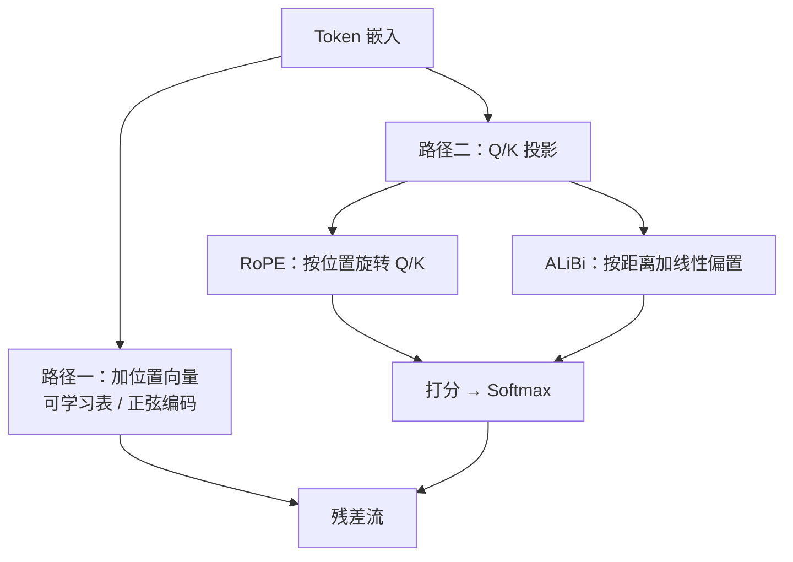

# 第 4 章 位置编码与长度外推

## 本章导读

把“猫追狗”改成“狗追猫”，Token 集合没变，意思却变了；但纯自注意力只比较内容，分不清顺序。位置编码负责把顺序重新注入模型。本章从正弦编码讲到 RoPE 与 ALiBi，再解释模型为什么在训练长度之外突然退化，以及 PI、NTK、YaRN 如何把上下文窗口撑大。

## 难度标签

⭐⭐⭐ 进阶 ｜ 数学要求：三角函数、线性代数 ｜ 代码要求：PyTorch 中级

## 学习目标

读完本章你将能够：

- 解释无位置编码时注意力的排列等变性，以及位置信息进入模型的两条路径；
- 推导正弦编码的旋转性质与 RoPE 的相对位移性质，说明注意力打分为什么只依赖位置差；
- 比较可学习绝对位置、相对偏置、RoPE、ALiBi 与 NoPE 的代价与适用条件；
- 说明 PI、NTK-aware、YaRN 各自改变了哪些频率，以及为什么都需要训练配合；
- 在 TinyLM 中实现位置编码分派，用复制任务复现“短训练、长测试”的外推曲线。

## 4.1 直觉：位置是地址，不是内容

第 3 章的注意力打分是查询与键的内积，只和两个位置的**内容**有关，和它们在序列中的**位置**无关。把输入的行重新排列，输出的行也按同样方式排列；模型看到的本质上是一个多重集，它知道有哪些 Token、每个出现几次，却不知道谁在前谁在后。因果掩码只规定了“能看左边”，没有提供“相距多远”的连续表示。对“猫追狗”和“狗追猫”这类顺序敏感的任务，位置编码不是可选优化，而是必要条件。

位置信息进入模型有两条路径。一条是**在输入端加向量**：把位置向量加到 Token 嵌入上，再送进残差流，可学习绝对位置和正弦编码都属于这一类。另一条是**在注意力里改打分**：让查询和键的比较本身带位置，相对位置偏置、RoPE 和 ALiBi 属于这一类。两条路径可以同时使用，但现代解码器通常只选一种。



用时钟做一个类比。正弦编码把每一对维度看成一根指针，不同维度以不同速度旋转：慢指针记录大尺度位置，快指针区分相邻位置，一串相位就是位置的“多尺度地址”。RoPE 不做加法，而是把查询和键分别旋转一个与位置成正比的角度；两根指针的夹角只取决于它们的**位置差**，所以内积天然携带相对距离。ALiBi 更直接：距离越远，打分扣得越多，相当于给模型一个强烈的“近处优先”先验。可学习绝对位置像一本地址簿：每个门牌号一行，训练时见过的号很准，没见过的号就没有条目。

## 4.2 数学原理

### 4.2.1 绝对位置：正弦编码与可学习表

第 3 章把输入写成 $$\mathbf{H}_t^{(0)}=\mathbf{E}z_t+\mathbf{P}_t$$，位置信息就藏在 $$\mathbf{P}_t$$ 里。最直接的做法是把 $$\mathbf{P}\in\mathbb{R}^{L_{ctx}\times d_{model}}$$ 做成可学习表：每个位置一行，训练时和词嵌入一起更新。GPT-2、GPT-3 和 BERT 都用这种方案。它简单，在训练长度内表达自由；代价是表的大小固定，位置 $$t\ge L_{ctx}$$ 没有对应的行，参数量是 $$L_{ctx}d_{model}$$。

Vaswani 等人 2017 年给出了一个无参数的替代方案。对位置 $$t$$ 和第 $$i$$ 对维度，定义

$$
\mathrm{PE}(t,2i)=\sin\left(\frac{t}{b^{2i/d_{model}}}\right),\qquad
\mathrm{PE}(t,2i+1)=\cos\left(\frac{t}{b^{2i/d_{model}}}\right)
\qquad \text{(4.1)}
$$

其中 $$b=10000$$，$$i=0,1,\dots,d_{model}/2-1$$。记角频率

$$
\omega_i=b^{-2i/d_{model}}
\qquad \text{(4.2)}
$$

于是每一对维度是单位圆上的一点 $$(\sin(t\omega_i),\cos(t\omega_i))$$。波长 $$\lambda_i=2\pi/\omega_i=2\pi b^{2i/d_{model}}$$ 随 $$i$$ 几何递增，从约 $$2\pi$$ 一直覆盖到约 $$2\pi\times10000$$。最慢的维度能区分上万步的间隔，最快的维度专门区分相邻位置；把所有这些尺度拼在一起，就得到一个既有粗粒度又有细粒度的位置地址。

正弦编码最重要的性质是**平移等于旋转**。对固定的 $$\Delta$$，有

$$
\begin{bmatrix}
\mathrm{PE}(t+\Delta,2i)\\
\mathrm{PE}(t+\Delta,2i+1)
\end{bmatrix}
=
\begin{bmatrix}
\cos(\Delta\omega_i) & \sin(\Delta\omega_i)\\
-\sin(\Delta\omega_i) & \cos(\Delta\omega_i)
\end{bmatrix}
\begin{bmatrix}
\mathrm{PE}(t,2i)\\
\mathrm{PE}(t,2i+1)
\end{bmatrix}
\qquad \text{(4.3)}
$$

这一步可以直接用和角公式验证：$$\sin(t\omega+\Delta\omega)=\sin(t\omega)\cos(\Delta\omega)+\cos(t\omega)\sin(\Delta\omega)$$，余弦同理。它说明“位置移动 $$\Delta$$”在每个二维子空间里都是一个固定的线性变换，而这个变换只依赖 $$\Delta$$，不依赖 $$t$$。

由此可以推出位置向量内积的形式。把 (4.3) 代入并利用 $$\sin^2+\cos^2=1$$，得

$$
\mathbf{p}_m^{\top}\mathbf{p}_n
=\sum_{i=0}^{d_{model}/2-1}\cos\left((m-n)\omega_i\right)
\qquad \text{(4.4)}
$$

内积只依赖位置差 $$m-n$$。这是正弦编码相对可学习表的最大优势：它不需要为每个绝对位置存一行，任意两个位置的相对关系都能由固定函数算出来。

但要注意，(4.4) 只说“编码本身提供了相对信息”，不说“训练好的模型会使用它”。正弦函数在长距离上会混叠，不同差值可能给出相近的内积；训练分布之外的相位组合也会把注意力推到模型没见过的区域。4.4 节的实验会看到：在长度 32 上训练的正弦模型，到 48 已经明显退化。**有定义不等于能外推**，这是本章最重要的区分之一。


可学习绝对位置和正弦编码都是“加法式”位置：位置向量进入残差流后，会被后续的 LayerNorm、注意力和前馈层反复变换。位置信息不是只存在于第一层，它会和各层的语义表示纠缠在一起。这也是为什么换位置编码往往需要重新训练，而不是简单替换一个模块。


### 4.2.2 相对位置：从偏置到旋转

既然内积只依赖位置差，一个自然的想法是直接把位置差加到打分上。T5 使用相对位置偏置：

$$
s_{ij}=\frac{\mathbf{q}_i^{\top}\mathbf{k}_j}{\sqrt{d_k}}+b_{\mathrm{clip}(j-i)}
\qquad \text{(4.5)}
$$

其中 $$b$$ 是一张按相对距离索引的可学习偏置表，$$\mathrm{clip}$$ 把距离截断在一个范围内。T5 用 32 个桶，最大距离 128：近距离一个距离一个桶，远距离对数分桶。参数量是 $$n_h\times32$$ 量级，很小。代价是超出截断范围后，所有远距离共享同一个偏置，模型无法再区分“远一点”和“远很多”；而且查询和键本身仍不含位置，位置信息只以加性偏置的形式出现。

**RoPE**（旋转位置编码）走得更彻底：它不往打分上加东西，而是旋转查询和键。把每个头的 $$d_h$$ 维切成 $$d_h/2$$ 对，对第 $$i$$ 对定义频率

$$
\theta_i=b^{-2i/d_h},\qquad i=0,1,\dots,d_h/2-1
\qquad \text{(4.6)}
$$

其中 $$b$$ 是基频，通常取 10000。位置 $$t$$ 的查询和键分别左乘一个分块对角旋转矩阵：

$$
\mathbf{q}_t'=\mathbf{R}_t\mathbf{q}_t,\qquad
\mathbf{k}_t'=\mathbf{R}_t\mathbf{k}_t
\qquad \text{(4.7)}
$$

第 $$i$$ 个二维块的旋转矩阵是

$$
\mathbf{R}_{t,i}=
\begin{bmatrix}
\cos(t\theta_i) & -\sin(t\theta_i)\\
\sin(t\theta_i) & \cos(t\theta_i)
\end{bmatrix}
\qquad \text{(4.8)}
$$

旋转矩阵是正交矩阵，所以 $$\lVert\mathbf{q}_t'\rVert_2=\lVert\mathbf{q}_t\rVert_2$$：RoPE 只改变方向，不改变范数。这一点很重要，它意味着注意力的尺度不会被位置编码放大或缩小。

相对位移性质来自旋转矩阵的复合。对同一对查询和键，有

$$
(\mathbf{R}_m\mathbf{q})^{\top}(\mathbf{R}_n\mathbf{k})
=\mathbf{q}^{\top}\mathbf{R}_m^{\top}\mathbf{R}_n\mathbf{k}
=\mathbf{q}^{\top}\mathbf{R}_{n-m}\mathbf{k}
\qquad \text{(4.9)}
$$

因为 $$\mathbf{R}_m^{\top}=\mathbf{R}_{-m}$$，而 $$\mathbf{R}_{-m}\mathbf{R}_n=\mathbf{R}_{n-m}$$。展开到分量，对每一对维度有

$$
(\mathbf{R}_m\mathbf{q})^{\top}(\mathbf{R}_n\mathbf{k})
=\sum_{i=1}^{d_h/2}\left[
(q_{2i-1}k_{2i-1}+q_{2i}k_{2i})\cos((m-n)\theta_i)
+(q_{2i-1}k_{2i}-q_{2i}k_{2i-1})\sin((m-n)\theta_i)
\right]
\qquad \text{(4.10)}
$$

右边只出现 $$m-n$$。也就是说，**位置信息以相对位移的形式进入注意力打分**，而不是以两个绝对位置的形式分别进入。用复数写会更简洁：把每对 $$(q_{2i-1},q_{2i})$$ 看成复数，RoPE 就是乘以 $$e^{it\theta_i}$$，内积的相位差自然给出 $$m-n$$。

这里有一个容易被忽略的细节：(4.10) 描述的是位置因子，不是整个打分矩阵。不同位置的查询和键内容不同，所以打分矩阵并不是沿对角线常数；相对性只保证“把同一对 $$q,k$$ 同时平移相同距离，打分不变”。这也正是 KV Cache 友好的原因：缓存里已经旋转过的键，在后续位置可以直接复用；新来的查询只需用自己的绝对位置旋转，相对关系由点积自动给出。第 21 章实现缓存时会再次用到 `position_ids`。

RoPE 没有额外参数，应用一次的代价是每个头 $$\mathcal{O}(Td_h)$$，注意力打分仍是 $$\mathcal{O}(T^2d_h)$$，渐进复杂度不变。它有两个常见实现约定：**交错式**把相邻的 $$(x_{2i},x_{2i+1})$$ 作为一对，**分半式**把前一半和后一半对应维度作为一对。两者只差一个维度置换，数学上等价，但预训练权重与约定绑定，加载时必须匹配。本章代码采用分半式，与 GPT-NeoX、Llama 系列一致。

**ALiBi**（Attention with Linear Biases）则完全不加位置向量，只在打分上加一个与距离成正比的惩罚：

$$
s_{ij}=\frac{\mathbf{q}_i^{\top}\mathbf{k}_j}{\sqrt{d_k}}-\nu_h(i-j),\qquad j\le i
\qquad \text{(4.11)}
$$

$$\nu_h$$ 是第 $$h$$ 个头的斜率。原始论文用几何序列

$$
\nu_h=2^{-8(h+1)/n_h},\qquad h=0,1,\dots,n_h-1
\qquad \text{(4.12)}
$$

例如 8 个头时斜率是 $$1/2,1/4,\dots,1/256$$；非 2 的幂的头数在对数空间插值。ALiBi 没有位置嵌入，也没有可学习的位置参数，斜率是固定的缓冲区。它的外推能力来自线性惩罚本身：距离越远扣得越多，模型天然偏向近处，所以短训练、长测试时不会因为“没见过的位置”而完全失效。代价是它把“近处优先”写死成了先验，对需要长距离内容匹配的任务不一定友好；BLOOM 和 MPT 使用了 ALiBi。

完全不编码位置也是一种选择，称为 **NoPE**。因果掩码本身携带顺序：位置 $$t$$ 能看到 $$t$$ 个 Token，位置 $$t+1$$ 能看到 $$t+1$$ 个。Haviv 等人 2022 年发现，无位置编码的语言模型仍能从因果结构中恢复位置信息；Kazemnejad 等人 2023 年的对照实验显示，在某些长度泛化任务上 NoPE 反而更好。但这不是普遍结论：位置信息变成了隐式的、需要模型自己学出来的东西，训练难度和任务依赖都更强。本章实验中，NoPE 没有学会固定偏移复制。

### 4.2.3 长度外推：PI、NTK 与 YaRN

设训练长度为 $$L_{\mathrm{train}}$$，测试长度为 $$L_{\mathrm{test}}>L_{\mathrm{train}}$$。**外推**指模型在更长的序列上保持性能；**内插**指把长位置压缩回训练范围。工程上更常用的指标是**有效上下文**：

$$
L_{\mathrm{eff}}(\epsilon)=\max\left\{L:\ \mathrm{metric}(L)\ge\epsilon\right\}
\qquad \text{(4.13)}
$$

其中 $$\mathrm{metric}(L)$$ 可以是检索准确率、困惑度或某个任务分数，$$\epsilon$$ 是阈值。宣称支持 128K，不等于在 128K 上有效；RULER（Hsieh 等人 2024）等评测发现，很多模型的真实有效上下文明显短于标称窗口。第 13 章会展开长上下文训练与评测。

**位置插值（PI）** 最直接：把目标位置线性压缩回训练范围。

$$
t'=\frac{L_{\mathrm{train}}}{L_{\mathrm{test}}}\,t=\frac{t}{s_{\mathrm{rope}}},\qquad s_{\mathrm{rope}}=\frac{L_{\mathrm{test}}}{L_{\mathrm{train}}}
\qquad \text{(4.14)}
$$

这等价于把所有频率的波长乘以 $$s_{\mathrm{rope}}$$。它保住了“每个位置都有编码”，但降低了分辨率：相邻位置在编码空间里靠得更近，长距离的区分度也变差。PI 通常需要继续训练，Chen 等人 2023 年用约 1000 步把 LLaMA 从 2K 扩到 32K。

**NTK-aware 缩放** 不压缩位置，而是改基频。由 (4.6)，最长波长约为 $$2\pi b^{(d_h-2)/d_h}$$；要让最长波长扩展到 $$s_{\mathrm{rope}}$$ 倍，令

$$
b'=b\,s_{\mathrm{rope}}^{d_h/(d_h-2)}
\qquad \text{(4.15)}
$$

则 $$\theta_i'=b'^{-2i/d_h}=\theta_i s_{\mathrm{rope}}^{-2i/(d_h-2)}$$。指数 $$-2i/(d_h-2)$$ 在 $$i=0$$ 时为 0，在最低频处约为 $$-1$$：**高频维度基本不动，低频维度被拉伸**。这比 PI 更精细：局部分辨率保留下来，全局范围被撑开。这个做法最早由社区实现（bloc97, 2023），后来被 YaRN 形式化。它可以零样本使用，但超长时质量不稳定；dynamic NTK 会按当前序列长度动态调整 $$s_{\mathrm{rope}}$$，代价是长度突变时可能抖动。

**YaRN** 在 NTK 的基础上再做两件事。第一是**分频插值**（NTK-by-parts）：不是所有低频维度都该被同等拉伸。定义波长 $$\lambda_i=2\pi/\theta_i$$ 和比例 $$r_i=L_{\mathrm{train}}/\lambda_i$$，低频维度 $$r_i$$ 小，高频维度 $$r_i$$ 大。用权重

$$
w_i=\mathrm{clamp}\left(\frac{\beta-r_i}{\beta-\alpha},0,1\right),\qquad \alpha=1,\ \beta=32
\qquad \text{(4.16)}
$$

对频率做分段缩放：

$$
\theta_i'=\theta_i\left[(1-w_i)+\frac{w_i}{s_{\mathrm{rope}}}\right]
\qquad \text{(4.17)}
$$

低频（$$r_i$$ 小）得到 $$w_i\approx1$$，频率除以 $$s_{\mathrm{rope}}$$，波长被拉伸；高频（$$r_i$$ 大）得到 $$w_i\approx0$$，频率不变；中间频率平滑过渡。第二是**温度缩放**：更长的上下文会让注意力分布更平坦，YaRN 把打分除以 $$\sqrt{t_y}$$ 来补偿，

$$
t_y=0.1\ln s_{\mathrm{rope}}+1
\qquad \text{(4.18)}
$$

这两件事合起来，使 YaRN 在少量微调下就能扩展到很长的窗口；论文报告 128K 扩展约需 400 步，比 PI 省一个数量级的数据。Qwen2 的长上下文和 Llama 3.1 的 `llama3` RoPE 缩放都属于这一族思路。

这些方法改变的是位置先验，不是模型知识。一个只在 8K 上训练过的模型，即使把位置公式改成支持 128K，也没有见过 128K 范围内的依赖关系；它只是“能接受”更长的输入，离“能处理”还有距离。评估时必须同时看短上下文是否退化、长上下文任务是否真的提升，以及有效上下文落在哪里。

### 4.2.4 复杂度与信息视角

从代价看，RoPE 和 ALiBi 都不增加参数：RoPE 每个头多一次 $$\mathcal{O}(Td_h)$$ 的旋转，ALiBi 多一次 $$\mathcal{O}(T^2)$$ 的偏置加法；相对偏置多一张 $$n_h\times32$$ 的小表；可学习绝对位置多 $$L_{ctx}d_{model}$$ 个参数；正弦编码没有参数，但要把表加进嵌入。

从信息看，位置编码是一个**先验**：它规定哪些位置之间更容易交互，而不是直接告诉模型答案。强先验（ALiBi 的线性衰减）在长度外推上简单有效，但会压制长距离内容匹配；弱先验（NoPE）更灵活，却要模型自己从因果结构中恢复位置。没有一种编码在所有任务上占优；选择取决于任务的距离结构、训练长度和是否需要外推。

## 4.3 方案对比

| 方案 | 位置进入方式 | 额外参数 | 相对信息 | 外推能力 | 典型使用者 |
| --- | --- | --- | --- | --- | --- |
| 可学习绝对位置 | 加位置嵌入 | $$L_{ctx}d_{model}$$ | 无显式相对项 | 表外无定义 | GPT-2/3、BERT |
| 正弦编码 | 加固定位置向量 | 0 | 内积依赖位置差 | 有定义，但不保证 | 原始 Transformer |
| 相对位置偏置 | 打分加 $$b_{\mathrm{clip}(j-i)}$$ | $$n_h\times32$$ 量级 | 是，截断 | 截断范围内 | T5 |
| RoPE | 旋转查询与键 | 0 | 内积依赖位置差 | 配合缩放可外推 | Llama、Qwen、PaLM |
| ALiBi | 打分加线性距离惩罚 | 0 | 是，线性 | 好，但近因偏置强 | BLOOM、MPT |
| NoPE | 不显式编码 | 0 | 隐式 | 任务相关 | 研究 |

| 外推方法 | 改什么 | 是否需训练 | 优点 | 代价 |
| --- | --- | --- | --- | --- |
| PI | 位置 $$t\mapsto t/s$$ | 需要微调 | 简单、稳定 | 所有频率一起压缩，局部分辨率下降 |
| NTK-aware | 基频 $$b\mapsto b s_{\mathrm{rope}}^{d_h/(d_h-2)}$$ | 可零样本，也可微调 | 保留高频，全局拉伸 | 需要调 $$s_{\mathrm{rope}}$$，超长时不稳定 |
| YaRN | 分频插值 + 温度缩放 | 少量微调 | 长上下文质量好、数据省 | 超参多，实现复杂 |
| Dynamic NTK | 按当前长度调 $$s_{\mathrm{rope}}$$ | 零样本 | 无需训练 | 长度突变时可能抖动 |

这张表没有“全面最优”的一行。可学习绝对位置用“实现简单、训练长度内表达自由”换“不能外推”；正弦编码用“固定函数、无参数”换“训练分布外行为不可控”；RoPE 用“无参数、相对点积、缓存友好”换“实现约定必须与权重一致”；ALiBi 用“强近因先验”换“长距离内容匹配可能受限”；PI/NTK/YaRN 用“额外的频率工程与微调”换“更长的有效上下文”。

## 4.4 代码实现：TinyLM 的位置编码分派

### 4.4.1 实现选择

本章在第 3 章代码上做增量，接口保持不变：

- `position.py`：新增正弦编码、RoPE（含 PI/NTK/YaRN 缩放）与 ALiBi；
- `model.py`：`ModelConfig` 增加 `rope_scaling`，`pos_encoding` 分派 `learned`、`sine`、`rope`、`nope`、`alibi`；
- RoPE 作用在注意力内部的查询和键上，不修改嵌入；正弦编码和可学习位置作用在嵌入上；
- 位置显式通过 `position_ids` 传入，便于将来接入 KV Cache 和打包序列；
- 因果掩码在序列超过 `max_seq_len` 时动态生成，让 RoPE 能测试更长的序列；可学习位置和正弦表仍然限制在表长内；
- `TinyLM.forward` 的签名与 `CausalLMOutput` 不变；`sine` 与 `alibi` 是本章新增的实验开关，默认值仍是 `learned`。

完整项目里，`position.py` 与 `model.py` 是分开的；为了让本章代码直接可跑，下面把它们合并在一个文件，并复用第 3 章的 `LayerNorm`、`MLP` 与 `ModelConfig` 基类。把第 3 章的 `ch03.py` 和本章的 `ch04.py` 放在同一目录即可。

### 4.4.2 完整代码

```python
"""第 4 章：位置编码与长度外推（tinylm/position.py 与 model.py 的增量）。"""
import math
import sys
from dataclasses import dataclass, field

import torch
import torch.nn as nn
import torch.nn.functional as F

sys.path.insert(0, ".")
from ch03 import CausalLMOutput, LayerNorm, MLP, ModelConfig as BaseConfig


# ---------------------------------------------------------------- config.py
@dataclass(frozen=True)
class RoPEScalingConfig:
    """RoPE 的长度外推配置。factor = 目标长度 / 训练长度。"""
    method: str = "none"          # none | pi | ntk | yarn
    factor: float = 1.0


@dataclass(frozen=True)
class ModelConfig(BaseConfig):
    # 第 3 章字段全部继承；本章只增加一个可选开关
    rope_scaling: RoPEScalingConfig = field(default_factory=RoPEScalingConfig)


# ---------------------------------------------------------------- position.py
def sinusoidal_positions(max_len, d_model, base=10000.0):
    """公式 (4.1)：正弦位置编码，返回 (max_len, d_model)。"""
    pos = torch.arange(max_len, dtype=torch.float32).unsqueeze(1)
    i = torch.arange(0, d_model, 2, dtype=torch.float32)
    omega = base ** (-i / d_model)                    # 公式 (4.2)
    angles = pos * omega
    pe = torch.zeros(max_len, d_model)
    pe[:, 0::2] = torch.sin(angles)
    pe[:, 1::2] = torch.cos(angles)
    return pe


def rope_inv_freq(d_head, theta=10000.0, scaling=None, train_len=1024):
    """公式 (4.6)、(4.15)–(4.17)：RoPE 各维频率及缩放。"""
    i = torch.arange(0, d_head, 2, dtype=torch.float32)
    theta_i = theta ** (-i / d_head)                  # 公式 (4.6)
    if scaling is None or scaling.method in ("none", "pi"):
        return theta_i
    s = scaling.factor
    if scaling.method == "ntk":                      # 公式 (4.15)
        base = theta * s ** (d_head / (d_head - 2))
        return base ** (-i / d_head)
    if scaling.method == "yarn":                     # 公式 (4.16)–(4.17)
        lam = 2 * math.pi / theta_i
        r = train_len / lam                          # 低频 r 小，高频 r 大
        alpha, beta = 1.0, 32.0
        w = ((beta - r) / (beta - alpha)).clamp(0, 1)
        return theta_i * ((1 - w) + w / s)
    raise ValueError(scaling.method)


def apply_rope(x, cos, sin):
    """公式 (4.7)：对最后一维做分半旋转。"""
    x1, x2 = x.chunk(2, dim=-1)
    return torch.cat([x1 * cos - x2 * sin, x1 * sin + x2 * cos], dim=-1)


class RoPE(nn.Module):
    def __init__(self, d_head, theta=10000.0, scaling=None, train_len=1024):
        super().__init__()
        self.scaling = scaling
        self.register_buffer(
            "inv_freq", rope_inv_freq(d_head, theta, scaling, train_len),
            persistent=False,
        )
        self.temp = 1.0
        if scaling is not None and scaling.method == "yarn":
            self.temp = 0.1 * math.log(scaling.factor) + 1.0   # 公式 (4.18)

    def forward(self, q, k, position_ids):
        pos = position_ids if position_ids.dim() == 2 else position_ids.unsqueeze(0)
        if self.scaling is not None and self.scaling.method == "pi":
            pos = pos / self.scaling.factor                 # 公式 (4.14)
        freqs = pos.float().unsqueeze(-1) * self.inv_freq
        cos = freqs.cos().unsqueeze(1)
        sin = freqs.sin().unsqueeze(1)
        return apply_rope(q, cos, sin), apply_rope(k, cos, sin)


def alibi_slopes(n_heads):
    """公式 (4.12)：几何递减的 ALiBi 斜率。"""
    return 2.0 ** (-8.0 * (torch.arange(n_heads, dtype=torch.float32) + 1) / n_heads)


class ALiBi(nn.Module):
    def __init__(self, n_heads):
        super().__init__()
        self.register_buffer("slopes", alibi_slopes(n_heads), persistent=False)

    def forward(self, T, device):
        idx = torch.arange(T, device=device)
        dist = (idx[:, None] - idx[None, :]).clamp(min=0)   # j <= i 时的距离
        return -self.slopes[:, None, None] * dist[None, :, :]


# ---------------------------------------------------------------- attention.py
class PositionAwareAttention(nn.Module):
    """在第 3 章 MultiHeadAttention 上加入位置分派。"""

    def __init__(self, cfg):
        super().__init__()
        d, h = cfg.d_model, cfg.n_heads
        self.n_heads = h
        self.d_head = d // h
        self.pos_mode = cfg.pos_encoding
        self.q_proj = nn.Linear(d, d, bias=cfg.bias)
        self.k_proj = nn.Linear(d, d, bias=cfg.bias)
        self.v_proj = nn.Linear(d, d, bias=cfg.bias)
        self.out_proj = nn.Linear(d, d, bias=cfg.bias)
        if self.pos_mode == "rope":
            self.rope = RoPE(self.d_head, cfg.rope_theta, cfg.rope_scaling,
                             cfg.max_seq_len)
        if self.pos_mode == "alibi":
            self.alibi = ALiBi(h)
        mask = torch.triu(
            torch.full((cfg.max_seq_len, cfg.max_seq_len), float("-inf")),
            diagonal=1,
        )
        self.register_buffer("causal_mask", mask, persistent=False)

    def forward(self, x, attention_mask=None, position_ids=None):
        B, T, _ = x.shape
        q = self.q_proj(x).view(B, T, self.n_heads, self.d_head).transpose(1, 2)
        k = self.k_proj(x).view(B, T, self.n_heads, self.d_head).transpose(1, 2)
        v = self.v_proj(x).view(B, T, self.n_heads, self.d_head).transpose(1, 2)

        if self.pos_mode == "rope":
            q, k = self.rope(q, k, position_ids)              # 公式 (4.7)
        scores = q @ k.transpose(-2, -1) / math.sqrt(self.d_head)
        if self.pos_mode == "rope" and self.rope.temp != 1.0:
            scores = scores / math.sqrt(self.rope.temp)       # 公式 (4.18)
        if self.pos_mode == "alibi":
            scores = scores + self.alibi(T, x.device)         # 公式 (4.11)

        if T > self.causal_mask.size(0):                      # 允许 RoPE 超出表长
            mask = torch.triu(
                torch.full((T, T), float("-inf"), device=x.device,
                           dtype=scores.dtype),
                diagonal=1,
            )
        else:
            mask = self.causal_mask[:T, :T]
        scores = scores + mask
        if attention_mask is not None:
            pad = attention_mask[:, None, None, :] == 0
            scores = scores.masked_fill(pad, float("-inf"))

        attn = scores.softmax(dim=-1)
        out = attn @ v
        out = out.transpose(1, 2).reshape(B, T, self.n_heads * self.d_head)
        return self.out_proj(out)


# ---------------------------------------------------------------- block.py
class TransformerBlock(nn.Module):
    def __init__(self, cfg):
        super().__init__()
        self.ln1 = LayerNorm(cfg.d_model, cfg.norm_eps, cfg.bias)
        self.attn = PositionAwareAttention(cfg)
        self.ln2 = LayerNorm(cfg.d_model, cfg.norm_eps, cfg.bias)
        self.mlp = MLP(cfg)

    def forward(self, x, attention_mask=None, position_ids=None):
        x = x + self.attn(self.ln1(x), attention_mask, position_ids)
        x = x + self.mlp(self.ln2(x))
        return x


# ---------------------------------------------------------------- model.py
class TinyLM(nn.Module):
    def __init__(self, cfg):
        super().__init__()
        self.cfg = cfg
        self.pos_mode = cfg.pos_encoding
        self.tok_emb = nn.Embedding(cfg.vocab_size, cfg.d_model)
        if self.pos_mode == "learned":
            self.pos_emb = nn.Embedding(cfg.max_seq_len, cfg.d_model)
        elif self.pos_mode == "sine":
            self.register_buffer(
                "sin_pe", sinusoidal_positions(cfg.max_seq_len, cfg.d_model),
                persistent=False,
            )
        self.blocks = nn.ModuleList(
            [TransformerBlock(cfg) for _ in range(cfg.n_layers)]
        )
        self.ln_f = LayerNorm(cfg.d_model, cfg.norm_eps, cfg.bias)
        self.lm_head = nn.Linear(cfg.d_model, cfg.vocab_size, bias=False)
        if cfg.tie_embeddings:
            self.lm_head.weight = self.tok_emb.weight
        self.apply(self._init_weights)
        std = 0.02 / math.sqrt(2 * cfg.n_layers)
        for name, p in self.named_parameters():
            if name.endswith("out_proj.weight") or name.endswith("fc_out.weight"):
                nn.init.normal_(p, mean=0.0, std=std)

    @staticmethod
    def _init_weights(module):
        if isinstance(module, nn.Linear):
            nn.init.normal_(module.weight, mean=0.0, std=0.02)
            if module.bias is not None:
                nn.init.zeros_(module.bias)
        elif isinstance(module, nn.Embedding):
            nn.init.normal_(module.weight, mean=0.0, std=0.02)

    def forward(self, input_ids, *, attention_mask=None, position_ids=None,
                past_kv=None, use_cache=False, labels=None, logits_to_keep=None):
        B, T = input_ids.shape
        if self.pos_mode in ("learned", "sine"):
            assert T <= self.cfg.max_seq_len, "序列长度超过 max_seq_len"
        if position_ids is None:
            position_ids = torch.arange(T, device=input_ids.device)

        x = self.tok_emb(input_ids)
        if self.pos_mode == "learned":
            x = x + self.pos_emb(position_ids)                # 第 3 章式 (3.18)
        elif self.pos_mode == "sine":
            x = x + self.sin_pe[position_ids]                 # 公式 (4.1)
        for block in self.blocks:
            x = block(x, attention_mask, position_ids)

        x = self.ln_f(x)
        logits = self.lm_head(x)
        loss = None
        if labels is not None:
            loss = F.cross_entropy(
                logits.reshape(-1, self.cfg.vocab_size),
                labels.reshape(-1),
                ignore_index=-100,
            )
        return CausalLMOutput(logits=logits, loss=loss)


# ---------------------------------------------------------------- 实验
def copy_task(B, T, lag, vocab, gen):
    """前 lag 个 Token 随机，之后每个 Token 复制 lag 步之前的值。"""
    seq = torch.randint(0, vocab, (B, lag), generator=gen)
    for t in range(lag, T):
        seq = torch.cat([seq, seq[:, t - lag:t - lag + 1]], dim=1)
    return seq


def make_labels(seq, lag):
    inp, tgt = seq[:, :-1], seq[:, 1:].clone()
    tgt[:, :lag - 1] = -100          # 前 lag-1 个目标落在随机前缀内
    return inp, tgt


def train_model(pos_encoding, steps=400, seed=0, train_len=32, lag=8):
    torch.manual_seed(seed)
    cfg = ModelConfig(
        vocab_size=16, d_model=64, n_layers=2, n_heads=4, d_ff=256,
        max_seq_len=128, pos_encoding=pos_encoding,
    )
    model = TinyLM(cfg)
    opt = torch.optim.AdamW(model.parameters(), lr=3e-3, weight_decay=0.01)
    gen = torch.Generator().manual_seed(123)
    model.train()
    for _ in range(steps):
        seq = copy_task(64, train_len, lag, 16, gen)
        inp, tgt = make_labels(seq, lag)
        out = model(inp, labels=tgt)
        opt.zero_grad()
        out.loss.backward()
        opt.step()
    return model


@torch.no_grad()
def evaluate(model, T, lag=8, B=256, seed=999):
    gen = torch.Generator().manual_seed(seed + T)
    seq = copy_task(B, T, lag, 16, gen)
    inp, tgt = make_labels(seq, lag)
    model.eval()
    out = model(inp, labels=tgt)
    mask = tgt != -100
    acc = (out.logits.argmax(-1)[mask] == tgt[mask]).float().mean().item()
    return out.loss.item(), acc


def scaling_table():
    d_head, theta, s, train_len = 64, 10000.0, 4.0, 8192
    print("RoPE 缩放：d_head=64, theta=10000, s=4, L_train=8192")
    print(f"{'i':>2s}  " + "  ".join(f"{m:>10s}" for m in
                                     ("none", "PI", "NTK", "YaRN")) + "   （有效波长）")
    for i in (0, 8, 16, 24, 31):
        vals = []
        for method in ("none", "pi", "ntk", "yarn"):
            inv = rope_inv_freq(d_head, theta,
                                RoPEScalingConfig(method=method, factor=s),
                                train_len)
            lam = (2 * math.pi / inv[i]).item()
            if method == "pi":
                lam *= s
            vals.append(lam)
        print(f"{i:2d}  " + "  ".join(f"{v:10.1f}" for v in vals))


def main():
    scaling_table()
    print("\n外推实验：训练长度 32，lag=8；损失/准确率只在可预测位置统计")
    lengths = [32, 48, 64, 96, 128]
    print(f"{'编码':<8s} " + " ".join(f"{'T=' + str(T):>13s}" for T in lengths))
    for pe in ("learned", "sine", "rope", "nope", "alibi"):
        model = train_model(pe, steps=400)
        cells = [evaluate(model, T) for T in lengths]
        print(f"{pe:<8s} " + " ".join(f"{loss:7.4f}/{acc:.3f}"
                                      for loss, acc in cells))


if __name__ == "__main__":
    main()
```

配套测试覆盖正弦编码的旋转性质、RoPE 的位移不变性与范数保持、缩放后的频率、ALiBi 的斜率与偏置形状、RoPE 超出表长的前向、可学习位置的表长限制，以及 RoPE 模型的因果性。把测试保存为 `tests/test_position.py`：

```python
"""第 4 章配套测试（tests/test_position.py）。"""
import math

import pytest
import torch

from ch04 import (
    ModelConfig, RoPE, RoPEScalingConfig, TinyLM,
    alibi_slopes, rope_inv_freq, sinusoidal_positions,
)


def test_sinusoidal_shift():
    d, L, delta = 16, 64, 7
    pe = sinusoidal_positions(L, d)
    omega = 10000.0 ** (-torch.arange(0, d, 2, dtype=torch.float32) / d)
    err = 0.0
    for t in range(L - delta):
        for i in range(d // 2):
            a = float(delta * omega[i])
            R = torch.tensor([[math.cos(a), math.sin(a)],
                              [-math.sin(a), math.cos(a)]])
            err = max(err, float(
                (pe[t + delta, 2 * i:2 * i + 2] - R @ pe[t, 2 * i:2 * i + 2]
                 ).abs().max()))
    assert err < 1e-5


def test_rope_shift_invariance():
    d_head, L = 16, 64
    rope = RoPE(d_head, 10000.0, None, L)
    q = torch.randn(1, 1, 1, d_head)
    k = torch.randn(1, 1, 1, d_head)
    qr, kr = rope(q.expand(1, 1, L, d_head), k.expand(1, 1, L, d_head),
                  torch.arange(L))
    S = (qr @ kr.transpose(-2, -1))[0, 0]
    err = 0.0
    for c in range(1, L):
        err = max(err, float((S[:L - c, :L - c] - S[c:, c:]).abs().max()))
    assert err < 1e-4


def test_rope_norm():
    d_head, L = 16, 32
    rope = RoPE(d_head, 10000.0, None, L)
    q = torch.randn(2, 3, L, d_head)
    k = torch.randn(2, 3, L, d_head)
    qr, kr = rope(q, k, torch.arange(L))
    assert torch.allclose(qr.norm(dim=-1), q.norm(dim=-1), atol=1e-5)
    assert torch.allclose(kr.norm(dim=-1), k.norm(dim=-1), atol=1e-5)


def test_rope_scaling_shapes():
    d_head = 64
    for method in ("none", "pi", "ntk", "yarn"):
        inv = rope_inv_freq(d_head, 10000.0,
                            RoPEScalingConfig(method, 4.0), 8192)
        assert inv.shape == (d_head // 2,)
        assert (inv > 0).all()
    none = rope_inv_freq(d_head, 10000.0, None, 8192)
    yarn = rope_inv_freq(d_head, 10000.0, RoPEScalingConfig("yarn", 4.0), 8192)
    assert yarn[0] == pytest.approx(none[0], rel=1e-5)
    assert yarn[-1] < none[-1] / 2


def test_alibi_slopes():
    slopes = alibi_slopes(4)
    expected = torch.tensor([0.25, 0.0625, 0.015625, 0.00390625])
    assert torch.allclose(slopes, expected)


def test_alibi_bias_shape():
    cfg = ModelConfig(vocab_size=16, d_model=32, n_layers=2, n_heads=4,
                      d_ff=64, max_seq_len=32, pos_encoding="alibi")
    model = TinyLM(cfg)
    bias = model.blocks[0].attn.alibi(8, torch.device("cpu"))
    assert bias.shape == (4, 8, 8)
    assert torch.allclose(bias[0, 7, 0], torch.tensor(-0.25 * 7))


def test_rope_extrapolation_shape():
    cfg = ModelConfig(vocab_size=16, d_model=32, n_layers=2, n_heads=4,
                      d_ff=64, max_seq_len=64, pos_encoding="rope")
    model = TinyLM(cfg).eval()
    ids = torch.randint(0, 16, (1, 128))
    with torch.no_grad():
        out = model(ids)
    assert out.logits.shape == (1, 128, 16)


def test_learned_cannot_exceed_table():
    cfg = ModelConfig(vocab_size=16, d_model=32, n_layers=2, n_heads=4,
                      d_ff=64, max_seq_len=64, pos_encoding="learned")
    model = TinyLM(cfg).eval()
    with pytest.raises(AssertionError):
        model(torch.randint(0, 16, (1, 65)))


def test_causality_rope():
    torch.manual_seed(0)
    cfg = ModelConfig(vocab_size=16, d_model=64, n_layers=2, n_heads=4,
                      d_ff=256, max_seq_len=128, pos_encoding="rope")
    model = TinyLM(cfg).eval()
    ids = torch.randint(0, 16, (2, 32))
    changed = ids.clone()
    changed[:, 5] = (changed[:, 5] + 1) % 16
    with torch.no_grad():
        a = model(ids).logits
        b = model(changed).logits
    assert torch.allclose(a[:, :5], b[:, :5], atol=1e-6)
    assert not torch.allclose(a[:, 5:], b[:, 5:], atol=1e-6)
```

在 Python 3.13 + PyTorch 2.9 的 CPU 环境中，主程序的实际输出如下。前五行的波长表来自 (4.14)–(4.17)；后五行是外推实验，损失与准确率只在可预测位置统计：

```text
RoPE 缩放：d_head=64, theta=10000, s=4, L_train=8192
 i        none          PI         NTK        YaRN   （有效波长）
 0         6.3        25.1         6.3         6.3
 8        62.8       251.3        89.9        62.8
16       628.3      2513.3      1285.1      1160.9
24      6283.2     25132.7     18377.7     24414.9
31     47117.2    188469.0    188469.0    188469.0

外推实验：训练长度 32，lag=8；损失/准确率只在可预测位置统计
编码                T=32          T=48          T=64          T=96         T=128
learned   0.0009/1.000  2.4674/0.674  3.4437/0.535  4.1996/0.417  4.4333/0.359
sine      0.0091/1.000  5.1386/0.631  7.2277/0.473  9.2179/0.323  9.8990/0.262
rope      0.0007/1.000  0.0007/1.000  0.0007/1.000  0.0009/1.000  0.0666/0.992
nope      1.6050/0.397  1.6227/0.379  1.6540/0.377  1.6902/0.363  1.7116/0.342
alibi     0.1496/0.954  0.1047/0.967  0.0909/0.973  0.0732/0.978  0.0664/0.984
```

```text
$ python -m pytest tests/test_position.py -q
.........                                                                [100%]
9 passed in 0.93s
```

耗时取决于机器，关键是 9 项全部通过。

### 4.4.3 结果说明了什么

**第一，波长表把三种缩放方法的差异摊开了。** 取 $$d_h=64$$、$$s_{\mathrm{rope}}=4$$。最高频维度（$$i=0$$）的波长原本是 6.3：PI 把它拉到 25.1，NTK 和 YaRN 保持 6.3；最低频维度（$$i=31$$）原本是 47,117，三种方法都把它拉到 188,469。中间的维度更能说明问题：PI 一刀切地乘 4；NTK 按幂次拉伸，高频少、低频多；YaRN 用 (4.16) 的权重做分段，$$i=16$$ 只拉到 1,161，$$i=24$$ 拉到 24,415。这就是“保留局部分辨率、拉伸全局范围”的具体含义。表里的数值依赖于 $$d_h$$ 与 $$s_{\mathrm{rope}}$$，换一组参数会变，趋势不变。

**第二，外推曲线把“有定义”和“能泛化”分开了。** 学习式绝对位置在训练长度 32 上损失 0.0009、准确率 1.000；到 48 损失升到 2.4674、准确率降到 0.674；到 128 损失 4.4333、准确率 0.359。表外位置没有训练过，模型没有对应的行，退化是必然的。

**第三，正弦编码同样失败，而且更早。** 它在 32 上几乎完美（损失 0.0091），到 48 已经升到 5.1386，到 128 是 9.8990。正弦编码对任意位置都有定义，(4.3) 也保证了平移是旋转，但训练好的注意力权重并没有学会在更长的序列上使用这种相对结构；高频维度的相位在分布外剧烈变化，注意力被打到模型没见过的区域。这个结果很反直觉，但很重要：**位置编码的数学性质不等于模型的泛化能力**，训练分布仍然是决定性的。

**第四，RoPE 在这个任务上几乎完美外推。** 32 到 96 的损失都在 0.0007–0.0009，准确率 1.000；到 128 损失 0.0666、准确率 0.992。任务规则是“复制 8 步之前的 Token”，这是一个纯相对规则；RoPE 的打分只依赖位置差 (4.10)，所以同一个相对偏移在更长序列上仍然成立。128 时的小幅退化来自两方面：序列更长、注意力更分散，以及模型确实没有在 128 上训练过。这个实验验证的是机制，不是大模型的长上下文能力。

**第五，ALiBi 也外推得很好，但原因是另一种。** 它的损失从 0.1496 降到 0.0664，准确率从 0.954 升到 0.984；长度越长，可预测位置越多，近因偏置又刚好适合“复制 8 步之前”这种近邻任务。换成需要长距离内容匹配的任务，线性惩罚可能反而成为负担。这正是“先验与任务交互”的例子：同一个编码在不同任务上的排序可能反过来。

**第六，NoPE 在这个任务上没有学会规则。** 损失一直在 1.6–1.7，准确率 0.34–0.40。没有显式位置时，因果结构虽然携带顺序，但模型要自己从注意力模式里恢复“第 8 步之前”这个概念，在 2 层、4 头、400 步的预算下没有学出来。这个结果不能推广成“NoPE 不行”；它只说明在这个受控设置里，显式相对位置更省样本。

**第七，这是一个很小的受控实验。** 模型只有 2 层、64 维、4 个头，训练 400 步，任务只有固定偏移复制。它验证的是位置编码的机制与实现：形状、相对性质、外推方向、因果性。不要从这些绝对数值推断大模型的长上下文质量；参数规模、数据分布和训练长度都会改变排序。

测试中的因果性检查与第 3 章口径一致：改动位置 5 的输入，位置 0–4 的 logits 不变，位置 5 之后发生变化。任何新的位置编码都必须先过这一关；如果未来信息从位置路径泄漏进来，后面的实验全部作废。

## 4.5 工业实践

**原始 Transformer、BERT 与 GPT 系列。** 原始 Transformer 用正弦编码，$$d_{model}=512$$、6 层；BERT-base 用可学习绝对位置，最大长度 512；GPT-2 把上下文扩到 1024，GPT-3 扩到 2048，仍然是可学习绝对位置。这三代模型的共同点是：位置表的大小就是硬上限，推理时超过表长没有定义。GPT-3 的 96 层、12288 维、2048 上下文是一个典型的“绝对位置 + 大规模”配置。

**T5 与相对偏置。** T5 使用 32 个相对距离桶、最大距离 128 的相对位置偏置，编码器和解码器都加在打分上。它的好处是位置信息不进入嵌入，参数少，且对相对距离有显式建模；代价是超过 128 后所有远距离共享一个桶，模型无法区分更细的差距。T5 的上下文通常是 512 或 1024，这个截断范围与训练长度匹配。

**RoPE 成为现代解码器的主流。** RoFormer 2021 年提出 RoPE，随后 PaLM（540B，6144 上下文）采用；Llama 2 用 $$\theta=10000$$、4096 上下文；Llama 3 8B 把 $$\theta$$ 提到 500,000、上下文 8192。Llama 3.1 进一步用 `rope_scaling` 扩到 128K：公开配置里 `factor=8.0`、`low_freq_factor=1.0`、`high_freq_factor=4.0`、`original_max_position_embeddings=8192`，这正是 YaRN 一族的“分频缩放”思路。Qwen2 系列公开配置使用 $$\theta=10^6$$，Qwen2-72B-Instruct 用 YaRN 扩到 128K；Mistral 7B v0.2/v0.3 也把 $$\theta$$ 调到 $$10^6$$ 并把窗口扩到 32K。可以看到，基频和缩放方法是一起调的，单独改一个通常不够。

**ALiBi 的路线。** BLOOM 176B 使用 ALiBi、2048 上下文；MPT-7B 用 ALiBi 把上下文扩到 65K。ALiBi 的工程优势是简单：没有位置表，没有旋转，只有一张固定的斜率；长度外推时不需要改模型结构。代价是近因偏置很强，长距离检索和需要“回头看很远”的任务可能吃亏。它适合“局部上下文更重要”的模型，不适合所有长上下文场景。

**NoPE 与研究视角。** NoPE 不是主流生产选择，但它是重要的对照：它提醒我们，因果掩码本身就携带顺序信息，显式位置编码不是唯一解。Haviv 等人 2022 年的工作表明，无位置编码的模型仍能学到位置；Kazemnejad 等人 2023 年的实验表明，在某些长度泛化设置下 NoPE 甚至更好。把这些结果和本章的实验放在一起看，结论不是“哪种编码最好”，而是“位置先验、训练分布和任务结构三者共同决定外推行为”。

**有效上下文比标称窗口更重要。** RULER 等评测把长上下文拆成检索、多跳、聚合等任务，发现不少模型在 128K 标称窗口下的有效长度远低于 128K。工程上要同时报告三件事：标称窗口、有效上下文、短上下文回归。只报“支持 128K”没有意义；第 13 章会给出更完整的长上下文训练与评测方法。

## 4.6 论文导读

**1. Vaswani, A., et al. (2017). Attention Is All You Need. *NeurIPS*. arXiv:1706.03762.**

核心贡献：提出完全基于注意力的序列到序列架构，并给出正弦位置编码。推荐阅读：第 3.5 节的位置编码定义与动机。注意它是编码器—解码器结构，位置编码加在嵌入上，和今天的 RoPE 不是一回事。

**2. Su, J., et al. (2021). RoFormer: Enhanced Transformer with Rotary Position Embedding. arXiv:2104.09864.**

核心贡献：提出 RoPE，把位置信息编码为查询和键的旋转，使内积只依赖相对位移。推荐阅读：第 3.2–3.3 节的旋转推导、第 4 节的实验。读的时候重点看它如何证明相对性，以及不同实现约定（交错/分半）的等价性。

**3. Press, O., Smith, N. A., & Lewis, M. (2021). Train Short, Test Long: Attention with Linear Biases Enables Input Length Extrapolation. arXiv:2108.12409.**

核心贡献：提出 ALiBi，用线性距离惩罚替代位置嵌入，实现短训练、长测试。推荐阅读：第 2 节的方法与第 3 节的长度外推实验。注意它的强近因先验，以及论文中对不同斜率设置的消融。

**4. Chen, S., et al. (2023). Extending Context Window of Large Language Models via Positional Interpolation. arXiv:2306.15595.**

核心贡献：提出位置插值（PI），把超长位置压缩回训练范围，用少量微调扩展 LLaMA 的上下文。推荐阅读：第 3 节的 PI 公式与第 4 节的实验结果。重点看它如何平衡扩展倍数与局部分辨率。

**5. Peng, B., et al. (2023). YaRN: Efficient Context Window Extension of Large Language Models. arXiv:2309.00071.**

核心贡献：提出 NTK-by-parts 分频插值与温度缩放，用比 PI 少一个数量级的数据扩展到 128K。推荐阅读：第 3 节的频率分段、第 4 节的温度缩放、第 5 节的实验。它是理解 Llama 3.1、Qwen2 长上下文配置的关键论文。

## 4.7 常见误区

**误区一：RoPE 是绝对位置编码。**

RoPE 对每个位置施加一个绝对角度的旋转，看起来像绝对编码；但对同一对查询和键，打分只依赖位置差 (4.10)。更准确的说法是：**旋转是绝对的，内积是相对的**。这也解释了为什么 RoPE 能配合 KV Cache：缓存里的键已经按自己的绝对位置旋转过，新查询按自己的位置旋转，相对关系由点积给出。把 RoPE 简单归类为“绝对”或“相对”都会丢掉关键细节。

**误区二：把 `max_seq_len` 调大就扩展了上下文。**

配置只改变允许的张量大小，不改变模型学到的依赖。可学习绝对位置在表外没有行；RoPE 能算出表外的位置，但模型的注意力模式不一定泛化。真正扩展上下文需要三件事一起做：位置编码的缩放、长上下文数据的继续训练、以及任务层面的评测。只改配置，通常只得到“能接受长输入”，不是“能处理长输入”。

**误区三：正弦编码天然能外推。**

正弦函数对任意位置都有定义，(4.3) 还给出了漂亮的平移旋转性质；但这些是编码的性质，不是训练后模型的性质。本章实验中，正弦模型在 32 上训练、48 上测试，损失从 0.0091 升到 5.1386。原因是训练分布外的相位组合把注意力推到了没见过的区域。“有定义”和“能泛化”是两件事，这是本章最值得记住的区分。

**误区四：RoPE 的 `theta` 越大越好。**

更大的基频让所有时钟转得更慢，长距离分辨力提高，但相邻位置的区分度下降；它还会改变注意力 logits 的分布，影响训练稳定性。Llama 2 用 10000，Llama 3 用 500,000，Qwen2 用 $$10^6$$，这些数字是和目标长度、训练数据、缩放方法一起选的，不是“越大越先进”。换 `theta` 通常需要继续训练或至少做长上下文评测。

**误区五：YaRN 只是把位置除以一个数。**

“位置除以一个数”是 PI (4.14)；YaRN 做的是分频插值 (4.16)–(4.17) 加温度缩放 (4.18)，需要按频率决定“哪些维度拉伸、哪些保留”，还要用少量长上下文数据微调。把 PI 和 YaRN 混为一谈，会错误地期待零样本行为。另一个相关误解是“支持 128K 就等于在 128K 上有效”；有效上下文要用任务指标测，不能只看配置。

## 4.8 本章小结

- 无位置编码时，注意力对输入排列等变；位置信息要么加在嵌入上（绝对位置），要么改在打分里（相对位置、RoPE、ALiBi）。
- 正弦编码用多尺度时钟表示位置，平移等于旋转 (4.3)，位置向量内积只依赖位置差 (4.4)；但它对任意位置有定义，不等于训练后的模型能外推。
- 可学习绝对位置简单、训练长度内表达自由，表外无定义；相对位置偏置用 $$b_{\mathrm{clip}(j-i)}$$ 直接建模距离，截断后远距离不可区分。
- RoPE 旋转查询和键，打分只依赖 $$m-n$$ (4.9)–(4.10)，无参数、保范数、与 KV Cache 友好；实现约定（交错/分半）必须与预训练权重一致。
- ALiBi 用线性距离惩罚替代位置嵌入，外推简单但近因偏置强；NoPE 依赖因果结构隐式恢复位置，任务相关。
- PI 压缩所有位置；NTK 改基频，保留高频、拉伸低频；YaRN 做分频插值加温度缩放；三者都需要训练和任务评测配合，标称窗口不等于有效上下文。
- 本章实验：RoPE 在 32 训练、96 测试下几乎零损失，128 时略降；可学习绝对位置与正弦编码明显退化；ALiBi 因近因偏置表现稳定；NoPE 未学会固定偏移复制。


**本章的取舍**：可学习绝对位置用“实现简单、训练长度内表达自由”换“不能外推、参数量 $$L_{ctx}d_{model}$$”；正弦编码用“固定函数、无参数、有平移旋转性质”换“训练分布外行为不可控”；相对偏置用“直接编码距离、参数少”换“截断后远距离不可区分”；RoPE 用“无参数、相对点积、缓存友好”换“实现约定必须与权重一致、外推仍需缩放”；ALiBi 用“强近因先验、外推简单”换“长距离内容匹配可能受限”；PI/NTK/YaRN 用“频率工程与微调”换“更长的有效上下文”。没有一种编码在所有任务上占优；先验、训练分布和任务结构共同决定外推行为。


## 4.9 习题

### 习题 1（推导）

对 (4.8) 定义的旋转矩阵 $$\mathbf{R}_{t,i}$$，证明 $$\mathbf{R}_m^{\top}\mathbf{R}_n=\mathbf{R}_{n-m}$$，并由此推出 (4.10) 只依赖 $$m-n$$。再说明这个性质为什么让 RoPE 与 KV Cache 兼容。

<details>

<summary>展开参考答案</summary>

每个二维块是旋转矩阵，旋转矩阵的转置等于反向旋转：$$\mathbf{R}_{t,i}^{\top}=\mathbf{R}_{-t,i}$$。于是

$$
\mathbf{R}_{m,i}^{\top}\mathbf{R}_{n,i}
=\mathbf{R}_{-m,i}\mathbf{R}_{n,i}
=\mathbf{R}_{n-m,i}
$$

第二步用了旋转的复合：先转 $$-m$$ 再转 $$n$$，等于转 $$n-m$$。这个等式对每个二维块成立，所以对分块对角的 $$\mathbf{R}$$ 也成立。

把 $$\mathbf{R}_m^{\top}\mathbf{R}_n=\mathbf{R}_{n-m}$$ 代入打分，得

$$
(\mathbf{R}_m\mathbf{q})^{\top}(\mathbf{R}_n\mathbf{k})
=\mathbf{q}^{\top}\mathbf{R}_{n-m}\mathbf{k}
$$

右边只通过 $$\mathbf{R}_{n-m}$$ 依赖位置，而 $$\mathbf{R}_{n-m}$$ 的每个元素都是 $$\cos((n-m)\theta_i)$$ 或 $$\sin((n-m)\theta_i)$$，所以整个表达式只依赖 $$m-n$$。展开后就是 (4.10)。

对 KV Cache 来说，缓存的键已经按它自己的绝对位置旋转过。新来的查询按自己的位置旋转，点积自动给出两者的相对位移；不需要因为“缓存里的键在更早的位置”而重新旋转它们。实现上只要把每个 Token 的绝对位置通过 `position_ids` 传进来，缓存和打包序列都能复用同一套 RoPE 计算。

</details>

### 习题 2（编程）

在本章代码的基础上，把 `rope_scaling` 分别设为 `pi`、`ntk`、`yarn`，在复制任务上做三组对照：

1. 训练长度 32，直接在 64 和 128 上评测（零样本）；
2. 在 64 上继续训练 100 步，再评测 64 和 128；
3. 记录每种方法在 32 上的损失，检查短上下文是否退化。

要求：固定随机种子；报告有效上下文（例如准确率不低于 0.9 的最长长度）；解释零样本与微调后的差异，而不是只贴数字。

### 习题 3（开放思考）

你有一个在 8K 长度上训练、使用 RoPE、$$\theta=10000$$ 的模型，现在需要支持 128K。可选路线包括 PI、NTK-aware、YaRN，以及“收集长上下文数据从头训练”。

1. 从数据、算力、评测三个角度比较这四条路线；
2. 你会先做哪一个实验来估计可行性和成本？
3. 除了“大海捞针”，你还会用哪些任务判断有效上下文？为什么？
4. 如果扩展后短上下文任务退化，你会优先调基频、缩放方法，还是训练数据配比？说明理由。
