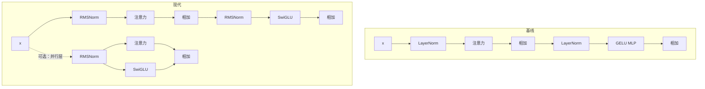

# 第 5 章 现代 LLM 的架构演进

## 本章导读

把 Llama 3 8B 和 GPT-2 的架构图并排放在一起，会发现骨架几乎一样：Pre-LN 解码器、因果多头注意力、逐位置前馈、残差连接。真正变了的只有四个零件——LayerNorm 换成 RMSNorm，GELU 前馈换成 SwiGLU，线性层去掉偏置，输入输出是否共享权重重新选择。可就是这几处替换，加上第 6 章的 GQA，让 Llama 2 7B 的 6.738B 参数变成 Llama 3 8B 的 8.030B。多出来的 1.292B 花在哪？其中 1.309B 进了更宽的前馈，0.789B 进了更大的词表，GQA 又省回 0.805B。本章要回答的不是“哪个架构最好”，而是：每个替换解决什么问题，代价是什么，怎样在同一预算下做公平对照。

## 难度标签

⭐⭐⭐ 进阶 ｜ 数学要求：方差、初等代数、复杂度分析 ｜ 代码要求：PyTorch 中级

## 学习目标

读完本章你将能够：

- 说清 RMSNorm 与 LayerNorm 的差别，解释尺度不变性为什么有价值，以及它为什么对平移不再不变；
- 推导 SwiGLU 的等参数预算点 $$d_{ff}=8d_{model}/3$$，并说明门控带来的表达力与额外激活显存；
- 判断去偏置、权重绑定、并行层各自的真实收益与适用条件；
- 写出 RMSNorm + SwiGLU + 无偏置配置的精确参数量与 FLOPs，并用它拆解 Llama 2 到 Llama 3 的参数增量；
- 在 TinyLM 中实现这些替换，用账本与受控消融验证实现正确性和预算等价。

## 5.1 直觉：换零件，不是重建

第 3 章的 Transformer 块可以写成两行残差更新：先归一化再做注意力，再加回残差；再归一化再做前馈，再加回残差。现代模型没有改这两行的顺序，改的是括号里的函数。这就像一栋房子的承重结构没动，换的是门窗、地暖和保温层：住起来的差别可能很大，但户型图还是那张。

四处替换各自针对不同的成本。

**RMSNorm** 不再减均值，只除以均方根。LayerNorm 要算均值、方差、减均值、除标准差、再加偏置；RMSNorm 少了一次减法和一组偏置参数。更重要的是，它对输入的**整体缩放**不变：把残差向量乘 10，归一化后的方向不变。这个性质让深层残差流的尺度增长不至于把子层输入推爆。

**SwiGLU** 把前馈网络从“升维—激活—降维”改成“升维—门控相乘—降维”。多出来的那个门控分支让两个线性投影的结果逐元素相乘，相当于让模型按输入内容决定每个中间特征放行多少。代价是多一个矩阵，所以中间维度要相应调小，才能和原来的参数量对齐。

**去偏置**和**权重绑定**更接近工程决策。偏置的参数占比很小，去掉它主要不是为了省参数，而是为了让实现更简单、训练更稳；权重绑定让输入嵌入和输出投影共享同一个矩阵，省下 $$n_{vocab}d_{model}$$ 个参数，但要求输入空间和输出空间共用一套几何。

**并行层**把注意力和前馈放在同一个归一化之后并行计算，再加到同一条残差流上。它省掉一个归一化，更重要的是在张量并行时把两次通信合成一次。代价是块内两个子层不能再串行地利用彼此的输出。



这里有一个方法论上的要求：本章每次只改一个维度。如果同时把归一化、前馈、偏置、绑定全换掉，然后说“现代架构更好”，就无法归因到底是哪一处起了作用。后面 5.4 节的消融实验就是按这个原则设计的。

## 5.2 数学原理

### 5.2.1 RMSNorm：只保留尺度不变性

对位置 $$t$$ 的隐藏向量 $$\mathbf{x}_t\in\mathbb{R}^{d_{model}}$$，均方根定义为

$$
\mathrm{RMS}(\mathbf{x}_t)=\sqrt{\frac{1}{d_{model}}\sum_{i=1}^{d_{model}}x_{t,i}^2}
\qquad \text{(5.1)}
$$

RMSNorm 只做一次缩放，再加可学习的增益：

$$
\mathrm{RMSNorm}(\mathbf{x}_t)=\boldsymbol{\gamma}\odot\frac{\mathbf{x}_t}{\sqrt{\mathrm{RMS}(\mathbf{x}_t)^2+\epsilon}}
\qquad \text{(5.2)}
$$

与第 3 章 (3.2) 的 LayerNorm 相比，它少了减均值这一步，也少了偏置 $$\boldsymbol{\beta}$$。这不是“省略”，而是两种不同的归一化。若输入本身零均值、且 LayerNorm 的 $$\boldsymbol{\beta}=0$$，两者完全一致：

$$
\mu_t=0,\ \boldsymbol{\beta}=0\ \Longrightarrow\ \mathrm{RMSNorm}(\mathbf{x}_t)=\mathrm{LN}(\mathbf{x}_t)
\qquad \text{(5.3)}
$$

一般情况下它们不同。RMSNorm 对输入的平移没有不变性：把 $$\mathbf{x}_t$$ 整体加一个常数，分子变了、分母的均方根也变，输出会变；LayerNorm 减掉均值，平移完全被抵消。这一点在 5.4 节的数值实验里可以直接看到。

RMSNorm 真正保留的是**尺度不变性**。对任意 $$\alpha>0$$，忽略 $$\epsilon$$ 时

$$
\mathrm{RMSNorm}(\alpha\mathbf{x}_t)=\boldsymbol{\gamma}\odot\frac{\alpha\mathbf{x}_t}{\sqrt{\alpha^2\,\mathrm{RMS}(\mathbf{x}_t)^2}}
=\mathrm{RMSNorm}(\mathbf{x}_t)
\qquad \text{(5.4)}
$$

分子和分母同时乘 $$\alpha$$，缩放被约掉。为什么这有用？Pre-LN 的残差流范数会随深度增长（第 3 章 3.2.1 节），而 RMSNorm 的输出只取决于方向、不取决于长度。取 $$\boldsymbol{\gamma}=\mathbf{1}$$ 时，输出范数约为 $$\sqrt{d_{model}}$$，与输入大小无关：残差流无论涨到多少，进入子层的向量都被拉回固定尺度，这就是“钉住尺度”的精确含义。梯度里也没有沿径向的分量，学习率对激活尺度的敏感度下降。Zhang 与 Sennrich 2019 年的论文正是从“重缩放不变性”出发论证 RMSNorm 的：重定心不变性对层功能不是必需的，去掉它可以少一次归约、少一组参数。


RMSNorm 不是 LayerNorm 的近似，也不能因为“看起来更简单”就认为它一定更差。它放弃的是平移不变性，保留的是尺度不变性。实践中残差流的均值通常不会失控，模型也会通过后续线性层吸收常数偏移；但如果你人为给激活加大常数偏置，RMSNorm 的行为会和 LayerNorm 明显不同。


参数量上，LayerNorm 每个位置有 $$\boldsymbol{\gamma}$$ 和 $$\boldsymbol{\beta}$$ 两组 $$d_{model}$$ 参数，RMSNorm 只有 $$\boldsymbol{\gamma}$$。每层两个归一化，省下 $$2d_{model}$$；对 32 层、4096 维的 Llama 2 7B，总共省 26.2 万参数，只占 0.004%。所以 RMSNorm 的主要收益不是参数，而是更少的算子、更好的数值行为，以及和尺度无关的训练稳定性。


混合精度下要小心平方和溢出。若直接用 FP16 计算 $$\sum x_i^2$$，较大的激活可能超出 FP16 的表示范围；常见实现会先把输入转成 FP32 算均方根，再转回原精度。这不是 RMSNorm 独有的问题，但因为省掉了减均值，输入中的大常数会直接进入平方项，风险更集中。


### 5.2.2 SwiGLU：用门控换每参数表达力

门控线性单元（Gated Linear Unit，GLU）把输入分成两路，一路做线性变换后过一个激活，另一路做线性变换后当门，两路逐元素相乘：

$$
\mathrm{GLU}(\mathbf{x})=\left(\mathbf{W}_1\mathbf{x}\right)\odot\sigma\left(\mathbf{W}_2\mathbf{x}\right)
\qquad \text{(5.5)}
$$

其中 $$\sigma$$ 是 Sigmoid。门控的作用是让每个中间特征有一个**由输入决定**的放行比例；它不再是固定的逐元素非线性，而是乘性的、条件化的。SiLU（也叫 Swish）把 Sigmoid 门换成自门控：

$$
\mathrm{SiLU}(z)=z\,\sigma(z)
\qquad \text{(5.6)}
$$

SwiGLU 用 SiLU 作为激活分支，再乘上另一路线性投影，最后降到 $$d_{model}$$：

$$
\mathrm{SwiGLU}(\mathbf{x})=\mathbf{W}_3\left(\mathrm{SiLU}(\mathbf{W}_1\mathbf{x})\odot\mathbf{W}_2\mathbf{x}\right)
\qquad \text{(5.7)}
$$

其中 $$\mathbf{W}_1,\mathbf{W}_2\in\mathbb{R}^{d_{ff}\times d_{model}}$$，$$\mathbf{W}_3\in\mathbb{R}^{d_{model}\times d_{ff}}$$。与 (3.15) 的两矩阵 MLP 相比，它多了一个 $$\mathbf{W}_2$$。若保持 $$d_{ff}=4d_{model}$$，前馈参数量会从 $$8d_{model}^2$$ 涨到 $$12d_{model}^2$$，多出 50%。所以工程上不会直接这么换，而是把中间维度调小。

令 SwiGLU 与 $$d_{ff}=4d_{model}$$ 的 MLP 参数相等：

$$
3d_{model}d_{ff}=2d_{model}\left(4d_{model}\right)
\ \Longrightarrow\ d_{ff}=\frac{8}{3}d_{model}
\qquad \text{(5.8)}
$$

以 $$d_{model}=4096$$ 为例，$$8d_{model}/3\approx10922.7$$。前馈的 FLOPs 也同步对齐：MLP 是 $$4Td_{model}d_{ff}$$，SwiGLU 是 $$6Td_{model}d_{ff}$$；代入 (5.8)，两者都等于 $$16Td_{model}^2$$。也就是说，**等预算的 SwiGLU 不增加参数，也不增加矩阵乘法量**，换来的表达力来自门控结构本身。代价是前向要多保存一份中间激活：MLP 只存一个 $$d_{ff}$$ 宽的中间张量，SwiGLU 要存门分支和值分支两个，宽度各为 $$\frac{2}{3}(4d_{model})$$，合计约为原来的 $$4/3$$。这部分激活显存在训练时真实存在，不能忽略。

实际模型还会把 $$d_{ff}$$ 向上取整到硬件的整数倍。Llama 2 7B 取 11008：它是最接近 $$10922.7$$ 的 256 的整数倍（$$43\times256$$）。Llama 3 8B 则取 14336，等于 $$3.5d_{model}$$，明显高于等预算点；这是有意把更多参数分配给前馈，用容量换质量，也是 8B 比 7B 多出参数的主要来源之一。


SwiGLU 不是唯一选择。Shazeer 2020 年系统比较了 ReLU、GELU、SiLU、GeGLU、SwiGLU 等变体，SwiGLU 在同等参数下表现最好，但差距依赖任务和数据。Gemma 用的是 GeGLU，说明“门控”这个大方向比某一个具体激活更稳定。


GLU 家族的区别只在门控分支用什么激活；四种变体的参数量完全相同，是同一预算下的干净对照：

| 变体 | 门控激活 | 公式 | 使用实例 |
| --- | --- | --- | --- |
| ReGLU | ReLU | $$\mathbf{W}_3\left(\mathrm{ReLU}(\mathbf{W}_1\mathbf{x})\odot\mathbf{W}_2\mathbf{x}\right)$$ | 对照实验 |
| GeGLU | GELU | $$\mathbf{W}_3\left(\mathrm{GELU}(\mathbf{W}_1\mathbf{x})\odot\mathbf{W}_2\mathbf{x}\right)$$ | Gemma |
| SwiGLU | SiLU | 同 (5.7) | Llama、PaLM |
| Bilinear | 恒等 | $$\mathbf{W}_3\left((\mathbf{W}_1\mathbf{x})\odot(\mathbf{W}_2\mathbf{x})\right)$$ | 对照实验 |

门控为什么有用？看 (5.7) 的中间量 $$\mathrm{SiLU}(\mathbf{W}_1\mathbf{x})\odot\mathbf{W}_2\mathbf{x}$$：它是两个线性投影的逐元素乘积，展开后含有输入特征的二次交叉项。普通 MLP 的激活只逐元素作用，单个隐藏单元里形不成这种乘性交互。门控的放行比例又依赖输入，相当于一种软性的条件计算：不同 Token 启用不同的有效子网络。代价是同样预算下每个分支更窄，表达力是否真的提升仍要靠下游实验判断；Shazeer 的比较是在固定参数与算力下做的，这一点比“哪个激活更好”更值得学。

### 5.2.3 去偏置、权重绑定与并行层

**去偏置。** 每个 Transformer 层里，注意力有四个长度为 $$d_{model}$$ 的偏置；SwiGLU 前馈有三个偏置（两个 $$d_{ff}$$、一个 $$d_{model}$$）；RMSNorm 本身没有偏置。若全部去掉，每层省下

$$
4d_{model}+\left(2d_{ff}+d_{model}\right)=5d_{model}+2d_{ff}
\qquad \text{(5.9)}
$$

个参数。对 Llama 2 7B，这大约是每层 4.25 万、总共 136 万，占 6.74B 的 0.020%。如果换成 LayerNorm + MLP 的基线，前馈只有两个偏置，但两个 LayerNorm 各多一组 $$\boldsymbol{\beta}$$，每层是 $$7d_{model}+d_{ff}$$，同样规模下也只有 127 万左右。所以“去偏置省参数”几乎可以忽略。PaLM 给出的理由是训练稳定性：去掉稠密核和归一化里的偏置后，大模型训练更稳；实现上也少了一次加法和一次内存读。代价是失去了一点点平移自由度，但归一化的增益和后续线性层通常能吸收它。

**权重绑定。** 输入嵌入矩阵 $$\mathbf{E}\in\mathbb{R}^{n_{vocab}\times d_{model}}$$ 和输出投影 $$\mathbf{W}_{\text{lm}}\in\mathbb{R}^{n_{vocab}\times d_{model}}$$ 形状相同。绑定就是令 $$\mathbf{W}_{\text{lm}}=\mathbf{E}$$，省下一整份 $$n_{vocab}d_{model}$$。对 Llama 2 7B 是 1.31 亿（1.9%），对 Llama 3 8B 是 5.25 亿（6.5%），词表越大越可观。代价是输入空间和输出空间被强制共用一套几何：模型不能单独调整“怎么读 Token”和“怎么预测 Token”。绑定后同一个矩阵同时接收输入查表与输出投影两路梯度，两项目标被强制共享统计结构，这既是正则化也是约束。Press 与 Wolf 2017 年发现绑定在语言建模上通常能改善困惑度并减少参数，但这不是普遍结论；GPT-2 绑定，GPT-3 和 Llama 系列不绑定，Gemma 又绑定。选择取决于词表大小、模型规模和数据量。

**并行层。** 串行块是“先注意力、再前馈”，两个子层各自读一次归一化后的残差流。并行块让两者读同一个归一化结果，再把两个输出一起加回去：

$$
\mathbf{X}\leftarrow\mathbf{X}+\mathrm{Attn}\left(\mathrm{LN}(\mathbf{X})\right)+\mathrm{MLP}\left(\mathrm{LN}(\mathbf{X})\right)
\qquad \text{(5.10)}
$$

它省掉一个归一化，也让注意力和前馈的矩阵乘法更容易融合。在张量并行里，每个子层通常要做一次全归约；并行块可以把两次通信合并或重叠，这是 PaLM 在 540B 上采用它的主要原因。代价是块内两个子层不能串行组合：前馈看不到注意力刚写入残差流的内容，表达能力略有下降。PaLM 报告大规模下质量损失可以忽略，训练吞吐提升约 15%；但 Llama 3 仍然使用串行块，说明这个选择依赖规模和硬件，不是单向的“更先进”。

### 5.2.4 重算参数与算力

把四处替换合起来，得到现代配置的精确参数量。每层包含：无偏置的四个注意力投影 $$4d_{model}^2$$；SwiGLU 的三个投影 $$3d_{model}d_{ff}$$；两个 RMSNorm 的增益 $$2d_{model}$$。加上最终归一化、Token 嵌入和输出层（不绑定时各一份），得到

$$
N_{\text{modern}}=n_l\left(4d_{model}^2+3d_{model}d_{ff}+2d_{model}\right)+d_{model}+2n_{vocab}d_{model}
\qquad \text{(5.11)}
$$

若绑定权重，末项只算一份，减去 $$n_{vocab}d_{model}$$；若使用 RoPE 等无表位置编码，不再有 $$L_{ctx}d_{model}$$ 的位置表。与第 3 章 (3.22) 的基线相比，差别是前馈项从 $$2d_{model}d_{ff}+d_{ff}$$ 变成 $$3d_{model}d_{ff}$$，归一化项从 $$9d_{model}$$ 降到 $$2d_{model}$$，嵌入项少了一份位置表。

每 Token 的前向 FLOPs 同样可以重算。注意力投影 $$8Td_{model}^2$$，SwiGLU $$6Td_{model}d_{ff}$$，打分与加权求和 $$4T^2d_{model}$$，于是

$$
\mathrm{FLOPs}_{\text{modern}}\approx8Td_{model}^2+6Td_{model}d_{ff}+4T^2d_{model}
\qquad \text{(5.12)}
$$

代入 (5.8) 的 $$d_{ff}=\frac{8}{3}d_{model}$$，前馈项变成 $$16Td_{model}^2$$，总和为 $$24Td_{model}^2+4T^2d_{model}$$，与第 3 章 $$d_{ff}=4d_{model}$$ 的 GELU 基线完全相同。这再次说明：等预算的 SwiGLU 是“同样的钱换一种花法”，不是免费加参数。

账本的用法是设计阶段的快速估算：先固定层数、宽度和词表，用 (5.11) 卡住参数预算，用 (5.12) 卡住每 Token 计算量，再决定前馈宽度、是否绑定和块结构；真正开训前，还要用实测吞吐与显存修正。下面 5.4 节的代码就是把这两式变成可执行的函数，并在小模型上逐位核对。

## 5.3 方案对比

| 设计维度 | 第 3 章基线 | 现代常见选择 | 收益 | 代价 | 典型使用者 |
| --- | --- | --- | --- | --- | --- |
| 归一化 | LayerNorm | RMSNorm | 少一次归约、少一组偏置、尺度不变 | 失去平移不变性，大均值输入需注意 | Llama、PaLM、Qwen |
| 前馈 | GELU MLP，$$d_{ff}=4d$$ | SwiGLU，$$d_{ff}=8d/3$$ | 同预算下门控表达力更强 | 多一个矩阵、激活显存约 4/3 | Llama、PaLM、Mistral |
| 偏置 | 全部保留 | 全部去掉 | 训练更稳、算子更简单 | 少量表达自由度 | PaLM、Llama |
| 输出层 | 不绑定 | 绑定或不绑定 | 绑定省 $$n_{vocab}d$$ | 输入输出几何耦合 | GPT-2、Gemma 绑定；Llama 不绑 |
| 块结构 | 串行 | 串行或并行 | 并行省通信、易融合 | 块内表达力略降 | PaLM 并行；Llama 串行 |
| 前馈宽度 | $$4d$$ | $$8d/3$$ 或更大 | 更大宽度换质量 | 参数与算力上升 | Llama 3 用 $$3.5d$$ |

在小模型上，这几种配置的账本几乎重合。取 $$d_{model}=256$$、$$n_l=4$$、$$n_{vocab}=1024$$、$$L_{ctx}=256$$、$$T=256$$，基线用 $$d_{ff}=1024$$，现代配置用 $$d_{ff}=683$$：

| 配置 | 参数量（实测 = 公式） | 每 Token FLOPs |
| --- | --- | --- |
| 基线 LN + MLP | 3,749,376 | 7,340,032 |
| 现代 RMSNorm + SwiGLU | 3,738,880 | 7,342,080 |
| 现代 + 权重绑定 | 3,476,736 | 7,342,080 |
| 现代 + 并行层 | 3,737,856 | 7,342,080 |

现代配置比基线少 0.28% 的参数，FLOPs 只差 0.03%；绑定省下 262,144 个参数，并行层省下每层一个增益（共 1024 个）。这些数字说明“等预算”不是一句口号，而是可以在参数量和 FLOPs 两个维度同时核对的设计约束。

这张表没有“全面最优”的一行。RMSNorm 用“放弃平移不变性”换“更少算子、尺度不变”；SwiGLU 用“多一个矩阵、更多激活显存”换“同预算下的门控表达力”；去偏置用“少量自由度”换“稳定与简单”；绑定用“输入输出耦合”换“参数与显存”；并行层用“块内表达力”换“通信效率”。Llama 3 把 $$d_{ff}$$ 抬到 $$3.5d$$，更是明确地用“更多参数”换“质量”，而不是停留在等预算点。

落到具体项目，可以先看瓶颈。推理显存吃紧时，绑定权重和收窄前馈最直接；训练吞吐吃紧时，并行层与算子融合的收益更明显；长上下文场景里，位置编码、KV 头数和数据配比的影响远大于这几处逐元素替换；小模型、小数据则往往更适合保留 LayerNorm 与权重绑定，正则化带来的稳定性比“现代配置”更值钱。换句话说，这张表是预算重排的工具，不是升级清单。

## 5.4 代码实现：TinyLM 的现代配置

### 5.4.1 实现选择

本章在第 3、4 章的代码上做增量，`TinyLM.forward` 的签名和 `CausalLMOutput` 不变：

- `norm.py`：新增 `RMSNorm`，由 `norm="rmsnorm"` 分派；默认仍是 `layernorm`，保证第 3 章实验可复现；
- `ffn.py`：新增 `SwiGLU`，由 `ffn="swiglu"` 分派；当 `d_ff=None` 且使用 SwiGLU 时，按 (5.8) 取 $$8d_{model}/3$$ 并四舍五入；
- `model.py`：启用 `bias`、`tie_embeddings`，新增可选开关 `parallel_block`；位置编码继续复用第 4 章的 `PositionAwareAttention`；
- 新增 `exact_params` 与 `flops_per_token`，把 (5.11)、(5.12) 变成可执行的账本；
- 权重绑定在初始化之后执行，避免共享矩阵被初始化两次。

完整项目里这些代码分属 `norm.py`、`ffn.py`、`block.py`、`model.py`；为了让本章可以独立运行，下面合并成一个文件，并与第 3、4 章的 `ch03.py`、`ch04.py` 放在同一目录。

### 5.4.2 完整代码

```python
"""第 5 章：现代 LLM 的架构演进（tinylm/norm.py、ffn.py、model.py 的增量）。"""
import math
import sys
from dataclasses import dataclass

import torch
import torch.nn as nn
import torch.nn.functional as F

sys.path.insert(0, ".")
from ch03 import CausalLMOutput, LayerNorm, MLP
from ch04 import (
    ModelConfig as Config4,
    PositionAwareAttention,
    sinusoidal_positions,
)


# ---------------------------------------------------------------- config.py
@dataclass(frozen=True)
class ModelConfig(Config4):
    parallel_block: bool = False

    def __post_init__(self):
        if self.d_ff is None:
            ratio = 8 / 3 if self.ffn == "swiglu" else 4   # 公式 (5.8)
            object.__setattr__(self, "d_ff", int(round(ratio * self.d_model)))
        super().__post_init__()
        assert self.norm in ("layernorm", "rmsnorm")
        assert self.ffn in ("mlp", "swiglu")


# ---------------------------------------------------------------- norm.py
class RMSNorm(nn.Module):
    """公式 (5.2)：只除以均方根，不减均值。"""

    def __init__(self, d_model, eps=1e-5):
        super().__init__()
        self.gamma = nn.Parameter(torch.ones(d_model))
        self.eps = eps

    def forward(self, x):
        rms = torch.sqrt(x.pow(2).mean(dim=-1, keepdim=True) + self.eps)  # (5.1)
        return self.gamma * x / rms                                       # (5.2)


def make_norm(cfg):
    if cfg.norm == "rmsnorm":
        return RMSNorm(cfg.d_model, cfg.norm_eps)
    return LayerNorm(cfg.d_model, cfg.norm_eps, cfg.bias)


# ---------------------------------------------------------------- ffn.py
class SwiGLU(nn.Module):
    """公式 (5.7)：SiLU 门控的三投影前馈网络。"""

    def __init__(self, cfg):
        super().__init__()
        self.w_gate = nn.Linear(cfg.d_model, cfg.d_ff, bias=cfg.bias)
        self.w_up = nn.Linear(cfg.d_model, cfg.d_ff, bias=cfg.bias)
        self.w_down = nn.Linear(cfg.d_ff, cfg.d_model, bias=cfg.bias)

    def forward(self, x):
        return self.w_down(F.silu(self.w_gate(x)) * self.w_up(x))         # (5.7)


def make_ffn(cfg):
    if cfg.ffn == "swiglu":
        return SwiGLU(cfg)
    return MLP(cfg)


# ---------------------------------------------------------------- block.py
class TransformerBlock(nn.Module):
    def __init__(self, cfg):
        super().__init__()
        self.parallel = cfg.parallel_block
        self.norm1 = make_norm(cfg)
        self.attn = PositionAwareAttention(cfg)
        self.norm2 = None if self.parallel else make_norm(cfg)
        self.mlp = make_ffn(cfg)

    def forward(self, x, attention_mask=None, position_ids=None):
        if self.parallel:                                      # 公式 (5.10)
            h = self.norm1(x)
            return x + self.attn(h, attention_mask, position_ids) + self.mlp(h)
        x = x + self.attn(self.norm1(x), attention_mask, position_ids)
        return x + self.mlp(self.norm2(x))


# ---------------------------------------------------------------- model.py
class TinyLM(nn.Module):
    def __init__(self, cfg):
        super().__init__()
        self.cfg = cfg
        self.pos_mode = cfg.pos_encoding
        self.tok_emb = nn.Embedding(cfg.vocab_size, cfg.d_model)
        if self.pos_mode == "learned":
            self.pos_emb = nn.Embedding(cfg.max_seq_len, cfg.d_model)
        elif self.pos_mode == "sine":
            self.register_buffer(
                "sin_pe", sinusoidal_positions(cfg.max_seq_len, cfg.d_model),
                persistent=False,
            )
        self.blocks = nn.ModuleList([TransformerBlock(cfg) for _ in range(cfg.n_layers)])
        self.ln_f = make_norm(cfg)
        self.lm_head = nn.Linear(cfg.d_model, cfg.vocab_size, bias=False)
        self.apply(self._init_weights)
        if cfg.tie_embeddings:
            self.lm_head.weight = self.tok_emb.weight
        std = 0.02 / math.sqrt(2 * cfg.n_layers)
        for name, p in self.named_parameters():
            if name.endswith(("out_proj.weight", "fc_out.weight", "w_down.weight")):
                nn.init.normal_(p, mean=0.0, std=std)

    @staticmethod
    def _init_weights(module):
        if isinstance(module, nn.Linear):
            nn.init.normal_(module.weight, mean=0.0, std=0.02)
            if module.bias is not None:
                nn.init.zeros_(module.bias)
        elif isinstance(module, nn.Embedding):
            nn.init.normal_(module.weight, mean=0.0, std=0.02)

    def forward(self, input_ids, *, attention_mask=None, position_ids=None,
                past_kv=None, use_cache=False, labels=None, logits_to_keep=None):
        B, T = input_ids.shape
        if self.pos_mode in ("learned", "sine"):
            assert T <= self.cfg.max_seq_len, "序列长度超过 max_seq_len"
        if position_ids is None:
            position_ids = torch.arange(T, device=input_ids.device)

        x = self.tok_emb(input_ids)
        if self.pos_mode == "learned":
            x = x + self.pos_emb(position_ids)
        elif self.pos_mode == "sine":
            x = x + self.sin_pe[position_ids]
        for block in self.blocks:
            x = block(x, attention_mask, position_ids)

        x = self.ln_f(x)
        logits = self.lm_head(x)
        loss = None
        if labels is not None:
            loss = F.cross_entropy(
                logits.reshape(-1, self.cfg.vocab_size),
                labels.reshape(-1),
                ignore_index=-100,
            )
        return CausalLMOutput(logits=logits, loss=loss)


# ---------------------------------------------------------------- 参数与算力账本
def exact_params(cfg):
    """公式 (5.11)：RMSNorm + SwiGLU + 可选偏置/绑定/并行层。"""
    d, f, V, L = cfg.d_model, cfg.d_ff, cfg.vocab_size, cfg.max_seq_len
    attn = 4 * d * d + (4 * d if cfg.bias else 0)
    if cfg.ffn == "swiglu":
        ffn = 3 * d * f + ((2 * f + d) if cfg.bias else 0)
    else:
        ffn = 2 * d * f + ((f + d) if cfg.bias else 0)
    norm_p = d + (d if cfg.norm == "layernorm" and cfg.bias else 0)
    layer_norms = norm_p if cfg.parallel_block else 2 * norm_p
    per_layer = attn + ffn + layer_norms
    emb = V * d * (1 if cfg.tie_embeddings else 2)
    pos = L * d if cfg.pos_encoding == "learned" else 0
    return cfg.n_layers * per_layer + norm_p + emb + pos


def flops_per_token(cfg, T):
    """公式 (5.12)：每个 Token 的前向 FLOPs，忽略偏置与归一化。"""
    d, f = cfg.d_model, cfg.d_ff
    attn_proj = 8 * d * d
    ffn = (6 * d * f) if cfg.ffn == "swiglu" else (4 * d * f)
    scores = 4 * T * d
    return cfg.n_layers * (attn_proj + ffn + scores)


def ledger_small():
    base = ModelConfig(vocab_size=1024, d_model=256, n_layers=4, n_heads=8,
                       d_ff=1024, max_seq_len=256)
    modern = ModelConfig(vocab_size=1024, d_model=256, n_layers=4, n_heads=8,
                         norm="rmsnorm", ffn="swiglu", bias=False, max_seq_len=256)
    modern_tied = ModelConfig(vocab_size=1024, d_model=256, n_layers=4, n_heads=8,
                              norm="rmsnorm", ffn="swiglu", bias=False,
                              tie_embeddings=True, max_seq_len=256)
    modern_par = ModelConfig(vocab_size=1024, d_model=256, n_layers=4, n_heads=8,
                             norm="rmsnorm", ffn="swiglu", bias=False,
                             parallel_block=True, max_seq_len=256)
    print("小模型账本（d=256, n_l=4, V=1024, L=256, T=256）")
    print(f"{'配置':<18s}{'实测':>10s}{'公式':>10s}{'每Token FLOPs':>16s}")
    for name, cfg in (("基线 LN+MLP", base), ("现代 RMS+SwiGLU", modern),
                      ("现代+权重绑定", modern_tied), ("现代+并行层", modern_par)):
        model = TinyLM(cfg)
        actual = sum(p.numel() for p in model.parameters())
        print(f"{name:<18s}{actual:>10,d}{exact_params(cfg):>10,d}"
              f"{flops_per_token(cfg, 256):>16,d}")


def llama2_ledger():
    """Llama 2 7B 的账本；只算公式，不实例化 67 亿参数。"""
    cfg = ModelConfig(vocab_size=32000, d_model=4096, n_layers=32, n_heads=32,
                      d_ff=11008, max_seq_len=4096, norm="rmsnorm",
                      ffn="swiglu", bias=False, pos_encoding="rope")
    n = exact_params(cfg)
    print("\nLlama 2 7B 账本")
    print(f"公式 (5.11): {n:,}    公开参数量: 6,738,415,616    差 {n - 6_738_415_616:+,}")
    d, f, nl, V = 4096, 11008, 32, 32000
    attn = nl * 4 * d * d
    ffn = nl * 3 * d * f
    norms = (nl * 2 + 1) * d
    emb = 2 * V * d
    print(f"注意力 {attn:,}  前馈 {ffn:,}  归一化 {norms:,}  嵌入/输出 {emb:,}")
    print(f"前馈占非嵌入参数: {ffn / (attn + ffn + norms):.1%}")


def llama3_delta():
    """Llama 2 7B 到 Llama 3 8B 的参数增量拆解。"""
    d, nl = 4096, 32
    vocab = (128256 - 32000) * d * 2
    ffn = 3 * d * (14336 - 11008) * nl
    d_kv = d * 8 // 32
    gqa = ((2 * d * d + 2 * d * d_kv) - 4 * d * d) * nl
    print("\nLlama 2 7B → Llama 3 8B 的参数增量")
    print(f"词表 32K→128K: {vocab:+,}")
    print(f"前馈 11008→14336: {ffn:+,}")
    print(f"注意力 MHA→GQA(8 KV 头): {gqa:+,}")
    total = 6_738_415_616 + vocab + ffn + gqa
    print(f"合计: {vocab + ffn + gqa:+,}   →   {total:,}")


def norm_demo():
    torch.manual_seed(0)
    x = torch.randn(2, 4, 64)
    rms, ln = RMSNorm(64), LayerNorm(64, 1e-5, True)
    with torch.no_grad():
        ln.gamma.copy_(rms.gamma)
        ln.beta.zero_()
    with torch.no_grad():
        scale_diff = (rms(10 * x) - rms(x)).abs().max().item()
        shift_rms = (rms(x + 5) - rms(x)).abs().max().item()
        shift_ln = (ln(x + 5) - ln(x)).abs().max().item()
        x0 = x - x.mean(dim=-1, keepdim=True)
        zero_mean_diff = (rms(x0) - ln(x0)).abs().max().item()
    print("\nRMSNorm 与 LayerNorm 的行为差异")
    print(f"输入放大 10 倍，RMSNorm 输出最大差异: {scale_diff:.2e}")
    print(f"输入平移 +5，RMSNorm 输出最大差异: {shift_rms:.2e}")
    print(f"输入平移 +5，LayerNorm 输出最大差异: {shift_ln:.2e}")
    print(f"零均值输入下两者输出最大差异: {zero_mean_diff:.2e}")


# ---------------------------------------------------------------- 复制任务消融
def copy_task(B, T, lag, vocab, gen):
    seq = torch.randint(0, vocab, (B, lag), generator=gen)
    for t in range(lag, T):
        seq = torch.cat([seq, seq[:, t - lag:t - lag + 1]], dim=1)
    return seq


def make_labels(seq):
    return seq[:, :-1], seq[:, 1:].clone()


def train_one(cfg, steps=300, seed=0, train_len=32, lag=8):
    torch.manual_seed(seed)
    model = TinyLM(cfg)
    opt = torch.optim.AdamW(model.parameters(), lr=3e-3, weight_decay=0.01)
    gen = torch.Generator().manual_seed(1000 + seed)
    model.train()
    for _ in range(steps):
        seq = copy_task(64, train_len, lag, cfg.vocab_size, gen)
        inp, tgt = make_labels(seq)
        out = model(inp, labels=tgt)
        opt.zero_grad()
        out.loss.backward()
        opt.step()
    return model


@torch.no_grad()
def evaluate(model, T=32, lag=8, B=256, seed=7):
    gen = torch.Generator().manual_seed(seed)
    seq = copy_task(B, T, lag, 16, gen)
    inp, tgt = make_labels(seq)
    model.eval()
    out = model(inp, labels=tgt)
    acc = (out.logits.argmax(-1) == tgt).float().mean().item()
    return out.loss.item(), acc


def ablation():
    common = dict(vocab_size=16, d_model=64, n_layers=2, n_heads=4,
                  max_seq_len=64, pos_encoding="learned")
    cfgs = {
        "基线 LN+MLP": ModelConfig(d_ff=256, **common),
        "仅 RMSNorm": ModelConfig(d_ff=256, norm="rmsnorm", **common),
        "仅 SwiGLU": ModelConfig(ffn="swiglu", **common),
        "现代组合": ModelConfig(norm="rmsnorm", ffn="swiglu", bias=False, **common),
    }
    floor = (8 - 1) / (32 - 1) * math.log(16)
    ceiling = ((32 - 8) + (8 - 1) / 16) / (32 - 1)
    print("\n复制任务消融（3 个种子，300 步，损失/准确率取均值±标准差）")
    print(f"理论损失下界 {floor:.4f}，理论上界（准确率）{ceiling:.4f}")
    print(f"{'配置':<14s}{'参数量':>9s}{'损失':>16s}{'准确率':>18s}")
    for name, cfg in cfgs.items():
        n = exact_params(cfg)
        results = []
        for seed in range(3):
            model = train_one(cfg, seed=seed)
            results.append(evaluate(model))
        losses = torch.tensor([r[0] for r in results])
        accs = torch.tensor([r[1] for r in results])
        print(f"{name:<14s}{n:>9,d}"
              f"{losses.mean():>10.4f} ± {losses.std():.4f}"
              f"{accs.mean():>11.4f} ± {accs.std():.4f}")


def main():
    ledger_small()
    llama2_ledger()
    llama3_delta()
    norm_demo()
    ablation()


if __name__ == "__main__":
    main()
```

配套测试覆盖 RMSNorm 的公式、尺度不变性、零均值下与 LayerNorm 的等价、平移敏感性，SwiGLU 的形状与参数，权重绑定，精确参数公式，等预算 FLOPs，并行层定义，以及现代配置下的因果性。把测试保存为 `tests/test_modern.py`：

```python
"""第 5 章配套测试（tests/test_modern.py）。"""
import pytest
import torch

from ch05 import (
    LayerNorm,
    ModelConfig,
    RMSNorm,
    SwiGLU,
    TinyLM,
    TransformerBlock,
    exact_params,
    flops_per_token,
)


def make_cfg(**kw):
    base = dict(vocab_size=32, d_model=32, n_layers=2, n_heads=4,
                d_ff=64, max_seq_len=32)
    base.update(kw)
    return ModelConfig(**base)


def test_rmsnorm_formula():
    torch.manual_seed(0)
    x = torch.randn(2, 3, 16)
    norm = RMSNorm(16, eps=1e-5)
    with torch.no_grad():
        norm.gamma.uniform_(0.5, 1.5)
    expected = norm.gamma * x / torch.sqrt(x.pow(2).mean(-1, keepdim=True) + 1e-5)
    assert torch.allclose(norm(x), expected, atol=1e-6)


def test_rmsnorm_scale_invariance():
    torch.manual_seed(0)
    x = torch.randn(2, 4, 16)
    norm = RMSNorm(16, eps=0.0)
    assert torch.allclose(norm(10 * x), norm(x), atol=1e-5)


def test_rmsnorm_equals_ln_on_zero_mean_input():
    torch.manual_seed(0)
    x = torch.randn(2, 4, 16)
    x = x - x.mean(-1, keepdim=True)
    rms = RMSNorm(16, eps=1e-5)
    ln = LayerNorm(16, 1e-5, bias=True)
    with torch.no_grad():
        ln.gamma.copy_(rms.gamma)
        ln.beta.zero_()
    assert torch.allclose(rms(x), ln(x), atol=1e-5)


def test_shift_sensitivity():
    torch.manual_seed(0)
    x = torch.randn(2, 4, 16)
    rms = RMSNorm(16, eps=1e-5)
    ln = LayerNorm(16, 1e-5, bias=True)
    with torch.no_grad():
        ln.gamma.copy_(rms.gamma)
        ln.beta.zero_()
    with torch.no_grad():
        assert (rms(x + 5) - rms(x)).abs().max() > 0.1
        assert (ln(x + 5) - ln(x)).abs().max() < 1e-5


def test_swiglu_params():
    cfg = make_cfg(ffn="swiglu", d_ff=64, bias=False)
    ffn = SwiGLU(cfg)
    assert sum(p.numel() for p in ffn.parameters()) == 3 * 32 * 64
    assert ffn(torch.randn(2, 5, 32)).shape == (2, 5, 32)


def test_weight_tying():
    cfg = make_cfg(tie_embeddings=True)
    model = TinyLM(cfg)
    assert model.lm_head.weight is model.tok_emb.weight
    assert model.lm_head.weight.data_ptr() == model.tok_emb.weight.data_ptr()


@pytest.mark.parametrize("kw", [
    {},
    {"norm": "rmsnorm"},
    {"ffn": "swiglu"},
    {"norm": "rmsnorm", "ffn": "swiglu", "bias": False},
    {"norm": "rmsnorm", "ffn": "swiglu", "bias": False, "tie_embeddings": True},
    {"norm": "rmsnorm", "ffn": "swiglu", "bias": False, "parallel_block": True},
])
def test_exact_parameter_count(kw):
    cfg = make_cfg(**kw)
    model = TinyLM(cfg)
    assert sum(p.numel() for p in model.parameters()) == exact_params(cfg)


def test_equal_flops_at_eight_thirds():
    base = make_cfg(d_ff=256)
    modern = make_cfg(ffn="swiglu", d_ff=170)
    rel = abs(flops_per_token(base, 64) - flops_per_token(modern, 64))
    assert rel / flops_per_token(base, 64) < 0.01


def test_parallel_block_definition():
    torch.manual_seed(0)
    cfg = make_cfg(parallel_block=True)
    block = TransformerBlock(cfg).eval()
    x = torch.randn(2, 8, 32)
    with torch.no_grad():
        h = block.norm1(x)
        expected = x + block.attn(h) + block.mlp(h)
        assert torch.allclose(block(x), expected, atol=1e-6)


def test_causality_modern():
    torch.manual_seed(0)
    cfg = make_cfg(norm="rmsnorm", ffn="swiglu", bias=False,
                   pos_encoding="rope", max_seq_len=64)
    model = TinyLM(cfg).eval()
    ids = torch.randint(0, 32, (2, 16))
    changed = ids.clone()
    changed[:, 5] = (changed[:, 5] + 1) % 32
    with torch.no_grad():
        a = model(ids).logits
        b = model(changed).logits
    assert torch.allclose(a[:, :5], b[:, :5], atol=1e-6)
    assert not torch.allclose(a[:, 5:], b[:, 5:], atol=1e-6)
```

在 Python 3.13 + PyTorch 2.9 的 CPU 环境中，主程序的实际输出如下：

```text
小模型账本（d=256, n_l=4, V=1024, L=256, T=256）
配置                        实测        公式    每Token FLOPs
基线 LN+MLP          3,749,376 3,749,376       7,340,032
现代 RMS+SwiGLU      3,738,880 3,738,880       7,342,080
现代+权重绑定            3,476,736 3,476,736       7,342,080
现代+并行层             3,737,856 3,737,856       7,342,080

Llama 2 7B 账本
公式 (5.11): 6,738,415,616    公开参数量: 6,738,415,616    差 +0
注意力 2,147,483,648  前馈 4,328,521,728  归一化 266,240  嵌入/输出 262,144,000
前馈占非嵌入参数: 66.8%

Llama 2 7B → Llama 3 8B 的参数增量
词表 32K→128K: +788,529,152
前馈 11008→14336: +1,308,622,848
注意力 MHA→GQA(8 KV 头): -805,306,368
合计: +1,291,845,632   →   8,030,261,248

RMSNorm 与 LayerNorm 的行为差异
输入放大 10 倍，RMSNorm 输出最大差异: 1.93e-05
输入平移 +5，RMSNorm 输出最大差异: 3.05e+00
输入平移 +5，LayerNorm 输出最大差异: 7.15e-07
零均值输入下两者输出最大差异: 2.38e-07

复制任务消融（3 个种子，300 步，损失/准确率取均值±标准差）
理论损失下界 0.6261，理论上界（准确率）0.7883
配置                  参数量              损失               准确率
基线 LN+MLP       106,240    0.6314 ± 0.0011     0.7875 ± 0.0008
仅 RMSNorm       105,920    0.6325 ± 0.0022     0.7875 ± 0.0014
仅 SwiGLU        106,540    0.6310 ± 0.0033     0.7894 ± 0.0008
现代组合            104,896    0.6315 ± 0.0028     0.7874 ± 0.0020
```

```text
$ python -m pytest tests/test_modern.py -q
...............                                                          [100%]
15 passed in 0.59s
```

### 5.4.3 结果说明了什么

**第一，精确账本可以对到个位。** 四种配置的 `sum(p.numel())` 与 `exact_params` 完全一致，现代配置比基线少 10,496 个参数（0.28%），FLOPs 只差 2,048（0.03%）。后者的偏差来自 $$d_{ff}$$ 从 682.67 取整到 683；若保留精确分数，两者严格相等。这说明 (5.8) 的等预算设计在实现层面成立：SwiGLU 多出的矩阵被更窄的 $$d_{ff}$$ 抵消了。绑定再省 262,144 个参数，正好是 $$n_{vocab}d_{model}=1024\times256$$；并行层省 1,024 个，正好是每层少一个 256 维增益。

**第二，Llama 2 7B 的账本能精确复现。** 用 (5.11) 算出 6,738,415,616，与公开参数量逐位相同。分解后，注意力 2.147B、前馈 4.329B、归一化 0.266M、嵌入与输出 0.262B；前馈占非嵌入参数的 66.8%。这印证了第 3 章的结论：**参数大头在前馈，不在注意力**。现代模型把归一化换成 RMSNorm、去掉偏置，省下的参数在这个尺度上几乎看不见；真正决定参数分配的是前馈宽度、词表和注意力变体。

**第三，Llama 2 到 Llama 3 的 1.292B 增量可以逐项归因。** 词表从 32K 扩到 128K，增加 0.789B；前馈从 11008 扩到 14336，增加 1.309B；MHA 换成 8 个 KV 头的 GQA，减少 0.805B；合计增加 1.292B，模型从 6.738B 变成 8.030B。这是一张很有用的“架构账单”：它说明所谓“模型变大”并不是均匀放大，而是有增有减的预算重排。GQA 的具体机制留到第 6 章，这里只用它的形状做算术。

**第四，RMSNorm 与 LayerNorm 的差别可以被精确测量。** 输入放大 10 倍，RMSNorm 输出最大差异只有 $$1.93\times10^{-5}$$，这是 $$\epsilon$$ 造成的近似误差，说明尺度不变性成立；输入平移 +5，RMSNorm 输出最大差异为 3.05，而 LayerNorm 只有 $$7.15\times10^{-7}$$，说明 RMSNorm 确实不具平移不变性；把输入先减去均值，两者输出差异降到 $$2.38\times10^{-7}$$，验证了 (5.3)。这三行数字比“RMSNorm 更简单”这种描述更有信息量。

**第五，复制任务上的四种配置都贴着理论下界。** 任务仍然是“复制 8 步之前的 Token”，前 7 个目标不可预测，理论损失下界 $$0.6261$$，准确率上界 $$0.7883$$。四种配置的损失在 0.6310 到 0.6325 之间，准确率在 0.7874 到 0.7894 之间，差异都在一个标准差以内。仅 SwiGLU 的准确率均值略高于上界，这是有限测试集上的抽样波动，不是模型超过了理论上界。**这个实验能说明的是实现正确、预算对齐、没有回归；它不能说明 SwiGLU 比 GELU 更好，也不能说明 RMSNorm 比 LayerNorm 更强。** 架构优劣的经验证据来自更大规模的训练，本章的受控实验只负责把账算清。

**第六，这是一个 10 万参数的玩具实验。** 2 层、64 维、4 个头、300 步，任务只有固定偏移复制。它能验证形状、因果性、参数公式和训练可运行，不能外推到 Llama 级别的质量差异。读者如果只记住一句话，应该是：**在现代架构里，等预算的替换首先改变的是“钱花在哪”，质量差异需要更大的规模才能显现。**

**第七，FLOPs 相等不等于速度相等。** RMSNorm 与并行层主要减少的是访存次数和通信，而不是浮点运算；在小模型上，这些收益可能被框架调度、核函数启动等开销淹没。要判断一个替换是否值得，应该测吞吐、显存和端到端延迟，而不是只把 (5.12) 的两行数字相减。这一点在第 21 章的推理优化里会反复出现。

## 5.5 工业实践

**Llama 2 7B：现代解码器的等预算样本。** 32 层、$$d_{model}=4096$$、32 个查询头、$$d_{ff}=11008$$、词表 32000、上下文 4096，使用 RMSNorm、SwiGLU、无偏置、RoPE、输入输出不绑定。$$d_{ff}=11008$$ 不是随手取的：$$8\times4096/3\approx10922.7$$，向上取到 256 的整数倍得到 11008，既贴近等预算点，又满足硬件对矩阵维度的对齐要求。这也解释了为什么许多论文的前馈宽度都是 128 或 256 的倍数：维度对齐能让矩阵乘少做尾块处理。用 (5.11) 算出的 6,738,415,616 与公开数字逐位一致，说明这套账本可以直接用于架构设计阶段的估算。

**Llama 3 8B：把预算向前馈和词表倾斜。** 同样是 32 层、4096 维，但 $$d_{ff}$$ 提到 14336（$$3.5d_{model}$$），词表扩到 128256，查询头 32 个、KV 头 8 个，上下文 8192，RoPE 基频 500000。前馈变宽增加 1.309B，词表变大增加 0.789B，GQA 省回 0.805B，净增 1.292B。三个动作各有目的：更宽的前馈增加逐位置计算容量，更大的词表提高多语言与代码的压缩率，GQA 降低推理时的 KV Cache。它们不是孤立的“架构升级”，而是围绕数据分布、推理成本和训练算力做的联合调整。第 6 章会展开 GQA 的机制与显存账本。

**PaLM：SwiGLU、并行层与无偏置的组合。** PaLM 540B 使用 SwiGLU、并行注意力和前馈、无偏置、RoPE。它给出的工程理由很具体：无偏置提升大模型训练稳定性；并行层把注意力和前馈的通信合并，论文报告约 15% 的训练加速，并在大规模下未观察到明显的质量损失。这些选择后来被很多模型借鉴，但并非所有模型都跟随：Llama 3 仍用串行块，说明并行层的收益依赖张量并行的实现和规模。

**Gemma：权重绑定与 GeGLU。** Gemma 系列使用 RMSNorm、GeGLU、RoPE，并绑定输入嵌入与输出投影。它提醒我们两点：第一，门控前馈不只 SwiGLU 一种，GeGLU 用 GELU 做门，同样属于 GLU 家族；第二，权重绑定并没有因为模型变大而消失，在词表很大、但模型宽度相对有限的设置里，省下的嵌入参数仍然可观。是否绑定要看词表规模、模型宽度和数据量，而不是简单地“大模型都不绑”。

把三个模型的关键配置并排放，差异一目了然：

| 模型 | 层数 | $$d_{model}$$ | Q/KV 头 | $$d_{ff}$$ | 词表 | 归一化 | 前馈 | 绑定 | 块结构 |
| --- | --- | --- | --- | --- | --- | --- | --- | --- | --- |
| Llama 2 7B | 32 | 4096 | 32/32 | 11008 | 32000 | RMSNorm | SwiGLU | 否 | 串行 |
| Llama 3 8B | 32 | 4096 | 32/8 | 14336 | 128256 | RMSNorm | SwiGLU | 否 | 串行 |
| PaLM 540B | 118 | 18432 | 48/1 | 73728 | 256000 | LayerNorm | SwiGLU | 是 | 并行 |

三行的 $$d_{ff}/d_{model}$$ 分别是 2.69、3.5 和 4.0：等预算点只是默认起点，实际配置会按容量需求向上偏移。PaLM 的 4 倍前馈、单 KV 头的多查询注意力与并行层，是把参数、显存和通信放在一起考虑的工程组合。注意 PaLM 的归一化仍是 LayerNorm，说明 RMSNorm 并非“现代”的必要条件。

**共同趋势与例外。** 今天的主流开源模型大多收敛到“RMSNorm + SwiGLU + 无偏置 + RoPE + GQA”这套组合；差异主要在前馈宽度、词表大小、是否绑定、以及块内是串行还是并行。把这些选择当成默认值很方便，但要注意每一条都有例外：Gemma 绑定、PaLM 并行、Llama 3 用 $$3.5d$$ 而不是 $$8d/3$$。架构设计是在具体预算和硬件约束下做取舍，不是照抄一张配置表。

还有一个容易被忽略的共同点：这些替换都在减少算子种类与访存次数。RMSNorm 少一次归约，SwiGLU 的门控是逐元素乘，去偏置少一次广播加，并行层合并通信。架构选择不只关于质量，也关于在目标硬件上每单位能耗能换到多少有效计算；这解释了为什么同一套配置在不同加速器上的收益并不相同。

## 5.6 论文导读

**1. Zhang, B., & Sennrich, R. (2019). Root Mean Square Layer Normalization. *NeurIPS*. arXiv:1910.07467.**

核心贡献：提出 RMSNorm，从重缩放不变性出发去掉 LayerNorm 的均值中心化与偏置，给出理论与实验对比。推荐阅读：第 3 节的 RMSNorm 定义与不变性分析、第 4 节的机器翻译与语言建模实验。读的时候注意它讨论的是“哪些不变性对层功能必要”，而不是“RMSNorm 是 LN 的近似”。

**2. Shazeer, N. (2020). GLU Variants Improve Transformer. arXiv:2002.05202.**

核心贡献：系统比较 ReLU、GELU、SiLU 与多种 GLU 变体在 Transformer 前馈层上的表现，SwiGLU 在同等参数下表现突出。推荐阅读：第 2 节的变体定义与第 3 节的实验结果。这是一篇短文，重点看它如何控制参数预算做公平比较。

**3. Chowdhery, A., et al. (2022). PaLM: Scaling Language Modeling with Pathways. arXiv:2204.02311.**

核心贡献：540B 稠密模型，采用 SwiGLU、并行层、无偏置与 RoPE，并系统报告大规模训练配置。推荐阅读：第 2 节的模型结构（SwiGLU、并行层、无偏置的理由）与第 3 节的训练设置。它是“架构选择服务于大规模训练工程”的典型案例。

**4. Press, O., & Wolf, L. (2017). Using the Output Embedding to Improve Language Models. *EACL*. arXiv:1608.05859.**

核心贡献：系统研究输入嵌入与输出投影共享权重的影响，发现绑定通常能改善语言模型困惑度并减少参数。推荐阅读：第 2 节的方法与第 3 节的实验。注意它的结论依赖模型规模、词表和数据量，不是“绑定永远更好”。

**5. Dubey, A., et al. (2024). The Llama 3 Herd of Models. arXiv:2407.21783.**

核心贡献：给出 Llama 3 系列的完整架构配置与训练方法，包括 8B 模型的 32 层、4096 维、14336 前馈、128K 词表、8 个 KV 头。推荐阅读：第 3 节的模型架构与配置表。把它和第 3 章末尾的 Llama 3 配置对照，可以看到本章的账本如何落到真实模型上。

## 5.7 常见误区

**误区一：RMSNorm 是 LayerNorm 的近似，效果一定更差。**

RMSNorm 不是近似，而是放弃了均值中心化的另一种归一化。零均值、无偏置时两者完全相等；一般情况下差别只在均值项。它保留尺度不变性，去掉平移不变性，换来更少的算子和更好的数值行为。Zhang 与 Sennrich 的实验显示它在多个任务上与 LayerNorm 持平或更好；“更简单”不等于“更弱”。

**误区二：SwiGLU 一定更贵。**

在 $$d_{ff}=8d_{model}/3$$ 的等预算点上，SwiGLU 的参数和矩阵乘法量与 $$4d$$ GELU MLP 相同。它确实多一个矩阵，但中间维度被调小了。真正的额外成本是激活显存：门分支和值分支各存一份，约为原来的 $$4/3$$。如果你坚持 $$d_{ff}=4d_{model}$$，前馈参数会多 50%，那才是“更贵”。

**误区三：去掉偏置能省很多参数。**

对 Llama 2 7B，去掉全部偏置只省约 136 万参数，占 0.020%。这个改动的主要理由是训练稳定性和算子简洁，不是参数预算。把它当成“压缩手段”会失望；把它当成“大规模训练的工程选择”才准确。

**误区四：权重绑定总是更好。**

绑定省下 $$n_{vocab}d_{model}$$，但强制输入和输出共享几何。小模型、词表相对较大、数据有限时，绑定常能正则化并提升困惑度；大模型、词表很大时，解绑可以让输入和输出各自调整，Llama 系列就选择不绑定。Gemma 绑定、Llama 不绑定，两个选择都能成立，取决于约束。

**误区五：现代架构是一套全新的设计，替换一定带来质量提升。**

骨架仍然是残差流、注意力、前馈；改动是局部的。质量收益依赖规模、数据和训练目标，在小模型上可能完全被噪声淹没。本章的复制任务实验里，四种配置的差异都在一个标准差内。正确的态度是：先把预算账算清，再用足够大的受控实验验证质量；不要用“现代”两个字代替证据。

## 5.8 本章小结

- 现代 LLM 的骨架没有变，变的是归一化、前馈、偏置、权重绑定与块结构这几个局部零件。
- RMSNorm 只除以均方根，保留尺度不变性、放弃平移不变性；零均值且无偏置时与 LayerNorm 等价。它的主要收益是算子更少、尺度更稳，参数量节省很小。
- SwiGLU 用 SiLU 门控两路线性投影；在 $$d_{ff}=8d_{model}/3$$ 时与 $$4d$$ GELU MLP 参数和 FLOPs 相同，额外成本是约 $$4/3$$ 的中间激活显存。
- 去偏置的参数量收益可忽略，主要价值是训练稳定与实现简单；权重绑定省 $$n_{vocab}d_{model}$$，但耦合输入输出空间；并行层省一次归一化和一次通信，代价是块内表达力略降。
- 现代配置的精确参数量为 (5.11)，FLOPs 为 (5.12)；等预算 SwiGLU 的 FLOPs 与基线完全相同。
- Llama 2 7B 的 6,738,415,616 个参数可以逐位复现；Llama 3 8B 多出的 1.292B 分别来自更大的词表、更宽的前馈，以及 GQA 省回的一部分。


**本章的取舍**：RMSNorm 用“放弃平移不变性”换“更少算子与尺度不变性”；SwiGLU 用“多一个矩阵、约 $$4/3$$ 的中间激活”换“同预算下的门控表达力”；去偏置用“少量自由度”换“训练稳定与实现简单”；权重绑定用“输入输出几何耦合”换“ $$n_{vocab}d_{model}$$ 的参数与显存”；并行层用“块内串行组合”换“通信合并与吞吐”；Llama 3 的 $$3.5d$$ 前馈则直接用“更多参数”换“质量”。没有一套配置在所有预算下最优；架构演进本质上是把有限的参数和算力重新分配到更能提升能力的地方。


## 5.9 习题

### 习题 1（推导）

证明 RMSNorm 的尺度不变性 (5.4)。再证明：当输入零均值且 LayerNorm 的偏置为零时，(5.2) 与 (3.2) 完全一致。最后，若保留偏置，重新推导 SwiGLU 与 $$4d$$ MLP 的等参数条件，并说明为什么大模型下它仍近似为 $$d_{ff}=8d_{model}/3$$。

<details>

<summary>展开参考答案</summary>

尺度不变性：对 $$\alpha>0$$，

$$
\mathrm{RMS}(\alpha\mathbf{x}_t)=\sqrt{\frac{1}{d}\sum_i(\alpha x_{t,i})^2}
=\alpha\sqrt{\frac{1}{d}\sum_i x_{t,i}^2}=\alpha\,\mathrm{RMS}(\mathbf{x}_t)
$$

忽略 $$\epsilon$$ 时，分子与分母同时乘 $$\alpha$$，商不变，即 (5.4)。

零均值且 $$\boldsymbol{\beta}=0$$ 时，LayerNorm 的均值 $$\mu_t=0$$，方差 $$\sigma_t^2=\frac{1}{d}\sum_i x_{t,i}^2=\mathrm{RMS}(\mathbf{x}_t)^2$$，于是

$$
\mathrm{LN}(\mathbf{x}_t)=\boldsymbol{\gamma}\odot\frac{\mathbf{x}_t}{\sqrt{\mathrm{RMS}(\mathbf{x}_t)^2+\epsilon}}
=\mathrm{RMSNorm}(\mathbf{x}_t)
$$

保留偏置时，$$4d$$ MLP 的参数为 $$2dd_{ff}+d_{ff}+d$$，SwiGLU 为 $$3dd_{ff}+2d_{ff}+d$$。令两者相等：

$$
3dd_{ff}+2d_{ff}+d=8d^2+4d+d
\ \Longrightarrow\ (3d+2)d_{ff}=8d^2+4d
$$

所以

$$
d_{ff}=\frac{8d^2+4d}{3d+2}=\frac{8}{3}d-\frac{4}{3}+\mathcal{O}\left(\frac{1}{d}\right)
$$

当 $$d_{model}$$ 很大时，修正项 $$-4/3$$ 可以忽略，等参数点仍近似为 $$8d/3$$。这也解释了为什么 Llama 2 7B 取 11008 而不是精确的 10922.7：偏置和硬件对齐都会带来小幅偏移。

</details>

### 习题 2（编程）

在本章代码上完成三组实验：

1. 把消融的种子数从 3 增加到 10，报告损失与准确率的均值和 95% 置信区间，判断四种配置的差异是否显著；
2. 构造一个“均值偏移”任务：在输入嵌入后加一个很大的常数向量，比较 RMSNorm 与 LayerNorm 的训练稳定性；
3. 把 Llama 2 7B 的 $$d_{ff}$$ 分别设为 10923、11008、14336，用 (5.11) 计算参数量，并与公开配置对照，解释差异来源。

要求：固定随机种子；报告理论下界或随机基线；区分“实现正确”与“架构更优”两类结论。

### 习题 3（开放思考）

假设你要从零训练一个 1B 参数、词表 32K、上下文 8K 的模型，硬件是单卡 24GB（训练时可用梯度累积与混合精度）。请在以下维度做选择并说明理由：

1. 归一化用 LayerNorm 还是 RMSNorm；
2. 前馈用 GELU MLP 还是 SwiGLU，$$d_{ff}$$ 取多少；
3. 是否保留偏置、是否绑定权重、块内串行还是并行；
4. 如果预算从 1B 增加到 70B，上述哪些选择会改变？为什么？
