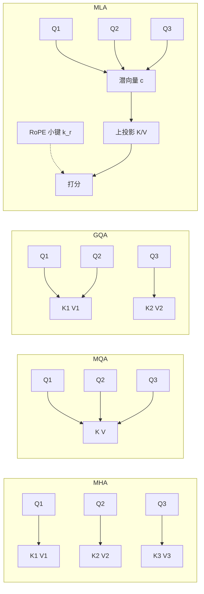

# 第 6 章 注意力机制的变体：从 MHA 到 MLA

## 本章导读

Llama 2 7B 在 8K 上下文、批量 1、FP16 精度下做推理，KV Cache 要占 4 GiB；Llama 3 8B 在同样的 8K 上下文只需要 1 GiB；DeepSeek-V2 把每 Token 的缓存压到 67.5 KiB。三者的注意力公式相同，缓存却差 4 到 8 倍。差别不在注意力公式——它们都在算同一件事：查询和键做点积、softmax 归一化、再对值加权求和。差别在于 K/V 存几份、存多宽、存在哪。本章回答三个问题：头共享和低秩压缩各自改了什么；省下来的到底是什么资源；在什么条件下值得付出实现复杂度。

## 难度标签

⭐⭐⭐ 进阶 ｜ 数学要求：矩阵乘法、softmax、低秩分解、RoPE ｜ 代码要求：PyTorch 中级

## 学习目标

读完本章你将能够：

- 画出 MHA、MQA、GQA、MLA 的 Q/K/V 头结构，写出每 Token KV Cache 的字节公式；
- 推导 MQA/GQA 的参数量与缓存量，解释为什么它们主要节省解码带宽而不是注意力 FLOPs；
- 推导 MLA 的低秩压缩、解耦 RoPE 与权重吸收恒等式，说明每一部分的必要性；
- 在 TinyLM 中按配置实现四种变体，验证因果性、MHA 退化一致性与吸收等价性；
- 给定模型宽度、层数、上下文和批量，估算缓存并选择合适的注意力变体。

## 6.1 直觉：解码时 GPU 在等内存

训练和推理是两种负载。训练时，一个批次的所有 Token 并行计算，矩阵很大，GPU 主要在做乘加，属于**计算受限**（compute-bound）。自回归推理分成两段：**预填充**（prefill）一次处理整个提示，仍然是大矩阵，接近训练；**解码**（decode）每步只生成一个 Token，矩阵向量乘占主导，GPU 大部分时间在等内存把权重和缓存搬过来，属于**内存受限**（memory-bound）。

算一笔账。一个 6.7B 模型在 FP16 下权重约 13.4 GB；每生成一个 Token 需要约 $$2N=13.4$$ GFLOP。读取权重需要 13.4 GB，所以算术强度约为 1 FLOP/byte。H100 SXM 的 FP16 稠密算力约 495 TFLOPS（不计稀疏加速），HBM 带宽约 3.35 TB/s，两者的比值约 148 FLOP/byte。也就是说，解码时硬件能提供的算力是访存能喂饱的 150 倍左右，瓶颈明确落在带宽上。

KV Cache 让这件事更糟。它不参与参数量的计算，却要在每一步被完整读一遍。Llama 2 7B 在 8K 上下文、FP16 下的缓存是 4 GiB，已经接近权重字节数的三分之一；批量开到 8，缓存变成 32 GiB，超过权重本身。上下文再长、批量再大，缓存就成了显存和带宽的主要消费者。

理解了这一点，注意力变体的设计目标就清楚了：在尽量不损失模型质量的前提下，减少 K/V 的存储与读取。MHA、MQA、GQA 走的是**共享**路线——让多个查询头共用同一组键值头；MLA 走的是**压缩**路线——不共享头，而是把 K/V 压到一个低维潜向量，每个头再从潜向量投影出自己需要的内容。

可以用一个比喻区分两条路线。MHA 给每个查询头配一本独立的笔记本，查资料快但占地方；MQA 让所有头共用一本；GQA 让一组头共用一本。MLA 则把所有笔记本的内容压缩成一份摘要，每个头按自己的索引从摘要里还原；位置信息另写一张小纸条，避免摘要被旋转操作搅乱。

这条演进线的时间顺序也值得记住。2017 年的 Transformer 用 MHA；2019 年 Shazeer 提出 MQA，把解码的访存瓶颈摆上台面；2023 年 Ainslie 等人提出 GQA，用分组共享在质量与速度之间找折中，并给出从 MHA 检查点低成本转换的方法；2024 年 DeepSeek-V2 用 MLA 把压缩路线推到生产规模。每一波都不是孤立的架构创新，而是被推理成本推着走：上下文变长、并发变高、缓存成为主要成本，才会有新的共享或压缩方式。



## 6.2 数学原理

### 6.2.1 MHA：每个头一套 K/V

设输入 $$\mathbf{x}_t\in\mathbb{R}^{d_{model}}$$，查询头数 $$n_h$$，单头维度 $$d_h=d_{model}/n_h$$。第 $$i$$ 个头的投影为

$$
\mathbf{q}_t^{(i)}=\mathbf{W}_Q^{(i)}\mathbf{x}_t,\qquad
\mathbf{k}_t^{(i)}=\mathbf{W}_K^{(i)}\mathbf{x}_t,\qquad
\mathbf{v}_t^{(i)}=\mathbf{W}_V^{(i)}\mathbf{x}_t
\qquad \text{(6.1)}
$$

其中三个权重矩阵都属于 $$\mathbb{R}^{d_h\times d_{model}}$$。因果注意力对每个头独立计算

$$
\mathbf{h}_t^{(i)}=\sum_{j\le t}\mathrm{softmax}_j\left(\frac{\mathbf{q}_t^{(i)\top}\mathbf{k}_j^{(i)}}{\sqrt{d_h}}\right)\mathbf{v}_j^{(i)}
$$

把所有头拼接，再乘输出投影 $$\mathbf{W}_O\in\mathbb{R}^{d_{model}\times d_{model}}$$，得到该位置的注意力输出。MHA 的参数量是四个 $$d_{model}\times d_{model}$$ 矩阵，即 $$4d_{model}^2$$；推理时每个头都要缓存自己的 K 和 V。把复杂度写全：预填充时每个头要算 $$T\times T$$ 的打分矩阵，时间是 $$O(T^2d_h)$$，全部头合计 $$O(T^2d_{model})$$；解码一步对 $$T$$ 个键打分，时间是 $$O(Td_{model})$$；缓存空间是 $$O(Td_{kv})$$；参数量是 $$O(d_{model}^2)$$。后文比较变体时要区分这三类量：参数量决定权重字节，缓存决定常驻显存，时间决定每步延迟。只比较参数量，会漏掉解码真正的瓶颈。

### 6.2.2 共享 K/V：从 MQA 到 GQA

多查询注意力（Multi-Query Attention, MQA）把所有查询头指向同一组 K/V，键值头数 $$n_{kv}=1$$。分组查询注意力（Grouped-Query Attention, GQA）取中间值：把 $$n_h$$ 个查询头分成 $$n_{kv}$$ 组，每组共享一套 K/V。设第 $$i$$ 个查询头属于第 $$g(i)$$ 组，

$$
g(i)=\left\lfloor \frac{i\,n_{kv}}{n_h}\right\rfloor,\qquad
\mathbf{k}_t^{(i)}=\mathbf{k}_t^{\mathrm{kv},(g(i))},\qquad
\mathbf{v}_t^{(i)}=\mathbf{v}_t^{\mathrm{kv},(g(i))}
\qquad \text{(6.2)}
$$

实现上先算出 $$n_{kv}$$ 个头的 K/V，再沿头维复制每份 $$n_h/n_{kv}$$ 次。每个查询头仍然有自己的 Q，打分和加权求和照常进行：

$$
\mathbf{o}_t=\mathbf{W}_O\left[\sum_{j\le t}\mathrm{softmax}_j\left(\frac{\mathbf{q}_t^{(i)\top}\mathbf{k}_j^{(g(i))}}{\sqrt{d_h}}\right)\mathbf{v}_j^{(g(i))}\right]_{i=1}^{n_h}
\qquad \text{(6.3)}
$$

MQA 是 $$n_{kv}=1$$ 的特例，MHA 是 $$n_{kv}=n_h$$ 的特例，GQA 在两者之间插值。三个变体共用同一套打分与归一化公式，区别只在 K/V 的份数。

共享 K/V 不等于共享查询。每个头仍然保留独立的 Q 投影，因此可以提出不同的问题；被共享的是被查询的键和值。梯度回传时，同一组 K/V 会收到组内所有查询头的梯度之和，这相当于一种结构化的权重共享：它降低了 K/V 的自由度，也带来正则化效果。代价是头与头之间的差异只能通过 Q 表达，若某个任务需要每个头维护不同的键空间，共享就会成为瓶颈。MQA 的表达力损失最大，GQA 把它分摊到多组，MLA 则用低秩潜空间替代显式共享。



GQA 的实现里最常见的两个错误：一是把 K/V 提前复制成 $$n_h$$ 份再写入缓存，显存收益直接归零；二是把 $$d_{kv}$$ 平均分给 $$n_{kv}$$ 个头，改变了单头维度。记住 $$d_h$$ 不变、只改头数。


这里有一个容易写错的地方：**减少头数时，单头维度 $$d_h$$ 不能跟着变。** K/V 的总宽度是

$$
d_{kv}=\frac{n_{kv}}{n_h}d_{model}
\qquad \text{(6.4)}
$$

每个 KV 头仍然是 $$d_h$$ 维。若把 $$d_{kv}$$ 平均分给 $$n_{kv}$$ 个头、让每头维度变成 $$d_{model}/n_{kv}$$，点积的尺度会变，和 Q 的维度也对不上。GQA 论文与所有主流实现都保持 $$d_h$$ 不变，只减少头的数量。

### 6.2.3 参数量与缓存账本

Q 和输出投影与 $$n_{kv}$$ 无关，各占 $$d_{model}^2$$；K、V 投影各占 $$d_{model}d_{kv}$$。因此

$$
N_{attn}=2d_{model}^2+2d_{model}d_{kv}
\qquad \text{(6.5)}
$$

MHA 时 $$d_{kv}=d_{model}$$，退化为 $$4d_{model}^2$$。GQA-8 在 32 个查询头、$$d_{model}=4096$$ 时，$$d_{kv}=1024$$，参数量从 67.1M 降到 41.9M；MQA 降到 34.6M。

推理缓存记批量 $$b$$、上下文长度 $$T$$、层数 $$L$$、每元素字节数 $$b_{\mathrm{elem}}$$（FP16 为 2）。K 和 V 各存一份，所以

$$
M_{kv}=2\,b\,T\,L\,n_{kv}\,d_h\,b_{\mathrm{elem}}
=2\,b\,T\,L\,d_{kv}\,b_{\mathrm{elem}}
\qquad \text{(6.6)}
$$

缓存对 $$n_{kv}$$ 是线性的，与查询头数 $$n_h$$ 无关。这是头共享最直接的收益：把 KV 头数减半，缓存和读取字节数就减半。

对 Llama 2 7B 的尺寸（$$d_{model}=4096$$、$$L=32$$、$$n_h=32$$、$$d_h=128$$、$$T=8192$$、FP16），代入 (6.6)：

$$
M_{kv}=2\times1\times8192\times32\times32\times128\times2\ \text{B}=4\ \text{GiB}
$$

GQA-8 把 32 个 KV 头减到 8 个，缓存变成 1 GiB；MQA 减到 1 个，变成 128 MiB。MLA 在这个对照里用 512 维潜向量加 64 维 RoPE 键，缓存是 288 MiB。这些数字都在 6.4 节由代码逐项复算。这里把三种配置统一放在 8K 上下文上做受控比较，不代表各自的训练上下文：Llama 2 7B 原生长度是 4K，这里只是借用它的宽度与层数来算缓存。

### 6.2.4 省的是带宽，不是注意力 FLOPs

一个常见的误解是：减少 KV 头会让注意力计算变快。看 FLOPs 就知道不是这样。预填充阶段，单个位置对全部 $$T$$ 个键打分的计算量是 $$2n_hd_hT=2d_{model}T$$，加权求和再花同样多，合计每层约 $$4d_{model}T$$。这个量与 $$n_{kv}$$ 无关，因为查询头数没有变。GQA 真正减少的是 K/V 投影的矩阵乘（从 $$2d_{model}^2$$ 降到 $$2d_{model}d_{kv}$$）和缓存的读写量；前者在整模型 FLOPs 中占比很小，后者才是解码的瓶颈。

解码阶段可以把每步的耗时近似写成访存量除以带宽：

$$
t_{\mathrm{dec}}\approx\frac{2N\,b_{\mathrm{elem}}+2\,b\,L\,T\,d_{kv}\,b_{\mathrm{elem}}}{\mathrm{BW}}
\qquad \text{(6.7)}
$$

第一项是读全部权重，第二项是读 KV Cache。$$N$$ 是总参数量，$$\mathrm{BW}$$ 是显存带宽。MLA 把第二项里的 $$2d_{kv}$$ 换成 $$d_c+d_r$$。这个模型忽略了计算时间，但它足以解释三件事：批量 $$b$$ 越大，缓存项越重要；上下文 $$T$$ 越长，缓存项越重要；权重项与批量无关，因为一份权重可以喂给整个批次。

把 Llama 2 7B 的数字代入：权重项约 27 GB，$$T=8192$$ 时 MHA 的缓存项在 $$b=8$$ 时约 34 GB，开始超过权重。若换成 GQA-8，缓存项降到 8.6 GB，权重重新占主导。这就是为什么长上下文服务普遍用 GQA：它不是让注意力数学更便宜，而是把每步要搬的字节数降下来。

### 6.2.5 MLA：压缩而不是共享

多头潜在注意力（Multi-head Latent Attention, MLA）换了一条路。它不减少头的数量，而是假设 K/V 可以由一个低维潜向量生成。先做下投影：

$$
\mathbf{c}_t=\mathbf{W}_{DKV}\mathbf{x}_t,\qquad
\mathbf{c}_t\in\mathbb{R}^{d_c},\quad d_c\ll d_{model}
\qquad \text{(6.8)}
$$

每个头再从潜向量上投影出键和值：

$$
\mathbf{k}_t^{(i)}=\mathbf{W}_{UK}^{(i)}\mathbf{c}_t,\qquad
\mathbf{v}_t^{(i)}=\mathbf{W}_{UV}^{(i)}\mathbf{c}_t
\qquad \text{(6.9)}
$$

其中 $$\mathbf{W}_{UK}^{(i)},\mathbf{W}_{UV}^{(i)}\in\mathbb{R}^{d_h\times d_c}$$。推理时只缓存 $$\mathbf{c}_t$$，不需要缓存每个头的 K/V。每个头用自己的一套上投影从同一份潜向量里取出不同的键值——这相当于把“共享一本笔记本”换成了“共享一份摘要，各自按索引还原”。

压缩能成立的前提是 K/V 矩阵近似低秩。DeepSeek-V2 的消融显示，压缩维度继续减小会掉点，512 是质量与压缩率的折中点；这个结论依赖模型宽度与数据，不能直接照搬。从线性代数看，所有头的 K/V 都从同一个 $$d_c$$ 维潜空间生成，等价于把每个头的键矩阵约束在至多 $$d_c$$ 维的子空间里。若真实的键值变化主要集中在这个子空间内，压缩几乎无损；若某些头需要捕捉子空间之外的方向，压缩就会和头共享一样损失表达力。$$d_c$$ 的选择因此是在“每个头保留多少独立方向”和“缓存多大”之间做权衡，而不是一个纯工程参数。

位置编码带来一个麻烦。如果直接对 $$\mathbf{k}_t^{(i)}=\mathbf{W}_{UK}^{(i)}\mathbf{c}_t$$ 施加 RoPE，旋转矩阵会和上投影纠缠在一起：不同位置需要不同的旋转，而缓存里只有一份 $$\mathbf{c}_t$$，无法在读取时对每个头分别旋转后再线性投影。更根本的是，RoPE 的旋转破坏了低秩结构——对每个位置旋转后的 K 不再落在同一个低维子空间里。

解决方案是**解耦 RoPE**（decoupled RoPE）：把键分成两部分，内容键走低秩通路，位置键走一条维度很小的独立通路。打分写成

$$
s_{tj}^{(i)}=\frac{\mathbf{q}_t^{(i)\top}\mathbf{k}_j^{(i)}}{\sqrt{d_h}}
+\frac{\mathbf{q}_{r,t}^{(i)\top}\mathbf{k}_{r,j}}{\sqrt{d_r}}
\qquad \text{(6.10)}
$$

其中 $$\mathbf{q}_{r,t}^{(i)}=\mathbf{W}_{QR}^{(i)}\mathbf{x}_t\in\mathbb{R}^{d_r}$$，$$\mathbf{k}_{r,j}=\mathbf{W}_{KR}\mathbf{x}_j\in\mathbb{R}^{d_r}$$。位置键在所有头之间共享一份，维度 $$d_r$$ 通常取 64 左右。缓存因此包含两部分：

$$
M_{MLA}=b\,T\,L\,(d_c+d_r)\,b_{\mathrm{elem}}
\qquad \text{(6.11)}
$$

DeepSeek-V2 取 $$d_c=512$$、$$d_r=64$$，每 Token 每层缓存 576 个标量，FP16 下 1152 字节；60 层合计 67.5 KiB/Token。论文报告的 93.3% 缓存缩减是相对 DeepSeek 67B 的整机对比，包含层数、MoE 和实现差异，不是 MLA 单独的因果效应。用 (6.15) 对同宽度的 MHA 做受控比较，压缩率是 $$1-576/10240=94.4\%$$。

### 6.2.6 权重吸收：把解压推迟到必要时

MLA 还有一个推理侧的变换，叫**权重吸收**（weight absorption）。内容通路的打分可以改写：

$$
\mathbf{q}_t^{(i)\top}\mathbf{k}_j^{(i)}
=\left(\mathbf{W}_Q^{(i)}\mathbf{x}_t\right)^\top
\left(\mathbf{W}_{UK}^{(i)}\mathbf{c}_j\right)
=\left(\mathbf{W}_{UK}^{(i)\top}\mathbf{W}_Q^{(i)}\mathbf{x}_t\right)^\top\mathbf{c}_j
\qquad \text{(6.12)}
$$

定义吸收后的查询 $$\tilde{\mathbf{q}}_t^{(i)}=\mathbf{W}_{UK}^{(i)\top}\mathbf{W}_Q^{(i)}\mathbf{x}_t\in\mathbb{R}^{d_c}$$，打分就变成 $$\tilde{\mathbf{q}}_t^{(i)\top}\mathbf{c}_j/\sqrt{d_h}$$，可以直接在潜空间里算。输出侧同理：把输出投影的第 $$i$$ 个块记为 $$\mathbf{W}_O^{(i)}\in\mathbb{R}^{d_{model}\times d_h}$$，则

$$
\mathbf{o}_t=\sum_{i=1}^{n_h}\mathbf{W}_O^{(i)}\mathbf{W}_{UV}^{(i)}
\sum_{j\le t}\alpha_{tj}^{(i)}\mathbf{c}_j,\qquad
\mathbf{W}_{OV}^{(i)}=\mathbf{W}_O^{(i)}\mathbf{W}_{UV}^{(i)}
\qquad \text{(6.13)}
$$

吸收后的矩阵 $$\mathbf{W}_{OV}^{(i)}\in\mathbb{R}^{d_{model}\times d_c}$$ 可以离线预计算。解码时不需要显式还原每个头的 K/V，直接在 512 维潜空间里完成打分和加权。代价有两处：吸收改变了浮点运算的顺序，数值误差会累积；RoPE 通路不能吸收，仍然要在小维度上单独计算。6.4 节用随机权重验证内容通路的等价性，最大输出误差是 $$1.49\times10^{-7}$$，说明这个恒等式在 FP32 下成立。

训练时通常不用吸收形式，因为要同时更新所有投影；吸收主要服务于推理部署。

权重吸收是代数恒等式，但在 FP16/BF16 下会改变求和顺序。潜向量投影的矩阵条件数较大时，吸收后的打分误差可能放大；量化部署前要用真实权重校准，不要只在随机初始化上验证。


另一个工程细节是，吸收后的矩阵可能比原矩阵条件数更差，量化时需要单独校准。吸收的收益可以用维度算清楚。未吸收时，每个 Token 要先算 $$d_{model}$$ 维的 Q，再与每个头的 $$d_h$$ 维 K 做点积；吸收后，Q 先投到 $$d_c$$ 维，点积在潜空间完成，读取的缓存也从每头 K/V 变成一份 $$\mathbf{c}_t$$。当 $$d_c<d_{model}$$ 时，打分和读缓存的成本都下降；输出侧把 $$\mathbf{W}_{OV}^{(i)}$$ 预先合并，在线只做一次 $$d_{model}\times d_c$$ 的乘加。代价是这些合并矩阵要在部署时物化，张量并行的切分方式也随之改变：原本按头切分，吸收后要按潜维度切分，通信模式不同。

### 6.2.7 参数量汇总

MLA 的投影包括：Q、输出各 $$d_{model}^2$$；下投影 $$d_{model}d_c$$；K、V 上投影各 $$d_{model}d_c$$；查询 RoPE 投影 $$n_hd_{model}d_r$$；共享位置键投影 $$d_{model}d_r$$。合计

$$
N_{MLA}=2d_{model}^2+3d_{model}d_c+d_{model}d_r(n_h+1)
\qquad \text{(6.14)}
$$

与 MHA 相比，MLA 省掉了随头数增长的 K/V 投影，但增加了潜空间的上、下投影和 RoPE 通路。$$d_c=512$$、$$d_r=64$$、$$d_{model}=4096$$、$$n_h=32$$ 时，MLA 的注意力参数是 48.5M，比 MHA 的 67.1M 少 18.6M，却比 GQA-8 的 41.9M 多。它买到的不是最少的参数，而是在接近 MHA 表达力的前提下把缓存压到 36 KiB/Token。若把 RoPE 通路的 8.65M 参数去掉，MLA 只剩 39.8M，接近 GQA-8；这说明解耦位置编码不是免费的，它用额外参数换取了压缩与位置的解耦。

最后给出缓存比的闭式表达。以 MHA 为基准，$$M_{MHA}=2bTLd_{model}b_{\mathrm{elem}}$$，于是

$$
\frac{M_{MLA}}{M_{MHA}}=\frac{d_c+d_r}{2d_{model}}
\qquad \text{(6.15)}
$$

这个比值只由潜向量宽度和模型宽度决定，与层数、批量、上下文无关。DeepSeek-V2 的 576/10240 给出 5.6%，对应 94.4% 的缩减；本章账本里 576/8192 给出 7.0%，对应 36 KiB/Token。

### 6.2.8 完整账本：FLOPs、字节数与算术强度

前面的公式分别看参数、缓存和延迟。把三者合起来，才能判断一段负载是计算受限还是访存受限。预填充一个长度为 $$T$$ 的序列约需 $$F_{\mathrm{prefill}}\approx 2NT+4LT^2d_{model}$$ 次浮点运算：第一项是全部权重的矩阵乘，第二项是注意力的打分与加权。解码每生成一个 Token 约需 $$F_{\mathrm{decode}}\approx 2N+4LTd_{model}$$ 次浮点运算：权重矩阵乘约 $$2N$$ 次，注意力约 $$4LTd_{model}$$ 次。访存量按 (6.6) 或 (6.11) 计算。以 $$d_{model}=4096$$、$$L=32$$、$$T=8192$$、$$N\approx6.7\times10^9$$、FP16、批量 1 为例：

| 指标 | MHA | GQA-8 | MQA | MLA |
| --- | --- | --- | --- | --- |
| 每 Token 解码 FLOPs | 17.7 GFLOP | 17.7 GFLOP | 17.7 GFLOP | 17.7 GFLOP |
| 每 Token 缓存 | 4 GiB | 1 GiB | 128 MiB | 288 MiB |
| 批量 1 总字节 | 31.1 GB | 27.9 GB | 27.0 GB | 27.1 GB |
| 批量 1 算术强度 | 0.57 | 0.63 | 0.66 | 0.65 |
| 批量 8 算术强度 | 2.3 | 4.0 | 5.1 | 4.9 |

表中的 FLOPs 是每生成一个 Token 的总量，权重项与注意力项都已计入；MLA 的额外投影约 0.2%，表中按 17.7 GFLOP 取整。总字节是权重 26.8 GB 加缓存字节。算术强度等于 FLOPs 除以字节数，单位是 FLOP/byte。

这张表说明两件事。第一，批量 1 时权重项占绝对主导，四种变体的强度都在 0.6 左右，差异只有 15%；批量增大后权重被摊薄，缓存项的相对份额上升，GQA/MQA/MLA 的优势才显现出来。第二，即使批量 8，最高强度也只有 5 左右，仍比 H100 的约 148 低一个数量级以上。也就是说，这些变体都没有把解码从访存受限变成计算受限；它们只是把分母变小，让同样的带宽能服务更多 Token。真正的计算受限场景是预填充：强度随 $$T$$ 线性增长，所以 GQA 对预填充的加速有限，对解码的加速明显。把预填充的数字也摆出来：8K 序列约需 $$2NT+4LT^2d_{model}\approx145$$ TFLOP，而权重只有 13.4 GB，算术强度远高于硬件平衡点，瓶颈在算力而不是带宽。解码一步只要约 17.7 GFLOP，却要读 27 到 31 GB，强度不到 1。同一个模型、同一张卡，两段负载的性质完全相反。这也解释了为什么推理系统通常把预填充和解码分开调度：预填充适合大批量、高并行；解码适合小批量、频繁读缓存，缓存布局和带宽决定吞吐。

**训练、转换与张量并行。** GQA 的一个重要工程优势是**可以从 MHA 检查点转换**：把每组内的 K/V 头做平均池化，得到 $$n_{kv}$$ 个头，再继续预训练少量步数。Ainslie 等人报告，转换加继续训练只需要原预训练算力的约 5%，就能恢复接近 MHA 的质量。这使得已经训练好的 MHA 模型可以低成本迁移到 GQA，也是 GQA 在 2023 年后迅速普及的原因之一。MQA 也可以从 MHA 转换，但它把全部头压成一组，表达力损失更难用短时间继续训练补回；PaLM 是在超大规模上从头训练并仔细调参的案例。MLA 则不适合这种“池化转换”：下投影和上投影需要重新学习，DeepSeek-V2 是从零训练的。把已有 MHA 模型直接改成 MLA，通常要重新预训练或至少做大规模继续训练。

张量并行也会改变结论。GQA 的 $$n_{kv}$$ 必须能被张量并行度整除，否则 KV 头只能复制，显存收益打折。例如 $$n_{kv}=8$$ 配 8 路张量并行，每路正好一个 KV 头；配 16 路时，每路只能复制半份或让两组共享，缓存不再按 16 倍缩减。MLA 的潜向量 $$\mathbf{c}_t$$ 在所有头之间共享，下投影之后需要一次跨卡归约，或者每张卡重复计算下投影；这增加了通信量，也是 MLA 推理内核比 GQA 复杂的原因之一。选变体时不能只看单卡账本，还要看并行切分方式。

### 6.2.9 缓存布局与分页

公式给出的是逻辑字节数，真正占多少显存还取决于缓存怎么排布。GQA 的缓存张量通常按层组织，每层形状为 $$[b,n_{kv},T,d_h]$$，只存 $$n_{kv}$$ 份 K 和 V。**千万不能在写入缓存之前把 K/V 复制成 $$n_h$$ 份**：复制之后每个头各存一份，头共享的显存收益立刻消失。正确顺序是只存 $$n_{kv}$$ 份，在计算注意力时临时广播或分组读取；MLA 同理，只存 $$\mathbf{c}_t$$ 与 $$\mathbf{k}_{r,t}$$，不要在每个头下重建 K/V。

缓存的生命周期很简单：预填充把整段提示写入，之后每生成一个 Token，各层追加一行。变长请求让连续分配很难做：为最坏长度预留会浪费，按实际长度分配又会产生碎片。分页注意力（paged attention）把缓存切成固定大小的块，用一张块表把逻辑位置映射到物理块，像操作系统的虚拟内存。它把碎片从“每条序列内部”转移到“块之间”，并让不同请求共享相同前缀的块。分页不改变 (6.6) 的逻辑字节数，但决定了实际峰值显存和能开多大批量；估算时要把块对齐的浪费算进去。

MLA 的缓存布局还有一个细节：$$\mathbf{k}_{r,t}$$ 在所有头之间共享，只存一份，不要按头复制；吸收后的查询 $$\tilde{\mathbf{q}}_t$$ 是每 Token 的临时量，不进入缓存。把这三类张量分清，才能让账本和实测对上。

## 6.3 方案对比

把四种变体放在同一组尺寸下（$$d_{model}=4096$$、$$L=32$$、$$n_h=32$$、$$d_h=128$$、$$T=8192$$、FP16、批量 1），账本如下：

| 变体 | KV 头数 | 注意力参数 | 总参数 | 每 Token 缓存 | 8K 缓存 | 质量趋势 | 代表模型 |
| --- | --- | --- | --- | --- | --- | --- | --- |
| MHA | 32 | 67,108,864 | 6,738,415,616 | 512 KiB | 4 GiB | 基准 | GPT-3、Llama 2 7B |
| GQA-8 | 8 | 41,943,040 | 5,933,109,248 | 128 KiB | 1 GiB | 接近 MHA | Llama 3 8B、Mistral 7B |
| MQA | 1 | 34,603,008 | 5,698,228,224 | 16 KiB | 128 MiB | 小模型可能掉点 | PaLM 540B、Falcon |
| MLA | 潜向量 | 48,496,640 | 6,142,824,448 | 36 KiB | 288 MiB | 接近 MHA | DeepSeek-V2/V3 |

读表要注意两点。第一，MLA 的“KV 头数”不是传统意义上的头，缓存的是 512 维潜向量加 64 维位置键；表中用“潜向量”标出，避免和头共享混淆。第二，总参数列包含前馈、嵌入和归一化，MLA 的总参数比 GQA-8 多 210M，因为多了潜空间投影与 RoPE 通路；它的优势在缓存，不在参数。

选择时可以按下面的顺序判断：

1. **如果推理不是瓶颈**，例如只做离线批量生成或小规模研究，MHA 的实现最简单，调试成本最低。
2. **如果需要长上下文或高并发，且希望改动最小**，选 GQA。它只需要改 K/V 投影的输出宽度和一次复制，训练与推理都能直接受益，质量损失在中等规模上通常很小。
3. **如果显存极度紧张且能接受质量风险**，MQA 最省缓存，但在小模型上更容易掉点，通常需要更长的训练或蒸馏来补偿。
4. **如果愿意承担结构改动和实现复杂度**，MLA 能在接近 MHA 的质量下把缓存压到 GQA-8 的三分之一以下；代价是训练代码、吸收变换和数值校准。

| 维度 | MHA | MQA | GQA | MLA |
| --- | --- | --- | --- | --- |
| 缓存复杂度 | $$O(Td_{model})$$ | $$O(Td_{model}/n_h)$$ | $$O(Td_{model}n_{kv}/n_h)$$ | $$O(T(d_c+d_r))$$ |
| 注意力 FLOPs | 基准 | 几乎不变 | 几乎不变 | 略增（多两条小投影） |
| 预填充速度 | 基准 | 略快 | 略快 | 取决于实现 |
| 解码带宽 | 最高 | 最低 | 居中 | 低 |
| 实现改动 | 无 | 小 | 小 | 大 |
| 质量风险 | 最低 | 最高 | 低到中 | 低 |

### 6.3.1 质量证据：GQA 论文的对照

Ainslie 等人在 T5-XXL 规模、单块 TPUv4 上报告了一组常被引用的数字：MHA-XXL 的平均分是 47.2，每个样本的推理时间是 1.51 秒；GQA-8-XXL 是 47.1 和 0.28 秒；MQA-XXL 是 46.6 和 0.24 秒。GQA-8 只比 MHA 低 0.1 分，推理时间降到后者的 18.5%；MQA 比 GQA-8 再快 0.04 秒，但低了 0.5 分。这组数字解释了为什么 GQA-8 成为工业默认：它在质量上几乎追平 MHA，在速度上几乎追平 MQA。

| 配置 | 平均分 | 每样本推理时间 | 相对 MHA 时间 |
| --- | --- | --- | --- |
| MHA-XXL | 47.2 | 1.51 s | 100% |
| GQA-8-XXL | 47.1 | 0.28 s | 18.5% |
| MQA-XXL | 46.6 | 0.24 s | 15.9% |

这些数字来自特定模型、硬件和任务平均，不能直接外推到所有规模。但它们给出一个有价值的参照：在 7B 到 70B 这一档，GQA 的分组数取 8 左右，通常能在质量损失很小的情况下拿到大部分速度收益。分组数继续增大，收益递减；继续减小，质量风险上升。

### 6.3.2 选型清单

把前面的公式整理成四个问题，按顺序回答，就能缩小候选范围。

**第一，缓存是否已经成为瓶颈？** 用 (6.6) 算每 Token 字节数，再乘以上下文和批量，和权重字节数比较。由 (6.7)，缓存项超过权重项的条件是 $$b\,L\,T\,d_{kv}>N$$。对 Llama 2 7B 的尺寸，$$L T d_{kv}=32\times8192\times4096\approx1.07\times10^9$$，总参数 $$N\approx6.7\times10^9$$，所以批量超过 6 左右，缓存项就超过权重。若服务只跑批量 1、上下文 2K，缓存不是主要矛盾，换变体的收益有限；若批量 8、上下文 32K，缓存主导，GQA/MLA 值得投入。

**第二，质量容差有多大？** 如果评测集足够大、能分辨 0.5 分的差异，优先 GQA-8 或 GQA-4；如果连 0.1 分都不能掉，MHA 或 MLA 更稳。MQA 在小模型上的掉点风险最高，除非有蒸馏或长训练预算，否则不作为默认。

**第三，训练预算和转换成本是多少？** 已有 MHA 检查点时，GQA 的均值池化加 5% 继续训练是最便宜的路径；从零训练时，GQA 与 MHA 的成本接近；MLA 需要重新学习下/上投影，通常要从头训练或大规模继续训练，预算不足时不要选。

**第四，推理栈支持吗？** GQA 的分组读取在主流框架里都有内核；MLA 的吸收形式需要专门实现，张量并行时还要处理潜向量的归约。若部署框架只支持标准 MHA/GQA，选 MLA 会带来额外的工程风险。四个问题都过一遍，剩下的候选通常只有一两个。

## 6.4 代码实现：TinyLM 的注意力变体

### 6.4.1 实现选择

本章在第 4、5 章的代码上做增量，`TinyLM.forward` 的签名和 `CausalLMOutput` 不变：

- `config.py`：新增 `attention`（`mha`/`mqa`/`gqa`/`mla`）、`n_kv_heads`、`d_c`、`d_head_rope` 四个字段。`n_kv_heads=None` 时按变体取默认值：MHA 为 $$n_h$$，MQA 为 1，GQA 必须显式指定；
- `attention.py`：`VariantAttention` 实现 MHA/MQA/GQA 的分派，K/V 投影输出宽度为 $$n_{kv}d_h$$，用 `repeat_interleave` 复制到 $$n_h$$ 个头；`LatentAttention` 实现 MLA 的下投影、上投影、解耦 RoPE 与输出投影；
- 位置编码继续复用第 4 章的 `RoPE`/`ALiBi`：MHA 系变体在复制之前对 K 施加 RoPE；MLA 只对解耦的位置键施加 RoPE，内容键不旋转；
- 新增 `attention_params`、`exact_params`、`kv_cache_bytes`，把 (6.5)、(6.6)、(6.11)、(6.14)、(6.15) 变成可执行的账本；
- 新增 `mla_absorption_error`，用随机权重数值验证 (6.12)；
- 复制任务消融沿用第 5 章的设定，只改注意力变体，控制其他变量。

完整项目里这些代码分属 `attention.py`、`config.py`、`block.py`、`model.py`；为了让本章独立运行，下面合并成一个文件，与第 3、4、5 章的 `ch03.py`、`ch04.py`、`ch05.py` 放在同一目录。

### 6.4.2 完整代码

```python
"""第 6 章：注意力机制的变体（tinylm/attention.py、config.py 的增量）。"""
import math
import sys
from dataclasses import dataclass

import torch
import torch.nn as nn
import torch.nn.functional as F

sys.path.insert(0, ".")
from ch03 import CausalLMOutput
from ch04 import ALiBi, RoPE, sinusoidal_positions
from ch05 import ModelConfig as Config5, make_ffn, make_norm


# ---------------------------------------------------------------- config.py
@dataclass(frozen=True)
class ModelConfig(Config5):
    attention: str = "mha"          # mha | mqa | gqa | mla
    n_kv_heads: int | None = None   # GQA 的 KV 头数
    d_c: int = 128                  # MLA 的 KV 压缩维度
    d_head_rope: int = 32           # MLA 解耦 RoPE 的键维度

    def __post_init__(self):
        super().__post_init__()
        assert self.attention in ("mha", "mqa", "gqa", "mla")
        if self.attention == "mla":
            assert self.d_c > 0 and self.d_head_rope > 0
            return
        if self.attention == "mha":
            n_kv = self.n_heads
        elif self.attention == "mqa":
            n_kv = 1
        else:
            assert self.n_kv_heads is not None, "GQA 必须指定 n_kv_heads"
            n_kv = self.n_kv_heads
        object.__setattr__(self, "n_kv_heads", n_kv)
        assert self.n_heads % n_kv == 0, "n_heads 必须是 n_kv_heads 的整数倍"


# ---------------------------------------------------------------- attention.py
class VariantAttention(nn.Module):
    """公式 (6.2)、(6.3)：Q 有 n_heads 个头，K/V 只有 n_kv_heads 个头。"""

    def __init__(self, cfg):
        super().__init__()
        d, h = cfg.d_model, cfg.n_heads
        self.n_heads = h
        self.n_kv_heads = cfg.n_kv_heads
        self.d_head = d // h
        self.repeat = h // cfg.n_kv_heads
        self.pos_mode = cfg.pos_encoding
        self.q_proj = nn.Linear(d, d, bias=cfg.bias)
        self.k_proj = nn.Linear(d, cfg.n_kv_heads * self.d_head, bias=cfg.bias)
        self.v_proj = nn.Linear(d, cfg.n_kv_heads * self.d_head, bias=cfg.bias)
        self.out_proj = nn.Linear(d, d, bias=cfg.bias)
        if self.pos_mode == "rope":
            self.rope = RoPE(self.d_head, cfg.rope_theta, cfg.rope_scaling,
                             cfg.max_seq_len)
        if self.pos_mode == "alibi":
            self.alibi = ALiBi(h)
        mask = torch.triu(
            torch.full((cfg.max_seq_len, cfg.max_seq_len), float("-inf")),
            diagonal=1,
        )
        self.register_buffer("causal_mask", mask, persistent=False)

    def forward(self, x, attention_mask=None, position_ids=None):
        B, T, _ = x.shape
        q = self.q_proj(x).view(B, T, self.n_heads, self.d_head).transpose(1, 2)
        k = self.k_proj(x).view(B, T, self.n_kv_heads, self.d_head).transpose(1, 2)
        v = self.v_proj(x).view(B, T, self.n_kv_heads, self.d_head).transpose(1, 2)

        if self.pos_mode == "rope":
            q, k = self.rope(q, k, position_ids)
        if self.repeat > 1:
            k = k.repeat_interleave(self.repeat, dim=1)          # 公式 (6.2)
            v = v.repeat_interleave(self.repeat, dim=1)
        scores = q @ k.transpose(-2, -1) / math.sqrt(self.d_head)
        if self.pos_mode == "rope" and self.rope.temp != 1.0:
            scores = scores / math.sqrt(self.rope.temp)
        if self.pos_mode == "alibi":
            scores = scores + self.alibi(T, x.device)

        if T > self.causal_mask.size(0):
            mask = torch.triu(
                torch.full((T, T), float("-inf"), device=x.device,
                           dtype=scores.dtype),
                diagonal=1,
            )
        else:
            mask = self.causal_mask[:T, :T]
        scores = scores + mask
        if attention_mask is not None:
            pad = attention_mask[:, None, None, :] == 0
            scores = scores.masked_fill(pad, float("-inf"))

        attn = scores.softmax(dim=-1)
        out = attn @ v
        out = out.transpose(1, 2).reshape(B, T, self.n_heads * self.d_head)
        return self.out_proj(out)


class LatentAttention(nn.Module):
    """公式 (6.8)–(6.10)：KV 联合低秩压缩 + 解耦 RoPE。"""

    def __init__(self, cfg):
        super().__init__()
        d, h = cfg.d_model, cfg.n_heads
        self.n_heads = h
        self.d_head = d // h
        self.d_c = cfg.d_c
        self.d_rope = cfg.d_head_rope
        self.pos_mode = cfg.pos_encoding
        self.q_proj = nn.Linear(d, d, bias=cfg.bias)
        self.kv_down = nn.Linear(d, cfg.d_c, bias=cfg.bias)      # (6.8)
        self.k_up = nn.Linear(cfg.d_c, d, bias=cfg.bias)         # (6.9)
        self.v_up = nn.Linear(cfg.d_c, d, bias=cfg.bias)         # (6.9)
        self.q_rope = nn.Linear(d, h * cfg.d_head_rope, bias=cfg.bias)
        self.k_rope = nn.Linear(d, cfg.d_head_rope, bias=cfg.bias)
        self.out_proj = nn.Linear(d, d, bias=cfg.bias)
        if self.pos_mode == "rope":
            self.rope = RoPE(cfg.d_head_rope, cfg.rope_theta,
                             cfg.rope_scaling, cfg.max_seq_len)
        if self.pos_mode == "alibi":
            self.alibi = ALiBi(h)
        mask = torch.triu(
            torch.full((cfg.max_seq_len, cfg.max_seq_len), float("-inf")),
            diagonal=1,
        )
        self.register_buffer("causal_mask", mask, persistent=False)

    def forward(self, x, attention_mask=None, position_ids=None):
        B, T, _ = x.shape
        q = self.q_proj(x).view(B, T, self.n_heads, self.d_head).transpose(1, 2)
        c = self.kv_down(x)                                       # (6.8)
        k = self.k_up(c).view(B, T, self.n_heads, self.d_head).transpose(1, 2)
        v = self.v_up(c).view(B, T, self.n_heads, self.d_head).transpose(1, 2)
        q_r = self.q_rope(x).view(B, T, self.n_heads, self.d_rope).transpose(1, 2)
        k_r = self.k_rope(x).view(B, T, 1, self.d_rope).transpose(1, 2)

        if self.pos_mode == "rope":
            q_r, k_r = self.rope(q_r, k_r, position_ids)          # (6.10)
        scores = q @ k.transpose(-2, -1) / math.sqrt(self.d_head)
        scores = scores + q_r @ k_r.transpose(-2, -1) / math.sqrt(self.d_rope)
        if self.pos_mode == "alibi":
            scores = scores + self.alibi(T, x.device)

        if T > self.causal_mask.size(0):
            mask = torch.triu(
                torch.full((T, T), float("-inf"), device=x.device,
                           dtype=scores.dtype),
                diagonal=1,
            )
        else:
            mask = self.causal_mask[:T, :T]
        scores = scores + mask
        if attention_mask is not None:
            pad = attention_mask[:, None, None, :] == 0
            scores = scores.masked_fill(pad, float("-inf"))

        attn = scores.softmax(dim=-1)
        out = attn @ v
        out = out.transpose(1, 2).reshape(B, T, self.n_heads * self.d_head)
        return self.out_proj(out)


def make_attention(cfg):
    if cfg.attention == "mla":
        return LatentAttention(cfg)
    return VariantAttention(cfg)


# ---------------------------------------------------------------- block.py
class TransformerBlock(nn.Module):
    def __init__(self, cfg):
        super().__init__()
        self.parallel = cfg.parallel_block
        self.norm1 = make_norm(cfg)
        self.attn = make_attention(cfg)
        self.norm2 = None if self.parallel else make_norm(cfg)
        self.mlp = make_ffn(cfg)

    def forward(self, x, attention_mask=None, position_ids=None):
        if self.parallel:
            h = self.norm1(x)
            return x + self.attn(h, attention_mask, position_ids) + self.mlp(h)
        x = x + self.attn(self.norm1(x), attention_mask, position_ids)
        return x + self.mlp(self.norm2(x))


# ---------------------------------------------------------------- model.py
class TinyLM(nn.Module):
    def __init__(self, cfg):
        super().__init__()
        self.cfg = cfg
        self.pos_mode = cfg.pos_encoding
        self.tok_emb = nn.Embedding(cfg.vocab_size, cfg.d_model)
        if self.pos_mode == "learned":
            self.pos_emb = nn.Embedding(cfg.max_seq_len, cfg.d_model)
        elif self.pos_mode == "sine":
            self.register_buffer(
                "sin_pe", sinusoidal_positions(cfg.max_seq_len, cfg.d_model),
                persistent=False,
            )
        self.blocks = nn.ModuleList([TransformerBlock(cfg) for _ in range(cfg.n_layers)])
        self.ln_f = make_norm(cfg)
        self.lm_head = nn.Linear(cfg.d_model, cfg.vocab_size, bias=False)
        self.apply(self._init_weights)
        if cfg.tie_embeddings:
            self.lm_head.weight = self.tok_emb.weight
        std = 0.02 / math.sqrt(2 * cfg.n_layers)
        for name, p in self.named_parameters():
            if name.endswith(("out_proj.weight", "fc_out.weight", "w_down.weight")):
                nn.init.normal_(p, mean=0.0, std=std)

    @staticmethod
    def _init_weights(module):
        if isinstance(module, nn.Linear):
            nn.init.normal_(module.weight, mean=0.0, std=0.02)
            if module.bias is not None:
                nn.init.zeros_(module.bias)
        elif isinstance(module, nn.Embedding):
            nn.init.normal_(module.weight, mean=0.0, std=0.02)

    def forward(self, input_ids, *, attention_mask=None, position_ids=None,
                past_kv=None, use_cache=False, labels=None, logits_to_keep=None):
        B, T = input_ids.shape
        if self.pos_mode in ("learned", "sine"):
            assert T <= self.cfg.max_seq_len, "序列长度超过 max_seq_len"
        if position_ids is None:
            position_ids = torch.arange(T, device=input_ids.device)

        x = self.tok_emb(input_ids)
        if self.pos_mode == "learned":
            x = x + self.pos_emb(position_ids)
        elif self.pos_mode == "sine":
            x = x + self.sin_pe[position_ids]
        for block in self.blocks:
            x = block(x, attention_mask, position_ids)

        x = self.ln_f(x)
        logits = self.lm_head(x)
        loss = None
        if labels is not None:
            loss = F.cross_entropy(
                logits.reshape(-1, self.cfg.vocab_size),
                labels.reshape(-1),
                ignore_index=-100,
            )
        return CausalLMOutput(logits=logits, loss=loss)


# ---------------------------------------------------------------- 账本
def attention_params(cfg):
    """公式 (6.5)、(6.13)：注意力子层的参数量。"""
    d, h = cfg.d_model, cfg.n_heads
    if cfg.attention == "mla":
        p = 2 * d * d + 3 * d * cfg.d_c + d * cfg.d_head_rope * (h + 1)
        if cfg.bias:
            p += 4 * d + cfg.d_c + (h + 1) * cfg.d_head_rope
        return p
    d_kv = cfg.n_kv_heads * (d // h)
    p = 2 * d * d + 2 * d * d_kv
    if cfg.bias:
        p += 2 * d + 2 * d_kv
    return p


def exact_params(cfg):
    """把 (6.5) 代入第 5 章 (5.11) 的整模型账本。"""
    d, f, V, L = cfg.d_model, cfg.d_ff, cfg.vocab_size, cfg.max_seq_len
    attn = attention_params(cfg)
    if cfg.ffn == "swiglu":
        ffn = 3 * d * f + ((2 * f + d) if cfg.bias else 0)
    else:
        ffn = 2 * d * f + ((f + d) if cfg.bias else 0)
    norm_p = d + (d if cfg.norm == "layernorm" and cfg.bias else 0)
    layer_norms = norm_p if cfg.parallel_block else 2 * norm_p
    per_layer = attn + ffn + layer_norms
    emb = V * d * (1 if cfg.tie_embeddings else 2)
    pos = L * d if cfg.pos_encoding == "learned" else 0
    return cfg.n_layers * per_layer + norm_p + emb + pos


def kv_cache_bytes(cfg, T, batch=1, dtype_bytes=2):
    """公式 (6.6)、(6.11)：推理时 KV Cache 的字节数。"""
    if cfg.attention == "mla":
        per_token_layer = (cfg.d_c + cfg.d_head_rope) * dtype_bytes
    else:
        per_token_layer = 2 * cfg.n_kv_heads * (cfg.d_model // cfg.n_heads) * dtype_bytes
    return batch * T * cfg.n_layers * per_token_layer


def mla_absorption_error(cfg, seed=0):
    """公式 (6.12)：内容通路吸收前后的输出误差。"""
    torch.manual_seed(seed)
    attn = LatentAttention(cfg).eval()
    x = torch.randn(2, 7, cfg.d_model)
    H, D, dc = attn.n_heads, attn.d_head, attn.d_c
    with torch.no_grad():
        q = attn.q_proj(x).view(2, 7, H, D).transpose(1, 2)
        c = attn.kv_down(x)
        k = attn.k_up(c).view(2, 7, H, D).transpose(1, 2)
        v = attn.v_up(c).view(2, 7, H, D).transpose(1, 2)
        scores = q @ k.transpose(-2, -1) / math.sqrt(D)
        mask = attn.causal_mask[:7, :7]
        w = (scores + mask).softmax(dim=-1)
        out = (w @ v).transpose(1, 2).reshape(2, 7, -1)
        out = attn.out_proj(out)

        Wq = attn.q_proj.weight.view(H, D, cfg.d_model)
        Wuk = attn.k_up.weight.view(H, D, dc)
        q_abs = torch.einsum("hdc,hde->hec", Wuk, Wq)
        q_c = torch.einsum("hec,bte->bhtc", q_abs, x)
        s_abs = torch.einsum("bhtc,bjc->bhtj", q_c, c) / math.sqrt(D)
        w_abs = (s_abs + mask).softmax(dim=-1)
        c_w = torch.einsum("bhtj,bjc->bhtc", w_abs, c)
        Wo = attn.out_proj.weight.view(cfg.d_model, H, D)
        Wuv = attn.v_up.weight.view(H, D, dc)
        O_h = torch.stack([Wo[:, h, :] @ Wuv[h] for h in range(H)])
        out_abs = torch.einsum("hoc,bhtc->bto", O_h, c_w)
    return (out - out_abs).abs().max().item()


def human(nbytes):
    for unit in ("B", "KiB", "MiB", "GiB"):
        if nbytes < 1024 or unit == "GiB":
            return f"{nbytes:.2f} {unit}" if unit != "B" else f"{nbytes:.0f} B"
        nbytes /= 1024


def ledger():
    common = dict(vocab_size=32000, d_model=4096, n_layers=32, n_heads=32,
                  d_ff=11008, max_seq_len=8192, norm="rmsnorm", ffn="swiglu",
                  bias=False, pos_encoding="rope")
    cfgs = {
        "MHA": ModelConfig(attention="mha", **common),
        "GQA-8": ModelConfig(attention="gqa", n_kv_heads=8, **common),
        "MQA": ModelConfig(attention="mqa", **common),
        "MLA": ModelConfig(attention="mla", d_c=512, d_head_rope=64, **common),
    }
    print("注意力变体账本（d=4096, L=32, H=32, T=8192, FP16）")
    print(f"{'变体':<8s}{'注意力参数':>14s}{'总参数':>16s}"
          f"{'每Token缓存':>14s}{'8K缓存':>12s}")
    for name, cfg in cfgs.items():
        per_token = kv_cache_bytes(cfg, 1)
        total8k = kv_cache_bytes(cfg, 8192)
        print(f"{name:<8s}{attention_params(cfg):>14,d}{exact_params(cfg):>16,d}"
              f"{human(per_token):>14s}{human(total8k):>12s}")


def industrial_cases():
    print("\n工业配置的 KV Cache（FP16）")
    cases = [
        ("Llama 2 7B MHA", 32, 32, 128, 4096, None),
        ("Llama 3 8B GQA-8", 32, 8, 128, 8192, None),
        ("PaLM 540B MQA", 118, 1, 384, 2048, None),
        ("DeepSeek-V2 MLA", 60, None, None, 8192, (512, 64)),
    ]
    for name, layers, n_kv, d_head, T, mla in cases:
        if mla is not None:
            per_token = layers * (mla[0] + mla[1]) * 2
        else:
            per_token = layers * 2 * n_kv * d_head * 2
        print(f"{name:<20s} 每Token {human(per_token):>10s}"
              f"   T={T:<5d} 总计 {human(per_token * T):>10s}")


def absorption_demo():
    cfg = ModelConfig(vocab_size=32, d_model=64, n_layers=2, n_heads=8,
                      d_ff=128, max_seq_len=64, attention="mla",
                      d_c=16, d_head_rope=8, bias=False)
    err = mla_absorption_error(cfg)
    print(f"\nMLA 吸收等价性（内容通路）：最大输出误差 {err:.2e}")


# ---------------------------------------------------------------- 复制任务消融
def copy_task(B, T, lag, vocab, gen):
    seq = torch.randint(0, vocab, (B, lag), generator=gen)
    for t in range(lag, T):
        seq = torch.cat([seq, seq[:, t - lag:t - lag + 1]], dim=1)
    return seq


def make_labels(seq):
    return seq[:, :-1], seq[:, 1:].clone()


def train_one(cfg, steps=300, seed=0, train_len=32, lag=8):
    torch.manual_seed(seed)
    model = TinyLM(cfg)
    opt = torch.optim.AdamW(model.parameters(), lr=3e-3, weight_decay=0.01)
    gen = torch.Generator().manual_seed(1000 + seed)
    model.train()
    for _ in range(steps):
        seq = copy_task(64, train_len, lag, cfg.vocab_size, gen)
        inp, tgt = make_labels(seq)
        out = model(inp, labels=tgt)
        opt.zero_grad()
        out.loss.backward()
        opt.step()
    return model


@torch.no_grad()
def evaluate(model, T=32, lag=8, B=256, seed=7):
    gen = torch.Generator().manual_seed(seed)
    seq = copy_task(B, T, lag, 16, gen)
    inp, tgt = make_labels(seq)
    model.eval()
    out = model(inp, labels=tgt)
    acc = (out.logits.argmax(-1) == tgt).float().mean().item()
    return out.loss.item(), acc


def ablation():
    common = dict(vocab_size=16, d_model=64, n_layers=2, n_heads=4,
                  d_ff=256, max_seq_len=64, pos_encoding="rope")
    cfgs = {
        "MHA": ModelConfig(attention="mha", **common),
        "GQA-2": ModelConfig(attention="gqa", n_kv_heads=2, **common),
        "MQA": ModelConfig(attention="mqa", **common),
        "MLA": ModelConfig(attention="mla", d_c=16, d_head_rope=8, **common),
    }
    floor = (8 - 1) / (32 - 1) * math.log(16)
    ceiling = ((32 - 8) + (8 - 1) / 16) / (32 - 1)
    print("\n复制任务消融（3 个种子，600 步，损失/准确率取均值±标准差）")
    print(f"参照损失下界 {floor:.4f}，随机猜测准确率 {ceiling:.4f}")
    print(f"{'变体':<8s}{'参数量':>10s}{'每Token缓存':>13s}"
          f"{'损失':>16s}{'准确率':>18s}")
    for name, cfg in cfgs.items():
        n = exact_params(cfg)
        cache = kv_cache_bytes(cfg, 1)
        results = []
        for seed in range(3):
            model = train_one(cfg, steps=600, seed=seed)
            results.append(evaluate(model))
        losses = torch.tensor([r[0] for r in results])
        accs = torch.tensor([r[1] for r in results])
        print(f"{name:<8s}{n:>10,d}{cache:>13d}"
              f"{losses.mean():>10.4f} ± {losses.std():.4f}"
              f"{accs.mean():>11.4f} ± {accs.std():.4f}")


def main():
    ledger()
    industrial_cases()
    absorption_demo()
    ablation()


if __name__ == "__main__":
    main()
```

### 6.4.3 测试

配套测试覆盖：MHA 退化一致性、GQA 的共享倍数与投影宽度、MQA 的单 KV 头、四种变体的参数公式、缓存公式、因果性、头数整除检查、MLA 吸收等价性，以及 TinyLM 在四种变体下的前向形状与损失。把测试保存为 `tests/test_attention_variants.py`：

```python
"""第 6 章自测：MHA/MQA/GQA/MLA 的形状、因果性、参数量、缓存与吸收等价性。"""
import pytest
import torch

import ch06
from ch04 import PositionAwareAttention


def base_config(**kw):
    common = dict(vocab_size=32, d_model=64, n_layers=2, n_heads=8,
                  d_ff=128, max_seq_len=64, bias=False,
                  norm="rmsnorm", ffn="swiglu")
    common.update(kw)
    return ch06.ModelConfig(**common)


def test_mha_matches_chapter4_attention():
    """n_kv_heads = n_heads 时，变体实现必须与第 4 章 MHA 完全一致。"""
    cfg = base_config(attention="mha", pos_encoding="rope")
    ours = ch06.VariantAttention(cfg).eval()
    ref = PositionAwareAttention(cfg).eval()
    ref.load_state_dict(ours.state_dict())
    x = torch.randn(2, 12, cfg.d_model)
    pos = torch.arange(12)
    with torch.no_grad():
        assert torch.allclose(ours(x, position_ids=pos),
                              ref(x, position_ids=pos), atol=1e-6)


def test_gqa_shares_kv_across_heads():
    cfg = base_config(attention="gqa", n_kv_heads=2, pos_encoding="rope")
    attn = ch06.VariantAttention(cfg)
    assert attn.n_kv_heads == 2
    assert attn.repeat == cfg.n_heads // 2
    assert attn.k_proj.out_features == 2 * attn.d_head
    assert attn.v_proj.out_features == 2 * attn.d_head


def test_mqa_has_single_kv_head():
    cfg = base_config(attention="mqa", pos_encoding="rope")
    assert cfg.n_kv_heads == 1
    attn = ch06.VariantAttention(cfg)
    assert attn.k_proj.out_features == attn.d_head
    assert attn.v_proj.out_features == attn.d_head


@pytest.mark.parametrize("name,n_kv", [("mha", 8), ("gqa", 4), ("gqa", 2), ("mqa", 1)])
def test_attention_param_formula(name, n_kv):
    """公式 (6.5)：2 d² + 2 d d_kv（无偏置）。"""
    cfg = base_config(attention=name, n_kv_heads=n_kv, pos_encoding="rope")
    d = cfg.d_model
    d_kv = cfg.n_kv_heads * (d // cfg.n_heads)
    expected = 2 * d * d + 2 * d * d_kv
    actual = sum(p.numel() for p in ch06.make_attention(cfg).parameters())
    assert actual == expected == ch06.attention_params(cfg)


def test_mla_param_formula():
    """公式 (6.13)：2 d² + 3 d d_c + d d_r (h + 1)。"""
    cfg = base_config(attention="mla", d_c=16, d_head_rope=8, pos_encoding="rope")
    d, h, dc, dr = cfg.d_model, cfg.n_heads, cfg.d_c, cfg.d_head_rope
    expected = 2 * d * d + 3 * d * dc + d * dr * (h + 1)
    actual = sum(p.numel() for p in ch06.make_attention(cfg).parameters())
    assert actual == expected == ch06.attention_params(cfg)


def test_kv_cache_formula():
    """公式 (6.6)：2 T L n_kv d_head b。"""
    cfg = base_config(attention="gqa", n_kv_heads=2, pos_encoding="rope")
    T, b = 16, 3
    expected = b * T * cfg.n_layers * 2 * cfg.n_kv_heads * (cfg.d_model // cfg.n_heads) * 2
    assert ch06.kv_cache_bytes(cfg, T, batch=b) == expected


def test_mla_cache_formula():
    """公式 (6.11)：T L (d_c + d_r) b。"""
    cfg = base_config(attention="mla", d_c=16, d_head_rope=8, pos_encoding="rope")
    expected = 4 * 32 * cfg.n_layers * (cfg.d_c + cfg.d_head_rope) * 2
    assert ch06.kv_cache_bytes(cfg, 32, batch=4) == expected


@pytest.mark.parametrize("name,kw", [
    ("mha", {}), ("mqa", {}), ("gqa", {"n_kv_heads": 2}),
    ("mla", {"d_c": 16, "d_head_rope": 8}),
])
def test_causality(name, kw):
    """改变位置 t 的输入，不得影响位置 < t 的输出。"""
    cfg = base_config(attention=name, pos_encoding="rope", **kw)
    attn = ch06.make_attention(cfg).eval()
    x = torch.randn(1, 10, cfg.d_model)
    pos = torch.arange(10)
    with torch.no_grad():
        y = attn(x, position_ids=pos)
        x2 = x.clone()
        x2[:, 6] += 5.0
        y2 = attn(x2, position_ids=pos)
    assert torch.allclose(y[:, :6], y2[:, :6], atol=1e-6)
    assert not torch.allclose(y[:, 6:], y2[:, 6:], atol=1e-4)


def test_divisibility_is_checked():
    with pytest.raises(AssertionError):
        base_config(attention="gqa", n_kv_heads=3, pos_encoding="rope")


def test_mla_absorption_identity():
    """公式 (6.12)：权重吸收前后的内容通路输出一致。"""
    cfg = base_config(attention="mla", d_c=16, d_head_rope=8, pos_encoding="rope")
    assert ch06.mla_absorption_error(cfg) < 1e-5


def test_mla_cache_beats_gqa_and_mha():
    cfgs = {
        "mha": base_config(attention="mha", pos_encoding="rope"),
        "gqa": base_config(attention="gqa", n_kv_heads=2, pos_encoding="rope"),
        "mla": base_config(attention="mla", d_c=16, d_head_rope=8, pos_encoding="rope"),
    }
    sizes = {k: ch06.kv_cache_bytes(c, 32) for k, c in cfgs.items()}
    assert sizes["mla"] < sizes["gqa"] < sizes["mha"]


@pytest.mark.parametrize("name,kw", [
    ("mha", {}), ("mqa", {}), ("gqa", {"n_kv_heads": 2}),
    ("mla", {"d_c": 16, "d_head_rope": 8}),
])
def test_tinylm_forward_and_loss(name, kw):
    cfg = base_config(attention=name, pos_encoding="rope", **kw)
    model = ch06.TinyLM(cfg)
    ids = torch.randint(0, cfg.vocab_size, (2, 12))
    out = model(ids, labels=ids)
    assert out.logits.shape == (2, 12, cfg.vocab_size)
    assert torch.isfinite(out.loss)
```

### 6.4.4 运行结果

在 Python 3.13 + PyTorch 2.9 的 CPU 环境中，主程序的实际输出如下：

```text
注意力变体账本（d=4096, L=32, H=32, T=8192, FP16）
变体               注意力参数             总参数      每Token缓存        8K缓存
MHA         67,108,864   6,738,415,616    512.00 KiB    4.00 GiB
GQA-8       41,943,040   5,933,109,248    128.00 KiB    1.00 GiB
MQA         34,603,008   5,698,228,224     16.00 KiB  128.00 MiB
MLA         48,496,640   6,142,824,448     36.00 KiB  288.00 MiB

工业配置的 KV Cache（FP16）
Llama 2 7B MHA       每Token 512.00 KiB   T=4096  总计   2.00 GiB
Llama 3 8B GQA-8     每Token 128.00 KiB   T=8192  总计   1.00 GiB
PaLM 540B MQA        每Token 177.00 KiB   T=2048  总计 354.00 MiB
DeepSeek-V2 MLA      每Token  67.50 KiB   T=8192  总计 540.00 MiB

MLA 吸收等价性（内容通路）：最大输出误差 1.49e-07

复制任务消融（3 个种子，600 步，损失/准确率取均值±标准差）
参照损失下界 0.6261，随机猜测准确率 0.7883
变体             参数量     每Token缓存              损失               准确率
MHA        102,144          512    0.6384 ± 0.0099     0.7887 ± 0.0006
GQA-2       93,824          256    0.6616 ± 0.0063     0.7837 ± 0.0057
MQA         89,664          128    0.6478 ± 0.0110     0.7861 ± 0.0012
MLA         97,136           96    0.6481 ± 0.0101     0.7878 ± 0.0006
```

```text
$ python -m pytest tests/test_attention_variants.py -q
.....................                                                    [100%]
21 passed in 1.08s
```

### 6.4.5 结果说明了什么

**第一，账本可以对到个位。** 四种变体的 `attention_params` 与 `sum(p.numel())` 完全一致，缓存字节数与 (6.6)、(6.11) 逐位相同。MHA 的 512 KiB/Token、GQA-8 的 128 KiB、MQA 的 16 KiB 是 $$4:1:1/32$$ 的关系；MLA 的 36 KiB 比 GQA-8 还小，但比 MQA 大，符合“压缩而非共享”的设计预期。

**第二，MHA 退化一致性验证了实现的正确性。** 当 $$n_{kv}=n_h$$ 时，`VariantAttention` 与第 4 章的 `PositionAwareAttention` 在相同权重下输出完全一致，误差小于 $$10^{-6}$$。这项测试排除了复制、掩码、RoPE 顺序等实现细节的偏差；没有它，其他变体的结果无法归因。

**第三，因果性对四种变体都成立。** 改动位置 6 的输入，位置 0 到 5 的输出不变，位置 6 之后发生变化。MLA 的解耦 RoPE 与潜向量通路都没有泄露未来信息。

**第四，吸收恒等式在数值上成立。** 随机初始化下，内容通路吸收前后的最大输出差异是 $$1.49\times10^{-7}$$，与 FP32 的舍入误差同量级。这说明 (6.12)、(6.13) 不是近似推导，而是严格的代数恒等式；实际部署中的偏差来自低精度和矩阵条件数。

**缓存账本可以手算复核。** 玩具配置是 $$d_{model}=64$$、$$L=2$$、$$n_h=4$$、$$d_h=16$$、FP16。MHA 每 Token 是 $$2\times2\times4\times16\times2=512$$ 字节；GQA-2 是 $$2\times2\times2\times16\times2=256$$；MQA 是 128；MLA 是 $$2\times2\times(16+8)=96$$。四个数字与程序输出逐位一致，说明 (6.6)、(6.11) 没有漏掉层数或 K/V 双份。参数量同样可以手算：MHA 的注意力是 $$2d^2+2d\cdot d=4d^2=16{,}384$$，GQA-2 是 $$2d^2+2d\cdot(d/2)=12{,}288$$，两者相差 4,096，正好是省下的两组 K/V 投影。账本对得上，后面的质量比较才有意义。

**第五，玩具任务分辨不出质量差异。** 复制任务的四个变体损失在 0.638 到 0.662 之间，准确率在 0.784 到 0.789 之间，与随机猜测的 0.788 参考值相差不到半个百分点。这个任务只需要把 8 步之前的 Token 复制过来，容量需求远低于四种变体的表达能力，所以质量差异被任务本身的天花板掩盖了。把参照值算清楚：31 个预测位置里有 7 个没有可复制的来源，损失下界是 $$7\ln16/31\approx0.626$$；另外 24 个位置可以复制，7 个位置按均匀猜测算，准确率参考值是 $$(24+7/16)/31\approx0.788$$。MHA 的 0.7887 略高于这个参考值，是有限评测集上的抽样波动，不说明它“超过理论上限”。它要验证的是实现正确性和账本，而不是“哪个变体更好”。要比较质量，需要更大的模型、更难的依赖任务和更多种子，这也是 GQA 论文要做 uptraining 实验的原因。

**从账本到部署，还差几项开销。** 上面的字节数是理论下界。实际框架还要为分页表、块对齐、CUDA 图和碎片留出空间，常见做法是按显存的 80% 做预算；激活、临时缓冲和通信缓冲另算。把精度从 FP16 降到 FP8，缓存字节数近似减半，式 (6.6) 里的 $$b_{\mathrm{elem}}$$ 改为 1；INT8 同理。前缀缓存（prefix caching）让多个请求共享相同的系统提示，把公共前缀的 KV 只存一份，进一步摊薄成本。这些手段与注意力变体正交，可以叠加使用，但都会改变“每 Token 缓存”的有效值，估算时要说明口径。

### 6.4.6 一个 24GB 显卡的部署估算

把账本落到一张 24GB 消费级显卡上。假设模型是 7B、FP16 权重占 13.4 GB，框架和激活预留 2 GB，剩下约 8.6 GB 给 KV Cache。上下文 4096、批量 8 时：

| 变体 | 每 Token 缓存 | 单条序列（4096） | 批量 8 合计 | 能否放下 |
| --- | --- | --- | --- | --- |
| MHA | 512 KiB | 2 GiB | 16 GiB | 否 |
| GQA-8 | 128 KiB | 512 MiB | 4 GiB | 是 |
| MQA | 16 KiB | 64 MiB | 512 MiB | 是 |
| MLA（$$d_c=512$$、$$d_r=64$$） | 36 KiB | 144 MiB | 1.1 GiB | 是 |

MHA 在这张卡上批量 4 就已经把 8 GiB 预算用满，批量 8 直接超出；GQA-8 把可用批量提高约 4 倍，MQA 和 MLA 还能更高。这就是同一张卡上“能不能开批量 8”的差别，也是头共享在部署侧最直观的收益。

这个估算忽略了三项开销：框架的分页表和块对齐会浪费 10% 到 20%；激活和临时缓冲随批量增长；显存碎片让实际可用量低于标称值。工程上通常按 80% 做预算，并把上下文按最坏情况而不是平均值计算。若把 KV Cache 量化到 FP8，表中的数字近似减半；若启用前缀缓存，多个请求共享的系统提示只存一份。这些手段与注意力变体正交，估算时要写清口径。

### 6.4.7 复现步骤

把 `ch03.py`、`ch04.py`、`ch05.py`、本章代码 `ch06.py` 放在同一目录，测试放在 `tests/test_attention_variants.py`，然后执行：

```text
$ python ch06.py
$ python -m pytest tests/test_attention_variants.py -q
```

主程序依次打印变体账本、工业配置缓存、吸收误差和复制任务消融；测试应全部通过。代码只依赖 PyTorch，CPU 即可运行；消融部分包含 12 次 600 步训练，单核 CPU 约需数分钟。若只想核对账本，可以注释掉 `main()` 里的 `ablation()`，其余三部分在几秒内完成。所有随机源都用固定种子，重复运行应得到逐位相同的输出。

## 6.5 工业实践

**Llama 2 7B：MHA 的最后一波主流配置。** 32 层、4096 维、32 个查询头、32 个 KV 头、$$d_h=128$$、上下文 4096。按 (6.6)，每 Token 缓存 512 KiB，4K 上下文单条序列 2 GiB。这个数字在 2023 年还能接受，因为服务端的批量通常不大；当上下文扩到 128K、并发变高时，MHA 的缓存就成了硬约束。

**Llama 3 8B：GQA-8 成为默认。** 同样 32 层、4096 维，但 KV 头降到 8 个，上下文扩到 8192，RoPE 基频提到 500000。每 Token 缓存降到 128 KiB，8K 上下文单条序列 1 GiB。相比 Llama 2 7B，缓存缩减 4 倍，而查询头数、单头维度和注意力 FLOPs 都没变。GQA 的工程吸引力正在这里：训练代码只需改 K/V 投影的输出宽度和一次复制，检查点转换和推理内核都有成熟支持。

**Mistral 7B：GQA 与滑动窗口的组合。** 32 层、4096 维、32 个查询头、8 个 KV 头、$$d_{ff}=14336$$、词表 32000，原生上下文 8192，同时使用 4096 的滑动窗口注意力（sliding window attention, SWA）。按 (6.6)，每 Token 缓存仍是 128 KiB；但 SWA 让每个位置只看最近 4096 个 Token，缓存可以用环形缓冲区限制在窗口内，不必随生成长度无限增长。GQA 和 SWA 是两个正交的轴：前者减少每 Token 的字节数，后者限制 Token 的数量。两者叠加，长上下文的缓存压力会显著下降，代价是超出窗口的信息只能通过多层间接传播，不能直接访问。Mistral 的配置提醒我们，注意力变体不是孤立的；读模型配置时要把头数、窗口、上下文长度放在一起看。

**同上下文下的直接对照。** 把 Llama 2 7B 和 Llama 3 8B 都放在 4K 上下文、FP16、批量 1 下：前者是 512 KiB/Token × 4096 = 2 GiB，后者是 128 KiB/Token × 4096 = 512 MiB，正好 4 倍。两者的查询头数、单头维度、层数都相同，差别只有 KV 头数从 32 降到 8。这个对照排除了上下文长度和模型宽度的干扰，是“头共享把缓存按比例缩小”最干净的证据。

**PaLM 540B：MQA 的大规模验证。** 118 层、18432 维、48 个查询头、1 个 KV 头、$$d_h=384$$、上下文 2048。每 Token 缓存 177 KiB，2K 上下文 354 MiB。PaLM 证明了 MQA 在超大规模上可以训练并保持质量，但它也暴露了 MQA 的代价：所有头共享同一组键值，表达力受限，训练稳定性更依赖调参。后来的模型大多没有沿用 1 个 KV 头，而是回到 8 个左右的折中点。这个转变说明工程选择不是单调追求“最省”：1 个 KV 头的缓存最小，但质量与训练风险最高；8 个头的 GQA 只多花一点缓存，就把风险降下来，速度仍接近 MQA。选型要看的是可行点，而不是单项指标的最优。

**DeepSeek-V2：MLA 的完整实现。** 60 层、5120 维、128 个查询头，$$d_c=512$$、$$d_r=64$$，总参数 236B、每 Token 激活 21B（MoE）。缓存只存潜向量和位置键，每 Token 每层 576 个标量，60 层合计 67.5 KiB，8K 上下文单条序列 540 MiB。论文报告相对 DeepSeek 67B 的整机对比：KV Cache 减少 93.3%，吞吐提升 5.76 倍，训练成本降低 42.5%。这些数字不能直接当作 MLA 的净效应，因为基线在层数、MoE 结构和实现上都不同；但 576 对 10240 的标量比（式 6.15）说明，压缩本身确实能带来近一个数量级的缓存缩减。

把四个模型放在一起看：

| 模型 | 变体 | 层数 | $$d_{model}$$ | Q 头 | KV 表示 | 每 Token 缓存 | 上下文 | 缓存总量 |
| --- | --- | --- | --- | --- | --- | --- | --- | --- |
| Llama 2 7B | MHA | 32 | 4096 | 32 | 32 头 × 128 | 512 KiB | 4096 | 2 GiB |
| Llama 3 8B | GQA-8 | 32 | 4096 | 32 | 8 头 × 128 | 128 KiB | 8192 | 1 GiB |
| PaLM 540B | MQA | 118 | 18432 | 48 | 1 头 × 384 | 177 KiB | 2048 | 354 MiB |
| DeepSeek-V2 | MLA | 60 | 5120 | 128 | 576 维潜向量 | 67.5 KiB | 8192 | 540 MiB |

这张表也纠正了一个直觉：缓存大小不是“参数量越小越小”。PaLM 540B 的参数是 Llama 3 8B 的几十倍，缓存却只有后者的三分之一，因为 MQA 把头数压到了 1。反过来，MLA 的参数量比 GQA-8 多，缓存却更小，因为它的缓存维度与查询头数解耦。

**共同趋势与例外。** 2024 年以后发布的开源模型，GQA 几乎成为默认；MLA 在 DeepSeek 系列上验证后，也被一些新模型采用。例外仍然存在：小模型或研究模型为了简单继续用 MHA；某些推理框架对 MLA 的吸收内核支持不完善，部署时会退回显式解压。选择变体不仅要看模型质量，还要看推理栈是否支持对应的内核。

## 6.6 论文导读

**1. Shazeer, N. (2019). Fast Transformer Decoding: One Write-Head is All You Need. arXiv:1911.02150.**

核心贡献：提出 MQA，把所有查询头指向一组 K/V，用表达能力换解码速度。推荐阅读：第 2 节的方法与第 3 节的机器翻译实验。注意它讨论的是解码阶段的访存瓶颈，而不是训练 FLOPs；读的时候把“one write-head”理解为“只写一份 K/V”。

**2. Ainslie, J., Lee-Thorp, J., de Jong, Z., He, Y., & Chollet, F. (2023). GQA: Training Generalized Multi-Query Transformer Models from Multi-Head Checkpoints. arXiv:2305.13245.**

核心贡献：提出 GQA，并给出从 MHA 检查点“uptraining”到 GQA 的方法，只需原预训练算力的约 5%。推荐阅读：第 2 节的方法、第 3 节的实验结果与延迟表。重点看 GQA-8 与 MHA 的质量差、与 MQA 的速度差，以及分组数如何影响两者。

**3. DeepSeek-AI (2024). DeepSeek-V2: A Strong, Economical, and Efficient Mixture-of-Experts Language Model. arXiv:2405.04434.**

核心贡献：提出 MLA，把 KV 压缩到低维潜向量，配合解耦 RoPE 和权重吸收，在 236B 总参数的 MoE 模型上验证。推荐阅读：第 2.1 节的 MLA 结构、第 3 节的效率分析、第 4 节的实验结果。重点看 576 维缓存的构成、吸收变换的推导，以及论文对 93.3% 缩减的口径说明。DeepSeek-V3 与 R1 延续了这套结构，说明 MLA 不只在单一模型上成立；读后续报告时可以对照它的缓存配置是否变化。

**4. Su, J., Lu, Y., Pan, S., Murtadha, A., Wen, B., & Liu, Y. (2021). RoFormer: Enhanced Transformer with Rotary Position Embedding. arXiv:2104.09864.**

核心贡献：提出 RoPE，用旋转矩阵编码相对位置。MLA 的解耦 RoPE 依赖它的性质。推荐阅读：第 3.2 节的旋转推导与第 3.3 节的长文本外推实验。读的时候注意旋转作用于二维块，以及它为什么能和线性投影交换——这正是 MLA 必须把位置键单独拆出来的原因。

**5. Pope, R., Douglas, S., Chowdhery, A., Devlin, J., Bradbury, J., Heek, J., Xiao, K., Agrawal, S., & Dean, J. (2022). Efficiently Scaling Transformer Inference. arXiv:2211.05102.**

核心贡献：系统分析大模型推理的访存瓶颈、KV Cache 分区与批量策略，给出延迟和吞吐的建模方法。推荐阅读：第 2 节的推理性能模型与第 3 节的分区策略。它提供了本章 (6.7) 所用的“带宽除以字节数”的分析框架，也解释了为什么长上下文下缓存会成为主要成本。

## 6.7 常见误区

**误区一：GQA 的质量必然严格介于 MHA 和 MQA 之间。**

GQA 的头数是离散的，质量随分组数的变化不是线性的。GQA 论文报告 GQA-8 在多数任务上接近 MHA，同时速度接近 MQA；某些任务上 GQA 甚至略好，因为共享 K/V 带来正则化。把 GQA 当成“质量旋钮”不如把它当成“用少量质量换大量带宽”的工具，具体拐点要在目标数据和规模上测。一个可操作的判断是：先在目标模型上做 1 到 2 个分组数的短程消融，看质量差是否落在评测噪声内，再决定是否继续减小 $$n_{kv}$$。

**误区二：MQA/GQA 减少了注意力计算的 FLOPs，所以预填充会快很多。**

预填充的注意力 FLOPs 主要由查询头数和序列长度决定，与 KV 头数无关。GQA 省下的是 K/V 投影的矩阵乘和缓存读写，前者在整模型 FLOPs 中占比很小。预填充通常受计算限制，收益有限；解码受带宽限制，收益明显。把这两段混为一谈，就会高估训练和预填充的加速。按 6.2.8 的数字，8K 预填充约 145 TFLOP，而解码一步约 17.7 GFLOP；前者的算术强度高得多，换注意力变体对它的影响很小。

**误区三：KV Cache 的大小只由上下文长度决定。**

同样 8K 上下文，Llama 2 7B 要 4 GiB，Llama 3 8B 要 1 GiB，DeepSeek-V2 只要 540 MiB。缓存还取决于层数、KV 头数、单头维度、批量大小和精度。估算时必须把 (6.6) 或 (6.11) 的每个因子都算进去；只看上下文长度会差一个数量级。

**误区四：MLA 推理时必须先解压 K/V，所以省不了带宽。**

权重吸收让内容通路可以直接在潜空间里完成打分和输出加权，不需要显式还原每个头的 K/V；只有解耦 RoPE 的小键需要单独存储和计算。吸收是严格的代数恒等式，不是近似。真正的代价是数值精度、矩阵条件数和推理内核的复杂度，而不是“必须解压”。

**误区五：参数量少就一定推理快。**

解码速度由每步要搬运的字节数决定，不由参数量单独决定。MQA 的参数量最少，但在短上下文、大批量下，权重项可能重新占主导，速度优势没有想象中大；反过来，MLA 的参数比 GQA 多，缓存却更小，长上下文时可能更快。判断快慢要代入 (6.7)，分别看权重项和缓存项，不能只看参数表。例如 7B 模型在 24GB 卡上，MHA 批量 8 需要 16 GiB 缓存、直接放不下，而 GQA-8 只要 4 GiB、能放下；这时“更快的变体”是那个能开更大批量的变体，而不是参数量更小的那个。反过来说，在上下文很短、批量很小的场景里，权重项占绝对主导，换变体的收益可能只有百分之几。

## 6.8 本章小结

- MHA 给每个查询头一套 K/V；MQA 让所有查询头共享一套；GQA 把查询头分组，每组共享一套。三者共用同一套注意力公式，区别只在 K/V 的份数。
- 减少 KV 头时单头维度 $$d_h$$ 不变，K/V 总宽度按 (6.4) 缩小。GQA-8 把 Llama 尺寸的缓存从 512 KiB/Token 降到 128 KiB/Token，注意力参数从 67.1M 降到 41.9M。
- 头共享主要在解码阶段省带宽，不显著减少注意力 FLOPs。解码耗时可以用 (6.7) 近似为权重字节加缓存字节除以带宽；批量或上下文越大，缓存项越重要。
- MLA 不共享头，而是把 K/V 压缩到低维潜向量 (6.8)、(6.9)，用解耦 RoPE (6.10) 保留位置信息，缓存只存 $$d_c+d_r$$ 个标量 (6.11)。
- 权重吸收 (6.12)、(6.13) 让内容通路可以直接在潜空间计算；数值实验的最大误差是 $$1.49\times10^{-7}$$，说明恒等式成立。
- MLA 的注意力参数为 (6.14)，缓存比为 (6.15)；DeepSeek-V2 的 576/10240 给出 94.4% 的受控缩减，论文报告的 93.3% 是整机对比。
- GQA 可以从 MHA 检查点通过 K/V 头均值池化加少量继续训练转换，成本约为原预训练的 5%；MLA 需要重新学习投影，通常从头训练。
- 选型先看缓存是否主导：由 (6.7)，批量、层数、上下文与 KV 宽度的乘积超过参数量时，缓存项压过权重项；再依次检查质量容差、训练预算和推理栈支持。
- 部署估算要区分理论字节与实际上限：分页表、块对齐、激活和碎片通常再吃掉 10% 到 20%，KV 量化与前缀缓存可以进一步摊薄成本。


**本章的取舍**：MHA 用“每个头独立的 K/V”换“最强的表达力与最简单的实现”；MQA 用“所有头共享一套 K/V”换“最小的缓存”，代价是表达力和训练稳定性；GQA 用“分组共享”在两者之间取折中，用少量质量换数倍带宽，是改动最小的工程解；MLA 用“低秩压缩 + 解耦 RoPE + 权重吸收”换“接近 MHA 的质量与远小于 GQA 的缓存”，代价是结构复杂、数值校准和推理内核支持。没有一种变体在所有规模、上下文和批量下最优；真正的决策变量是推理负载的形状——上下文越长、并发越高，缓存项越重要，越值得为压缩付出实现成本。


## 6.9 习题

### 习题 1（推导）

1. 从 (6.6) 出发，分别写出 MHA、GQA（$$n_{kv}$$ 个头）、MQA 的每 Token 缓存字节数，并证明 GQA 相对 MHA 的缓存缩减倍数是 $$n_h/n_{kv}$$。
2. 推导 (6.15) 的缓存比，并计算 DeepSeek-V2 配置（$$d_c=512$$、$$d_r=64$$、$$d_{model}=5120$$）相对同宽度 MHA 的缩减百分比。
3. 计算 Llama 3 8B（32 层、8 个 KV 头、$$d_h=128$$、FP16）在 128K 上下文、批量 8 时的 KV Cache 总量；再计算同样条件下 MHA 的总量。

<details>

<summary>展开参考答案</summary>

**第 1 问。** 由 (6.6)，每 Token 缓存为 $$2Ld_{kv}b_{\mathrm{elem}}$$（批量 1 时省略 $$b$$）。MHA 的 $$d_{kv}=d_{model}$$，缓存是 $$2Ld_{model}b_{\mathrm{elem}}$$；GQA 的 $$d_{kv}=d_{model}n_{kv}/n_h$$，缓存是 $$2Ld_{model}n_{kv}b_{\mathrm{elem}}/n_h$$；MQA 的 $$n_{kv}=1$$，缓存是 $$2Ld_{model}b_{\mathrm{elem}}/n_h$$。三者相除，GQA 相对 MHA 的缩减倍数是 $$n_h/n_{kv}$$，MQA 是 $$n_h$$。

**第 2 问。** MHA 的每 Token 每层缓存是 $$2d_{model}$$ 个标量，MLA 是 $$d_c+d_r$$。相除得

$$
\frac{M_{MLA}}{M_{MHA}}=\frac{d_c+d_r}{2d_{model}}
$$

代入 512、64、5120，得到 $$576/10240=0.05625$$，即缩减 $$94.375\%$$。略高于论文整机报告的 93.3%，因为整机对比还包含层数与实现差异。

**第 3 问。** Llama 3 8B 的 GQA-8 每 Token 每层缓存 $$2\times8\times128=2048$$ 个标量，FP16 下 4096 字节；32 层合计 131,072 字节 = 128 KiB/Token。128K（131072）个 Token、批量 8：

$$
128\ \text{KiB}\times131072\times8=128\ \text{GiB}
$$

MHA 的每 Token 缓存是 GQA-8 的 4 倍，即 512 KiB；同样条件下总量是 512 GiB。两者都远超单卡显存，说明 128K 上下文必须配合张量并行、缓存分页或量化，单靠注意力变体不够。

</details>

### 习题 2（编程）

在本章代码上实现增量解码的 KV Cache：

1. 给 `VariantAttention` 和 `LatentAttention` 增加 `past_kv` 参数，逐步缓存 K/V（GQA 只存 $$n_{kv}$$ 份，不要提前复制；MLA 只存 $$\mathbf{c}_t$$ 和 $$\mathbf{k}_{r,t}$$）；
2. 用 `torch.allclose` 验证逐步解码与一次性前向的输出一致，误差小于 $$10^{-5}$$；
3. 统计两种实现的峰值缓存字节数，确认 GQA 的缓存确实按 $$n_{kv}$$ 缩减，MLA 的缓存是 $$d_c+d_r$$ 而不是 $$2d_{model}$$。

要求：固定随机种子；报告缓存字节数的计算值与实测值；说明为什么不能在缓存前复制 K/V。

### 习题 3（开放思考）

假设你要部署一个 1B 参数、32K 上下文、批量 8 的推理服务，单卡 24GB，FP16。请回答：

1. 用 (6.6) 估算 MHA、GQA-4、MQA 的缓存总量，判断哪些配置放得下；
2. 如果质量要求接近 MHA，你会选 GQA 还是 MLA？给出 $$d_c$$、$$d_r$$ 的取值并估算缓存；
3. 如果把上下文扩到 128K，或者把模型扩到 70B，你的选择会怎么变？哪些工程手段（分页、量化、张量并行）会改变结论？
