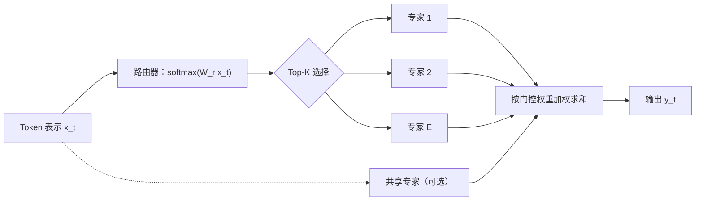

# 第 7 章 混合专家模型（MoE）

## 本章导读

Mixtral 8x7B 的总参数是 46.7B，比 Llama 2 70B 少不了太多；但生成每个 Token 时，它只计算约 12.9B 参数。参数装满了显卡，计算却只用一个中等模型的开销。这不是压缩，也不是量化，而是把前馈层拆成八个“专家”，每个 Token 只交给其中两个。为什么这样能保持质量？路由器怎么决定派谁上场？专家忙闲不均、显存装不下时又该怎么办？

## 难度标签

⭐⭐⭐ 进阶 ｜ 数学要求：softmax、概率期望、梯度推导 ｜ 代码要求：熟悉 PyTorch 的索引、掩码与按专家分组计算

## 学习目标

读完本章你将能够：

1. 写出 MoE 前馈层的稀疏激活公式，区分总参数与每 Token 激活参数。
2. 推导容量因子、Token 丢弃与负载均衡辅助损失，说明它们各自解决什么问题。
3. 比较 Top-1、Top-2、Expert Choice、共享专家、细粒度专家与无辅助损失均衡的取舍。
4. 在 TinyLM 上实现 MoE 层，用参数账本、路由统计与因果性测试验证实现。
5. 解释 MoE 的训练与推理代价，判断一个部署场景是否适合 MoE。

## 7.1 直觉：把前馈层拆成专科

第 3 章把 Transformer 块拆成两个子层：注意力负责 Token 之间的通信，前馈网络负责每个 Token 自己的非线性计算。第 5 章的账本显示，在现代配置里前馈层占非嵌入参数的三分之二左右；第 6 章又把注意力侧的缓存压缩了一个数量级。于是问题变成：还能从哪里加容量？

一个直接的想法是加宽前馈层，但这样每个 Token 的计算量也同比增加。MoE 换了一个思路：准备很多个前馈网络，每个 Token 只走其中少数几个。就像综合医院里既有全科门诊，也有心内、神内、儿科等专科；病人先分诊，再按需要去少数几个科室。分诊台就是路由器（router），科室就是专家（expert），“只看少数几个”就是稀疏激活（sparse activation）。



这个设计的第一个好处是**容量与计算解耦**。增加专家数 $$E$$，模型的总参数线性增长，但每个 Token 仍然只计算 $$k$$ 个专家，前馈 FLOPs 基本不变。第二个好处是**条件计算**：不同输入可以调用不同的参数子集，理论上能让专家分工。代价也很直接：所有专家都要放进显存，路由器要额外计算，专家之间可能忙闲不均，分布式训练还要把 Token 发到不同设备。

为什么偏偏替换前馈层，而不是注意力？有两个原因。第一，前馈层本来就是参数大头，替换它的性价比最高。第二，前馈层逐位置作用，不混合序列维；路由一个 Token 不会把未来信息带给过去，因果性天然保持。若在注意力头上做路由，掩码、缓存和并行切分都会复杂得多。


MoE 不是“用更少参数做同样的事”，而是“用更多参数、同样多的每 Token 计算，换更好的质量”。它把成本从计算转移到显存和通信。理解这一点，后面所有的工程取舍都能对上号。


## 7.2 数学原理

### 7.2.1 从稠密前馈到稀疏加权

稠密前馈网络对每个位置做同一个变换：

$$
\mathrm{FFN}(\mathbf{x}_t)=\mathbf{W}_{\text{out}}\,\phi(\mathbf{W}_{\text{in}}\mathbf{x}_t+\mathbf{b}_{\text{in}})+\mathbf{b}_{\text{out}}
$$

MoE 层准备 $$E$$ 个这样的专家，再给每个 Token 一组门控权重：

$$
\mathbf{y}_t=\sum_{e=1}^{E} g_{t,e}\,\mathrm{FFN}_e(\mathbf{x}_t)
\qquad \text{(7.1)}
$$

其中 $$g_{t,e}\ge 0$$、$$\sum_e g_{t,e}=1$$，且 $$g_t$$ 只有至多 $$k$$ 个非零分量。若 $$k=E$$ 且权重均匀，它退化为多个专家的平均；若 $$k=1$$，每个 Token 只走一个专家。实际系统通常取 $$k=2$$，兼顾表达力与计算量。

这里有一个容易忽略的细节：专家不是“不同的网络结构”，而是“同构但参数独立的前馈网络”。它们的宽度、激活函数、是否用 SwiGLU 都由配置统一决定，只有权重不同。这样实现才能把多个 Token 拼成矩阵乘，获得硬件效率。

从函数逼近的角度看，MoE 没有让单条计算路径变深或变宽，而是扩大了“可被选中的函数库”：参数容量来自专家组合，而不是单个专家的宽度。这解释了一个容易困惑的现象——为什么 Mixtral 的专家和稠密 FFN 一样宽，而 DeepSeek 的专家只有 1536 维却依然够用：前者靠 8 选 2 的组合获得容量，后者靠 160 选 6 获得更大的组合空间（7.2.6）。

### 7.2.2 路由与 Top-K

路由器是一个线性层加 softmax。对第 $$t$$ 个 Token：

$$
\mathbf{u}_t=\mathbf{W}_r\mathbf{x}_t,\qquad \mathbf{W}_r\in\mathbb{R}^{E\times d_{model}}
\qquad \text{(7.2)}
$$

$$
\mathbf{p}_t=\mathrm{softmax}(\mathbf{u}_t)
\qquad \text{(7.3)}
$$

然后选出概率最大的 $$k$$ 个专家：

$$
\mathcal{T}_t=\mathrm{TopK}(\mathbf{p}_t,k)
\qquad \text{(7.4)}
$$

为了让选中专家的门控权重重新归一到 1，做一次截断归一化：

$$
\tilde{g}_{t,e}=
\begin{cases}
\dfrac{p_{t,e}}{\sum_{e'\in\mathcal{T}_t}p_{t,e'}}, & e\in\mathcal{T}_t\\[6pt]
0, & e\notin\mathcal{T}_t
\end{cases}
\qquad \text{(7.5)}
$$

最终输出为

$$
\mathbf{y}_t=\sum_{e\in\mathcal{T}_t}\tilde{g}_{t,e}\,\mathrm{FFN}_e(\mathbf{x}_t)
\qquad \text{(7.6)}
$$

Top-K 的索引是离散选择，不能直接求导；梯度通过 $$\tilde{g}_{t,e}$$ 和选中专家的输出回传。未被选中的专家对当前 Token 没有任何梯度，这是路由会“塌缩”到少数专家的根源：一旦某个专家早期略占优势，它获得更多梯度、变得更强，又被更多 Token 选中，正反馈会把负载推向极端。

Shazeer 等人 2017 年的原始工作用带噪声的 Top-K 缓解这一点：训练时在打分上加高斯噪声再取 Top-K，推理时不加噪声。噪声迫使模型探索不同的专家组合，但它不是免费的，噪声尺度本身就是一个需要调的超参数。

$$k$$ 的选择是一个直接的计算旋钮。每 Token 的前馈计算大致与 $$k$$ 成正比，通信量也随 $$k$$ 线性增长 (7.28)。取 $$k=1$$（Switch）把计算与通信压到最低，但一个 Token 只能依赖一个专家，选错没有第二个专家兜底，训练更依赖容量与均衡；取 $$k=2$$（GShard、Mixtral）在计算与容错之间折中，成为最常见的默认值；DeepSeek 的细粒度配置把 $$k$$ 提到 6 或 8，是因为单个专家只有一千多维，激活宽度 $$k\,d_{ff}^{e}$$ 才与稠密前馈相当。换句话说，$$k$$ 不能脱离专家宽度单独讨论，真正要对齐的是每 Token 激活的前馈宽度。

### 7.2.3 容量因子与 Token 丢弃

一个批次有 $$N_{\text{tok}}=B\cdot T$$ 个 Token，Top-K 后共有 $$N_{\text{tok}}k$$ 个专家分派。若负载完全均衡，每个专家分到 $$N_{\text{tok}}k/E$$ 个。框架为了把计算组织成规整的矩阵乘，通常给每个专家预留固定容量：

$$
C_{\text{cap}}=\left\lceil \mathrm{CF}\cdot\frac{N_{\text{tok}}k}{E}\right\rceil
\qquad \text{(7.7)}
$$

$$\mathrm{CF}$$ 是容量因子（capacity factor），常取 1.0 到 1.25。超过容量的分派会被丢弃。定义分派指示变量

$$
a_{t,e}=\mathbf{1}\left[e\in\mathcal{T}_t\ \text{且该分派排在第 } C_{\text{cap}} \text{ 个之前}\right]
\qquad \text{(7.8)}
$$

实际输出变成

$$
\mathbf{y}_t=\sum_{e=1}^{E} a_{t,e}\,\tilde{g}_{t,e}\,\mathrm{FFN}_e(\mathbf{x}_t)
\qquad \text{(7.9)}
$$

被丢弃的 Token 不会报错，只是少了一个专家的贡献；若配置了共享专家，它仍能得到共享部分。这就是所谓 Token 丢弃（token dropping）。丢弃的排序规则各实现不同：有的按 Token 在批次中的位置先到先得，有的用随机优先级，有的按路由概率从高到低。本章代码采用位置顺序，保证可复现。


容量因子不是越大越好。取 1.25 意味着每层多算 25% 的专家容量，即使没有 Token 被丢弃，框架也要按容量补齐张量，浪费算力；取 1.0 则在负载稍有波动时就开始丢弃。要结合专家数、批次大小和负载均衡质量来定，不能只看“丢没丢”。


无丢弃（dropless）实现取消了固定容量，每个专家处理实际分到的 Token 数，容量随批次变化。它避免了信息损失，但会产生大小不一的矩阵乘，且在专家并行下造成设备间负载不均；工程上通常用分组 GEMM、动态重排或专门的通信内核来消化。另一条路线是分组受限路由（group-limited routing）：把专家按设备分组，要求每个 Token 的专家落在至多 $$G$$ 个组里，用少量负载均衡换通信量下降。DeepSeek 系列采用的就是这一类约束：V2 把 160 个专家分布在 8 台设备上，每个 Token 最多发往 3 台；V3 进一步改成节点受限，每个 Token 最多发往 4 个节点。约束 $$G$$ 直接作用在路由选择上：先按组汇总分数，再在组内选专家。

### 7.2.4 参数与激活账本

设每个专家的中间维度为 $$d_{ff}^{e}$$。若专家用 SwiGLU，单个专家的权重参数量为

$$
P_e=3\,d_{model}\,d_{ff}^{e}
\qquad \text{(7.10)}
$$

若用普通两层 MLP，则为 $$2d_{model}d_{ff}^{e}$$。式 (7.10) 只数权重，偏置项按每层 $$2d_{ff}^{e}+d_{model}$$ 另外加。

一层 MoE 的参数量是路由器加全部专家：

$$
P_{\mathrm{MoE}}=d_{model}E+(E+S_{\text{sh}})P_e
\qquad \text{(7.11)}
$$

其中 $$S_{\text{sh}}$$ 是共享专家数（见 7.2.6），共享专家始终参与计算，但参数也要存。整个模型的总参数为

$$
N=N_0+n_l P_{\mathrm{MoE}}
\qquad \text{(7.12)}
$$

$$N_0$$ 是注意力、归一化、嵌入等非前馈部分。每个 Token 实际激活的参数只有路由器和选中的专家：

$$
N_{\mathrm{act}}=N_0+n_l\left(d_{model}E+(k+S_{\text{sh}})P_e\right)
\qquad \text{(7.13)}
$$

两者的比值

$$
\rho=\frac{N_{\mathrm{act}}}{N}
\qquad \text{(7.14)}
$$

就是激活比。它决定了“显存按总参数算、算力按激活参数算”的差距有多大。每 Token 前向 FLOPs 近似为

$$
\mathrm{FLOPs}\approx 2N_{\mathrm{act}}
\qquad \text{(7.15)}
$$

与第 3 章的 $$2N$$ 心算一致，只是把 $$N$$ 换成了 $$N_{\mathrm{act}}$$。

以 Mixtral 的公开配置为例：$$d_{model}=4096$$、$$E=8$$、$$k=2$$、每专家 $$d_{ff}^{e}=14336$$、32 层。单个专家 $$P_e=3\times4096\times14336\approx176.2\text{M}$$；一层专家 $$8P_e\approx1.409\text{B}$$；32 层约 45.1B，加上注意力和嵌入约 1.5B，总参数约 46.7B。每 Token 只算两个专家，前馈激活约 352M/层，整模型激活约 12.9B。这两个数字与公开报告一致，说明账本没有漏项。

### 7.2.5 负载均衡：辅助损失

路由器是自私的：每个 Token 都挑当前打分最高的专家，整体上却可能导致少数专家被挤爆、多数专家闲置。为了让负载接近均匀，Switch Transformer 和 GShard 引入辅助损失（auxiliary loss）。先定义两个统计量。第一个是专家实际分到的份额：

$$
f_e=\frac{1}{N_{\text{tok}}k}\sum_{t=1}^{N_{\text{tok}}}\sum_{j=1}^{k}\mathbf{1}\left[e\in\mathcal{T}_t\right]
\qquad \text{(7.16)}
$$

第二个是路由器分配给该专家的平均概率：

$$
P_e=\frac{1}{N_{\text{tok}}}\sum_{t=1}^{N_{\text{tok}}}p_{t,e}
\qquad \text{(7.17)}
$$

辅助损失定义为

$$
\mathcal{L}_{\text{aux}}=\alpha\,E\sum_{e=1}^{E}f_eP_e
\qquad \text{(7.18)}
$$

当负载完全均匀时，$$f_e=P_e=1/E$$，求和为 $$E\cdot(1/E^2)=1/E$$，再乘 $$E$$ 得 1，所以 $$\mathcal{L}_{\text{aux}}=\alpha$$。若负载集中，$$f$$ 与 $$P$$ 同时偏向少数专家，乘积之和大于 $$1/E$$，损失大于 $$\alpha$$。

对第 $$t$$ 个 Token 的路由 logits 求梯度，把 $$f_e$$ 当作常数（它由不可导的 Top-K 决定），有

$$
\frac{\partial\mathcal{L}_{\text{aux}}}{\partial u_{t,j}}
=\frac{\alpha E}{N_{\text{tok}}}\,p_{t,j}\left(f_j-\sum_{e=1}^{E}f_ep_{t,e}\right)
$$

方括号里是“专家 $$j$$ 的实际份额”减去“按概率加权的平均份额”。若专家 $$j$$ 被过度使用，这项为正，梯度推动 $$u_{t,j}$$ 下降，从而降低它被选中的概率。这就是辅助损失起作用的机制：它不给专家直接加减分，而是调节路由概率。

要诚实指出，$$\mathcal{L}_{\text{aux}}$$ 不是一个有全局最小值的凸势函数。$$f$$ 依赖 Top-K，和 $$P$$ 互相影响，系统可能震荡，也可能停在某个近似均衡点。$$\alpha$$ 通常取 0.01；太大会伤害语言建模，太小则压不住失衡。Switch Transformer 报告过训练后期去掉辅助损失、只保留均衡结果的技巧，但这不是普遍规律。

ST-MoE 还提出路由器 z-loss，约束路由 logits 的幅度：

$$
\mathcal{L}_z=\frac{1}{N_{\text{tok}}}\sum_{t=1}^{N_{\text{tok}}}\left(\log\sum_{e=1}^{E}e^{u_{t,e}}\right)^2
\qquad \text{(7.19)}
$$

它的系数通常取 $$10^{-3}$$。直觉是：logits 太大会让 softmax 接近 one-hot，路由几乎不可更改，训练容易失稳；z-loss 把 logits 拉回温和范围，给路由留下调整空间。这里选 $$\log\sum_e e^{u_{t,e}}$$ 而不是 logits 的 L2，是因为前者正好是 softmax 归一化常数的对数，直接度量路由分布的尖锐程度，并且对整体平移不变：所有 logits 同加一个常数不改变 softmax，z-loss 也不变。L2 会惩罚这种无关的平移，多了一道不必要的约束。总训练目标为

$$
\mathcal{L}=\mathcal{L}_{\text{CE}}+\mathcal{L}_{\text{aux}}+\beta\,\mathcal{L}_z
\qquad \text{(7.20)}
$$

其中 $$\mathcal{L}_{\text{CE}}$$ 是第 1 章的语言建模交叉熵。

### 7.2.6 共享专家与细粒度专家

普通 MoE 的所有专家都是“平权”的，每个 Token 从中选 k 个。DeepSeekMoE 观察到，不同专家会重复学习一些通用模式，造成参数冗余。它把专家分成两类：始终激活的共享专家，和按路由选择的专家：

$$
\mathbf{y}_t=\sum_{s=1}^{S_{\text{sh}}}\mathrm{FFN}_s(\mathbf{x}_t)
+\sum_{e\in\mathcal{T}_t}\tilde{g}_{t,e}\,\mathrm{FFN}_e(\mathbf{x}_t)
\qquad \text{(7.21)}
$$

共享专家负责吸收跨领域的通用知识，路由专家则可以专注于更细的差异。代价是共享专家的计算量无法被稀疏化，每 Token 都要付。

细粒度专家（fine-grained expert）是另一个维度：把每个专家切小，专家数变多，每 Token 激活更多个小专家。若把宽度为 $$d_{ff}$$ 的专家切成 $$m$$ 份，每份宽度 $$d_{ff}^{e}=d_{ff}/m$$，同时把激活个数从 $$k$$ 提到 $$k'=mk$$，则每 Token 激活的前馈宽度不变：

$$
k\,d_{ff}^{e}=k'\,\frac{d_{ff}}{m}=k\,d_{ff}
\qquad \text{(7.22)}
$$

但可选组合数从 $$\binom{E}{k}$$ 增加到 $$\binom{mE}{mk}$$，专家分工更细。DeepSeek-V2 用了 160 个路由专家、每个激活 6 个，再加 2 个共享专家，就是这一思路的工程化版本。

### 7.2.7 另一条路：Expert Choice 与无辅助损失均衡

Top-K 是“Token 选专家”，负载不均的根源在 Token 侧。Expert Choice 反过来，让每个专家按路由分数挑选固定数量的 Token：

$$
\mathcal{S}_e=\mathrm{TopC}\left(\{u_{t,e}\}_{t=1}^{N_{\text{tok}}}\right),\qquad |\mathcal{S}_e|=C_{\text{cap}}
\qquad \text{(7.23)}
$$

这样每个专家恰好处理 $$C_{\text{cap}}$$ 个 Token，负载完美均衡，不需要辅助损失。但每个 Token 被几个专家选中是可变的：热门 Token 可能被很多专家处理，冷门 Token 可能一个都没有。更麻烦的是，路由依赖整个批次的 Token；在自回归解码时，当前 Token 不能提前知道未来的 Token，Expert Choice 与逐 Token 生成不兼容。它更适合编码器或非因果任务，这也是它没有成为主流解码器方案的原因。

DeepSeek-V3 给出第三条路：不用辅助损失，给每个专家维护一个偏置 $$b_e$$，只用于 Top-K 选择，不参与前向加权。每次参数更新后，按负载调整偏置：

$$
b_e\leftarrow b_e+\gamma\,\mathrm{sign}\left(\mathrm{load}_e-\frac{N_{\text{tok}}k}{E}\right)
\qquad \text{(7.24)}
$$

$$\gamma$$ 常取 0.001。专家过载时偏置减小，欠载时偏置增大，下一批 Token 的选择就会向欠载专家倾斜。偏置不进入梯度，因此不会干扰语言建模目标；DeepSeek-V3 还辅以一个系数很小的序列级均衡损失，防止单个序列内部极端倾斜。这个方案把“均衡”从损失函数里拿出来，变成控制回路的反馈，是 2024 年后 MoE 训练的一个重要转向。

### 7.2.8 反向传播：稀疏的不只是前向

前向只激活 $$k$$ 个专家，反向也只在同样的路径上流动。设损失对第 $$t$$ 个 Token 输出的梯度为 $$\mathbf{c}_t=\partial\mathcal{L}/\partial\mathbf{y}_t$$，定义标量 $$c_{t,e}=\langle\mathbf{c}_t,\mathrm{FFN}_e(\mathbf{x}_t)\rangle$$。它度量专家 $$e$$ 的输出沿“降低损失”方向有多少分量，可正可负。记选中集合的未归一化概率和 $$Z_t=\sum_{e\in\mathcal{T}_t}p_{t,e}$$，把 (7.5) 写成 $$\tilde{g}_{t,e}=p_{t,e}/Z_t$$，则对选中集合内的 $$j$$：

$$
\frac{\partial\tilde{g}_{t,e}}{\partial p_{t,j}}
=\frac{\delta_{ej}Z_t-p_{t,e}}{Z_t^{2}}
=\frac{1}{Z_t}\left(\delta_{ej}-\tilde{g}_{t,e}\right)
\qquad \text{(7.25)}
$$

其中 $$\delta_{ej}$$ 是 Kronecker delta；$$j\notin\mathcal{T}_t$$ 时偏导为 0。链式相乘后，路由概率的梯度为

$$
\frac{\partial\mathcal{L}}{\partial p_{t,j}}
=\frac{1}{Z_t}\left(c_{t,j}-\sum_{e\in\mathcal{T}_t}\tilde{g}_{t,e}\,c_{t,e}\right),
\qquad j\in\mathcal{T}_t
\qquad \text{(7.26)}
$$

括号里是“专家 $$j$$ 单独的贡献”减去“选中专家的加权平均贡献”。若 $$j$$ 比平均更有用，梯度为正，推高 $$p_{t,j}$$；再经过 softmax 的雅可比，才变成对路由 logits 的更新。这揭示了两个事实。第一，门控只做**相对比较**：把选中专家的贡献与它们的加权平均相比，而不是与某个绝对标准相比，因此损失的整体尺度不会直接改变路由偏好。第二，比较只发生在选中集合内部；未被选中的专家没有任何梯度，“选错”无法被纠正，只能靠噪声、辅助损失或偏置反馈从外部干预。

专家参数的梯度同样稀疏。对专家 $$e$$ 的权重 $$\mathbf{W}_e$$，

$$
\frac{\partial\mathcal{L}}{\partial\mathbf{W}_e}
=\sum_{t:\,e\in\mathcal{T}_t}g_{t,e}\,
\frac{\partial\mathcal{L}}{\partial\mathbf{y}_t}\,
\frac{\partial\mathrm{FFN}_e(\mathbf{x}_t)}{\partial\mathbf{W}_e}
\qquad \text{(7.27)}
$$

只有选中该专家的 Token 贡献梯度，且贡献被门控权重缩放。门控越小，专家学得越慢；专家越弱，越难被选中，门控又越小。这个正反馈就是 7.2.2 所说“路由塌缩”的梯度视角，也是所有负载均衡机制要打断的循环。

### 7.2.9 通信账本

7.2.3 提到专家并行要把 Token 发到专家所在设备，现在把这个代价写成公式。设 $$E$$ 个专家分布在 $$D$$ 台设备上（通常 $$D\le E$$），每台设备持有若干专家。每层做两次 All-to-All：一次把 Token 发给专家（dispatch），一次把专家输出送回原设备（combine）。忽略索引与元数据，每 Token 每层的通信量近似为

$$
V_{\text{comm}}=2\,k\,d_{model}\,b
\qquad \text{(7.28)}
$$

$$b$$ 是每个元素的字节数（BF16 为 2）。系数 2 来自一去一回，系数 $$k$$ 来自每个 Token 要去 $$k$$ 个专家。整个模型有 $$n_l$$ 层，单个 Token 的总通信量为 $$2kn_ld_{model}b$$。

代入 Mixtral：$$2\times2\times4096\times32\times2\ \text{B}=1{,}048{,}576\ \text{B}$$，约 1 MiB/Token。一个 4096 Token 的预填充批次因此要搬约 4 GiB 的激活。与第 6 章的 KV Cache 不同，这不常驻显存，但要求瞬时带宽。把它和每 Token 的 25.8 GFLOP 放在一起，算术强度约 $$25.8\times10^9/1.05\times10^6\approx2.5\times10^4$$ FLOP/Byte，远超任何互联的带宽上限，所以大批量预填充时通信通常能被计算掩盖。

小批量解码是另一回事。批次为 1 时，每次 All-to-All 只传几个 Token 的向量，字节数微不足道，延迟却固定存在；跨节点（InfiniBand）与节点内（NVLink）的延迟差一个数量级。两个工程结论由此而来。第一，MoE 推理要尽量攒大批量把延迟摊薄，这也是连续批处理对 MoE 尤其重要的原因。第二，通信量随 $$k$$ 线性增长，而随总专家数增长较慢；把专家切细、同时提高 $$k$$（如 DeepSeek-V2 的 Top-6），换来了更大的组合空间，却把通信量抬高了约 3 倍。细粒度专家不是免费的。

注意 (7.28) 只是下界：容量补齐会让设备按固定容量 $$C_{\text{cap}}$$ 计算，即使实际分到更少；被丢弃的分派省下了计算，却不省通信；负载不均还会让部分设备空等。这些空转在批量小、路由偏斜时最明显。

### 7.2.10 训练稳定性从哪里来

MoE 的训练比同尺寸稠密模型更容易失败，原因集中在路由器上。路由 logits 决定 softmax 的尖锐程度；训练初期或遇到分布突变的批次时，某些 logits 迅速增大，softmax 接近 one-hot，路由几乎冻结在少数专家上。一旦冻结，7.2.8 的梯度循环会让强者更强，直到辅助损失或容量限制把它拉回来。这个“冻结—反弹”过程在损失曲线上表现为尖峰：某几层的专家权重被少数 Token 的大梯度推动，短暂发散，随后路由又避开这些专家。

低精度会放大问题。路由 logits 的指数运算在 FP16 下容易溢出；即使不溢出，接近 one-hot 时的梯度也极小，量化噪声占比很高。ST-MoE 因此把路由器单独提升到 float32（选择性精度），并用 z-loss (7.19) 限制 $$\log\sum_e e^{u_{t,e}}$$ 的增长。除此之外，常用的约束还有：把路由器权重初始化得比稠密层更小；对路由 logits 做梯度裁剪；用容量因子限制单个专家的更新规模；在超大规模下改用 (7.24) 的偏置反馈，把均衡从梯度中剥离。

这些手段没有哪一个是充分的。MoE 的稳定性是“路由器精度 + z-loss + 初始化 + 容量 + 均衡机制”叠加出来的工程结果，任何一环放松都可能在长训练中暴露。读到某个模型报告“训练稳定”时，要问它用了哪一组约束，而不是把稳定性归因于某个单独技巧。

## 7.3 方案对比

| 方案 | 路由规则 | 负载特性 | 每 Token 计算 | 训练稳定性 | 实现与部署 |
| --- | --- | --- | --- | --- | --- |
| 稠密 FFN | 无 | 天然均衡 | 全部前馈参数 | 最稳定 | 最简单，内核成熟 |
| Switch（Top-1） | 每 Token 1 个专家 | 易塌缩，需辅助损失 | 1 个专家 | 对学习率、容量敏感 | 简单，通信量小 |
| GShard（Top-2） | 每 Token 2 个专家 | 较均衡，仍需容量与辅助损失 | 2 个专家 | 中等 | 需专家并行与容量管理 |
| Expert Choice | 专家选 Token | 完美均衡 | 每 Token 可变 | 中等 | 不适合因果解码，批处理复杂 |
| 共享 + 细粒度 | Top-K 路由 + 共享专家 | 共享专家缓解冗余，仍需均衡 | k 个小专家 + $$S_{\text{sh}}$$ 个共享 | 较好 | 路由/通信更复杂，DeepSeek 系列验证 |
| 无辅助损失均衡 | Top-K + 专家偏置反馈 | 通过偏置控制，近似均衡 | k + $$S_{\text{sh}}$$ 个专家 | 较好，需调 γ | 需要维护偏置状态，V3 验证 |

选型时可以按下面的顺序问问题。第一，推理瓶颈是显存还是算力？MoE 省算力不省显存，显存紧张时先考虑量化、GQA/MLA 或更小的模型。第二，负载能否通过批处理摊平？批量越大，Top-K 的统计越稳定，辅助损失和容量因子越容易调。第三，是否必须逐 Token 解码？若是，Expert Choice 直接出局。第四，训练集群的互联带宽够不够？专家并行的 All-to-All 通信是 MoE 训练的主要开销之一。

还可以做一个等价换算。稠密模型每 Token 的计算是 $$2N_d$$，MoE 是 $$2N_{\mathrm{act}}$$。Mixtral 的激活参数是同等稠密前馈配置的 1.78 倍，容量却是 6.45 倍。也就是说，若要用稠密模型获得 6.45 倍的参数容量，每 Token 计算就得放大到 6.45 倍；反过来，在同样的每 Token 计算预算下，MoE 能提供约 3.6 倍的参数容量。这个换算只在“容量确实是瓶颈”时成立。如果任务受限于数据量、训练步数或推理延迟，多出来的容量只是躺在显存里的闲置参数，不会自动变成质量。

## 7.4 代码实现：TinyLM 的 MoE 层

### 7.4.1 实现选择

本章在第 6 章的代码上做增量，`TinyLM.forward` 与 `CausalLMOutput` 的签名不变：

- `config.py`：新增 `MoEConfig`，字段为 `n_experts`、`top_k`、`n_shared`、`d_ff_expert`、`capacity_factor`、`aux_loss_coef`；`ModelConfig` 增加 `moe`，默认 `None` 时保持第 6 章的稠密前馈；
- `moe.py`：`Expert` 复用第 5 章的 MLP/SwiGLU 结构，`MoE` 实现路由器、Top-K 分派、容量丢弃、共享专家与辅助损失；
- `block.py`：前馈子层在稠密 FFN 与 MoE 之间分派；块的前向返回 `(x, aux)`，由 `TinyLM` 汇总到 `CausalLMOutput.aux_loss`；
- 路由分派用掩码加逐专家循环实现，便于在 CPU 上核对每一步；生产实现会换成排序、分组 GEMM 或专用的 All-to-All 内核；
- 辅助损失只在 `training=True` 且系数大于 0 时计算，评估时 `aux_loss` 为 `None`；训练总损失为 `loss + aux_loss`；
- `capacity_factor=None` 表示不丢弃，容量测试与无丢弃对照都依赖这个开关。

完整项目里这些代码分属 `moe.py`、`block.py`、`config.py`；为了让本章独立运行，下面合并成一个文件 `ch07.py`，与第 3 到 6 章的 `ch03.py`–`ch06.py` 放在同一目录。

### 7.4.2 完整代码

```python
"""第 7 章：混合专家模型（tinylm/moe.py、block.py 的增量）。"""
import math
import sys
from dataclasses import dataclass

import torch
import torch.nn as nn
import torch.nn.functional as F

sys.path.insert(0, ".")
from ch03 import CausalLMOutput
from ch04 import sinusoidal_positions
from ch05 import make_ffn, make_norm
from ch06 import ModelConfig as Config6, make_attention


# ---------------------------------------------------------------- config.py
@dataclass(frozen=True)
class MoEConfig:
    n_experts: int = 8
    top_k: int = 2
    n_shared: int = 0
    d_ff_expert: int | None = None       # None 表示沿用 cfg.d_ff
    capacity_factor: float | None = 1.25  # None 表示不丢弃
    aux_loss_coef: float = 0.01

    def __post_init__(self):
        assert self.n_experts >= 1
        assert 1 <= self.top_k <= self.n_experts
        assert self.n_shared >= 0
        assert self.d_ff_expert is None or self.d_ff_expert > 0
        assert self.capacity_factor is None or self.capacity_factor > 0
        assert self.aux_loss_coef >= 0


@dataclass(frozen=True)
class ModelConfig(Config6):
    moe: MoEConfig | None = None

    def __post_init__(self):
        super().__post_init__()
        if self.moe is not None:
            assert self.moe.top_k <= self.moe.n_experts


# ---------------------------------------------------------------- moe.py
class Expert(nn.Module):
    """公式 (7.10)：一个专家就是一个独立的前馈网络。"""

    def __init__(self, cfg):
        super().__init__()
        d = cfg.d_model
        f = cfg.moe.d_ff_expert or cfg.d_ff
        self.is_glu = cfg.ffn == "swiglu"
        if self.is_glu:
            self.w_gate = nn.Linear(d, f, bias=cfg.bias)
            self.w_up = nn.Linear(d, f, bias=cfg.bias)
            self.w_down = nn.Linear(f, d, bias=cfg.bias)
        else:
            self.fc_in = nn.Linear(d, f, bias=cfg.bias)
            self.fc_out = nn.Linear(f, d, bias=cfg.bias)

    def forward(self, x):
        if self.is_glu:
            return self.w_down(F.silu(self.w_gate(x)) * self.w_up(x))
        return self.fc_out(F.gelu(self.fc_in(x)))


def load_balance_loss(f, p, coef, n_experts):
    """公式 (7.18)：α E Σ_e f_e P_e。f、p 都是长度为 E 的向量。"""
    return coef * n_experts * (f * p).sum()


class MoE(nn.Module):
    """稀疏激活的前馈层：路由、Top-K 分派、容量、共享专家与辅助损失。"""

    def __init__(self, cfg):
        super().__init__()
        m = cfg.moe
        self.n_experts = m.n_experts
        self.top_k = m.top_k
        self.capacity_factor = m.capacity_factor
        self.aux_coef = m.aux_loss_coef
        self.router = nn.Linear(cfg.d_model, m.n_experts, bias=False)  # (7.2)
        self.experts = nn.ModuleList([Expert(cfg) for _ in range(m.n_experts)])
        self.shared = nn.ModuleList([Expert(cfg) for _ in range(m.n_shared)])
        self.last_load = None
        self.last_dropped = 0

    def forward(self, x):
        B, T, D = x.shape
        flat = x.reshape(-1, D)
        probs = self.router(flat).softmax(dim=-1)                  # (7.3)
        top_p, top_idx = probs.topk(self.top_k, dim=-1)            # (7.4)
        gates = top_p / top_p.sum(dim=-1, keepdim=True).clamp_min(1e-9)  # (7.5)

        n_tokens = flat.shape[0]
        if self.capacity_factor is None:
            capacity = None
        else:                                                       # (7.7)
            capacity = max(1, math.ceil(
                self.capacity_factor * n_tokens * self.top_k / self.n_experts))

        out = torch.zeros_like(flat)
        load = torch.zeros(self.n_experts, dtype=torch.long, device=flat.device)
        dropped = 0
        for e, expert in enumerate(self.experts):
            slot = top_idx == e                                     # (7.8)
            chosen = slot.any(dim=-1)
            if capacity is not None:
                keep = torch.cumsum(chosen.long(), dim=0) <= capacity
                dropped += int((chosen & ~keep).sum())
                chosen = chosen & keep
            n_e = int(chosen.sum())
            load[e] = n_e
            if n_e == 0:
                continue
            idx = chosen.nonzero(as_tuple=True)[0]
            g = (gates * slot).sum(dim=-1)[idx]                     # (7.6)
            out[idx] += g.unsqueeze(-1) * expert(flat[idx])

        for expert in self.shared:                                  # (7.21)
            out = out + expert(flat)

        self.last_load = load.detach()
        self.last_dropped = dropped

        aux = None
        if self.training and self.aux_coef > 0:
            f = load.float() / max(1, n_tokens * self.top_k)        # (7.16)
            p = probs.mean(dim=0)                                   # (7.17)
            aux = load_balance_loss(f, p, self.aux_coef, self.n_experts)  # (7.18)
        return out.reshape(B, T, D), aux


def make_ffn_or_moe(cfg):
    if cfg.moe is None:
        return make_ffn(cfg)
    return MoE(cfg)


# ---------------------------------------------------------------- block.py
class TransformerBlock(nn.Module):
    def __init__(self, cfg):
        super().__init__()
        self.parallel = cfg.parallel_block
        self.norm1 = make_norm(cfg)
        self.attn = make_attention(cfg)
        self.norm2 = None if self.parallel else make_norm(cfg)
        self.mlp = make_ffn_or_moe(cfg)

    def forward(self, x, attention_mask=None, position_ids=None):
        if self.parallel:
            h = self.norm1(x)
            delta, aux = self._ffn(h)
            return x + self.attn(h, attention_mask, position_ids) + delta, aux
        x = x + self.attn(self.norm1(x), attention_mask, position_ids)
        delta, aux = self._ffn(self.norm2(x))
        return x + delta, aux

    def _ffn(self, h):
        out = self.mlp(h)
        return out if isinstance(out, tuple) else (out, None)


# ---------------------------------------------------------------- model.py
class TinyLM(nn.Module):
    def __init__(self, cfg):
        super().__init__()
        self.cfg = cfg
        self.pos_mode = cfg.pos_encoding
        self.tok_emb = nn.Embedding(cfg.vocab_size, cfg.d_model)
        if self.pos_mode == "learned":
            self.pos_emb = nn.Embedding(cfg.max_seq_len, cfg.d_model)
        elif self.pos_mode == "sine":
            self.register_buffer(
                "sin_pe", sinusoidal_positions(cfg.max_seq_len, cfg.d_model),
                persistent=False,
            )
        self.blocks = nn.ModuleList([TransformerBlock(cfg) for _ in range(cfg.n_layers)])
        self.ln_f = make_norm(cfg)
        self.lm_head = nn.Linear(cfg.d_model, cfg.vocab_size, bias=False)
        self.apply(self._init_weights)
        if cfg.tie_embeddings:
            self.lm_head.weight = self.tok_emb.weight
        std = 0.02 / math.sqrt(2 * cfg.n_layers)
        for name, p in self.named_parameters():
            if name.endswith(("out_proj.weight", "fc_out.weight", "w_down.weight")):
                nn.init.normal_(p, mean=0.0, std=std)

    @staticmethod
    def _init_weights(module):
        if isinstance(module, nn.Linear):
            nn.init.normal_(module.weight, mean=0.0, std=0.02)
            if module.bias is not None:
                nn.init.zeros_(module.bias)
        elif isinstance(module, nn.Embedding):
            nn.init.normal_(module.weight, mean=0.0, std=0.02)

    def forward(self, input_ids, *, attention_mask=None, position_ids=None,
                past_kv=None, use_cache=False, labels=None, logits_to_keep=None):
        B, T = input_ids.shape
        if self.pos_mode in ("learned", "sine"):
            assert T <= self.cfg.max_seq_len, "序列长度超过 max_seq_len"
        if position_ids is None:
            position_ids = torch.arange(T, device=input_ids.device)

        x = self.tok_emb(input_ids)
        if self.pos_mode == "learned":
            x = x + self.pos_emb(position_ids)
        elif self.pos_mode == "sine":
            x = x + self.sin_pe[position_ids]

        aux_total = None
        for block in self.blocks:
            x, aux = block(x, attention_mask, position_ids)
            if aux is not None:
                aux_total = aux if aux_total is None else aux_total + aux

        x = self.ln_f(x)
        logits = self.lm_head(x)
        loss = None
        if labels is not None:
            loss = F.cross_entropy(
                logits.reshape(-1, self.cfg.vocab_size),
                labels.reshape(-1),
                ignore_index=-100,
            )
        return CausalLMOutput(logits=logits, loss=loss, aux_loss=aux_total)


# ---------------------------------------------------------------- 账本
def expert_params(cfg):
    """公式 (7.10)：单个专家的参数量（SwiGLU 为 3 d d_f，MLP 为 2 d d_f）。"""
    d, f = cfg.d_model, (cfg.moe.d_ff_expert or cfg.d_ff)
    if cfg.ffn == "swiglu":
        return 3 * d * f + ((2 * f + d) if cfg.bias else 0)
    return 2 * d * f + ((f + d) if cfg.bias else 0)


def dense_ffn_params(cfg):
    d, f = cfg.d_model, cfg.d_ff
    if cfg.ffn == "swiglu":
        return 3 * d * f + ((2 * f + d) if cfg.bias else 0)
    return 2 * d * f + ((f + d) if cfg.bias else 0)


def moe_layer_params(cfg, active=False):
    """公式 (7.11)、(7.13)：路由 + 参与计算的专家个数。"""
    m = cfg.moe
    n = m.n_experts
    used = (m.top_k + m.n_shared) if active else (n + m.n_shared)
    return cfg.d_model * n + used * expert_params(cfg)


def model_params(cfg, active=False):
    """公式 (7.12)、(7.13)：整模型的总参数与每 Token 激活参数。"""
    d, V, L = cfg.d_model, cfg.vocab_size, cfg.max_seq_len
    from ch06 import attention_params
    attn = attention_params(cfg)
    if cfg.moe is None:
        ffn = dense_ffn_params(cfg)
    else:
        ffn = moe_layer_params(cfg, active=active)
    norm_p = d + (d if cfg.norm == "layernorm" and cfg.bias else 0)
    norms = norm_p if cfg.parallel_block else 2 * norm_p
    per_layer = attn + ffn + norms
    emb = V * d * (1 if cfg.tie_embeddings else 2)
    pos = L * d if cfg.pos_encoding == "learned" else 0
    return cfg.n_layers * per_layer + norm_p + emb + pos


def human(nbytes):
    for unit in ("B", "KiB", "MiB", "GiB", "TiB"):
        if nbytes < 1024 or unit == "TiB":
            return f"{nbytes:.1f} {unit}" if unit != "B" else f"{nbytes:.0f} B"
        nbytes /= 1024


def ledger():
    common = dict(vocab_size=32000, d_model=4096, n_layers=32, n_heads=32,
                  n_kv_heads=8, d_ff=14336, max_seq_len=32768, norm="rmsnorm",
                  ffn="swiglu", bias=False, pos_encoding="rope", attention="gqa")
    mixtral = ModelConfig(moe=MoEConfig(n_experts=8, top_k=2,
                                        d_ff_expert=14336), **common)
    v3 = ModelConfig(
        vocab_size=129280, d_model=7168, n_layers=61, n_heads=128,
        d_ff=18432, max_seq_len=16384, norm="rmsnorm", ffn="swiglu",
        bias=False, pos_encoding="rope", attention="mla", d_c=512,
        d_head_rope=64,
        moe=MoEConfig(n_experts=256, top_k=8, n_shared=1, d_ff_expert=2048),
    )
    toy = ModelConfig(vocab_size=32000, d_model=512, n_layers=8, n_heads=8,
                      d_ff=2048, max_seq_len=1024, norm="rmsnorm",
                      ffn="swiglu", bias=False, pos_encoding="rope",
                      moe=MoEConfig(n_experts=8, top_k=2, d_ff_expert=1024))

    print("MoE 账本（FP16 权重）")
    print(f"{'配置':<14s}{'总参数':>16s}{'激活参数':>16s}{'激活比':>8s}"
          f"{'权重显存':>10s}{'每Token FLOPs':>14s}")
    for name, cfg in (("Mixtral 8x7B", mixtral), ("DeepSeek-V3", v3),
                      ("TinyLM MoE", toy)):
        total = model_params(cfg)
        active = model_params(cfg, active=True)
        if name == "TinyLM MoE":
            actual = sum(p.numel() for p in TinyLM(cfg).parameters())
            assert total == actual, (total, actual)
        print(f"{name:<14s}{total:>16,d}{active:>16,d}"
              f"{active / total:>8.1%}{human(2 * total):>10s}"
              f"{2 * active / 1e9:>11.1f} GFLOP")

    v3_adjusted = model_params(v3) - 3 * (moe_layer_params(v3) - dense_ffn_params(v3))
    print(f"DeepSeek-V3 前 3 层为稠密前馈：扣除后总参数 {v3_adjusted:,d}"
          f"（公开值约 671B）")
    dense = ModelConfig(**common)
    sparse = mixtral
    print(f"\n稠密对照：Mixtral 尺寸的稠密前馈总参数 "
          f"{model_params(dense):,d}，MoE 总参数 {model_params(sparse):,d}，"
          f"激活参数 {model_params(sparse, active=True):,d}")
    print(f"MoE 用 {model_params(sparse, active=True) / model_params(dense):.2f} "
          f"倍的激活参数承载 {model_params(sparse) / model_params(dense):.2f} 倍的容量")


# ---------------------------------------------------------------- 受控实验
def copy_task(B, T, lag, vocab, gen):
    seq = torch.randint(0, vocab, (B, lag), generator=gen)
    for t in range(lag, T):
        seq = torch.cat([seq, seq[:, t - lag:t - lag + 1]], dim=1)
    return seq


def make_labels(seq):
    return seq[:, :-1], seq[:, 1:].clone()


def train_one(cfg, steps=600, seed=0, train_len=32, lag=8):
    torch.manual_seed(seed)
    model = TinyLM(cfg)
    opt = torch.optim.AdamW(model.parameters(), lr=3e-3, weight_decay=0.01)
    gen = torch.Generator().manual_seed(1000 + seed)
    model.train()
    for _ in range(steps):
        seq = copy_task(64, train_len, lag, cfg.vocab_size, gen)
        inp, tgt = make_labels(seq)
        out = model(inp, labels=tgt)
        total = out.loss + (out.aux_loss if out.aux_loss is not None else 0.0)
        opt.zero_grad()
        total.backward()
        opt.step()
    return model


@torch.no_grad()
def evaluate(model, T=32, lag=8, B=256, seed=7):
    gen = torch.Generator().manual_seed(seed)
    seq = copy_task(B, T, lag, 16, gen)
    inp, tgt = make_labels(seq)
    model.eval()
    out = model(inp, labels=tgt)
    acc = (out.logits.argmax(-1) == tgt).float().mean().item()
    try:
        moe = model.blocks[0].mlp
        load = moe.last_load.float()
        load = load / load.sum()
        entropy = -(load * load.clamp_min(1e-9).log()).sum().item()
        max_share = load.max().item()
    except AttributeError:
        entropy, max_share = float("nan"), float("nan")
    return out.loss.item(), acc, entropy, max_share


def ablation():
    common = dict(vocab_size=16, d_model=64, n_layers=2, n_heads=4,
                  d_ff=256, max_seq_len=64, pos_encoding="rope",
                  norm="rmsnorm", ffn="swiglu")
    cfgs = {
        "Dense": ModelConfig(**common),
        "MoE-aux0": ModelConfig(moe=MoEConfig(
            n_experts=8, top_k=2, d_ff_expert=128, aux_loss_coef=0.0), **common),
        "MoE-aux": ModelConfig(moe=MoEConfig(
            n_experts=8, top_k=2, d_ff_expert=128, aux_loss_coef=0.01), **common),
    }
    floor = (8 - 1) / (32 - 1) * math.log(16)
    print("\n复制任务消融（3 个种子，600 步，损失/准确率取均值±标准差）")
    print(f"参照损失下界 {floor:.4f}")
    print(f"{'配置':<10s}{'总参数':>10s}{'激活参数':>10s}{'损失':>16s}"
          f"{'准确率':>18s}{'负载熵':>8s}{'最大份额':>9s}")
    for name, cfg in cfgs.items():
        total, active = model_params(cfg), model_params(cfg, active=True)
        results = []
        for seed in range(3):
            model = train_one(cfg, seed=seed)
            results.append(evaluate(model))
        losses = torch.tensor([r[0] for r in results])
        accs = torch.tensor([r[1] for r in results])
        ent = torch.tensor([r[2] for r in results])
        mx = torch.tensor([r[3] for r in results])
        ent_s = "—" if math.isnan(ent.mean()) else f"{ent.mean():.2f}"
        mx_s = "—" if math.isnan(mx.mean()) else f"{mx.mean():.2f}"
        print(f"{name:<10s}{total:>10,d}{active:>10,d}"
              f"{losses.mean():>10.4f} ± {losses.std():.4f}"
              f"{accs.mean():>11.4f} ± {accs.std():.4f}"
              f"{ent_s:>8s}{mx_s:>9s}")


def capacity_demo():
    cfg = ModelConfig(vocab_size=16, d_model=64, n_layers=2, n_heads=4,
                      d_ff=128, max_seq_len=64, pos_encoding="rope",
                      norm="rmsnorm", ffn="swiglu",
                      moe=MoEConfig(n_experts=8, top_k=2, d_ff_expert=64,
                                    capacity_factor=None, aux_loss_coef=0.0))
    torch.manual_seed(0)
    model = TinyLM(cfg)
    ids = torch.randint(0, 16, (8, 32))
    with torch.no_grad():
        model.eval()
        base = model(ids).logits
        for m in model.modules():
            if isinstance(m, MoE):
                m.capacity_factor = 0.5
        tight = model(ids).logits
        loads = [int(m.last_dropped) for m in model.modules() if isinstance(m, MoE)]
    diff = (base - tight).abs().max().item()
    capacity = max(1, math.ceil(0.5 * 8 * 32 * 2 / 8))
    print(f"\n容量收紧（CF=1.25 → 0.5，容量 {capacity}/专家）："
          f"两层共丢弃 {sum(loads)}/{2 * 8 * 32 * 2} 个分派，"
          f"logits 最大变化 {diff:.3f}")


def main():
    ledger()
    capacity_demo()
    ablation()


if __name__ == "__main__":
    main()
```

代码里有几个与公式一一对应的实现细节，读的时候值得停下来核对。

- `probs.topk(self.top_k)` 取出 Top-K 的概率与索引，随后 `top_p / top_p.sum(...)` 完成 (7.5) 的截断归一化；`clamp_min(1e-9)` 是数值保护，防止极端 logits 下分母下溢成 0。
- 容量控制用 `cumsum(chosen) <= capacity`，按 Token 在批次中的顺序先到先得，这正是 (7.8) 的分派指示；`dropped` 累加超容量的分派数，`load` 记录丢弃之后每个专家实际接收的 Token 数，二者相加等于 $$N_{\text{tok}}k$$，测试里用它做守恒检查。
- 外层对专家循环，内层只对分到该专家的 Token 做一次矩阵乘。生产实现会把同样的事情换成排序加分组 GEMM，一次算完所有专家；这里为了在 CPU 上逐步核对而写成循环。
- 共享专家在路由之后对全部 Token 相加，对应 (7.21)；`last_load`、`last_dropped` 是普通属性而非缓冲区，只用于诊断，不进入 `state_dict`，也不影响已冻结的接口。

### 7.4.3 测试

测试覆盖：`moe=None` 与第 6 章逐位一致、参数公式、激活参数、路由门控归一化、同权专家退化为单专家、容量上限、无容量不丢弃、辅助损失公式、辅助损失只在训练时返回、因果性、前向形状与 Top-K 越界检查。把测试保存为 `tests/test_moe.py`：

```python
"""第 7 章自测：MoE 路由、分派、容量、参数账本、辅助损失与因果性。"""
import math

import pytest
import torch

import ch06
import ch07


def base_config(**kw):
    common = dict(vocab_size=32, d_model=64, n_layers=2, n_heads=4,
                  d_ff=128, max_seq_len=64, bias=False,
                  norm="rmsnorm", ffn="swiglu", pos_encoding="rope")
    common.update(kw)
    return ch07.ModelConfig(**common)


def moe_config(**kw):
    m = dict(n_experts=8, top_k=2, d_ff_expert=64)
    m.update(kw)
    return base_config(moe=ch07.MoEConfig(**m))


def test_dense_moe_none_matches_chapter6():
    """moe=None 时，第 7 章的模型必须与第 6 章逐位一致。"""
    cfg6 = ch06.ModelConfig(vocab_size=32, d_model=64, n_layers=2, n_heads=4,
                            d_ff=128, max_seq_len=64, bias=False,
                            norm="rmsnorm", ffn="swiglu", pos_encoding="rope")
    cfg7 = base_config()
    ref, ours = ch06.TinyLM(cfg6).eval(), ch07.TinyLM(cfg7).eval()
    ours.load_state_dict(ref.state_dict())
    ids = torch.randint(0, 32, (2, 12))
    with torch.no_grad():
        a = ref(ids)
        b = ours(ids)
    assert torch.allclose(a.logits, b.logits, atol=1e-6)
    assert b.aux_loss is None


def test_param_formula_matches_model():
    """公式 (7.10)–(7.12)：总参数逐位一致，含共享专家。"""
    cfg = moe_config(n_shared=1)
    total = ch07.model_params(cfg)
    active = ch07.model_params(cfg, active=True)
    actual = sum(p.numel() for p in ch07.TinyLM(cfg).parameters())
    d, f, E = cfg.d_model, cfg.moe.d_ff_expert, 8
    expert = 3 * d * f
    assert total == actual
    assert total - active == cfg.n_layers * (E - cfg.moe.top_k) * expert


def test_router_experts_and_shared_count():
    cfg = moe_config(n_shared=2)
    model = ch07.TinyLM(cfg)
    moe = model.blocks[0].mlp
    assert len(moe.experts) == 8
    assert len(moe.shared) == 2
    assert moe.router.weight.shape == (8, cfg.d_model)


def test_routing_weights_sum_to_one():
    """公式 (7.5)：Top-K 的归一化门控之和为 1。"""
    cfg = moe_config()
    moe = ch07.MoE(cfg).eval()
    x = torch.randn(5, 7, cfg.d_model)
    with torch.no_grad():
        probs = moe.router(x.reshape(-1, cfg.d_model)).softmax(-1)
        top_p, _ = probs.topk(moe.top_k, dim=-1)
        gates = top_p / top_p.sum(-1, keepdim=True)
    assert torch.allclose(gates.sum(-1), torch.ones(35), atol=1e-6)


def test_identical_experts_reduce_to_dense():
    """所有专家权重相同时，无论路由如何，输出等于单个专家。"""
    cfg = moe_config(capacity_factor=None)
    torch.manual_seed(0)
    moe = ch07.MoE(cfg).eval()
    for expert in moe.experts[1:]:
        expert.load_state_dict(moe.experts[0].state_dict())
    x = torch.randn(3, 9, cfg.d_model)
    with torch.no_grad():
        y, _ = moe(x)
        y_ref = moe.experts[0](x)
    assert torch.allclose(y, y_ref, atol=1e-6)


def test_capacity_limits_dispatch():
    """公式 (7.7)–(7.8)：每个专家接收的 Token 不超过容量。"""
    cfg = moe_config(capacity_factor=0.4, top_k=2)
    torch.manual_seed(1)
    moe = ch07.MoE(cfg).eval()
    x = torch.randn(16, 16, cfg.d_model)
    n = 16 * 16
    capacity = math.ceil(0.4 * n * 2 / 8)
    with torch.no_grad():
        moe(x)
    assert int(moe.last_load.max()) <= capacity
    assert moe.last_dropped > 0
    assert int(moe.last_load.sum()) + moe.last_dropped == n * 2


def test_no_capacity_means_no_drop():
    cfg = moe_config(capacity_factor=None)
    moe = ch07.MoE(cfg).eval()
    x = torch.randn(4, 10, cfg.d_model)
    with torch.no_grad():
        moe(x)
    assert moe.last_dropped == 0
    assert int(moe.last_load.sum()) == 4 * 10 * 2


def test_load_balance_loss_formula():
    """公式 (7.18)：均衡时为 α，失衡时大于 α。"""
    balanced = ch07.load_balance_loss(
        torch.tensor([0.5, 0.5]), torch.tensor([0.5, 0.5]), 0.01, 2)
    skewed = ch07.load_balance_loss(
        torch.tensor([0.9, 0.1]), torch.tensor([0.9, 0.1]), 0.01, 2)
    assert abs(balanced.item() - 0.01) < 1e-9
    assert skewed > balanced


def test_aux_loss_only_when_enabled_and_training():
    cfg = moe_config(aux_loss_coef=0.01)
    model = ch07.TinyLM(cfg)
    ids = torch.randint(0, 32, (2, 10))
    model.train()
    out = model(ids, labels=ids)
    assert out.aux_loss is not None and out.aux_loss.item() >= 0.0
    model.eval()
    with torch.no_grad():
        out_eval = model(ids, labels=ids)
    assert out_eval.aux_loss is None

    none_cfg = moe_config(aux_loss_coef=0.0)
    model0 = ch07.TinyLM(none_cfg).train()
    assert model0(ids, labels=ids).aux_loss is None


@pytest.mark.parametrize("kw", [
    {}, {"n_shared": 1}, {"capacity_factor": None},
])
def test_causality(kw):
    """改动位置 t 的输入，位置 < t 的 logits 不变。"""
    cfg = moe_config(**kw)
    torch.manual_seed(0)
    model = ch07.TinyLM(cfg).eval()
    ids = torch.randint(0, 32, (1, 10))
    with torch.no_grad():
        y = model(ids).logits
        ids2 = ids.clone()
        ids2[:, 6] = (ids2[:, 6] + 5) % 32
        y2 = model(ids2).logits
    assert torch.allclose(y[:, :6], y2[:, :6], atol=1e-6)
    assert not torch.allclose(y[:, 6:], y2[:, 6:], atol=1e-6)


@pytest.mark.parametrize("kw", [
    {}, {"n_shared": 1}, {"capacity_factor": None},
])
def test_tinylm_forward_and_loss(kw):
    cfg = moe_config(**kw)
    model = ch07.TinyLM(cfg)
    ids = torch.randint(0, 32, (2, 12))
    out = model(ids, labels=ids)
    assert out.logits.shape == (2, 12, 32)
    assert torch.isfinite(out.loss)


def test_invalid_top_k_is_rejected():
    with pytest.raises(AssertionError):
        moe_config(top_k=9)
```

### 7.4.4 运行结果

在 Python 3.13 + PyTorch 2.9 的 CPU 环境中，主程序的实际输出如下：

```text
MoE 账本（FP16 权重）
配置                         总参数            激活参数     激活比      权重显存  每Token FLOPs
Mixtral 8x7B    46,702,792,704  12,879,925,248   27.6%  87.0 GiB       25.8 GFLOP
DeepSeek-V3    702,934,184,960  36,694,160,384    5.2%   1.3 TiB       73.4 GFLOP
TinyLM MoE         141,861,376      66,363,904   46.8% 270.6 MiB        0.1 GFLOP
DeepSeek-V3 前 3 层为稠密前馈：扣除后总参数 670,162,777,088（公开值约 671B）

稠密对照：Mixtral 尺寸的稠密前馈总参数 7,241,732,096，MoE 总参数 46,702,792,704，激活参数 12,879,925,248
MoE 用 1.78 倍的激活参数承载 6.45 倍的容量

容量收紧（CF=1.25 → 0.5，容量 32/专家）：两层共丢弃 553/1024 个分派，logits 最大变化 0.032

复制任务消融（3 个种子，600 步，损失/准确率取均值±标准差）
参照损失下界 0.6261
配置               总参数      激活参数              损失               准确率     负载熵     最大份额
Dense        135,104   135,104    0.6313 ± 0.0033     0.7862 ± 0.0008       —        —
MoE-aux0     435,008   136,256    0.6323 ± 0.0051     0.7877 ± 0.0006    1.82     0.22
MoE-aux      435,008   136,256    0.6362 ± 0.0048     0.7876 ± 0.0012    2.05     0.16
```

```text
$ python -m pytest tests/test_moe.py -q
................                                                         [100%]
16 passed in 0.94s
```

测试耗时随机器与负载而异，上面是一次实际运行的记录；通过项数与断言内容不随环境变化。

### 7.4.5 结果说明了什么

**第一，三个账本都能与公开数字对上。** Mixtral 8x7B 由 (7.11)–(7.13) 得到 46,702,792,704 个总参数和 12,879,925,248 个激活参数，与公开的 46.7B / 12.9B 逐位吻合。DeepSeek-V3 若 61 层全部按 MoE 计是 702.9B，其中前 3 层实际是稠密前馈，把这三层换回 18432 宽的稠密 FFN 后是 670.16B，与公开的 671B 相差不到 0.2%；激活参数 36.69B 对应公开的约 37B。账本能对上，说明式子里没有漏掉路由器、共享专家或嵌入层。

**第二，MoE 用显存换容量，而不是用算力换容量。** Mixtral 尺寸的稠密模型（单专家、同样宽度）只有 7.24B 参数，MoE 总参数是它的 6.45 倍，但每 Token 激活参数是它的 1.78 倍，只多了路由器和一个额外的专家。前向 FLOPs 按 (7.15) 算，MoE 每 Token 约 25.8 GFLOP，接近一个 13B 稠密模型，而权重显存按 FP16 算是 87 GiB。这就是 MoE 最核心的取舍：推理算力便宜，权重显存昂贵。

**第三，容量因子确实会丢弃分派。** 把容量因子从 1.25 收紧到 0.5，每个专家容量是 32，两层共 1024 个分派里丢了 553 个，输出 logits 的最大变化是 0.032。这个实验只验证丢弃机制生效，不说明质量影响；随机初始化下专家输出本就接近，丢弃的后果被掩盖了。真实训练中，容量过紧会持续移除梯度信号，表现为训练损失变差或收敛变慢。

**第四，辅助损失改善了负载均衡。** 无辅助损失的 MoE 在评测批次上的负载熵是 1.82，最大专家份额是 0.22；加上系数 0.01 的辅助损失后，熵升到 2.05（8 个专家的均匀分布熵是 $$\ln 8=2.079$$），最大份额降到 0.16。这个方向与 (7.18) 的推导一致：辅助损失把过度使用的专家概率压下去。代价是语言建模损失从 0.6323 升到 0.6362，但两者标准差都在 0.005 左右，三个种子的样本量不足以证明这是真实退化，不能据此说“辅助损失伤害质量”。

**第五，玩具任务分辨不出 MoE 的质量优势。** 稠密、无辅助损失的 MoE、有辅助损失的 MoE 三组损失都在 0.631 到 0.636 之间，准确率在 0.786 到 0.788 之间；参照损失下界是 0.6261，随机猜测准确率参考值是 0.7883。这个复制任务只需要把 8 步之前的 Token 搬过来，对模型容量的需求远低于 8 个专家能提供的容量，所以三组结果都贴着任务天花板。本章的受控实验验证的是实现正确性、账本口径和均衡机制，不是“MoE 更好”。要比较质量，需要在更大的数据、更长的训练和更难的依赖任务上做，这也是 Mixtral 与 DeepSeek 报告要做大规模对照的原因。

**参数量可以手算复核。** 消融配置是两层、$$d_{model}=64$$、$$d_{ff}=256$$、SwiGLU、带偏置。稠密前馈每层权重 $$3\times64\times256=49{,}152$$，加偏置 $$256+256+64=576$$，共 49,728。MoE 每层 8 个专家，每个专家宽度 128，权重 $$3\times64\times128=24{,}576$$，偏置 320，共 24,896；八个专家 199,168，加路由器 512，共 199,680。每层比稠密多 149,952，两层多 299,904；稠密总参数 135,104，相加正好是 435,008。激活参数只算两个专家：每层 512 + 2×24,896 = 50,304，比稠密多 576，两层多 1,152，得到 136,256。账本对得上，后面的均衡统计才有意义。

**从账本到 24GB 显卡。** Mixtral 的 FP16 权重是 87 GiB，单张 24GB 卡放不下；即使用 4-bit 量化把权重压到约 21.75 GiB，留给 KV Cache、激活和框架的空间也只剩 2 GiB 左右，批量稍大就会溢出。MoE 的部署通常需要多卡专家并行、把冷门专家放到主机内存按需换入，或者接受更小的批量。它的每 Token 计算虽然只相当于 13B 稠密模型，但显存门槛是 46.7B 级别的。这个不对称是判断“MoE 是否划算”的出发点。

**训练比推理更吃显存。** 87 GiB 只是 FP16 推理权重。训练时每个参数还要存 FP32 主权重、梯度和 Adam 的一阶、二阶动量，混合精度下合计约 18 字节/参数：Mixtral 规模约 840 GB，DeepSeek-V3 规模约 12 TB，这还没算激活、通信缓冲与容量补齐。因此 MoE 训练必须叠加优化器分片（ZeRO/FSDP）、专家并行与激活重计算，具体方案留到第 12 章。把“MoE 省算力”误读成“MoE 省资源”，是训练预算估算的常见错误。

### 7.4.6 复现步骤

把 `ch03.py` 到 `ch06.py` 与本章的 `ch07.py` 放在同一目录，测试放在 `tests/test_moe.py`，然后执行：

```text
$ python ch07.py
$ python -m pytest tests/test_moe.py -q
```

主程序依次打印参数账本、容量演示和复制任务消融。账本与容量演示在几秒内完成；消融包含 9 次 600 步训练，单核 CPU 约需五分钟，若只想核对实现，可以注释掉 `main()` 里的 `ablation()`。所有随机源都使用固定种子，重复运行应得到逐位相同的输出。

## 7.5 工业实践

**Switch Transformer：把 Top-K 简化到 1。** Fedus、Zoph 和 Shazeer 2021 年把每个 Token 只路由到一个专家，去掉了 Top-2 的加权求和，降低了通信和实现复杂度，并训练到 1.6 万亿参数。Top-1 的代价是路由的容错变小：一个 Token 只能依赖一个专家，选错就没有第二个专家兜底。论文用容量因子、辅助损失和选择性精度（专家用 bfloat16、其余部分用 float32）来稳定训练。它的历史意义在于证明了“参数可以远远多于每 Token 计算量”这条路可行。

**GShard：Top-2 与专家并行的工程模板。** Lepikhin 等人 2020 年在 600B 参数的翻译模型上使用 Top-2 路由、容量因子和辅助损失，并把专家分布到多台设备上，形成了后来 MoE 训练的经典结构：Token 先按路由结果重排，通过 All-to-All 发到专家所在设备，算完再发回。GShard 的很多细节——容量、分组、随机路由、辅助损失——至今仍是各框架的默认选项。

**Mixtral 8x7B：MoE 进入开源主流。** 32 层、4096 维、8 个专家、每 Token 选 2 个，专家宽度 14336，总参数 46.7B，激活参数 12.9B。它的注意力沿用第 6 章的 GQA-8，位置编码是 RoPE，整体结构接近 Llama。Mixtral 的意义不只是数字：它让“用 13B 的算力跑 47B 的模型”成为开源社区可复现的事实，也暴露了 MoE 的部署难题——权重显存是 47B 级别，单卡放不下，量化与多卡成为必需选项。

**DeepSeek-V2：细粒度专家与共享专家。** 236B 总参数、21B 激活参数，60 层，注意力用第 6 章的 MLA。MoE 侧有 160 个路由专家、每 Token 激活 6 个，再加 2 个共享专家；每个专家的中间维度只有 1536，通过“多而小”的专家提高组合数。DeepSeek 还提出设备受限路由，限制每个 Token 的专家落在少数设备组内，降低 All-to-All 的跨度。V2 的账本说明，专家切得越细，总参数与激活参数的差距可以越大，但路由和通信的复杂度也越高。

**DeepSeek-V3：无辅助损失的负载均衡。** 671B 总参数、37B 激活参数，61 层，前 3 层是稠密前馈，其余 58 层是 MoE；每层 256 个路由专家、每 Token 激活 8 个，加 1 个共享专家。V3 用 (7.24) 的专家偏置反馈替代辅助损失，配合序列级均衡损失；训练使用 FP8 混合精度，报告了 14.8T Token 的预训练量。它在工程上把“均衡”从损失函数里拆出来，减少了辅助损失对语言建模的干扰，也让路由状态成为可解释、可调节的控制器。

**2025 年后的开源前沿（截至写作时）。** MoE 已经取代稠密结构成为大参数开源模型的主流选择。Qwen3-235B-A22B 使用 128 个路由专家、每 Token 激活 8 个，总参数 235B、激活 22B，激活比约 10.7 倍；Kimi K2 把总参数推到 1T、激活 32B，384 个专家中选 8 个并加 1 个共享专家，激活比约 31 倍。这条曲线延续了 Mixtral 到 V3 的方向：扩大总参数、基本固定激活参数。代价同样在放大：Kimi K2 的 FP16 权重约 1.8 TiB，必须多机部署；专家数增加后，路由、通信与负载控制都要更精细。具体数字会随版本更新，判断“激活比还能推多高”时，应看互联带宽、显存预算和推理批量的匹配关系，而不是只比参数表。

**上线后看什么指标。** MoE 的运维比稠密模型多一组路由指标：每层各专家的负载份额与最大值、被丢弃分派的占比、路由分布熵、路由器 z-loss、以及 All-to-All 的延迟与带宽占用。负载份额的最大值持续高于均匀值的数倍，或丢弃率随批次明显上升，通常意味着容量因子过紧、辅助损失系数失效或数据分布发生了漂移；路由熵快速下降则提示可能正在塌缩。这些指标要按层、按时间窗口观察，只看全局平均会掩盖少数层的极端倾斜。推理服务的批量配置也要与路由指标联动：批量太小时，即使负载均衡，All-to-All 的固定延迟也会主导端到端时间。

把几个代表配置放在一起：

| 模型（年份） | 总参数 | 激活参数 | 专家配置 | 关键机制 |
| --- | --- | --- | --- | --- |
| Switch Transformer（2021） | 最高 1.6T | 未统一报告 | 每层多专家，Top-1 | 容量、辅助损失、选择性精度 |
| GShard（2020） | 600B | 未统一报告 | 每层多专家，Top-2 | 专家并行、容量、随机路由 |
| Mixtral 8x7B（2024） | 46.7B | 12.9B | 8 专家，Top-2 | GQA-8、RoPE、开源权重 |
| DeepSeek-V2（2024） | 236B | 21B | 160 路由 + 2 共享，Top-6 | MLA、细粒度专家、设备受限路由 |
| DeepSeek-V3（2024） | 671B | 37B | 256 路由 + 1 共享，Top-8 | 无辅助损失均衡、FP8 训练 |
| Qwen3-235B-A22B（2025） | 235B | 22B | 128 路由，Top-8 | 无共享专家、GQA |
| Kimi K2（2025） | 1T | 32B | 384 路由 + 1 共享，Top-8 | MLA、MuonClip 优化器 |

这张表要横着读：总参数与激活参数的差距从 Mixtral 的 3.6 倍扩大到 V3 的 18 倍，再到 Kimi K2 的约 31 倍，说明“用显存换容量”的杠杆越用越长；但差距越大，路由、通信和显存的工程难度也越高。没有哪个比例是普适最优，它取决于训练集群的互联带宽、推理服务的显存预算和任务对容量的需求。表中 2025 年的两行数据来自模型卡与技术报告，具体配置可能随版本微调。

## 7.6 论文导读

**1. Shazeer, N., Mirhoseini, A., Maziarz, K., Davis, A., Le, Q., Hinton, G., & Dean, J. (2017). Outrageously Large Neural Networks: The Sparsely-Gated Mixture-of-Experts Layer. arXiv:1701.06538.**

核心贡献：提出稀疏门控 MoE，用带噪声的 Top-K 路由在 LSTM 上做到 137B 参数，并系统讨论了负载均衡与容量。推荐阅读：第 2 节的门控与噪声、第 3 节的负载均衡损失、第 4 节的实验。重点看它如何把“专家”与“条件计算”联系起来，以及噪声在训练中的作用。

**2. Lepikhin, D., Lee, H., Xu, Y., Chen, D., Firat, O., Huang, Y., Krikun, M., Shazeer, N., & Chen, Z. (2020). GShard: Scaling Giant Models with Conditional Computation and Automatic Sharding. arXiv:2006.16668.**

核心贡献：把 Top-2 路由、容量因子、辅助损失与专家并行组合成可扩展的训练系统，在 600B 翻译模型上验证。推荐阅读：第 2 节的路由与容量、第 3 节的并行切分。它是理解“MoE 如何在集群上落地”的最佳入口。

**3. Fedus, W., Zoph, B., & Shazeer, N. (2021). Switch Transformers: Scaling to Trillion Parameter Models with Simple and Efficient Sparsity. arXiv:2101.03961.**

核心贡献：把 Top-K 简化为 Top-1，降低通信与实现复杂度，训练到 1.6T 参数，并给出容量、辅助损失、精度与稳定性的工程细节。推荐阅读：第 2 节的方法、第 3 节的实验、第 5 节的训练技巧。重点看 Top-1 的质量代价和它如何用容量因子控制。

**4. Zoph, B., Bello, I., Kumar, S., Du, N., Huang, Y., Dean, J., Shazeer, N., & Fedus, W. (2022). ST-MoE: Designing Stable and Transferable Sparse Expert Models. arXiv:2202.08906.**

核心贡献：系统研究 MoE 的训练稳定性，提出路由器 z-loss (7.19)，并分析微调、蒸馏与迁移中的问题。推荐阅读：第 3 节的稳定性分析、第 4 节的 z-loss。它解释了为什么 MoE 训练比稠密模型更容易出现损失尖峰。

**5. Dai, D., Deng, C., Zhao, C., Xu, R. X., Gao, H., Chen, D., ... & Liang, W. (2024). DeepSeekMoE: Towards Ultimate Expert Specialization in Mixture-of-Experts Language Models. arXiv:2401.06066.**

核心贡献：提出细粒度专家与共享专家的组合，减少专家之间的知识冗余，提高参数效率。推荐阅读：第 3 节的结构、第 4 节的消融。它是理解 DeepSeek-V2/V3 专家配置的直接来源。

## 7.7 常见误区

**误区一：MoE 的总参数就是推理时要读的参数。**

推理时每个 Token 只计算 k 个专家，但所有专家的权重都必须常驻显存（或可换入）。显存占用按总参数算，计算量按激活参数算，两者相差数倍到十几倍。Mixtral 的 46.7B 权重是 87 GiB，不会因为每 Token 只激活 12.9B 就变成 26 GiB。把“激活参数”当成“模型大小”去估算显存，是部署 MoE 时最常见的错误。

**误区二：MoE 一定比同激活量的稠密模型训练得快。**

每 Token 的浮点运算量接近，但 MoE 多了路由、Token 重排、All-to-All 通信、容量补齐和负载不均带来的空转。小批量时这些问题更明显，专家矩阵乘的尺寸也更小，GPU 利用率可能下降。MoE 的收益通常体现为“相同算力下质量更好”，而不是“相同质量下训练更快”。训练吞吐要按实际集群、批量与并行策略测量，不能从参数表直接推断。

**误区三：专家越多，模型一定越强。**

专家数增加会带来三个边际成本：每个专家分到的训练 Token 变少，专家欠训练；路由空间变大，负载均衡更难；总参数与通信开销线性增长，而激活计算基本不变。当专家数超过数据量和任务复杂度支撑的范围时，增加专家只增加显存，不增加有效容量。DeepSeekMoE 的细粒度专家之所以有效，是因为它同时调整了专家宽度和激活个数，保持了每 Token 的计算预算，而不是单纯堆专家。

**误区四：辅助损失能保证负载完全均衡。**

辅助损失是一个软惩罚，且 $$f_e$$ 由不可导的 Top-K 决定，它只能把路由概率往均衡方向推，不能保证每个专家恰好分到 $$N_{\text{tok}}k/E$$ 个 Token。容量因子、批次组成、序列长度分布都会让实际负载偏离。DeepSeek-V3 改用偏置反馈，正是因为辅助损失在超大规模下不够稳、还会干扰语言建模。看到“加了辅助损失”就假设负载均匀，会误判容量和通信需求。

**误区五：每个专家会学到清晰可解释的领域分工。**

路由确实可能形成一定的 specialization，但研究发现专家分工往往对应语法、Token 频率、位置或局部模式，而不是人类意义上的“医学专家”“代码专家”。在 Top-K 下，一个 Token 同时走多个专家，分工是叠加的，不能把单个专家标签化为某个领域。把专家当成人格化的模块去分析，容易得出过度解读的结论。

## 7.8 本章小结

- MoE 把稠密前馈替换为多个独立专家，每个 Token 只激活其中 k 个；输出是选中专家的加权和 (7.1)、(7.6)。
- 路由器是线性层加 softmax (7.2)、(7.3)，Top-K 选择离散不可导，梯度只通过门控权重和选中专家回传，容易负载塌缩。
- 容量因子 (7.7) 给每个专家预留固定容量，超出部分丢弃；无丢弃实现避免了信息损失，但带来动态形状与设备间负载不均。
- 总参数按 (7.12) 算，激活参数按 (7.13) 算，激活比 (7.14) 决定“显存按总参数、算力按激活参数”的差距；每 Token FLOPs 约 2 倍激活参数 (7.15)。
- 辅助损失 (7.18) 通过惩罚 $$f_eP_e$$ 的乘积推动均衡，均衡时等于 $$\alpha$$；它依赖不可导的 Top-K，不能保证完美均衡。z-loss (7.19) 约束路由 logits 幅度，提升稳定性。
- 共享专家 (7.21) 吸收通用知识，细粒度专家 (7.22) 在保持激活宽度不变的前提下增加组合数；DeepSeek 系列用这两者把激活比推到 10 倍以上。
- Expert Choice (7.23) 完美均衡但不兼容因果解码；无辅助损失的偏置反馈 (7.24) 把均衡变成控制回路，在 DeepSeek-V3 上验证。
- 反向传播同样稀疏：门控梯度只比较选中专家 (7.25)、(7.26)，专家梯度只来自选中它的 Token 且被门控缩放 (7.27)；未被选中的专家没有梯度，这是路由塌缩的梯度根源。
- 专家并行的通信量约为 $$2kn_ld_{model}b$$ (7.28)；大批量预填充时能被计算掩盖，小批量解码受延迟主导，细粒度专家提高 $$k$$ 会按比例抬高通信。
- 本章账本复现了 Mixtral 的 46.7B/12.9B 与 DeepSeek-V3 的约 671B/37B；受控实验验证了实现、容量与均衡机制，但玩具任务无法判断 MoE 的质量优势。


**本章的取舍**：MoE 用“全部专家常驻显存”换“每 Token 只付 k 个专家的算力”，再用路由与负载均衡把“参数容量”转化为“有效质量”。它放弃了稠密模型的简单性、确定性和显存效率，换来在固定计算预算下更大的参数容量；代价是路由塌缩、容量丢弃、All-to-All 通信、专家并行的工程复杂度和推理时的显存门槛。选不选 MoE，取决于四个条件：显存是否够放总参数、批量是否大到能摊平路由与通信、任务是否从额外容量中获益、以及推理栈是否支持专家并行与低精度。若显存是硬约束而算力有余，MoE 往往不是第一选择；若算力是硬约束、显存可扩展，MoE 才进入候选。


## 7.9 习题

### 习题 1（推导）

某 MoE 层有 $$E=8$$ 个专家、Top-$$k=2$$，一个批次有 $$N_{\text{tok}}=4096$$ 个 Token，容量因子 $$\mathrm{CF}=1.25$$。

1. 按 (7.7) 计算每个专家的容量 $$C_{\text{cap}}$$。
2. 假设路由把 50% 的 Token 都分给了专家 1 和 2（每个 Token 选这两个），其余 Token 均匀分给专家 3 到 8。写出各专家的分派数，计算被丢弃的分派数。
3. 从 (7.18) 出发，写出 $$\mathcal{L}_{\text{aux}}$$ 对路由 logits $$u_{t,j}$$ 的梯度，并说明为什么过度使用的专家会被压低概率。

<details>

<summary>展开参考答案</summary>

**第 1 问。** 由 (7.7)，$$C=\lceil1.25\times4096\times2/8\rceil=\lceil1280\rceil=1280$$。

**第 2 问。** 总共有 $$4096\times2=8192$$ 个分派。50% 的 Token 是 2048 个，它们都选专家 1 和 2，所以专家 1、2 各有 2048 个分派，各超出容量 $$2048-1280=768$$，共丢弃 1536 个。剩下 2048 个 Token 均匀分给 6 个专家，每个专家约 683 个分派，未超容量。总丢弃 1536 个，占 8192 的 18.75%。这说明即使平均负载看起来只有 1024，局部热点也会造成大量丢弃，容量因子 1.25 对此不够。

**第 3 问。** 把 $$f_e$$ 视为常数，对 (7.18) 求导并用 softmax 的雅可比：

$$
\frac{\partial\mathcal{L}_{\text{aux}}}{\partial u_{t,j}}
=\frac{\alpha E}{N_{\text{tok}}}p_{t,j}\left(f_j-\sum_{e=1}^{E}f_ep_{t,e}\right)
$$

括号内是专家 $$j$$ 的实际份额减去按概率加权的平均份额。若专家 $$j$$ 被过度使用，$$f_j$$ 大于加权平均，括号为正，梯度方向使 $$u_{t,j}$$ 下降，softmax 后该专家的概率降低。反之，欠载专家的梯度为负，概率被抬高。这就是辅助损失推动均衡的机制。

</details>

### 习题 2（编程）

在本章代码上实现 Expert Choice 路由，并做对照：

1. 给 `MoE` 增加 `routing="token_choice" | "expert_choice"` 开关；Expert Choice 下每个专家按路由分数挑选固定数量 $$C_{\text{cap}}$$ 的 Token，输出仍按门控权重加权；
2. 在一个批次上统计两种路由的负载熵、最大专家份额、每 Token 被选中的专家数分布；
3. 说明 Expert Choice 为什么不能直接用于自回归解码，并给出一个折中方案（例如只在预填充阶段使用，或按块选择）。

要求：固定随机种子；报告负载指标与每 Token 专家数的均值和方差；不要修改 `TinyLM.forward` 的签名。

### 习题 3（开放思考）

你要在单张 24GB 显卡上部署一个中文对话模型，推理预算为每 Token 不超过 20 GFLOP，显存要留出至少 4 GiB 给 KV Cache 和激活。请回答：

1. 用 (7.11)–(7.15) 估算一个 8 专家、Top-2、每专家宽度 2048、32 层、$$d_{model}=2048$$ 的 MoE 模型的总参数、激活参数与 FP16 权重显存，判断是否可行；
2. 若不可行，列出三种降低显存的手段（量化、专家并行、专家换入），并分别估算它们能把权重压到多少、引入什么新代价；
3. 结合 7.5 的工业配置，说明在“显存紧、算力也紧”的场景下，MoE 与稠密模型、GQA/MLA、量化之间的选择顺序。
