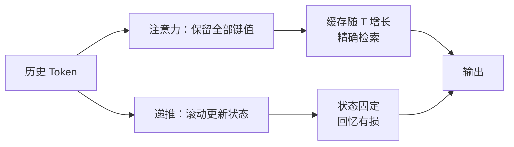

# 第 8 章 超越 Transformer：线性注意力、状态空间与混合架构

## 本章导读

把上下文从 8K 拉到 128K，看起来只是把最大长度改大；但在第 6 章那个 32 层、4096 维、GQA-8 的模型里，单条序列的 KV Cache 在 128K 时已经要 16 GiB，权重之外再占掉一整张显卡。继续推到一百万 Token，缓存就是 128 GiB。真正的出路不是再加显存，而是换一种只保留固定大小状态的机制。可一个几百 KB 的状态，凭什么记住一小时前说过的话？它又在什么地方必然忘事？

## 难度标签

⭐⭐⭐ 进阶 ｜ 数学要求：矩阵指数、常微分方程、卷积、分治扫描；代码要求：熟悉 PyTorch 的张量广播、`cumsum` 与因果掩码。

## 学习目标

读完本章你将能够：

1. 推导线性注意力如何用核函数替换 softmax，写出它的状态递推、并行形式与复杂度。
2. 从连续状态空间方程出发，推导零阶保持离散化，得到 SSM 的卷积形式与递推形式。
3. 解释选择性 SSM 为什么放弃 FFT 卷积、改用并行扫描，并说明扫描的稳定性条件。
4. 用状态账本比较注意力、线性注意力、SSM 与混合架构的显存与解码代价。
5. 判断固定状态架构在哪类任务上会失效，以及混合架构为什么成为 2025 年的主流折中。

## 8.1 直觉：从"记住全部"到"滚动摘要"

第 3 章的注意力有一个很强的性质：生成第 $$t$$ 个 Token 时，它能直接读到前面每一个 Token 的键和值。缓存里存的是完整历史，检索是精确的，代价是缓存随序列长度线性增长，而计算随长度平方增长。这像一场会议全程录音：想查哪句话都能回放，但录音文件会一直变大。

另一条路是只维护一份"会议纪要"。每来一句新话，就用固定大小的篇幅更新纪要；生成回复时只读纪要。纪要的大小与会议开了多久无关，这是它最诱人的地方；代价是细节会被压缩、覆盖，早先说过的人名和数字可能已经不在纪要里。线性注意力、状态空间模型（state space model，SSM）与 RWKV 都属于这一类：把历史压进一个固定大小的状态。



两者的差别不只在显存。注意力在训练时可以一次性看到整个序列，矩阵乘并行度极高；递推模型如果只能一步步算，训练会慢得无法接受。因此这一类架构能否成立，关键在于"训练时能不能并行"。本章会看到，线性注意力用前缀和、SSM 用并行扫描，各自解决了这个问题，但解决方式不同，代价也不同。


这里的"线性"指的是计算量随序列长度 $$T$$ 线性增长，而不是"线性层"的线性。线性注意力的状态大小与 $$T$$ 无关，却与模型宽度平方成正比；它不是"更小的模型"，而是"换一种方式记历史"。


## 8.2 数学原理

### 8.2.1 线性注意力：把 softmax 换成可分解的核

标准因果注意力对第 $$t$$ 个位置输出

$$
\mathbf{y}_t=\sum_{j=1}^{t}\frac{\exp\left(\mathbf{q}_t^{\top}\mathbf{k}_j/\sqrt{d}\right)}{\sum_{j'=1}^{t}\exp\left(\mathbf{q}_t^{\top}\mathbf{k}_{j'}/\sqrt{d}\right)}\,\mathbf{v}_j
\qquad \text{(8.1)}
$$

其中 $$\mathbf{q}_t,\mathbf{k}_j,\mathbf{v}_j\in\mathbb{R}^{d}$$。分母要对每个 $$t$$ 重新求和，所以计算量是 $$O(T^2d)$$。线性注意力（linear attention）的核心观察是：softmax 里的相似度可以换成一个可分解的核（kernel）。若存在特征映射 $$\phi$$ 使得

$$
\exp\left(\mathbf{q}^{\top}\mathbf{k}\right)\approx\phi(\mathbf{q})^{\top}\phi(\mathbf{k})
\qquad \text{(8.2)}
$$

那么分子与分母都能先对历史求和、再与当前查询做一次内积。常用的选择是 $$\phi(\mathbf{x})=\mathrm{ELU}(\mathbf{x})+1$$：ELU 的值域是 $$(-1,\infty)$$，加一后保证每个分量非负，分母不会因正负抵消而接近零。

把 (8.2) 代入 (8.1)，并去掉 $$\sqrt{d}$$ 的缩放（它会被分母约掉一部分，实际实现中常保留在特征里），得到

$$
\mathbf{y}_t=\frac{\sum_{j=1}^{t}\left(\phi(\mathbf{q}_t)^{\top}\phi(\mathbf{k}_j)\right)\mathbf{v}_j}{\sum_{j=1}^{t}\phi(\mathbf{q}_t)^{\top}\phi(\mathbf{k}_j)}
\qquad \text{(8.3)}
$$

定义两个累积量，问题就变成了递推。状态矩阵与归一化向量为

$$
\mathbf{S}_t=\sum_{j=1}^{t}\phi(\mathbf{k}_j)\mathbf{v}_j^{\top}\in\mathbb{R}^{d_\phi\times d_v},\qquad
\mathbf{z}_t=\sum_{j=1}^{t}\phi(\mathbf{k}_j)\in\mathbb{R}^{d_\phi}
\qquad \text{(8.4)}
$$

输出只需一次矩阵向量乘：

$$
\mathbf{y}_t=\frac{\phi(\mathbf{q}_t)^{\top}\mathbf{S}_t}{\phi(\mathbf{q}_t)^{\top}\mathbf{z}_t}
\qquad \text{(8.5)}
$$

而 $$\mathbf{S}_t$$ 与 $$\mathbf{z}_t$$ 满足最简单的递推：

$$
\mathbf{S}_t=\mathbf{S}_{t-1}+\phi(\mathbf{k}_t)\mathbf{v}_t^{\top},\qquad
\mathbf{z}_t=\mathbf{z}_{t-1}+\phi(\mathbf{k}_t)
\qquad \text{(8.6)}
$$

这就是"线性注意力是一个 RNN"的含义。训练时，式 (8.4) 中的求和可以沿序列维做前缀和（`cumsum`），一次算出所有位置的 $$\mathbf{S}_t$$；推理时用 (8.6) 每步只更新一次状态，不需要回看历史。

复杂度随之改变。设特征维度 $$d_\phi=d_v=d$$，则每层的计算量为 $$O(Td^2)$$，状态大小是 $$d^2$$ 个元素：

$$
\text{Attention: }O(T^2d)\ \text{FLOPs};\qquad
\text{Linear: }O(Td^2)\ \text{FLOPs},\ O(d^2)\ \text{state}
\qquad \text{(8.7)}
$$

注意 (8.7) 里的第二个式子对 $$T$$ 是线性的，但对宽度是平方的。在 $$d=4096$$ 的模型里，单层状态有约 1680 万个元素，FP16 下是 32 MiB；它与同宽度模型在 8K 上下文下的注意力缓存（每层 32 MiB）一样大，只有在更长的序列上才显出优势。把线性注意力理解成"状态很小"是误解，它只是"状态不随 $$T$$ 增长"。

还有一个质量上的代价。softmax 的指数可以让权重高度集中在一个键上，形成"精确指向"；而 $$\phi(\mathbf{q})^{\top}\phi(\mathbf{k})$$ 是有限维内积，取值平滑、有界，权重容易被摊薄到许多历史位置上。这就是线性注意力在检索类任务上通常弱于 softmax 注意力的原因，也是后面混合架构要保留少量注意力层的动机。

### 8.2.2 训练为什么还能并行

式 (8.4) 的求和对每个 $$t$$ 是独立的，因此可以沿序列维并行计算前缀和。把每步的外积记作 $$\mathbf{u}_t=\phi(\mathbf{k}_t)\mathbf{v}_t^{\top}$$，则 $$\mathbf{S}_t=\sum_{j\le t}\mathbf{u}_j$$，它是一次标准的前缀和扫描，深度为 $$O(\log T)$$。

代价在显存。若真的把所有 $$\mathbf{S}_t$$ 都物化，需要 $$O(Td^2)$$ 的中间量，对长序列比二次注意力还贵。实际实现采用分块（chunked）形式：把序列切成若干块，块内用二次形式算注意力，块间只传递一个状态。块大小为 $$C$$ 时，计算量仍是 $$O(Td^2)$$，中间显存降到 $$O(Cd^2+Td)$$。这一思路与第 5 章的 FlashAttention 同源：不改变数学结果，只改变计算顺序与内存布局。本章的参考实现为了可读性直接物化 $$\mathbf{S}_t$$，因此只适合教学规模，不能直接用于长序列训练。

### 8.2.3 状态空间模型：从微分方程到递推

状态空间模型用一组线性微分方程描述"状态如何随输入演化"：

$$
\mathbf{h}'(t)=\mathbf{A}\mathbf{h}(t)+\mathbf{B}\mathbf{x}(t),\qquad
\mathbf{y}(t)=\mathbf{C}\mathbf{h}(t)+\mathbf{D}\mathbf{x}(t)
\qquad \text{(8.8)}
$$

$$\mathbf{h}(t)\in\mathbb{R}^{N}$$ 是隐藏状态，$$\mathbf{A}\in\mathbb{R}^{N\times N}$$ 决定状态如何衰减与混合，$$\mathbf{B}$$ 把输入写进状态，$$\mathbf{C}$$ 从状态读出输出，$$\mathbf{D}$$ 是输入的直通项。连续时间在数字计算机上要离散化。最常用的是零阶保持（zero-order hold，ZOH）：假设在一个步长 $$\Delta$$ 内输入近似不变，解 (8.8) 得

$$
\mathbf{h}_t=\bar{\mathbf{A}}\mathbf{h}_{t-1}+\bar{\mathbf{B}}\mathbf{x}_t,\qquad
\bar{\mathbf{A}}=e^{\Delta\mathbf{A}},\quad
\bar{\mathbf{B}}=(\Delta\mathbf{A})^{-1}\left(e^{\Delta\mathbf{A}}-\mathbf{I}\right)\Delta\mathbf{B}
\qquad \text{(8.9)}
$$

推导从常数变易公式出发。把 (8.8) 两边乘以积分因子 $$e^{-\mathbf{A}t}$$，从 $$t-1$$ 积到 $$t$$，并假设区间内输入恒为 $$\mathbf{x}_t$$：

$$
\begin{aligned}
\mathbf{h}(t)&=e^{\Delta\mathbf{A}}\mathbf{h}(t-1)+\int_{0}^{\Delta}e^{(\Delta-u)\mathbf{A}}\mathbf{B}\mathbf{x}_t\,du\\
&=e^{\Delta\mathbf{A}}\mathbf{h}(t-1)+\left(\int_{0}^{\Delta}e^{v\mathbf{A}}dv\right)\mathbf{B}\mathbf{x}_t\\
&=e^{\Delta\mathbf{A}}\mathbf{h}(t-1)+\mathbf{A}^{-1}\left(e^{\Delta\mathbf{A}}-\mathbf{I}\right)\mathbf{B}\mathbf{x}_t
\end{aligned}
$$

把第二项写成 $$\bar{\mathbf{B}}\mathbf{x}_t$$，分子分母同乘 $$\Delta$$，就得到 (8.9) 中的 $$\bar{\mathbf{B}}$$。$$\bar{\mathbf{A}}$$ 是矩阵指数，它把连续时间的衰减"翻译"成离散步的衰减；$$\bar{\mathbf{B}}$$ 则把连续时间的输入增益按同样的衰减加权积分。

矩阵指数对一般矩阵很贵。S4 一类模型取 $$\mathbf{A}$$ 为对角矩阵，记对角元为 $$a_1,\dots,a_N$$，并要求 $$a_n<0$$，于是每个通道独立演化：

$$
h_{t,n}=\bar{a}_{t,n}h_{t-1,n}+\bar{b}_{t,n}x_t,\qquad
y_t=\sum_{n=1}^{N}c_{t,n}h_{t,n}+D x_t
\qquad \text{(8.10)}
$$

$$\bar{a}_n=e^{\Delta a_n}\in(0,1)$$，状态只会衰减、不会自发放大。这个约束很重要：它保证长序列上的数值稳定，也让后面并行扫描不会溢出。$$a_n$$ 的取值决定记忆长度：若 $$\bar{a}=0.99$$，半衰期是 $$\ln 0.5/\ln 0.99\approx 69$$ 步；若 $$\bar{a}=0.9999$$，半衰期约 6931 步。S4 用 HiPPO 初始化把 $$a_n$$ 铺在一段对数尺度上，让模型同时拥有短记忆与长记忆的通道。

### 8.2.4 卷积视角与 S4

递推可以展开成卷积。假设状态从零开始，反复代入 (8.10) 得

$$
y_t=\sum_{j=1}^{t}\mathbf{C}\bar{\mathbf{A}}^{\,t-j}\bar{\mathbf{B}}\,x_j+D x_t
\qquad \text{(8.11)}
$$

把核记作

$$
K_i=\mathbf{C}\bar{\mathbf{A}}^{\,i}\bar{\mathbf{B}},\qquad
\mathbf{y}=\mathbf{K}*\mathbf{x}+\mathbf{D}\mathbf{x}
\qquad \text{(8.12)}
$$

由于 (8.9) 中的 $$\bar{\mathbf{A}},\bar{\mathbf{B}},\mathbf{C}$$ 不随位置变化（线性时不变，linear time-invariant，LTI），核 $$K_i$$ 只依赖滞后量 $$i$$。这意味着训练时可以用 FFT 把卷积算成 $$O(T\log T)$$，而不必逐步递推。S4 的工程价值正在于此：它把一个看似只能串行的递推，变成了可并行的长卷积，同时在初始化上保证了长程记忆。

但卷积形式有一个前提：参数不随输入变化。只要 $$\bar{\mathbf{A}}$$ 或 $$\bar{\mathbf{B}}$$ 依赖当前 Token，核就不再是固定的 $$K_i$$，FFT 卷积失效。下一节的选择性 SSM 正是打破了这一前提。

### 8.2.5 选择性：Mamba 的关键一步

LTI 模型对所有 Token 用同一套衰减与写入规则。它无法根据内容决定"这个 Token 很重要，多记一会儿"或"这是无关的填充，快速忘掉"。Mamba 的做法是让离散化参数依赖输入：

$$
\Delta_t=\operatorname{softplus}\left(\mathbf{W}_\Delta\mathbf{x}_t+\mathbf{b}_\Delta\right),\qquad
\mathbf{B}_t=\mathbf{W}_B\mathbf{x}_t,\qquad
\mathbf{C}_t=\mathbf{W}_C\mathbf{x}_t
\qquad \text{(8.13)}
$$

softplus 保证步长 $$\Delta_t>0$$。于是离散参数也随位置变化：

$$
\bar{\mathbf{A}}_t=\exp\left(\Delta_t\mathbf{A}\right),\qquad
\bar{\mathbf{B}}_t=\left(\Delta_t\mathbf{A}\right)^{-1}\left(\exp\left(\Delta_t\mathbf{A}\right)-\mathbf{I}\right)\Delta_t\mathbf{B}_t
\qquad \text{(8.14)}
$$

$$\Delta_t$$ 大时 $$\bar{\mathbf{A}}_t$$ 的元素更小，状态忘得快；$$\Delta_t$$ 小时状态保留得久。$$\mathbf{B}_t$$ 决定写入什么，$$\mathbf{C}_t$$ 决定读出什么，两者都由当前输入算出。这就是"选择性"（selectivity）：模型按内容控制记忆的写入、保留与读取。

代价是卷积形式不能用了。$$\bar{\mathbf{A}}_t$$ 随 $$t$$ 变化，系统不再是时不变的，不存在固定的卷积核。训练只能回到递推，但可以用并行扫描把递推并行化（8.2.6）。每层的计算量约为 $$O(TIN)$$，状态为 $$O(IN)$$：

$$
\text{FLOPs}=O(TIN),\qquad \text{state}=O(IN)
\qquad \text{(8.15)}
$$

其中 $$I=\eta\,d_{model}$$ 是内部宽度，$$\eta$$ 是扩展倍数，$$N$$ 是状态维度。与线性注意力的 $$O(Td^2)$$ 相比，只要 $$N\ll d$$，选择性 SSM 就更省算力；本章的账本取 $$N=16$$，内部宽度 8192，每层状态只有 131072 个元素。

参数量可以逐项数出来。设 $$I=\eta\,d$$，单层包含：输入投影 $$\mathbf{W}_{in}:d\to2I$$（$$2dI$$）、深度因果卷积核（$$4I$$）、从内部宽度生成 $$\mathbf{B},\mathbf{C},\Delta$$ 的投影（$$I(2N+1)$$）、步长投影（$$I$$）、对角 $$\mathbf{A}$$ 的对数参数（$$IN$$）、直通项 $$\mathbf{D}$$（$$I$$）、输出投影（$$dI$$）。合并得

$$
P_{\text{ssm}}=3dI+I(3N+7)+\begin{cases}4I+d, & \text{带偏置}\\ I, & \text{不带偏置}\end{cases}
\qquad \text{(8.16)}
$$

不带偏置时最后一项只剩步长投影的偏置，因为 $$\Delta$$ 的投影必须带偏置才能表达非零的初始步长。本章代码在 64 维、$$I=128$$、$$N=16$$ 的配置上实测 31,744 个参数，与 (8.16) 逐位一致。

### 8.2.6 并行扫描

递推 $$h_t=a_t h_{t-1}+b_t$$ 的并行化依赖一个结合律。把一步变换记作二元组 $$(a_t,b_t)$$，复合两步：

$$
(a_1,b_1)\circ(a_2,b_2)=(a_2a_1,\ a_2b_1+b_2)
\qquad \text{(8.17)}
$$

验证：先算 $$h_1=a_1h_0+b_1$$，再算 $$h_2=a_2h_1+b_2=a_2a_1h_0+a_2b_1+b_2$$，正好等于复合后的 $$(a_2a_1)h_0+(a_2b_1+b_2)$$。这个运算满足结合律，因此可以用 Hillis–Steele 扫描：第 $$k$$ 轮把每个位置与前面 $$2^{k-1}$$ 步的复合结果合并，$$\lceil\log_2T\rceil$$ 轮后得到所有前缀状态。$$T=2^{20}\approx10^6$$ 时只需 20 轮，每一轮都是向量化操作。

数值稳定性依赖 $$|a_t|\le1$$。若所有 $$a_t\in(0,1]$$，复合只会在 $$[0,1]$$ 内相乘，不会溢出；若某些 $$a_t>1$$，长序列的乘积会指数增长。这就是 SSM 把 $$\mathbf{A}$$ 参数化为 $$-\exp(\mathbf{A}_{\log})$$ 的原因：负实部保证 $$\bar{\mathbf{A}}_t\in(0,1]$$。反过来，若 $$\bar{a}$$ 接近零，乘积会下溢成零，相当于状态被完全遗忘；这不是数值错误，而是模型学到的"短记忆"。

### 8.2.7 RWKV：另一条线性递推

RWKV 把注意力改写成带指数衰减的加权和。简化掉 token-shift 与 bonus 项后，它的时间混合部分为

$$
\mathbf{n}_t=e^{-\mathbf{w}}\odot\mathbf{n}_{t-1}+e^{\mathbf{k}_t}\odot\mathbf{v}_t,\qquad
\mathbf{z}_t=e^{-\mathbf{w}}\odot\mathbf{z}_{t-1}+e^{\mathbf{k}_t}
\qquad \text{(8.18)}
$$

$$
\mathbf{y}_t=\sigma(\mathbf{r}_t)\odot\frac{\mathbf{n}_t}{\mathbf{z}_t}
\qquad \text{(8.19)}
$$

$$\mathbf{w}>0$$ 是每个通道的衰减率，$$\sigma(\mathbf{r}_t)$$ 是接收门。它与线性注意力的结构几乎一样：分子是"键乘值"的加权和，分母是权重和，输出做归一化。差别在于权重不是 $$\phi(\mathbf{q})^{\top}\phi(\mathbf{k})$$，而是 $$e^{\mathbf{k}_t}\cdot e^{-\mathbf{w}(t-j)}$$，衰减是固定的指数。RWKV-4 的衰减不可学习地依赖内容，RWKV-7 则引入数据相关的衰减与 delta rule，向"选择性"靠拢。

RWKV 的状态是一个 $$d$$ 维向量，比线性注意力的 $$d^2$$ 矩阵与 SSM 的 $$IN$$ 都小，因此极省显存；但它的记忆是逐通道的标量衰减，表达能力也更受限。它适合从零训练的大规模模型，这一点已由 RWKV 系列自身验证，但它不是"把已有 Transformer 权重直接换掉"就能用的方案。

### 8.2.8 混合架构与状态账本

纯 SSM 的短板是精确检索，纯注意力的短板是长上下文显存。混合架构（hybrid architecture）把两者按层交替：大多数层用 SSM 或线性注意力，每隔 $$m$$ 层放一个真正的注意力层。记第 $$i$$ 层的类型为

$$
\text{kind}(i)=
\begin{cases}
\text{attn}, & (i+1)\bmod m=0\\
\text{ssm}, & \text{否则}
\end{cases}
\qquad \text{(8.20)}
$$

$$m=4$$ 表示每四层一个注意力层，注意力占比 25%。注意力层负责"精确查找"，SSM 层负责"廉价的长程摘要"。这样既把缓存压到原来的四分之一，又保留了少量可精确检索的位置。

账本要分两部分算。注意力的 KV Cache 与序列长度成正比：

$$
M_{\text{attn}}=2\,B\,T\,n_{kv}d_h\,b
\qquad \text{(8.21)}
$$

系数 2 是键与值，$$n_{kv}$$ 是 KV 头数，$$d_h$$ 是头维度，$$b$$ 是每元素字节数（FP16 为 2）。SSM 的状态与 $$T$$ 无关：

$$
M_{\text{ssm}}=B\,I\,N\,b
\qquad \text{(8.22)}
$$

混合架构的总状态是各层之和：$$n_{\text{attn}}M_{\text{attn}}+n_{\text{ssm}}M_{\text{ssm}}$$。解码时的每 Token 计算则近似为

$$
F_{\text{dec}}\approx2N_{\text{param}}+n_{\text{attn}}\cdot4Td+n_{\text{ssm}}\cdot4IN
\qquad \text{(8.23)}
$$

第一项是读全部权重做矩阵乘，后两项是序列相关的注意力计算与状态更新；注意力项的 $$4Td$$ 来自查询与 $$T$$ 个键的点积、再对 $$T$$ 个值加权，按查询头计共约 $$4Td$$ 次浮点运算。注意 (8.23) 只数 FLOPs，不等价于实际延迟：长上下文解码通常受显存带宽限制，每生成一个 Token 都要把 KV Cache 读一遍，字节数按 (8.21) 正比于 $$T$$，在 GQA 下只按 KV 头计。这也是为什么 128K 上下文的注意力模型即使 FLOPs 还能接受，实际吞吐也会被缓存读带宽拖垮。

### 8.2.9 表达能力边界

固定状态不是免费的午餐。一个宽 $$d$$、状态维度 $$N$$ 的 SSM，每层只能携带 $$IN$$ 个数；要在任意长度上精确复制一段输入，状态必须至少存下这段输入的信息量。序列越长、内容越随机，固定状态越不够用。Jelassi 等人 2024 年的对照实验（arXiv:2402.01032）给出了直接证据：在复制任务上，单层 Transformer 能随长度扩展，而 SSM 在长度超过某个阈值后准确率迅速下降。第 8.4 节的玩具实验会复现同一方向的现象。

第二个限制来自线性时不变。LTI 系统的卷积核固定，无法依据内容选择"记住哪一个"。选择性 SSM 用输入相关的 $$\Delta_t,\mathbf{B}_t,\mathbf{C}_t$$ 缓解了这一点，但状态维度仍然有限，不能无限期保存任意多个键值对。Merrill 等人 2024 年进一步指出（arXiv:2404.08819），固定深度的 SSM 在电路复杂度上属于 $$TC^0$$，无法解决某些需要状态跟踪的问题；这类结论有前提条件，不能外推成"SSM 什么都做不了"，但它说明纯 SSM 存在原理性的表达上界。

混合架构的动机就在这里。少量注意力层提供精确检索，SSM 层提供长程摘要与低显存；Jamba、MiniMax-01、Qwen3-Next 等模型的经验是，注意力占比在 1/8 到 1/4 之间就能补回大部分检索能力，而缓存只剩原来的零头。这个比例不是定理，它是任务分布、模型规模与上下文长度的联合折中。

## 8.3 方案对比

| 方案 | 训练并行方式 | 每 Token 训练复杂度 | 解码状态 | 内容选择 | 长上下文检索 | 工程成熟度 |
| --- | --- | --- | --- | --- | --- | --- |
| Softmax 注意力 | 矩阵乘，完全并行 | $$O(T^2d)$$ | KV Cache，$$O(T)$$ | 强 | 最强 | 最成熟 |
| 线性注意力 | 前缀和/分块 | $$O(Td^2)$$ | 矩阵状态，$$O(d^2)$$ | 弱 | 弱 | 中等 |
| S4 / LTI SSM | FFT 卷积 | $$O(T\log T)$$ | $$O(Nd)$$ | 无 | 中等 | 较成熟 |
| 选择性 SSM（Mamba） | 并行扫描 | $$O(TNd)$$ | $$O(Nd)$$ | 中等 | 中等 | 较成熟 |
| RWKV | 并行扫描/分块 | $$O(Td)$$ | 向量状态，$$O(d)$$ | 弱到中等 | 弱到中等 | 中等 |
| 混合架构 | 按层混合 | 介于两者之间 | 少量 KV + 多数定长 | 强（来自注意力层） | 接近注意力 | 2025 年主流 |

选型可以按三个问题排序。第一，瓶颈是显存还是算力？若显存被 KV Cache 吃满，优先考虑 SSM 或混合；若只是单卡算力不足，量化和更小的模型通常更直接。第二，任务是否依赖精确检索？长文档问答、代码补全、多轮对话中的指代，都是注意力层的强项；纯摘要与流式感知对精确回忆要求低，SSM 足够。第三，训练栈是否支持扫描内核？并行扫描在 GPU 上需要专门实现，CPU 上的朴素循环会比注意力慢一个数量级，这不是架构问题，而是内核问题。

## 8.4 代码实现：TinyLM 的 SSM 与混合块

### 8.4.1 实现选择

本章在第 7 章的代码上做增量，`TinyLM.forward` 与 `CausalLMOutput` 的签名不变：

- `config.py`：新增 `block_type`（`attention` / `linear_attention` / `ssm` / `hybrid`）、`ssm_d_state`、`ssm_expand`、`hybrid_attn_every` 四个字段；默认值保持 `attention`，因此旧配置逐位不变；
- `ssm.py`：`SelectiveSSM` 实现选择性 SSM，`LinearAttention` 实现核化注意力，`scan_states` 实现并行扫描；
- `block.py`：`SSMBlock` 与 `TransformerBlock` 同构，只把注意力换成 `mixer`；`LinearAttentionBlock` 复用同一骨架；`make_block` 按 `block_type` 分派，混合架构按 (8.20) 的规则插入注意力层；
- 深度因果卷积用手写的移位切片实现，避免 CPU 上 `Conv1d` 反向传播的开销；生产实现应换成专用内核；
- `last_state` 保存第一层最后一个位置的状态，供测试与账本读取；它被 `detach`，不参与梯度；
- 账本函数 `model_params`、`state_bytes`、`decode_flops` 全部按层解析计算，不为大配置实例化模型。

完整项目里这些代码分属 `ssm.py`、`block.py`、`config.py`；为了让本章独立运行，下面合并成一个文件 `ch08.py`，与第 3 到 7 章的 `ch03.py`–`ch07.py` 放在同一目录。

### 8.4.2 完整代码

```python
"""第 8 章：超越 Transformer（tinylm/ssm.py、block.py 的增量）。"""
import math
import sys
from dataclasses import dataclass

import torch
import torch.nn as nn
import torch.nn.functional as F

sys.path.insert(0, ".")
from ch03 import CausalLMOutput
from ch04 import sinusoidal_positions
from ch05 import make_norm
from ch06 import attention_params
from ch07 import (ModelConfig as Config7, TransformerBlock, dense_ffn_params,
                 make_ffn_or_moe, moe_layer_params)


# ---------------------------------------------------------------- config.py
@dataclass(frozen=True)
class ModelConfig(Config7):
    block_type: str = "attention"      # attention | linear_attention | ssm | hybrid
    ssm_d_state: int = 16              # 每个通道的状态维度 N
    ssm_expand: int = 2                # 内部宽度 I = expand * d_model
    hybrid_attn_every: int = 4         # 混合架构中每隔多少层放一个注意力层

    def __post_init__(self):
        super().__post_init__()
        assert self.block_type in ("attention", "linear_attention", "ssm", "hybrid")
        assert self.ssm_d_state >= 1
        assert self.ssm_expand >= 1
        assert self.hybrid_attn_every >= 1


# ---------------------------------------------------------------- ssm.py
def scan_states(a, b):
    """公式 (8.17)：h_t = a_t h_{t-1} + b_t 的并行关联扫描。

    Hillis-Steele 扫描，把 (a_t, b_t) 复合为 (a2 a1, a2 b1 + b2)，
    共 log2(T) 轮，每轮对序列维做一次向量化更新。
    """
    A, Bv = a, b
    T = a.shape[1]
    step = 1
    while step < T:
        A_prev = A
        A = torch.cat([A[:, :step], A[:, step:] * A_prev[:, :-step]], dim=1)
        Bv = torch.cat(
            [Bv[:, :step], A_prev[:, step:] * Bv[:, :-step] + Bv[:, step:]], dim=1)
        step *= 2
    return Bv


class SelectiveSSM(nn.Module):
    """公式 (8.8)–(8.16)：输入相关的选择性状态空间层（Mamba 风格）。"""

    def __init__(self, cfg):
        super().__init__()
        d = cfg.d_model
        self.inner = cfg.ssm_expand * d
        self.n_state = cfg.ssm_d_state
        self.in_proj = nn.Linear(d, 2 * self.inner, bias=cfg.bias)
        self.conv_w = nn.Parameter(torch.empty(self.inner, 4))  # 深度因果卷积
        nn.init.kaiming_uniform_(self.conv_w, a=math.sqrt(5))
        self.conv_b = nn.Parameter(torch.zeros(self.inner)) if cfg.bias else None
        self.x_proj = nn.Linear(self.inner, 2 * self.n_state + 1, bias=False)
        self.dt_proj = nn.Linear(1, self.inner, bias=True)
        a = torch.empty(self.inner, self.n_state).uniform_(1.0, 16.0)
        self.A_log = nn.Parameter(torch.log(a))          # A = -exp(A_log) < 0
        self.D = nn.Parameter(torch.ones(self.inner))
        self.out_proj = nn.Linear(self.inner, d, bias=cfg.bias)
        self.last_state = None

    def forward(self, x, attention_mask=None, position_ids=None):
        B, T, _ = x.shape
        u, z = self.in_proj(x).chunk(2, dim=-1)
        xp = F.pad(u.transpose(1, 2), (3, 0))                      # 左侧补 3 个 0
        conv = sum(xp[:, :, k:k + T] * self.conv_w[:, k].view(1, -1, 1)
                   for k in range(4))
        if self.conv_b is not None:
            conv = conv + self.conv_b.view(1, -1, 1)
        u = F.silu(conv.transpose(1, 2))                            # 因果卷积

        bc_dt = self.x_proj(u)
        B_t, C_t, dt_raw = torch.split(
            bc_dt, [self.n_state, self.n_state, 1], dim=-1)           # (8.13)
        dt = F.softplus(self.dt_proj(dt_raw))                         # (8.13)

        A = -torch.exp(self.A_log)                                    # (8.10)
        A_bar = torch.exp(dt.unsqueeze(-1) * A)                       # (8.14)
        ratio = torch.where(
            A.abs() < 1e-6,
            dt.unsqueeze(-1).expand_as(A_bar),
            (A_bar - 1.0) / A,
        )
        B_bar = ratio * B_t.unsqueeze(-2)                             # (8.14)

        h = scan_states(A_bar, B_bar)                                 # (8.17)
        y = (C_t.unsqueeze(-2) * h).sum(-1) + self.D * u              # (8.10)
        self.last_state = h[:, -1].detach()
        return self.out_proj(y * F.silu(z))


class LinearAttention(nn.Module):
    """公式 (8.1)–(8.6)：以 φ(q)ᵀφ(k) 替代 softmax 的线性注意力。"""

    def __init__(self, cfg):
        super().__init__()
        d = cfg.d_model
        self.q_proj = nn.Linear(d, d, bias=cfg.bias)
        self.k_proj = nn.Linear(d, d, bias=cfg.bias)
        self.v_proj = nn.Linear(d, d, bias=cfg.bias)
        self.out_proj = nn.Linear(d, d, bias=cfg.bias)
        self.eps = 1e-6
        self.last_state = None

    def forward(self, x, attention_mask=None, position_ids=None):
        q = F.elu(self.q_proj(x)) + 1.0                               # φ(q)
        k = F.elu(self.k_proj(x)) + 1.0
        v = self.v_proj(x)
        S = (k.unsqueeze(-1) * v.unsqueeze(-2)).cumsum(dim=1)         # (8.4)
        z = k.cumsum(dim=1)
        num = torch.einsum("btd,btdv->btv", q, S)                     # (8.3)
        den = torch.einsum("btd,btd->bt", q, z).clamp_min(self.eps)
        self.last_state = S[:, -1].detach()
        return self.out_proj(num / den.unsqueeze(-1))                 # (8.5)


class SSMBlock(nn.Module):
    """与 TransformerBlock 同构：只把注意力换成 SSM，前馈子层保持不变。"""

    def __init__(self, cfg):
        super().__init__()
        self.parallel = cfg.parallel_block
        self.norm1 = make_norm(cfg)
        self.mixer = SelectiveSSM(cfg)
        self.norm2 = None if self.parallel else make_norm(cfg)
        self.mlp = make_ffn_or_moe(cfg)

    def forward(self, x, attention_mask=None, position_ids=None):
        if self.parallel:
            h = self.norm1(x)
            delta, aux = self._ffn(h)
            return x + self.mixer(h) + delta, aux
        x = x + self.mixer(self.norm1(x))
        delta, aux = self._ffn(self.norm2(x))
        return x + delta, aux

    def _ffn(self, h):
        out = self.mlp(h)
        return out if isinstance(out, tuple) else (out, None)


class LinearAttentionBlock(SSMBlock):
    """同样的块结构，mixer 换成线性注意力。"""

    def __init__(self, cfg):
        super().__init__(cfg)
        self.mixer = LinearAttention(cfg)


def make_block(cfg, layer_idx):
    """按 block_type 分派；默认 attention 与第 7 章逐位一致。"""
    if cfg.block_type == "attention":
        return TransformerBlock(cfg)
    if cfg.block_type == "linear_attention":
        return LinearAttentionBlock(cfg)
    if cfg.block_type == "ssm":
        return SSMBlock(cfg)
    m = cfg.hybrid_attn_every
    return TransformerBlock(cfg) if (layer_idx + 1) % m == 0 else SSMBlock(cfg)


def layer_kinds(cfg):
    if cfg.block_type == "attention":
        return ["attn"] * cfg.n_layers
    if cfg.block_type == "linear_attention":
        return ["linear"] * cfg.n_layers
    if cfg.block_type == "ssm":
        return ["ssm"] * cfg.n_layers
    m = cfg.hybrid_attn_every
    return ["attn" if (i + 1) % m == 0 else "ssm" for i in range(cfg.n_layers)]


# ---------------------------------------------------------------- model.py
class TinyLM(nn.Module):
    def __init__(self, cfg):
        super().__init__()
        self.cfg = cfg
        self.pos_mode = cfg.pos_encoding
        self.tok_emb = nn.Embedding(cfg.vocab_size, cfg.d_model)
        if self.pos_mode == "learned":
            self.pos_emb = nn.Embedding(cfg.max_seq_len, cfg.d_model)
        elif self.pos_mode == "sine":
            self.register_buffer(
                "sin_pe", sinusoidal_positions(cfg.max_seq_len, cfg.d_model),
                persistent=False,
            )
        self.blocks = nn.ModuleList([make_block(cfg, i) for i in range(cfg.n_layers)])
        self.ln_f = make_norm(cfg)
        self.lm_head = nn.Linear(cfg.d_model, cfg.vocab_size, bias=False)
        self.apply(self._init_weights)
        if cfg.tie_embeddings:
            self.lm_head.weight = self.tok_emb.weight
        std = 0.02 / math.sqrt(2 * cfg.n_layers)
        for name, p in self.named_parameters():
            if name.endswith(("out_proj.weight", "fc_out.weight", "w_down.weight")):
                nn.init.normal_(p, mean=0.0, std=std)

    @staticmethod
    def _init_weights(module):
        if isinstance(module, nn.Linear):
            nn.init.normal_(module.weight, mean=0.0, std=0.02)
            if module.bias is not None:
                nn.init.zeros_(module.bias)
        elif isinstance(module, nn.Embedding):
            nn.init.normal_(module.weight, mean=0.0, std=0.02)

    def forward(self, input_ids, *, attention_mask=None, position_ids=None,
                past_kv=None, use_cache=False, labels=None, logits_to_keep=None):
        B, T = input_ids.shape
        if self.pos_mode in ("learned", "sine"):
            assert T <= self.cfg.max_seq_len, "序列长度超过 max_seq_len"
        if position_ids is None:
            position_ids = torch.arange(T, device=input_ids.device)

        x = self.tok_emb(input_ids)
        if self.pos_mode == "learned":
            x = x + self.pos_emb(position_ids)
        elif self.pos_mode == "sine":
            x = x + self.sin_pe[position_ids]

        aux_total = None
        for block in self.blocks:
            x, aux = block(x, attention_mask, position_ids)
            if aux is not None:
                aux_total = aux if aux_total is None else aux_total + aux

        x = self.ln_f(x)
        logits = self.lm_head(x)
        loss = None
        if labels is not None:
            loss = F.cross_entropy(
                logits.reshape(-1, self.cfg.vocab_size),
                labels.reshape(-1),
                ignore_index=-100,
            )
        return CausalLMOutput(logits=logits, loss=loss, aux_loss=aux_total)


# ---------------------------------------------------------------- 账本
def ssm_layer_params(cfg):
    """公式 (8.16)：单层 SSM 的参数量。"""
    I = cfg.ssm_expand * cfg.d_model
    N = cfg.ssm_d_state
    p = 3 * cfg.d_model * I + I * (3 * N + 7)
    p += (4 * I + cfg.d_model) if cfg.bias else I  # dt_proj 始终带偏置
    return p


def norm_params(cfg):
    d = cfg.d_model
    return d + (d if cfg.norm == "layernorm" and cfg.bias else 0)


def block_params(cfg, kind):
    """单层参数量：三种块都只替换 mixer，前馈子层与归一化保持一致。"""
    d, n = cfg.d_model, norm_params(cfg)
    ffn = moe_layer_params(cfg) if cfg.moe is not None else dense_ffn_params(cfg)
    norms = n if cfg.parallel_block else 2 * n
    if kind == "attn":
        mixer = attention_params(cfg)
    elif kind == "linear":
        mixer = 4 * d * d + (4 * d if cfg.bias else 0)
    else:
        mixer = ssm_layer_params(cfg)
    return mixer + ffn + norms


def model_params(cfg):
    """按块类型逐层累加，避免为 4096 维配置实例化整个模型。"""
    emb = cfg.vocab_size * cfg.d_model * (1 if cfg.tie_embeddings else 2)
    pos = cfg.max_seq_len * cfg.d_model if cfg.pos_encoding == "learned" else 0
    return (sum(block_params(cfg, k) for k in layer_kinds(cfg))
            + norm_params(cfg) + emb + pos)


def state_bytes(cfg, batch=1, seq_len=8192, b_elem=2):
    """每层解码状态：注意力缓存随 T 增长，SSM/线性注意力状态与 T 无关。"""
    d = cfg.d_model
    total = 0
    for kind in layer_kinds(cfg):
        if kind == "attn":
            if cfg.attention == "mla":
                total += batch * seq_len * (cfg.d_c + cfg.d_head_rope) * b_elem
            else:
                d_kv = cfg.n_kv_heads * (d // cfg.n_heads)
                total += 2 * batch * seq_len * d_kv * b_elem
        elif kind == "linear":
            total += batch * (d * d + d) * b_elem
        else:
            total += batch * (cfg.ssm_expand * d) * cfg.ssm_d_state * b_elem
    return total


def decode_flops(cfg, seq_len):
    """每 Token 解码的粗略 FLOPs：权重读取 + 序列相关项。"""
    total = 2 * model_params(cfg)
    d = cfg.d_model
    for kind in layer_kinds(cfg):
        if kind == "attn":
            total += 4 * seq_len * d          # QK^T + AV，按查询头计 4 T d
        elif kind == "linear":
            total += 4 * d * d
        else:
            total += 4 * (cfg.ssm_expand * d) * cfg.ssm_d_state
    return total


def human(nbytes):
    for unit in ("B", "KiB", "MiB", "GiB", "TiB"):
        if nbytes < 1024 or unit == "TiB":
            return f"{nbytes:.1f} {unit}" if unit != "B" else f"{nbytes:.0f} B"
        nbytes /= 1024


def ledger():
    common = dict(vocab_size=32000, d_model=4096, n_layers=32, n_heads=32,
                  n_kv_heads=8, d_ff=14336, max_seq_len=32768, norm="rmsnorm",
                  ffn="swiglu", bias=False, pos_encoding="rope", attention="gqa")
    cfgs = {
        "Attention": ModelConfig(**common),
        "LinearAttn": ModelConfig(block_type="linear_attention", **common),
        "SSM": ModelConfig(block_type="ssm", ssm_d_state=16, ssm_expand=2, **common),
        "Hybrid(1:3)": ModelConfig(block_type="hybrid", hybrid_attn_every=4,
                                   ssm_d_state=16, ssm_expand=2, **common),
    }
    print("状态与算力账本（FP16 状态，B=1，单序列解码）")
    print(f"{'配置':<12s}{'参数量':>14s}{'状态@8K':>12s}{'状态@128K':>12s}"
          f"{'FLOPs@8K':>12s}{'FLOPs@128K':>13s}")
    for name, cfg in cfgs.items():
        p = model_params(cfg)
        print(f"{name:<12s}{p:>14,d}{human(state_bytes(cfg, 1, 8192)):>12s}"
              f"{human(state_bytes(cfg, 1, 131072)):>12s}"
              f"{decode_flops(cfg, 8192) / 1e9:>9.1f} G"
              f"{decode_flops(cfg, 131072) / 1e9:>10.1f} G")

    print("\n每层状态大小（B=1，FP16）")
    print(f"{'层类型':<10s}{'8K':>12s}{'128K':>12s}{'随 T 增长':>10s}")
    for name, cfg in cfgs.items():
        kinds = layer_kinds(cfg)
        a8 = state_bytes_all(cfg, 8192) / max(1, len(kinds))
        a128 = state_bytes_all(cfg, 131072) / max(1, len(kinds))
        grows = "是" if a128 > 1.01 * a8 else "否"
        print(f"{name:<10s}{human(a8):>12s}{human(a128):>12s}{grows:>10s}")

    one = ModelConfig(vocab_size=16, d_model=64, n_layers=2, n_heads=4,
                      d_ff=256, max_seq_len=64, norm="rmsnorm", ffn="swiglu",
                      bias=False, pos_encoding="rope", block_type="ssm",
                      ssm_d_state=16, ssm_expand=2)
    measured = sum(p.numel() for p in TinyLM(one).parameters())
    print(f"\n单层 SSM 参数：公式 {ssm_layer_params(one):,d}，"
          f"实测 {sum(p.numel() for p in SelectiveSSM(one).parameters()):,d}")
    print(f"两层 SSM 模型：公式 {model_params(one):,d}，实测 {measured:,d}")


def state_bytes_all(cfg, seq_len):
    """无批次的每层平均状态字节数，便于逐层对照。"""
    return state_bytes(cfg, 1, seq_len)


# ---------------------------------------------------------------- 受控实验
def copy_task(B, T, lag, vocab, gen):
    seq = torch.randint(0, vocab, (B, lag), generator=gen)
    for t in range(lag, T):
        seq = torch.cat([seq, seq[:, t - lag:t - lag + 1]], dim=1)
    return seq


def make_labels(seq):
    return seq[:, :-1], seq[:, 1:].clone()


def train_one(cfg, steps=600, seed=0, train_len=32, lag=8):
    torch.manual_seed(seed)
    model = TinyLM(cfg)
    opt = torch.optim.AdamW(model.parameters(), lr=3e-3, weight_decay=0.01)
    gen = torch.Generator().manual_seed(1000 + seed)
    model.train()
    for _ in range(steps):
        seq = copy_task(64, train_len, lag, cfg.vocab_size, gen)
        inp, tgt = make_labels(seq)
        out = model(inp, labels=tgt)
        total = out.loss + (out.aux_loss if out.aux_loss is not None else 0.0)
        opt.zero_grad()
        total.backward()
        opt.step()
    return model


@torch.no_grad()
def evaluate(model, T=32, lag=8, B=256, seed=7):
    gen = torch.Generator().manual_seed(seed)
    seq = copy_task(B, T, lag, 16, gen)
    inp, tgt = make_labels(seq)
    model.eval()
    out = model(inp, labels=tgt)
    acc = (out.logits.argmax(-1) == tgt).float().mean().item()
    mixer = model.blocks[0].mixer if hasattr(model.blocks[0], "mixer") else None
    state = getattr(mixer, "last_state", None)
    norm = state.norm().item() if state is not None else float("nan")
    return out.loss.item(), acc, norm


def ablation():
    common = dict(vocab_size=16, d_model=64, n_layers=2, n_heads=4,
                  d_ff=256, max_seq_len=64, pos_encoding="rope",
                  norm="rmsnorm", ffn="swiglu")
    cfgs = {
        "Attention": ModelConfig(block_type="attention", **common),
        "LinearAttn": ModelConfig(block_type="linear_attention", **common),
        "SSM": ModelConfig(block_type="ssm", ssm_d_state=16, ssm_expand=2, **common),
        "Hybrid(1:1)": ModelConfig(block_type="hybrid", hybrid_attn_every=2,
                                   ssm_d_state=16, ssm_expand=2, **common),
    }
    floor = (8 - 1) / (32 - 1) * math.log(16)
    print("\n复制任务消融（3 个种子，600 步，损失/准确率取均值±标准差）")
    print(f"参照损失下界 {floor:.4f}")
    print(f"{'配置':<12s}{'参数量':>10s}{'损失':>16s}{'准确率':>18s}{'状态范数':>10s}")
    for name, cfg in cfgs.items():
        params = model_params(cfg)
        results = []
        for seed in range(3):
            model = train_one(cfg, seed=seed)
            results.append(evaluate(model))
        losses = torch.tensor([r[0] for r in results])
        accs = torch.tensor([r[1] for r in results])
        norms = torch.tensor([r[2] for r in results])
        norm_s = "—" if math.isnan(norms.mean()) else f"{norms.mean():.2f}"
        print(f"{name:<12s}{params:>10,d}"
              f"{losses.mean():>10.4f} ± {losses.std():.4f}"
              f"{accs.mean():>11.4f} ± {accs.std():.4f}{norm_s:>10s}")


def long_context_demo():
    cfg = ModelConfig(vocab_size=16, d_model=64, n_layers=2, n_heads=4,
                      d_ff=256, max_seq_len=64, norm="rmsnorm", ffn="swiglu",
                      bias=False, pos_encoding="rope", block_type="ssm",
                      ssm_d_state=16, ssm_expand=2)
    torch.manual_seed(0)
    model = TinyLM(cfg).eval()
    with torch.no_grad():
        for T in (8, 64, 512):
            ids = torch.randint(0, 16, (1, T))
            out = model(ids)
            state = model.blocks[0].mixer.last_state
            print(f"T={T:>3d}  输出有限 {bool(torch.isfinite(out.logits).all())}"
                  f"  状态形状 {tuple(state.shape)}  状态范数 {state.norm():.2f}")


def main():
    ledger()
    long_context_demo()
    ablation()


if __name__ == "__main__":
    main()
```

### 8.4.3 测试

测试覆盖四类不变量：默认配置与第 7 章逐位一致、线性注意力的扫描形式等于显式二次形式、并行扫描等于逐步递推、以及因果性与状态大小。完整测试如下：

```python
"""第 8 章自测：线性注意力、选择性 SSM、混合块、状态账本与因果性。"""
import math

import pytest
import torch

import ch07
import ch08


def base_config(**kw):
    common = dict(vocab_size=32, d_model=64, n_layers=2, n_heads=4,
                  d_ff=128, max_seq_len=64, bias=False,
                  norm="rmsnorm", ffn="swiglu", pos_encoding="rope")
    common.update(kw)
    return ch08.ModelConfig(**common)


def ssm_config(**kw):
    c = dict(block_type="ssm", ssm_d_state=16, ssm_expand=2)
    c.update(kw)
    return base_config(**c)


def test_attention_default_matches_chapter7():
    """block_type="attention" 时，第 8 章必须与第 7 章逐位一致。"""
    cfg7 = ch07.ModelConfig(vocab_size=32, d_model=64, n_layers=2, n_heads=4,
                            d_ff=128, max_seq_len=64, bias=False,
                            norm="rmsnorm", ffn="swiglu", pos_encoding="rope")
    cfg8 = base_config(block_type="attention")
    ref, ours = ch07.TinyLM(cfg7).eval(), ch08.TinyLM(cfg8).eval()
    ours.load_state_dict(ref.state_dict())
    ids = torch.randint(0, 32, (2, 12))
    with torch.no_grad():
        a, b = ref(ids), ours(ids)
    assert torch.allclose(a.logits, b.logits, atol=1e-6)
    assert b.aux_loss is None


def test_linear_attention_matches_quadratic_form():
    """公式 (8.1)–(8.6)：线性注意力的扫描形式等于显式二次形式。"""
    cfg = base_config(block_type="linear_attention")
    torch.manual_seed(0)
    layer = ch08.LinearAttention(cfg).eval()
    x = torch.randn(2, 9, cfg.d_model)
    with torch.no_grad():
        y = layer(x)
        q = torch.nn.functional.elu(layer.q_proj(x)) + 1.0
        k = torch.nn.functional.elu(layer.k_proj(x)) + 1.0
        v = layer.v_proj(x)
        scores = q @ k.transpose(-1, -2)
        mask = torch.tril(torch.ones(9, 9, dtype=torch.bool))
        scores = scores.masked_fill(~mask, 0.0)
        ref = layer.out_proj((scores @ v) / scores.sum(-1, keepdim=True).clamp_min(1e-6))
    assert torch.allclose(y, ref, atol=1e-5)


@pytest.mark.parametrize("T", [1, 2, 17, 32])
def test_parallel_scan_matches_sequential(T):
    """公式 (8.17)：并行扫描与逐步递推一致。"""
    torch.manual_seed(0)
    B, C = 2, 5
    a = torch.rand(B, T, C) * 0.9
    b = torch.randn(B, T, C)
    h = torch.zeros(B, C)
    ref = []
    for t in range(T):
        h = a[:, t] * h + b[:, t]
        ref.append(h)
    ref = torch.stack(ref, dim=1)
    assert torch.allclose(ch08.scan_states(a, b), ref, atol=1e-6)


def test_ssm_shapes_and_state():
    cfg = ssm_config()
    model = ch08.TinyLM(cfg).eval()
    ids = torch.randint(0, 32, (2, 11))
    with torch.no_grad():
        out = model(ids, labels=ids)
    state = model.blocks[0].mixer.last_state
    assert out.logits.shape == (2, 11, 32)
    assert torch.isfinite(out.loss)
    assert state.shape == (2, cfg.ssm_expand * cfg.d_model, cfg.ssm_d_state)


def test_state_size_independent_of_sequence_length():
    cfg = ssm_config()
    torch.manual_seed(0)
    model = ch08.TinyLM(cfg).eval()
    with torch.no_grad():
        for T in (4, 64):
            model(torch.randint(0, 32, (1, T)))
            state = model.blocks[0].mixer.last_state
            assert state.shape == (1, cfg.ssm_expand * cfg.d_model, cfg.ssm_d_state)


def test_ssm_layer_param_formula():
    """公式 (8.16)：单层 SSM 参数公式与实测一致。"""
    cfg = ssm_config()
    mixer = ch08.SelectiveSSM(cfg)
    actual = sum(p.numel() for p in mixer.parameters())
    assert actual == ch08.ssm_layer_params(cfg)


@pytest.mark.parametrize("kind", ["attention", "ssm", "linear_attention", "hybrid"])
def test_model_params_formula_matches_model(kind):
    """按层累加的参数量账本与实测一致。"""
    cfg = ssm_config(block_type=kind, hybrid_attn_every=2)
    actual = sum(p.numel() for p in ch08.TinyLM(cfg).parameters())
    assert ch08.model_params(cfg) == actual


@pytest.mark.parametrize("kind", ["ssm", "linear_attention", "hybrid"])
def test_causality(kind):
    """改动位置 t 的输入，位置 < t 的 logits 不变。"""
    cfg = ssm_config(block_type=kind, hybrid_attn_every=2)
    torch.manual_seed(0)
    model = ch08.TinyLM(cfg).eval()
    ids = torch.randint(0, 32, (1, 10))
    with torch.no_grad():
        y = model(ids).logits
        ids2 = ids.clone()
        ids2[:, 6] = (ids2[:, 6] + 5) % 32
        y2 = model(ids2).logits
    assert torch.allclose(y[:, :6], y2[:, :6], atol=1e-6)
    assert not torch.allclose(y[:, 6:], y2[:, 6:], atol=1e-6)


def test_long_sequence_is_stable():
    cfg = ssm_config()
    torch.manual_seed(0)
    model = ch08.TinyLM(cfg).eval()
    with torch.no_grad():
        out = model(torch.randint(0, 32, (1, 512)))
        state = model.blocks[0].mixer.last_state
    assert torch.isfinite(out.logits).all()
    assert torch.isfinite(state).all()
    assert state.abs().max() < 1e3


def test_hybrid_layer_mix():
    cfg = ssm_config(block_type="hybrid", hybrid_attn_every=4, n_layers=4)
    assert ch08.layer_kinds(cfg) == ["ssm", "ssm", "ssm", "attn"]
    model = ch08.TinyLM(cfg)
    assert isinstance(model.blocks[3], ch07.TransformerBlock)


def test_state_bytes_grows_only_for_attention():
    common = dict(vocab_size=32, d_model=64, n_layers=2, n_heads=4,
                  d_ff=128, max_seq_len=64, bias=False, norm="rmsnorm",
                  ffn="swiglu", pos_encoding="rope")
    attn = ch08.ModelConfig(block_type="attention", **common)
    ssm = ch08.ModelConfig(block_type="ssm", **common)
    linear = ch08.ModelConfig(block_type="linear_attention", **common)
    assert ch08.state_bytes(ssm, 1, 8192) == ch08.state_bytes(ssm, 1, 131072)
    assert ch08.state_bytes(linear, 1, 8192) == ch08.state_bytes(linear, 1, 131072)
    assert ch08.state_bytes(attn, 1, 131072) > 10 * ch08.state_bytes(attn, 1, 8192)
    assert ch08.state_bytes(ssm, 1, 8192) < ch08.state_bytes(linear, 1, 8192)


def test_hybrid_forward_and_loss():
    cfg = ssm_config(block_type="hybrid", hybrid_attn_every=2)
    model = ch08.TinyLM(cfg)
    ids = torch.randint(0, 32, (2, 12))
    out = model(ids, labels=ids)
    assert out.logits.shape == (2, 12, 32)
    assert torch.isfinite(out.loss)


def test_invalid_block_type_is_rejected():
    with pytest.raises(AssertionError):
        base_config(block_type="transformer")


def test_zero_features_do_not_produce_nan():
    """φ 为非负特征，归一化分母不应为零。"""
    cfg = base_config(block_type="linear_attention")
    layer = ch08.LinearAttention(cfg).eval()
    x = torch.zeros(1, 3, cfg.d_model)
    with torch.no_grad():
        y = layer(x)
    assert torch.isfinite(y).all()
```

### 8.4.4 运行结果

在 Python 3.13 + PyTorch 2.9 的 CPU 环境中，主程序的实际输出如下：

```text
状态与算力账本（FP16 状态，B=1，单序列解码）
配置                     参数量       状态@8K     状态@128K    FLOPs@8K   FLOPs@128K
Attention    7,241,732,096     1.0 GiB    16.0 GiB     18.8 G      83.2 G
LinearAttn   8,047,038,464     1.0 GiB     1.0 GiB     18.2 G      18.2 G
SSM          9,135,460,352     8.0 MiB     8.0 MiB     18.3 G      18.3 G
Hybrid(1:3)  8,662,028,288   262.0 MiB     4.0 GiB     18.4 G      34.5 G

每层状态大小（B=1，FP16）
层类型                 8K        128K    随 T 增长
Attention     32.0 MiB   512.0 MiB         是
LinearAttn    32.0 MiB    32.0 MiB         否
SSM          256.0 KiB   256.0 KiB         否
Hybrid(1:3)     8.2 MiB   128.2 MiB         是

单层 SSM 参数：公式 31,744，实测 31,744
两层 SSM 模型：公式 164,160，实测 164,160
T=  8  输出有限 True  状态形状 (1, 128, 16)  状态范数 0.08
T= 64  输出有限 True  状态形状 (1, 128, 16)  状态范数 0.10
T=512  输出有限 True  状态形状 (1, 128, 16)  状态范数 0.10

复制任务消融（3 个种子，600 步，损失/准确率取均值±标准差）
参照损失下界 0.6261
配置                 参数量              损失               准确率      状态范数
Attention      135,104    0.6313 ± 0.0033     0.7862 ± 0.0008         —
LinearAttn     135,104    1.2705 ± 0.0358     0.6169 ± 0.0124  16221.77
SSM            166,208    2.0816 ± 1.1965     0.3025 ± 0.4136    151.54
Hybrid(1:1)    150,656    0.6299 ± 0.0012     0.7876 ± 0.0009     21.73
```

```text
$ python -m pytest tests/test_ssm.py -q
......................                                                   [100%]
22 passed in 0.92s
```

测试耗时随机器与负载而异，通过项数与断言内容不随环境变化。

### 8.4.5 结果说明了什么

**第一，默认配置确实没有破坏第 7 章。** 把 `block_type` 设为 `attention` 时，`TinyLM` 的模块列表与第 7 章完全一致；测试加载第 7 章的 `state_dict` 后，logits 的最大误差在 `1e-6` 以内，`aux_loss` 为 `None`。这是"增量实现"的底线：新增能力用配置分派，默认路径不改一行行为。

**第二，参数量与状态量是两本账。** 同为 4096 维、32 层，注意力版 72.4 亿参数、SSM 版 91.4 亿参数、线性注意力版 80.5 亿参数。SSM 更多，因为它的输入投影是 2I 宽，还要存卷积核、状态投影与 $$\mathbf{A}$$ 的对数参数。但多出来的参数买到的不是每 Token 计算量，而是"状态不随 $$T$$ 增长"：注意力在 128K 时状态 16 GiB，SSM 始终 8 MiB。用参数量判断架构优劣会得出错误结论，必须同时看状态与序列长度。

**第三，线性注意力的状态并不小。** 它的状态是 $$d^2$$ 矩阵，4096 维下单层 32 MiB，32 层 1 GiB；在 8K 上下文下，这与注意力缓存（每层 32 MiB）持平，只有在更长的序列上才划算。它在 128K 时比注意力省 16 倍，但比 SSM 贵 128 倍。所谓"线性注意力省显存"是有条件的：省的是与 $$T$$ 相关的那一项，不是总显存。

**第四，解码算力的交叉点在几千 Token。** 8K 时注意力每 Token 约 18.8 GFLOP，SSM 约 18.3 GFLOP，两者几乎持平；128K 时注意力升到 83.2 GFLOP，SSM 仍是 18.3 GFLOP。按 (8.23) 解出交叉点约 7,300 Token：比这更短的序列，SSM 并不便宜；比这更长，注意力的序列项才开始主导。SSM 的优势不是"单位计算更便宜"，而是"计算曲线不随长度上扬"。真正先撞墙的是缓存带宽：128K 时每生成一个 Token 都要读 16 GiB 的 KV Cache，FLOPs 还没成为瓶颈，带宽已经先到极限。

**第五，复制任务揭示了固定状态的短板。** 任务要求模型在看到 8 个随机 Token 后原样重复 24 个位置，损失下界是 0.626，随机基线准确率约 0.788。注意力版损失 0.631、准确率 0.786，贴着天花板；线性注意力版损失 1.271、准确率 0.617，低于随机基线，说明它没有学会"把看到的 Token 存下来再吐出"，而不是仅仅回忆得不够准；纯 SSM 损失 2.082、准确率 0.303，三个种子之间的准确率标准差高达 0.414，有的种子完全没学会复制。只有混合 1:1 版回到 0.630 的损失、0.788 的准确率，与注意力持平。状态范数同样说明问题：线性注意力 $$1.6\times10^4$$，纯 SSM 151.5，混合版 21.7。无衰减的累加状态在训练中持续膨胀；带衰减的 SSM 稳定一些，但两层纯 SSM 无法可靠保存 8 步前的随机 Token；只要留一层注意力，复制能力就恢复。这与 8.2.9 的表达能力讨论方向一致。

**第六，长序列上的数值是稳的。** 在 T=8、64、512 上，SSM 的输出全部有限，状态形状恒为 `(1, 128, 16)`，范数稳定在 0.08 到 0.10 之间。这不是偶然：$$\mathbf{A}$$ 被参数化为负值，$$\bar{\mathbf{A}}\in(0,1]$$，状态只衰减不放大；并行扫描的乘积不会溢出。把 $$\mathbf{A}$$ 直接初始化为正数，长序列上很快就会看到 `inf`。

**第七，训练速度的差异主要是内核，不是架构。** 本章的并行扫描用 Python 循环实现，在 CPU 上每步约 0.24 秒，慢于注意力的矩阵乘。这不代表 SSM 在 GPU 上也慢：生产实现用 CUDA 的 scan 内核，把 $$\log T$$ 轮合并进一次核函数。用教学实现的速度给架构下结论，是常见的误判。

**参数量可以手算复核。** 测试配置是两层、$$d=64$$、$$I=128$$、$$N=16$$、SwiGLU、无偏置。单层 SSM 按 (8.16)：$$3\times64\times128=24{,}576$$，$$128\times(3\times16+7)=7{,}040$$，加上步长投影偏置 128，共 31,744；两层模型再加嵌入、位置表、最终归一化与输出头，合计 164,160，与实测一致。账本对得上，后面的状态与算力比较才有意义。

### 8.4.6 复现步骤

把 `ch03.py` 到 `ch07.py` 与本章的 `ch08.py` 放在同一目录，测试放在 `tests/test_ssm.py`，然后执行：

```text
$ python ch08.py
$ python -m pytest tests/test_ssm.py -q
```

主程序依次打印状态与算力账本、长上下文演示和复制任务消融。账本与长上下文演示在几秒内完成；消融包含 12 次 600 步训练，单核 CPU 约需七到十分钟，若只想核对实现，可以注释掉 `main()` 里的 `ablation()`。所有随机源都使用固定种子，重复运行应得到逐位相同的输出。

## 8.5 工业实践

**Jamba：Transformer 与 Mamba 的 1:7 混合。** AI21 在 2024 年发布的 Jamba 有 52B 总参数、12B 激活参数，32 层按 1:7 的比例混排 Transformer 与 Mamba 层（4 个注意力层 + 28 个 Mamba 层），前馈部分用 16 专家、Top-2 的 MoE，支持 256K 上下文。它的取舍很清晰：注意力层保证检索质量，Mamba 层把 KV Cache 压到 1/8，MoE 把每 Token 计算压到 12B 量级。Jamba-1.5 Large 把总参数推到 398B、激活参数 94B，路线不变。

**MiniMax-01：闪电注意力与 softmax 注意力交替。** MiniMax-01 有 456B 总参数、45.9B 激活参数，每 8 层插入一个 softmax 注意力层，其余用闪电注意力（lightning attention），训练上下文 100 万 Token、推理外推到 400 万 Token。闪电注意力的分块实现与 8.2.2 的思路一致：块内二次、块间递推，避免物化 $$Td^2$$ 的中间量。

**Qwen3-Next：门控 DeltaNet 与门控注意力的 3:1 混合。** 80B 总参数、3B 激活参数，48 层按"3 层 Gated DeltaNet + 1 层门控注意力"重复 12 次，即 75% 的层用带 delta rule 的线性注意力、25% 保留 softmax 注意力，原生上下文 262K。它把"大部分层用线性递推、少数层保留精确检索"做成了默认配置，并用 MoE 把激活参数压到 3B。

**Griffin：局部注意力与门控线性递推。** DeepMind 的 Griffin 在 2024 年比较了多种混合方案，最终采用"局部注意力 + 门控线性递推单元（RG-LRU）"，在 7B 与 14B 规模上匹配或超过同尺寸 Transformer。它的贡献之一是把"混合比例"与"门控机制"分开做消融，说明两者都影响长上下文质量。

**Kimi Linear 与 2025 年的混合潮。** Kimi Linear 报告了 KDA 与 MLA 按 3:1 混合的 48B/3B 模型，宣称在 1M 上下文上优或持平全注意力基线（技术报告数字，截至写作时）。同一时期，IBM Granite 4.0、Falcon-H1、NVIDIA Nemotron-H 都转向 Mamba/注意力混合。这条曲线的共同点是：不再追求"纯 SSM 取代注意力"，而是用少量注意力层兜住检索，用大量线性层换显存与吞吐。

把几个代表配置放在一起：

| 模型（年份） | 总参数 / 激活参数 | 层结构 | 上下文 | 关键机制 |
| --- | --- | --- | --- | --- |
| Jamba（2024） | 52B / 12B | 注意力:Mamba = 1:7，32 层（4 + 28） | 256K | MoE 16 选 2 |
| Jamba-1.5 Large（2024） | 398B / 94B | 同上比例 | 256K | 更大规模验证 |
| Griffin（2024） | 7B、14B | 局部注意力 + RG-LRU | 未主打超长 | 门控线性递推 |
| MiniMax-01（2025） | 456B / 45.9B | 每 8 层一个 softmax 注意力 | 4M | 闪电注意力 |
| Qwen3-Next-80B-A3B（2025） | 80B / 3B | Gated DeltaNet:注意力 = 3:1 | 262K | MoE、门控线性注意力 |
| Kimi Linear（2025） | 48B / 3B | KDA:MLA = 3:1 | 1M | KDA、delta rule |

这张表要横着读：混合比例从 1:7 到 3:1 不等，没有统一最优；参数规模从 7B 到 456B，说明这条路在小模型与大模型上都成立。共同约束是"注意力层不能为零"，因为精确检索仍需要它；共同收益是"KV Cache 按注意力占比缩小"，而不是消失。

## 8.6 论文导读

**1. Katharopoulos, A., Vyas, A., Pappas, N., & Fleuret, F. (2020). Transformers are RNNs: Fast Autoregressive Transformers with Linear Attention. arXiv:2006.16236.**

核心贡献：用核函数替换 softmax，把注意力写成线性递推，并给出训练时的前缀和形式。推荐阅读：第 3 节的线性注意力定义、第 4 节的复杂度分析。重点看它如何把 (8.1) 改写成 (8.5)，以及作者对"质量换速度"的诚实讨论。

**2. Gu, A., Goel, K., & Ré, C. (2021). Efficiently Modeling Long Sequences with Structured State Spaces. arXiv:2111.00396.**

核心贡献：S4。用 HiPPO 初始化与结构化矩阵，把 SSM 的长程记忆做到当时的最好水平，并用 FFT 卷积把训练复杂度降到 $$O(T\log T)$$。推荐阅读：第 2 节的背景、第 3 节的 S4 结构、第 4 节的卷积核计算。它是理解 (8.11)–(8.12) 的标准入口。

**3. Gu, A., & Dao, T. (2023). Mamba: Linear-Time Sequence Modeling with Selective State Spaces. arXiv:2312.00752.**

核心贡献：让 $$\Delta,\mathbf{B},\mathbf{C}$$ 依赖输入，打破时不变性，并用并行扫描训练。推荐阅读：第 3 节的选择性机制、第 4 节的硬件感知扫描。重点看作者如何解释"为什么必须放弃卷积"，以及扫描内核的实现取舍。

**4. Peng, B., Alcaide, E., Anthony, Q., Albalak, A., Arcadinho, S., Biderman, S., ... & Zhu, R.-J. (2023). RWKV: Reinventing RNNs for the Transformer Era. arXiv:2305.13048.**

核心贡献：把注意力改写成指数衰减的线性递推，给出可并行训练的实现，并在大规模上验证。推荐阅读：第 3 节的时间混合与通道混合、第 4 节的并行训练。重点看 (8.18)–(8.19) 与线性注意力的异同。

**5. Lieber, O., Lenz, B., Bata, H., Cohen, G., Osin, J., Dalmedico, J., ... & Shalev-Shwartz, S. (2024). Jamba: A Hybrid Transformer-Mamba Language Model. arXiv:2403.19887.**

核心贡献：把 Transformer、Mamba 与 MoE 组合成 52B/12B 的混合模型，验证 256K 上下文。推荐阅读：第 3 节的架构、第 4 节的消融。重点看混合比例、层间排列与缓存账本，它是本章 8.2.8 的工业对照。

## 8.7 常见误区

**误区一：线性注意力是"小状态"模型。**

它的状态是 $$d_\phi\times d_v$$ 矩阵，与模型宽度的平方成正比。4096 维下单层 32 MiB，32 层 1 GiB；只有在序列长到远超宽度时，它才比 KV Cache 省。把它当成"恒定几 MB"的模型，会在宽模型上低估显存。

**误区二：SSM 会在所有长度上比注意力快。**

每 Token 的计算量包含读全部权重。SSM 的权重往往更多（输入投影 2I 宽、状态参数），短序列上它可能比注意力更慢。本章账本里 8K 时 SSM 18.3 GFLOP 对注意力 18.8 GFLOP，交叉点在 7,300 Token 左右。SSM 的收益是"计算不随长度增长"，不是"单位计算更便宜"。

**误区三：Mamba 训练用 FFT 卷积。**

FFT 卷积只对线性时不变系统成立。选择性 SSM 的 $$\bar{\mathbf{A}}_t,\bar{\mathbf{B}}_t$$ 依赖输入，卷积核随位置变化，必须用并行扫描。把 S4 的实现直接套到 Mamba 上，结果会错，而不是仅仅慢。

**误区四：状态维度 $$N$$ 越大越好。**

$$N$$ 增大，状态、参数量与每 Token 计算都线性增长；但表达能力并不随 $$N$$ 线性提升。Mamba 的默认 $$N=16$$ 是在质量与效率之间折中的结果；把 $$N$$ 拉到 256 而不改其他配置，通常只增加显存。$$N$$ 要与内部宽度 $$I$$、层数、训练数据量一起调。

**误区五：混合比例可以随便定。**

比例决定缓存与检索能力的交换。注意力占比太低，长文档检索与精确复制会退化；太高，缓存又回到原点。Jamba 用 1:7、Qwen3-Next 用 1:4（3:1 的线性:注意力），差异来自任务、规模与上下文长度，不是随意选择。调整比例必须配合检索类评测，不能只看平均损失。

## 8.8 本章小结

- 线性注意力用核函数 $$\phi(\mathbf{q})^{\top}\phi(\mathbf{k})$$ 替换 softmax (8.2)，把历史压进矩阵状态 (8.4)，训练用前缀和、推理用递推 (8.6)，复杂度 $$O(Td^2)$$ (8.7)。
- 线性注意力的状态与 $$T$$ 无关但与 $$d^2$$ 成正比；它省的是序列维，不是模型维。没有衰减的累加状态会持续膨胀，需要归一化或门控。
- SSM 从连续方程 (8.8) 出发，用零阶保持离散化 (8.9)，在对角负实部假设下得到逐通道递推 (8.10)；时不变时可写成卷积 (8.11)–(8.12)，用 FFT 训练。
- 选择性 SSM 让 $$\Delta_t,\mathbf{B}_t,\mathbf{C}_t$$ 依赖输入 (8.13)–(8.14)，打破时不变性，卷积失效，改用并行扫描 (8.17)；复杂度 $$O(TIN)$$ (8.15)，参数量 (8.16)。
- 并行扫描依赖结合律 (8.17)；$$|a|\le1$$ 是数值稳定的前提，SSM 用负实部的 $$\mathbf{A}$$ 保证这一点。
- RWKV 用固定指数衰减的线性递推 (8.18)–(8.19)，状态只有 $$O(d)$$，比线性注意力与 SSM 都小，但内容选择性更弱。
- 混合架构按 (8.20) 交替放置注意力与 SSM；状态账本 (8.21)–(8.22) 显示缓存只随注意力层数增长，解码 FLOPs (8.23) 的交叉点在几千 Token。
- 固定状态存在表达上界：复制任务与状态跟踪任务会暴露它；少量注意力层能补回大部分检索能力，这是 2024–2025 年混合架构的共同选择。
- 本章账本与公开配置对得上：Jamba 的 1:7、Qwen3-Next 的 3:1、MiniMax-01 的每 8 层一个注意力，都落在 (8.20)–(8.23) 描述的同一框架内。


**本章的取舍**：线性注意力与 SSM 用"固定大小状态"换"不随序列增长的计算与显存"，再用前缀和或并行扫描把训练拉回可并行的轨道。它们放弃了 softmax 注意力的精确检索与内容选择性，换来长上下文下的显存与吞吐；代价是回忆有损、纯 SSM 在复制与状态跟踪上存在原理性短板、训练需要专门内核。混合架构是目前的折中：用少量注意力层兜住检索，用大量线性层换效率。选不选它，取决于三个条件：上下文是否长到 KV Cache 成为主瓶颈、任务是否容忍近似回忆、训练与推理栈是否支持扫描内核。若三者有一个不成立，全注意力往往仍是更稳的默认。


## 8.9 习题

### 习题 1（推导）

线性注意力的一层使用 $$\phi(\mathbf{x})=\mathrm{ELU}(\mathbf{x})+1$$，模型宽度为 $$d$$，特征维度 $$d_\phi=d_v=d$$，序列长度为 $$T$$。

1. 从 (8.3) 出发，推导递推 (8.6)，并说明为什么训练时可以只用一次前缀和算出所有 $$\mathbf{S}_t$$。
2. 写出单层的状态元素数与 FP16 字节数；在 $$d=4096$$、$$T=131072$$ 时，与同一模型的 GQA-8 注意力缓存（$$n_{kv}=8$$、$$d_h=128$$）比较，谁更大、大多少倍。
3. 若把 $$\phi$$ 换成恒等映射（去掉 ELU 与加一），分母可能出现什么问题？给出一个具体的输入例子。

<details>

<summary>展开参考答案</summary>

**第 1 问。** 由 (8.3)，$$\mathbf{S}_t=\sum_{j=1}^{t}\phi(\mathbf{k}_j)\mathbf{v}_j^{\top}$$。把求和拆成前 $$t-1$$ 项与第 $$t$$ 项，前 $$t-1$$ 项正是 $$\mathbf{S}_{t-1}$$，于是 $$\mathbf{S}_t=\mathbf{S}_{t-1}+\phi(\mathbf{k}_t)\mathbf{v}_t^{\top}$$；$$\mathbf{z}_t$$ 同理。由于每个 $$\mathbf{S}_t$$ 都是同一组外积的前缀和，沿序列维做一次 `cumsum` 就能同时得到所有位置的状态，不需要逐步串行。

**第 2 问。** 状态元素数为 $$d^2=4096^2=16{,}777{,}216$$，FP16 下每层 $$16{,}777{,}216\times2=33{,}554{,}432$$ 字节，即 32 MiB；32 层共 1 GiB。GQA-8 的注意力缓存每层为 $$2Tn_{kv}d_hb=2\times131072\times8\times128\times2=536{,}870{,}912$$ 字节，即 512 MiB；32 层共 16 GiB。注意力缓存是线性注意力状态的 16 倍。

**第 3 问。** 恒等映射下 $$\mathbf{z}_t=\sum_j\mathbf{k}_j$$ 可能为零或接近零，分母 $$\phi(\mathbf{q}_t)^{\top}\mathbf{z}_t$$ 会消失或变号。例如两个键 $$\mathbf{k}_1=(1,-1)$$、$$\mathbf{k}_2=(-1,1)$$ 相加为零，查询 $$\mathbf{q}=(1,0)$$ 时内积为零，输出被零除。ELU 加一保证每个分量非负，分母至少为 $$\phi(\mathbf{q})^{\top}\mathbf{z}_t\ge0$$，再配合下界裁剪即可避免除零。

</details>

### 习题 2（编程）

给本章的 `LinearAttention` 增加一个可学习的衰减门，构造最简单的门控线性注意力（gated linear attention）：

1. 把状态递推改为 $$\mathbf{S}_t=\mathbf{g}_t\odot\mathbf{S}_{t-1}+\phi(\mathbf{k}_t)\mathbf{v}_t^{\top}$$，其中 $$\mathbf{g}_t=\sigma(\mathbf{W}_g\mathbf{x}_t)\in(0,1)^d$$ 按特征维衰减；$$\mathbf{z}_t$$ 同步衰减；
2. 在复制任务上比较加门前后三组指标的均值与标准差：损失、准确率、第一层状态的范数；
3. 解释为什么门控能缓解本章观察到的状态膨胀，并说明它引入了什么新代价（参数量、并行扫描的形式）。

要求：固定随机种子；保持 `TinyLM.forward` 签名不变；报告至少 3 个种子的结果。

### 习题 3（开放思考）

你要为一个中文法律文档问答系统选择架构，单文档平均 30 万 Token，要求模型能准确引用条文编号与当事人姓名，推理在单张 80GB 显卡上进行。

1. 用 (8.21)–(8.23) 估算全注意力、纯 SSM、1:3 混合三种方案在 30 万 Token 下的 KV Cache 与每 Token 解码 FLOPs，指出哪一种最先撞显存墙；
2. 结合 8.2.9 的表达能力讨论，判断"纯 SSM 是否可行"，并给出你会选择的混合比例与理由；
3. 若显存仍然不够，列出两种工程手段（分块预填充、KV 量化、分层卸载等），分别说明它们能省多少、破坏什么保证。
