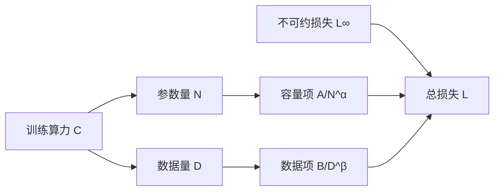

# 第 9 章 缩放定律

## 本章导读

2022 年之前，训练大模型的默认思路是"在算力允许的范围内把参数堆到最大"：GPT-3 有 1750 亿参数，只喂了约 3000 亿 Token，平均每个参数不到两个 Token。Chinchilla 用差不多的训练算力训练了一个 700 亿参数的模型，喂了 1.4 万亿 Token，在大多数评测上超过了参数量是它 2.5 倍的 Gopher。花的钱相近，结果却反过来了。为什么"更小、更久"能赢？如果算力再翻十倍，参数和数据应该各加多少？

## 难度标签

⭐⭐⭐ 进阶 ｜ 数学要求：多元函数极值、拉格朗日乘子、对数线性回归；代码要求：熟悉 PyTorch 自动微分与一维搜索，能读懂参数量与 FLOPs 账本。

## 学习目标

读完本章你将能够：

1. 写出损失随参数量与数据量变化的双幂律形式，解释三项各自的含义与单位。
2. 从算力账本 $$C\approx6ND$$ 与拉格朗日乘子推出计算最优配比，说明指数的来源。
3. 用合成数据拟合缩放定律，解释为什么指数比常数更稳健。
4. 估计数据重复的有效数据量，判断"数据不够时该重复还是该缩小模型"。
5. 区分计算最优、推理最优与数据受限三种目标，并据此评价 Llama 3 与 DeepSeek-V3 的配比。

## 9.1 直觉：损失是两笔账的和

把语言模型的损失想成两笔独立的罚款。第一笔来自"脑子不够"：模型的参数容量有限，无法精确表示数据分布，参数越多这笔罚款越小。第二笔来自"题做得不够"：训练数据有限，模型记住了训练集却没见到足够多的模式，数据越多这笔罚款越小。两笔罚款之外还有一个地板：自然语言本身有不可消除的不确定性，即便参数与数据都无限多，损失也降不到零。

这个心智模型可以直接画成一张账本图：



固定算力时，多给参数就少给数据，反之亦然。缩放定律要回答的就是这条预算线上的最优点在哪里。幂律的数学形式还带来一个方便：在双对数坐标上，当其中一项占主导时，损失与参数量或数据量的关系是一条直线，斜率就是指数。实验里看到的"直线下降"，正是这么来的。

举个具体例子：固定数据，把参数量从 1 亿加到 10 亿，容量项按 $$10^{-0.34}$$ 缩小，约降到原来的 46%；再翻十倍到 100 亿，再降到 21%。每次翻十倍，损失下降的比例相同，这就是幂律在双对数图上呈直线的原因。


缩放定律不是像能量守恒那样的自然定律，而是在特定数据分布、分词器、架构与优化器下，对一段算力区间的经验拟合。它能告诉你"在这个区间里往哪走更划算"，不能保证换一个数据分布或换一种架构后常数不变。


## 9.2 数学原理

### 9.2.1 双幂律形式

Chinchilla 使用的参数化是三项相加：

$$
L(N,D)=L_\infty+\frac{A}{N^{\alpha}}+\frac{B}{D^{\beta}}
\qquad \text{(9.1)}
$$

其中 $$N$$ 是参数量，$$D$$ 是训练 Token 数，$$L_\infty$$ 是不可约损失，$$A,B$$ 是常数，$$\alpha,\beta$$ 是正指数。三项分别对应"地板""容量不足""数据不足"。当 $$N\to\infty$$ 时容量项消失，只剩地板与数据项；当 $$D\to\infty$$ 时数据项消失；两者都趋于无穷时 $$L\to L_\infty$$。

Chinchilla 在自身数据上拟合得到 $$L_\infty=1.69$$、$$A=406.4$$、$$B=410.7$$、$$\alpha=0.34$$、$$\beta=0.28$$。$$L_\infty=1.69$$ nat/Token 约合困惑度 5.4，这是该数据分布与分词器下的经验地板，不是普适常数。

要注意 $$A$$ 与 $$B$$ 是有量纲的：$$A$$ 的单位是"损失乘以 $$N^\alpha$$"，$$B$$ 的单位是"损失乘以 $$D^\beta$$"。所以论文之间的常数不能直接比较，除非先统一 $$N$$、$$D$$ 的单位（是用个、千、还是百万）。指数 $$\alpha,\beta$$ 无量纲，反而更可移植。

为什么用加法而不是乘法？因为两种瓶颈是独立的：参数再多，数据项也不会消失；数据再多，容量项也不会消失。若写成乘积，无限参数会把损失压到零，等于宣称"只要模型够大，没见过的东西也能预测"，这与固定数据下的经验不符。

### 9.2.2 训练算力账本

第 3 章式 (3.26) 已经给出：前向传播每个 Token 约需 $$2N$$ 次浮点运算，因为每个参数参与一次乘加。反向传播要算对输入的梯度与对权重的梯度，计算量约为前向的两倍，即 $$4N$$。反向为什么是前向的两倍？对每层要算两份梯度：激活的梯度用于继续向前传，权重的梯度用于更新参数；两者各需一次与前向同量级的矩阵乘，合起来约为前向的两倍。于是每个 Token 合计约 $$6N$$，训练 $$D$$ 个 Token 的总算力为

$$
C\approx6ND
\qquad \text{(9.2)}
$$

这个账本忽略了三类开销。其一是注意力的序列项：每个 Token 每层还有约 $$4Td_{model}$$ 的运算，上下文越长占比越高，8K 上下文、4096 维、32 层时约占 10%。其二是重计算、通信与低利用率带来的实际开销，通常用模型浮点利用率（MFU）折算。其三是混合专家模型：稀疏激活时只有激活参数参与计算，必须把 $$N$$ 换成 $$N_{\mathrm{act}}$$，否则会把算力高估一个数量级。本章所有分配结论都建立在 (9.2) 的近似上。

### 9.2.3 计算最优分配

固定 $$C$$，把 $$D=C/(6N)$$ 代回 (9.1)，问题变成只关于 $$N$$ 的一维最小化：

$$
\Lambda(N,D,\lambda)=L_\infty+\frac{A}{N^{\alpha}}+\frac{B}{D^{\beta}}+\lambda(6ND-C)
\qquad \text{(9.3)}
$$

对 $$N$$ 与 $$D$$ 分别求偏导并令其为零：

$$
-\alpha A N^{-\alpha-1}+6\lambda D=0,\qquad -\beta B D^{-\beta-1}+6\lambda N=0
$$

第一式乘 $$N$$、第二式乘 $$D$$，两边的 $$6\lambda ND$$ 相同，于是得到平衡条件

$$
\alpha A N^{-\alpha}=\beta B D^{-\beta}
\qquad \text{(9.4)}
$$

它的含义是"最后一单位算力投在参数上和数据上，带来的损失下降相同"。这就是经济学里的等边际原则：只要两边边际收益不等，就该把算力从收益低的一侧挪到高的一侧。乘子 $$\lambda$$ 本身也有含义：它是"多一单位算力能换来的损失下降"，即算力的边际价值。

对 (9.4) 取对数，代入 $$D=C/(6N)$$，解出

$$
N_{\mathrm{opt}}\propto C^{\frac{\beta}{\alpha+\beta}},\qquad D_{\mathrm{opt}}\propto C^{\frac{\alpha}{\alpha+\beta}}
\qquad \text{(9.5)}
$$

Chinchilla 的拟合给出 $$\alpha=0.34>\beta=0.28$$，所以参数的指数约 0.45、数据的指数约 0.55：数据应该比参数增长得稍快。这与"参数优先"的早期直觉相反，也是 20 Token/参数这条经验规则的来源。

把比例常数记为 $$g_0$$，可以写成更好用的参数化形式：

$$
N_{\mathrm{opt}}=g_0\left(\frac{C}{6}\right)^{a},\qquad D_{\mathrm{opt}}=\frac{1}{g_0}\left(\frac{C}{6}\right)^{b},\qquad a+b=1
\qquad \text{(9.6)}
$$

其中 $$a=\beta/(\alpha+\beta)$$、$$b=\alpha/(\alpha+\beta)$$。两式相乘恰好得到 $$N_{\mathrm{opt}}D_{\mathrm{opt}}=C/6$$，即预算约束自动满足。$$g_0$$ 只决定参数与数据的比例，不改变增长指数。用 Chinchilla 报告的 $$a=0.46,b=0.54$$，再以 70B/1.4T 为锚点，可反解出 $$g_0\approx1.858$$。

最优解附近很平坦。把 $$N$$ 偏离最优点两倍，损失通常只上升千分之几；这也是为什么不同论文给出的 Token/参数比可以从 15 变到 30，而损失曲线几乎重合。精确比值对常数与拟合区间敏感，真正稳健的是"两边一起增长"这个方向。

把最优解代回 (9.1)，还能得到损失随算力下降的幂律：

$$
L_{\mathrm{opt}}(C)-L_\infty\propto C^{-\frac{\alpha\beta}{\alpha+\beta}}
\qquad \text{(9.7)}
$$

Chinchilla 参数下指数为 $$0.34\times0.28/0.62\approx0.154$$；Kaplan 等人报告的算力最优损失指数是 0.050。两者不矛盾：函数形式、拟合区间与数据都不同，指数自然不同。这也提醒我们，跨论文比较指数前要先确认它们定义在同一条曲线上。


"20 Token/参数"不是定律。按 (9.6)，$$D_{\mathrm{opt}}/N_{\mathrm{opt}}=g_0^{-2}(C/6)^{b-a}$$，这个比值随算力缓慢上升。本章的计算表里，$$C=10^{20}$$ 时约 10，$$C=10^{25}$$ 时约 25。所谓 20 只是在 $$10^{23}$$ 附近的局部值。更稳健的是指数，不是这个整数。


### 9.2.4 怎么拟合

直接对 (9.1) 做最小二乘会有两个麻烦。第一，损失在几个数量级的算力上变化，绝对误差会被大损失主导；第二，观测噪声更接近乘性而非加性。因此标准做法是在对数空间回归，最小化

$$
\sum_i\left(\log L(N_i,D_i)-\log\hat{L}(N_i,D_i)\right)^2
$$

或它的 Huber 稳健版本。本章代码用后者，并对五个参数做三次随机重启。

五个参数并不都能被稳定识别。$$A$$ 与 $$\alpha$$ 在有限的 $$N$$ 区间内高度相关：把 $$A$$ 调大、$$\alpha$$ 调小，曲线在观测区间里几乎不变。$$B$$ 与 $$\beta$$ 同理。更麻烦的是 $$L_\infty$$ 与两个指数也相关：地板压低一点，指数就要抬高一点才能拟合同样的点。这就是为什么不同论文拟合出的 $$A,B$$ 能差几十个百分点，而 $$\alpha,\beta$$ 却比较接近。

实践中还会遇到第三种失败：学习率太大导致拟合震荡，或者初始化让 $$L_\infty$$ 落到负值。本章代码用 softplus 保证地板为正，用多次重启挑最优，就是为了避开这些坑。

Chinchilla 用了三种方法互相校验：固定 Kaplan 的指数只拟合常数、按等算力曲线（IsoFLOP）逐个预算找最优点、以及对 (9.1) 做完整参数拟合。三种方法给出的精确 Token/参数比并不一致，但都指向"参数与数据应大致同速增长"。这个结论比任何一组具体常数都更可靠。

等算力曲线方法的操作是：对每个预算 $$C$$，训练多个不同 $$N$$ 的模型，$$D$$ 由 $$C/(6N)$$ 决定；在 $$\log N$$ 上把损失拟合成抛物线，顶点就是该预算的最优 $$N$$；再对所有预算的顶点拟合幂律。它不依赖 (9.1) 的函数形式，因此常被用来交叉验证参数化拟合。

### 9.2.5 数据受限：重复数据的有效量

当唯一 Token 数 $$U$$ 不够时，只能重复数据。重复不是等价的：第一遍几乎全是新信息，第二遍开始收益递减，重复到几十遍后新增价值接近于零。Muennighoff 等人把这种递减拟合为

$$
D_{\mathrm{eff}}=U+U R^{*}\left(1-e^{-R/R^{*}}\right),\qquad R=\frac{D}{U}-1
\qquad \text{(9.8)}
$$

其中 $$D$$ 是计划训练的 Token 数，$$R$$ 是"第一遍之外又重复了几遍"，$$R^{*}\approx15.4$$ 是拟合常数。$$R=0$$ 时 $$D_{\mathrm{eff}}=U$$；$$R\to\infty$$ 时 $$D_{\mathrm{eff}}\to U(1+R^{*})\approx16.4U$$。也就是说，无论重复多少遍，最多只能拿到约 16.4 倍唯一数据的有效信息。举个直观的例子：$$U=1$$ 万亿 Token，想训练 10 万亿 Token；重复 10 遍的有效数据量只有约 7.8 万亿，相当于浪费了两成算力。

把 (9.8) 代回损失：

$$
L(N,D)=L_\infty+\frac{A}{N^{\alpha}}+\frac{B}{D_{\mathrm{eff}}^{\beta}}
\qquad \text{(9.9)}
$$

这时"加数据"的边际收益被打了折扣，计算最优解会向更小的 $$N$$ 偏移：与其把算力花在第 20 遍重复上，不如把模型缩小、让每个参数看到更多不同的样本。$$R^{*}$$ 本身依赖数据质量、模型规模与任务，15.4 是论文数据上的拟合值，不是普适常数。

这个公式是现象学的，不是从第一性原理推出来的。它的合理性在于：重复数据覆盖的是同一支撑集，新增样本带来的独立信息随重复轮数指数衰减；$$R^{*}$$ 就是衰减的时间常数。数据质量越高、去重越彻底，重复的边际价值通常越低。

### 9.2.6 学习率与批大小

缩放定律描述的是"给定算力能达到的损失"，前提是优化器能把模型训练到那条曲线上。批大小与学习率决定能否到达，以及到达得多快。

关键批大小（critical batch size）由梯度噪声与真实梯度的比值决定：

$$
B_{\mathrm{crit}}\approx\frac{\operatorname{tr}(\boldsymbol{\Sigma})}{\lVert\mathbf{g}\rVert^{2}}
\qquad \text{(9.10)}
$$

其中 $$\boldsymbol{\Sigma}$$ 是单样本梯度的协方差，$$\mathbf{g}$$ 是全批量梯度。批大小远小于 $$B_{\mathrm{crit}}$$ 时，梯度噪声主导，扩大批量能显著降低噪声，可以把省下的步数换成更大的学习率；远大于 $$B_{\mathrm{crit}}$$ 时，噪声已经被平均掉，再扩批量只是浪费算力。

由此得到两条经验缩放规则：

$$
\eta(B)=\begin{cases}\eta_0\,B/B_0, & B\ll B_{\mathrm{crit}}\\[4pt] \eta_0\sqrt{B/B_0}, & B\gg B_{\mathrm{crit}}\end{cases}
\qquad \text{(9.11)}
$$

前者是线性缩放规则，后者是平方根缩放。它们都是经验规律，成立与否取决于优化器、warmup 与模型结构。μP（maximal update parametrization）从参数化角度给出了更系统的方案：把每层的初始化与学习率按宽度重标定，使最优超参数可以从一个小模型零样本迁移到大模型。这对缩放定律实验尤其重要，因为不可能为每个规模都重新扫一遍学习率。

批大小还随训练时长变化。训练越久，梯度噪声被平均得越充分，最优批大小通常越大；这也是为什么长训练的模型常用更大的全局批大小与更长的 warmup。把短训练扫出的学习率直接搬到长训练，往往会在后期发散或欠拟合。

### 9.2.7 损失之外：涌现是不是相变

缩放定律拟合的是平均损失，而人们真正关心的是下游能力。Wei 等人 2022 年报告，某些能力在模型规模超过某个阈值后"突然出现"，曲线在阈值附近近乎垂直。若这是真的，缩放定律对能力预测就没什么用：损失平滑下降，能力却可能一直为零然后跳变。

Schaeffer 等人 2023 年给出了一个有力的反驳：很多"涌现"是度量选择造成的假象。若把精确匹配换成连续的 Token 编辑距离或对数似然，同一批模型的曲线是平滑的。精确匹配是一个非线性、不连续的指标：模型答对的概率从 1% 缓慢升到 20% 时，精确匹配可能一直是零；升到 30% 时才突然"及格"。看起来像相变，其实是被阈值放大的连续变化。

反过来，McKenzie 等人 2023 年整理的逆缩放（inverse scaling）现象说明，规模变大也不总是更好：有些任务上，大模型更容易被干扰项带偏。因此对"规模会解决一切"要保持警惕。更稳妥的做法是同时报告连续损失与任务指标，并在多个规模上检查曲线的形状，而不是只看一个阈值。

还有一种中间情况：能力本身是连续的，但任务需要多步组合，单步准确率的微小提升会在多步任务上被指数放大，看起来像阈值。区分"度量假象"与"组合效应"，需要把任务拆成单步与多步两组分别测量。

## 9.3 方案对比

三种目标对应三条不同的预算线，放在一起看最清楚：

| 目标 | 代表工作 | 参数与数据 | 优化对象 | 适用条件 |
| --- | --- | --- | --- | --- |
| 训练损失最优 | Kaplan et al. 2020 | 偏向加大参数 | 固定算力下的损失 | 训练算力主导，推理量小 |
| 计算最优 | Hoffmann et al. 2022 | 约 20 Token/参数 | 固定算力下的损失 | 通用预训练基线 |
| 推理最优 | Sardana et al. 2024 | 更小、训练更久 | 训练加推理的总成本 | 推理量大，部署成本主导 |
| 数据受限 | Muennighoff et al. 2023 | 用 $$D_{\mathrm{eff}}$$ 修正 | 重复数据的边际价值 | 唯一数据不足 |

几组拟合结果也值得对照，但要注意它们的函数形式并不相同：

| 工作 | 损失形式 | 关键指数 | 计算最优结论 |
| --- | --- | --- | --- |
| Kaplan 2020 | 三个独立的幂律 | $$\alpha_N=0.076,\ \alpha_D=0.095,\ \alpha_C=0.050$$ | 参数优先 |
| Chinchilla 2022 | 双幂律相加 (9.1) | $$\alpha=0.34,\ \beta=0.28$$ | 参数与数据同速，$$a=0.46,b=0.54$$ |
| 本章合成实验 | 同 (9.1) | 真值 0.34 / 0.28 | 指数可恢复，常数不可辨识 |

Kaplan 的形式是 $$L(N)=(N_c/N)^{\alpha_N}$$ 一类的单项幂律，与 (9.1) 的"地板加两项"不是同一个模型，指数不能逐项相减。真正可比的结论是方向：参数与数据都要增长，且数据不应被忽视。

## 9.4 代码实现：TinyLM 的缩放账本

### 9.4.1 实现选择

本章不需要新的模型模块，只需要四类纯函数与两组实验：

- `scaling.py`：损失函数 (9.1)、最优指数 (9.5)、黄金分割求最优分配、对数空间拟合、有效数据量 (9.8)、算力账本 (9.2)。
- 合成数据验证：从已知参数生成带 1% 乘性噪声的 35 个点，检查拟合器能否恢复参数。
- 玩具扫描：复用第 8 章的 `TinyLM` 与复制任务，在 3 个模型规模、3 个数据预算、3 个种子上训练，观察损失与准确率。
- 训练加推理账本：复用第 8 章的 `decode_flops`，比较 8B/15T 与 70B/1.4T 的总成本。

拟合器在 log 空间用 Huber 回归，$$\alpha,\beta$$ 通过 Sigmoid 限制在 $$(0,1)$$，$$A,B$$ 通过指数变换保证为正。求最优分配没有用 SciPy，而是在 $$\log_{10}N$$ 上做 200 轮黄金分割，避免引入额外依赖。黄金分割不需要导数，也不假设目标函数可微，适合这种一维、单峰、计算便宜的问题；200 轮后区间宽度已经远小于浮点精度。

### 9.4.2 完整代码

```python
"""第 9 章：缩放定律（tinylm/scaling.py 与实验）。"""
import math

import torch
import torch.nn.functional as F

from ch08 import ModelConfig, TinyLM, decode_flops, model_params


# ---------------------------------------------------------------- scaling.py
def power_law_loss(N, D, E, A, B, alpha, beta):
    """公式 (9.1)：L(N,D)=E+A/N^α+B/D^β。"""
    return E + A / N**alpha + B / D**beta


def optimal_exponents(alpha, beta):
    """公式 (9.5)：计算最优分配的两个指数。"""
    s = alpha + beta
    return beta / s, alpha / s


def compute_optimal(C, E, A, B, alpha, beta, lo=6.0, hi=14.0):
    """公式 (9.3)–(9.6)：在 6ND=C 约束下最小化 (9.1)。

    固定 C 后 D=C/(6N)，问题化为一维搜索；在对数 N 上做黄金分割。
    """
    def objective(log_n):
        N = 10.0 ** log_n
        D = C / (6.0 * N)
        return float(power_law_loss(N, D, E, A, B, alpha, beta))

    gr = (math.sqrt(5.0) - 1.0) / 2.0
    a, b = lo, hi
    c, d = b - gr * (b - a), a + gr * (b - a)
    fc, fd = objective(c), objective(d)
    for _ in range(200):
        if fc < fd:
            b, d, fd = d, c, fc
            c = b - gr * (b - a)
            fc = objective(c)
        else:
            a, c, fc = c, d, fd
            d = a + gr * (b - a)
            fd = objective(d)
    log_n = (a + b) / 2.0
    N = 10.0 ** log_n
    D = C / (6.0 * N)
    return N, D, float(power_law_loss(N, D, E, A, B, alpha, beta))


def fit_scaling_law(points, fix_E=None, steps=3000, restarts=3, seed=0):
    """用对数损失上的 Huber 回归拟合 (9.1)；返回参数字典与拟合误差。

    points: (M,3) 张量，三列分别是 N、D、观测损失 L。
    fix_E: 若给出，固定不可约损失 E，只拟合其余四个参数。
    """
    pts = torch.as_tensor(points, dtype=torch.float32)
    N, D, L = pts[:, 0], pts[:, 1], pts[:, 2]
    log_L = torch.log(L)
    best = None
    for r in range(restarts):
        g = torch.Generator().manual_seed(seed + r)
        raw = torch.zeros(5)
        raw[0] = math.log(math.expm1(0.5)) if fix_E is None else 0.0
        raw[1] = math.log(400.0) + 0.5 * torch.randn((), generator=g).item()
        raw[2] = math.log(400.0) + 0.5 * torch.randn((), generator=g).item()
        raw[3] = 0.0
        raw[4] = 0.0
        raw = raw.requires_grad_(True)
        opt = torch.optim.Adam([raw], lr=0.05)
        for _ in range(steps):
            if fix_E is None:
                E = F.softplus(raw[0]) + 1e-3
            else:
                E = torch.tensor(float(fix_E))
            A = torch.exp(raw[1])
            B = torch.exp(raw[2])
            alpha = torch.sigmoid(raw[3])
            beta = torch.sigmoid(raw[4])
            pred = torch.log(E + A / N**alpha + B / D**beta)
            loss = F.huber_loss(pred, log_L, delta=1e-3)
            opt.zero_grad()
            loss.backward()
            opt.step()
        with torch.no_grad():
            if fix_E is None:
                E = float(F.softplus(raw[0]) + 1e-3)
            else:
                E = float(fix_E)
            params = dict(E=E, A=float(torch.exp(raw[1])), B=float(torch.exp(raw[2])),
                          alpha=float(torch.sigmoid(raw[3])),
                          beta=float(torch.sigmoid(raw[4])))
            pred = torch.log(torch.tensor(params["E"]) + params["A"] / N**params["alpha"]
                             + params["B"] / D**params["beta"])
            rmse = float(torch.sqrt(torch.mean((pred - log_L) ** 2)))
        if best is None or rmse < best[0]:
            best = (rmse, params)
    rmse, params = best
    params["rmse_log"] = rmse
    return params


R_STAR = 15.4  # Muennighoff et al. 2023 拟合的重复半程常数


def effective_data(D, U, r_star=R_STAR):
    """公式 (9.8)：数据受限时的有效数据量（Muennighoff et al. 2023）。

    D 是计划训练的 Token 数，U 是唯一 Token 数；R=D/U-1 是重复轮数。
    """
    if D <= U:
        return float(D)
    R = D / U - 1.0
    return U + U * r_star * (1.0 - math.exp(-R / r_star))


def training_flops(N, D):
    """公式 (9.2)：训练算力 C≈6ND。"""
    return 6.0 * N * D


# ---------------------------------------------------------------- 合成数据验证
def synthetic_points(true, seed=0):
    """从已知幂律生成带噪声的观测点，用于验证拟合器。"""
    g = torch.Generator().manual_seed(seed)
    Ns = torch.logspace(7, 10, 5)
    Ds = torch.logspace(8, 11, 5)
    pts = []
    for N in Ns:
        for D in Ds:
            L = float(power_law_loss(float(N), float(D), **true))
            L *= math.exp(0.01 * float(torch.randn((), generator=g)))
            pts.append((float(N), float(D), L))
    return torch.tensor(pts)


# ---------------------------------------------------------------- 玩具扫描
V, T, LAG = 16, 32, 8
FLOOR = (LAG - 1) / (T - 1) * math.log(V)


def copy_batch(B, T, V, gen, lag=LAG):
    x = torch.randint(0, V, (B, lag), generator=gen)
    for t in range(lag, T):
        x = torch.cat([x, x[:, t - lag:t - lag + 1]], dim=1)
    return x


def toy_train(cfg, steps, seed=0, lr=3e-3, batch=32):
    torch.manual_seed(seed)
    model = TinyLM(cfg)
    opt = torch.optim.AdamW(model.parameters(), lr=lr, weight_decay=0.01)
    gen = torch.Generator().manual_seed(1000 + seed)
    model.train()
    for _ in range(steps):
        seq = copy_batch(batch, T, V, gen)
        out = model(seq[:, :-1], labels=seq[:, 1:].clone())
        opt.zero_grad()
        out.loss.backward()
        opt.step()
    return model


@torch.no_grad()
def toy_eval(model, seed=7, n=512):
    gen = torch.Generator().manual_seed(seed)
    seq = copy_batch(n, T, V, gen)
    inp, tgt = seq[:, :-1], seq[:, 1:].clone()
    model.eval()
    out = model(inp, labels=tgt)
    acc = (out.logits.argmax(-1) == tgt).float().mean().item()
    return out.loss.item(), acc


def toy_sweep(seeds=(0, 1, 2)):
    common = dict(vocab_size=V, n_heads=4, max_seq_len=T, norm="rmsnorm",
                  ffn="swiglu", bias=False, pos_encoding="rope",
                  attention="gqa", n_kv_heads=2)
    sizes = {
        "s": dict(d_model=32, n_layers=1, d_ff=64),
        "m": dict(d_model=48, n_layers=2, d_ff=96),
        "l": dict(d_model=64, n_layers=2, d_ff=128),
    }
    budgets = (100, 400, 1600)
    rows = []
    print("玩具扫描：复制任务（lag=8，T=32，V=16，3 个种子取均值）")
    print(f"理论损失下界 {FLOOR:.4f}，随机猜测损失 {math.log(V):.4f}")
    print(f"{'配置':<4s}{'N':>9s}{'D':>11s}{'损失':>16s}{'准确率':>16s}{'C=6ND':>11s}")
    for name, sz in sizes.items():
        cfg = ModelConfig(**common, **sz)
        for steps in budgets:
            losses, accs = [], []
            for seed in seeds:
                model = toy_train(cfg, steps, seed=seed)
                loss, acc = toy_eval(model)
                losses.append(loss)
                accs.append(acc)
            loss = torch.tensor(losses)
            acc = torch.tensor(accs)
            N = model_params(cfg)
            D = steps * 32 * T
            rows.append((N, D, float(loss.mean())))
            print(f"{name:<4s}{N:>9,d}{D:>11,d}"
                  f"{loss.mean():>10.4f} ± {loss.std():.4f}"
                  f"{acc.mean():>10.4f} ± {acc.std():.4f}"
                  f"{training_flops(N, D):>11.2e}")
    return rows


# ---------------------------------------------------------------- 账本
def chinchilla_params():
    return dict(E=1.69, A=406.4, B=410.7, alpha=0.34, beta=0.28)


def scaling_allocation(C, a=0.46, b=0.54, G0=1.858):
    """公式 (9.6)：N_opt=g0(C/6)^a，D_opt=g0^{-1}(C/6)^b。

    a、b 取 Chinchilla Approach 3 的报告值；g0 由 70B/1.4T 的锚点校准。
    """
    N = G0 * (C / 6.0) ** a
    D = (C / 6.0) ** b / G0
    return N, D


def allocation_table():
    p = chinchilla_params()
    print("\n计算最优分配（a=0.46，b=0.54，g0=1.858；损失按 (9.1) 代入）")
    print(f"{'C (FLOPs)':>12s}{'N_opt':>14s}{'D_opt':>14s}{'D/N':>8s}{'L_pred':>9s}")
    for e in (20, 21, 22, 23, 24, 25):
        C = 10.0 ** e
        N, D = scaling_allocation(C)
        L = float(power_law_loss(N, D, **p))
        print(f"{C:>12.1e}{N:>14.3e}{D:>14.3e}{D/N:>8.1f}{L:>9.4f}")


def repetition_table():
    U = 1e12
    print("\n数据重复的有效数据量（U=1e12，R*=15.4）")
    print(f"{'重复轮数 R':>10s}{'D/U':>8s}{'D_eff/U':>10s}{'D_eff/D':>10s}")
    for r in (0, 1, 3, 7, 15, 31):
        D = (r + 1) * U
        de = effective_data(D, U)
        print(f"{r:>10d}{r + 1:>8d}{de/U:>10.3f}{de/D:>10.3f}")
    print(f"重复轮数趋于无穷时，D_eff 上限为 U(1+R*) = {1 + R_STAR:.1f}U")


def inference_ledger(infer_tokens=1e13):
    """训练 + 推理总成本；解码 FLOPs 复用第 8 章的 decode_flops。"""
    base = dict(vocab_size=128256, max_seq_len=8192, norm="rmsnorm",
                ffn="swiglu", bias=False, pos_encoding="rope", attention="gqa")
    m8 = ModelConfig(d_model=4096, n_layers=32, n_heads=32, n_kv_heads=8,
                     d_ff=14336, **base)
    m70 = ModelConfig(d_model=8192, n_layers=80, n_heads=64, n_kv_heads=8,
                      d_ff=28672, **base)
    rows = [("8B / 15T", m8, 15e12), ("70B / 1.4T", m70, 1.4e12)]
    print(f"\n训练 + 推理账本（上下文 8192，推理 {infer_tokens:.0e} Token）")
    print(f"{'模型/数据':<12s}{'参数量':>14s}{'训练 FLOPs':>12s}"
          f"{'每 Token 解码':>13s}{'推理 FLOPs':>12s}{'合计':>12s}")
    for name, cfg, D in rows:
        N = model_params(cfg)
        train = training_flops(N, D)
        dec = decode_flops(cfg, 8192)
        infer = dec * infer_tokens
        print(f"{name:<12s}{N:>14,d}{train:>12.2e}{dec:>13.2e}"
              f"{infer:>12.2e}{train+infer:>12.2e}")
    return rows


def breakeven():
    """8B/15T 与 70B/1.4T 的训练 + 推理总成本相等时的推理 Token 数。"""
    base = dict(vocab_size=128256, max_seq_len=8192, norm="rmsnorm",
                ffn="swiglu", bias=False, pos_encoding="rope", attention="gqa")
    m8 = ModelConfig(d_model=4096, n_layers=32, n_heads=32, n_kv_heads=8,
                     d_ff=14336, **base)
    m70 = ModelConfig(d_model=8192, n_layers=80, n_heads=64, n_kv_heads=8,
                      d_ff=28672, **base)
    t8, t70 = training_flops(model_params(m8), 15e12), training_flops(model_params(m70), 1.4e12)
    d8, d70 = decode_flops(m8, 8192), decode_flops(m70, 8192)
    q = (t70 - t8) / (d8 - d70)
    print(f"\n8B/15T 与 70B/1.4T 的总成本在推理 {q:.2e} Token 后相等；"
          f"此后 8B 更省。")


def main():
    true = dict(E=1.7, A=400.0, B=400.0, alpha=0.34, beta=0.28)
    pts = synthetic_points(true)
    got = fit_scaling_law(pts, seed=0)
    print("合成数据验证：已知幂律 + 1% 乘性噪声，35 个点")
    print(f"{'参数':<8s}{'真值':>10s}{'拟合':>10s}{'相对误差':>10s}")
    for k in ("E", "A", "B", "alpha", "beta"):
        print(f"{k:<8s}{true[k]:>10.4f}{got[k]:>10.4f}"
              f"{abs(got[k]-true[k])/abs(true[k]):>10.2%}")
    print(f"对数损失 RMSE：{got['rmse_log']:.5f}")

    allocation_table()
    repetition_table()

    toy_sweep()
    print("\n玩具扫描的算力跨度只有约 1.8 个数量级，且部分配置已经贴近损失下界，")
    print("不足以稳定识别 (9.1) 的五个参数；本章只用它验证方向，不用它估计指数。")

    inference_ledger()
    breakeven()


if __name__ == "__main__":
    main()
```

### 9.4.3 测试

```python
"""第 9 章自测：幂律拟合、计算最优分配、数据重复与算力账本。"""
import math

import pytest
import torch

import ch09


TRUE = dict(E=1.7, A=400.0, B=400.0, alpha=0.34, beta=0.28)


def test_power_law_and_flops():
    """(9.1) 与 (9.2)：手算两点核对。"""
    L = ch09.power_law_loss(1e9, 1e10, 1.7, 400.0, 400.0, 0.34, 0.28)
    expected = 1.7 + 400.0 / (1e9 ** 0.34) + 400.0 / (1e10 ** 0.28)
    assert abs(L - expected) < 1e-12
    assert ch09.training_flops(1e9, 1e10) == 6e19


def test_optimal_exponents_sum_to_one():
    """(9.5)：a+b=1，且 a<b（α>β）。"""
    a, b = ch09.optimal_exponents(0.34, 0.28)
    assert abs(a + b - 1.0) < 1e-12
    assert abs(a - 0.28 / 0.62) < 1e-12
    assert a < b


def test_allocation_satisfies_compute_budget():
    """(9.6)：N_opt 与 D_opt 必须严格满足 6ND=C。"""
    for e in (20, 22, 24):
        C = 10.0 ** e
        N, D = ch09.scaling_allocation(C)
        assert abs(6.0 * N * D / C - 1.0) < 1e-12
    N1, D1 = ch09.scaling_allocation(1e22)
    N2, D2 = ch09.scaling_allocation(1e24)
    assert N2 > N1 and D2 > D1
    assert D2 / N2 > D1 / N1          # b>a，Token/参数比缓慢上升


def test_compute_optimal_satisfies_balance_condition():
    """(9.3)–(9.4)：直接数值最小化应满足 αA N^-α=βB D^-β。"""
    C = 1e22
    N, D, _ = ch09.compute_optimal(C, **TRUE)
    assert abs(6.0 * N * D / C - 1.0) < 1e-9
    left = TRUE["alpha"] * TRUE["A"] * N ** (-TRUE["alpha"])
    right = TRUE["beta"] * TRUE["B"] * D ** (-TRUE["beta"])
    assert abs(left / right - 1.0) < 1e-3


def test_fit_recovers_exponents_from_synthetic_data():
    """固定随机种子，35 个带 1% 噪声的点应恢复 α、β 与 E。"""
    pts = ch09.synthetic_points(TRUE, seed=0)
    got = ch09.fit_scaling_law(pts, seed=0)
    assert abs(got["E"] - TRUE["E"]) / TRUE["E"] < 0.05
    assert abs(got["alpha"] - TRUE["alpha"]) < 0.05
    assert abs(got["beta"] - TRUE["beta"]) < 0.05
    assert got["rmse_log"] < 0.02


def test_effective_data_saturates():
    """(9.8)：首轮全值，重复收益递减，上限为 U(1+R*)。"""
    U = 1e12
    assert ch09.effective_data(U, U) == U
    assert ch09.effective_data(0.5 * U, U) == 0.5 * U
    # 第二轮几乎等于全新数据：R=1 时 D_eff/U 已到 1.95 以上
    assert 1.95 * U < ch09.effective_data(2 * U, U) < 2 * U
    # 无限重复也只能拿到 U(1+R*) 的有效数据
    assert ch09.effective_data(1e6 * U, U) < 1.001 * (1 + ch09.R_STAR) * U
    assert ch09.effective_data(2 * U, U) < ch09.effective_data(8 * U, U)


@pytest.mark.parametrize("C", [1e19, 1e21, 1e23])
def test_compute_optimal_loss_decreases_with_budget(C):
    N1, D1, L1 = ch09.compute_optimal(C, **TRUE)
    N2, D2, L2 = ch09.compute_optimal(10 * C, **TRUE)
    assert N2 > N1 and D2 > D1
    assert L2 < L1
```

### 9.4.4 运行结果

在 Python 3.13 + PyTorch 2.9 的 CPU 环境中，主程序的实际输出如下：

```text
合成数据验证：已知幂律 + 1% 乘性噪声，35 个点
参数              真值        拟合      相对误差
E           1.7000    1.6879     0.71%
A         400.0000  553.4148    38.35%
B         400.0000  313.1785    21.71%
alpha       0.3400    0.3621     6.51%
beta        0.2800    0.2651     5.32%
对数损失 RMSE：0.00925

计算最优分配（a=0.46，b=0.54，g0=1.858；损失按 (9.1) 代入）
   C (FLOPs)         N_opt         D_opt     D/N   L_pred
     1.0e+20     1.292e+09     1.290e+10    10.0   2.6205
     1.0e+21     3.725e+09     4.475e+10    12.0   2.3442
     1.0e+22     1.074e+10     1.552e+11    14.4   2.1500
     1.0e+23     3.098e+10     5.380e+11    17.4   2.0134
     1.0e+24     8.935e+10     1.865e+12    20.9   1.9174
     1.0e+25     2.577e+11     6.468e+12    25.1   1.8499

数据重复的有效数据量（U=1e12，R*=15.4）
    重复轮数 R     D/U   D_eff/U   D_eff/D
         0       1     1.000     1.000
         1       2     1.968     0.984
         3       4     3.726     0.931
         7       8     6.625     0.828
        15      16    10.586     0.662
        31      32    14.343     0.448
重复轮数趋于无穷时，D_eff 上限为 U(1+R*) = 16.4U
玩具扫描：复制任务（lag=8，T=32，V=16，3 个种子取均值）
理论损失下界 0.6261，随机猜测损失 2.7726
配置          N          D              损失             准确率      C=6ND
s      10,336    102,400    1.4934 ± 0.7269    0.6374 ± 0.2607   6.35e+09
s      10,336    409,600    0.9457 ± 0.4443    0.7260 ± 0.1069   2.54e+10
s      10,336  1,638,400    0.8261 ± 0.3193    0.7410 ± 0.0828   1.02e+11
m      43,248    102,400    1.0294 ± 0.0849    0.7870 ± 0.0006   2.66e+10
m      43,248    409,600    0.6394 ± 0.0024    0.7885 ± 0.0003   1.06e+11
m      43,248  1,638,400    0.6294 ± 0.0009    0.7882 ± 0.0019   4.25e+11
l      76,096    102,400    1.1571 ± 0.5674    0.6957 ± 0.1604   4.68e+10
l      76,096    409,600    0.6521 ± 0.0263    0.7847 ± 0.0063   1.87e+11
l      76,096  1,638,400    0.6331 ± 0.0023    0.7883 ± 0.0008   7.48e+11

玩具扫描的算力跨度只有约 1.8 个数量级，且部分配置已经贴近损失下界，
不足以稳定识别 (9.1) 的五个参数；本章只用它验证方向，不用它估计指数。

训练 + 推理账本（上下文 8192，推理 1e+13 Token）
模型/数据                  参数量    训练 FLOPs   每 Token 解码    推理 FLOPs          合计
8B / 15T     8,030,261,248    7.23e+23     2.04e+10    2.04e+23    9.26e+23
70B / 1.4T  70,553,706,496    5.93e+23     1.63e+11    1.63e+24    2.22e+24

8B/15T 与 70B/1.4T 的总成本在推理 9.15e+11 Token 后相等；此后 8B 更省。
```

```text
$ python -m pytest tests/test_scaling.py -q
.........                                                                [100%]
9 passed in 2.82s
```

测试耗时随机器与负载而异，通过项数与断言内容不随环境变化。

### 9.4.5 结果说明了什么

**第一，指数比常数稳。** 在 35 个带 1% 噪声的合成点上，拟合器把 $$L_\infty$$ 恢复到 0.71% 误差、$$\alpha$$ 恢复到 6.5%、$$\beta$$ 恢复到 5.3%，但 $$A$$ 偏了 38%、$$B$$ 偏了 22%。这不是拟合器坏了，而是参数之间本来就存在补偿关系：把 $$A$$ 调大、$$\alpha$$ 调小，曲线在观测区间里几乎一样。想同时钉住五个参数，需要更宽的算力跨度与更低的噪声；只想要方向时，指数足够。真实实验的噪声更大、网格更稀，$$A,B$$ 的误差通常比这里更严重；这也是工业界更愿意报告"损失-算力曲线的斜率"，而不是一组精确的 $$A,B$$。

**第二，Token/参数比不是常数。** 用 Chinchilla 报告的指数与 70B/1.4T 锚点，$$C=10^{20}$$ 时最优配比约 10 Token/参数，$$C=10^{25}$$ 时升到约 25。原因是 $$b>a$$：数据指数略大于参数指数，算力越大，数据相对参数增长得越快。把 20 当成硬性门槛，会在小算力上高估数据需求、在大算力上低估数据需求。

**第三，重复数据的边际价值衰减得很快。** 第一遍重复几乎与全新数据等价（98.4%），4 遍后只剩 93.1%，32 遍后只剩 44.8%，而有效数据量的上限是 16.4 倍唯一数据。数据受限时，"把同样的语料再喂十遍"不是免费的午餐；更合理的做法是按 (9.9) 把 $$D$$ 换成 $$D_{\mathrm{eff}}$$，重新解一次最优点，通常会得到更小的模型。

**第四，玩具扫描验证了方向，但不足以估计指数。** 在每个固定规模上，增加数据都让损失下降；3 个规模、3 个数据预算、3 个种子，共 27 次训练，最小的 `s` 模型在 100 步时损失 1.49，`m` 模型在 400 步时降到 0.64，`l` 模型在 1600 步时是 0.63，方向与 (9.1) 一致。但算力跨度只有约 1.8 个数量级，且 `m` 与 `l` 已经贴近 0.626 的理论下界，五个参数无法稳定识别。只用这张表去拟合，会得到顶到边界的指数；所以正文只用它验证实现，不用它下结论。还要注意，`m` 在 400 步时已经比 `l` 在 100 步时更好，而后者算力更高；这不是"小模型更优"，而是"数据不足的大模型还不如数据充足的中模型"，方向上仍与平衡条件一致。

**第五，准确率饱和而损失继续下降。** `m` 模型从 400 步到 1600 步，损失从 0.6394 降到 0.6294，但准确率从 0.7885 微降到 0.7882，看上去"没有进步"。这正是 9.2.7 讨论的度量问题：准确率在 0.788 附近已经饱和，损失仍在光滑下降。若只用准确率判断缩放是否有效，会漏掉后半段的真实改进。

**第六，训练与推理要一起算账。** 8B/15T 的训练算力是 $$7.23\times10^{23}$$，70B/1.4T 是 $$5.93\times10^{23}$$，两者相近；但 70B 每 Token 解码要 $$1.63\times10^{11}$$ FLOPs，是 8B 的 8 倍。按上下文 8192、推理 $$10^{13}$$ Token 计算，8B 的总成本在推理约 $$9.15\times10^{11}$$ Token 后低于 70B。推理量越大，越应该选更小、训练更久的模型；这就是推理最优与计算最优的分界。

### 9.4.6 复现步骤

把 `ch03.py` 到 `ch08.py` 与本章的 `ch09.py` 放在同一目录，测试放在 `tests/test_scaling.py`，然后执行：

```text
$ python ch09.py
$ python -m pytest tests/test_scaling.py -q
```

主程序依次打印合成数据拟合、计算最优分配、重复数据表、玩具扫描与训练/推理账本。合成数据与账本部分几秒内完成；玩具扫描包含 27 次最长 1600 步的训练，单核 CPU 约需几分钟。所有随机源都使用固定种子，重复运行应得到逐位相同的输出。

## 9.5 工业实践

**Chinchilla 的对照实验。** DeepMind 用与 Gopher 相近的训练算力（约 $$5\times10^{23}$$ FLOPs）训练了 70B 参数、1.4T Token 的 Chinchilla，而 Gopher 是 280B 参数、300B Token。Chinchilla 在多数评测上更好，说明此前的模型普遍"参数过剩、数据不足"。GPT-3 的 175B/300B 只有 1.7 Token/参数，按 Chinchilla 的标准严重欠训练。按 (9.2) 复算，Chinchilla 的训练算力约 $$5.9\times10^{23}$$ FLOPs，Gopher 约 $$5.0\times10^{23}$$，两者确实在同一量级；三者的对比说明：在相近预算下，把参数从 280B 降到 70B、把数据从 300B 升到 1.4T，是更划算的交易。

**Llama 3 的过训练。** Meta 在 2024 年公开的 Llama 3 把这条路推向另一头：8B 与 70B 都在超过 15T Token 上训练，405B 用了 15.6T。8B 的 Chinchilla 最优点约 200B Token，15T 是它的 75 倍。按纯训练损失，这远不是最优；但 Llama 3 是要长期部署的模型，推理成本会随使用量累积，训练时多花的算力可以从推理里省回来。这是 9.4.5 第六点的工业版本。按 (9.2)，405B/15.6T 的训练算力约 $$3.8\times10^{25}$$ FLOPs，比 8B/15T 高约 50 倍；这不是为了把训练损失压到最低，而是为了得到一个能力上限更高、推理时仍可按需选择尺寸的模型族。

**DeepSeek-V3 的 MoE 口径。** DeepSeek-V3 有 671B 总参数、37B 激活参数，训练了 14.8T Token，消耗 2.788M H800 GPU 小时。若按总参数算，14.8T/671B 约 22 Token/参数，看起来正好落在 Chinchilla 附近；但每 Token 只激活 37B，按 (9.2) 应代入 $$N_{\mathrm{act}}$$，于是 14.8T/37B 约 400 Token/激活参数，是明显的过训练。把总参数直接代进 $$C\approx6ND$$，会把训练算力高估约 18 倍。

几个代表配置放在一起：

| 模型 | 总参数 | 激活参数 | 训练 Token | Token/激活参数 | 训练算力（按 (9.2)） |
| --- | --- | --- | --- | --- | --- |
| Chinchilla | 70B | 70B | 1.4T | 20 | $$5.9\times10^{23}$$ |
| Llama 3 8B | 8B | 8B | >15T | >1,870 | $$7.2\times10^{23}$$ |
| Llama 3 405B | 405B | 405B | 15.6T | 38.5 | $$3.8\times10^{25}$$ |
| DeepSeek-V3 | 671B | 37B | 14.8T | 400 | $$3.3\times10^{24}$$ |

这张表要横着读：Chinchilla 是计算最优的基准，Llama 3 与 DeepSeek-V3 都主动偏离了它，偏离的方向一致——用更多数据换更小的推理成本。区别在于 Llama 3 是稠密模型，DeepSeek-V3 用 MoE 把总参数与激活参数分开，两者都不能只看总参数。

**推理最优的判据。** Sardana 等人 2024 年把推理成本写进目标函数，结论很直接：如果部署后的推理 Token 数远大于训练 Token 数，最优模型会比 Chinchilla 更小、训练更久。具体差多少取决于推理量、模型宽度与硬件；本章的账本给出的是同一套算法的简化版。用本章账本做个粗算：若日推理量是 $$10^{12}$$ Token、持续一年约 $$3.65\times10^{14}$$ Token，8B 与 70B 的推理成本差距会远大于训练成本差距；这时 8B/15T 的过训练几乎是必然选择。工程上常用的经验是：先按 Chinchilla 比例估一个基线，再按预期推理量向"更小更久"的方向调整，最后用实际吞吐与单位 Token 成本复核。

还有一个常被忽略的口径：训练算力只算了一次前向加一次反向，不含超参搜索、失败重跑与数据清洗。工业报告里的 GPU 小时通常已经包含这些开销，所以会比 (9.2) 的理论值高出一截。

## 9.6 论文导读

**1. Kaplan, J., McCandlish, S., Henighan, T., Brown, T. B., Chess, B., Child, R., ... & Amodei, D. (2020). Scaling Laws for Neural Language Models. arXiv:2001.08361.**

核心贡献：系统拟合了损失随参数量、数据量、算力的幂律，给出 $$\alpha_N=0.076$$、$$\alpha_D=0.095$$、$$\alpha_C=0.050$$，并主张固定算力下优先加参数。推荐阅读：第 1 节的幂律形式、第 3 节的算力分配、第 5 节的批大小讨论。注意它的函数形式与 Chinchilla 不同，指数不能逐项对比。

**2. Hoffmann, J., Borgeaud, S., Mensch, A., Buchatskaya, E., Cai, T., Rutherford, E., ... & Sifre, L. (2022). Training Compute-Optimal Large Language Models. arXiv:2203.15556.**

核心贡献：Chinchilla。用三种方法重新估计计算最优配比，得到 $$\alpha=0.34$$、$$\beta=0.28$$，并训练 70B/1.4T 的模型击败 280B 的 Gopher。推荐阅读：第 3 节的三种估计方法、第 4 节的 IsoFLOP 曲线、附录的拟合细节。重点是"损失面在最优附近很平坦"这一观察。

**3. Muennighoff, N., Rush, A. M., Barak, B., Le Scao, T., Piktus, A., Tazi, N., ... & Raffel, C. (2023). Scaling Data-Constrained Language Models. arXiv:2305.16264.**

核心贡献：研究唯一数据不足时的重复训练，给出有效数据量公式 (9.8)，拟合 $$R^{*}\approx15.4$$，并报告前 4 轮重复几乎与全新数据等价。推荐阅读：第 3 节的重复实验、第 4 节的拟合、第 5 节的数据受限缩放定律。它是本章 9.2.5 的直接来源。

**4. Sardana, N., Portes, J., Doubov, S., & Frankle, J. (2024). Beyond Chinchilla-Optimal: Accounting for Inference in Language Model Scaling Laws. arXiv:2401.00448.**

核心贡献：把推理成本纳入缩放目标，推导推理感知的最优模型规模，说明推理需求大时应训练更小、更久的模型。推荐阅读：第 2 节的目标函数、第 3 节的等值线、第 4 节的实验。它是本章 9.4.5 第六点与 9.5 节的理论依据。

**5. Schaeffer, R., Miranda, B., & Koyejo, S. (2023). Are Emergent Abilities of Large Language Models a Mirage? arXiv:2304.15004.**

核心贡献：指出许多"涌现"是度量选择造成的假象，连续指标下曲线平滑。推荐阅读：第 2 节的度量分析、第 3 节的替换实验、第 4 节的反例。正文另引 Wei 等人 2022 年的涌现论文（arXiv:2206.10658）与 McKenzie 等人 2023 年的逆缩放论文（arXiv:2306.09479），三者应一起读。

## 9.7 常见误区

**误区一：20 Token/参数是必须遵守的定律。**

它只是 (9.6) 在 $$10^{23}$$ FLOPs 附近的局部值。比值随算力缓慢上升，且常数 $$g_0$$ 依赖数据与分词器。更稳健的是指数：数据应比参数增长得稍快，而不是死守一个整数。

**误区二：同样算力下，参数越多的模型一定越好。**

Kaplan 的早期结论偏向参数，Chinchilla 用同样的算力证明 70B/1.4T 优于 280B/300B。原因不是"参数不重要"，而是此前的数据配比失衡。固定算力时，参数与数据是两条腿，任何一条太短都会拖住损失。判断配比是否合理，不能只看参数量或 Token 数中的任何一个，而要把两者放进 (9.1) 或 (9.6) 一起算。

**误区三：缩放定律可以无限外推。**

(9.1) 是在一段算力区间上拟合的。超出区间后，数据可能先耗尽、架构可能不再是瓶颈、下游任务可能饱和，曲线会弯折。用 1e20 到 1e22 的拟合去预测 1e26，误差可能大到无法指导决策；外推前至少要检查唯一数据量、上下文长度与评测指标是否仍在同一 regime。一个实用的检查是：在拟合区间的两端各留一个点做留出验证，若外推误差已经超过几个百分点，就不要把结论用到更远的规模。

**误区四：能力"涌现"一定是相变。**

Wei 等人的曲线在精确匹配指标上很陡，但换成连续指标后往往变平滑。度量是非线性的，会把连续改进放大成跳变。反过来，逆缩放现象说明规模也不总带来提升。判断是否真的出现新能力，要同时看连续损失、任务指标与错误类型。

**误区五：MoE 用总参数代入 $$C\approx6ND$$。**

MoE 每 Token 只激活一部分专家，训练算力由激活参数决定。DeepSeek-V3 按总参数算是 22 Token/参数，按激活参数算是 400，差了 18 倍。混用两个口径，会把训练成本、最优配比与推理成本全部算错。

## 9.8 本章小结

- 损失可以写成不可约项、容量项与数据项之和 (9.1)；训练算力约等于 $$6ND$$ (9.2)。
- 在固定算力下最小化损失，拉格朗日乘子给出平衡条件 (9.4)：参数与数据的边际收益相等。
- 平衡条件解出两个指数 (9.5)：参数按 $$C^{\beta/(\alpha+\beta)}$$ 增长，数据按 $$C^{\alpha/(\alpha+\beta)}$$ 增长；Chinchilla 下约为 0.46 与 0.54。
- 最优损失随算力按 (9.7) 下降，Chinchilla 参数下指数约 0.154。
- 数据重复的收益按 (9.8) 递减，有效数据量有上限 $$U(1+R^{*})$$；数据受限时应把 $$D$$ 换成 $$D_{\mathrm{eff}}$$ 后重解最优点 (9.9)。
- 批大小与学习率决定能否到达缩放曲线；关键批大小 (9.10) 与两条缩放规则 (9.11) 是工程上的起点，μP 提供了更系统的超参数迁移方案。
- 涌现不一定是相变，度量选择会把连续改进放大成跳变；逆缩放说明规模不是万能的。
- Llama 3 与 DeepSeek-V3 都主动偏离了计算最优，用更多数据换更低的推理成本；MoE 必须用激活参数算账。


**本章的取舍**：计算最优配比用"更多数据"换"更小参数"，把固定训练算力的损失压到最低；代价是训练更久、每 Token 的推理成本更高。Chinchilla 比例适合训练算力主导、推理量有限、唯一数据充足的场景；Llama 3 式的过训练适合推理量大、部署周期长的场景，用训练算力换推理成本；数据受限时则应按 (9.9) 重新分配，必要时缩小模型、减少重复。三者没有绝对优劣，只有"训练、推理、数据"三笔账里哪一笔更贵。缩放定律给出的是这条预算线上的斜率，不是终点。


## 9.9 习题

### 习题 1（推导）

设损失为 (9.1)，训练算力约束为 $$6ND=C$$，$$\alpha,\beta>0$$。

1. 用拉格朗日乘子推出平衡条件 (9.4) 与指数 (9.5)，并说明为什么这个驻点是全局最小。
2. 证明最优损失满足 (9.7)，并代入 $$\alpha=0.34,\beta=0.28$$ 算出指数。
3. 若 $$\alpha=\beta$$，参数与数据应如何随算力增长？此时 $$D_{\mathrm{opt}}/N_{\mathrm{opt}}$$ 是否随算力变化？

<details>

<summary>展开参考答案</summary>

**第 1 问。** 构造 (9.3) 的拉格朗日函数，对 $$N,D$$ 求偏导并令其为零，得到 $$-\alpha A N^{-\alpha-1}+6\lambda D=0$$ 与 $$-\beta B D^{-\beta-1}+6\lambda N=0$$。两式分别乘 $$N$$ 与 $$D$$，消去 $$6\lambda ND$$，即得 $$\alpha A N^{-\alpha}=\beta B D^{-\beta}$$。目标函数在 $$N,D>0$$ 上严格凸（$$A N^{-\alpha}$$ 与 $$B D^{-\beta}$$ 的二阶导数均为正），约束是线性等式，因此满足约束的驻点就是全局最小点。

**第 2 问。** 由 (9.5)，$$N_{\mathrm{opt}}\propto C^{\beta/(\alpha+\beta)}$$，所以 $$N_{\mathrm{opt}}^{-\alpha}\propto C^{-\alpha\beta/(\alpha+\beta)}$$；同理 $$D_{\mathrm{opt}}^{-\beta}\propto C^{-\alpha\beta/(\alpha+\beta)}$$。两项同阶，故 $$L_{\mathrm{opt}}-L_\infty\propto C^{-\alpha\beta/(\alpha+\beta)}$$。代入 $$\alpha=0.34,\beta=0.28$$，指数为 $$0.34\times0.28/(0.34+0.28)=0.0952/0.62\approx0.1535$$。

**第 3 问。** 当 $$\alpha=\beta$$ 时，两个指数都等于 $$1/2$$，$$N_{\mathrm{opt}}$$ 与 $$D_{\mathrm{opt}}$$ 都按 $$C^{1/2}$$ 增长。由 (9.6)，$$D_{\mathrm{opt}}/N_{\mathrm{opt}}=g_0^{-2}(C/6)^{b-a}$$，而 $$a=b=1/2$$，所以比值恒为 $$g_0^{-2}$$，不随算力变化。这就是"参数与数据等比例增长"的特例。

</details>

### 习题 2（编程）

给 `ch09.py` 增加一个"数据受限的最优分配"函数：

1. 输入总算力 $$C$$、唯一数据 $$U$$、损失参数，用二分法或黄金分割在 $$\log N$$ 上最小化 $$L(N,D_{\mathrm{eff}})$$，其中 $$D=C/(6N)$$，$$D_{\mathrm{eff}}$$ 按 (9.8) 计算；
2. 取 $$U=10^{12}$$、$$C=10^{23}$$，比较受限最优与无限制最优 (9.6) 的 $$N$$、$$D$$、$$D_{\mathrm{eff}}$$ 与损失；
3. 固定 $$C=10^{23}$$，扫描 $$U$$ 从 $$10^{11}$$ 到 $$10^{13}$$，画出（或打印）最优 $$N$$ 随 $$U$$ 的变化，解释趋势。

要求：保持 `TinyLM.forward` 不变；报告至少 5 个 $$U$$ 的结果；说明二分/搜索区间如何选取。

### 习题 3（开放思考）

你要为一个日活千万的代码助手选择预训练规模。候选方案是 8B 稠密模型训练 15T Token，或 70B 稠密模型训练 1.4T Token；两者训练算力相近。上线后预计每天处理 $$10^{12}$$ 个推理 Token，持续一年。

1. 用 (9.2) 与第 8 章的 `decode_flops` 估算两种方案的训练算力、一年推理算力与总算力，指出哪一种更省。
2. 若代码补全的平均上下文是 8K，长上下文请求占 10%，这个结论会怎样变化？给出你的敏感性分析。
3. 除算力外，再列出两个会改变决策的因素（延迟、显存、模型质量、数据重复等），并说明它们各自把决策推向哪一边。
