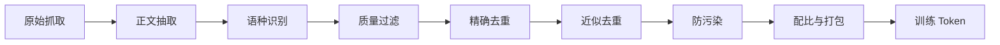

# 第 10 章 预训练数据工程

## 本章导读

同一套模型结构、同样的参数量、同样的训练算力，只把语料从"未经清洗的网页抓取"换成"去重、过滤、按比例混合后的语料"，验证损失可以差出 0.1 nat 以上，下游评测的差距往往更大。数据不是训练的输入，而是训练本身的一部分：它决定模型看到什么、记住什么、把容量分配给哪些分布。本章把数据工程拆成可以复算的漏斗、去重、质量过滤、配比、课程与污染检测，并给出每一步的代价。

## 难度标签

⭐⭐ 基础 ｜ 数学要求：集合与概率、哈希、Jaccard 相似度、温度采样；代码要求：Python 标准库与 PyTorch 基础，能读懂小规模训练循环。

## 学习目标

读完本章你将能够：

1. 画出预训练数据管道的漏斗，计算每一级的文档与 Token 保留率。
2. 解释精确去重与 MinHash + LSH 近似去重的原理，推导 LSH 的 S 曲线并选择 bands 与 rows。
3. 写出质量过滤的收益与精度权衡，判断阈值调整的方向。
4. 用温度采样与最大余数法分配 Token 预算，解释数据配比定律。
5. 用 n-gram 覆盖率检测评测污染，并说明检测结果为什么不能当作能力提升。

## 10.1 直觉：数据工程是一个漏斗

把一个网页语料库想象成一列漏斗。最上面是抓取到的原始文本，包含导航栏、广告、重复转载、乱码与机器翻译的低质页面；最下面是真正进入训练循环的 Token。每经过一级，都会有一部分文档被留下、一部分被删除。整条管道通常长这样：



每一级都在做同一件事：用可接受的算力删掉低价值 Token，提高单位算力能换到的信息量。但"低价值"不是免费的判断。过滤本身要花算力；阈值太高会误删代码、数学与对话等稀缺但重要的数据；按某种分布训练出来的过滤器，会把语料整体拉向那个分布。所以数据工程的目标不是"最干净"，而是在给定训练算力下让最终损失最低。

这个目标可以用一个具体的数来说明。RefinedWeb 从约 5 万亿 Token 的原始网页池中，经过抽取、过滤与去重，保留了约 6000 亿 Token，保留率约 12%。剩下 88% 的 Token 被删掉，但用这 6000 亿训练出的 Falcon 模型，效果可以接近用人工精选语料训练的模型。这就是数据工程的价值：它不生产 Token，它决定哪些 Token 值得被计算。


数据工程与第 9 章的缩放定律是同一笔账的两端。清洗提高了有效数据量 $$U$$，但也会减少 Token 总数；去重让重复训练的有效数据量 $$D_{\mathrm{eff}}$$ 更接近真实 Token 数。评价一次清洗是否值得，要同时报告清洗前后的 Token 数、唯一 Token 数与最终损失，不能只报清洗后的损失。


## 10.2 数学原理

### 10.2.1 漏斗与 Token 预算

设有 $$k$$ 个处理阶段，第 $$j$$ 级对文档的保留率为 $$r_j$$，则经过前 $$k$$ 级后剩下的文档数为

$$
N_k=N_0\prod_{j=1}^{k}r_j,\qquad r_j=\frac{N_j}{N_{j-1}}
\qquad \text{(10.1)}
$$

Token 数用同样的乘积计算，但每一级的保留率换成按 Token 计的 $$r_j^{(T)}$$。两者通常不同：去重删除的多是长文档，质量过滤删除的多是短文档，所以文档保留率与 Token 保留率会分叉。报告数据管道时，两个数都要给。

漏斗的每一级都有成本。设处理一个 Token 的过滤算力为 $$c_{\text{filter}}$$，训练一个 Token 的算力约为 $$6N$$，则过滤开销占训练算力的比例约为 $$c_{\text{filter}}/(6N)$$。对百亿参数以上的模型，这个比例通常很小，值得把过滤器做得更细；对小模型，过滤开销可能反而不可忽略。这就是"数据工程也有缩放"的含义：模型越大，单位 Token 的训练成本越高，花更多算力清洗每个 Token 越划算。

实际工程里，过滤器的成本还不止算力。它包含延迟、工程复杂度与人工维护：一个需要多模型集成、逐篇复核的过滤器，即使理论上更准，也可能因为吞吐不足而拖慢整条流水线。数据管道通常是一个离线批处理系统，吞吐与可恢复性（断点续跑、分片重试）和准确率同样重要。

### 10.2.2 精确去重与近似去重

精确去重先规范化文本（统一空白、大小写或 Unicode 形式），再对规范化结果做密码学哈希，只保留第一次出现的文档：

$$
h(x)=\mathrm{BLAKE2b}\big(\mathrm{norm}(x)\big),\qquad
\mathcal{D}_{\text{keep}}=\{x_i:h(x_i)\notin\{h(x_1),\dots,h(x_{i-1})\}\}
\qquad \text{(10.2)}
$$

128 位哈希的碰撞概率可以忽略，所以精确去重的误差主要来自"规范化是否过激"。把代码的缩进、Markdown 的标题层级或数学公式的空白全部抹平，会把本不相同的文档判成重复。工业实现通常对网页与代码采用不同的规范化规则。

精确去重只能抓住逐字相同或规范化后相同的副本。网页转载经常改标题、加导航、换几个词，这时需要近似去重。做法是把文档切成 Token 的连续 $$n$$ 元组集合（shingles），用 Jaccard 相似度衡量两个集合的重叠：

$$
J(A,B)=\frac{|A\cap B|}{|A\cup B|}
\qquad \text{(10.3)}
$$

对每篇文档计算所有 shingle 的 Jaccard 是平方复杂度，不可行。MinHash 用 $$m$$ 个随机哈希函数为每个集合生成签名：第 $$i$$ 个签名的值是集合中所有元素在第 $$i$$ 个哈希下的最小值，

$$
s_i(A)=\min_{g\in A}h_i(g),\qquad
\Pr\big[s_i(A)=s_i(B)\big]=J(A,B)
\qquad \text{(10.4)}
$$

无偏性来自一个简单的计数论证：把 $$A\cup B$$ 的元素按 $$h_i$$ 排序，最小值落在 $$A\cap B$$ 中，当且仅当两个集合的签名相等；而最小值落在交集中的概率正是 $$|A\cap B|/|A\cup B|$$。于是用 $$m$$ 个签名中相等的比例，就能估计 Jaccard；估计量的标准差为 $$\sqrt{J(1-J)/m}$$，最坏不超过 $$1/(2\sqrt{m})$$。

有了签名，还要避免两两比较。局部敏感哈希（LSH）把 $$m$$ 长的签名切成 $$b$$ 段、每段 $$r$$ 行（$$br\le m$$），只有至少一段完全相同的文档对才进入候选集。Jaccard 为 $$s$$ 的一对文档，在单段内完全相同的概率是 $$s^r$$，在 $$b$$ 段中至少一段相同的概率是

$$
P(s)=1-\left(1-s^r\right)^b
\qquad \text{(10.5)}
$$

取 $$b=16$$、$$r=8$$，得到一条很陡的 S 曲线：

| Jaccard 相似度 $$s$$ | 单段碰撞概率 $$s^8$$ | 至少一段碰撞 $$P(s)$$ |
| --- | --- | --- |
| 0.5 | 0.0039 | 0.0607 |
| 0.6 | 0.0168 | 0.2374 |
| 0.7 | 0.0576 | 0.6133 |
| 0.8 | 0.1678 | 0.9470 |
| 0.9 | 0.4305 | 0.9999 |

也就是说，阈值设在 0.7 附近：低于 0.6 的文档对只有约四分之一的概率被抓住，高于 0.8 的文档对几乎一定进入候选集。候选集还要用精确 Jaccard 复核，所以 LSH 只负责召回，不负责最终判定。改 $$b$$ 与 $$r$$ 就是在移动这条曲线的拐点：增大 $$r$$ 让曲线更陡、拐点右移；增大 $$b$$ 让整体召回上升，但候选对也更多。

### 10.2.3 质量过滤

质量过滤把"这篇文档值不值得训练"变成一个打分问题。一个便宜且可解释的启发式打分器会看四个信号：长度是否足够、相邻二元组是否够多样、字母与汉字占比是否正常、最高频 Token 的占比是否过高（重复堆砌）。把它们线性组合，得到

$$
q(x)=0.30\,\ell(x)+0.40\,u(x)+0.15\,a(x)+0.15\,\big(1-f(x)\big)\ge\tau
\qquad \text{(10.6)}
$$

其中 $$\ell$$ 是长度分（截断到 1），$$u$$ 是不同二元组占比，$$a$$ 是字母、数字与汉字占比，$$f$$ 是最高频 Token 的占比。代码里还对过短文档与符号噪声加了惩罚。阈值 $$\tau$$ 决定保留哪些文档。

阈值不是越高越好。设 $$K$$ 是保留下来的文档集，$$G$$ 是人工判定为高质量的文档集，则产出率（yield）与精确率（precision）分别为

$$
\mathrm{yield}=\frac{|K|}{|D|},\qquad
\mathrm{precision}=\frac{|K\cap G|}{|K|}
\qquad \text{(10.7)}
$$

提高 $$\tau$$ 通常提高 precision、降低 yield；真正进入训练的高质量 Token 数大致正比于 yield 与 precision 的乘积。如果过滤器把某个领域整体判为低质，yield 的下降会直接变成该领域的"数据消失"。代码、数学与对话往往比维基百科更像"符号噪声"或"重复模板"，用同一套阈值会把它们误删。工业上的做法是按领域分别校准阈值，或者用分类器输出连续分数再按领域重采样。

质量过滤还有两条更贵的路线：用一个小分类器（如 fastText）在人工标注的高质量样本上训练，或用大模型逐篇打分。前者便宜、可扩展到万亿 Token；后者质量更高，但成本可能达到训练算力的百分之几，通常只用于采样、蒸馏成小分类器或给少量高价值数据打分。

### 10.2.4 数据配比

假设有 $$K$$ 个数据来源，第 $$i$$ 个来源的原始权重是 $$w_i$$（可以是文档数、Token 数或人工设定的先验）。最简单的配比是按来源比例采样：

$$
p_i=\frac{w_i}{\sum_{j=1}^{K}w_j}
\qquad \text{(10.8)}
$$

按比例采样会放大最大的来源。如果希望小来源获得更多曝光，可以用温度采样：

$$
p_i=\frac{w_i^{1/T}}{\sum_{j=1}^{K}w_j^{1/T}}
\qquad \text{(10.9)}
$$

$$T=1$$ 退化为按比例；$$T>1$$ 把分布拉平，$$T\to\infty$$ 趋向等权；$$T<1$$ 把分布变尖。代码里为了避免数值溢出，先取对数再减最大值，与 Softmax 的实现相同。温度没有理论最优，通常用 1.5 到 3 之间的几个值做小规模对照：温度过高会让大来源的优势完全消失，过低则退化成按比例。

给定总预算 $$N$$，每个来源应分到多少篇文档？直接四舍五入会让总数对不上，最大余数法先取整数部分，再把剩余的预算按小数部分从大到小分配：

$$
n_i=\left\lfloor Np_i\right\rfloor+\delta_i,\qquad
\sum_i\delta_i=N-\sum_i\left\lfloor Np_i\right\rfloor,\quad \delta_i\in\{0,1\}
\qquad \text{(10.10)}
$$

数据配比不只是"按比例混合"。Ye 等人的数据配比定律发现，第 $$i$$ 个领域的损失随各领域比例呈指数变化：

$$
L_i(\mathbf{p})=c_i+k_i\exp\left(\sum_{j=1}^{K}t_{ij}p_j\right)
\qquad \text{(10.11)}
$$

其中 $$\mathbf{p}=(p_1,\dots,p_K)$$ 是配比，$$c_i,k_i,t_{ij}$$ 是拟合参数。这个形式的价值在于可以用小模型、小预算的多次配比实验拟合参数，再外推到更大预算，而不必真的把每个候选配比都训一遍。DoReMi 走的是另一条路：用一个代理模型和分组分布鲁棒优化（group DRO）直接学习各领域的权重，使最差领域的损失最小，报告在相同质量下比按比例基线快约 2.6 倍。注意最优配比会随模型规模与训练阶段变化，不能把一个小模型的配比直接搬到另一个规模。

### 10.2.5 数据课程与退火

多数 Token 用基础配比训练，最后一段切换到高质量数据，这叫退火或数据课程。设总 Token 预算为 $$D$$，退火比例为 $$\rho$$，则

$$
\mathbf{p}(t)=
\begin{cases}
\mathbf{p}_{\text{base}}, & t\le(1-\rho)D,\\
\mathbf{p}_{\text{anneal}}, & t>(1-\rho)D.
\end{cases}
\qquad \text{(10.12)}
$$

退火有效的条件是学习率同步下降。训练末段学习率小，模型不会因为分布突变而剧烈震荡；高质量数据的梯度更"干净"，能把模型推向更好的局部区域。WSD（warmup-stable-decay）调度把稳定段与衰减段分开，正是为了让同一份稳定段检查点可以接不同的退火数据，做多次低成本实验。退火比例通常取 5% 到 20%，太小看不到效果，太大则基础配比训练不足。退火数据必须单独做防污染，否则等于把评测集直接喂进最后一段。

### 10.2.6 合成数据

合成数据用强模型生成教科书、问答、代码解释或改写文本，再经过过滤加入训练集。"Textbooks Are All You Need" 用这种方法让小模型在代码任务上表现突出；Phi-3 的 3.3T Token 中也有大量经过筛选的合成数据。合成数据的优势是密度高、格式可控、能补足稀缺领域；风险是多样性下降、错误被放大、以及模型只学会模仿生成器的风格。

最危险的做法是无限自我循环：用模型 A 生成数据训练模型 B，再用 B 生成数据训练 C。每一轮都会丢失分布尾部的模式，若再用同一个过滤器筛选，还会把过滤器的偏好当成"高质量"反复强化。缓解办法是保留真实数据锚点、每轮混入新的人类数据、对合成数据做去重与事实校验，并单独评测分布外样本。工程上，合成数据通常要和真实数据走同一套去重与质量过滤，再一起进入配比，而不是单独占一个阶段。合成数据是补充，不是替代。

### 10.2.7 污染检测

评测污染指评测集的样本或近似副本出现在训练集中。检测的基本单位是 n-gram 覆盖率。对评测文档 $$d$$，统计它的 n-gram 有多大比例出现在训练集里：

$$
c(d)=\frac{\big|\mathrm{grams}_n(d)\cap G_{\text{train}}\big|}{\big|\mathrm{grams}_n(d)\big|}
\qquad \text{(10.13)}
$$

反向去污染则对每篇训练文档计算它与评测集的覆盖率，超过阈值就删除：

$$
\mathcal{D}_{\text{train}}^{\text{clean}}=\left\{x\in\mathcal{D}_{\text{train}}:
c_{\text{eval}}(x)<\theta\right\},\qquad
c_{\text{eval}}(x)=\frac{\big|\mathrm{grams}_n(x)\cap G_{\text{eval}}\big|}{\big|\mathrm{grams}_n(x)\big|}
\qquad \text{(10.14)}
$$

整份评测集的污染率与分数虚高可以写成

$$
\mathrm{CR}=\frac{1}{M}\sum_{m=1}^{M}\mathbf{1}\left[c_m\ge\theta\right],\qquad
\Delta=L_{\text{clean}}-L_{\text{leak}}
\qquad \text{(10.15)}
$$

其中 $$M$$ 是评测文档数，$$\Delta$$ 是在干净验证集与泄漏评测集上的损失差。$$n$$ 常取 8 到 13：太小会被常见短语误伤，太大则漏掉改写后的泄漏。阈值 $$\theta$$ 常取 0.5 左右，但必须用未泄漏的干净文档做假阳性校准。n-gram 检测抓不住同义改写与翻译后的泄漏，所以它给出的是下界，不是保证。金丝雀串（canary string）能在训练后检查模型是否记住了特定标记，是另一道独立的防线。

## 10.3 方案对比

**去重方法。** 精确哈希最便宜，只能抓逐字副本；MinHash + LSH 能抓近似副本，代价是签名计算与候选复核；后缀数组可以对全语料做精确子串去重，内存开销大；语义去重用小模型嵌入判断"意思相同"，最贵，也最容易误删。

| 方法 | 召回对象 | 时间/空间 | 主要风险 |
| --- | --- | --- | --- |
| 精确哈希 (10.2) | 规范化后逐字相同 | $$O(N)$$，低 | 规范化过激会误删 |
| MinHash + LSH (10.4)–(10.5) | 高 Jaccard 近似副本 | $$O(Nm)$$ 签名，中 | 阈值与 bands 需校准 |
| 后缀数组 | 任意长度的重复子串 | $$O(T)$$，高内存 | 实现复杂，需分块 |
| 语义嵌入 | 同义改写、翻译 | 最贵 | 误删不同含义的相似文本 |

**质量过滤器。** 启发式规则最便宜、可解释，但只能抓表面特征；分类器在标注数据上学习，精度更高，需要维护标注集；大模型裁判质量最好，成本最高，适合采样或蒸馏。

| 过滤器 | 单位成本 | 精度 | 适用场景 |
| --- | --- | --- | --- |
| 启发式打分 (10.6) | 极低 | 中 | 万亿 Token 的第一道粗筛 |
| 小分类器 | 低 | 较高 | 有标注集、需大规模部署 |
| 大模型裁判 | 高 | 高 | 采样评估、蒸馏小分类器 |

**配比策略。** 按比例最简单，但会放大最大来源；温度采样用一个小参数控制平滑程度；等权适合来源数量少、希望每域都不被淹没的场景；DoReMi 与配比定律用实验或优化找权重，成本更高，适合大规模训练前的预研；退火把高质量数据放在末段，几乎不增加总 Token，但需要预留数据与配套的学习率调度。

| 策略 | 需要什么 | 代价 | 何时选它 |
| --- | --- | --- | --- |
| 按比例 (10.8) | 各源 Token 数 | 无 | 来源分布本身合理 |
| 温度采样 (10.9) | 一个温度 $$T$$ | 低 | 小来源被淹没 |
| 等权 | 来源数 | 低 | 来源少且同等重要 |
| DoReMi / 配比定律 (10.11) | 代理模型、多组实验 | 中高 | 大规模训练前定配比 |
| 退火 (10.12) | 高质量数据、学习率调度 | 中 | 有明确的高质量子集 |

## 10.4 代码实现：TinyLM 的数据管道

### 10.4.1 实现选择

本章给 TinyLM 增加两个纯函数模块和一个实验脚本，不改模型结构：

- `tinylm/data/filter.py`：分词、精确去重、shingle、Jaccard、MinHash、LSH、近似去重、质量打分与过滤、污染检测与去污染。
- `tinylm/data/mixture.py`：温度采样、最大余数法分配预算、按配额交错取文档。
- `ch10.py`：构造 4 个领域的合成语料（正常、重复、低质噪声、评测泄漏），跑完整漏斗，比较不同清洗组合的训练损失，再做配比消融。
- `tests/test_data.py`：13 个用例，覆盖分词、去重、MinHash 估计、LSH 分桶、质量过滤、污染检测、配比采样与预算分配。

实验刻意把语料做小：248 篇文档、约 1 万 Token、2 层 32 维的模型、150 步训练。这样在 CPU 上几十秒就能跑完，且每个数字都可复算。代价是模型容量与语料规模都远离真实预训练，结论只能用于验证管道机制，不能外推到 LLM 的数据配比。

### 10.4.2 完整代码

`tinylm/data/filter.py`：

```python
"""第 10 章：去重、质量过滤与污染检测（tinylm/data/filter.py）。"""
import hashlib
import random
import re
from collections import Counter

_MERSENNE = (1 << 61) - 1


def tokenize(text):
    """教学用混合分词：中文按空白分隔的连续汉字串，英文与代码按词。"""
    return re.findall(r"[A-Za-z_][A-Za-z0-9_]*|\d+|[一-鿿]+|[^\s]", text)


def exact_dedup(docs):
    """(10.2)：按规范化文本的哈希去重，保留首次出现。"""
    seen, kept, dropped = set(), [], []
    for doc in docs:
        key = hashlib.blake2b(" ".join(tokenize(doc)).encode("utf-8"),
                              digest_size=16).hexdigest()
        if key in seen:
            dropped.append(doc)
        else:
            seen.add(key)
            kept.append(doc)
    return kept, dropped


def shingles(tokens, n=5):
    """把 Token 序列切成连续 n 元组集合。"""
    if len(tokens) < n:
        return {tuple(tokens)} if tokens else set()
    return {tuple(tokens[i:i + n]) for i in range(len(tokens) - n + 1)}


def jaccard(a, b):
    """(10.3)：J(A,B)=|A∩B|/|A∪B|。"""
    if not a and not b:
        return 1.0
    return len(a & b) / len(a | b)


def _base_hash(gram):
    data = "\x1f".join(map(str, gram)).encode("utf-8")
    return int.from_bytes(hashlib.blake2b(data, digest_size=8).digest(), "big")


def minhash_signature(gram_set, num_perm=64, seed=0):
    """(10.4)：用随机仿射哈希构造 MinHash 签名。"""
    rng = random.Random(seed)
    coeffs = [(rng.randrange(1, _MERSENNE), rng.randrange(_MERSENNE))
              for _ in range(num_perm)]
    if not gram_set:
        return tuple([_MERSENNE] * num_perm)
    bases = [_base_hash(g) for g in gram_set]
    return tuple(min((a * x + b) % _MERSENNE for x in bases) for a, b in coeffs)


def lsh_candidates(signatures, bands=8, rows=8):
    """(10.5)：把签名切成 bands 段，同段同桶的文档成为候选对。"""
    assert bands * rows <= len(signatures[0])
    buckets = {}
    for idx, sig in enumerate(signatures):
        for b in range(bands):
            key = (b, sig[b * rows:(b + 1) * rows])
            buckets.setdefault(key, []).append(idx)
    pairs = set()
    for ids in buckets.values():
        for i in range(len(ids)):
            for j in range(i + 1, len(ids)):
                pairs.add((ids[i], ids[j]))
    return pairs


def near_dedup(docs, threshold=0.7, num_perm=64, bands=8, rows=8, n=5):
    """先 LSH 找候选，再用精确 Jaccard 复核；保留每簇的第一个文档。"""
    gram_sets = [shingles(tokenize(d), n) for d in docs]
    sigs = [minhash_signature(g, num_perm) for g in gram_sets]
    removed = set()
    for i, j in sorted(lsh_candidates(sigs, bands, rows)):
        if i in removed or j in removed:
            continue
        if jaccard(gram_sets[i], gram_sets[j]) >= threshold:
            removed.add(j)
    kept = [d for i, d in enumerate(docs) if i not in removed]
    dropped = [docs[i] for i in sorted(removed)]
    return kept, dropped


def quality_score(text):
    """启发式质量分：长度、去重二元组、字母/汉字比例、词频集中度。"""
    toks = tokenize(text)
    n = len(toks)
    if n == 0:
        return 0.0
    length = min(1.0, n / 40.0)
    uniq_bigram = len(set(zip(toks, toks[1:]))) / max(1, n - 1)
    alpha = sum(bool(re.match(r"[A-Za-z0-9一-鿿]", t)) for t in toks) / n
    top = Counter(toks).most_common(1)[0][1] / n
    score = 0.30 * length + 0.40 * uniq_bigram + 0.15 * alpha + 0.15 * (1.0 - top)
    if n < 12:                      # 太短的文档信息量不足
        score = min(score, 0.30)
    if alpha < 0.5:                 # 符号噪声按比例惩罚
        score *= alpha / 0.5
    return score


def quality_filter(docs, tau=0.55):
    """(10.6)：保留质量分不低于阈值的文档。"""
    scores = [quality_score(d) for d in docs]
    kept = [d for d, s in zip(docs, scores) if s >= tau]
    dropped = [d for d, s in zip(docs, scores) if s < tau]
    return kept, dropped, scores


def ngram_set(tokens, n):
    return {tuple(tokens[i:i + n]) for i in range(len(tokens) - n + 1)}


def contamination_hits(train_docs, eval_docs, n=8):
    """(10.13)：每个评测文档被训练集 n-gram 覆盖的比例。"""
    train_grams = set()
    for d in train_docs:
        train_grams |= ngram_set(tokenize(d), n)
    hits = []
    for d in eval_docs:
        grams = ngram_set(tokenize(d), n)
        hits.append(len(grams & train_grams) / max(1, len(grams)))
    return hits


def decontaminate(train_docs, eval_docs, n=8, threshold=0.5):
    """(10.14)：移除与评测集 n-gram 重叠超阈值的训练文档。"""
    eval_grams = set()
    for d in eval_docs:
        eval_grams |= ngram_set(tokenize(d), n)
    hits = []
    for d in train_docs:
        grams = ngram_set(tokenize(d), n)
        hits.append(len(grams & eval_grams) / max(1, len(grams)))
    kept = [d for d, h in zip(train_docs, hits) if h < threshold]
    dropped = [d for d, h in zip(train_docs, hits) if h >= threshold]
    return kept, dropped
```

`tinylm/data/mixture.py`：

```python
"""第 10 章：数据配比与 Token 预算（tinylm/data/mixture.py）。"""
import math
import random


def temperature_probs(weights, temperature=1.0):
    """(10.9)：p_i ∝ w_i^{1/T}，T=1 为按来源比例，T>1 更均匀。"""
    if temperature <= 0:
        raise ValueError("temperature 必须为正")
    logits = [math.log(w) / temperature for w in weights]
    top = max(logits)
    exps = [math.exp(x - top) for x in logits]
    total = sum(exps)
    return [e / total for e in exps]


def allocate_counts(total, probs):
    """(10.10)：最大余数法分配预算，保证各域计数之和等于 total。"""
    raw = [total * p for p in probs]
    counts = [int(math.floor(x)) for x in raw]
    remainder = total - sum(counts)
    order = sorted(range(len(raw)), key=lambda i: raw[i] - counts[i], reverse=True)
    for i in order[:remainder]:
        counts[i] += 1
    return counts


def interleave(domain_docs, counts, seed=0):
    """按配额轮流取文档；域内先打乱，配额超过文档数时循环复用。"""
    rng = random.Random(seed)
    pools = {}
    for name, docs in domain_docs.items():
        pool = list(docs)
        rng.shuffle(pool)
        pools[name] = pool
    remaining = dict(zip(domain_docs, counts))
    cursor = {name: 0 for name in pools}
    out = []
    while sum(remaining.values()) > 0:
        for name in domain_docs:
            if remaining[name] > 0 and pools[name]:
                out.append(pools[name][cursor[name] % len(pools[name])])
                cursor[name] += 1
                remaining[name] -= 1
    return out
```

`ch10.py`：

```python
"""第 10 章：预训练数据工程实验（examples/ch10_data.py）。"""
import random
import re
from collections import Counter

import torch

from ch08 import ModelConfig, TinyLM
from tinylm.data.filter import (contamination_hits, decontaminate, exact_dedup,
                                near_dedup, quality_filter, tokenize)
from tinylm.data.mixture import allocate_counts, interleave, temperature_probs

DOMAINS = ("百科", "代码", "数学", "对话")
BANK = {
    "百科": "山脉 河流 高原 平原 盆地 气候 降水 植被 森林 草原 湖泊 海岸 岛屿 峡谷 冰川 湿地 土壤 矿物 物种 迁徙 聚落 灌溉 交通 贸易 城市 人口 语言 建筑 遗址".split(),
    "代码": "def return for while if else import from class self None True False print len range list dict set tuple append sort key value total result data model token batch".split(),
    "数学": "整数 实数 有理数 素数 因数 倍数 方程 函数 极限 导数 积分 矩阵 向量 概率 期望 方差 集合 映射 群 环 域 证明 定理 引理 归纳 反证 充分 必要 存在 任意".split(),
    "对话": "用户 助手 问题 回答 请 帮 我 你 这个 可以 需要 建议 步骤 首先 然后 最后 注意 例如 如果 因为 所以 好的 谢谢 明白 继续 试试 检查".split(),
}


def make_doc(domain, rng):
    """按域随机拼句：固定短语很短，避免不同文档共享长 n-gram。"""
    words = BANK[domain]
    sentences = []
    for _ in range(rng.randint(3, 5)):
        length = rng.randint(6, 12)
        parts = [rng.choice(words) for _ in range(length)]
        if domain in ("百科", "数学"):
            sentences.append(" ".join(parts) + "。")
        elif domain == "代码":
            sentences.append(" ".join(parts) + " ;")
        else:
            sentences.append(rng.choice(["用户：", "助手："]) + " ".join(parts) + "。")
    return "".join(sentences)


def make_good(domain_counts, rng):
    return [(d, make_doc(d, rng)) for d, n in domain_counts.items() for _ in range(n)]


def near_copy(text, rng):
    chars = list(text)
    idxs = [i for i, c in enumerate(chars) if re.match(r"[A-Za-z0-9一-鿿]", c)]
    i = rng.choice(idxs)
    pool = "甲乙丙丁戊己庚辛壬癸山脉河海云风力" if re.match(r"[一-鿿]", chars[i]) \
        else "abcdefghijklmnopqrstuvwxyz0123456789"
    chars[i] = rng.choice(pool)
    return "".join(chars)


def build_corpus(seed=0):
    """248 篇：160 正常 + 60 重复 + 20 低质 + 8 条评测泄漏。"""
    rng = random.Random(seed)
    good = make_good({"百科": 80, "代码": 40, "数学": 25, "对话": 15}, rng)
    eval_rng = random.Random(2024)
    eval_docs = [(d, make_doc(d, eval_rng)) for d in DOMAINS for _ in range(5)]
    leak = []
    for i, (d, text) in enumerate(eval_docs[:8]):
        leak.append((d, text if i < 6 else near_copy(text, rng)))
    exact = [(d, text) for d, text in rng.sample(good, 30)]
    near = [(d, near_copy(text, rng)) for d, text in rng.sample(good, 30)]
    noise = []
    for i in range(20):
        d = DOMAINS[i % 4]
        if i % 3 == 0:
            noise.append((d, " ".join([rng.choice(BANK[d])] * 80)))
        elif i % 3 == 1:
            noise.append((d, " ".join(BANK[d][:5])))
        else:
            noise.append((d, "".join(rng.choice("###$%^&*(){}[]<>~`|") for _ in range(80))))
    return good + exact + near + noise + leak, eval_docs


def build_clean_val(seed=777):
    rng = random.Random(seed)
    return {d: [make_doc(d, rng) for _ in range(10)] for d in DOMAINS}


def build_vocab(texts):
    counter = Counter()
    for text in texts:
        counter.update(tokenize(text))
    vocab = {"<eos>": 0, "<unk>": 1}
    for tok, _ in counter.most_common():
        if tok not in vocab:
            vocab[tok] = len(vocab)
    return vocab


def encode_stream(docs, vocab):
    ids = []
    for doc in docs:
        ids.extend(vocab.get(t, 1) for t in tokenize(doc))
        ids.append(0)
    return torch.tensor(ids, dtype=torch.long)


def train_model(docs, vocab, steps=150, seed=0, batch=16, seq=32, lr=2e-3):
    cfg = ModelConfig(vocab_size=len(vocab), d_model=32, n_layers=2, n_heads=4,
                      d_ff=64, max_seq_len=64, norm="rmsnorm", ffn="swiglu",
                      bias=False, pos_encoding="rope", attention="gqa",
                      n_kv_heads=2)
    torch.manual_seed(seed)
    model = TinyLM(cfg)
    stream = encode_stream(docs, vocab)
    gen = torch.Generator().manual_seed(seed)
    opt = torch.optim.AdamW(model.parameters(), lr=lr, weight_decay=0.01)
    model.train()
    for _ in range(steps):
        starts = torch.randint(0, len(stream) - seq - 1, (batch,), generator=gen)
        x = torch.stack([stream[s:s + seq] for s in starts])
        y = torch.stack([stream[s + 1:s + seq + 1] for s in starts])
        out = model(x, labels=y)
        opt.zero_grad()
        out.loss.backward()
        opt.step()
    return model


@torch.no_grad()
def evaluate(model, docs, vocab, seq=32):
    model.eval()
    stream = encode_stream(docs, vocab)
    n = (len(stream) - 1) // seq
    losses = []
    for k in range(n):
        x = stream[k * seq:(k + 1) * seq].unsqueeze(0)
        y = stream[k * seq + 1:(k + 1) * seq + 1].unsqueeze(0)
        losses.append(model(x, labels=y).loss.item())
    return sum(losses) / len(losses)


def pipeline(raw, eval_texts):
    q_kept, q_drop, _ = quality_filter(raw)
    e_kept, e_drop = exact_dedup(q_kept)
    n_kept, n_drop = near_dedup(e_kept)
    d_kept, d_drop = decontaminate(n_kept, eval_texts)
    return {"raw": raw, "quality": q_kept, "exact+near": n_kept,
            "decontam": d_kept}, [len(q_drop), len(e_drop), len(n_drop), len(d_drop)]


def funnel_table(raw, eval_texts):
    stages, _ = pipeline(raw, eval_texts)
    print("\n数据管道漏斗（按文档数与 Token 数）")
    print(f"{'阶段':<12s}{'文档数':>8s}{'Token 数':>10s}{'本阶段删除':>10s}")
    prev = len(raw)
    for name, docs in stages.items():
        tokens = sum(len(tokenize(d)) for d in docs)
        removed = prev - len(docs)
        print(f"{name:<12s}{len(docs):>8d}{tokens:>10d}{removed:>10d}")
        prev = len(docs)
    return stages


def contamination_demo(raw, eval_texts):
    hits = contamination_hits(raw, eval_texts)
    leaked = sum(h >= 0.5 for h in hits)
    clean_val = [t for docs in build_clean_val().values() for t in docs]
    clean_hits = contamination_hits(raw, clean_val)
    print(f"\n污染检测（8-gram，覆盖率阈值 0.5）")
    print(f"评测集 {len(eval_texts)} 篇中命中 {leaked} 篇；"
          f"未泄漏的干净文档 {len(clean_val)} 篇中命中 "
          f"{sum(h >= 0.5 for h in clean_hits)} 篇")
    print(f"命中评测文档的覆盖率：{sorted(round(h, 2) for h in hits)[-8:]}")


def mixture_table(clean_docs):
    by_domain = {d: [t for dd, t in clean_docs if dd == d] for d in DOMAINS}
    sizes = [max(1, len(by_domain[d])) for d in DOMAINS]
    print("\n数据配比：按来源比例与温度采样（总预算 400 篇）")
    print(f"{'策略':<14s}" + "".join(f"{d:>8s}" for d in DOMAINS) + f"{'最大/最小':>10s}")
    for name, probs in (("按来源比例", temperature_probs(sizes, 1.0)),
                        ("温度 T=2", temperature_probs(sizes, 2.0)),
                        ("等权", [0.25] * 4)):
        counts = allocate_counts(400, probs)
        print(f"{name:<14s}" + "".join(f"{c:>8d}" for c in counts)
              + f"{max(counts) / min(counts):>10.1f}")
    return by_domain, sizes


def mixture_ablation(by_domain, sizes, vocab, clean_val):
    source = {d: by_domain[d] for d in DOMAINS}
    equal = {d: 0.25 for d in DOMAINS}
    source_probs = temperature_probs(sizes, 1.0)
    equal_probs = [equal[d] for d in DOMAINS]
    print("\n配比消融：按来源比例 vs 等权（2 个种子、120 步）")
    print(f"{'策略':<12s}{'百科':>10s}{'代码':>10s}{'数学':>10s}{'对话':>10s}")
    for name, probs in (("按来源比例", source_probs), ("等权", equal_probs)):
        counts = allocate_counts(400, probs)
        docs = interleave(source, counts, seed=0)
        rows = []
        for seed in (0, 1):
            model = train_model(docs, vocab, steps=120, seed=seed)
            rows.append([evaluate(model, clean_val[d], vocab) for d in DOMAINS])
        means = [sum(r[i] for r in rows) / len(rows) for i in range(4)]
        print(f"{name:<12s}" + "".join(f"{m:>10.4f}" for m in means))


def main():
    raw_docs, eval_docs = build_corpus()
    raw = [t for _, t in raw_docs]
    eval_texts = [t for _, t in eval_docs]
    clean_val = build_clean_val()

    print("合成语料：4 个域，含正常文档、重复、低质噪声与评测泄漏")
    print(f"原始文档 {len(raw)} 篇，评测集 {len(eval_texts)} 篇，干净验证集 "
          f"{sum(len(v) for v in clean_val.values())} 篇")
    stages = funnel_table(raw, eval_texts)
    contamination_demo(raw, eval_texts)

    clean = stages["decontam"]
    text_to_domain = {t: d for d, t in raw_docs}
    by_domain, sizes = mixture_table([(text_to_domain[t], t) for t in clean])

    vocab = build_vocab(raw + eval_texts + [t for v in clean_val.values() for t in v])
    print(f"\n词表大小 {len(vocab)}；训练 150 步、批 16、序列 32，3 个种子取均值")
    corpora = {
        "原始": raw,
        "仅质量过滤": stages["quality"],
        "仅去重": stages["exact+near"],
        "质量+去重+防污染": clean,
    }
    print(f"{'语料':<18s}{'去重后 Token':>11s}{'干净验证':>14s}{'泄漏评测':>14s}")
    for name, docs in corpora.items():
        unique_docs = near_dedup(exact_dedup(docs)[0])[0]
        unique = sum(len(tokenize(d)) for d in unique_docs)
        clean_loss, leak_loss = [], []
        for seed in (0, 1, 2):
            model = train_model(docs, vocab, steps=150, seed=seed)
            clean_loss.append(evaluate(model, [t for v in clean_val.values() for t in v], vocab))
            leak_loss.append(evaluate(model, eval_texts, vocab))
        c = torch.tensor(clean_loss)
        l = torch.tensor(leak_loss)
        print(f"{name:<18s}{unique:>11d}"
              f"{c.mean():>9.4f}±{c.std():.3f}{l.mean():>9.4f}±{l.std():.3f}")

    mixture_ablation(by_domain, sizes, vocab, clean_val)

if __name__ == "__main__":
    main()
```

`tests/test_data.py`：

```python
"""第 10 章自测：配比采样、去重、质量过滤与污染检测。"""
import pytest

from tinylm.data import filter as F
from tinylm.data import mixture as M


GOOD_A = "山脉 河流 高原 气候 植被 森林 草原 湖泊 海岸 岛屿 峡谷 冰川 湿地 土壤 矿物 物种 迁徙 聚落 灌溉 交通 贸易 城市 人口 语言 建筑 遗址 平原 盆地 丘陵 瀑布 温泉 沙漠 绿洲 冻土 溶洞 珊瑚 红树 湿地 苔原 沼泽 溪流 三角洲 峡湾"
GOOD_B = "整数 实数 素数 因数 倍数 方程 函数 极限 导数 积分 矩阵 向量 概率 期望 方差 集合 映射 群 环 域 证明 定理 引理 归纳 反证 充分 必要 存在 任意 唯一 连续 可导 有界 收敛 发散 级数 多项式 特征值 行列式 秩 迹 对偶 同构"
NEAR_A = GOOD_A.replace("高原", "盆地")


def test_tokenize_splits_words_and_punctuation():
    toks = F.tokenize("def f(x): return x，山脉")
    assert "def" in toks and "f" in toks and "(" in toks
    assert "山脉" in toks and "，" in toks


def test_exact_dedup_keeps_first_occurrence():
    kept, dropped = F.exact_dedup([GOOD_A, GOOD_B, GOOD_A, GOOD_B])
    assert kept == [GOOD_A, GOOD_B]
    assert dropped == [GOOD_A, GOOD_B]


def test_jaccard_edges():
    assert F.jaccard(set(), set()) == 1.0
    assert F.jaccard({1, 2}, {2, 3}) == pytest.approx(1 / 3)
    assert F.jaccard({1, 2}, {1, 2}) == 1.0


def test_minhash_estimate_tracks_jaccard():
    a = F.shingles(F.tokenize(GOOD_A), 3)
    b = F.shingles(F.tokenize(NEAR_A), 3)
    sa = F.minhash_signature(a, num_perm=256)
    sb = F.minhash_signature(b, num_perm=256)
    estimate = sum(x == y for x, y in zip(sa, sb)) / 256
    assert abs(estimate - F.jaccard(a, b)) < 0.12


def test_near_dedup_catches_small_edit():
    docs = [GOOD_A, NEAR_A, GOOD_B]
    kept, dropped = F.near_dedup(docs, threshold=0.7, num_perm=128)
    assert len(kept) == 2 and len(dropped) == 1
    assert GOOD_B in kept


def test_lsh_puts_identical_signatures_in_one_bucket():
    sig = F.minhash_signature(F.shingles(F.tokenize(GOOD_A), 3), 64)
    pairs = F.lsh_candidates([sig, sig], bands=8, rows=8)
    assert (0, 1) in pairs


def test_quality_filter_rejects_noise():
    repetitive = " ".join(["山脉"] * 80)
    short = " ".join(["山脉", "河流", "高原", "气候"])
    symbols = "".join(["#"] * 80)
    kept, dropped, scores = F.quality_filter([GOOD_A, repetitive, short, symbols])
    assert GOOD_A in kept
    assert repetitive in dropped and short in dropped and symbols in dropped
    assert F.quality_score(GOOD_A) > 0.7


def test_contamination_detects_leak_not_clean_doc():
    train = [GOOD_A, GOOD_B]
    eval_docs = [GOOD_A, "用户 请 检查 这个 步骤 首先 打开 文件"]
    hits = F.contamination_hits(train, eval_docs, n=4)
    assert hits[0] == 1.0
    assert hits[1] < 0.5


def test_decontaminate_removes_leak():
    train = [GOOD_A, GOOD_B]
    kept, dropped = F.decontaminate(train, [GOOD_A], n=4, threshold=0.5)
    assert kept == [GOOD_B]
    assert dropped == [GOOD_A]


def test_temperature_probs_flat_and_sharp():
    weights = [80, 40, 25, 15]
    base = M.temperature_probs(weights, 1.0)
    flat = M.temperature_probs(weights, 2.0)
    sharp = M.temperature_probs(weights, 0.5)
    assert sum(base) == pytest.approx(1.0)
    assert max(flat) - min(flat) < max(base) - min(base)
    assert max(sharp) - min(sharp) > max(base) - min(base)


def test_allocate_counts_sums_to_budget():
    probs = M.temperature_probs([80, 40, 25, 15], 2.0)
    counts = M.allocate_counts(1000, probs)
    assert sum(counts) == 1000
    assert all(c >= 0 for c in counts)


def test_interleave_respects_quotas_and_recycles():
    domains = {"a": ["a1", "a2"], "b": ["b1"]}
    out = M.interleave(domains, [3, 2], seed=0)
    assert len(out) == 5
    assert out.count("b1") == 2 and sum(x.startswith("a") for x in out) == 3


def test_invalid_temperature_raises():
    with pytest.raises(ValueError):
        M.temperature_probs([1, 2], 0.0)
```

### 10.4.3 测试

```text
$ python -m pytest tests/test_data.py -q
13 passed in 0.04s
```

### 10.4.4 运行结果

```text
$ python ch10.py
合成语料：4 个域，含正常文档、重复、低质噪声与评测泄漏
原始文档 248 篇，评测集 20 篇，干净验证集 40 篇

数据管道漏斗（按文档数与 Token 数）
阶段               文档数   Token 数     本阶段删除
raw              248     10473         0
quality          228      9398        20
exact+near       179      7283        49
decontam         171      6957         8

污染检测（8-gram，覆盖率阈值 0.5）
评测集 20 篇中命中 8 篇；未泄漏的干净文档 40 篇中命中 0 篇
命中评测文档的覆盖率：[0.64, 0.83, 1.0, 1.0, 1.0, 1.0, 1.0, 1.0]

数据配比：按来源比例与温度采样（总预算 400 篇）
策略                  百科      代码      数学      对话     最大/最小
按来源比例              201      98      63      38       5.3
温度 T=2             149     104      83      64       2.3
等权                 100     100     100     100       1.0

词表大小 170；训练 150 步、批 16、序列 32，3 个种子取均值
语料                  去重后 Token          干净验证          泄漏评测
原始                       8343   3.3896±0.023   3.3901±0.030
仅质量过滤                    7283   3.3353±0.015   3.3344±0.013
仅去重                      7283   3.3254±0.001   3.3259±0.004
质量+去重+防污染                6957   3.2991±0.005   3.3236±0.015

配比消融：按来源比例 vs 等权（2 个种子、120 步）
策略                  百科        代码        数学        对话
按来源比例           3.3803    3.5280    3.6173    3.3297
等权              3.4849    3.5442    3.5328    3.0750
```

### 10.4.5 结果说明了什么

**第一，漏斗的保留率要按文档与 Token 分别报告。** 248 篇文档经过质量过滤、去重与防污染后剩下 171 篇，文档保留率 69.0%；Token 从 10473 降到 6957，保留率 66.4%。两个数不一样，是因为被删文档的平均长度与保留文档不同：本实验中被删的 77 篇平均约 46 Token，保留的 171 篇平均约 41 Token。只报文档数会低估去重的 Token 收益，只报 Token 数会掩盖被删文档的长度结构。

**第二，去重是最大的一级删减。** 质量过滤删除 20 篇、1075 Token；精确去重删除 31 篇，近似去重再删除 18 篇，合计 49 篇、2115 Token。合成语料里专门放了 30 篇逐字重复与 30 篇单字符改动；精确去重处理前者，近似去重又抓出 18 篇后者；另一些副本因为文档较短、单字符改动破坏了太多 5-gram，Jaccard 落到阈值 0.7 以下而漏掉。这说明 LSH 的召回依赖文档长度与 shingle 大小，阈值不是越大越好。

**第三，污染检测器在设计好的泄漏上没有误报。** 8 条注入的泄漏全部被 8-gram 覆盖率抓住，20 篇评测中命中 8 篇；40 篇未泄漏的干净文档命中 0 篇，假阳性率为 0。命中文档的覆盖率在 0.64 到 1.0 之间：逐字副本是 1.0，单字符改动的近似副本仍有 0.64 以上。这验证了 (10.13) 的机制，但不代表真实网页上也能这么干净——真实语料有大量模板化短语，需要按语料校准 n 与阈值。

**第四，清洗带来的损失下降是单调的，但幅度有限。** 干净验证集上，原始语料 3.3896，仅质量过滤 3.3353，仅去重 3.3254，质量 + 去重 + 防污染 3.2991。三级清洗合计约 0.09 nat。这个幅度来自一个 2 层 32 维、只训练 150 步的小模型；真实预训练的绝对值不可比，但"去重与过滤各自都有独立收益"的方向与文献一致。

**第五，泄漏评测上的差距没有想象中大。** 四个语料在泄漏评测上的损失分别是 3.3901、3.3344、3.3259、3.3236，完整清洗仍然最好，但没有出现"训练集包含评测集所以分数虚高"的反转。原因是泄漏只占 248 篇中的 8 篇（约 3.2%），而干净语料的整体质量提升占了主导。这是一个重要的诚实结论：在小规模、低泄漏率下，污染对平均损失的贡献可能被清洗收益掩盖；要观察污染效应，需要提高泄漏比例或直接看逐样本的损失差。

**第六，配比没有免费的最优解。** 按来源比例（百科:代码:数学:对话 = 201:98:63:38）训练时，四个领域的损失是 3.3803、3.5280、3.6173、3.3297；改成等权后，数学从 3.6173 降到 3.5328，对话从 3.3297 降到 3.0750，但百科从 3.3803 升到 3.4849，代码也略升到 3.5442。等权把容量从大来源挪给小来源，换来了小来源的改善与大来源的退步。哪一个更好取决于部署时各领域的查询比例，不能只看四个数的平均值。


以上所有数字都来自合成语料与玩具模型。它们能验证管道、公式与实现的一致性，不能用来推断真实 LLM 的数据配比。真实预训练的语料有网页、代码、数学、多语种与书籍，长度分布、重复模式与污染方式都远比这里复杂。


### 10.4.6 复现步骤

把四个代码块分别保存为 `tinylm/data/filter.py`、`tinylm/data/mixture.py`、`ch10.py` 与 `tests/test_data.py`，把第 3–8 章的基线文件放在同一目录，并确保 `tinylm/` 与 `tinylm/data/` 都有 `__init__.py`。然后运行：

```text
$ python ch10.py
$ python -m pytest tests/test_data.py -q
```

运行环境为 Python 3.13 + PyTorch 2.9，CPU 即可，整轮约十几秒。所有随机源都固定了种子：语料生成用 `random.Random(seed)`，模型初始化与批采样用 `torch.manual_seed(seed)`，因此输出可以逐字复现。

## 10.5 工业实践

**Llama 3 的数据管道。** 截至写作时，Meta 公开的 Llama 3 技术报告给出的预训练语料超过 15 万亿 Token（405B 模型为 15.6 万亿），配比大致是 50% 通用知识、25% 数学与推理、17% 代码、8% 多语种。管道包括 URL 级、文档级与行级去重，启发式质量过滤与基于模型的质量分类，以及针对评测集的防污染。Llama 3 还在训练末段用高质量数据做退火。这套组合的每个部件都能在本章找到对应小节：去重对应 10.2.2，质量分类对应 10.2.3，配比对应 10.2.4，退火对应 10.2.5。

**RefinedWeb 的保留率。** Penedo 等人从 Common Crawl 出发，用正文抽取、语种识别、启发式过滤、精确行级去重与 MinHash 近似去重，得到约 6000 亿 Token 的英文网页语料。它证明了"只靠网页，只要清洗得足够好，也能训练出有竞争力的模型"，同时给出了一个可复算的漏斗：原始池约 5 万亿 Token，保留率约 12%。

**DoReMi 的配比优化。** Xie 等人用一个 2.8 亿参数的代理模型，在多个领域上做分组分布鲁棒优化，学出使最差领域损失最小的权重，再把权重用于大模型训练。报告称在相同质量下比按比例基线快约 2.6 倍。它的价值不在于某个固定配方，而在于把"配比"从人工试错变成一个可优化的问题。

**Phi-3 的合成数据。** 截至写作时，Phi-3 系列公开的预训练语料约 3.3 万亿 Token，其中大量是经过筛选的网页数据与合成教科书数据。小模型在这一配方下表现出很强的推理与代码能力，但它也提醒我们：合成数据的收益依赖严格的过滤与去重，直接堆量会带来多样性下降与评测污染。

| 系统 | 原始规模 | 保留规模 | 关键操作 |
| --- | --- | --- | --- |
| Llama 3 | >15T Token | >15T Token | URL/文档/行级去重、质量分类、防污染、退火 |
| RefinedWeb | 约 5T Token | 约 600B Token | 抽取、语种识别、启发式过滤、精确 + MinHash 去重 |
| DoReMi | 代理模型实验 | 学出的领域权重 | 分组 DRO、配比迁移 |
| Phi-3 | 约 3.3T Token | 约 3.3T Token | 严格过滤、合成教科书、去重 |

## 10.6 论文导读

**1. Lee, K., Ippolito, D., Nystrom, A., Zhang, C., Eck, D., Callison-Burch, C., & Carlini, N. (2021). Deduplicating Training Data Makes Language Models Better. arXiv:2107.06922.**

核心贡献：用后缀数组做精确子串去重、用 MinHash 做近似文档去重，证明去重能降低记忆化、提升训练效率与下游表现。推荐阅读：第 3 节的精确去重、第 4 节的近似去重、第 5 节的记忆化分析。它是本章 10.2.2 的直接来源。

**2. Xie, S. M., Pham, H., Dong, X., Du, N., Liu, H., Lu, Y., ... & Le, Q. V. (2023). DoReMi: Optimizing Data Mixtures Speeds Up Language Model Pretraining. arXiv:2305.10429.**

核心贡献：用代理模型与分组分布鲁棒优化学习领域权重，在相同质量下比按比例基线快约 2.6 倍。推荐阅读：第 2 节的问题设定、第 3 节的算法、第 4 节的实验。重点是"配比可以优化"这一思路，而不是某个具体权重。

**3. Penedo, G., Malartic, Q., Hesslow, D., Cojocaru, R., Cappelli, A., Alobeidli, H., ... & Launay, J. (2023). The RefinedWeb Dataset for Falcon LLM: Outperforming Curated Corpora with Web Data, and Web Data Only. arXiv:2306.01116.**

核心贡献：给出可复现的网页清洗管道与 6000 亿 Token 的 RefinedWeb 语料，证明高质量网页数据可以媲美人工精选语料。推荐阅读：第 3 节的管道、第 4 节的过滤与去重、第 5 节的模型结果。它是本章 10.1 与 10.5 的事实依据。

**4. Ye, J., Liu, P., Sun, T., Zhou, Y., Zhan, J., & Qiu, X. (2024). Data Mixing Laws: Optimizing Data Mixtures by Predicting Language Modeling Performance. arXiv:2403.16952.**

核心贡献：发现领域损失随配比呈指数变化，提出 (10.11) 的拟合形式，并用小规模实验外推最优配比。推荐阅读：第 3 节的定律形式、第 4 节的拟合与外推、第 5 节的实验。它是本章 10.2.4 的理论依据。

**5. Gunasekar, S., Zhang, Y., Aneja, J., Mendes, C. C. T., Del Giorno, A., Gopi, S., ... & Li, Y. (2023). Textbooks Are All You Need. arXiv:2306.11644.**

核心贡献：用合成教科书与练习数据训练 1.3B 的 phi-1，在代码任务上超过更大的模型，说明数据密度与课程设计可以部分替代规模。推荐阅读：第 2 节的合成数据生成、第 3 节的训练配方、第 4 节的评测。读它时要同时看后续关于合成数据多样性与污染争议的讨论。

## 10.7 常见误区

**误区一：去重越彻底越好。**

去重能减少记忆化与重复计算，但阈值过高会把"共享模板但内容不同"的文档判成重复：代码文件都共享许可证头，网页都共享导航栏，数学题都共享题干格式。按文档级 Jaccard 去重时，这些合法重复会被整篇删除。正确做法是分层去重：行级去重处理模板，文档级去重处理转载，近似去重阈值按领域校准。

**误区二：质量阈值越高，数据越好。**

提高阈值会同时提高 precision 与降低 yield。被删掉的不只是噪声，还可能是代码、数学、对话等"看起来不像维基百科"的稀缺数据。应按领域分别校准阈值，并用下游评测而不是过滤器自身的分数来判断阈值是否合适。

**误区三：配比可以一次定死。**

最优配比随模型规模、训练阶段与下游任务变化。小模型上表现最好的配比，搬到 10 倍参数上未必最优；预训练中期的配比与退火阶段的配比也应当不同。把配比当成超参数，用代理模型或小规模实验定期重估，比抄一个固定比例更稳妥。

**误区四：合成数据可以无限自我循环。**

每一轮自训练都会丢失分布尾部的模式，若再用同一个过滤器筛选，还会把过滤器的偏好反复强化。结果不是能力提升，而是多样性坍缩与错误累积。合成数据应混入真实数据锚点、每轮引入新的人类数据，并单独评测分布外样本。

**误区五：污染只影响排行榜。**

污染不仅让评测分数虚高，还会误导模型选择、早停与缩放定律拟合。一个在泄漏评测上"更好"的检查点，可能在真实分布上更差；用被污染的验证集做早停，等于用错误信号选模型。防污染要在训练前做，而不是在发布前补一个说明。

## 10.8 本章小结

- 数据管道是一个漏斗，每一级的文档保留率与 Token 保留率由 (10.1) 相乘得到；报告数据工程结果时两个数都要给。
- 精确去重用规范化文本的哈希 (10.2)；近似去重用 shingle + Jaccard (10.3)、MinHash (10.4) 与 LSH (10.5)。LSH 的 S 曲线由 bands 与 rows 决定，$$b=16,r=8$$ 时拐点在 0.67 附近。
- 质量过滤是打分加阈值 (10.6)，核心权衡是产出率与精确率 (10.7)；阈值要按领域校准，避免把稀缺领域整体删掉。
- 配比可以用按比例 (10.8)、温度采样 (10.9) 与最大余数预算 (10.10)；配比定律 (10.11) 允许用小规模实验外推，DoReMi 用分组 DRO 直接学权重。
- 数据课程把高质量数据放在末段 (10.12)，配合学习率衰减才有效；WSD 调度让同一稳定段检查点可以接不同退火数据。
- 合成数据是补充而非替代，必须保留真实数据锚点并防止自我循环导致的多样性坍缩。
- 污染检测用 n-gram 覆盖率 (10.13) 与去污染规则 (10.14)，污染率与分数虚高用 (10.15) 度量；n-gram 检测给出的是下界。

### 本章的取舍


**本章的取舍**：数据工程的核心是"质量与数量"的交换。更严格的过滤与去重提高单位 Token 的信息密度，代价是删除可能有用但看起来不典型的样本、消耗过滤算力，并冒领域被整体抹掉的风险；更宽松的管道保留多样性，代价是噪声、重复与记忆化。合成数据能补足稀缺领域与格式，代价是多样性下降与自我循环风险；配比优化能把容量分配给需要的领域，代价是代理模型实验与规模迁移的误差；退火几乎不增加总 Token，却要求预留高质量数据并匹配学习率调度。没有一套对所有模型都最优的配方：训练算力越大，越值得在清洗上多花钱；推理量越大，越值得在配比上多花心思；数据越稀缺，越要在合成与重复之间谨慎权衡。


## 10.9 习题

### 习题 1（推导）

LSH 用 $$b$$ 段、每段 $$r$$ 行对 MinHash 签名分桶，一对 Jaccard 相似度为 $$s$$ 的文档至少在一段相同的概率为 (10.5)。

1. 推导 (10.5)，并说明它依赖哪些独立性假设；若不同段复用签名位置，公式会高估还是低估碰撞概率？
2. 求 $$P(s)=1/2$$ 的拐点 $$s^{*}$$ 的闭式，并代入 $$b=16,r=8$$ 算出数值。
3. 若要求 $$P(0.8)\ge0.95$$ 且 $$P(0.5)\le0.10$$，在 $$r=8$$ 的前提下至少需要多少段 $$b$$？给出计算过程。

<details>

<summary>展开参考答案</summary>

**第 1 问。** 一对文档在某一固定段内完全相同的概率是 $$s^r$$：段内 $$r$$ 个签名位置都相等，每个位置相等的概率是 $$s$$。该段不相同的概率是 $$1-s^r$$。若各段使用的签名位置互不重叠，且每个位置都是独立的 MinHash 估计，则 $$b$$ 段都不相同的概率是 $$(1-s^r)^b$$，至少一段相同的概率就是 $$1-(1-s^r)^b$$。这个推导依赖"签名位置独立"的假设。如果不同段复用同一批位置，段碰撞事件会正相关：一段碰撞时另一段也更可能碰撞，真实的并集概率小于独立公式给出的值，因此 (10.5) 会高估召回。标准实现让 $$br\le m$$ 且各段取不相交的切片，正是为了保住这个近似。

**第 2 问。** 令 $$1-(1-s^r)^b=1/2$$，得 $$(1-s^r)^b=1/2$$，即 $$1-s^r=2^{-1/b}$$，所以

$$
s^{*}=\left(1-2^{-1/b}\right)^{1/r}
$$

代入 $$b=16,r=8$$：$$2^{-1/16}=e^{-\ln 2/16}\approx0.9576$$，$$1-0.9576=0.0424$$，$$s^{*}=0.0424^{1/8}\approx0.674$$。这与正文所说的"拐点在 0.67 附近"一致。

**第 3 问。** 固定 $$r=8$$。$$P(0.8)=1-(1-0.8^8)^b=1-(0.8322)^b\ge0.95$$，即 $$(0.8322)^b\le0.05$$，取对数得 $$b\ge\ln0.05/\ln0.8322\approx(-2.996)/(-0.1836)\approx16.3$$，所以 $$b\ge17$$。再看 $$P(0.5)=1-(1-0.5^8)^b=1-(0.9961)^b\le0.10$$，即 $$(0.9961)^b\ge0.90$$，取对数得 $$b\le\ln0.90/\ln0.9961\approx(-0.1054)/(-0.003914)\approx26.9$$。因此 $$b$$ 取 17 到 26 之间的整数都满足两个条件；$$b=20,r=8$$ 时 $$P(0.8)\approx0.975$$、$$P(0.5)\approx0.075$$，留有裕量。段数增加会提高召回，也会增加候选对与复核成本。

</details>

### 习题 2（编程）

在 `tinylm/data/filter.py` 中增加一个行级去重函数 `line_dedup(docs, min_chars=40)`：

1. 把每篇文档按行切开，删除在整份语料中出现超过一次的行；只对长度不小于 `min_chars` 的行做去重，避免误删短代码行与标题。
2. 在 `ch10.py` 的漏斗中加入这一级，报告它在质量过滤之后、精确去重之前删除了多少 Token。
3. 比较"先去重再质量过滤"与"先质量过滤再去重"两种顺序的最终 Token 数与训练损失，解释顺序为什么会影响结果。

要求：保持 `TinyLM.forward` 不变；至少跑 2 个种子；报告每一级的文档数与 Token 数。

### 习题 3（开放思考）

你要为一个 1 万亿 Token 的预训练语料设计数据管道，过滤算力预算约为训练算力的 2%。

1. 给出管道的阶段顺序，并说明为什么质量过滤通常放在去重之前或之后；两种顺序各有什么代价？
2. 在只能对 1% 的文档做人工或大模型质量标注的约束下，设计一个可扩展的质量过滤器，并说明如何校准阈值。
3. 如果评测集只有 5000 道题，如何估计污染率并控制假阳性？n-gram 检测之外还需要什么证据？
4. 训练末段有 5% 的预算用于退火。你会选哪些数据、如何做防污染、如何判断退火是否有效？给出至少两个可检验的指标。
