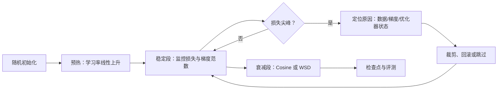

# 第 11 章 优化器、学习率与训练稳定性

## 本章导读

同一个模型、同一份数据、同样的算力，换一个优化器或把学习率调大两倍，结果可能从稳定收敛变成损失在 2.1 和 3.5 之间来回跳。更常见的情况是前几百步一切正常，某一步损失突然翻倍，继续训练也回不到原来的轨迹。这些现象不是玄学：更新规则、学习率调度、批大小与数值稳定性各自有明确的数学机制，也各自有可观测的诊断指标。本章把这些机制拆开，给出可以运行、可以复算的对照实验。

## 难度标签

⭐⭐⭐ 进阶 ｜ 数学要求：梯度下降、指数滑动平均、矩阵范数与奇异值 ｜ 代码要求：能读懂 PyTorch 训练循环与 `Optimizer` 接口

## 学习目标

读完本章你将能够：

1. 从 SGD 推导 Adam 的一阶、二阶矩与偏差修正，解释每个超参数的物理含义。
2. 说明 AdamW 的解耦权重衰减与 Adam 耦合 L2 的差别，并判断何时必须解耦。
3. 写出 Warmup、Cosine、WSD 三种调度，根据训练预算与是否需要多次退火选择。
4. 用关键批大小解释线性缩放与平方根缩放，避免“批大小翻倍、学习率就翻倍”的误用。
5. 诊断损失尖峰，组合使用梯度裁剪、QK-norm、z-loss 与检查点回滚，并实现 Muon 的正交化更新。

## 11.1 直觉：优化器是梯度的过滤器

把训练想成在山谷里找最低点。梯度只告诉你“当前位置最陡的下坡方向”，但直接沿梯度走有两个问题：方向噪声大，步长对所有坐标一视同仁。优化器做的就是两件事：给梯度加记忆（动量），按坐标缩放步长（自适应学习率）。Adam 同时做了这两件事，所以它在梯度尺度差异大的 Transformer 上是默认选择。

第二个直觉关于时间。训练不是匀速的。开头参数随机，梯度方向变化剧烈，二阶矩估计还不可靠；中段模型进入相对平稳的下降通道；末段需要把学习率降下来，让参数在最小值附近收敛而不是来回震荡。这三段分别对应预热、稳定训练与衰减，如图 11-1。



损失尖峰是本章的第三条主线。它通常表现为一步或几步内损失突然上升，随后部分恢复。原因可以分成三类：数据侧的异常样本、梯度侧的范数爆炸、结构侧的注意力 logits 过大导致 softmax 饱和。三类原因对应不同的工具，盲目调小学习率往往只能掩盖症状。

优化器本身只有三个可调旋钮：更新方向、每个坐标的步长、全局步长。动量与 Muon 改的是方向，Adam 的二阶矩改的是坐标步长，学习率与调度改的是全局步长。三者互相耦合：把学习率调大，方向噪声会被放大；把二阶矩的 $$\beta_2$$ 调小，坐标步长对近期梯度更敏感；把权重衰减调大，又会改变有效学习率。本章后面每一节只动一个旋钮，其余固定，目的是让读者看清每个旋钮单独的作用，而不是给出一个“万能配方”。

## 11.2 数学原理

### 11.2.1 从 SGD 到 Adam

最朴素的更新是随机梯度下降（Stochastic Gradient Descent，SGD）：

$$
\theta_{t+1}=\theta_t-\eta_t\,\mathbf{g}_t,\qquad \mathbf{g}_t=\nabla_\theta\mathcal{L}(\theta_t)\qquad \text{(11.1)}
$$

其中 $$\theta_t$$ 是第 $$t$$ 步的参数，$$\eta_t$$ 是学习率，$$\mathbf{g}_t$$ 是当前小批量上的梯度。SGD 对每个坐标用同一个步长，当不同参数的梯度尺度相差几个数量级时，要么大梯度方向震荡，要么小梯度方向几乎不动。

动量（momentum）用指数滑动平均平滑梯度：

$$
\mathbf{m}_t=\beta_1\mathbf{m}_{t-1}+(1-\beta_1)\mathbf{g}_t,\qquad \theta_{t+1}=\theta_t-\eta_t\mathbf{m}_t\qquad \text{(11.2)}
$$

$$\beta_1$$ 通常取 0.9。动量把过去约 $$1/(1-\beta_1)$$ 步的梯度做加权平均，方向一致的坐标被放大，来回震荡的坐标被抵消。注意 PyTorch 的 `SGD(momentum=...)` 用的是 $$\mathbf{m}_t=\beta_1\mathbf{m}_{t-1}+\mathbf{g}_t$$，少了一个 $$1-\beta_1$$，等价于把学习率放大了 $$1/(1-\beta_1)$$ 倍；写公式时要说明采用哪种约定。

Adam 在动量之外再加一个二阶矩，用来估计每个坐标的梯度方差：

$$
\mathbf{m}_t=\beta_1\mathbf{m}_{t-1}+(1-\beta_1)\mathbf{g}_t,\qquad
\mathbf{v}_t=\beta_2\mathbf{v}_{t-1}+(1-\beta_2)\mathbf{g}_t\odot\mathbf{g}_t\qquad \text{(11.3)}
$$

$$\mathbf{v}_t$$ 是逐元素的平方滑动平均。如果直接用 $$\mathbf{m}_t/\sqrt{\mathbf{v}_t}$$，训练初期两个矩都从零开始，会严重偏小。偏差修正（bias correction）把它校正回来：

$$
\hat{\mathbf{m}}_t=\frac{\mathbf{m}_t}{1-\beta_1^t},\qquad
\hat{\mathbf{v}}_t=\frac{\mathbf{v}_t}{1-\beta_2^t}\qquad \text{(11.4)}
$$

推导只需一步。在梯度平稳的假设下，$$\mathbb{E}[\mathbf{m}_t]=(1-\beta_1)\sum_{i=1}^{t}\beta_1^{t-i}\mathbb{E}[\mathbf{g}_i]=(1-\beta_1^t)\mathbf{g}$$，所以除以 $$1-\beta_1^t$$ 得到无偏估计；二阶矩同理。Adam 的更新为

$$
\theta_{t+1}=\theta_t-\eta_t\frac{\hat{\mathbf{m}}_t}{\sqrt{\hat{\mathbf{v}}_t}+\epsilon}\qquad \text{(11.5)}
$$

$$\epsilon$$ 只负责避免除以零，通常取 $$10^{-8}$$。由于分子分母同阶，$$\hat{\mathbf{m}}_t/\sqrt{\hat{\mathbf{v}}_t}$$ 的每个分量大致在 $$[-1,1]$$ 内，因此 Adam 的单步更新幅度约等于学习率本身，与梯度绝对大小无关。这是 Adam 对梯度尺度不敏感的来源，也是它在大模型上省去逐层调学习率的原因。

把更新写成分量形式更清楚。设某个坐标的梯度长期为 $$g$$，则 $$\hat m\approx g$$、$$\sqrt{\hat v}\approx|g|$$，更新量约等于 $$\eta$$ 乘以 $$g/|g|$$。也就是说，Adam 在每个坐标上近似做“符号下降”（sign descent），只保留方向、丢掉幅度。梯度从 $$10^{-5}$$ 变成 $$10^{-2}$$，步长仍然是 $$\eta$$，不会因为梯度变大而爆炸。这个性质在嵌入层、MoE 路由、稀疏特征上特别有用，因为这些参数的梯度尺度天然相差很大。代价是 Adam 丢掉了曲率信息：在某个坐标上，即使已经接近最优点，只要梯度方向不变，它仍会以 $$\eta$$ 的步长前进，因此需要学习率衰减来收尾。

大语言模型里 $$\beta_2$$ 常取 0.95 而不是原论文的 0.999。0.999 的记忆长度约 1000 步，在非平稳训练中会把很久以前的方差带进来，遇到分布变化时反应太慢；0.95 的记忆长度约 20 步，更适合语言模型这种梯度统计持续变化的场景。代价是二阶矩噪声更大，需要靠较大的批大小平滑。

空间复杂度上，Adam 为每个参数保存一阶矩与二阶矩，优化器状态是参数量的 3 倍（参数本身、$$\mathbf{m}$$、$$\mathbf{v}$$）。以 70B 模型、BF16 参数、FP32 优化器状态为例，仅优化器状态就约 $$70\times10^9\times 8$$ 字节，即 560 GB，这也是第 12 章要分片存储的原因。每步计算是 $$O(N)$$ 的逐元素运算，相对前向反向的矩阵乘可以忽略。

嵌入层是否做权重衰减是一个具体的分歧点。支持衰减的理由是嵌入矩阵也是权重，衰减可以抑制低频 Token 的范数失控；反对的理由是低频 Token 出现次数少，衰减会让它们的向量过早收缩到零，损害长尾词的表示。LLaMA 系列通常对嵌入层也施加 0.1 的衰减，但一些团队选择对嵌入层关闭衰减或用更小的系数。这个问题没有理论定论，只能在自己的数据分布上比较验证损失与长尾评测。本章的 `make_param_groups` 采用最简单的规则（二维以上全部衰减），读者可以按需修改。

### 11.2.2 权重衰减为什么必须解耦

权重衰减（weight decay）是常见的正则化手段。最直接的写法是在损失上加 $$\frac{\lambda}{2}\|\theta\|^2$$，于是梯度变成

$$
\mathbf{g}_t^{\mathrm{L2}}=\mathbf{g}_t+\lambda\theta_t\qquad \text{(11.6)}
$$

这叫耦合 L2（coupled L2），因为它和普通梯度混在一起，随后被 Adam 的 $$\sqrt{\hat{\mathbf{v}}}$$ 归一化。把 (11.6) 代入 (11.5)，衰减项实际贡献的更新是 $$\Delta\theta_{\text{decay}}=-\eta_t\frac{\lambda\theta_t}{\sqrt{\hat{\mathbf{v}}_t}+\epsilon}$$。分母是逐坐标的梯度尺度。梯度小的坐标，$$\sqrt{\hat{\mathbf{v}}}$$ 小，衰减被放大；梯度大的坐标，衰减被压缩。也就是说，耦合 L2 的“衰减强度”依赖梯度统计，不是真正意义上的固定比例收缩。我们的实验里，参数初值 1、梯度 $$10^{-3}$$、学习率 0.1、衰减系数 0.1，耦合 L2 一步把参数拉到 0.900，解耦写法只到 0.890：衰减被放大了约 10 倍。

AdamW 把衰减从梯度里拿出来，直接作用在参数上：

$$
\theta_{t+1}=(1-\eta_t\lambda)\theta_t-\eta_t\frac{\hat{\mathbf{m}}_t}{\sqrt{\hat{\mathbf{v}}_t}+\epsilon}\qquad \text{(11.7)}
$$

这样每一步的收缩比例只由 $$\eta_t\lambda$$ 决定，与梯度大小、二阶矩估计都无关。它与 SGD 时代的权重衰减语义一致，也让 $$\lambda$$ 可以跨模型、跨批大小迁移。工程上通常只对二维以上的权重矩阵做衰减，偏置、LayerNorm/RMSNorm 的增益不衰减；嵌入层是否衰减没有统一答案，取决于词表规模与数据量，需要用验证集确认。

从近端优化的角度看，解耦衰减等价于每步先最小化线性化损失再加一个二次惩罚：

$$
\theta_{t+1}=\arg\min_{\theta}\left\{\mathcal{L}(\theta_t)+\langle\mathbf{g}_t,\theta-\theta_t\rangle+\frac{1}{2\eta_t}\|\theta-\theta_t\|^2+\frac{\lambda}{2}\|\theta\|^2\right\}
$$

对 $$\theta$$ 求导并令其为零，得到的就是 (11.7) 中参数先乘 $$(1-\eta_t\lambda)$$ 再走梯度一步的形式。这个视角说明衰减不是“额外加在损失上的项”，而是对参数幅度的一个显式约束；因此它可以和任意自适应优化器组合，而不改变后者的坐标缩放。工程上常用的范围是 $$\lambda=0.1$$ 配学习率 $$10^{-4}$$ 到 $$10^{-3}$$；$$\lambda$$ 太大时模型会欠拟合，太小时正则不足，需要通过验证损失扫描。


很多框架的 `Adam(weight_decay=...)` 实现的是耦合 L2，而 `AdamW(weight_decay=...)` 才是解耦。迁移超参数时先确认这一点，否则同一个 0.1 可能产生完全不同的有效衰减。


### 11.2.3 学习率调度

学习率调度决定 $$\eta_t$$ 随步数怎么变。三种最常见的形式如下。

预热（warmup）在训练开头把学习率从零线性升到峰值：

$$
s_t=\frac{t}{T_w},\qquad 0\le t<T_w\qquad \text{(11.8)}
$$

其中 $$s_t=\eta_t/\eta_{\max}$$ 是学习率乘子，$$T_w$$ 是预热步数。余弦退火（cosine decay）在剩余步数内按余弦曲线降到最小值：

$$
s_t=s_{\min}+(1-s_{\min})\cdot\frac{1+\cos\left(\pi\frac{t-T_w}{T-T_w}\right)}{2}\qquad \text{(11.9)}
$$

WSD（Warmup-Stable-Decay）把训练分成预热、恒定、衰减三段：

$$
s_t=
\begin{cases}
1, & t\le T_s\\
s_{\min}+(1-s_{\min})\left(\dfrac{T-t}{T-T_s}\right)^p, & t>T_s
\end{cases}
\qquad \text{(11.10)}
$$

其中 $$T_s$$ 是开始衰减的步数，$$p$$ 控制衰减形状，$$p=1$$ 为线性。DeepSeek-V3 公开的配方就接近这种形状：先恒定到 10T Token，再在 4.3T Token 内余弦降到峰值的十分之一。

预热的必要性有两个来源。第一，Adam 的二阶矩在最初几十步只见过很少的梯度样本，$$\hat{\mathbf{v}}$$ 噪声大且可能偏小，导致更新方向被异常放大；预热把这段时间的步长压小，等统计量稳定后再放开。第二，训练初期的参数远离最优点，梯度的局部线性近似不成立，大步长容易把参数推到更差的区域。预热与批大小也有关系：批越小，梯度噪声越大，越需要预热；批很大、梯度已经很准时，预热的收益下降。

衰减的必要性来自噪声。随机梯度的方差与批大小成反比，训练末段如果不降学习率，参数会在最小值附近按噪声幅度来回跳，验证损失停在平台甚至回升。余弦衰减在整个训练过程中持续降低学习率，适合一次性跑完的预算；WSD 把大部分时间留给恒定学习率，只在最后快速下降，好处是任意一个稳定段检查点都可以接一段新的退火数据，做多次低成本实验。第 10 章的数据退火正是利用这一点：同一份稳定段权重，可以分别接高质量数据、领域数据或合成数据，比较不同退火配方。

预热长度没有通用公式，但可以按两个约束估：预热期间模型要见到足够多的样本，使二阶矩的估计相对误差降到可接受范围；预热又不能占用太大比例的预算，否则大部分训练都在低学习率下浪费。经验上，预热占总步数的 0.5% 到 5%：Llama 3 的 8000/1.2M 约 0.7%，DeepSeek-V3 的 2000 步相对于十多万步也在 1% 量级；小模型、短训练可以取 5% 到 10%。更稳妥的做法是做一次短程学习率扫描：固定其他条件，用 100 到 300 步试几个峰值学习率，选择损失下降最快且不发散的值，再按总步数比例放大预热长度。

调度还会改变“有效训练步数”的分配。余弦衰减在前期学习率接近峰值，后期迅速下降，面积大致集中在中间；WSD 把恒定段拉长，末段衰减很快，因此同样预算下 WSD 在恒定段见到的样本更多。若数据量很大、模型还没充分拟合，WSD 的恒定段有利；若数据量小、需要尽快收敛，余弦的持续下降更合适。这也是为什么调度选择必须和数据规模、训练预算一起看，不能脱离上下文比较。


调度选择的一个实用判据：如果训练预算固定、只跑一次，Cosine 是稳妥默认；如果需要在同一底座上反复做退火或继续预训练，WSD 的检查点复用价值更大。终损失两者通常接近，差别主要在工程流程。


### 11.2.4 批大小与学习率缩放

批大小 $$B$$ 变大，梯度估计的方差按 $$1/B$$ 下降。为了保持参数更新的信噪比，学习率需要相应调整。两条经验规则分别对应两种极限：

$$
\eta=\eta_0\frac{B}{B_0},\qquad B\ll B_{\mathrm{crit}}\qquad \text{(11.11)}
$$

$$
\eta=\eta_0\sqrt{\frac{B}{B_0}},\qquad B\gg B_{\mathrm{crit}}\qquad \text{(11.12)}
$$

$$B_{\mathrm{crit}}$$ 是第 9 章的关键批大小，定义为 $$B_{\mathrm{crit}}=\frac{\operatorname{tr}(\boldsymbol{\Sigma})}{\|\mathbf{g}\|^2}$$，其中 $$\boldsymbol{\Sigma}$$ 是单样本梯度的协方差，$$\mathbf{g}$$ 是全批量梯度。直观上，$$B_{\mathrm{crit}}$$ 是“梯度噪声与真实梯度同量级”的批大小。批远小于它时，训练受噪声主导，增大批大小等价于按比例减小噪声，学习率可以按比例放大；批远大于它时，梯度已经足够准，继续增大批只减少很小的噪声，学习率只能按平方根放大，再大就会震荡。线性缩放规则来自 Goyal 等人 2017 年的大批量 ImageNet 实验，平方根规则是噪声主导分析的自然延伸；两者都是经验规律，不是精确等式，迁移到新模型时应做小规模扫描确认。

梯度累积（gradient accumulation）是同样的道理：在 $$k$$ 个微批上累加梯度再更新一次，等效批大小是 $$k$$ 倍微批大小，学习率也应按上述规则调整。第 12 章会把这条规则放进分布式训练的全局批大小里。

实际调参时不要直接套公式，而是做一次小规模批大小—学习率扫描。固定模型与数据，取基准批 $$B_0$$ 和 4 倍批 $$4B_0$$，各自扫 3 到 5 个学习率，找到各自的最优点。如果 $$4B_0$$ 的最佳学习率约为 $$2\eta_0$$，说明还处在线性区；如果约为 $$1.6\eta_0$$（即 $$\sqrt{4}\eta_0$$ 附近），说明已经进入平方根区；如果最佳学习率几乎不变，说明批大小已远超关键批，继续加批没有收益。这个扫描只需要几百步，成本远低于一次完整训练，却能避免“批翻倍、学习率照抄”造成的震荡或欠训练。

批大小的另一个作用是平滑损失。批越大，单步损失越接近整个分布的期望，曲线越平滑；但批越大，同样 Token 预算下的更新次数越少，模型在固定步数内见到的不同样本组合也更少。数据受限时（第 9 章），盲目增大批会让每个 Token 被重复见到的次数增加，收益进一步下降。学习率缩放只解决“梯度噪声”这一项，不能补偿数据多样性或更新次数的损失。

两条规则之间可以用一个指数 $$\kappa\in[0.5,1]$$ 统一写成 $$\eta\propto B^\kappa$$：批远小于关键批时 $$\kappa=1$$，远大于时 $$\kappa=0.5$$，中间平滑过渡。实际工程中，批大小翻倍以内可以按线性放大，翻四倍以上建议按平方根或介于两者之间的指数放大，并做短程验证。不要用“学习率随批大小自动缩放”的库函数替代扫描，因为关键批大小本身依赖模型、数据和训练阶段，库函数只能给你一个起点。

### 11.2.5 损失尖峰与稳定性工具

损失尖峰（loss spike）指训练损失在一步或几步内异常上升。检测它最直接的方法是对损失做滑动统计：

$$
z_t=\frac{L_t-\mu_t}{\sigma_t},\qquad
\mu_t=\frac{1}{W}\sum_{i=1}^{W}L_{t-i},\qquad
\sigma_t^2=\frac{1}{W}\sum_{i=1}^{W}(L_{t-i}-\mu_t)^2\qquad \text{(11.13)}
$$

当 $$z_t$$ 超过阈值（例如 4）时记录一次尖峰。滑动窗口要排除当前点，否则尖峰会抬高自己的基线；阈值要按模型和批大小校准，没有通用数值。

第一道防线是梯度裁剪（gradient clipping）：

$$
\mathbf{g}\leftarrow\mathbf{g}\cdot\min\left(1,\frac{\tau_{\mathrm{clip}}}{\|\mathbf{g}\|_2}\right)\qquad \text{(11.14)}
$$

它把所有参数的梯度看作一个整体，当全局 L2 范数超过 $$\tau_{\mathrm{clip}}$$ 时等比例缩小。大模型常用的阈值是 1.0。裁剪只限制单步更新的最大幅度，不能修复已经污染的二阶矩，也不能阻止注意力 logits 在正常梯度下持续变大。

第二个诊断量是更新与权重的比例：

$$
r_t=\frac{\|\theta_t-\theta_{t-1}\|_2}{\|\theta_{t-1}\|_2}\qquad \text{(11.15)}
$$

它衡量每一步把参数改动了多少比例。$$r_t$$ 突然比平时大一个数量级，往往说明学习率、梯度或二阶矩出了问题。这个量适合做监控曲线，不适合设一个跨模型通用的硬阈值。

注意力是尖峰的高发区。一个有用的诊断量是注意力熵：对每个查询，$$H_t=-\sum_u a_{t,u}\log a_{t,u}$$，其中 $$a_{t,u}$$ 是 softmax 后的权重。正常训练中，熵缓慢下降，表示模型逐渐学会聚焦；如果某一步熵突然从 3 降到 0.5，说明 softmax 已经饱和到几乎 one-hot，梯度会变得又稀疏又不稳定，尖峰往往紧随其后。把熵与梯度范数、损失一起画在同一张时间轴上，能快速区分“数据异常”与“注意力塌缩”。

打分 $$s_{t,u}=\mathbf{q}_t^\top\mathbf{k}_u/\sqrt{d_h}$$ 的幅度随 $$\|\mathbf{q}\|\|\mathbf{k}\|$$ 增长。QK-norm 在计算打分前对每个头的查询和键做均方根归一化：

$$
\tilde{\mathbf{q}}_t=\frac{\mathbf{q}_t}{\mathrm{RMS}(\mathbf{q}_t)},\qquad
\tilde{\mathbf{k}}_t=\frac{\mathbf{k}_t}{\mathrm{RMS}(\mathbf{k}_t)},\qquad
s_{t,u}=\frac{\tilde{\mathbf{q}}_t^\top\tilde{\mathbf{k}}_u}{\sqrt{d_h}}\qquad \text{(11.16)}
$$

归一化后每个向量的 L2 范数是 $$\sqrt{d_h}$$，由柯西不等式，打分绝对值不超过 $$\sqrt{d_h}$$，与参数尺度无关。这不能保证训练一定不发散，但切断了“权重变大 → logits 变大 → softmax 饱和 → 梯度异常”的正反馈。Kimi K2 使用的 QK-Clip 是同一思路的工程版本：监控 query/key 的最大值，超过阈值就缩放，而不是每步都归一化。

另一个工具是 z-loss，用来惩罚输出层 logits 的整体尺度：

$$
\mathcal{L}_z=\beta_z(\log Z)^2,\qquad Z=\sum_{v}\exp(z_v)\qquad \text{(11.17)}
$$

$$Z$$ 是 softmax 的配分函数。logits 整体偏大时 $$Z$$ 指数增长，z-loss 给出很强的惩罚，把 logits 拉回温和范围。PaLM 的训练报告使用了这一项；代价是它会给所有 logits 一个向零的力，过大的系数会损害模型容量，通常取很小的值（如 $$10^{-4}$$）。

初始化决定了训练开始时的数值尺度。对线性层，Xavier 初始化让前向与反向的方差大致保持：

$$
\mathrm{Var}(W_{ij})=\frac{2}{n_{\mathrm{in}}+n_{\mathrm{out}}},\qquad
W_{\mathrm{res}}\leftarrow\frac{W_{\mathrm{res}}}{\sqrt{2n_l}}\qquad \text{(11.18)}
$$

第二式针对残差分支：每层有注意力和前馈两个残差分支，共 $$2n_l$$ 个分支把方差累加到残差流上，若每个分支的输出方差为 $$v$$，总和约为 $$2n_l v$$。把分支输出投影缩小 $$1/\sqrt{2n_l}$$，残差流方差就与层数无关。TinyLM 从第 3 章起就用 `0.02/sqrt(2*n_layers)` 缩放残差输出投影，正是这个道理。第 9 章的 μP 把这套方差分析推广到宽度与学习率，使超参数可以跨规模迁移。

处理尖峰的流程可以固定为四步。第一步，确认尖峰的幅度与持续时间：一步尖峰后立刻恢复，通常只是异常批次；连续多步不恢复，说明参数已经离开好的区域。第二步，回看尖峰前的梯度范数、更新比例与注意力熵：梯度范数先涨，查数据与裁剪；梯度正常但注意力熵骤降，查 QK 尺度；三者都正常，查优化器状态与学习率。第三步，决定恢复策略：跳过该批次、回滚到最近检查点、降低学习率，或者重置优化器的二阶矩。第四步，记录这次尖峰的种子、步数与数据来源，方便复现。

还有一类尖峰来自数值格式而非优化算法。混合精度训练中，FP16 的动态范围只有约 $$6\times10^4$$，梯度或激活一旦溢出就变成 `inf`，下一步更新会把参数污染成 `nan`；BF16 的指数范围与 FP32 相同，溢出风险小得多，但尾数只有 7 位，累加误差更大。损失缩放（loss scaling）与主权重（master weights）是常见的补救：前者把损失乘一个大常数再反传，避免梯度下溢；后者在 FP32 中保存参数副本，更新后再转回低精度。第 12 章会展开这些工程细节，本章只需记住：看到尖峰先确认它不是数值溢出，否则调优化器没有意义。


出现尖峰后不要只做“降学习率 + 继续跑”。先判断是哪一类：如果梯度范数在尖峰前暴涨，优先检查数据和裁剪；如果梯度正常但注意力熵骤降，检查 QK 尺度与 QK-norm；如果两者都正常，可能是优化器二阶矩被一个坏批次污染，需要回滚检查点并重置优化器状态。带病继续训练常常在几百步后再次尖峰。


### 11.2.6 Muon：把更新矩阵正交化

Adam 是逐坐标的，它不看参数矩阵的行列结构。Muon（Momentum Orthogonalized by Newton-Schulz）对二维权重矩阵做另一种处理：先累积动量，再把动量矩阵的奇异值推向 1，得到一个近似正交的更新方向。

$$
\mathbf{M}_t=\mu\mathbf{M}_{t-1}+\mathbf{G}_t,\qquad
\mathbf{O}_t=\mathrm{NS}(\mathbf{M}_t),\qquad
\theta_t=\theta_{t-1}-\eta_t\gamma\,\mathbf{O}_t\qquad \text{(11.19)}
$$

其中 $$\mathrm{NS}(\cdot)$$ 是 Newton-Schulz 迭代，$$\gamma$$ 是按矩阵形状的缩放因子（常见取 $$\sqrt{\max(1,n_{\mathrm{out}}/n_{\mathrm{in}})}$$）。正交化的动机是：梯度矩阵的奇异值分布通常很不均匀，少数方向占据大部分能量，Adam 的逐坐标归一化只能部分缓解；把奇异值压到同一量级，相当于在谱范数下做最速下降，让更新更均匀地覆盖各个方向。

Newton-Schulz 迭代只使用矩阵乘法，不需要显式 SVD：

$$
\mathbf{X}_{k+1}=a\mathbf{X}_k+\left(b\mathbf{A}_k+c\mathbf{A}_k^2\right)\mathbf{X}_k,\qquad
\mathbf{A}_k=\mathbf{X}_k\mathbf{X}_k^\top\qquad \text{(11.20)}
$$

常用系数为 $$a=3.4445,\ b=-4.7750,\ c=2.0315$$，迭代 5 次。先把输入除以 Frobenius 范数，使奇异值落在迭代收敛区间；若矩阵行数大于列数，先转置再迭代，最后转置回来。5 次迭代得到的只是近似正交，奇异值大约落在 0.7 到 1.1 之间，但条件数已经显著下降，足以改善更新方向。

从优化理论看，Muon 的更新可以理解为在谱范数约束下的最速下降。普通梯度下降在欧氏范数下选择使一阶近似下降最多的方向；若把约束换成谱范数 $$\|\Delta\theta\|_2\le\eta$$，最优方向是梯度的极分解中正交因子的负值，也就是把奇异值全部置为 1。Newton-Schulz 迭代正是在不显式做 SVD 的情况下逼近这个正交因子。Adam 的约束是逐坐标的无穷范数，它让每个坐标的更新幅度相同；Muon 的约束是矩阵的谱范数，它让每个奇异方向的更新幅度相同。两者对应不同的几何，适用的参数结构也不同。

Muon 的工程细节比公式多。逐参数更新缩放 $$\gamma$$ 需要按矩阵形状调整，否则宽矩阵与高矩阵的有效步长不一致；权重衰减对 Muon 同样重要，Moonlight 的报告专门讨论了这一点；嵌入层、输出层、归一化参数不能做矩阵正交化，必须继续用 AdamW。实现上还要注意转置与批量维：只对二维权重做 NS，卷积核等更高维参数需要先 reshape。这些细节决定了 Muon 在真实模型上是否稳定，不能只看公式。

Muon 不适合所有场景。小模型或小批量下，正交化带来的方向改善可能被额外的矩阵乘与实现开销抵消；参数形状极端（例如宽度远大于高度）时，逐参数缩放与转置逻辑容易出错；训练已经稳定、瓶颈在数据而非优化时，换优化器的收益有限。更稳妥的做法是先固定 AdamW 配方，把 Muon 当作对照实验，在相同 Token 预算、相同学习率扫描下比较验证损失与训练稳定性，再决定是否迁移。

Muon 只适用于二维以上的隐藏层权重。嵌入层、输出层、偏置与归一化参数仍用 AdamW，因为它们的梯度结构不适合做矩阵正交化。开销上，每次更新多出约 5 次矩阵乘，相对前向反向的矩阵乘总量很小，但在小模型上占比会变大。Moonlight 的公开报告称 Muon 在同等损失下可节省约一半训练算力，并指出权重衰减与逐参数更新缩放是规模化的两个关键；这些数字来自特定模型与数据，不能直接外推到所有配方。

## 11.3 方案对比

表 11-1 从状态开销、超参数敏感度与适用场景比较四种优化器。

| 优化器 | 额外状态 | 单步开销 | 超参数敏感度 | 适用场景 |
| --- | --- | --- | --- | --- |
| SGD + 动量 | 1× 参数 | 低 | 对学习率很敏感 | 小模型、已精细调参的视觉任务 |
| Adam | 2× 参数 | 低 | 中，需调 β₂、ε | 通用基线，稀疏梯度 |
| AdamW | 2× 参数 | 低 | 中，衰减可迁移 | LLM 预训练默认选择 |
| Muon | 1× 参数 + 矩阵乘 | 中 | 对形状缩放敏感 | 隐藏层权重，追求算力效率 |

表 11-2 比较三种调度。

| 调度 | 形状 | 优点 | 代价 | 适用场景 |
| --- | --- | --- | --- | --- |
| Constant | 预热后恒定 | 简单，任意时刻可停 | 末段噪声大，终损失略差 | 短程调试、学习率扫描 |
| Cosine | 全程平滑下降 | 终损失稳定，默认稳妥 | 预算必须预先确定 | 一次性预训练 |
| WSD | 恒定后快速下降 | 稳定段检查点可复用 | 需要预留退火数据与步数 | 多次退火、继续预训练 |

读表时要注意“代价”一列。优化器的状态开销直接决定显存，第 12 章的 ZeRO 与 FSDP 很大程度上是在为 Adam 的两份状态买单；Muon 的状态更小，但增加了矩阵乘与实现复杂度。调度的代价不是算力，而是流程约束：Cosine 要求预先知道总步数，WSD 要求预留退火数据，Constant 则不提供末段收敛。稳定性工具的代价是表达力：QK-norm 限制了注意力的动态范围，z-loss 限制了 logits 的尺度，裁剪在异常时保护训练，但在正常情况下也会削掉一部分有效更新。选择工具时先问“它牺牲了什么”，再问“它换来了什么”。

表 11-3 汇总稳定性工具的作用点。

| 工具 | 作用对象 | 主要收益 | 代价与局限 |
| --- | --- | --- | --- |
| 梯度裁剪 | 全局梯度范数 | 限制单步更新幅度 | 不修复二阶矩污染 |
| QK-norm / QK-Clip | 注意力打分 | 切断 logits 爆炸的正反馈 | 改变注意力表达，略增计算 |
| z-loss | 输出层配分函数 | 抑制 logits 整体漂移 | 系数过大会损害容量 |
| 残差缩放初始化 | 残差分支 | 控制深层方差 | 不解决训练中期的漂移 |
| 检查点回滚 | 优化器与参数状态 | 从尖峰前恢复 | 损失算力，需保存历史检查点 |

## 11.4 代码实现：TinyLM 的优化器与调度

### 11.4.1 实现选择

本章在 `tinylm/train/optim.py` 中实现四块内容：带解耦衰减的 `AdamW`、参数分组、学习率乘子 `lr_factor` 与全局梯度裁剪；另外提供 `LossSpikeDetector` 与 Muon 的 Newton-Schulz 正交化。优化器不进入 `ModelConfig`，因为它是训练脚本的选择，不应该改变模型结构；`TinyLM.forward` 与 `CausalLMOutput` 保持不变。

实验复用第 10 章的合成语料与词表，模型仍是 2 层、`d_model=32`、4 头 GQA-2 的小模型，所有随机源固定种子。四个实验分别是：病态二次型上的 SGD/Adam 对照、TinyLM 上的优化器对照、高学习率下的预热对照、调度对照，以及一次人为注入梯度的裁剪演示。

实现上有两个容易出错的细节。第一，参数分组必须按“是否做衰减”拆开：如果把偏置和归一化增益也放进衰减组，模型会在训练早期把这些接近零的参数进一步压小，表现为收敛变慢；如果把嵌入层误放进不衰减组，长尾词又可能范数失控。第二，调度索引必须与“已完成的更新次数”对齐：第 0 步的乘子应为 0（如果启用预热），预热结束的那一步应恰好为 1；如果把 `step+1` 与 `step` 混用，预热会整体偏移一步，短训练下影响不大，长训练下会改变有效预热长度。测试里的端点检查就是为这两个细节兜底。

### 11.4.2 完整代码

`tinylm/train/optim.py`：

```python
"""第 11 章：优化器、学习率调度与训练稳定性（tinylm/train/optim.py）。"""
import math
from collections import deque

import torch


class AdamW(torch.optim.Optimizer):
    """公式 (11.3)–(11.7)：偏差修正的 Adam 与解耦权重衰减。"""

    def __init__(self, params, lr=1e-3, betas=(0.9, 0.95), eps=1e-8,
                 weight_decay=0.1):
        if lr < 0 or eps < 0 or weight_decay < 0:
            raise ValueError("lr、eps、weight_decay 必须非负")
        if not 0 <= betas[0] < 1 or not 0 <= betas[1] < 1:
            raise ValueError("betas 必须在 [0, 1) 内")
        super().__init__(params, dict(lr=lr, betas=betas, eps=eps,
                                      weight_decay=weight_decay))

    @torch.no_grad()
    def step(self, closure=None):
        loss = None
        if closure is not None:
            with torch.enable_grad():
                loss = closure()
        for group in self.param_groups:
            lr = group["lr"]
            b1, b2 = group["betas"]
            eps = group["eps"]
            wd = group["weight_decay"]
            for p in group["params"]:
                if p.grad is None:
                    continue
                g = p.grad
                state = self.state[p]
                if not state:
                    state["step"] = 0
                    state["m"] = torch.zeros_like(p)
                    state["v"] = torch.zeros_like(p)
                state["step"] += 1
                t = state["step"]
                m, v = state["m"], state["v"]
                m.mul_(b1).add_(g, alpha=1 - b1)              # (11.3)
                v.mul_(b2).addcmul_(g, g, value=1 - b2)       # (11.3)
                m_hat = m / (1 - b1 ** t)                     # (11.4)
                v_hat = v / (1 - b2 ** t)                     # (11.4)
                p.mul_(1 - lr * wd)                           # (11.7) 解耦衰减
                p.addcdiv_(m_hat, v_hat.sqrt().add_(eps), value=-lr)
        return loss


def make_param_groups(model, weight_decay=0.1):
    """权重衰减只作用于二维以上参数；偏置与归一化增益不衰减。"""
    decay, no_decay = [], []
    for name, p in model.named_parameters():
        if not p.requires_grad:
            continue
        if p.ndim >= 2:
            decay.append(p)
        else:
            no_decay.append(p)
    return [
        {"params": decay, "weight_decay": weight_decay},
        {"params": no_decay, "weight_decay": 0.0},
    ]


def lr_factor(step, total, warmup=0, kind="cosine", min_ratio=0.1,
              decay_start=None, power=1.0):
    """公式 (11.8)–(11.10)：返回第 step 步的学习率乘子。

    step 是已完成的更新次数，取值 0..total；warmup 结束处因子恰好为 1。
    """
    if total <= 0 or step < 0:
        raise ValueError("total 必须为正，step 必须非负")
    step = min(step, total)
    if warmup > 0 and step < warmup:
        return step / warmup                              # (11.8)
    if kind == "constant":
        return 1.0
    if kind == "cosine":
        span = max(1, total - warmup)
        t = min(1.0, (step - warmup) / span)
        return min_ratio + (1 - min_ratio) * 0.5 * (1 + math.cos(math.pi * t))  # (11.9)
    if kind == "wsd":
        start = int(0.8 * total) if decay_start is None else decay_start
        start = max(start, warmup)
        if step <= start:
            return 1.0                                    # (11.10) 稳定段
        t = min(1.0, (step - start) / max(1, total - start))
        return min_ratio + (1 - min_ratio) * (1 - t) ** power  # (11.10) 衰减段
    raise ValueError(f"未知调度: {kind}")


def clip_grad_norm_(parameters, max_norm):
    """公式 (11.14)：按全局 L2 范数缩放所有梯度，返回裁剪前的范数。"""
    if max_norm <= 0:
        raise ValueError("max_norm 必须为正")
    params = [p for p in parameters if p.grad is not None]
    if not params:
        return 0.0
    total = torch.sqrt(sum((p.grad.detach() ** 2).sum() for p in params))
    coef = min(1.0, max_norm / (total.item() + 1e-6))
    if coef < 1.0:
        for p in params:
            p.grad.mul_(coef)
    return total.item()


class LossSpikeDetector:
    """公式 (11.13)：用滑动窗口的均值与标准差判定损失尖峰。"""

    def __init__(self, window=50, z_threshold=4.0, min_history=10):
        self.history = deque(maxlen=window)
        self.z_threshold = z_threshold
        self.min_history = min_history

    def update(self, loss):
        """先判定再更新，避免当前点抬高自己的基线。"""
        x = float(loss)
        z = 0.0
        spike = False
        if len(self.history) >= self.min_history:
            mean = sum(self.history) / len(self.history)
            var = sum((h - mean) ** 2 for h in self.history) / len(self.history)
            if var > 0:
                z = (x - mean) / math.sqrt(var)
                spike = z > self.z_threshold
        self.history.append(x)
        return z, spike


def zeropower_newtonschulz5(G, steps=5, eps=1e-7):
    """公式 (11.20)：五次迭代把矩阵的奇异值推向 1。"""
    if G.ndim != 2:
        raise ValueError("Muon 只处理二维参数")
    a, b, c = 3.4445, -4.7750, 2.0315
    X = G / (G.norm() + eps)
    transposed = G.size(0) > G.size(1)
    if transposed:
        X = X.T
    for _ in range(steps):
        A = X @ X.T
        B = b * A + c * (A @ A)
        X = a * X + B @ X
    return X.T if transposed else X


def muon_update(param, momentum, grad, lr, mu=0.95, ns_steps=5):
    """公式 (11.19)：动量正交化后更新，返回新动量。"""
    momentum = mu * momentum + grad
    ortho = zeropower_newtonschulz5(momentum, steps=ns_steps)
    scale = max(1.0, param.size(0) / param.size(1)) ** 0.5
    with torch.no_grad():
        param.add_(ortho, alpha=-lr * scale)
    return momentum
```

`tests/test_optim.py`：

```python
"""第 11 章自测：AdamW、学习率调度、梯度裁剪与 Muon。"""
import math

import pytest
import torch

from tinylm.train import optim as O


def test_adamw_first_step_matches_closed_form():
    p = torch.nn.Parameter(torch.tensor([1.0]))
    p.grad = torch.tensor([2.0])
    opt = O.AdamW([p], lr=0.1, betas=(0.9, 0.95), eps=0.0, weight_decay=0.1)
    opt.step()
    expected = 0.99 - 0.1 * 2.0 / math.sqrt(4.0)
    assert p.item() == pytest.approx(expected, rel=1e-6)


def test_bias_correction_makes_first_step_lr_sized():
    p = torch.nn.Parameter(torch.tensor([0.0]))
    p.grad = torch.tensor([1e-3])
    opt = O.AdamW([p], lr=0.05, betas=(0.9, 0.95), eps=0.0, weight_decay=0.0)
    opt.step()
    assert p.item() == pytest.approx(-0.05, rel=1e-4)


def test_decoupled_decay_is_not_amplified_by_second_moment():
    p1 = torch.nn.Parameter(torch.tensor([1.0]))
    p1.grad = torch.tensor([1e-3])
    O.AdamW([p1], lr=0.1, betas=(0.9, 0.95), eps=0.0,
            weight_decay=0.1).step()

    p2 = torch.nn.Parameter(torch.tensor([1.0]))
    p2.grad = torch.tensor([1e-3])
    torch.optim.Adam([p2], lr=0.1, betas=(0.9, 0.95), eps=0.0,
                     weight_decay=0.1).step()

    # 耦合 L2 的衰减项会除以 sqrt(v)，在本例中被放大约 10 倍
    assert p2.item() - p1.item() == pytest.approx(0.01, abs=1e-4)


def test_param_groups_exclude_biases_and_norms():
    model = torch.nn.Sequential(torch.nn.Linear(4, 3), torch.nn.LayerNorm(3))
    groups = O.make_param_groups(model, weight_decay=0.2)
    assert groups[0]["weight_decay"] == 0.2 and groups[1]["weight_decay"] == 0.0
    assert len(groups[0]["params"]) == 1          # 只有 Linear.weight
    assert len(groups[1]["params"]) == 3          # Linear.bias + LN 的权重与偏置

def test_warmup_endpoints_and_midpoint():
    assert O.lr_factor(0, 100, warmup=10) == 0.0
    assert O.lr_factor(5, 100, warmup=10) == pytest.approx(0.5)
    assert O.lr_factor(10, 100, warmup=10) == 1.0
    assert O.lr_factor(100, 100, warmup=10) == pytest.approx(0.1)


def test_cosine_is_monotone_after_warmup():
    factors = [O.lr_factor(s, 100, warmup=10, kind="cosine") for s in range(10, 101)]
    assert all(a >= b for a, b in zip(factors, factors[1:]))
    assert factors[-1] == pytest.approx(0.1)


def test_wsd_is_flat_then_decays():
    assert O.lr_factor(50, 100, warmup=0, kind="wsd", decay_start=50) == 1.0
    assert O.lr_factor(75, 100, warmup=0, kind="wsd", decay_start=50) == pytest.approx(0.55)
    assert O.lr_factor(100, 100, warmup=0, kind="wsd", decay_start=50) == pytest.approx(0.1)
    assert abs(O.lr_factor(50, 100, warmup=0, kind="wsd", decay_start=50)
               - O.lr_factor(51, 100, warmup=0, kind="wsd", decay_start=50)) < 0.02


def test_unknown_schedule_raises():
    with pytest.raises(ValueError):
        O.lr_factor(1, 10, kind="trapezoid")


def test_clip_grad_norm_scales_globally():
    a = torch.nn.Parameter(torch.zeros(2))
    b = torch.nn.Parameter(torch.zeros(1))
    a.grad = torch.tensor([3.0, 0.0])
    b.grad = torch.tensor([4.0])
    before = O.clip_grad_norm_([a, b], max_norm=1.0)
    after = torch.sqrt((a.grad ** 2).sum() + (b.grad ** 2).sum())
    assert before == pytest.approx(5.0)
    assert after.item() == pytest.approx(1.0, rel=1e-6)


def test_clip_keeps_small_gradients():
    p = torch.nn.Parameter(torch.zeros(2))
    p.grad = torch.tensor([0.1, 0.2])
    before = O.clip_grad_norm_([p], max_norm=1.0)
    assert before == pytest.approx(math.sqrt(0.05))
    assert torch.allclose(p.grad, torch.tensor([0.1, 0.2]))


def test_spike_detector_flags_outlier():
    det = O.LossSpikeDetector(window=20, z_threshold=3.0, min_history=10)
    for i in range(15):
        z, spike = det.update(1.0 + 0.01 * (i % 2))
        assert not spike
    z, spike = det.update(3.0)
    assert spike and z > 3.0
    z, spike = det.update(1.0)
    assert not spike


def test_newton_schulz_drives_singular_values_to_one():
    torch.manual_seed(0)
    G = torch.randn(8, 5)
    before = torch.linalg.svdvals(G / G.norm())
    Q = O.zeropower_newtonschulz5(G)
    after = torch.linalg.svdvals(Q)
    assert Q.shape == G.shape
    # 五次迭代只是近似正交：条件数显著下降，谱范数接近 1
    assert after[0] / after[-1] < before[0] / before[-1]
    assert 0.5 < after[-1] and after[0] < 1.3


def test_muon_update_reduces_quadratic():
    torch.manual_seed(1)
    p = torch.nn.Parameter(torch.randn(4, 3))
    m = torch.zeros_like(p)
    before = 0.5 * (p ** 2).sum().item()
    m = O.muon_update(p, m, p.grad if p.grad is not None else p.detach().clone(),
                      lr=0.05)
    after = 0.5 * (p ** 2).sum().item()
    assert after < before
    assert m.shape == p.shape
```

`examples/ch11_optim.py`：

```python
"""第 11 章：优化器、学习率与训练稳定性实验（examples/ch11_optim.py）。"""
import math
import time

import torch

import ch10
from ch08 import ModelConfig, TinyLM
from tinylm.train import optim as O


def make_model(vocab_size, seed):
    cfg = ModelConfig(vocab_size=vocab_size, d_model=32, n_layers=2, n_heads=4,
                      d_ff=64, max_seq_len=64, norm="rmsnorm", ffn="swiglu",
                      bias=False, pos_encoding="rope", attention="gqa",
                      n_kv_heads=2)
    torch.manual_seed(seed)
    return TinyLM(cfg)


def build_data():
    raw_docs, eval_docs = ch10.build_corpus()
    raw = [t for _, t in raw_docs]
    eval_texts = [t for _, t in eval_docs]
    stages, _ = ch10.pipeline(raw, eval_texts)
    docs = stages["decontam"]
    clean_val = ch10.build_clean_val()
    val_texts = [t for v in clean_val.values() for t in v]
    vocab = ch10.build_vocab(raw + eval_texts + val_texts)
    return docs, val_texts, vocab


def make_optimizer(name, model, lr, weight_decay):
    if name == "sgd":
        return torch.optim.SGD(model.parameters(), lr=lr, momentum=0.9)
    if name == "adam":
        # PyTorch 的 weight_decay 是耦合 L2，用于对照 (11.6)
        return torch.optim.Adam(model.parameters(), lr=lr, betas=(0.9, 0.95),
                                weight_decay=weight_decay)
    if name == "adamw":
        groups = O.make_param_groups(model, weight_decay)
        return O.AdamW(groups, lr=lr, betas=(0.9, 0.95))
    raise ValueError(name)


def train_lm(docs, val_texts, vocab, name="adamw", lr=2e-3, steps=300,
             warmup=30, kind="cosine", weight_decay=0.01, seed=0,
             batch=16, seq=32):
    model = make_model(len(vocab), seed)
    opt = make_optimizer(name, model, lr, weight_decay)
    base_lrs = [g["lr"] for g in opt.param_groups]
    stream = ch10.encode_stream(docs, vocab)
    gen = torch.Generator().manual_seed(seed)
    history = []
    model.train()
    for step in range(steps):
        factor = O.lr_factor(step, steps, warmup=warmup, kind=kind)
        for group, base in zip(opt.param_groups, base_lrs):
            group["lr"] = base * factor
        starts = torch.randint(0, len(stream) - seq - 1, (batch,), generator=gen)
        x = torch.stack([stream[s:s + seq] for s in starts])
        y = torch.stack([stream[s + 1:s + seq + 1] for s in starts])
        out = model(x, labels=y)
        opt.zero_grad()
        out.loss.backward()
        opt.step()
        history.append(out.loss.item())
    return model, history, ch10.evaluate(model, val_texts, vocab)


def mean_std(values):
    t = torch.tensor(values)
    return t.mean().item(), t.std().item()


def optimizer_table(docs, val_texts, vocab):
    runs = (("SGD + 动量", "sgd", 0.1, 0.0),
            ("AdamW（解耦）", "adamw", 2e-3, 0.01),
            ("Adam（L2 耦合）", "adam", 2e-3, 0.01))
    print("\n优化器对照（300 步，3 个种子，验证损失）")
    print(f"{'优化器':<18s}{'验证损失':>16s}{'最后 10 步训练损失':>20s}")
    for label, name, lr, wd in runs:
        vals, tails = [], []
        for seed in range(3):
            _, hist, val = train_lm(docs, val_texts, vocab, name, lr,
                                    weight_decay=wd, seed=seed)
            vals.append(val)
            tails.append(sum(hist[-10:]) / 10)
        m, s = mean_std(vals)
        print(f"{label:<18s}{m:>10.4f} ± {s:.4f}{sum(tails) / 3:>20.4f}")


def warmup_table(docs, val_texts, vocab):
    print("\n预热对照（峰值学习率 0.5，150 步，3 个种子）")
    print(f"{'预热步数':>8s}{'验证损失':>18s}{'训练损失峰值':>16s}")
    for warmup in (0, 40):
        vals, peaks = [], []
        for seed in range(3):
            _, hist, val = train_lm(docs, val_texts, vocab, "adamw", lr=0.5,
                                    steps=150, warmup=warmup, kind="constant",
                                    seed=seed)
            vals.append(val)
            peaks.append(max(hist))
        m, s = mean_std(vals)
        print(f"{warmup:>8d}{m:>12.4f} ± {s:.4f}{sum(peaks) / 3:>16.2f}")


def schedule_table(docs, val_texts, vocab):
    print("\n学习率调度（峰值 0.01，300 步，3 个种子）")
    print(f"{'调度':<12s}{'验证损失':>18s}{'训练损失峰值':>16s}")
    for kind in ("constant", "cosine", "wsd"):
        vals, peaks = [], []
        for seed in range(3):
            _, hist, val = train_lm(docs, val_texts, vocab, "adamw", lr=0.01,
                                    steps=300, warmup=30, kind=kind, seed=seed)
            vals.append(val)
            peaks.append(max(hist))
        m, s = mean_std(vals)
        print(f"{kind:<12s}{m:>12.4f} ± {s:.4f}{sum(peaks) / 3:>16.2f}")


def quadratic_demo():
    """公式 (11.1)–(11.4)：条件数为 1000 的二次型，比较 SGD 与 Adam。"""
    A = torch.tensor([1.0, 1000.0])
    print("\n病态二次型：SGD 与 Adam 的损失轨迹")
    print(f"{'优化器':<10s}{'步 1':>12s}{'步 10':>12s}{'步 50':>12s}{'步 100':>12s}")
    for name, lr in (("SGD", 0.0015), ("Adam", 0.1)):
        x = torch.tensor([1.0, 1.0], requires_grad=True)
        opt = (torch.optim.SGD([x], lr=lr) if name == "SGD"
               else torch.optim.Adam([x], lr=lr))
        marks = {}
        for step in range(100):
            loss = 0.5 * (A * x * x).sum()
            opt.zero_grad()
            loss.backward()
            opt.step()
            if step + 1 in (1, 10, 50, 100):
                marks[step + 1] = loss.item()
        print(f"{name:<10s}" + "".join(f"{marks[k]:>12.4f}"
                                       for k in (1, 10, 50, 100)))


def clip_demo():
    """公式 (11.14)：在第 10 步把梯度放大 50 倍，比较是否裁剪。"""
    print("\n梯度裁剪：SGD 动量，第 10 步梯度 ×50")
    print(f"{'裁剪阈值':<10s}{'最大 |x|':>10s}{'尖峰后损失':>12s}{'最终损失':>10s}")
    for clip in (None, 1.0):
        x = torch.tensor([5.0, 5.0], requires_grad=True)
        opt = torch.optim.SGD([x], lr=0.05, momentum=0.9)
        history, max_abs = [], 0.0
        for step in range(50):
            loss = 0.5 * (x * x).sum()
            opt.zero_grad()
            loss.backward()
            if step == 10:
                x.grad.mul_(50)
            if clip is not None:
                O.clip_grad_norm_([x], clip)
            opt.step()
            history.append(loss.item())
            max_abs = max(max_abs, x.detach().abs().max().item())
        label = "无" if clip is None else f"{clip:.1f}"
        print(f"{label:<10s}{max_abs:>10.2f}{history[14]:>12.2f}{history[-1]:>10.4f}")


def main():
    start = time.time()
    docs, val_texts, vocab = build_data()
    print(f"语料 {len(docs)} 篇，验证集 {len(val_texts)} 篇，词表 {len(vocab)}")
    print("模型：2 层、d_model=32、4 头 GQA-2、SwiGLU、RMSNorm、RoPE")
    quadratic_demo()
    optimizer_table(docs, val_texts, vocab)
    warmup_table(docs, val_texts, vocab)
    schedule_table(docs, val_texts, vocab)
    clip_demo()
    print(f"\n总耗时 {time.time() - start:.1f} s")


if __name__ == "__main__":
    main()
```

### 11.4.3 测试

```text
$ python -m pytest -q tests/test_optim.py
.............                                                            [100%]
13 passed in 1.69s
```

### 11.4.4 运行结果

```text
$ python ch11.py
语料 171 篇，验证集 40 篇，词表 170
模型：2 层、d_model=32、4 头 GQA-2、SwiGLU、RMSNorm、RoPE

病态二次型：SGD 与 Adam 的损失轨迹
优化器                步 1        步 10        步 50       步 100
SGD           500.5000      0.4886      0.4316      0.3714
Adam          500.5000     11.8059      0.0214      0.0023

优化器对照（300 步，3 个种子，验证损失）
优化器                           验证损失         最后 10 步训练损失
SGD + 动量              3.3158 ± 0.0280              3.2532
AdamW（解耦）             3.2895 ± 0.0069              3.1929
Adam（L2 耦合）           3.4351 ± 0.0092              3.3738

预热对照（峰值学习率 0.5，150 步，3 个种子）
    预热步数              验证损失          训练损失峰值
       0      3.7122 ± 0.1628           10.31
      40      3.6222 ± 0.0662            5.15

学习率调度（峰值 0.01，300 步，3 个种子）
调度                        验证损失          训练损失峰值
constant          3.5647 ± 0.0252            5.15
cosine            3.4093 ± 0.0319            5.15
wsd               3.5125 ± 0.0104            5.15

梯度裁剪：SGD 动量，第 10 步梯度 ×50
裁剪阈值          最大 |x|       尖峰后损失      最终损失
无              10.79       81.78    2.0301
1.0             4.96        6.27    0.0292

总耗时 39.0 s
```

### 11.4.5 结果说明了什么

**第一，病态二次型展示了 Adam 的坐标缩放。** 条件数为 1000 时，SGD 在第 10 步把损失降到 0.489，之后进展缓慢；Adam 第 10 步还有 11.81，因为它在最初几步对两个坐标都用了约 0.1 的步长，第二个坐标曲率大，出现了短暂过冲，但第 50 步已经降到 0.021，第 100 步到 0.0023，比 SGD 的 0.371 低两个数量级。Adam 不是每一步都更优，它的优势在于不需要为每个坐标单独调学习率。

**第二，解耦衰减在语言模型上确实更好。** 同样是 0.01 的衰减系数、$$2\times10^{-3}$$ 的学习率，AdamW 的验证损失是 3.2895，耦合 L2 的 Adam 是 3.4351，差距 0.15 nat，且三个种子的标准差都小于 0.01。原因在上文：耦合 L2 的衰减项被 $$\sqrt{\hat{\mathbf{v}}}$$ 放大，训练早期的二阶矩又偏小，等效衰减远大于设定值。SGD 加动量在同一预算下是 3.3158，略逊于 AdamW，但对学习率更敏感：它需要 0.1 这样大的步长才能在 300 步内追上，换一个模型就未必成立。

**第三，预热在高学习率下抑制了早期尖峰。** 峰值学习率 0.5 时，无预热的训练损失峰值平均 10.31，最差种子到 14.7；40 步预热把峰值压到 5.15，验证损失从 3.7122 降到 3.6222，种子间标准差从 0.16 降到 0.07。这里没有出现完全发散，是因为模型很小、批大小 16、二阶矩很快稳定；在大模型上，无预热的后果通常更严重。

**第四，调度在固定预算下差异明显。** 恒定学习率的验证损失是 3.5647，余弦是 3.4093，WSD 是 3.5125。恒定策略在末段仍用 0.01 的步长，参数无法收敛到最小值附近；余弦从第 30 步开始持续下降；WSD 只在前 20% 的步数衰减，末段学习率仍高于余弦，所以终损失介于两者之间。WSD 的价值不在这一次的终损失，而在稳定段检查点可以反复接退火数据。

**第五，裁剪阻止了异常梯度造成的过冲。** 在第 10 步把梯度放大 50 倍后，不裁剪的 SGD 动量把参数推到最大绝对值 10.79，尖峰后损失 81.78，最终仍有 2.03；裁剪到 1.0 后最大绝对值 4.96，尖峰后损失 6.27，最终 0.029。裁剪只改变步长，不改变方向，因此它适合处理“偶发大梯度”，不适合处理持续的梯度爆炸。


这些结论来自 2 层、32 维、171 篇合成文档的玩具设置，训练只有 150–300 步。它们能验证实现方向与定性机制，不能直接外推到十亿参数、万亿 Token 的训练。特别是“哪种调度终损失更低”高度依赖预算、数据与模型规模，工业上应做小规模代理实验，而不是照搬本章数字。


### 11.4.6 复现步骤

1. 把本章三个代码块分别保存为 `tinylm/train/optim.py`、`tests/test_optim.py`、`examples/ch11_optim.py`，并保证 `tinylm/train/__init__.py` 存在。
2. 复用第 10 章的 `ch10.py`、第 8 章的 `ch08.py` 与其依赖，确保 `tinylm/data/` 可导入。
3. 在仓库根目录运行 `python -m pytest -q tests/test_optim.py`，应得到 13 项通过。
4. 运行 `python examples/ch11_optim.py`，CPU 上约 40 秒；输出应与上文逐字一致（耗时行除外）。
5. 所有种子固定为 0、1、2；若改动模型宽度或步数，需重新跑 3 个种子并重算标准差。

## 11.5 工业实践

大模型的训练配方高度收敛到 AdamW 加某种衰减调度，差别主要在峰值学习率、预热长度与稳定性工具。表 11-4 汇总三个公开案例。

| 模型 | 优化器 | $$\beta_1,\beta_2$$ | 峰值学习率 | 预热 | 调度 | 权重衰减 | 梯度裁剪 |
| --- | --- | --- | --- | --- | --- | --- | --- |
| Llama 3 405B | AdamW | 0.9, 0.95 | $$8\times10^{-5}$$ | 8000 步 | 余弦至 $$8\times10^{-7}$$ | 0.1 | 1.0 |
| DeepSeek-V3 671B | AdamW | 0.9, 0.95 | $$2.2\times10^{-4}$$ | 2000 步 | 恒定 10T + 余弦 4.3T 至 $$2.2\times10^{-5}$$ | 0.1 | 1.0 |
| Kimi K2 1T | MuonClip | 未公开 | 未公开 | 未公开 | 未公开 | 未公开 | QK-Clip |

Llama 3 405B 的配方是“经典一次性预训练”的代表：峰值学习率只有 $$8\times10^{-5}$$，预热 8000 步，余弦衰减到峰值的 1%，权重衰减 0.1，梯度裁剪 1.0。低峰值学习率与大模型的高曲率、大批大小有关；8000 步预热相对于 1.2M 总步数只占 0.7%，但它覆盖了二阶矩建立与初期分布适应的关键窗口。

DeepSeek-V3 的配方更接近 WSD：先用 2000 步预热到 $$2.2\times10^{-4}$$，恒定训练到 10T Token，再用 4.3T Token 余弦降到 $$2.2\times10^{-5}$$。这种“长稳定段 + 末尾衰减”的结构让中间检查点可以继续训练或换数据退火，也解释了为什么近年来越来越多团队采用 WSD 类调度。它的峰值学习率比 Llama 3 高，部分原因是 MoE 只激活部分参数、每 Token 的有效计算更小，不能直接比较。

Kimi K2 使用 Muon 的工程变体 MuonClip，在优化器层面做矩阵正交化，并在注意力层加 QK-Clip 控制 query/key 的最大值。公开报告称 1T 参数 MoE 在 15.5T Token 上训练没有出现损失尖峰。这是“优化器 + 结构稳定性工具”组合的典型案例：Muon 负责更新方向，QK-Clip 负责切断注意力 logits 的正反馈，两者解决的不是同一个问题。

把三个案例放在一起看，会发现配方差异有规律。模型越大、批越大，峰值学习率通常越低，因为大模型的曲率更大、梯度估计更准，过大的步长更容易越界；预热长度随总步数增长，但比例往往下降，因为大模型更依赖稳定的二阶矩而不是长时间的低速探索；β₂=0.95 几乎成为共识，说明语言模型的梯度统计在几十步的尺度上就会变化，0.999 的记忆太长。裁剪阈值 1.0 也很常见，但它是全局范数，不是逐参数阈值；不同层的梯度尺度差异很大，全局裁剪实际上主要约束那些范数最大的层。

这些规律不是定理。模型宽度、深度、MoE 稀疏度、数据分布都会改变最优配方；公开报告往往只给出一组成功配置，不给出失败的扫描结果，存在幸存者偏差。复现时应先在小模型上做代理实验，把峰值学习率、预热比例、β₂ 与裁剪阈值当作超参数扫描，而不是照抄大模型的数字。


以上数字来自各模型的公开技术报告，截至写作时。未公开的模型无法核实其优化器、学习率与裁剪策略；同一模型的不同训练阶段（预训练、长上下文扩展、退火）也可能使用不同配方，不能把表中的一组数字当成全程配置。


## 11.6 论文导读

**1. Kingma & Ba, 2015. Adam: A Method for Stochastic Optimization.** arXiv:1412.6980。读第 2 节与 Algorithm 1，重点看一阶、二阶矩的更新与偏差修正；第 3 节的自适应学习率分析解释了为什么步长与梯度尺度无关。

**2. Loshchilov & Hutter, 2019. Decoupled Weight Decay Regularization.** arXiv:1711.05101。读第 2 节区分 L2 正则与权重衰减，第 4 节的 AdamW 算法，以及实验部分关于学习率与衰减系数可迁移性的讨论。

**3. Goyal et al., 2017. Accurate, Large Minibatch SGD: Training ImageNet in 1 Hour.** arXiv:1706.02677。读第 2 节的线性缩放规则与预热策略；这篇论文是“批大小翻倍、学习率翻倍”经验规则的来源，也说明了预热为何在大批量下必需。

**4. Wortsman et al., 2024. Small-scale proxies for large-scale Transformer training instabilities.** arXiv:2309.14322。读第 3–5 节关于 QK-norm、z-loss、权重衰减与学习率对稳定性的影响；这篇论文的方法论比单个结论更有价值：用小型代理模型预测大模型的失稳。

**5. Liu et al., 2025. Muon is Scalable for LLM Training.** arXiv:2502.16982。读第 3 节 Muon 的更新规则与 Newton-Schulz 实现，第 4–5 节关于权重衰减、逐参数更新缩放与规模化的实验；注意文中的算力节省数字来自特定模型与数据配方。

## 11.7 常见误区

**误区一：AdamW 就是 Adam 加 L2 正则。** 纠正：AdamW 的衰减直接乘在参数上，Adam 的 `weight_decay` 是把 $$\lambda\theta$$ 加进梯度再被二阶矩归一化。两者只有在梯度尺度恒定时才近似等价；实际训练中二阶矩逐坐标变化，耦合 L2 的有效衰减可能相差一个数量级。原因见 (11.6) 与 (11.7) 的对比。

**误区二：预热只是为了大批量训练。** 纠正：大批量确实需要预热来维持训练稳定性，但 Adam 的二阶矩偏差修正也需要早期小步长。即使批大小不变，去掉预热也可能在前几十步出现更新幅度异常。批大小影响预热的长度，不决定预热是否存在。

**误区三：损失尖峰一定是脏数据。** 纠正：数据异常是常见原因，但注意力 logits 爆炸、优化器二阶矩被污染、学习率过高、混合精度溢出都会造成尖峰。判断顺序应是先看梯度范数与注意力熵，再看数据批次；不同原因对应不同工具，统一降学习率会掩盖问题。

**误区四：WSD 一定比余弦退火好。** 纠正：在固定预算、单次训练下，两者的终损失通常接近，胜负取决于数据与模型。WSD 的确定优势是稳定段检查点可以复用，适合多次退火与继续预训练；如果只跑一次且预算固定，余弦更简单。本章实验里余弦的终损失甚至低于 WSD，因为预算只有 300 步、WSD 的稳定段占了 80%，末段衰减不充分。把工程流程的优势说成普适的损失优势，是常见的过度解读。

**误区五：梯度裁剪能解决所有不稳定。** 纠正：裁剪只限制单步更新的全局范数，不能阻止注意力 logits 在正常梯度下持续增长，也不能修复已经被异常批次污染的二阶矩。它应该与 QK-norm、z-loss、检查点回滚组合使用；把裁剪阈值调得很小还会拖慢正常训练。

## 11.8 本章小结

- Adam 用一阶矩平滑方向、二阶矩缩放坐标，偏差修正保证训练初期步长不被低估；$$\beta_2=0.95$$ 是 LLM 的常用选择。
- AdamW 把权重衰减从梯度中解耦，使衰减强度只由 $$\eta\lambda$$ 决定；耦合 L2 会被二阶矩放大，不能混用超参数。
- 预热、余弦、WSD 分别解决早期统计量不稳、末段噪声、检查点复用三个问题；批大小缩放只在关键批大小的一侧近似成立。
- 损失尖峰要按数据、梯度、注意力三类原因定位；裁剪、QK-norm、z-loss、残差缩放初始化各管一段，不能互相替代。处理流程应是“先诊断、再恢复、最后记录”，而不是统一降学习率。
- Muon 对二维权重做动量正交化，用 Newton-Schulz 近似极分解；它改变的是更新方向，不是梯度本身，嵌入层与输出层仍需 AdamW。Muon 的收益需要配套的权重衰减、逐参数缩放与稳定性工具，不能只替换优化器类名。
- 所有这些结论都有适用边界：玩具模型验证的是机制，不是规模。真正的配方要在目标模型、目标数据上做短程扫描与代理实验，再逐步放大。


**本章的取舍**：本章的默认配方是 **AdamW + 预热 + 余弦衰减 + 梯度裁剪 1.0**：它不追求最快，但在大多数规模上稳定、可迁移、容易复现。选择 WSD 是为了换取检查点复用与多次退火的能力，代价是训练流程更复杂、需要预留退火数据。选择 Muon 是为了换取算力效率，代价是实现复杂度、对参数形状的依赖，以及嵌入层仍需另一套优化器。稳定性工具同样有取舍：QK-norm 改变注意力表达，z-loss 压缩 logits 的动态范围，裁剪在抑制异常的同时也会削弱正常的大梯度更新。真正需要回答的问题不是“哪个工具最好”，而是“当前的不稳定来自哪一层，愿意为它付出多少表达力与算力”。


## 11.9 习题

### 习题 1（推导）

设梯度在训练初期近似平稳，$$\mathbb{E}[\mathbf{g}_i]=\mathbf{g}$$，且各步梯度独立。请证明 $$\mathbb{E}[\mathbf{m}_t]=(1-\beta_1^t)\mathbf{g}$$ 与 $$\mathbb{E}[\mathbf{v}_t]=(1-\beta_2^t)\mathbb{E}[\mathbf{g}\odot\mathbf{g}]$$，并说明当 $$\epsilon\to0$$ 时 Adam 第一步的更新为什么约等于 $$\eta\,\mathrm{sign}(\mathbf{g})$$。进一步比较耦合 L2 与解耦衰减在第一步的有效衰减系数。

<details>
<summary>展开参考答案</summary>

对一阶矩展开递推：

$$
\mathbf{m}_t=(1-\beta_1)\sum_{i=1}^{t}\beta_1^{t-i}\mathbf{g}_i
$$

取期望并用平稳性：

$$
\mathbb{E}[\mathbf{m}_t]=(1-\beta_1)\sum_{i=1}^{t}\beta_1^{t-i}\mathbf{g}=(1-\beta_1)\frac{1-\beta_1^t}{1-\beta_1}\mathbf{g}=(1-\beta_1^t)\mathbf{g}
$$

二阶矩同理，把 $$\mathbf{g}_i$$ 换成 $$\mathbf{g}_i\odot\mathbf{g}_i$$ 即可。

第一步 $$t=1$$ 时，$$\mathbf{m}_1=(1-\beta_1)\mathbf{g}$$，$$\mathbf{v}_1=(1-\beta_2)\mathbf{g}\odot\mathbf{g}$$。偏差修正后 $$\hat{\mathbf{m}}_1=\mathbf{g}$$，$$\hat{\mathbf{v}}_1=\mathbf{g}\odot\mathbf{g}$$，于是

$$
\frac{\hat{\mathbf{m}}_1}{\sqrt{\hat{\mathbf{v}}_1}+\epsilon}\approx\frac{\mathbf{g}}{|\mathbf{g}|}=\mathrm{sign}(\mathbf{g})
$$

更新约为 $$-\eta\,\mathrm{sign}(\mathbf{g})$$，每个坐标的步长都是 $$\eta$$。

耦合 L2 的第一步梯度是 $$\mathbf{g}+\lambda\theta$$，经过同样的归一化，衰减项贡献约 $$\eta\lambda\theta/|\mathbf{g}|$$；解耦衰减贡献 $$\eta\lambda\theta$$。两者之比为 $$1/|\mathbf{g}|$$：梯度越小，耦合 L2 的衰减被放大得越多。

</details>

### 习题 2（编程）

在 `lr_factor` 中增加 `"inverse_sqrt"` 调度，定义为预热后 $$s_t=\sqrt{T_w/t}$$，并截断到 $$s_{\min}$$。为它补三个测试：预热结束处等于 1、随步数单调不增、末步不低于 $$s_{\min}$$。然后用 `ch11.py` 的训练函数比较它与余弦在 300 步预算下的验证损失（3 个种子），报告均值与标准差，并解释差异。

### 习题 3（开放思考）

假设你要在 24GB 单卡上训练一个 1B 参数、100B Token 的模型，数据质量中等，训练中偶发损失尖峰。请给出一套完整配方：优化器与参数分组、峰值学习率与预热步数、调度、权重衰减、裁剪阈值、是否使用 QK-norm 或 z-loss，以及尖峰发生时的处理流程。对每个选择说明依据，并指出哪些结论必须通过小规模代理实验验证，不能直接照搬本章的玩具结果。
