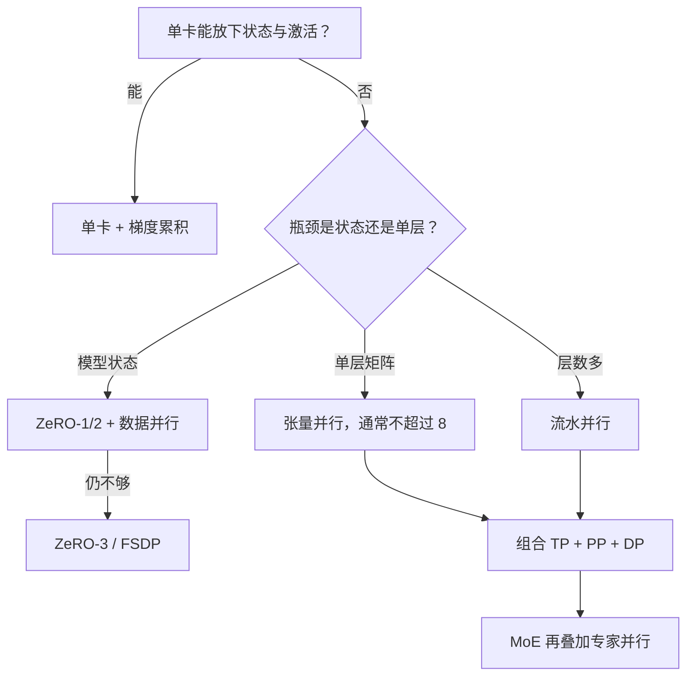

# 第 12 章 分布式训练

## 本章导读

一个 70B 参数的模型，用 BF16 权重、FP32 主权重和 Adam 的两份状态保存，仅模型状态就要 1.12 TB；单张 80 GB 显卡连一个优化器步都放不下。分布式训练不是把训练脚本复制到多张卡上：参数、梯度、优化器状态、激活与通信量都要重新记账。本章回答三个问题：切什么、通信多少、什么时候值得切。

## 难度标签

⭐⭐⭐ 进阶 ｜ 数学要求：矩阵分块、集合通信复杂度、浮点表示 ｜ 代码要求：熟悉 PyTorch 训练循环，了解 `torch.distributed` 的集合通信语义

## 学习目标

读完本章你将能够：

1. 写出混合精度训练的模型状态账本，并推导 ZeRO 各阶段的每卡显存。
2. 计算数据并行、张量并行、流水并行与专家并行的通信量，判断瓶颈在带宽还是延迟。
3. 区分梯度累积、数据并行与全局批大小的关系，正确缩放学习率。
4. 解释 FP16、BF16 与 FP8 的范围和精度差异，实现动态损失缩放并诊断溢出。
5. 在单机 CPU 上验证分片—聚合与大 batch 的数值等价性。

## 12.1 直觉：把一张卡装不下的训练拆开

把训练想成一家餐厅。数据并行（data parallelism，DP）是四位厨师各拿一份完整菜谱，分别接待不同的客人，最后把四份经验平均一下；张量并行（tensor parallelism，TP）是把一道菜拆成切配、烹炒、装盘几个工位，每个工位只做一部分；流水并行（pipeline parallelism，PP）是让不同工位同时处理不同的订单，形成装配线；序列并行（sequence parallelism，SP）是把一张很长的餐桌从中间分开，两人各负责一半；专家并行（expert parallelism，EP）则像专门做甜点、烧烤的档口，订单要送到对应的档口再送回来。

每一种切法都在用通信换显存或算力。数据并行最容易实现，但每步要做一次全模型梯度的全归约；张量并行把单个矩阵乘切开，前向反向都要在层内同步激活；流水并行不需要切矩阵，却会在填充和排空阶段产生气泡；专家并行的全对全通信量随路由的 Token 数增长。选择并行策略，本质上是在显存、带宽、延迟与实现复杂度之间做取舍，而不是寻找一个普遍最优的切法。

图 12-1 给出一个简化的决策顺序。先判断单卡能否放下模型状态与一个微批的激活；放得下就用梯度累积，完全不需要多卡通信。放不下时再看瓶颈是参数状态还是单层激活：前者优先用 ZeRO 或 FSDP 分片，后者才需要张量并行；层数很多、单层不大的模型可以用流水并行。真实系统通常是多种策略的组合：节点内张量并行，节点间流水与数据并行，MoE 模型再叠加专家并行。



先把开头的 70B 算完。每个参数 16 字节，模型状态约 $$70\times10^9\times16=1.12\times10^{12}$$ 字节，即 1.12 TB。如果只用 8 张 80 GB 卡做纯数据并行，每张卡仍要放完整状态，平均 140 GB，装不下；要降到 70 GB 以下，至少需要 16 张卡，而且还没算激活与通信缓冲。这说明数据并行只分摊数据，不分摊状态；要解决单卡装不下模型的问题，必须让参数、梯度或优化器状态在卡间分片，或者把层切开。理解这一点，后面的 ZeRO、张量并行与流水并行才有共同的语言。

本章先把每一维的账算清楚，再给出可以运行的代码。所有账本都区分三个量：每步搬运的字节数、这些字节能跑多快、以及延迟是否成为瓶颈。只看字节数会高估大环的性能，只看卡数会低估气泡与同步的开销。

把这三个量分开，能避免两种常见误判。第一，字节数大不等于慢：如果一步的计算足够长，通信可以完全被反向传播盖住，此时带宽只是门槛，不是瓶颈。第二，字节数小不等于快：层内同步每步都要发生，延迟固定且无法被下一层掩盖，卡数一多，等待时间会累积。判断标准应当是“这一步的实际耗时里有多少是纯等待”，而不是“这个方案搬了多少 GB”。下面的账本先算字节与时间，最后再把重叠与拓扑因素加回来。

## 12.2 数学原理

### 12.2.1 模型状态与激活的显存账本

设模型有 $$N$$ 个可训练参数。训练时每个参数通常对应五份数据：低精度权重、低精度梯度、FP32 主权重（master weights）、Adam 的一阶矩与二阶矩。用 $$c_w,c_g,c_m,c_o$$ 分别表示权重、梯度、主权重和单个矩的每参数字节数，模型状态（model states）的总字节数为

$$
M_{\mathrm{state}}=N\left(c_w+c_g+c_m+2c_o\right)\qquad \text{(12.1)}
$$

对 BF16 混合精度，$$c_w=c_g=2$$、$$c_m=4$$、$$c_o=4$$，每个参数合计 16 字节；纯 FP32 训练是 $$c_w=c_g=4$$、$$c_m=0$$、$$c_o=4$$，同样是 16 字节。两者总量相同，但分布不同：BF16 把更多字节放在 FP32 的主权重与优化器状态上，换来矩阵乘的低精度算力。FP8 把权重压到 1 字节、梯度通常仍是 BF16 的 2 字节，总字节数只从 16 降到 15。**混合精度的主要收益是算力与激活显存，不是模型状态的显存**；优化器状态才是大头，这也是 ZeRO 要分片的对象。

激活显存没有像参数量那样干净的闭式公式，它取决于实现、序列长度、批大小与是否重算。教学账本可以用

$$
M_{\mathrm{act}}\approx c_a\,\frac{n_l}{N_p}\,B_m\,\frac{T}{N_s}\,d_{model}\,c_{\mathrm{act}}\qquad \text{(12.2)}
$$

估算，其中 $$c_a$$ 是每个 Token 每层保留的激活张量数，典型实现落在 8 到 16 之间；$$N_p$$ 是流水段数，$$N_s$$ 是序列并行度，$$B_m$$ 是每卡微批大小，$$T$$ 是序列长度，$$c_{\mathrm{act}}$$ 是激活元素的字节数。这个系数没有普适常数，必须用自己的实现测一次。激活检查点（activation checkpointing）只保留每层的输入，反向时重算中间结果，显存大约按 $$\sqrt{n_l/N_p}$$ 缩小，代价是额外约三分之一的前向计算。

平方根缩放的来源值得拆开看。若每隔 $$\sqrt{n_l}$$ 层存一个检查点，长期存储只有 $$\sqrt{n_l}$$ 份，重算一个段时临时需要 $$\sqrt{n_l}$$ 份，两项都落在平方根量级；段太大则临时显存高，段太小则检查点多，最优就在平方根附近。选择性检查点（selective checkpointing）只重算注意力或前馈中的一项，牺牲更少的算力换走更大的激活。重算的代价可以量化：训练算力从 $$6ND$$ 升到约 $$8ND$$，即多三分之一；如果激活本来不是瓶颈，这笔算力就是白花。序列很长时激活随 $$T$$ 线性增长，先上检查点往往比先加卡更直接。

总显存是三者之和：

$$
M_{\mathrm{total}}=M_{\mathrm{state}}+M_{\mathrm{act}}+M_{\mathrm{temp}}\qquad \text{(12.3)}
$$

$$M_{\mathrm{temp}}$$ 包括通信缓冲、临时工作区与显存碎片，通常再留 10% 到 20%。下面的账本只算前两项，所以真实预算要按 80% 到 90% 的可用显存规划。

ZeRO（Zero Redundancy Optimizer）按分片对象分成四个阶段。设数据并行组大小为 $$N_d$$，则每卡的模型状态为

$$
M_{\mathrm{ZeRO}}=
\begin{cases}
N\left(c_w+c_g+c_m+2c_o\right), & \text{阶段 0}\\[4pt]
N\left(c_w+c_g\right)+\dfrac{N\left(c_m+2c_o\right)}{N_d}, & \text{阶段 1}\\[6pt]
Nc_w+\dfrac{N\left(c_g+c_m+2c_o\right)}{N_d}, & \text{阶段 2}\\[6pt]
\dfrac{N\left(c_w+c_g+c_m+2c_o\right)}{N_d}, & \text{阶段 3}
\end{cases}\qquad \text{(12.4)}
$$

阶段 1 只分片优化器状态与主权重，参数与梯度仍然每卡一份；阶段 2 再对梯度做归约散射，每卡只保留自己负责的那一段；阶段 3 连参数也分片，前向时需要临时收集。注意 $$N_d$$ 是数据并行组的大小，不是总卡数：张量与流水并行已经把参数切过一次，ZeRO 只在数据并行维上分片。公式里的 $$N$$ 也应当理解为当前 TP/PP 分片上的参数量；若模型同时用 8 路张量并行与 16 段流水，先把它除以 128，再代入。

四个阶段的通信代价并不相同。阶段 1 只改变优化器状态与主权重的存放位置，梯度仍然做一次完整的全归约，通信量与阶段 0 相同；阶段 2 把全归约换成归约散射，字节数相近，但每卡只保留梯度的一段，反向结束后的聚合方式要跟着改；阶段 3 在每层前向之前收集参数、反向之后释放，等于把一次梯度的通信摊到每一层，总字节数通常是阶段 1 的数倍。更准确地说，阶段 3 还要在反向中重新收集参数以计算梯度，通信模式从“每步一次大消息”变成“每层多次中等消息”，对延迟更敏感。分片不是免费的：它把显存压力换成了通信压力，阶段越高，越需要高速互联与重叠调度。

以 7B 模型、BF16 混合精度、8 卡数据并行为例，$$M_{\mathrm{state}}$$ 在阶段 0 到 3 分别是 112.0、38.5、26.2 与 14.0 GB。再加一个 $$B_m=1$$、$$T=4096$$、$$n_l=32$$、$$d_{model}=4096$$ 的微批激活，按 $$c_a=12$$ 估算约 12.9 GB，总计 124.9、51.4、39.1 与 26.9 GB。阶段 0 放不进 80 GB 卡，阶段 1 可以；阶段 3 省下的 12 GB 需要以每层收集参数为代价，是否值得取决于带宽。若把 $$T$$ 提到 32768，激活会变成约 103 GB，此时即使 ZeRO-3 也救不了，必须同时上序列并行、激活重算或更小的微批。账本的意义就在这里：先看哪一项在增长，再决定切什么。

### 12.2.2 数据并行：梯度平均与全归约

数据并行最简单：每张卡保留完整模型，处理不同的微批。设第 $$i$$ 张卡上的局部梯度为 $$\mathbf{g}_i$$，全局批的梯度是它们的平均。若每个局部损失都是该局部 Token 上的均值，且各卡 Token 数相同，则

$$
\mathbf{g}_{\mathrm{global}}=\frac{1}{N_d}\sum_{i=1}^{N_d}\mathbf{g}_i
$$

实现上通常先做全归约求和，再除以 $$N_d$$。如果各卡 Token 数不同，必须按 Token 数加权；把长度不一的序列打包（sequence packing）进定长样本时尤其容易出错：对每个微批的均值再取平均，不等于对全部 Token 取平均。正确做法是用真实 Token 数做权重，或者让每个微批的损失乘以该微批的 Token 数、最后统一除以全局 Token 数。这个细节在短序列与长序列混训时会造成系统性的梯度偏差。

环形全归约（ring all-reduce）分两步：先归约散射（reduce-scatter），每卡得到总和的一段；再全收集（all-gather），把各段拼回完整张量。设梯度张量有 $$S$$ 字节，每步每卡的收发量为

$$
V_{\mathrm{DP}}=2\,\frac{N_d-1}{N_d}\,S\qquad \text{(12.5)}
$$

推导只需看两步：归约散射阶段，每卡把张量切成 $$N_d$$ 段，沿环传递并在本地累加，每卡收发 $$(N_d-1)/N_d\cdot S$$；全收集阶段再把各段沿环传一圈，收发量相同。两阶段相加即得 (12.5)。当 $$N_d=64$$ 时，系数是 $$2\times63/64\approx1.97$$，已经接近 2；继续加卡不会让字节数显著增长，但会改变延迟与拓扑。

环形算法的延迟随卡数线性增长，因为消息要走完整个环；树形或递归倍增算法把延迟降到 $$O(\log N_d)$$，但每条消息的聚合路径更长，带宽利用率可能下降。NCCL 之类的库会按消息大小与拓扑自动选择环形或树形：小张量受延迟支配，大张量受带宽支配。训练实现还会把梯度分桶，反向算完一层就启动该层的全归约，让通信与下一层的反向计算重叠。账本里的 $$T_{\mathrm{comm}}$$ 是串行时间，重叠之后的实际增量通常更小；但重叠需要额外的缓冲，也会增加显存峰值。

通信时间与计算时间分别为

$$
T_{\mathrm{comm}}=\frac{V}{B_{\mathrm{bw}}},\qquad
T_{\mathrm{comp}}=\frac{6ND_{\mathrm{tok}}}{N_{\mathrm{gpu}}F_{\mathrm{eff}}}\qquad \text{(12.6)}
$$

其中 $$D_{\mathrm{tok}}$$ 是一步处理的全局 Token 数，$$F_{\mathrm{eff}}$$ 是每卡有效算力，$$6ND_{\mathrm{tok}}$$ 直接复用第 9 章式 (9.2) 的训练算力。以 7B、BF16、$$N_d=64$$、每步 4M Token 为例，梯度张量约 14 GB，每卡全归约 27.56 GB；按 50 GB/s 的跨节点带宽约 0.55 s。整步计算 $$6\times7\times10^9\times4\times10^6=1.68\times10^{17}$$ FLOPs，64 卡各 400 TFLOP/s 约 6.56 s，通信占 8.4%。这部分通信可以与反向传播重叠，实际开销往往更低，但它决定了数据并行能扩展到多大。

全局批大小由微批、梯度累积步数与数据并行度共同决定：

$$
B_{\mathrm{global}}=B_m\,A\,N_d\qquad \text{(12.7)}
$$

$$A$$ 是梯度累积步数。单卡用 $$A$$ 把一个大批拆成多个微批，不需要任何通信；多卡用 $$N_d$$ 分摊数据，每步做一次全归约；两者可以叠加。梯度累积不减少模型状态与优化器状态的显存，只减少激活显存，因为同一时刻只有一个微批的激活需要保留。它也不会改变每步的通信量，但会降低参数更新频率。

学习率要按全局批大小缩放，而不是按单卡微批。第 11 章的线性与平方根规则可以写成

$$
\eta=\eta_0\left(\frac{B_{\mathrm{global}}}{B_0}\right)^{\kappa},\qquad
\kappa=
\begin{cases}
1, & B_{\mathrm{global}}\ll B_{\mathrm{crit}}\\
0.5, & B_{\mathrm{global}}\gg B_{\mathrm{crit}}
\end{cases}\qquad \text{(12.8)}
$$

其中 $$B_{\mathrm{crit}}$$ 是第 9、11 章的关键批大小。若只是用梯度累积或数据并行保持全局批不变、单纯为了省显存，就不要改学习率；只有全局批真的变了，才按 (12.8) 调整。这也是“批大小翻倍、学习率翻倍”经常被误用的地方：翻倍的是全局批，不是单卡微批。

关键批大小的物理含义是“梯度噪声已经小到再加样本也换不来更多信息”。在关键批以下，梯度估计的方差随批大小下降，增大批大小可以用更大的学习率换更少的步数；超过它之后，方差的收益饱和，多出来的算力只换来同样的更新质量。经验上，关键批随模型规模增大而增大，也随训练后期而增大，所以把固定指数用到训练结束并不严谨：常见做法是前期用较大的批与线性缩放，后期退火时降低批或改用平方根。用 (12.8) 之前，先确认全局批确实变了、学习率也做过短程扫描；否则同时改批与学习率，失败时分不清是哪一项。

### 12.2.3 张量并行：把矩阵切开

张量并行切的是单个矩阵乘。设输入 $$\mathbf{X}\in\mathbb{R}^{T\times d}$$、权重 $$\mathbf{W}\in\mathbb{R}^{d\times d'}$$。列并行把 $$\mathbf{W}$$ 按输出维切成 $$N_t$$ 份，$$\mathbf{W}=[\mathbf{W}_1,\dots,\mathbf{W}_{N_t}]$$，每卡计算 $$\mathbf{Y}_i=\mathbf{X}\mathbf{W}_i$$，输出维度是 $$d'/N_t$$。前向不需要通信，因为每张卡都能独立算出自己那部分输出；反向对输入的梯度是 $$\nabla\mathbf{X}=\sum_i\nabla\mathbf{Y}_i\mathbf{W}_i^\top$$，需要在 $$N_t$$ 张卡之间求和。

行并行把 $$\mathbf{W}$$ 按输入维切分，输入也跟着切：$$\mathbf{X}=[\mathbf{X}_1,\dots,\mathbf{X}_{N_t}]$$，每卡计算 $$\mathbf{X}_i\mathbf{W}_i$$，输出再全归约求和。前向需要一次全归约，反向对输入的梯度不需要通信，因为每张卡只依赖自己的那一段输入。

Transformer 块正好由这两种切法拼成。QKV 投影按头做列并行，每个头在不同卡上独立计算注意力；输出投影按输入维做行并行，前向做一次全归约。前馈网络的第一层（SwiGLU 的门与值投影）列并行，第二层（下投影）行并行，再做一次全归约。因此每个块前向有两次全归约；反向时，两个列并行层的输入梯度各需要一次全归约，合计每个块四次。每卡每步的张量并行通信量为

$$
V_{\mathrm{TP}}=4\cdot 2\,\frac{N_t-1}{N_t}\,B_mT\,d_{model}\,c_{\mathrm{act}}\qquad \text{(12.9)}
$$

以 $$N_t=8$$、$$B_m=1$$、$$T=4096$$、$$d_{model}=4096$$、BF16 为例，单个激活张量约 33.6 MB，每次环形全归约 58.7 MB，每个块四次共 235 MB；32 层合计 7.5 GB 每步。这个数字比数据并行的 27.6 GB 小，但它发生在层内，必须等通信完成才能继续，且要求很高的带宽与很低的延迟。这就是张量并行通常限制在单个 NVLink 域内（常见为 8 卡）、很少跨节点的原因。跨节点做张量并行会把每次全归约变成跨交换机的往返，延迟足以吃掉并行收益。

张量并行还有一组整除约束：$$d_{model}$$ 必须被 $$N_t$$ 整除；头数 $$n_h$$ 必须被 $$N_t$$ 整除，才能把整头分到各卡；前馈中间维度 $$d_{ff}$$ 也必须被 $$N_t$$ 整除。GQA 模型若 $$N_t>n_{kv}$$，KV 头无法继续切分，只能复制，通信与显存收益会打折扣；MLA 则按潜维度切分，约束不同。矩阵切得太小还会让 GEMM 从计算密集变成延迟密集，所以张量并行度不是越大越好。

输出层还有一个常被忽略的切分点：词表。词表动辄十万以上，输出投影 $$\mathbf{W}_{\mathrm{out}}\in\mathbb{R}^{d_{model}\times V}$$ 的参数可能比一层前馈还大。词表并行把输出维按卡切开，每卡只算自己负责的词表片段；交叉熵需要全部 logits 的归一化因子，做法是先在各卡上算局部 log-sum-exp，再对每行做一次求最大值与求和的归约，最后广播回去。这次通信只涉及每个 Token 的两个标量，量级很小，却必须在反向之前完成。若不做词表并行，输出投影在张量并行下也会被切分；区别是前者按词表切、后者按隐藏维切，约束与通信点不同。

### 12.2.4 流水并行：用时间换显存

流水并行把 $$n_l$$ 层按顺序切成 $$N_p$$ 段，每段放在不同设备上。一个全局批被拆成 $$A$$ 个微批，微批依次流过各段。GPipe 式调度先填满流水线，再在稳态阶段让各段并行工作，最后排空。设每个微批在每段上的计算时间为 $$t_f$$，则理想情况下 $$A$$ 个微批需要 $$A\,N_p\,t_f$$ 的设备时间；实际流水线耗时是 $$(A+N_p-1)t_f$$ 每段，多出来的 $$(N_p-1)t_f$$ 就是气泡。气泡占比为

$$
\mathrm{Bub}=\frac{N_p-1}{A+N_p-1}\qquad \text{(12.10)}
$$

其中 $$A$$ 也是在途微批数。$$N_p=16$$、$$A=64$$ 时气泡 19.0%；把在途微批加到 256，气泡降到 5.5%。增加微批数能压低气泡，但会提高激活显存，因为同时有更多微批在流水线中。1F1B（one-forward-one-backward）调度让每段在稳态阶段交替做一次前向和一次反向，把在途微批数限制在约 $$N_p$$，显存比 GPipe 小，气泡比例与同步 GPipe 相同；交错式调度把每段再切成多个虚拟段，可以进一步降低气泡，代价是更多通信与更复杂的调度。

以 $$N_p=16$$ 为例，GPipe 要让所有在途微批同时保留激活，稳态激活显存与 $$A$$ 成正比；1F1B 在稳态只保留约 $$N_p$$ 个微批的激活，显存可接近减半，代价是每段要等到对应微批的反向才能释放缓冲。交错式调度把每段切成 $$v$$ 个虚拟段，气泡的量级约等于把 $$N_p$$ 换成 $$N_p/v$$ 后的结果，但段数变多会带来更多的边界发送与更细的调度开销，收益并非线性。负载不均衡同样会吃掉理论气泡：若某段比平均慢 20%，整条流水线就被这一段拖住，单纯增加微批并不能补救。工业实现通常先按实测的每层时间做划分，再决定虚拟段数。

流水并行的显存收益直接：每段只保存 $$n_l/N_p$$ 层的参数、梯度与优化器状态，模型状态近似除以 $$N_p$$。代价是层间激活的发送与接收，以及各段负载不易均衡。Transformer 的注意力层与前馈层耗时不同，MoE 层还与路由有关；按层数平均切分常常让某一段成为瓶颈。工业实现会按实测耗时分配层，或者把参数量与计算量一起考虑。

### 12.2.5 序列并行与专家并行

序列并行解决的是另一类显存：当序列很长时，激活与注意力的中间张量按 $$T$$ 增长，哪怕模型状态放得下，激活也会爆。Megatron 式序列并行把 LayerNorm、dropout 等逐 Token 运算沿序列维切分，在进入注意力或前馈之前用全收集把序列拼回来，出来之后用归约散射切回去。这样每卡的逐 Token 激活降到 $$1/N_s$$，代价是每层多几次集合通信。它与张量并行通常一起使用，因为两者都要求隐藏维或序列维可整除。

更激进的长上下文方案是上下文并行（context parallel）或环形注意力：把序列或 KV 块分到不同卡上，注意力计算时在卡间轮转 KV 块。通信量随序列长度线性增长，但避免了单卡保存完整 KV Cache。它的特点是通信字节与计算量同步增长：注意力本身按 $$T^2$$ 增长，轮转 KV 的字节按 $$T$$ 增长，所以序列越长，计算越占主导，通信反而相对变便宜。真正的难点是负载均衡与因果掩码带来的不规则：环形注意力要让各卡轮流处理不同 KV 块，才能让每卡的计算量相同。这部分会在第 13 章展开，本章只把它计入“序列维切分”这一类。

专家并行用于 MoE。每个专家只放在一张卡或一组卡上，Token 通过全对全（all-to-all）发送到对应专家，计算完再送回。设每卡本地 Token 数为 $$N_{\mathrm{tok}}$$、每 Token 选 $$k$$ 个专家、隐藏维为 $$d_{model}$$、元素字节数为 $$c$$，则每层 all-to-all 的字节数约为

$$
V_{\mathrm{EP}}=2\,N_{\mathrm{tok}}\,k\,d_{model}\,c\qquad \text{(12.11)}
$$

系数 2 表示发出与收回各一份。以每卡 4096 Token、$$k=2$$、$$d_{model}=4096$$、BF16 为例，每层约 134 MB，32 层约 4.3 GB 每步。这个量级与张量并行相当，而且 all-to-all 对网络拓扑更敏感；专家负载不均时，某些卡会等待最慢的专家，容量因子与无丢弃路由（dropless routing）的选择会直接影响吞吐。容量因子决定每个专家预留多少位置：增大容量减少 Token 丢弃，但增加显存与无效计算；启用无丢弃路由可以避免丢弃，代价是负载不均时整条流水线等待最慢的专家。因此账本上的平均字节数只是下界，长尾决定实际完成时间。第 7 章的容量、辅助损失与专家并行是同一组取舍的两个侧面。

### 12.2.6 混合精度：范围、精度与溢出

FP16 有 5 位指数、10 位尾数，最大约 65504，最小正规数约 $$6.1\times10^{-5}$$。梯度很容易落到这个范围以下，直接下溢成零。损失缩放（loss scaling）把损失乘以缩放系数 $$S_{\mathrm{ls}}$$ 再反向，梯度也相应放大；更新前再除回去。若某步出现非有限值，就跳过该步并把 $$S_{\mathrm{ls}}$$ 减半；连续若干步正常后再加倍：

$$
S_{\mathrm{ls}}\leftarrow
\begin{cases}
S_{\mathrm{ls}}/2, & \text{发现 inf 或 nan，跳过本步}\\
2S_{\mathrm{ls}}, & \text{连续 }G\text{ 步正常}
\end{cases}\qquad \text{(12.12)}
$$

配套还需要 FP32 主权重：参数更新在 FP32 中完成，再转回 FP16 供前向使用。没有主权重时，接近 1 的 FP16 参数的更新间隔约为 $$10^{-3}$$，学习率 $$10^{-4}$$ 的更新会被直接舍入掉，训练看起来“没有进展”。主权重的更新可以写成两步：先在 FP32 中 $$\mathbf{w}^{(t+1)}=\mathbf{w}^{(t)}-\eta\,\mathbf{u}^{(t)}$$，再把结果舍入到低精度供下一步前向使用；低精度梯度则先累加到主权重的更新量上。若低精度权重与主权重之间的舍入误差长期同向累积，模型会缓慢漂移，实践中用随机舍入或周期性从主权重重算低精度权重来抑制。

BF16 有 8 位指数、7 位尾数，指数范围与 FP32 相同，因此不需要损失缩放；但尾数只有 7 位，精度明显低于 FP16，主权重仍然推荐保留。BF16 是当前大模型预训练最常用的格式，原因不是它更精确，而是它不会因为范围不足而溢出，工程上更省心。

FP8 进一步压缩到 1 字节。E4M3 的最大值 448、尾数 3 位，E5M2 的最大值 57344、尾数 2 位。FP8 需要逐张量或逐块的缩放：先统计一个块的最大绝对值 $$a_{\max}$$，令缩放系数 $$S=a_{\max}/q_{\max}$$，量化与反量化为

$$
x_q=\mathrm{clamp}\left(\frac{x}{S},-q_{\max},q_{\max}\right),\qquad
\hat{x}=S\,x_q\qquad \text{(12.13)}
$$

矩阵乘的累加仍在高精度（FP32 或 BF16）中完成，否则误差会快速累积。延迟缩放（delayed scaling）用上一步的 $$a_{\max}$$ 估计当前步，避免每步同步读取最大值。它的实现要维护一个 amax 历史：每步记录当前张量的最大绝对值，用历史最大值或滑动平均估计下一步的缩放系数，既避免插入全局同步，又防止单步异常把 scale 推得过小。E4M3 适合前向的权重与激活，E5M2 指数位更多、动态范围更大，常用于梯度；两者混用需要分别维护缩放。FP8 的收益依赖内核：只有当矩阵乘、转置与通信都原生支持 FP8 时，省下的字节才会变成吞吐，否则会在格式转换处来回搬运，反而更慢。FP8 的收益主要是矩阵乘吞吐与激活带宽，模型状态只从 16 字节降到 15 字节；除非优化器状态也量化或分片，否则它不解决显存问题。这也是为什么 DeepSeek-V3 的 FP8 训练仍要配合专家并行、流水并行与 ZeRO 类分片。

混合精度的溢出与第 11 章的损失尖峰要分开诊断。溢出通常表现为某一步被跳过、损失短暂停顿或出现一个孤立尖峰，随后 scale 减半恢复；数据异常则往往伴随梯度范数持续偏高、注意力熵下降。排查时先看 `inf` 计数、跳过的步数与 scale 历史，再看数据批次。把溢出当成数据污染去清洗语料，或者把数据异常当成数值问题去调 scale，都会浪费时间。

## 12.3 方案对比

表 12-1 从切分对象、通信模式、通信量与适用条件比较五种并行维度。

| 维度 | 切分对象 | 通信模式 | 每步通信量 | 主要约束与代价 |
| --- | --- | --- | --- | --- |
| 数据并行 DP | 数据（每卡完整模型） | 梯度全归约 | 约 $$2N c_g$$，与卡数弱相关 | 模型状态每卡一份；受带宽与全局批限制 |
| 张量并行 TP | 单层矩阵、头、前馈宽度 | 层内全归约 | 每块四次，约 $$8B_mTd_{model}c/N_t$$ | 需整除；跨节点延迟高；通常不超过 8 |
| 流水并行 PP | 层 | 边界激活发送/接收 | 约 $$A(N_p-1)B_mTd_{model}c$$ | 气泡 $$(N_p-1)/(A+N_p-1)$$；负载均衡难 |
| 序列并行 SP | 序列维的逐 Token 激活 | 全收集 + 归约散射 | 与 TP 同量级 | 需与 TP 配合；注意力仍需全局信息 |
| 专家并行 EP | 专家 | 全对全 | 约 $$2N_{\mathrm{tok}}kd_{model}c$$ | 负载不均；路由与容量影响吞吐 |

表 12-2 比较 ZeRO 各阶段的显存与通信代价。数字以 7B、BF16、8 卡数据并行为例。

| 阶段 | 分片对象 | 每卡状态（GB） | 额外通信 | 适用场景 |
| --- | --- | --- | --- | --- |
| 0 | 无 | 112.0 | 仅梯度全归约 | 能放下，追求简单 |
| 1 | 优化器状态、主权重 | 38.5 | 与阶段 0 相同 | 大多数预训练的首选 |
| 2 | 再加梯度 | 26.2 | 梯度归约散射 | 显存紧张但仍需完整参数 |
| 3 / FSDP | 再加参数 | 14.0 | 每层收集参数 | 单卡放不下参数；通信最重 |

表 12-3 比较训练常用的数值格式。

| 格式 | 每参数状态字节 | 最大 | 最小正规数 | 尾数位 | 损失缩放 | 典型用途 |
| --- | --- | --- | --- | --- | --- | --- |
| FP32 | 16 | $$3.4\times10^{38}$$ | $$1.2\times10^{-38}$$ | 23 | 不需要 | 小模型、数值敏感层 |
| FP16 | 16 | 65504 | $$6.1\times10^{-5}$$ | 10 | 需要 | 有 Tensor Core 的旧卡 |
| BF16 | 16 | $$3.4\times10^{38}$$ | $$1.2\times10^{-38}$$ | 7 | 不需要 | LLM 预训练默认 |
| FP8 E4M3 | 15 | 448 | $$1.56\times10^{-2}$$ | 3 | 逐块缩放 | 矩阵乘加速，需高精度累加 |

读表时不要只看“省了多少字节”。ZeRO-3 的 14 GB 很诱人，但每层前向都要收集参数，通信量比阶段 1 高得多；FP8 的 15 字节几乎不省状态，却能把矩阵乘吞吐翻倍。真正的选择标准是当前瓶颈：如果一步的计算时间远大于通信时间，省显存就可能值得增加通信；如果已经被通信卡住，再分片只会更慢。

组合策略也有优先级：把通信最频繁的操作放在带宽最高的链路上。张量并行的全归约发生在每层内，所以限制在 NVLink 域；流水并行只在段边界传激活，可以跨节点；数据并行的梯度全归约每步一次，放在节点间也容易被反向重叠。这个“由内到外”的层次与表 12-1 的通信频率一致，也是 405B 稠密模型与 DeepSeek-V3 都采用 TP/EP 在内、PP/DP 在外的原因。反过来，如果为了凑卡数把 TP 拉到跨节点，每层都要付跨交换机延迟，账本上的字节数再漂亮也没用。

## 12.4 代码实现：TinyLM 的分布式账本与等价性

### 12.4.1 实现选择

本章新增 `tinylm/train/parallel.py`，包含四类工具：显存与通信账本、CPU 上的集合通信模拟、张量并行的列/行原语，以及动态损失缩放。账本函数全部解析计算，不为大模型实例化参数；集合通信用“每个 rank 一个张量”的列表表示，语义与 NCCL 的 sum、reduce-scatter、all-gather 一致，但只用于验证正确性，不测量真实带宽。`TinyLM.forward`、`CausalLMOutput` 与 `ModelConfig` 均未改动；并行度与批大小属于训练脚本参数，不进入模型结构。

实验复用第 10 章的语料与第 11 章的优化器，模型仍是 2 层、`d_model=32`、4 头 GQA-2 的小模型。四个对照是：整批 16、梯度累积 4 次、4 卡数据并行、以及 4 卡 ZeRO-1 分片。四者使用同一份初始权重、同一组数据批次与同一优化器超参数；整批训练是基准，其余三种应当给出相同的参数与损失，差异只来自浮点求和顺序。测试里另有一项“分片 AdamW 与稠密 AdamW”的逐元素等价性检查，直接验证优化器状态分片不会改变更新。

实现上有三个容易出错的细节。第一，梯度平均必须在全局 Token 数上归一化；每个微批的损失先除以累积步数，才能在累加后等于全局均值。第二，ZeRO 分片更新后要立刻聚合回完整参数，否则下一步前向会用到过期的主副本；真实系统用 all-gather 或广播完成这一步。第三，损失缩放的溢出检查必须在反缩放之后、优化器更新之前；发现非有限值时跳过更新，且不要推进 Adam 的步数，否则偏差修正会用错步数。

### 12.4.2 完整代码

`tinylm/train/parallel.py`：

```python
"""第 12 章：分布式训练的显存、通信与混合精度工具（tinylm/train/parallel.py）。"""
import math
from dataclasses import dataclass

import torch


# 每种精度下每参数占用的字节数：权重、梯度、FP32 主权重、单个 Adam 矩
# FP32 训练没有额外的主权重副本，master=0
PRECISION_BYTES = {
    "fp32": {"weight": 4, "grad": 4, "master": 0, "moment": 4, "act": 4},
    "tf32": {"weight": 4, "grad": 4, "master": 0, "moment": 4, "act": 4},
    "fp16": {"weight": 2, "grad": 2, "master": 4, "moment": 4, "act": 2},
    "bf16": {"weight": 2, "grad": 2, "master": 4, "moment": 4, "act": 2},
    "fp8": {"weight": 1, "grad": 2, "master": 4, "moment": 4, "act": 1},
}


@dataclass(frozen=True)
class ParallelConfig:
    """并行度与账本所需的形状参数；不改变 TinyLM 的结构。"""

    dp: int = 1              # 数据并行组大小，也是 ZeRO 分片组大小
    tp: int = 1              # 张量并行度
    pp: int = 1              # 流水并行段数
    sp: int = 1              # 序列并行度，1 表示关闭；只允许 1 或 tp
    zero_stage: int = 0      # 0/1/2/3
    micro_batch: int = 1     # 每卡的微批大小
    grad_accum: int = 1      # 梯度累积的微步数，也是流水线中的在途微批数
    seq_len: int = 1024
    d_model: int = 512
    n_layers: int = 8

    def __post_init__(self):
        for name in ("dp", "tp", "pp", "sp", "micro_batch", "grad_accum",
                     "seq_len", "d_model", "n_layers"):
            if getattr(self, name) < 1:
                raise ValueError(f"{name} 必须为正整数")
        if self.zero_stage not in (0, 1, 2, 3):
            raise ValueError("zero_stage 必须是 0、1、2 或 3")
        if self.sp not in (1, self.tp):
            raise ValueError("序列并行度必须为 1 或等于张量并行度")
        if self.d_model % self.tp != 0:
            raise ValueError("d_model 必须被张量并行度整除")
        if self.n_layers % self.pp != 0:
            raise ValueError("n_layers 必须被流水并行段数整除")

    @property
    def world_size(self):
        return self.dp * self.tp * self.pp

    @property
    def global_batch(self):
        """公式 (12.7)：全局批大小。"""
        return self.micro_batch * self.grad_accum * self.dp

    @property
    def tokens_per_step(self):
        return self.global_batch * self.seq_len


def param_state_bytes(precision="bf16"):
    """公式 (12.1)：每参数的权重、梯度、主权重和两份优化器状态之和。"""
    if precision not in PRECISION_BYTES:
        raise ValueError(f"未知精度 {precision}")
    b = PRECISION_BYTES[precision]
    return b["weight"] + b["grad"] + b["master"] + 2 * b["moment"]


def zero_state_bytes(P, dp, stage, precision="bf16"):
    """公式 (12.4)：ZeRO 各阶段每卡的模型状态字节数。"""
    if P <= 0 or dp < 1:
        raise ValueError("P 必须为正，dp 必须不小于 1")
    b = PRECISION_BYTES[precision]
    full = param_state_bytes(precision)
    if stage == 0:
        per_param = full
    elif stage == 1:                          # 只分片优化器状态与主权重
        per_param = b["weight"] + b["grad"] + (b["master"] + 2 * b["moment"]) / dp
    elif stage == 2:                          # 再分片梯度
        per_param = b["weight"] + (b["grad"] + b["master"] + 2 * b["moment"]) / dp
    elif stage == 3:                          # 再分片参数
        per_param = full / dp
    else:
        raise ValueError("stage 必须是 0、1、2 或 3")
    return P * per_param


def memory_ledger(P, cfg: ParallelConfig, precision="bf16",
                  activation_coef=12.0, recompute=False):
    """公式 (12.1)–(12.3)：模型状态、激活与合计的显存账本（字节）。"""
    b = PRECISION_BYTES[precision]
    state = zero_state_bytes(P, cfg.dp, cfg.zero_stage, precision)
    layers = cfg.n_layers / cfg.pp
    seq = cfg.seq_len / cfg.sp
    act = (activation_coef * layers * cfg.micro_batch * seq
           * cfg.d_model * b["act"])
    if recompute:
        act /= math.sqrt(layers)              # 激活重算：显存降，算力升
    return {
        "state": state,
        "activation": act,
        "total": state + act,
        "per_param_state": state / P,
    }


def ring_all_reduce_bytes(size_bytes, world):
    """环形 all-reduce 每卡收发量：2(N-1)/N 倍张量大小。"""
    if world < 1:
        raise ValueError("world 必须为正")
    return 2 * (world - 1) / world * size_bytes


def dp_grad_bytes(P, cfg: ParallelConfig, precision="bf16"):
    """公式 (12.5)：一步数据并行梯度 all-reduce 的每卡字节数。"""
    grad = P * PRECISION_BYTES[precision]["grad"]
    return ring_all_reduce_bytes(grad, cfg.dp)


def tp_block_bytes(cfg: ParallelConfig, precision="bf16", collectives=4):
    """公式 (12.9)：每个 Transformer 块在张量并行下的通信字节数。

    前向两个 row-parallel 输出各一次 all-reduce；反向两个 column-parallel
    的输入梯度各一次 all-reduce。每次 all-reduce 的量按环形算法计。
    """
    act = (cfg.micro_batch * cfg.seq_len * cfg.d_model
           * PRECISION_BYTES[precision]["act"])
    return collectives * ring_all_reduce_bytes(act, cfg.tp)


def pp_bubble_fraction(pp, micro_batches):
    """公式 (12.10)：GPipe/1F1B 同步流水线的气泡占比。"""
    if pp < 1 or micro_batches < 1:
        raise ValueError("pp 与 micro_batches 必须为正")
    return (pp - 1) / (micro_batches + pp - 1)


def ep_all_to_all_bytes(n_tokens, top_k, d_model, ep, element_bytes=2):
    """公式 (12.11)：每层专家并行的 all-to-all 字节数（发出与收回各一份）。"""
    if min(n_tokens, top_k, d_model, ep) < 1:
        raise ValueError("参数必须为正")
    return 2 * n_tokens * top_k * d_model * element_bytes


def global_batch_size(micro_batch, grad_accum, dp):
    """公式 (12.7) 的函数形式。"""
    if min(micro_batch, grad_accum, dp) < 1:
        raise ValueError("参数必须为正")
    return micro_batch * grad_accum * dp


def scale_lr(base_lr, global_batch, base_batch, kappa=1.0):
    """公式 (12.8)：按全局批大小缩放学习率，kappa=1 线性，0.5 平方根。"""
    if base_lr <= 0 or base_batch <= 0 or global_batch <= 0:
        raise ValueError("学习率与批大小必须为正")
    if not 0.0 <= kappa <= 1.0:
        raise ValueError("kappa 必须在 [0, 1] 内")
    return base_lr * (global_batch / base_batch) ** kappa


# ---------------------------------------------------------------- 集合通信模拟
def all_reduce_sum(parts):
    """模拟 all-reduce(sum)：输入每个 rank 一份张量，输出每个 rank 的相同和。"""
    if not parts:
        raise ValueError("至少需要一个 rank 的张量")
    if len({tuple(p.shape) for p in parts}) != 1:
        raise ValueError("各 rank 的张量形状必须一致")
    total = torch.stack(parts).sum(dim=0)
    return [total.clone() for _ in parts]


def reduce_scatter_sum(tensors):
    """模拟 reduce-scatter(sum)：rank r 只保留总和中的第 r 段。"""
    if not tensors:
        raise ValueError("至少需要一个 rank 的张量")
    shape = tensors[0].shape
    if any(t.shape != shape for t in tensors):
        raise ValueError("各 rank 的张量形状必须一致")
    world = len(tensors)
    n = tensors[0].numel()
    pad = (-n) % world
    flats = [torch.cat([t.reshape(-1), t.new_zeros(pad)]) for t in tensors]
    total = torch.stack(flats).sum(dim=0)
    chunks = total.chunk(world)
    return [chunks[r].clone() for r in range(world)]


def all_gather_shards(shards):
    """模拟 all-gather：每个 rank 收集全部 shard 并拼接。"""
    if not shards:
        raise ValueError("至少需要一个 shard")
    full = torch.cat([s.reshape(-1) for s in shards])
    return [full.clone() for _ in shards]


def shard_flat(tensor, world, rank):
    """把张量按扁平化后等分为 world 份，返回第 rank 份。"""
    if world < 1 or not 0 <= rank < world:
        raise ValueError("world 与 rank 不合法")
    flat = tensor.reshape(-1)
    if flat.numel() % world != 0:
        raise ValueError("元素数必须能被 world 整除")
    return flat.chunk(world)[rank].clone()


def merge_shards(parts):
    """把参数分片拼回一个扁平张量。"""
    return torch.cat([p.detach().reshape(-1) for p in parts])


def shard_reduce_gather(tensors):
    """reduce-scatter 后 all-gather：在所有 rank 上重建求和结果。"""
    shards = reduce_scatter_sum(tensors)
    full = all_gather_shards(shards)[0]
    n = tensors[0].numel()
    return [full[:n].reshape(tensors[0].shape).clone() for _ in tensors]


# ---------------------------------------------------------------- 张量并行原语
def column_parallel_linear(x, weight, world):
    """列并行：输出维度切分，前向不需要通信。"""
    if weight.ndim != 2 or weight.shape[1] % world != 0:
        raise ValueError("weight 的输出维度必须能被 world 整除")
    return [x @ w for w in weight.chunk(world, dim=1)]


def row_parallel_linear(x_parts, weight):
    """行并行：输入维度切分，前向用一次 all-reduce 求和。"""
    world = len(x_parts)
    if weight.shape[0] % world != 0:
        raise ValueError("weight 的输入维度必须能被 world 整除")
    partial = [x @ w for x, w in zip(x_parts, weight.chunk(world, dim=0))]
    return all_reduce_sum(partial)[0]


class LossScaler:
    """公式 (12.12)：FP16 动态损失缩放。"""

    def __init__(self, init_scale=2.0 ** 16, backoff=0.5, growth=2.0,
                 growth_interval=2000):
        if init_scale <= 0 or not 0 < backoff < 1 or growth <= 1:
            raise ValueError("缩放参数不合法")
        if growth_interval < 1:
            raise ValueError("growth_interval 必须为正")
        self.scale = float(init_scale)
        self.backoff = float(backoff)
        self.growth = float(growth)
        self.growth_interval = int(growth_interval)
        self.good_steps = 0
        self.skipped_steps = 0

    def scale_loss(self, loss):
        return loss * self.scale

    def unscale_(self, params):
        """把梯度除回真实尺度；返回梯度是否全部有限。"""
        inv = 1.0 / self.scale
        finite = True
        for p in params:
            if p.grad is None:
                continue
            p.grad.mul_(inv)
            finite = finite and bool(torch.isfinite(p.grad).all())
        return finite

    def update(self, finite):
        """溢出时减半并跳过；连续若干次正常后加倍。返回是否执行更新。"""
        if not finite:
            self.scale *= self.backoff
            self.good_steps = 0
            self.skipped_steps += 1
            return False
        self.good_steps += 1
        if self.good_steps >= self.growth_interval:
            self.scale *= self.growth
            self.good_steps = 0
        return True
```

`tests/test_parallel.py`：

```python
"""第 12 章自测：显存账本、通信量、分片集合通信、张量并行与损失缩放。"""
import math

import pytest
import torch

from tinylm.train import optim as O
from tinylm.train import parallel as P


def cfg(**kw):
    base = dict(dp=8, tp=2, pp=1, sp=1, zero_stage=0, micro_batch=1,
                grad_accum=1, seq_len=1024, d_model=64, n_layers=8)
    base.update(kw)
    return P.ParallelConfig(**base)


def test_param_state_bytes():
    assert P.param_state_bytes("fp32") == 16
    assert P.param_state_bytes("fp16") == 16
    assert P.param_state_bytes("bf16") == 16
    # FP8 只压缩权重与激活；主权重与优化器状态仍是 FP32
    assert P.param_state_bytes("fp8") == 15


def test_zero_stage_memory_7b():
    model = 7e9
    gb = 1e9
    assert P.zero_state_bytes(model, 8, 0, "bf16") / gb == pytest.approx(112.0)
    assert P.zero_state_bytes(model, 8, 1, "bf16") / gb == pytest.approx(38.5)
    assert P.zero_state_bytes(model, 8, 2, "bf16") / gb == pytest.approx(26.25)
    assert P.zero_state_bytes(model, 8, 3, "bf16") / gb == pytest.approx(14.0)


def test_zero_memory_is_monotone():
    model = 1e9
    values = [P.zero_state_bytes(model, 16, s, "bf16") for s in range(4)]
    assert all(a >= b for a, b in zip(values, values[1:]))


def test_memory_ledger_activation_and_recompute():
    c = cfg(tp=1, sp=1, pp=2, micro_batch=2, seq_len=128, d_model=64, n_layers=8)
    plain = P.memory_ledger(1e6, c, "bf16", activation_coef=12.0)
    recompute = P.memory_ledger(1e6, c, "bf16", activation_coef=12.0,
                                recompute=True)
    assert plain["total"] == pytest.approx(plain["state"] + plain["activation"])
    assert recompute["activation"] < plain["activation"]
    # 每卡层数 4、序列 128、微批 2、宽度 64、系数 12、每元素 2 字节
    expected = 12.0 * 4 * 2 * 128 * 64 * 2
    assert plain["activation"] == pytest.approx(expected)


def test_ring_all_reduce_volume():
    assert P.ring_all_reduce_bytes(100, 1) == 0
    assert P.ring_all_reduce_bytes(100, 4) == pytest.approx(150.0)
    assert P.ring_all_reduce_bytes(100, 64) == pytest.approx(196.875)


def test_dp_and_tp_bytes():
    c = cfg(dp=4, tp=2, micro_batch=1, seq_len=8, d_model=4)
    # 1000 个参数、BF16 梯度 2 字节、4 卡：2*(3/4)*2000
    assert P.dp_grad_bytes(1000, c, "bf16") == pytest.approx(3000.0)
    # 激活 1*8*4*2=64 字节；每次 all-reduce 2*(1/2)*64=64；每块 4 次
    assert P.tp_block_bytes(c, "bf16") == pytest.approx(256.0)


def test_pipeline_bubble():
    assert P.pp_bubble_fraction(1, 8) == 0
    assert P.pp_bubble_fraction(4, 8) == pytest.approx(3 / 11)
    assert P.pp_bubble_fraction(4, 32) < 0.5 * P.pp_bubble_fraction(4, 8)
    with pytest.raises(ValueError):
        P.pp_bubble_fraction(0, 8)


def test_global_batch_and_lr_scaling():
    assert P.global_batch_size(4, 2, 8) == 64
    assert P.scale_lr(3e-4, 64, 8, 1.0) == pytest.approx(2.4e-3)
    assert P.scale_lr(3e-4, 64, 8, 0.5) == pytest.approx(3e-4 * math.sqrt(8))
    with pytest.raises(ValueError):
        P.scale_lr(3e-4, 64, 8, 1.5)


def test_all_reduce_and_shard_roundtrip():
    torch.manual_seed(0)
    parts = [torch.randn(2, 3) for _ in range(4)]
    reduced = P.all_reduce_sum(parts)
    expected = torch.stack(parts).sum(dim=0)
    assert all(torch.allclose(r, expected) for r in reduced)
    gathered = P.shard_reduce_gather(parts)
    assert all(torch.allclose(g, expected) for g in gathered)
    # 元素数不能被卡数整除时，padding 不能污染结果
    odd = [torch.arange(5.0) + i for i in range(3)]
    out = P.shard_reduce_gather(odd)
    assert torch.allclose(out[0], torch.stack(odd).sum(dim=0))


def test_column_and_row_parallel_equal_dense():
    torch.manual_seed(1)
    x = torch.randn(2, 3)
    w = torch.randn(3, 6)
    world = 3
    col = P.column_parallel_linear(x, w, world)
    assert torch.allclose(torch.cat(col, dim=1), x @ w, atol=1e-6)
    row = P.row_parallel_linear(list(x.chunk(world, dim=1)), w)
    assert torch.allclose(row, x @ w, atol=1e-6)


def test_tensor_parallel_mlp_equal_dense():
    torch.manual_seed(2)
    x = torch.randn(2, 4)
    w1 = torch.randn(4, 8)
    w2 = torch.randn(8, 4)
    world = 2
    hidden = [torch.relu(h) for h in P.column_parallel_linear(x, w1, world)]
    out = P.row_parallel_linear(hidden, w2)
    assert torch.allclose(out, torch.relu(x @ w1) @ w2, atol=1e-6)


def test_loss_scaler_overflow_and_growth():
    s = P.LossScaler(init_scale=8.0, growth_interval=2)
    assert s.update(True) is True and s.scale == 8.0
    assert s.update(True) is True and s.scale == 16.0
    assert s.update(False) is False and s.scale == 8.0
    assert s.good_steps == 0 and s.skipped_steps == 1


def test_loss_scaler_unscale_detects_inf():
    s = P.LossScaler(init_scale=4.0)
    p = torch.nn.Parameter(torch.zeros(2))
    p.grad = torch.tensor([8.0, -4.0])
    assert s.unscale_([p]) is True
    assert torch.allclose(p.grad, torch.tensor([2.0, -1.0]))
    p.grad = torch.tensor([float("inf"), 1.0])
    assert s.unscale_([p]) is False


def test_shard_flat_roundtrip():
    t = torch.arange(8.0)
    parts = [P.shard_flat(t, 4, r) for r in range(4)]
    assert torch.equal(torch.cat(parts), t)
    with pytest.raises(ValueError):
        P.shard_flat(torch.arange(7.0), 4, 0)


def test_sharded_adamw_equals_dense():
    torch.manual_seed(3)
    full = torch.randn(16)
    grad = torch.randn(16)
    dense = torch.nn.Parameter(full.clone())
    dense.grad = grad.clone()
    O.AdamW([dense], lr=0.05, betas=(0.9, 0.95), eps=1e-8,
            weight_decay=0.01).step()

    world = 4
    shards = [torch.nn.Parameter(x.clone()) for x in full.chunk(world)]
    for shard, g in zip(shards, grad.chunk(world)):
        shard.grad = g.clone()
        O.AdamW([shard], lr=0.05, betas=(0.9, 0.95), eps=1e-8,
                weight_decay=0.01).step()
    merged = P.merge_shards(shards)
    assert torch.allclose(merged, dense.detach(), atol=1e-6)


def test_invalid_configs():
    with pytest.raises(ValueError):
        cfg(zero_stage=4)
    with pytest.raises(ValueError):
        cfg(tp=4, sp=2)
    with pytest.raises(ValueError):
        cfg(d_model=30, tp=4)
    with pytest.raises(ValueError):
        cfg(n_layers=7, pp=2)
    with pytest.raises(ValueError):
        P.all_reduce_sum([torch.zeros(2), torch.zeros(3)])
```

`examples/ch12_parallel.py`：

```python
"""第 12 章：分布式训练的显存、通信与等价性实验（examples/ch12_parallel.py）。"""
import copy
import math
import time

import torch
import torch.nn as nn

import ch10
import ch11
from ch08 import ModelConfig, TinyLM
from tinylm.train import optim as O
from tinylm.train import parallel as P


def make_model(vocab_size, seed):
    cfg = ModelConfig(vocab_size=vocab_size, d_model=32, n_layers=2, n_heads=4,
                      d_ff=64, max_seq_len=64, norm="rmsnorm", ffn="swiglu",
                      bias=False, pos_encoding="rope", attention="gqa",
                      n_kv_heads=2)
    torch.manual_seed(seed)
    return TinyLM(cfg)


def flat_params(model):
    return torch.cat([p.detach().reshape(-1) for p in model.parameters()])


def flat_grad(model):
    return torch.cat([p.grad.reshape(-1) for p in model.parameters()])


def assign_flat(model, flat):
    offset = 0
    with torch.no_grad():
        for p in model.parameters():
            n = p.numel()
            p.copy_(flat[offset:offset + n].reshape(p.shape))
            offset += n


def make_batches(stream, steps, batch, seq, seed):
    gen = torch.Generator().manual_seed(seed)
    batches = []
    for _ in range(steps):
        starts = torch.randint(0, len(stream) - seq - 1, (batch,), generator=gen)
        x = torch.stack([stream[s:s + seq] for s in starts])
        y = torch.stack([stream[s + 1:s + seq + 1] for s in starts])
        batches.append((x, y))
    return batches


def optimizer(params, lr):
    if isinstance(params, nn.Module):
        params = list(params.parameters())
    elif isinstance(params, torch.Tensor):
        params = [params]
    groups = [{"params": list(params), "weight_decay": 0.01}]
    return O.AdamW(groups, lr=lr, betas=(0.9, 0.95))


def train_full(model, opt, batches):
    losses = []
    for x, y in batches:
        opt.zero_grad()
        out = model(x, labels=y)
        out.loss.backward()
        opt.step()
        losses.append(out.loss.item())
    return losses


def train_accum(model, opt, batches, accum):
    losses = []
    for x, y in batches:
        opt.zero_grad()
        xs, ys = x.chunk(accum), y.chunk(accum)
        step_loss = 0.0
        for xb, yb in zip(xs, ys):
            out = model(xb, labels=yb)
            (out.loss / accum).backward()          # 按 (12.7) 的全局批归一化
            step_loss += out.loss.item() / accum
        opt.step()
        losses.append(step_loss)
    return losses


def average_grads(replicas):
    grads = [flat_grad(m) for m in replicas]
    avg = torch.stack(grads).mean(dim=0)
    offset = 0
    for m in replicas:
        for p in m.parameters():
            n = p.numel()
            p.grad.copy_(avg[offset:offset + n].reshape(p.shape))
            offset += n
        offset = 0


def train_dp(replicas, opts, batches):
    losses = []
    for x, y in batches:
        for m in replicas:
            m.zero_grad(set_to_none=True)
        step_losses = []
        for m, xb, yb in zip(replicas, x.chunk(len(replicas)),
                            y.chunk(len(replicas))):
            out = m(xb, labels=yb)
            out.loss.backward()
            step_losses.append(out.loss.item())
        average_grads(replicas)                     # (12.5) all-reduce 后平均
        for opt in opts:
            opt.step()
        losses.append(sum(step_losses) / len(step_losses))
    return losses


def make_zero_shards(model, dp, lr):
    flat = flat_params(model).clone()
    n = flat.numel()
    pad = (-n) % dp
    padded = torch.cat([flat, flat.new_zeros(pad)])
    shards = [nn.Parameter(c.clone()) for c in padded.chunk(dp)]
    opts = [optimizer(s, lr) for s in shards]
    return shards, opts, n, pad


def train_zero1(replicas, opts, shards, shard_opts, n, pad, batches):
    losses = []
    dp = len(replicas)
    for x, y in batches:
        for m in replicas:
            m.zero_grad(set_to_none=True)
        step_losses = []
        for m, xb, yb in zip(replicas, x.chunk(dp), y.chunk(dp)):
            out = m(xb, labels=yb)
            out.loss.backward()
            step_losses.append(out.loss.item())
        average_grads(replicas)
        grad = flat_grad(replicas[0])
        grad_pad = torch.cat([grad, grad.new_zeros(pad)])
        for shard, opt, g in zip(shards, shard_opts, grad_pad.chunk(dp)):
            shard.grad = g.clone()
            opt.step()
        full = P.all_gather_shards(shards)[0][:n]   # 分片更新后聚合
        for m in replicas:
            assign_flat(m, full)
        losses.append(sum(step_losses) / len(step_losses))
    return losses


def run_seed(docs, val_texts, vocab, seed, steps=50, lr=2e-3):
    stream = ch10.encode_stream(docs, vocab)
    batches = make_batches(stream, steps, 16, 32, seed)
    base = make_model(len(vocab), seed)
    results = {}

    dense = copy.deepcopy(base)
    dense_losses = train_full(dense, optimizer(dense, lr), batches)
    results["整批 B=16"] = (dense, dense_losses)

    accum = copy.deepcopy(base)
    accum_losses = train_accum(accum, optimizer(accum, lr), batches, 4)
    results["梯度累积 A=4"] = (accum, accum_losses)

    replicas = [copy.deepcopy(base) for _ in range(4)]
    opts = [optimizer(m, lr) for m in replicas]
    dp_losses = train_dp(replicas, opts, batches)
    results["数据并行 DP=4"] = (replicas[0], dp_losses)

    replicas = [copy.deepcopy(base) for _ in range(4)]
    opts = [optimizer(m, lr) for m in replicas]
    shards, shard_opts, n, pad = make_zero_shards(replicas[0], 4, lr)
    zero_losses = train_zero1(replicas, opts, shards, shard_opts, n, pad,
                              batches)
    results["ZeRO-1 分片"] = (replicas[0], zero_losses)
    shard_ratio = ((n + pad) / 4) / n

    dense_flat = flat_params(dense)
    finals = []
    for name, (model, losses) in results.items():
        diff = (flat_params(model) - dense_flat).abs().max().item()
        val = ch10.evaluate(model, val_texts, vocab)
        finals.append((name, losses[-5:], val, diff))
    return finals, shard_ratio


def equivalence_table(docs, val_texts, vocab, seeds=(0, 1, 2)):
    rows = {}
    ratios = []
    for seed in seeds:
        finals, ratio = run_seed(docs, val_texts, vocab, seed)
        ratios.append(ratio)
        for name, last, val, diff in finals:
            rows.setdefault(name, []).append((val, diff, last))
    print("\n等价性（50 步，3 个种子，与整批训练的偏差）")
    print(f"{'模式':<16s}{'验证损失':>16s}{'最大参数偏差':>18s}")
    for name, vals in rows.items():
        v = torch.tensor([x[0] for x in vals])
        d = max(x[1] for x in vals)
        print(f"{name:<16s}{v.mean().item():.4f} ± {v.std().item():.4f}"
              f"{d:>16.2e}")
    print(f"每卡优化器状态占参数比例：{min(ratios):.3f}（4 卡分片，含 padding）")


def memory_table():
    print("\n7B 模型显存账本（BF16 权重与梯度、FP32 主权重与 Adam 状态，8 卡）")
    print(f"{'ZeRO':<8s}{'状态 GB':>12s}{'激活 GB':>12s}{'合计 GB':>12s}")
    for stage in range(4):
        cfg = P.ParallelConfig(dp=8, tp=1, pp=1, zero_stage=stage,
                               micro_batch=1, seq_len=4096,
                               d_model=4096, n_layers=32)
        m = P.memory_ledger(7e9, cfg, "bf16", activation_coef=12.0)
        print(f"{stage:<8d}{m['state']/1e9:>12.1f}"
              f"{m['activation']/1e9:>12.1f}{m['total']/1e9:>12.1f}")


def comm_table():
    print("\n通信账本（7B，BF16 激活，单步 4M Token，DP=64）")
    dp_cfg = P.ParallelConfig(dp=64, micro_batch=1, grad_accum=16, seq_len=4096,
                              d_model=4096, n_layers=32)
    v_dp = P.dp_grad_bytes(7e9, dp_cfg, "bf16")
    compute = 6 * 7e9 * 4e6
    t_comp = compute / (64 * 400e12)
    t_dp = v_dp / 50e9
    print(f"DP 梯度 all-reduce 每卡 {v_dp/1e9:.2f} GB，"
          f"按 50 GB/s 约 {t_dp:.2f} s")
    print(f"整步计算 {compute:.2e} FLOPs，64 卡 × 400 TFLOP/s 约 {t_comp:.2f} s")
    print(f"通信/计算 = {t_dp/t_comp:.1%}")

    tp_cfg = P.ParallelConfig(tp=8, micro_batch=1, seq_len=4096,
                              d_model=4096, n_layers=32)
    v_tp = P.tp_block_bytes(tp_cfg, "bf16") * 32
    print(f"TP=8 每层 {P.tp_block_bytes(tp_cfg)/1e6:.1f} MB，"
          f"32 层共 {v_tp/1e9:.2f} GB/步")
    for pp, m in ((16, 16), (16, 64), (16, 256)):
        print(f"PP={pp}、在途微批 {m:>3d}：气泡 {P.pp_bubble_fraction(pp, m):.1%}")
    ep = P.ep_all_to_all_bytes(4096, 2, 4096, 64, 2) * 32
    print(f"EP=64、每卡 4096 Token、Top-2、32 层：all-to-all {ep/1e9:.2f} GB/步")


def precision_table():
    print("\n精度与每参数状态字节")
    print(f"{'dtype':<10s}{'状态字节':>10s}{'最大':>12s}{'最小正规数':>14s}"
          f"{'尾数位':>8s}")
    mantissa = {"fp32": 23, "fp16": 10, "bf16": 7, "fp8": 3}
    for name, torch_dtype in (("fp32", torch.float32), ("fp16", torch.float16),
                              ("bf16", torch.bfloat16),
                              ("fp8", torch.float8_e4m3fn)):
        info = torch.finfo(torch_dtype)
        print(f"{name:<10s}{P.param_state_bytes(name):>10d}"
              f"{info.max:>12.3g}{info.tiny:>14.3g}{mantissa[name]:>8d}")


def loss_scaling_demo():
    g = 1e-8
    h = torch.tensor(g, dtype=torch.float16).item()
    scaled = torch.tensor(g * 1024.0, dtype=torch.float16).item()
    print("\n损失缩放（梯度 1e-8）")
    print(f"直接转 FP16：{h:.3e}；乘 1024 后转 FP16：{scaled:.3e}，"
          f"再除回：{scaled/1024:.3e}")
    scaler = P.LossScaler(init_scale=8.0, growth_interval=2)
    print(f"初始 scale={scaler.scale:.0f}")
    for i in range(2):
        scaler.update(True)
    print(f"连续 2 步正常后 scale={scaler.scale:.0f}")
    scaler.update(False)
    print(f"检测到溢出后 scale={scaler.scale:.0f}，"
          f"跳过步数={scaler.skipped_steps}")


def main():
    t0 = time.time()
    docs, val_texts, vocab = ch11.build_data()
    equivalence_table(docs, val_texts, vocab)
    memory_table()
    comm_table()
    precision_table()
    loss_scaling_demo()
    print(f"\n总耗时 {time.time() - t0:.1f} s")


if __name__ == "__main__":
    main()
```

### 12.4.3 测试

```text
$ python -m pytest -q tests/test_parallel.py
................                                                         [100%]
16 passed in 1.58s
```

### 12.4.4 运行结果

```text

等价性（50 步，3 个种子，与整批训练的偏差）
模式                          验证损失            最大参数偏差
整批 B=16         3.8768 ± 0.0031        0.00e+00
梯度累积 A=4        3.8768 ± 0.0031        4.22e-06
数据并行 DP=4       3.8768 ± 0.0031        4.22e-06
ZeRO-1 分片       3.8768 ± 0.0031        4.22e-06
每卡优化器状态占参数比例：0.250（4 卡分片，含 padding）

7B 模型显存账本（BF16 权重与梯度、FP32 主权重与 Adam 状态，8 卡）
ZeRO           状态 GB       激活 GB       合计 GB
0              112.0        12.9       124.9
1               38.5        12.9        51.4
2               26.2        12.9        39.1
3               14.0        12.9        26.9

通信账本（7B，BF16 激活，单步 4M Token，DP=64）
DP 梯度 all-reduce 每卡 27.56 GB，按 50 GB/s 约 0.55 s
整步计算 1.68e+17 FLOPs，64 卡 × 400 TFLOP/s 约 6.56 s
通信/计算 = 8.4%
TP=8 每层 234.9 MB，32 层共 7.52 GB/步
PP=16、在途微批  16：气泡 48.4%
PP=16、在途微批  64：气泡 19.0%
PP=16、在途微批 256：气泡 5.5%
EP=64、每卡 4096 Token、Top-2、32 层：all-to-all 4.29 GB/步

精度与每参数状态字节
dtype           状态字节          最大         最小正规数     尾数位
fp32              16     3.4e+38      1.18e-38      23
fp16              16    6.55e+04       6.1e-05      10
bf16              16    3.39e+38      1.18e-38       7
fp8               15         448        0.0156       3

损失缩放（梯度 1e-8）
直接转 FP16：0.000e+00；乘 1024 后转 FP16：1.025e-05，再除回：1.001e-08
初始 scale=8
连续 2 步正常后 scale=16
检测到溢出后 scale=8，跳过步数=1

总耗时 7.2 s
```

### 12.4.5 结果说明了什么

**第一，三种拆分方式与整批训练在数值上等价。** 三个种子的验证损失都保留到小数点后四位相同，最大参数偏差 4.22e-06。这个偏差不是算法差异，而是浮点求和顺序不同：整批一次求和 16 条序列的梯度，梯度累积与数据并行先求 4 个局部均值再平均，ZeRO-1 还多了一次分片拼接。误差量级与 FP32 的机器精度和 50 步的累积相符。若偏差到 $$10^{-2}$$ 以上，通常说明损失没有按全局 Token 数归一化，或者各副本的初始权重不一致。

**第二，显存账本把“能不能跑”变成了算术。** 7B 模型在阶段 0 需要 124.9 GB，超过 80 GB；阶段 1 只要 51.4 GB，余量足够放激活与通信缓冲；阶段 3 的 26.9 GB 看起来最省，但每层都要收集参数。真正决定阶段的是瓶颈：如果单卡差 20 GB，阶段 1 就够；如果差 80 GB，才需要阶段 3。激活在 $$T=4096$$ 时只占 12.9 GB，但当序列翻到 32768，它会增长到约 103 GB，成为主项，此时要先考虑序列并行与重算，而不是继续加 ZeRO 阶段。

**第三，通信量与卡数的关系不是线性的。** 数据并行的环形全归约在 64 卡时每卡 27.56 GB，系数已经接近 2；再加卡不会让字节数明显增长，但会增加延迟与拓扑压力。张量并行每步 7.52 GB，量级更小，却必须等层内同步，所以只能在 NVLink 域内做。流水并行的气泡从 48.4% 降到 5.5%，靠的是增加在途微批；这部分显存与气泡的交换没有免费的中间点。专家并行的 4.29 GB 全对全还受负载均衡影响，账本上的字节数只是下界。

**第四，混合精度的收益与代价不对称。** FP16、BF16 与 FP32 的每参数状态都是 16 字节，FP8 只降到 15 字节；省显存的主要手段是分片，不是降低精度。BF16 的范围与 FP32 相同，不需要损失缩放；FP16 的最大值只有 65504，梯度 1e-8 会直接下溢成 0，乘 1024 后才能表示。FP8 的 E4M3 最小值是 0.0156，必须逐块缩放，且累加要回到高精度。把“混合精度”理解成“把模型转成 half 就完了”，会同时丢掉主权重、损失缩放与溢出处理。

**第五，动态损失缩放的行为可以逐项核对。** 初始 scale 为 8，连续两步正常后翻倍到 16；检测到溢出后减半回 8，并记录一次跳过。真实训练中还要设置最小与最大 scale、限制连续溢出的次数，并在跳过步后检查优化器状态是否被污染。这个过程与第 11 章的损失尖峰诊断相连：先看 scale 与 `inf` 计数，再判断是数值问题还是数据问题。

还要说明实验没有覆盖什么。本章真正执行了数据并行与 ZeRO-1 的等价性，张量并行与流水并行只验证了原语的数学等价和账本公式，没有在 CPU 上模拟完整的层间调度；通信量是解析值，不是实测带宽。等价性实验用的是 2 层小模型与等长序列，真实训练中的变长打包、dropout 与混合精度误差都可能放大偏差。把这些边界写清楚，比给出一个漂亮的“完全等价”结论更有用。


这些结论来自 2 层、32 维、50 步的玩具模型与解析账本。等价性验证的是分布式语义，不是性能：CPU 上的列表集合通信不测量真实带宽，激活系数 12 是估算值，7B 与 405B 的数字来自公开报告或按公式复算。真实系统的吞吐还受网络拓扑、内核效率、显存碎片与故障恢复影响，不能把本章的通信占比直接当作生产环境的延迟。


### 12.4.6 复现步骤

1. 把本章三个代码块分别保存为 `tinylm/train/parallel.py`、`tests/test_parallel.py`、`examples/ch12_parallel.py`，并保证 `tinylm/train/__init__.py` 存在。
2. 复用第 3–11 章的提取文件：`ch03.py` 到 `ch11.py`、`tinylm/data/filter.py`、`tinylm/data/mixture.py`、`tinylm/train/optim.py`。
3. 在仓库根目录运行 `PYTHONPATH=. python -m pytest -q tests/test_parallel.py`，应得到 16 项通过。
4. 运行 `PYTHONPATH=. python examples/ch12_parallel.py`，CPU 上约 7–9 秒；输出应与上文逐字一致（耗时行除外）。
5. 所有种子固定为 0、1、2；若改动模型宽度、步数或微批大小，需要重跑三个种子并重算偏差。

## 12.5 工业实践

Llama 3 405B 的训练配置是理解大规摸并行的一个好样本。公开报告给出的组合是 16K 张 H100-80GB、BF16 混合精度、TP=8、PP=16、DP=128，合计 $$8\times16\times128=16384$$ 张卡；长上下文阶段还加入了上下文并行。用本章的账本核对：每张卡所在的数据并行组只持有经 TP 与 PP 切分后的模型分片，405B 参数的状态约 $$405\times10^9\times16\approx6.5$$ TB，除以 $$8\times16$$ 后每卡约 50.6 GB，留给激活、通信缓冲与碎片约 29 GB。这个余量解释了为什么它能放在 80 GB 卡上，也解释了为什么再增加模型规模就必须上 ZeRO 或 FP8。

DeepSeek-V3 展示了另一条路线。671B 总参数、37B 激活参数的 MoE，在 2048 张 H800 上训练 14.8T Token；公开报告称使用了 16 路流水并行、64 路专家并行与 ZeRO-1 数据并行，并用 DualPipe 让前向、反向与 all-to-all 重叠。它的 FP8 训练不是简单地把权重转成 8 位，而是逐块缩放、FP32 累加，并在通信与计算之间做细粒度重叠。这里的关键取舍是：MoE 把参数量做大但每 Token 只激活一部分，专家并行负责把专家分散到多卡，流水并行负责把层分散，数据并行负责吞吐；三者叠加后，单卡的模型状态与通信量才落在可接受范围。

DualPipe 的做法是把流水线从单向改成双向：一半设备从前向后、另一半从后向前，两个方向的微批互相填补对方的气泡；同时把前向、反向与 all-to-all 分块重叠，让通信尽量藏在计算后面。代价是每个设备要同时保存两个方向的激活与参数副本，显存压力更高，调度也更复杂。Llama 3 405B 的账本则可以这样核对：DP=128 时梯度张量约 $$405\times10^9\times2\approx0.81$$ TB，环形全归约每卡每步搬运接近 2 倍，即约 1.6 TB；报告称这部分与反向重叠，且跨节点使用分层网络，所以实际占比低于串行估算。两套系统都说明：论文里的并行度只是骨架，真正决定吞吐的是重叠、拓扑与故障恢复。

表 12-4 汇总两个案例的公开配置。表中数字来自技术报告，截至写作时；未公开的调度细节与失败配置无法核实，不能把一组成功配置当成唯一解。

| 模型 | 规模与精度 | 并行配置 | 关键取舍 |
| --- | --- | --- | --- |
| Llama 3 405B | 405B 稠密，BF16 | TP=8、PP=16、DP=128，长上下文加 CP | 节点内 TP，节点间 PP/DP；状态约 50.6 GB/卡 |
| DeepSeek-V3 | 671B 总参数 / 37B 激活，FP8 | PP=16、EP=64、ZeRO-1 DP、DualPipe | 专家并行换稀疏算力，FP8 换吞吐，重叠换气泡 |

把两个案例放在一起看，会发现并行策略的差别来自模型形态。稠密模型没有专家维，参数均匀分布在每层，TP 与 PP 足以把单卡状态压到 80 GB 以下；MoE 模型的参数集中在专家里，专家并行把“参数多、激活少”的结构利用起来，但 all-to-all 与负载均衡成为新的瓶颈。两者都选择了节点内高带宽、节点间较低带宽的层次化拓扑，这说明通信账本的第一原则是“把最频繁的通信放在最快的链路上”。

## 12.6 论文导读

**1. Rajbhandari et al., 2020. ZeRO: Memory Optimizations Toward Training Trillion Parameter Models.** arXiv:1910.02054。读第 3 节的显存分解与第 4 节的三个阶段，重点看每阶段分片什么、通信量如何变化；第 6 节的实验给出了阶段 1/2/3 在不同模型规模上的收益。

**2. Shoeybi et al., 2019. Megatron-LM: Training Multi-Billion Parameter Language Models Using Model Parallelism.** arXiv:1909.08053。读第 3 节的列并行与行并行推导，以及第 4 节如何把 Transformer 块映射成两次全归约；这是本章 12.2.3 节的原始出处。

**3. Huang et al., 2019. GPipe: Efficient Training of Giant Neural Networks using Pipeline Parallelism.** arXiv:1811.06965。读第 2 节的微批流水线与气泡分析，第 3 节的实验结果；重点理解“用微批填满流水线”为什么能提高设备利用率。

**4. Narayanan et al., 2021. Efficient Large-Scale Language Model Training on GPU Clusters Using Megatron-LM.** arXiv:2104.04473。读第 3 节的 1F1B 调度与第 4 节的交错式流水线；这篇论文把气泡、显存与通信放在同一个框架里比较，是工业实现的必读材料。

**5. Micikevicius et al., 2018. Mixed Precision Training.** arXiv:1710.03740。读第 2 节的 FP16 训练流程与第 3 节的损失缩放；虽然论文早于 BF16 与 FP8，但主权重、损失缩放与溢出处理的基本框架没有变。

## 12.7 常见误区

**误区一：ZeRO-3 一定比 ZeRO-1 更快、更省。** 纠正：ZeRO-3 省的是参数显存，代价是每层前向都要收集参数、反向再释放，通信量显著高于阶段 1。若单卡只差 20 GB，阶段 1 往往已经够用，且训练更快。阶段选择应由“差多少显存”决定，而不是“阶段号越大越先进”。

**误区二：张量并行度越大越好。** 纠正：张量并行每次全归约都在层内同步，跨节点后延迟会吃掉收益；矩阵切得太小还会让 GEMM 从计算密集变成延迟密集。常见做法是把 TP 限制在单个 NVLink 域（8 卡）内，跨节点交给 PP 与 DP。GQA 的 KV 头数不足时，TP 还会退化为复制。

**误区三：梯度累积完全等价于大 batch。** 纠正：在损失按全局 Token 数归一化、且没有 BatchNorm 或随机性差异时，梯度累积与一次大 batch 的数学期望相同；但 dropout 的随机掩码、长度不一的微批、以及按均值再平均的归一化都会引入差异。本章的等价性实验之所以能到 $$4\times10^{-6}$$，是因为小模型没有 dropout、各微批等长、损失严格按全局平均计算。换到真实数据，先检查归一化，再谈等价。

**误区四：BF16 不需要损失缩放，所以混合精度没有数值风险。** 纠正：BF16 的范围与 FP32 相同，确实不需要损失缩放，但它的尾数只有 7 位，主权重仍然必要；FP16 的范围窄，必须有损失缩放；FP8 的范围更窄，必须逐块缩放并高精度累加。三种格式的风险点不同，不能因为 BF16 省事就把同一套配置套到 FP16 或 FP8 上。

**误区五：通信字节数与卡数无关，所以加卡一定划算。** 纠正：环形全归约的字节数确实接近常数，但延迟随跳数与拓扑增长，小消息还会变成延迟受限；流水并行的气泡随段数增长，专家并行的 all-to-all 受负载均衡影响。扩展效率要用“计算时间 /（计算时间 + 通信时间 + 气泡时间）”整体衡量，不能只看单步字节数。

## 12.8 本章小结

- 混合精度训练的模型状态约为每参数 16 字节，优化器状态占一半以上；FP8 只降到 15 字节，省显存要靠 ZeRO/FSDP 分片，而不是降低精度。
- ZeRO 阶段 1/2/3 分别分片优化器状态、梯度和参数；分片组是数据并行组，不是总卡数。阶段越高通信越重，选择依据是显存缺口而不是阶段编号。
- 数据并行每步做一次梯度全归约，环形算法每卡约搬运两倍梯度；通信时间要与 $$6ND$$ 的计算时间一起看，重叠后才是真实开销。
- 张量并行把矩阵按行或列切开，每个 Transformer 块前向两次、反向两次全归约；它要求整除、吃带宽，通常限制在节点内。
- 流水并行把层分到不同设备，气泡占比为 $$(N_p-1)/(A+N_p-1)$$；增加在途微批能压低气泡，但会增加激活显存。序列并行与专家并行分别解决长序列激活与 MoE 专家分散的问题。
- 全局批大小由微批、梯度累积和数据并行共同决定；学习率按全局批缩放，损失必须按全局 Token 数归一化。
- FP16 需要动态损失缩放与 FP32 主权重，BF16 不需要缩放但仍需主权重，FP8 需要逐块缩放与高精度累加。溢出与数据异常要分开诊断。
- 分布式训练没有单一最优解：先算账本找出瓶颈，再选择切法；等价性可以严格验证，性能必须实测。


**本章的取舍**：本章的默认配方是 **单卡能放下就用梯度累积；放不下先用 ZeRO-1/2 加数据并行；单层矩阵太大再加 TP=8；层数多、跨节点带宽不足再加 PP；MoE 才引入 EP；精度默认 BF16，FP16 必须配损失缩放，FP8 只在有验证过的内核与缩放方案时使用**。这套配方的优点是每一层都解决一个明确的瓶颈，代价是组合复杂度随维度增加：TP 与 PP 的切分要整除，ZeRO 的分片组要与 DP 对齐，EP 的 all-to-all 要与 PP 的微批调度重叠。选择更激进的方案（ZeRO-3、跨节点 TP、FP8）能换来更大的模型或更高的吞吐，但要付出通信、实现与数值稳定性的代价。真正需要回答的问题不是“哪种并行最好”，而是“当前一步的时间花在哪里，愿意为哪一项瓶颈付出哪种代价”。


## 12.9 习题

### 习题 1（推导）

一个 7B 参数的稠密模型，使用 BF16 权重与梯度、FP32 主权重、FP32 的 Adam 一阶与二阶矩。数据并行组大小为 8，请推导 ZeRO 阶段 0、1、2、3 的每卡模型状态字节数；再把数据并行组换成 64，重新计算阶段 1 的每卡状态与梯度全归约的每卡字节数。最后说明：为什么阶段 3 不能减少激活显存？

<details>
<summary>展开参考答案</summary>

每参数字节：权重 2、梯度 2、主权重 4、两个矩各 4，合计 16。7B 参数的状态为 $$7\times10^9\times16=112\times10^9$$ 字节，即 112 GB。

阶段 0：$$112$$ GB。阶段 1：参数与梯度不分片，$$7\times10^9\times(2+2)=28$$ GB；主权重与两个矩分片，$$7\times10^9\times(4+8)/8=10.5$$ GB；合计 38.5 GB。阶段 2：参数 14 GB，梯度、主权重与矩分片，$$7\times10^9\times(2+4+8)/8=12.25$$ GB；合计 26.25 GB。阶段 3：全部除以 8，$$112/8=14$$ GB。

换成 64 卡后，阶段 1：$$28+7\times10^9\times12/64=28+1.3125=29.3125$$ GB。梯度全归约每卡字节数由 (12.5) 得 $$2\times63/64\times7\times10^9\times2=27.5625\times10^9$$ 字节，约 27.56 GB。

阶段 3 只分片参数、梯度与优化器状态，不改变激活的生命周期。激活仍由每卡的微批、序列长度与当前层决定，只有激活重算、序列并行或减小微批能降低它。因此长序列训练中，即使阶段 3 把状态压到很小，激活仍可能成为主项。

</details>

### 习题 2（编程）

在 `parallel.py` 中扩展 `zero_state_bytes`，增加 `optimizer_bits` 参数，支持 8 位 Adam 状态（一阶矩与二阶矩各 1 字节，主权重仍为 FP32）。补两个测试：8 位状态下 7B 模型、8 卡阶段 1 的每卡状态；以及 16 位与 8 位状态下阶段 0 的差值。然后用 `memory_ledger` 重新打印 7B 表的阶段 1/2/3，解释节省比例为什么不是 50%。

### 习题 3（开放思考）

假设你有 64 张 80 GB 卡，节点内 8 卡通过 NVLink 连接，节点间带宽 50 GB/s。要训练一个 70B 稠密模型，全局批 4M Token，序列长度 4096。请给出 TP、PP、DP 与 ZeRO 阶段的组合，计算每卡模型状态、激活、每步通信时间与流水气泡，指出最可能成为瓶颈的一项；再讨论如果模型换成 671B 的 MoE、每 Token 只激活 37B，配置应该如何调整，哪些假设会失效。
