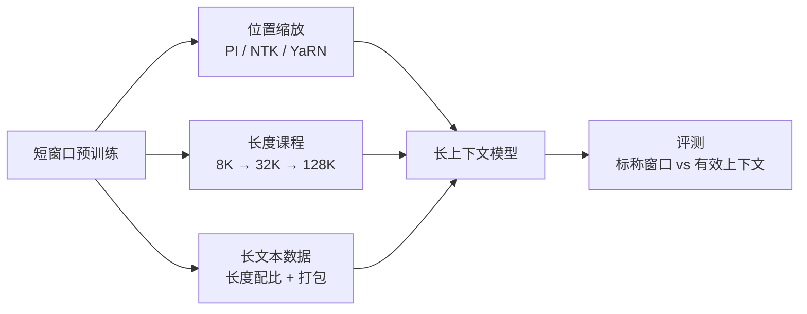

# 第 13 章 长上下文训练

## 本章导读

一个只在 4K 上训练过的模型，直接接收 128K 输入时通常不会报错：位置编码有定义，注意力矩阵也放得下，它甚至能写出通顺的续写。但把答案放在第 100K 个 Token 附近，再在末尾提问，模型很可能找不到——它“看见了”全部输入，却没有“用上”全部输入。本章把这种差距拆成三本账：计算、显存与数据，并回答一个工程问题：多出来的上下文长度，应该用位置缩放、长度课程、长文本数据还是并行系统去换？

## 难度标签

⭐⭐⭐ 进阶 ｜ 前置：第 4 章的 RoPE 与位置缩放、第 6 章的 KV Cache、第 12 章的激活与并行账本 ｜ 数学要求：量级估算 ｜ 代码要求：能读懂 PyTorch 的注意力掩码与训练循环

## 学习目标

1. 能算出注意力项与线性项的交叉长度，以及 KV Cache、激活随上下文长度的增长。
2. 能区分标称窗口、训练长度、插值长度与有效上下文，并设计能区分它们的评测。
3. 能实现带块对角掩码的序列打包，验证它与逐条训练在损失与梯度上等价。
4. 能比较固定长度、混合长度与课程式延长三种训练策略，解释零样本 RoPE 缩放为什么不稳定。

## 13.1 直觉：窗口不等于能力

把长上下文想成一张桌子。桌子的长度是**标称窗口**（nominal context length），它能放下多少文件由硬件与实现决定；你能在桌上多快找到某一份文件，是**有效上下文**（effective context length）。把桌子加长一倍，不会自动让文件变得更好找；如果文件只是被随意摊开，没有索引、没有分区，找起来甚至更慢。模型也一样：位置编码可以把第 100K 个 Token 映射到一个合法位置，但注意力权重是否学会“在 100K 的距离上保持可分辨”，取决于训练时见过什么。

计算上有两条曲线。注意力要比较每个查询与它之前的每个键，成本随序列长度按平方增长；投影与前馈对每个 Token 独立计算，成本随长度线性增长。短序列时线性项占主导，长序列时二次项迅速反超。第 12 章的账本只关心参数、梯度、优化器状态与激活，默认注意力不是主项；到了长上下文，这个假设失效了。

图 13-1 把长上下文的三条技术路线并列出来：位置缩放、长度课程与长文本数据，最后都汇合到“标称窗口与有效上下文”的评测上。



位置编码像一只表盘。训练时模型只见过表盘上的一段刻度，比如 0 到 4K；推理时把指针拨到 100K，刻度虽然还在，指针扫过的角度却超出了训练分布。PI 把长位置整体压回训练范围，相当于把表盘缩小；NTK 改变基频，相当于重新刻度；YaRN 按频率分段处理，让低频维度拉伸得多、高频维度几乎不动。这三种方法改变的是“位置怎样进入注意力”，不是“模型学过哪些距离上的依赖”。第 4 章已经推导过它们的公式，本章关心的是：这些变换在训练中够不够用，以及还需要补什么。

数据打包则像把多本小册子装进一个厚书脊。逐条训练时，每篇文档都要补齐到最大长度，短文档后面全是填充；打包把多篇文档首尾相接，Token 利用率立刻上升。但装订时必须加隔页：如果让第 2 篇文档的 Token 去注意第 1 篇的内容，模型就学到了训练分布里不存在的跨文档依赖。块对角掩码就是这层隔页，它让同一本书内的页可以互相参考，不同书之间互不可见。

## 13.2 数学原理

### 13.2.1 计算与显存的增长

先算前向 FLOPs。设批大小为 $$B$$，序列长度为 $$T$$，层数为 $$n_l$$，模型宽度为 $$d_{model}$$，前馈宽度为 $$d_{ff}$$，注意力头数为 $$n_h$$，每个头的维度为 $$d_h=d_{model}/n_h$$。因果注意力只计算下三角，查询与键的配对数为 $$T(T+1)/2$$；每个配对做一次长度为 $$d_{model}$$ 的点积（跨所有头合计），QK 与 AV 两次矩阵乘，每次乘加算两个 FLOPs，因此

$$
F_{\mathrm{attn}}=2\,B\,n_l\,d_{model}\,T(T+1)\qquad \text{(13.1)}
$$

投影与前馈对每个 Token 独立计算。MHA 的 Q、K、V、O 四个投影共 $$4d_{model}^2$$ 次乘加；SwiGLU 前馈有三个矩阵，共 $$3d_{model}d_{ff}$$ 次乘加。于是

$$
F_{\mathrm{lin}}=2\,B\,T\,n_l\left(4d_{model}^2+3d_{model}d_{ff}\right)\qquad \text{(13.2)}
$$

令两式相等，得到注意力项追上线性项的交叉长度：

$$
T^\star=4d_{model}+3d_{ff}-1\qquad \text{(13.3)}
$$

对 $$d_{model}=4096$$、$$d_{ff}=14336$$ 的 7B 级模型，$$T^\star\approx 59{,}391$$。这个数字比很多人的直觉大：在 32K 上下文里，注意力只占前向 FLOPs 的约 36%；到 128K 才升到约 69%。原因是前馈层的参数量与计算量都很大，长上下文并不是“一开始就全是注意力”。但注意，这是前向账本；反向约为前向的两倍，比例相近。GQA 与 MLA 减少的是 K/V 投影与缓存，不改变 $$T^2$$ 项；FlashAttention 减少的是显存与访存，也不改变 FLOPs。任何声称“换注意力变体就能降低长上下文计算”的说法，都要先问它降的是哪一项。

| T | 注意力 TFLOPs | 线性 TFLOPs | 注意力占比 | KV GiB | 激活 GiB | 显式分数矩阵 GiB |
| --- | --- | --- | --- | --- | --- | --- |
| 4K | 4.4 | 63.8 | 6.5% | 0.5 | 12.0 | 32.0 |
| 32K | 281.5 | 510.2 | 35.6% | 4.0 | 96.0 | 2048.0 |
| 128K | 4503.6 | 2040.7 | 68.8% | 16.0 | 384.0 | 32768.0 |

表 13-1 的模型是 7B 级：$$d_{model}=4096$$、$$n_l=32$$、$$n_h=32$$、$$n_{kv}=8$$、$$d_h=128$$、$$d_{ff}=14336$$；批大小 1、BF16。FLOPs 是前向；激活按 (13.5) 的 $$c_a=12$$ 估算，不含序列并行与重算；显式分数矩阵指不使用 FlashAttention 时每层需要保存的 $$T\times T$$ 打分。

推理侧的 KV Cache 是另一本账。每个 Token 的每层缓存 K 与 V 两份，K/V 的头数是 $$n_{kv}$$，每头 $$d_h$$ 维，每元素 $$b_{\mathrm{elem}}$$ 字节，于是

$$
M_{\mathrm{kv}}=2\,B\,T\,n_l\,n_{kv}\,d_h\,b_{\mathrm{elem}}\qquad \text{(13.4)}
$$

同样配置下，7B 模型在 128K 上单序列要 16 GiB，70B 要 40 GiB，405B（126 层）要 63 GiB。表 13-2 列出 4K、32K、128K 三档。把批大小乘上去，缓存会线性膨胀：7B、B=8、128K 需要 128 GiB，单张 80 GB 卡已经放不下。这正是第 6 章的 GQA/MLA 与第 21 章的分页缓存在长上下文下变得关键的原因。

| 模型 | 层数 | 4K | 32K | 128K |
| --- | --- | --- | --- | --- |
| 7B | 32 | 0.5 | 4.0 | 16.0 |
| 70B | 80 | 1.2 | 10.0 | 40.0 |
| 405B | 126 | 2.0 | 15.8 | 63.0 |

训练时的显存不是 KV Cache，而是激活。沿用第 12 章 (12.2) 的写法，逐 Token 激活约为

$$
M_{\mathrm{act}}\approx c_a\,B\,T\,n_l\,d_{model}\,b_{\mathrm{elem}}
+\mathbf{1}_{\mathrm{scores}}\,B\,n_l\,n_h\,T^2\,b_{\mathrm{elem}}\qquad \text{(13.5)}
$$

第一项随 $$T$$ 线性增长，$$c_a$$ 是每层保留的激活张量数，典型实现落在 8 到 16 之间；第二项只在显式保存 $$T\times T$$ 打分矩阵时出现，随 $$T^2$$ 增长。表 13-1 最后两列展示了差距：128K 时线性激活约 384 GiB，而显式分数矩阵高达 32 TiB。后者不是“优化一下”能解决的量级，它解释了为什么 FlashAttention 在长上下文里不是可选项，而是前提。FlashAttention 把打分切成小块、在片上完成 softmax 与累加，不把完整矩阵写回显存，显存回到 $$O(T)$$；代价是更多的重算与更复杂的反向。

> **warning** 表 13-1 的激活数字是单卡、未做序列并行与激活重算的估算，目的是比较量级，不是某套实现的实测值。真实预算要按实现测量，并用第 12 章的 $$\sqrt{n_l}$$ 重算规律、序列并行度与可用显存的 80% 做修正。

### 13.2.2 位置外推的边界

第 4 章把长度外推拆成三类：PI 把位置除以缩放因子 $$s=L_{\mathrm{test}}/L_{\mathrm{train}}$$（式 4.14）；NTK-aware 改基频，让低频维度被拉伸、高频维度基本不动（式 4.15）；YaRN 按波长分段插值，并给注意力加温度（式 4.16–4.18）。这里不重复推导，只看一个常被忽略的事实：**这些变换只改变位置的相位，不改变模型学到的注意力统计**。

以 RoPE 为例，查询与键的打分只依赖相对位移。训练时模型见过的是 $$|i-j|\le L_{\mathrm{train}}$$ 的相位组合；推理时如果直接把 $$T$$ 拉到 $$4L_{\mathrm{train}}$$，相对位移进入训练分布之外，打分会在某些距离上振荡或混叠。PI 把长位移压回训练范围，相当于让模型用“近距离”的权重去处理“远距离”的内容；只要任务只要求找到某个 Token，这种压缩常常够用。但如果任务依赖远距离上的细微顺序或多跳关系，压缩会损失分辨率，模型仍然做不对。

本章的实验会看到一种典型现象：固定 32 训练、直接测 128 时，不缩放时没有任何种子达标；PI、NTK、YaRN 各只有 1 个种子达到 0.5 以上的准确率，另外两个种子接近随机。均值被单个成功种子拉高，标准差接近 0.5。这不是“某种缩放更好”的证据，而是“零样本外推是一次抽签”的证据：同一套公式，权重初始化与数据顺序不同，模型可能学会一个可压缩的注意力策略，也可能学会一个依赖绝对相位的捷径。工业上不会把长上下文能力押在一次抽签上，所以位置缩放通常只作为“让模型能接受长输入”的第一步，后面必须跟长文本继续训练。

### 13.2.3 长度课程与数据配比

如果从零训练，最简单的方法是在目标长度上直接训练；但长序列的激活与注意力成本高，早期模型也还没学会短距离的局部结构。**渐进式长度扩展**（progressive length extension）先从短长度开始，再分阶段加长。设起始长度 $$L_0$$、目标长度 $$L_N$$、阶段数 $$N_{\mathrm{st}}$$，一种常用的几何安排是

$$
L_i=L_0\left(\frac{L_N}{L_0}\right)^{i/(N_{\mathrm{st}}-1)},\qquad i=0,\dots,N_{\mathrm{st}}-1\qquad \text{(13.6)}
$$

每个阶段分配相同的步数，长度按几何级数增长。若希望各阶段的 Token 预算相同，步数占比应与 $$1/L_i$$ 成正比：长序列阶段每一步更贵，步数要相应减少。两种预算对应两种工程目标：等步数让每个长度都得到充分的参数更新，等 Token 让总算力可控。

长度课程解决的是“怎样把模型带到长长度”，但**带到之后短长度会不会退化**是另一个问题。本章实验中，课程式训练把 128 上的准确率做到 1.00，却在 32 和 64 上掉到 0.28 与 0.30；原因是最后三分之一步都在 128 上，模型的注意力策略适应了远距离，短距离反而成了分布外。加入 PI 后，同一套权重在 32、64、128 上分别是 0.99、1.00、1.00：位置压缩让不同长度共享同一段有效距离，短长度不再被“挤出”分布。更简单的做法是**混合长度训练**：每个批从 32、64、128 中轮流采样，模型始终同时见到三种长度，实验中三种长度分别为 0.97、0.98、0.94，且三个种子都稳定。代价是每个长度分到的步数变少，长长度的收敛可能稍慢；但在有长数据的前提下，它是最稳的默认方案。

数据侧还要决定“喂什么长度的文档”。只喂最大长度会浪费算力，因为大多数文档没有那么长；只喂短文档又学不会长距离依赖。常见做法是按长度分层采样：短、中、长文档各占一定比例，长文档可以重复使用，但要避免过拟合。超过窗口的文档需要截断或切块：从头截断会丢结尾，从尾截断会丢开头，按段落切块并保留少量重叠更稳；切块后仍要保留文档边界，否则打包时又会引入跨文档注意力。Llama 3.1 的长上下文阶段就采用分阶段延长，并在每个阶段检查短上下文性能是否恢复、长上下文检索是否达标，再进入下一阶段；这说明课程不是“把长度调大”这么简单，而是一个带验收条件的流水线。

### 13.2.4 序列打包与文档隔离

逐条训练时，一个批里的序列要被补齐到同一长度，短文档后面全是 padding。设第 $$i$$ 篇文档长度为 $$\ell_i$$，批内最大长度为 $$T_{\max}$$，逐条 padding 的 Token 利用率是

$$
\eta_{\mathrm{pad}}=\frac{\sum_i \ell_i}{N_{\mathrm{doc}}\,T_{\max}},\qquad
\eta_{\mathrm{pack}}=\frac{\sum_i \ell_i}{\left\lceil \sum_i \ell_i/T_{\max}\right\rceil T_{\max}}\qquad \text{(13.7)}
$$

其中 $$N_{\mathrm{doc}}$$ 是文档数。本章的玩具例子有 6 篇文档、长度 9/12/7/15/11/8，总长 62；逐条 padding 到 32 时利用率只有 32.3%，打包成两条 32 后升到 96.9%。打包的收益来自“把 padding 换成真实 Token”，但它引入了一个正确性问题：拼起来的序列里，后一篇文档能看到前一篇吗？

答案必须是否定的。给每个位置记录文档编号 $$d_i$$，块对角因果掩码定义为

$$
M_{ij}=\mathbf{1}\left[d_i=d_j\right]\cdot\mathbf{1}\left[j\le i\right]\qquad \text{(13.8)}
$$

只有当两个位置属于同一篇文档、且键在查询之前时才允许注意力。与之配套的还有两件事：第一，跨文档的预测目标要置为忽略（`-100`），因为第 $$i$$ 篇的最后一个 Token 不应该被训练去预测第 $$i+1$$ 篇的首 Token；第二，位置编号在每篇文档内从 0 重新开始，虽然 RoPE 的相对性使“整篇平移一个常数”不改变打分，但重置位置能让缓存、打包与逐条训练共用同一条路径，语义也更清楚。

只要掩码、边界标签与位置三者都正确，打包后的损失与梯度应当与逐条前向一致。本章的实现用 4D 布尔掩码扩展了注意力的 `attention_mask`：形状为 $$(B,1,T,T)$$ 时按块对角掩码处理，形状为 $$(B,T)$$ 时仍按原来的 padding 掩码处理，`TinyLM.forward` 的签名不变。实验中，打包与逐条的 logits 最大偏差为 $$8.9\times10^{-8}$$，梯度最大偏差为 $$2.9\times10^{-6}$$；去掉块对角掩码、只保留因果掩码后，logits 偏差升到 $$1.5\times10^{-1}$$，平均损失也发生变化。这说明“打包只影响吞吐”是错的：没有文档隔离，模型会学到跨文档的虚假依赖，损失看起来更低，泛化却更差。

> **info** 工业实现通常不会构造完整的 $$T\times T$$ 掩码，而是用变长 FlashAttention（如 `cu_seqlens`）把每篇文档当成一个独立序列拼接，内核在块级别跳过跨文档区域。本章的 4D 掩码便于教学与验证，计算量仍是稠密因果注意力的量级；真实系统会用块稀疏内核把被掩掉的部分也省掉。

### 13.2.5 长上下文并行

单卡放不下长序列的激活时，有两个层次的切分。**序列并行**（sequence parallelism，SP）把 LayerNorm、dropout 等逐 Token 运算沿序列维切开，进入注意力前用全收集拼回完整序列，出来后再归约散射；它把逐 Token 激活降到 $$1/N_s$$，但注意力仍需要看到完整序列。**上下文并行**（context parallelism，CP）更进一步：把序列切成 $$N_{cp}$$ 块分到不同卡上，每张卡只保存自己那段查询与 KV，计算注意力时让 KV 块在卡间轮转，直到每个查询块都与所有 KV 块交互。这就是环形注意力（ring attention）的基本思想。

CP 的通信量随 $$T$$ 线性增长，计算量随 $$T^2/N_{cp}$$ 增长。每张卡每层要接收其他卡的全部 K/V 块，字节数约为

$$
V_{\mathrm{cp}}\approx 2\,\frac{N_{cp}-1}{N_{cp}}\,T\,d_{model}\,b_{\mathrm{elem}}
\qquad \text{(13.9)}
$$

它与第 12 章 (12.5) 的环形全归约同形。关键比值是通信/计算：通信按 $$T$$ 增长，计算按 $$T^2/N_{cp}$$ 增长，所以序列越长，通信相对越便宜；这与短序列下“通信是瓶颈”的直觉相反。真正的难点是因果掩码带来的负载不均：查询块越靠后，它能看到的 KV 块越多；如果简单按顺序分块，前面的卡很快算完、后面的卡还在等。工业实现会用交错或“之”字形分配（striped/zigzag）让每张卡分到的因果工作量大致相等，并把 KV 轮转与计算重叠起来。

CP 不减少注意力的 FLOPs，它把 FLOPs 与显存分散到多张卡；它也不自动提升模型能力，只是让“在 128K 上训练”从不可能变成可能。第 12 章把 SP 归入“序列维切分”，本章把 CP 与环形注意力补全；两者常与张量并行、激活重算一起使用，形成“节点内 TP、节点间 CP/DP”的组合。

### 13.2.6 评测：有效上下文

第 4 章已经给出有效上下文的定义 (4.13)：在某个指标上不低于阈值的最长长度。把它写成可操作的离散形式：

$$
T_{\mathrm{eff}}=\max\left\{T\in\mathcal{T}:\mathrm{metric}(T)\ge\epsilon\right\}\qquad \text{(13.10)}
$$

其中 $$\mathcal{T}$$ 是评测长度集合，$$\epsilon$$ 是阈值。这个定义看起来简单，实际有三个坑。第一，指标与阈值决定结论：检索准确率、困惑度、多跳问答的曲线形状不同，同一个模型可能在不同指标上得到不同的有效长度。第二，评测长度要覆盖“标称窗口以内”与“训练长度以外”两段，否则分不清插值与外推。第三，要报告随机水平与样本量，否则 0.1 与 0.06 的差别可能只是噪声。

最常用的是“大海捞针”（needle-in-a-haystack，NIAH）：在一段长文本的某个深度放入一条关键信息，在末尾提问。把针放在不同深度，可以画出位置敏感曲线；把多条针放在一起，可以测多针检索。设探针数为 $$N_{\mathrm{probe}}$$，第 $$i$$ 个探针的深度为 $$u_i$$，本章的 `needle_positions` 在可放置 KEY 的深度上等距取样：

$$
u_i=\mathrm{round}\left(\frac{i(T-3)}{N_{\mathrm{probe}}-1}\right),\qquad i=0,\dots,N_{\mathrm{probe}}-1\qquad \text{(13.11)}
$$

末两位留给 value 与 QUERY，因此 KEY 的位置范围是 $$[0,T-3]$$。单针检索的门槛很低：模型只要学会“找到 KEY、读下一位”就能通过，前沿模型在 128K 上的单针准确率常常超过 90%。这不能证明它具备长上下文推理能力；RULER 把评测扩展到多针检索、变量追踪、聚合与带干扰项的问答共 13 项任务，发现不少标称 128K 的模型在 32K 之后就开始明显退化，GPT-4 与 Llama 3.1 70B 的有效长度约为标称的一半。另一条独立证据是“迷失在中间”（lost in the middle）：把关键信息放在长文开头或结尾时模型更容易找到，放在中间时性能下降，曲线呈 U 形。

因此，长上下文评测至少应包含四件事：单针位置曲线（看位置偏差）、多针与聚合任务（看是否只会词面匹配）、真实长文档任务（看领域迁移）、以及短上下文回归（看扩窗是否破坏了原有能力）。只报一个“128K 通过”的结论，信息量接近零。

## 13.3 方案对比

表 13-3 把本章讨论的方案放在同一张表里。没有一行是全面最优的：它们分别用数据、算力、显存或实现复杂度，换取不同意义上的“更长”。

| 方案 | 数据需求 | 算力/显存 | 外推与泛化 | 主要风险 | 适用场景 |
| --- | --- | --- | --- | --- | --- |
| 固定短长度训练 | 只需要短数据 | 最低 | 训练长度内好，长度外基本失效 | 无法处理长输入 | 任务确实只需要短上下文 |
| 直接长长度训练 | 需要目标长度的数据 | 激活与注意力成本最高 | 目标长度内可靠，短长度可能退化 | 显存峰值高、早期不稳定 | 有充足长数据与算力 |
| 混合长度训练 | 需要各长度数据 | 取决于采样比例 | 各长度都较稳 | 长长度分到的步数少 | 从零训练或大规模继续训练 |
| 课程式延长 | 短数据起步，逐步加长 | 前期便宜，后期贵 | 能到达长长度，短长度可能遗忘 | 阶段切换不稳、需验收 | 从已有短窗口模型扩展 |
| 位置缩放 + 少量微调 | 少量长数据 | 便宜 | 能接受长输入，能力提升有限 | 零样本不稳定、短上下文回退 | 快速扩窗、原型验证 |
| SP/CP/环形注意力 | 不改变数据 | 用通信换显存 | 不直接提升能力 | 负载不均、实现复杂 | 单卡放不下长序列 |
| 线性注意力/SSM | 需要匹配任务的数据 | $$O(T)$$ 计算与固定状态 | 检索类任务可能退化 | 表达上界与训练难度 | 超长序列、流式场景 |

读表时先问“缺的是哪一项”。如果缺的是显存，SP/CP/激活重算是直接答案；如果缺的是“模型没见过长距离依赖”，再多的并行也只是让训练跑起来，数据与课程才是答案；如果缺的是“现有短窗口模型想快速扩窗”，位置缩放加少量长数据是成本最低的起点，但必须用短上下文回归与多任务评测兜底。表 13-3 里没有“把 RoPE base 调大就免费扩窗”这一行，因为那不是方案，是一次没有验收的赌博。

## 13.4 代码实现：TinyLM 的长上下文工具

### 13.4.1 实现选择

本章新增三个模块：`tinylm/data/collate.py` 负责打包与块对角掩码；`tinylm/train/long_context.py` 负责算力/显存账本、长度课程与有效上下文；`tinylm/eval/needle.py` 负责单针检索的构造与分桶统计。模型侧只改了一处：注意力接受 4D 布尔掩码，2D padding 掩码的行为保持不变，`TinyLM.forward`、`CausalLMOutput` 与 `ModelConfig` 的签名都不变。

实验用 2 层、$$d_{model}=32$$、2 个头的 TinyLM，词表 17：Token 0–15 是内容，16 是查询标记。输入是一个随机 Token 序列，末位放查询，目标是最开头的 Token。这是一个最小化的“单针检索”：模型必须把注意力放到位置 0 并复制它的值，随机水平是 $$1/16=0.0625$$。固定 32 训练的模型把 `max_seq_len` 设为 32；RoPE 允许前向长度超过这个值，注意力会动态重建因果掩码。混合长度与课程式训练的模型把 `max_seq_len` 设为 128。所有实验固定模型初始化与批采样种子，报告 3 个种子的均值与标准差。

### 13.4.2 完整代码

先看打包模块。

```python
"""第 13 章：长文本打包与块对角注意力（tinylm/data/collate.py）。"""
import math
from dataclasses import dataclass

import torch


@dataclass(frozen=True)
class PackedBatch:
    """一条打包序列；所有张量长度都是 ``sum(len(doc)) - 1``。"""

    input_ids: torch.Tensor        # (T,)
    labels: torch.Tensor           # (T,)，跨文档位置为 -100
    doc_ids: torch.Tensor          # (T,)，每个输入位置所属文档
    position_ids: torch.Tensor     # (T,)，文档内位置，每篇从 0 开始
    attention_mask: torch.Tensor   # (1, 1, T, T)，块对角因果掩码


def block_causal_mask(doc_ids):
    """(13.8)：同文档且不越界的注意力掩码，形状 (1, 1, T, T)。"""
    T = doc_ids.numel()
    same_doc = doc_ids[:, None] == doc_ids[None, :]
    causal = torch.tril(torch.ones(T, T, dtype=torch.bool))
    return (same_doc & causal)[None, None]


def pack_documents(docs, max_len=None):
    """把多篇文档拼成一条训练序列，返回 :class:`PackedBatch`。

    打包后第 t 个输入预测第 t+1 个 Token；若两者属于不同文档，
    ``labels[t] = -100``，配合 ``attention_mask`` 保证文档之间互不可见。
    """
    if max_len is not None and sum(len(d) for d in docs) > max_len:
        raise ValueError("文档总长超过 max_len")
    lengths = [len(d) for d in docs]
    flat = torch.cat([torch.as_tensor(d, dtype=torch.long) for d in docs])
    doc_ids = torch.cat([torch.full((n,), i, dtype=torch.long)
                         for i, n in enumerate(lengths)])
    position_ids = torch.cat([torch.arange(n) for n in lengths])

    input_ids = flat[:-1]
    labels = flat[1:].clone()
    labels[doc_ids[:-1] != doc_ids[1:]] = -100      # 跨文档边界不计损失
    return PackedBatch(
        input_ids=input_ids,
        labels=labels,
        doc_ids=doc_ids[:-1],
        position_ids=position_ids[:-1],
        attention_mask=block_causal_mask(doc_ids[:-1]),
    )


def token_utilization(lengths, max_len):
    """(13.7)：逐条 padding 与拼接打包的 Token 利用率。"""
    total = sum(lengths)
    padded_capacity = len(lengths) * max_len
    packed_capacity = math.ceil(total / max_len) * max_len
    return {"pad": total / padded_capacity, "packed": total / packed_capacity}
```

接着是算力、显存与长度调度。

```python
"""第 13 章：长上下文的算力、显存与长度调度（tinylm/train/long_context.py）。"""


def attention_flops(batch, seq_len, d_model, n_layers):
    """(13.1)：因果注意力的前向 FLOPs（QK^T 与 AV 各一次）。"""
    return 2 * batch * n_layers * d_model * seq_len * (seq_len + 1)


def linear_flops(batch, seq_len, d_model, d_ff, n_layers):
    """(13.2)：投影与 SwiGLU 前馈的前向 FLOPs。"""
    return 2 * batch * seq_len * n_layers * (4 * d_model ** 2 + 3 * d_model * d_ff)


def attention_share(batch, seq_len, d_model, d_ff, n_layers):
    """注意力 FLOPs 占总前向 FLOPs 的比例。"""
    attn = attention_flops(batch, seq_len, d_model, n_layers)
    linear = linear_flops(batch, seq_len, d_model, d_ff, n_layers)
    return attn / (attn + linear)


def crossover_length(d_model, d_ff):
    """(13.3)：注意力 FLOPs 追上线性项时的序列长度。"""
    return 4 * d_model + 3 * d_ff - 1


def kv_cache_bytes(batch, seq_len, n_layers, n_kv_heads, d_head,
                   bytes_per_elem=2):
    """(13.4)：推理 KV Cache 的字节数。"""
    return (2 * batch * seq_len * n_layers * n_kv_heads * d_head
            * bytes_per_elem)


def activation_bytes(batch, seq_len, d_model, n_layers, n_heads,
                     bytes_per_elem=2, coef=12.0, materialize_scores=False):
    """(13.5)：训练激活；显式分数矩阵是额外的 T^2 * n_heads 项。"""
    base = coef * batch * seq_len * n_layers * d_model * bytes_per_elem
    if materialize_scores:
        base += batch * n_layers * n_heads * seq_len ** 2 * bytes_per_elem
    return base


def length_schedule(base_len, target_len, stages):
    """(13.6)：几何增长的长度课程，返回 [(长度, 步数占比), ...]。"""
    assert stages >= 1 and target_len >= base_len >= 1
    if stages == 1:
        return [(target_len, 1.0)]
    ratio = (target_len / base_len) ** (1 / (stages - 1))
    lengths = [int(round(base_len * ratio ** i)) for i in range(stages)]
    lengths[-1] = target_len
    return [(n, 1.0 / stages) for n in lengths]


def token_budget_shares(lengths):
    """等 Token 预算时各长度应分配的步数占比。"""
    inv = [1.0 / n for n in lengths]
    total = sum(inv)
    return [x / total for x in inv]


def effective_context(lengths, scores, threshold=0.5):
    """(13.10)：指标不低于阈值的最长评测长度；全部不达标时返回 0。"""
    passed = [n for n, s in zip(lengths, scores) if s >= threshold]
    return max(passed) if passed else 0
```

再是检索评测工具。

```python
"""第 13 章：大海捞针式检索评测（tinylm/eval/needle.py）。"""
import torch


def needle_positions(context_len, n_probes):
    """(13.11)：在可放置 KEY 的深度上等距取样。

    末两位留给 value 与 QUERY，因此 KEY 的位置范围是 ``[0, T-3]``。
    """
    if context_len < 3:
        raise ValueError("context_len 至少为 3")
    if n_probes < 1:
        raise ValueError("n_probes 必须为正")
    last = context_len - 3
    if n_probes == 1:
        return [last // 2]
    return [round(i * last / (n_probes - 1)) for i in range(n_probes)]


def passkey_batch(batch, context_len, positions, key_id, query_id,
                  value_vocab, generator=None):
    """构造单针检索批；返回 ``(input_ids, targets)``。

    ``KEY`` 后一位是随机 value，末位是 ``QUERY``；模型在末位预测 value。
    """
    if context_len < 3:
        raise ValueError("context_len 至少为 3")
    ids = torch.randint(0, value_vocab, (batch, context_len),
                        generator=generator)
    targets = torch.empty(batch, dtype=torch.long)
    for b, pos in enumerate(positions):
        if not 0 <= pos <= context_len - 3:
            raise ValueError("KEY 的位置越界")
        ids[b, pos] = key_id
        targets[b] = ids[b, pos + 1]
    ids[:, -1] = query_id
    return ids, targets


def retrieval_correct(logits, targets):
    """末位 logits 的 argmax 是否等于目标 value。"""
    return logits.argmax(dim=-1) == targets


def bucket_accuracy(positions, correct, edges):
    """按深度分桶统计准确率，返回 [(下界, 上界, 准确率, 样本数), ...]。"""
    positions = torch.as_tensor(positions)
    correct = torch.as_tensor(correct, dtype=torch.float32)
    out = []
    for lo, hi in zip(edges[:-1], edges[1:]):
        mask = (positions >= lo) & (positions < hi)
        n = int(mask.sum())
        acc = float(correct[mask].mean()) if n else float("nan")
        out.append((lo, hi, acc, n))
    return out
```

注意力侧只加一个 4D 分支，2D 路径保持原样；`PositionAwareAttention` 与 `VariantAttention` 都要改。

```python
        if attention_mask is not None:
            if attention_mask.dim() == 4:                     # 块对角文档掩码
                scores = scores.masked_fill(attention_mask == 0, float("-inf"))
            else:
                pad = attention_mask[:, None, None, :] == 0
                scores = scores.masked_fill(pad, float("-inf"))
```

完整实验如下。

```python
"""第 13 章：长上下文的算力、打包与长度外推实验（examples/ch13_long_context.py）。"""
import time

import torch
import torch.nn.functional as F

from ch04 import RoPEScalingConfig
from ch08 import ModelConfig, TinyLM
from tinylm.data.collate import pack_documents, token_utilization
from tinylm.eval.needle import (bucket_accuracy, needle_positions,
                                passkey_batch, retrieval_correct)
from tinylm.train import long_context as LC

VOCAB = 17
QUERY = 16
CHANCE = 1.0 / 16
T_TRAIN = 32
TARGET = 128
STEPS = 400
SEEDS = (0, 1, 2)
LENGTHS = (32, 64, 128)


def retrieval_batch(batch, seq_len, gen):
    x = torch.randint(0, QUERY, (batch, seq_len), generator=gen)
    x[:, -1] = QUERY
    y = torch.full((batch, seq_len), -100, dtype=torch.long)
    y[:, -1] = x[:, 0]
    return x, y


@torch.no_grad()
def evaluate(model, seq_len, batch=256, seed=7):
    gen = torch.Generator().manual_seed(seed)
    x, y = retrieval_batch(batch, seq_len, gen)
    model.eval()
    out = model(x, labels=y)
    acc = (out.logits[:, -1].argmax(-1) == y[:, -1]).float().mean().item()
    return out.loss.item(), acc


def train_one(regime, method, factor, seed):
    torch.manual_seed(seed)
    max_len = T_TRAIN if regime == "fixed" else TARGET
    cfg = ModelConfig(
        vocab_size=VOCAB, d_model=32, n_layers=2, n_heads=2, d_ff=128,
        max_seq_len=max_len, pos_encoding="rope", norm="rmsnorm",
        ffn="swiglu", bias=False,
        rope_scaling=RoPEScalingConfig(method=method, factor=factor),
    )
    model = TinyLM(cfg)
    opt = torch.optim.AdamW(model.parameters(), lr=3e-3, weight_decay=0.01)
    gen = torch.Generator().manual_seed(1000 + seed)
    model.train()

    def train_at(seq_len, steps):
        for _ in range(steps):
            x, y = retrieval_batch(32, seq_len, gen)
            out = model(x, labels=y)
            opt.zero_grad()
            out.loss.backward()
            opt.step()

    if regime == "fixed":
        train_at(T_TRAIN, STEPS)
    elif regime == "mixed":
        for i in range(STEPS):
            train_at(LENGTHS[i % len(LENGTHS)], 1)
    elif regime == "curriculum":
        for seq_len, share in LC.length_schedule(T_TRAIN, TARGET, 3):
            train_at(seq_len, round(STEPS * share))
    return [evaluate(model, seq_len)[1] for seq_len in LENGTHS]


def extrapolation_table():
    configs = (
        ("固定 32", "none", 1.0, "fixed"),
        ("固定 32", "pi", 4.0, "fixed"),
        ("固定 32", "ntk", 4.0, "fixed"),
        ("固定 32", "yarn", 4.0, "fixed"),
        ("混合长度", "none", 1.0, "mixed"),
        ("课程", "none", 1.0, "curriculum"),
        ("课程", "pi", 4.0, "curriculum"),
    )
    print(f"\n首 Token 检索（训练 400 步，3 种子；随机水平 {CHANCE:.3f}）")
    print(f"{'训练方式':<10s}{'RoPE':<6s}{'T=32':>14s}{'T=64':>14s}"
          f"{'T=128':>14s}{'达标种子':>10s}{'有效长度':>8s}")
    for regime_name, method, factor, regime in configs:
        rows = torch.tensor([train_one(regime, method, factor, seed)
                             for seed in SEEDS])
        mean, std = rows.mean(0), rows.std(0)
        eff = LC.effective_context(LENGTHS, mean.tolist(), threshold=0.5)
        hit = int((rows[:, -1] >= 0.5).sum())
        cells = "".join(f"{m:>9.2f}±{s:.2f}" for m, s in zip(mean, std))
        print(f"{regime_name:<10s}{method:<6s}{cells}"
              f"{hit:>7d}/{len(SEEDS)}{eff:>8d}")


def ledger_table():
    d, layers, heads, kv_heads, d_ff = 4096, 32, 32, 8, 14336
    print("\n7B 模型账本（B=1，BF16；分数矩阵指不使用 FlashAttention 时的显式 T×T）")
    print(f"{'T':>8s}{'注意力 TFLOPs':>14s}{'线性 TFLOPs':>13s}"
          f"{'注意力占比':>10s}{'KV GiB':>9s}{'激活 GiB':>10s}"
          f"{'分数矩阵 GiB':>14s}")
    for T in (4096, 32768, 131072):
        a = LC.attention_flops(1, T, d, layers) / 1e12
        l = LC.linear_flops(1, T, d, d_ff, layers) / 1e12
        share = LC.attention_share(1, T, d, d_ff, layers)
        kv = LC.kv_cache_bytes(1, T, layers, kv_heads, d // heads) / 2**30
        act = LC.activation_bytes(1, T, d, layers, heads) / 2**30
        score = (LC.activation_bytes(1, T, d, layers, heads,
                                     materialize_scores=True)
                 - LC.activation_bytes(1, T, d, layers, heads)) / 2**30
        print(f"{T:>8d}{a:>14.1f}{l:>13.1f}{share:>10.1%}"
              f"{kv:>9.1f}{act:>10.1f}{score:>14.1f}")


def kv_model_table():
    models = (("7B", 32), ("70B", 80), ("405B", 126))
    print("\n单序列 BF16 KV Cache（GiB，8 个 KV 头、d_head=128）")
    print(f"{'模型':<6s}{'层数':>6s}" + "".join(f"{T//1024:>8d}k" for T in
                                          (4096, 32768, 131072)))
    for name, layers in models:
        cells = "".join(f"{LC.kv_cache_bytes(1, T, layers, 8, 128)/2**30:>8.1f}"
                        for T in (4096, 32768, 131072))
        print(f"{name:<6s}{layers:>6d}{cells}")


def packing_demo():
    gen = torch.Generator().manual_seed(0)
    lengths = (9, 12, 7, 15, 11, 8)
    docs = [torch.randint(0, VOCAB, (n,), generator=gen) for n in lengths]
    torch.manual_seed(0)
    cfg = ModelConfig(vocab_size=VOCAB, d_model=32, n_layers=2, n_heads=2,
                      d_ff=128, max_seq_len=128, pos_encoding="rope",
                      norm="rmsnorm", ffn="swiglu", bias=False)
    model = TinyLM(cfg).eval()
    batch = pack_documents(docs)

    def token_losses(input_ids, labels, mask=None, positions=None):
        out = model(input_ids[None], attention_mask=mask,
                    position_ids=positions)
        per_token = F.cross_entropy(out.logits[0], labels, reduction="none",
                                    ignore_index=-100)
        return out.logits[0], per_token, per_token[labels != -100].sum()

    logits_u, losses_u, sum_u = [], [], 0.0
    for doc in docs:
        lg, ls, s = token_losses(doc[:-1], doc[1:],
                                 positions=torch.arange(len(doc) - 1))
        logits_u.append(lg)
        losses_u.append(ls)
        sum_u = sum_u + s
    logits_u = torch.cat(logits_u)
    losses_u = torch.cat(losses_u)

    lg_p, ls_p, sum_p = token_losses(batch.input_ids, batch.labels,
                                     batch.attention_mask, batch.position_ids)
    lg_c, ls_c, _ = token_losses(batch.input_ids, batch.labels,
                                 positions=batch.position_ids)
    keep = batch.labels != -100
    mean_u = (losses_u.sum() / keep.sum()).item()
    mean_p = ls_p[keep].mean().item()
    mean_c = ls_c[keep].mean().item()
    n_pred = sum(lengths) - len(lengths)
    print(f"\n打包等价性（6 篇文档，长度 {'/'.join(map(str, lengths))}，"
          f"共 {n_pred} 个预测位置）")
    print(f"{'方式':<20s}{'平均损失':>10s}{'logits 最大偏差':>16s}"
          f"{'梯度最大偏差':>14s}")
    print(f"{'逐条前向':<20s}{mean_u:>10.4f}{0.0:>16.1e}{0.0:>14.1e}")
    print(f"{'打包 + 块对角掩码':<20s}{mean_p:>10.4f}"
          f"{(logits_u - lg_p[keep]).abs().max().item():>16.1e}", end="")
    model.zero_grad()
    sum_u.backward()
    grads_u = [p.grad.clone() for p in model.parameters()]
    model.zero_grad()
    sum_p.backward()
    gdiff = max((gu - p.grad).abs().max().item()
                for gu, p in zip(grads_u, model.parameters()))
    print(f"{gdiff:>14.1e}")
    print(f"{'打包 + 仅因果掩码':<20s}{mean_c:>10.4f}"
          f"{(logits_u - lg_c[keep]).abs().max().item():>16.1e}"
          f"{'—':>14s}")
    pad, packed = token_utilization(lengths, 32).values()
    print(f"Token 利用率：逐条 padding {pad:.1%} → 打包 {packed:.1%}")


def needle_sanity():
    torch.manual_seed(0)
    cfg = ModelConfig(vocab_size=18, d_model=32, n_layers=2, n_heads=2,
                      d_ff=128, max_seq_len=TARGET, pos_encoding="rope",
                      norm="rmsnorm", ffn="swiglu", bias=False)
    model = TinyLM(cfg).eval()
    gen = torch.Generator().manual_seed(3)
    depths = needle_positions(TARGET, 8)
    positions = [depths[i % len(depths)] for i in range(512)]
    ids, targets = passkey_batch(512, TARGET, positions, 16, 17, 16, gen)
    with torch.no_grad():
        correct = retrieval_correct(model(ids).logits[:, -1], targets)
    edges = [0, 32, 64, 96, TARGET]
    print("\n单针评测口径自检（随机初始化模型，预期接近 1/16）")
    for lo, hi, acc, n in bucket_accuracy(positions, correct, edges):
        print(f"深度 {lo:>3d}-{hi-1:<3d}：准确率 {acc:.3f}（{n} 条）")


def main():
    t0 = time.time()
    ledger_table()
    kv_model_table()
    packing_demo()
    needle_sanity()
    extrapolation_table()
    print(f"\n总耗时 {time.time() - t0:.1f} s")


if __name__ == "__main__":
    main()
```

测试覆盖账本、打包等价性与评测口径。

```python
"""第 13 章的账本、打包与检索评测测试。"""
import pytest
import torch
import torch.nn.functional as F

from ch08 import ModelConfig, TinyLM
from tinylm.data.collate import block_causal_mask, pack_documents, token_utilization
from tinylm.eval.needle import (bucket_accuracy, needle_positions, passkey_batch,
                                retrieval_correct)
from tinylm.train import long_context as LC


def tiny_model(vocab=17, max_len=32, seed=0):
    torch.manual_seed(seed)
    cfg = ModelConfig(vocab_size=vocab, d_model=16, n_layers=1, n_heads=2,
                      d_ff=32, max_seq_len=max_len, pos_encoding="rope",
                      norm="rmsnorm", ffn="swiglu", bias=False)
    return TinyLM(cfg).eval()


def test_attention_and_linear_flops():
    d, f, L, T, B = 8, 16, 2, 4, 3
    assert LC.attention_flops(B, T, d, L) == 2 * B * L * d * T * (T + 1)
    assert LC.linear_flops(B, T, d, f, L) == 2 * B * T * L * (4 * d * d + 3 * d * f)
    # T 翻倍时，二次项按 2(2T+1)/(T+1) 增长，线性项正好翻倍
    assert LC.attention_flops(B, 2 * T, d, L) == pytest.approx(
        LC.attention_flops(B, T, d, L) * 2 * (2 * T + 1) / (T + 1))
    assert LC.linear_flops(B, 2 * T, d, f, L) == 2 * LC.linear_flops(B, T, d, f, L)


def test_attention_share_at_crossover():
    d, f, L = 32, 64, 2
    T = LC.crossover_length(d, f)
    assert T == 4 * d + 3 * f - 1
    share = LC.attention_share(1, T, d, f, L)
    assert share == pytest.approx(0.5, abs=1e-6)
    assert LC.attention_share(1, T // 2, d, f, L) < 0.5
    assert LC.attention_share(1, 2 * T, d, f, L) > 0.5


def test_kv_cache_and_activation():
    # 7B 风格：32 层、8 个 KV 头、d_head=128、128k 上下文
    kv = LC.kv_cache_bytes(1, 131072, 32, 8, 128)
    assert kv == 1.7179869184e10
    assert kv / 2 ** 30 == pytest.approx(16.0)
    assert LC.kv_cache_bytes(2, 131072, 32, 8, 128) == 2 * kv

    base = LC.activation_bytes(1, 4096, 64, 4, 4)
    assert base == 12 * 1 * 4096 * 4 * 64 * 2
    scores = LC.activation_bytes(1, 4096, 64, 4, 4, materialize_scores=True) - base
    assert scores == 1 * 4 * 4 * 4096 ** 2 * 2


def test_length_schedule_and_effective_context():
    sched = LC.length_schedule(32, 128, 3)
    assert [n for n, _ in sched] == [32, 64, 128]
    assert sum(share for _, share in sched) == pytest.approx(1.0)
    shares = LC.token_budget_shares([32, 64, 128])
    assert sum(shares) == pytest.approx(1.0)
    assert shares[0] > shares[1] > shares[2]
    assert LC.effective_context([32, 64, 128], [1.0, 0.6, 0.4], 0.5) == 64
    assert LC.effective_context([32, 64], [0.1, 0.2], 0.5) == 0


def test_block_causal_mask():
    doc_ids = torch.tensor([0, 0, 1, 1])
    mask = block_causal_mask(doc_ids)
    assert mask.shape == (1, 1, 4, 4)
    assert mask.sum().item() == 6          # 1 + 2 + 1 + 2
    assert not mask[0, 0, 0, 1]
    assert not mask[0, 0, 2, 1]
    assert mask[0, 0, 3, 2]


def test_pack_documents():
    docs = [torch.arange(5), torch.arange(10, 17), torch.arange(20, 24)]
    batch = pack_documents(docs)
    assert batch.input_ids.numel() == 5 + 7 + 4 - 1
    assert batch.labels.numel() == batch.input_ids.numel()
    assert batch.doc_ids.tolist() == [0] * 5 + [1] * 7 + [2] * 3
    # 每个文档的最后一个输入位置不能预测下一篇文档的首 Token
    assert batch.labels[4].item() == -100
    assert batch.labels[11].item() == -100
    assert batch.position_ids.tolist() == ([0, 1, 2, 3, 4] + list(range(7))
                                           + [0, 1, 2])
    with pytest.raises(ValueError):
        pack_documents(docs, max_len=10)


def test_packed_equivalence_and_leakage():
    docs = [torch.tensor([1, 4, 2, 7, 3]), torch.tensor([5, 0, 6, 8, 2, 9, 1]),
            torch.tensor([3, 3, 7, 0])]
    model = tiny_model()
    batch = pack_documents(docs)

    def logits_loss(ids, labels, mask=None, positions=None):
        out = model(ids[None], attention_mask=mask, position_ids=positions)
        per = F.cross_entropy(out.logits[0], labels, reduction="none",
                              ignore_index=-100)
        return out.logits[0], per

    lg_u, ls_u = [], []
    for doc in docs:
        lg, ls = logits_loss(doc[:-1], doc[1:],
                             positions=torch.arange(len(doc) - 1))
        lg_u.append(lg)
        ls_u.append(ls)
    lg_u, ls_u = torch.cat(lg_u), torch.cat(ls_u)
    lg_p, ls_p = logits_loss(batch.input_ids, batch.labels,
                             batch.attention_mask, batch.position_ids)
    lg_c, _ = logits_loss(batch.input_ids, batch.labels,
                          positions=batch.position_ids)
    keep = batch.labels != -100
    assert torch.allclose(lg_u, lg_p[keep], atol=1e-5)
    assert torch.allclose(ls_u, ls_p[keep], atol=1e-5)
    assert not torch.allclose(lg_u, lg_c[keep], atol=1e-4)


def test_2d_padding_mask_unchanged():
    model = tiny_model()
    x = torch.randint(0, 17, (2, 9))
    with torch.no_grad():
        plain = model(x).logits
        masked = model(x, attention_mask=torch.ones(2, 9, dtype=torch.long)).logits
    assert torch.allclose(plain, masked, atol=1e-6)


def test_token_utilization():
    util = token_utilization([9, 12, 7, 15, 11, 8], 32)
    assert util["pad"] == pytest.approx(62 / 192)
    assert util["packed"] == pytest.approx(62 / 64)


def test_needle_positions():
    pos = needle_positions(128, 5)
    assert pos[0] == 0 and pos[-1] == 125
    assert pos == sorted(set(pos))
    assert needle_positions(9, 1) == [3]
    with pytest.raises(ValueError):
        needle_positions(2, 4)
    with pytest.raises(ValueError):
        needle_positions(128, 0)


def test_passkey_batch_and_buckets():
    gen = torch.Generator().manual_seed(0)
    positions = [0, 3, 8, 12]
    ids, targets = passkey_batch(4, 16, positions, 16, 17, 16, gen)
    assert ids.shape == (4, 16)
    for b, pos in enumerate(positions):
        assert ids[b, pos] == 16
        assert targets[b] == ids[b, pos + 1]
        assert ids[b, -1] == 17
    with pytest.raises(ValueError):
        passkey_batch(1, 16, [14], 16, 17, 16, gen)

    correct = torch.tensor([True, True, True, False])
    rows = bucket_accuracy(positions, correct, [0, 4, 16])
    assert rows[0][2] == pytest.approx(1.0)     # 位置 0、3 都正确
    assert rows[0][3] == 2
    assert rows[1][2] == pytest.approx(0.5)     # 位置 8 正确、12 错误

    last = torch.tensor([[0.0, 1.0, 0.0], [1.0, 0.0, 0.0]])
    assert retrieval_correct(last, torch.tensor([1, 0])).tolist() == [True, True]
```

### 13.4.3 测试

`tests/test_long_context.py` 共 11 项：注意力与线性 FLOPs 的解析式及翻倍关系、交叉长度处占比为 0.5、7B 在 128K 的 KV 缓存为 16 GiB、激活与显式分数矩阵两项、课程表与有效上下文、块对角掩码的行和、打包边界标签与位置重置、打包与逐条的 logits/损失等价、去除掩码后的泄漏、2D padding 掩码的向后兼容、Token 利用率、针位置与分桶统计。运行结果为 11 项全部通过。

### 13.4.4 运行结果

```text
7B 模型账本（B=1，BF16；分数矩阵指不使用 FlashAttention 时的显式 T×T）
       T    注意力 TFLOPs    线性 TFLOPs     注意力占比   KV GiB    激活 GiB      分数矩阵 GiB
    4096           4.4         63.8      6.5%      0.5      12.0          32.0
   32768         281.5        510.2     35.6%      4.0      96.0        2048.0
  131072        4503.6       2040.7     68.8%     16.0     384.0       32768.0

单序列 BF16 KV Cache（GiB，8 个 KV 头、d_head=128）
模型        层数       4k      32k     128k
7B        32     0.5     4.0    16.0
70B       80     1.2    10.0    40.0
405B     126     2.0    15.8    63.0

打包等价性（6 篇文档，长度 9/12/7/15/11/8，共 56 个预测位置）
方式                        平均损失     logits 最大偏差        梯度最大偏差
逐条前向                    2.8151         0.0e+00       0.0e+00
打包 + 块对角掩码              2.8151         8.9e-08       2.9e-06
打包 + 仅因果掩码              2.8174         1.5e-01             —
Token 利用率：逐条 padding 32.3% → 打包 96.9%

单针评测口径自检（随机初始化模型，预期接近 1/16）
深度   0-31 ：准确率 0.031（128 条）
深度  32-63 ：准确率 0.062（128 条）
深度  64-95 ：准确率 0.047（128 条）
深度  96-127：准确率 0.094（128 条）

首 Token 检索（训练 400 步，3 种子；随机水平 0.062）
训练方式      RoPE            T=32          T=64         T=128      达标种子    有效长度
固定 32     none       1.00±0.00     0.09±0.01     0.10±0.01      0/3      32
固定 32     pi         1.00±0.00     0.61±0.39     0.39±0.51      1/3      64
固定 32     ntk        1.00±0.00     0.48±0.45     0.37±0.51      1/3      32
固定 32     yarn       1.00±0.00     0.09±0.03     0.46±0.34      1/3      32
混合长度      none       0.97±0.03     0.98±0.04     0.94±0.10      3/3     128
课程        none       0.28±0.19     0.30±0.26     1.00±0.00      3/3     128
课程        pi         0.99±0.01     1.00±0.00     1.00±0.00      3/3     128

总耗时 124.2 s
```

### 13.4.5 结果说明了什么

**第一，零样本外推是抽签，不是能力。** 固定 32 训练、直接测 128 时，不缩放的方法在 3 个种子上都只有 0.10 左右，远高于随机水平但离可用很远；PI、NTK、YaRN 各只有 1 个种子达到 0.5 以上。均值看起来“有点用”，标准差却接近 0.5，说明分布是双峰的：要么学会了一个可压缩的注意力策略，要么完全没学会。实际部署不能接受这种方差，所以位置缩放必须与长文本继续训练一起使用。

**第二，数据在什么长度上，模型就有什么长度的能力。** 混合长度训练在 32、64、128 上都稳定在 0.94–0.98，三个种子全部达标。这是本章最强的结论：长上下文不是“调位置编码调出来的”，而是“在长序列上训练出来的”。位置缩放能让模型接受长输入，但不能凭空创造长距离的训练信号。

**第三，课程会带来短长度遗忘，PI 可以缓解。** 课程式训练在 128 上做到 1.00，但 32 和 64 掉到 0.28 与 0.30；加入 PI 后变为 0.99、1.00、1.00。原因在 13.2.3 已经解释：最后阶段全在长长度上，模型适应了长距离；PI 把长位置压回短范围，让不同长度共享同一段有效距离。工程上更稳的做法是课程加短长度回放，或者在课程结束后混入短数据。

**第四，打包的正确性可以精确验证。** 块对角掩码加边界标签加位置重置后，打包与逐条的 logits 最大偏差只有 $$8.9\times10^{-8}$$，梯度偏差 $$2.9\times10^{-6}$$，都在浮点误差范围内；去掉文档隔离，偏差立刻升到 $$1.5\times10^{-1}$$。这给出了一个可执行的验收标准：任何打包实现，都应该能在小模型上复现“有掩码等价、无掩码不等价”。

**第五，显存账本决定了系统方案。** 7B 在 128K 上单序列 KV 缓存 16 GiB，405B 要 63 GiB；不显式保存分数矩阵时激活约 384 GiB，显式保存则高达 32 TiB。前者靠 CP/SP/重算分摊，后者只能靠 FlashAttention 式的分块计算避免。先算清是哪一项在增长，再决定加卡、切序列还是换内核。

需要说明实验的边界：模型只有 2 层、32 维、400 步，任务是单针检索，不能外推到真实 LLM 的长上下文能力。它能验证账本、打包等价性与训练策略的方向，不能用来给某个位置缩放方法下最终结论。表 13-3 的选择仍要结合真实模型、真实数据与 RULER 类评测。

### 13.4.6 复现步骤

```bash
cd tinylm-book/ch13
PYTHONPATH=. python examples/ch13_long_context.py
PYTHONPATH=. python -m pytest tests/test_long_context.py -q
```

CPU 上约 2–3 分钟；除耗时外，所有数字由固定种子决定，可逐字复现。

## 13.5 工业实践

Llama 3.1 是把“渐进式扩展”写进公开报告的典型。它从 8K 窗口开始，分 6 个阶段延长到 128K，长上下文继续预训练约 800B Token；每个阶段都要检查两件事：短上下文性能是否恢复，以及该长度上的“大海捞针”是否通过。这个流程与本章的实验结论一致：长度是一段一段加上去的，验收条件同时看短和长。Llama 3.1 还在长上下文 SFT 中使用了合成数据，覆盖多轮问答、长文摘要与代码库推理；这说明“能读长文”与“会做长文任务”是两件事，后者需要任务数据。

推理侧的窗口竞赛更激进：Gemini 1.5 Pro 把标称窗口推到 1M Token，Claude 系列长期提供 200K 级窗口（截至写作时）。但标称窗口只是上限。RULER 的评测显示，声称支持 32K 以上的模型中只有约一半能在 32K 上保持基本性能；GPT-4（128K 标称）与 Llama 3.1 70B（128K 标称）的有效长度约为 64K，Llama 3.1 8B 约为 32K。单针检索很容易接近满分，多针、变量追踪与聚合任务才是分水岭。这也是为什么工业评测通常同时报告 NIAH、RULER 与真实长文档任务，而不是只报一个“128K 通过”。

显存侧的对策是组合拳：GQA/MLA 降低 KV 头数与每 Token 缓存（第 6 章），分页缓存避免按最大长度预分配（第 21 章），CP/环形注意力把序列维分摊到多卡（本章），激活重算与 SP 降低训练激活（第 12 章）。这些手段解决的是“放得下”和“算得动”，不解决“找得到”；后者仍然要靠数据、课程与评测。把两类问题混在一起，就会出现“窗口扩到 1M，但有效长度只有 32K”的产品。

## 13.6 论文导读

**1. Chen, Wong, Chen, Tian, 2023. Extending Context Window of Large Language Models via Positional Interpolation.** arXiv:2306.15595。读第 3 节（PI 的构造与为什么位置要压缩）与第 4 节（不同缩放因子下的困惑度与任务结果）；重点看它如何用少量微调把窗口从 4K 扩到 32K。

**2. Peng, Quesnelle, Fan, Shippole, 2023. YaRN: Efficient Context Window Extension of Large Language Models.** arXiv:2309.00071。读第 3 节（NTK-by-parts 的分频权重与温度缩放）与第 4 节（128K 扩展的训练步数与数据量）；对照本章 13.2.2 的“零样本抽签”解释，注意论文强调的是“少量微调后”的效果。

**3. Liu, Lin, Hewitt, Paranjape, Bevilacqua, Petroni, Liang, 2023. Lost in the Middle: How Language Models Use Long Contexts.** arXiv:2307.03172。读第 3–4 节（信息位置如何影响问答与摘要）；这篇论文是“有效上下文”概念的经验来源之一。

**4. Hsieh, Sun, Kriman, Acharya, Rekesh, Jia, Zhang, Ginsburg, 2024. RULER: What's the Real Context Size of Your Long-Context Language Models?** arXiv:2404.06654。读第 2 节（13 项任务的分类）与第 3 节（标称窗口与有效长度的对比）；重点看多针、变量追踪与聚合任务为什么比单针难。

**5. Liu, Zaharia, Abbeel, 2023. Ring Attention with Blockwise Transformers for Near-Infinite Context.** arXiv:2310.01889。读第 2–3 节（块级注意力与环形通信）以及因果掩码下的负载均衡；对照本章 13.2.5 的通信/计算比值。

## 13.7 常见误区

**误区一：标称窗口等于有效上下文。** 模型能接收 128K Token，不代表能在这 128K 上稳定检索或推理。RULER 的结果显示有效长度常常只有标称的一半左右，复杂任务更短。纠正方法：用多任务、分深度评测，报告有效长度而不是只报窗口。

**误区二：把 RoPE base 调大就能免费扩窗。** 改基频或加缩放只改变位置的相位，不改变权重学到的距离统计；零样本使用在 4 倍长度上可能只有部分种子成功，短上下文还可能回退。纠正方法：位置缩放必须配长数据继续训练，并做短上下文回归。

**误区三：训练长度直接拉到最大最省事。** 直接长训练会推高激活与注意力成本，早期也不稳定；如果只在最大长度上训练，短长度还可能退化。纠正方法：混合长度或课程式延长，按 Token 预算分配阶段，并保留短长度回放。

**误区四：打包只影响吞吐，不影响正确性。** 没有块对角掩码时，后一篇文档会注意前一篇，损失与梯度都会改变；损失看起来更低，泛化却更差。纠正方法：掩码、边界标签、位置重置三件套一起做，并用小模型验证“有掩码等价、无掩码不等价”。

**误区五：大海捞针通过就具备长上下文能力。** 单针检索接近词面匹配，模型只要找到 KEY 并读下一位；多针、聚合、多跳与真实长文档任务才能暴露问题。纠正方法：把 NIAH 当作最低门槛，加入 RULER 类任务、位置分桶与短上下文回归。

## 13.8 本章小结

- 计算账：注意力项按 $$T^2$$ 增长，在 7B 模型上约 59K 才追上线性项，128K 时占前向 FLOPs 的 69%。
- 显存账：KV Cache 按 $$T$$ 线性增长（7B 128K 为 16 GiB，405B 为 63 GiB），激活按 $$T$$ 增长，显式分数矩阵按 $$T^2$$ 增长到不可实现的量级。
- 数据账：模型的长度能力由训练时见过的长度分布决定，标称窗口不等于有效上下文。
- 位置缩放（PI/NTK/YaRN）能改变位置的相位，零样本外推却不稳定；长度课程能把模型带到长长度，但可能遗忘短长度；混合长度训练最稳。
- 块对角打包能在不泄漏文档的前提下把 Token 利用率从 32% 提到 97%；CP/环形注意力把长序列的显存与计算分摊到多卡。
- 评测必须区分标称窗口与有效上下文，单针检索只是最低门槛，还要看多针、聚合与短上下文回归。


**本章的取舍**：本章的默认配方是 **有长数据就从混合长度训练开始；从短窗口检查点扩展时用课程式延长加 PI/YaRN，并保留短数据回放；单卡放不下时先上 FlashAttention 与激活重算，再上 SP/CP；评测同时看单针、多针、聚合与短上下文回归**。这套配方用“额外的长数据与训练步数”换“稳定的长度能力”，用“文档隔离与位置重置”换“打包的吞吐”，用“通信与实现复杂度”换“单卡放不下的长序列”。它放弃的是零样本扩窗的便利：不经过长数据训练，位置缩放只能让模型“接受”长输入，不能保证“使用”长输入。若任务只需要局部上下文，滑动窗口或检索增强可能更便宜；若长度极端且任务以流式为主，线性注意力/SSM 的 $$O(T)$$ 成本更有吸引力，但必须用检索类任务验证它没有丢掉关键能力。真正需要回答的问题不是“窗口能开多大”，而是“在这项任务上，多长的上下文是有效的，愿意为它付出什么”。


## 13.9 习题

### 习题 1（推导）

对 7B 级配置 $$d_{model}=4096$$、$$d_{ff}=14336$$、$$n_l=32$$、$$n_h=32$$、$$n_{kv}=8$$、$$d_h=128$$、BF16，求：(1) 交叉长度 $$T^\star$$；(2) 128K 时注意力占前向 FLOPs 的比例；(3) $$B=8$$、128K 时的 KV Cache；(4) 不使用 FlashAttention 时，单层显式分数矩阵的字节数。并说明哪一项最先迫使你换方案。

<details>
<summary>展开参考答案</summary>

(1) 由 (13.3)，$$T^\star=4\times4096+3\times14336-1=59{,}391$$。

(2) 128K 时，注意力 FLOPs 为 $$2\times1\times32\times4096\times131072\times131073\approx4.50\times10^{15}$$；线性项为 $$2\times1\times131072\times32\times(4\times4096^2+3\times4096\times14336)\approx2.04\times10^{15}$$；占比约 $$4.50/(4.50+2.04)=68.8\%$$。

(3) 由 (13.4)，$$M_{\mathrm{kv}}=2\times8\times131072\times32\times8\times128\times2=1.374\times10^{11}$$ 字节，约 128 GiB。

(4) 单层分数矩阵为 $$B\,n_h\,T^2\,b_{\mathrm{elem}}=8\times32\times131072^2\times2\approx8.80\times10^{12}$$ 字节，约 8 TiB。仅这一层就无法显式保存，因此 FlashAttention 式的分块计算是前提；KV Cache 的 128 GiB 则要靠 GQA/MLA、分页或多卡分摊。

</details>

### 习题 2（编程）

扩展 `pack_documents`，支持把一组文档装进多个不超过 `max_len` 的包，返回 `PackedBatch` 的列表。要求：每个包内文档顺序不变；边界标签与位置重置正确；对同一组文档，打包后的总损失与逐条前向在浮点误差内一致。再补一个测试：当某篇文档长度超过 `max_len` 时，明确报错而不是静默截断。

### 习题 3（开放思考）

假设你要在固定预算内评估一个标称 128K 的模型，预算只够跑 200 次长度为 128K 的前向。请设计一套评测：如何分配单针、多针、聚合与真实长文档任务？如何按深度分桶？如何估计随机水平与置信区间？如果模型在单针上接近满分、在聚合任务上明显下降，你会如何向产品团队解释“有效上下文”？
