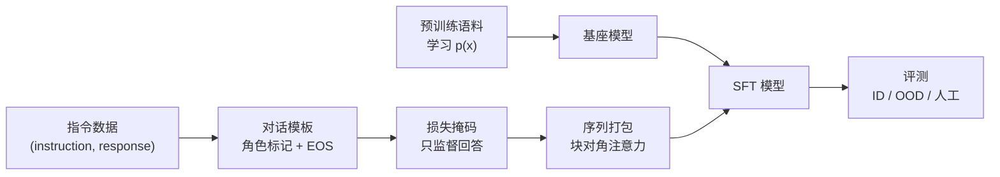

# 第 14 章 监督微调（SFT）

## 本章导读

一个只做过预训练的模型，收到“把这句话翻译成英文”时，很可能接着写出更多中文指令，而不是给出译文。它学会了“下一个 Token 是什么”，却没有学会“现在该做什么”。监督微调（Supervised Fine-Tuning，SFT）要补的正是这一步：把数据从任意文本换成指令与回答的配对，把损失从全部 Token 收窄到回答 Token。看似只是换了数据集和掩码，实则同时改变了模型的条件分布、梯度来源与评测口径。本章用一个可以手算的玩具任务回答三个问题：掩码到底改变了什么，数据质量与数量如何权衡，拒绝采样为什么常常没有公式预测得那么好。

## 难度标签

⭐⭐ 基础 ｜ 前置：第 1 章的交叉熵、第 3 章的 Transformer 与因果掩码、第 13 章的序列打包 ｜ 数学要求：条件概率、加权平均与几何分布 ｜ 代码要求：能读懂 PyTorch 的 `ignore_index` 与批处理拼接

## 学习目标

1. 写出掩码交叉熵，解释角色标记、用户内容、回答、EOS 与 padding 各自在标签中的取值。
2. 区分 Token 平均与序列平均两种损失，说明它们对长短回答的加权差异及适用条件。
3. 实现对话模板与序列打包，验证打包前后 logits 在浮点误差内一致，并说清跨对话边界为何要置 `-100`。
4. 用标签噪声混合公式区分随机噪声与系统性噪声，解释“加噪声几乎不降分”与“换一种噪声直接崩掉”并不矛盾。
5. 推导拒绝采样的接受率、pass@n 与期望采样量，解释经验 pass@n 低于平均率公式的原因。

## 14.1 直觉：预训练学会续写，SFT 学会回答

预训练的目标是 $$p(x_t\mid x_{<t})$$，序列里的每个 Token 都是监督信号。一段网页、一本书、一份代码，模型都要预测它的下一个词。这个目标让模型吸收语言规律与世界知识，但它不区分“问题”与“答案”：只要文本统计上通顺，模型就可能继续写问题，而不是回答问题。SFT 把目标改成 $$p(y\mid x)$$，其中 $$x$$ 是指令或对话历史，$$y$$ 是期望的回答。数据从“任意文本”变成“示范”，损失从“全部 Token”变成“只监督回答”，评测从“困惑度”变成“指令遵循”。

可以用学徒打比方。预训练像把学徒关进图书馆，让他读遍所有书，学会语言的形状；SFT 像师傅坐在旁边，给出一个个具体请求，再示范该怎么回应。师傅的示范不需要覆盖所有知识，但要覆盖“什么样的请求，对应什么样的回答格式与语气”。这也解释了为什么少量高质量示范有时比海量随意文本更有效：SFT 补的是条件分布的形状，不是知识的存量。

SFT 相对预训练有三个同时发生的变化。第一是数据形态：单条样本从连续文本变成带角色的多轮对话，需要模板把角色、内容与回合结束符拼成一条 Token 序列。第二是损失掩码：只有助手回合的内容与 EOS 进入损失，用户回合、角色标记与 padding 都置为 `-100`。第三是训练规模：SFT 通常只跑 1–3 个 epoch，学习率比预训练低一到两个数量级，数据量从万亿 Token 降到几千到几百万条。三者缺一不可：只换数据不换掩码，模型会花大量容量去预测用户的问题；只换掩码不换数据，模型仍然没有见过“指令—回答”的对应关系。

图 14-1 把这条流水线画出来。预训练语料提供语言能力，指令数据提供条件分布，模板负责序列化，掩码负责梯度选择，打包负责吞吐，最后才得到可评测的 SFT 模型。



本章的实验任务刻意做得足够小，以便在 CPU 上几分钟跑完：输入是 3–5 个数字，回答是每个数字加一后对 8 取模。例如输入 `3 6 1`，正确回答是 `4 7 2`。词表只有 16 个 Token：0 是 padding，1–4 是 BOS、用户、助手、EOS，5–12 是数字 0–7，13–14 留作分布外模板的角色标记。随机猜中整条回答的概率约为 $$(1/8)^L$$，逐 Token 命中率的随机水平是 $$1/8=0.125$$。这个任务同时提供了三种评测：训练分布内（ID）的 3–5 位输入、长度分布外（OOD）的 7–8 位输入、以及把角色标记换成训练中从未出现过的 13/14 的模板 OOD。后两者用来观察 SFT 学到的是可迁移的规则，还是训练分布内的表面映射。

## 14.2 数学原理

### 14.2.1 掩码交叉熵

设一条对话渲染后的输入为 $$x_0,\dots,x_T$$，其中 $$x_0$$ 是 BOS，末尾是 EOS。因果语言模型在第 $$t$$ 个位置输出对下一个 Token 的分布 $$p_\theta(\cdot\mid x_{\le t})$$。SFT 的损失只对监督位置求平均：

$$
\mathcal{L}_{\mathrm{SFT}}(\theta)=-\frac{1}{\sum_{t=0}^{T-1}m_t}\sum_{t=0}^{T-1}m_t\log p_\theta(x_{t+1}\mid x_{\le t})\qquad \text{(14.1)}
$$

其中 $$m_t\in\{0,1\}$$ 表示“用位置 $$t$$ 预测位置 $$t+1$$”这一项是否进入损失。对本章的模板，助手回合的内容 Token 与回合结束的 EOS 对应 $$m_t=1$$；BOS、角色标记、用户内容与 padding 对应 $$m_t=0$$。实现上不需要单独保存 $$m_t$$，而是把不监督的目标写成 `-100`，交给 `F.cross_entropy(..., ignore_index=-100)` 跳过。这与第 13 章打包时处理跨文档边界用的是同一个约定。

这里有两个容易写错的地方。其一是位移方向：位置 $$t$$ 的 logits 预测的是 $$x_{t+1}$$，所以掩码要作用在目标上，而不是输入上。输入始终保留完整上下文，包括用户的问题；被掩掉的只是“要不要为这个目标付梯度”。其二是 EOS：助手回合末尾的 EOS 必须监督，否则模型学不会在回答结束后停下来，推理时会一直续写。相应地，序列最后一个位置没有“下一个 Token”可预测，标签固定为 `-100`。


把掩码理解成“目标选择”而不是“输入裁剪”：输入永远是完整的对话，掩码只决定哪些位置的目标进入分母与梯度。这样模型在生成回答时仍能看到用户的问题与多轮历史。


掩码不只是省算力。若把用户内容也纳入损失，模型会被要求预测“用户会怎么问”，这部分梯度与“助手该怎么答”争夺容量；在数据量小、用户句式多样的 SFT 中，它还会让模型倾向于模仿提问风格。第 14.4 节的对照会看到，只算回答在等步数下略好，但差距不大；真正的理由是监督比例与信号纯度，而不是一个数量级的性能提升。

### 14.2.2 Token 平均与序列平均

(14.1) 的分母是所有监督 Token 的总数，这等价于对整个批次的 Token 做统一平均。另一种常见写法是先对每条样本求平均，再对样本求平均：

$$
\mathcal{L}_{\mathrm{tok}}=\frac{\sum_{i=1}^{B}\sum_{t}m_{i,t}\ell_{i,t}}{\sum_{i=1}^{B}\sum_{t}m_{i,t}},\qquad
\mathcal{L}_{\mathrm{seq}}=\frac{1}{B}\sum_{i=1}^{B}\frac{\sum_{t}m_{i,t}\ell_{i,t}}{\sum_{t}m_{i,t}}\qquad \text{(14.2)}
$$

其中 $$\ell_{i,t}=-\log p_\theta(x_{i,t+1}\mid x_{i,\le t})$$。两者只在各样本的监督 Token 数相等时一致。Token 平均让长回答的每个 Token 权重相同，于是一条 500 Token 的回答对梯度的贡献约为一条 20 Token 回答的 25 倍；序列平均则让每条对话权重相同，短回答的每个 Token 被放大。实际框架默认多用 Token 平均，因为它与预训练的口径一致，实现也最简单。若数据里回答长度与质量强相关——例如长回答往往更详细、更可靠——Token 平均会自然地偏向长回答；若长短回答同等重要，或者你想避免少数超长样本主导训练，就应改用序列平均，或者先按长度分桶再组批。

选择哪种平均还会改变有效学习率。同样的学习率下，序列平均对短样本的梯度更大，训练早期更容易震荡；切换到序列平均时，通常要重新扫一遍学习率，而不能直接沿用 Token 平均的超参数。

### 14.2.3 监督比例

记第 $$i$$ 条对话的监督 Token 数为 $$n_i^{\mathrm{sup}}$$，总长度为 $$T_i$$，监督比例定义为

$$
\rho_{\mathrm{sup}}=\frac{\sum_{i=1}^{B}n_i^{\mathrm{sup}}}{\sum_{i=1}^{B}T_i}\qquad \text{(14.3)}
$$

对本章的模板，一条长度为 $$L$$ 的单轮对话渲染为 `BOS USER x ASSISTANT y EOS`，共 $$2L+4$$ 个 Token，监督的是 $$L$$ 个回答 Token 加 1 个 EOS，因此 $$\rho_{\mathrm{sup}}=(L+1)/(2L+4)$$。当 $$L=5$$ 时约为 0.43，与 14.4 节实测的 0.417 吻合（评测集长度在 3–5 之间浮动）。这个数字说明：即使做了答案掩码，仍有超过一半的 Token 不产生梯度。短回答、长系统提示、多轮历史都会进一步压低比例。逐条 padding 还会把填充位置算进分母，让有效监督比例更低；打包通过减少 padding 把比例拉回真实值，第 13 章的 Token 利用率账本在这里直接适用。

监督比例低本身不是问题，但它解释了两件事。第一，SFT 的“有效数据量”应按监督 Token 而非总 Token 计；同样是一百万条对话，回答平均 20 Token 与平均 200 Token，梯度信号差一个数量级。第二，当监督比例很低时，增大批大小主要是在重复填充与提示，真正的监督信号增长有限，这时提高打包率比单纯加卡更划算。

### 14.2.4 标签噪声：随机与系统

SFT 数据由人写或由模型生成，错误不可避免。把标签错误建模成噪声，可以解释一个反直觉现象：给数据随机注入一半错误，模型几乎不掉分；换一种错误方式，模型直接崩掉。

设干净条件分布为 $$p(y\mid x)$$，每个标签以概率 $$\epsilon$$ 被替换成词表上的均匀随机 Token。模型在无限数据下学到的是混合分布

$$
\tilde p(y\mid x)=(1-\epsilon)\,p(y\mid x)+\frac{\epsilon}{|\mathcal{V}|}\qquad \text{(14.4)}
$$

对任意两个候选 $$a,j$$，两者之差为

$$
\tilde p(a\mid x)-\tilde p(j\mid x)=(1-\epsilon)\left[p(a\mid x)-p(j\mid x)\right]\qquad \text{(14.5)}
$$

均匀噪声给所有候选加同一个常数，只把分布压平，不改变排序。因此只要干净分布的最高概率类别领先，argmax 仍然不变；模型付出的代价是置信度下降、熵上升，而不是准确率下降。这与 14.4 节 `rand-50%-1024` 与 `clean-256` 几乎打平的结果一致：随机噪声消耗了样本效率，但没有改变学到的条件分布。

系统性噪声不同。假设标注者习惯性地把“加一”写成“加二”，即错误答案 $$y'$$ 总是同一个偏移。此时 $$\tilde p(a\mid x)=(1-\epsilon)p(a\mid x)$$，$$\tilde p(y'\mid x)=(1-\epsilon)p(y'\mid x)+\epsilon$$。取 $$p(a)=0.6$$、$$p(y')=0.3$$、$$\epsilon=0.5$$，干净时两者差 0.3，加噪后变成 $$0.5\times0.3-0.5=-0.35$$，排序翻转，模型学会的是“加二”。真实数据里的错误往往有相关性：同一批标注者的偏好、同一个模板的歧义、同一个生成模型的习惯。这类噪声不会被平均掉，反而会被当成信号学进去。这就是为什么数据清洗的收益不能只看“错了多少条”，还要看错误是否与任务规则相关。


清洗 SFT 数据时先问“错误是否与任务规则相关”，再看错误率。与规则无关的随机错误可以靠数据量摊薄；与规则相关的系统性错误会被模型当成另一种规则学进去。


### 14.2.5 序列打包与对话隔离

SFT 的对话长短不一，逐条组批要补齐到批内最大长度。打包把多条对话首尾相接成一条长序列，用块对角因果掩码保证每条对话只能看到自己。设 $$d_t$$ 是位置 $$t$$ 所属的对话编号，打包后的目标为

$$
y_t^{\mathrm{pack}}=
\begin{cases}
x_{t+1}, & d_t=d_{t+1},\\
-100, & d_t\neq d_{t+1}.
\end{cases}\qquad \text{(14.6)}
$$

注意力掩码沿用第 13 章的 (13.8)：$$M_{ij}=\mathbf{1}[d_i=d_j]\cdot\mathbf{1}[j\le i]$$，位置编号在每条对话内从 0 重新开始。三者合起来，每个 Token 看到的上下文与它单独前向时完全相同，因此 logits 与损失逐位一致。若省掉块对角掩码、只保留因果掩码，后一条对话会注意到前一条的内容，loss 可能看起来更低，但模型学到了训练分布里不存在的跨对话依赖。

跨对话边界的标签必须置 `-100`，原因与第 13 章相同：位置 $$t$$ 是上一条对话的最后一个 Token 时，$$x_{t+1}$$ 是下一条对话的第一个 Token，用前者预测后者既没有语义，也会把两条无关对话强行关联。注意 EOS 仍在上一条对话内部，它是被监督的；被掩掉的是“EOS 预测下一条 BOS”这一项。打包不改变监督 Token 的总数，只改变它们在一维序列里的排布。

### 14.2.6 拒绝采样

拒绝采样（rejection sampling）先用当前模型对每个提示采样若干条回答，再用规则或验证器筛出正确的，把“提示—正确回答”加入训练集。设模型对某个提示输出完全正确回答的概率为 $$p$$，独立采样 $$n$$ 条，则至少有一条正确的概率与凑够 $$k$$ 条正确样本的期望采样量为

$$
p_{\mathrm{acc}}=p,\qquad \mathrm{pass@}n=1-(1-p)^n,\qquad \mathbb{E}[\text{draws}]=\frac{k}{p}\qquad \text{(14.7)}
$$

(14.7) 假设同一个提示的每次采样独立同分布，且所有提示共享同一个 $$p$$。真实数据里 $$p$$ 随提示难度剧烈变化。设提示 $$i$$ 的接受率为 $$p_i$$，平均接受率为 $$\bar p$$，则经验 pass@n 是 $$\frac{1}{N}\sum_i[1-(1-p_i)^n]$$。函数 $$f(p)=1-(1-p)^n$$ 在 $$[0,1]$$ 上是凹函数，由 Jensen 不等式 $$\frac{1}{N}\sum_{i=1}^{N}[1-(1-p_i)^n]\le 1-(1-\bar p)^n$$ 可知，用平均接受率代入 (14.7) 会系统性高估真实通过率。容易的提示贡献了大部分命中，困难的提示即使采 8 条也几乎全错；把两者混在一起算一个平均 $$p$$，等于假设困难提示也能按平均概率成功。第 14.4 节的实验里，平均接受率 0.176 对应的理论 pass@8 是 0.787，而经验值只有 0.281，差距正来自这种异质性。

拒绝采样还有两个副作用。其一是多样性坍缩：弱模型对同一提示的输出高度集中，筛出来的正确答案可能只有少数几种，去重后远少于采样条数；用这样的数据继续训练，会进一步收窄模型的输出分布。其二是选择偏差：被接受的样本集中在模型已经会的提示上，训练集分布向“容易”偏移，难提示得不到补充。工程上通常要同时记录接受率、去重后条数与提示难度分层，不能只看“筛出了多少条”。

### 14.2.7 灾难性遗忘与回放

SFT 的数据量远小于预训练，学习率却不低，模型容易在学会指令格式的同时遗忘预训练能力。一种直接的缓解是混入预训练数据做回放（replay）。设预训练数据量为 $$N_{\mathrm{PT}}$$，SFT 数据量为 $$N_{\mathrm{SFT}}$$，回放比例与损失权重为

$$
r_{\mathrm{replay}}=\frac{N_{\mathrm{PT}}}{N_{\mathrm{PT}}+N_{\mathrm{SFT}}},\qquad
\lambda=\frac{r_{\mathrm{replay}}}{1-r_{\mathrm{replay}}}\qquad \text{(14.8)}
$$

训练损失写成 $$\mathcal{L}=\mathcal{L}_{\mathrm{SFT}}+\lambda\mathcal{L}_{\mathrm{PT}}$$。若希望回放数据占总 Token 的 10%，则 $$r=0.1$$、$$\lambda\approx0.111$$。回放比例不是越高越好：太高会把模型拉回预训练分布，指令遵循变弱；太低则起不到正则作用。实践中常按任务调整，并在 SFT 前后各跑一次预训练风格的困惑度或通用能力评测，确认没有明显回退。第 15 章会看到，参数高效微调通过只更新少量参数，把遗忘限制在更小的子空间里，是另一条互补的路线。

需要说明，本节只给公式与工业经验，没有单独跑遗忘实验。本章的玩具任务只有“加一模 8”一种能力，没有可遗忘的旧任务；强行构造一个旧任务再回放，结论也会被 2 层 32 维的容量限制掩盖。遗忘的定量结论应留给真实模型与真实数据。

## 14.3 方案对比

表 14-1 把本章涉及的几个决策放在一起。它们不是互斥的选项，而是一条流水线上的不同开关；每个开关都对应一个代价，选它之前要先说清换来了什么。

| 决策 | 常见选项 | 代价 | 适用条件 |
| --- | --- | --- | --- |
| 损失范围 | 只算回答 / 全序列 | 全序列让用户 Token 争夺容量，监督比例高但信号杂 | 任务以生成为主时只算回答；需要建模完整对话分布时才用全序列 |
| 数据规模 | 少量精选 / 大规模合成 | 精选依赖标注质量，合成依赖生成模型与过滤 | 格式对齐用少量精选即可；覆盖长尾任务需要规模与多样性 |
| 噪声类型 | 随机错误 / 系统性错误 | 随机错误只降样本效率，系统性错误改变条件分布 | 清洗优先级应由“错误是否与规则相关”决定，而非错误率 |
| 序列组织 | 逐条 padding / 打包 | 打包省 padding，但需要块对角掩码与边界处理 | 回答短、对话多、GPU 利用率低时收益最大 |
| 合成策略 | 直接使用 / 拒绝采样 | 拒绝采样耗推理算力，且可能多样性坍缩 | 有可靠验证器、且模型已具备一定正确率时有效 |
| 遗忘控制 | 不回放 / 混预训练数据 | 回放占预算，比例过高会削弱指令遵循 | SFT 数据少、学习率高、基座能力宝贵时启用 |

## 14.4 代码实现：TinyLM 的 SFT 工具

### 14.4.1 实现选择

本章新增两个模块。`tinylm/tokenizer/chat.py` 定义对话模板与渲染函数，负责把 `(role, content)` 列表变成 `input_ids` 与 `labels`；`tinylm/posttrain/sft.py` 定义 `SFTConfig`、掩码损失、两种平均、批拼接、序列打包与拒绝采样公式。模型侧没有改动：仍然调用第 8 章的 `TinyLM.forward(input_ids, attention_mask=..., labels=...)`，`CausalLMOutput` 与 `ModelConfig` 的签名保持不变。`SFTConfig` 只承载训练脚本参数（学习率、轮数、批大小、最大长度、是否只算回答、回放比例、梯度裁剪、预热比例、权重衰减），不进入模型配置。

模板的渲染结果保留完整长度：`input_ids` 与 `labels` 等长，`labels` 由右移一位的输入构造，最后一个位置固定为 `-100`。这样 EOS 既是输入也是监督目标，打包时也不会丢掉每条对话的收尾。若像预训练那样返回 `ids[:-1]` 与 `ids[1:]`，EOS 会落在预测目标之外，模型学不会停止，打包的边界也会错位。

实验用 2 层、$$d_{model}=32$$、2 个头的 TinyLM，词表 16，任务为“逐 Token 加一模 8”。所有对照固定数据种子、模型种子与批采样种子，报告 3 个种子的均值与标准差。示例为了在 CPU 上几分钟收敛，学习率取 $$3\times10^{-3}$$；`SFTConfig` 默认的 $$2\times10^{-5}$$ 是真实全参数微调的典型值，两者不要混用。

### 14.4.2 完整代码

先看对话模板。

```python
"""第 14 章：对话模板与损失掩码（tinylm/tokenizer/chat.py）。"""
from dataclasses import dataclass

import torch

IGNORE_INDEX = -100


@dataclass(frozen=True)
class ChatTemplate:
    """把多轮对话渲染成一条 Token 序列。

    ``turns`` 是 ``(role, content)`` 的列表，``role`` 取 ``"user"`` 或
    ``"assistant"``，``content`` 是 Token ID 列表。模板只负责拼接与
    掩码，不负责把文本切成 Token；分词由第 2 章的 ``Tokenizer`` 完成。
    """

    name: str = "default"
    bos_token: int = 1
    user_token: int = 2
    assistant_token: int = 3
    eos_token: int = 4
    system_token: int | None = None

    def render(self, turns, *, answer_only=True):
        """返回 ``input_ids`` 与 ``labels``。

        只有 assistant 回合的内容与回合结束符进入损失；user 回合、
        role 标记、BOS 以及 padding 位置在 ``labels`` 中都是 ``-100``。
        标签由输入右移一位的目标构造；最后一个位置没有目标，固定为
        ``-100``。
        """
        ids, mask = [self.bos_token], [0]
        for role, content in turns:
            if role == "system":
                if self.system_token is None:
                    raise ValueError("模板没有 system_token")
                ids.append(self.system_token)
                mask.append(0)
            elif role == "user":
                ids.append(self.user_token)
                mask.append(0)
            elif role == "assistant":
                ids.append(self.assistant_token)
                mask.append(0)
            else:
                raise ValueError(f"未知角色 {role!r}")
            ids.extend(int(t) for t in content)
            content_supervised = (role == "assistant") or (not answer_only)
            mask.extend([1 if content_supervised else 0] * len(content))
            if role == "assistant":
                ids.append(self.eos_token)
                mask.append(1)

        input_ids = torch.tensor(ids, dtype=torch.long)
        labels = torch.full_like(input_ids, IGNORE_INDEX)
        next_supervised = torch.tensor(mask[1:], dtype=torch.bool)
        labels[:-1] = torch.where(
            next_supervised, input_ids[1:],
            torch.full_like(input_ids[1:], IGNORE_INDEX))
        return {"input_ids": input_ids, "labels": labels}


def encode_conversation(turns, template=None, *, answer_only=True):
    """模板渲染的简写；``template=None`` 时使用默认模板。"""
    return (template or ChatTemplate()).render(
        turns, answer_only=answer_only)


def count_supervised(rendered):
    """(14.3)：返回 (监督标签数, 非 padding 输入数, 监督比例)。"""
    n_sup = int((rendered["labels"] != IGNORE_INDEX).sum())
    n_tok = int(rendered["input_ids"].numel())
    return n_sup, n_tok, (n_sup / n_tok if n_tok else 0.0)
```

再看待训练工具与采样公式。

```python
"""第 14 章：监督微调的数据整理、损失与采样工具（tinylm/posttrain/sft.py）。"""
from dataclasses import dataclass

import torch
import torch.nn.functional as F

from tinylm.data.collate import block_causal_mask

IGNORE_INDEX = -100


@dataclass(frozen=True)
class SFTConfig:
    """SFT 的训练脚本参数，不进入 ``ModelConfig``。"""

    lr: float = 2e-5                 # 全参数微调的典型峰值学习率
    epochs: float = 3.0
    batch_size: int = 8
    max_len: int = 1024
    answer_only: bool = True
    replay_ratio: float = 0.0        # 混入预训练数据的比例
    grad_clip: float = 1.0
    warmup_ratio: float = 0.03
    weight_decay: float = 0.0


def masked_cross_entropy(logits, labels):
    """(14.1)：只对 ``labels != -100`` 的位置求平均。

    ``logits`` 形状 ``(B, T, V)``，``labels`` 形状 ``(B, T)``。
    """
    return F.cross_entropy(
        logits.reshape(-1, logits.size(-1)),
        labels.reshape(-1),
        ignore_index=IGNORE_INDEX,
    )


def token_mean_loss(per_token, labels):
    """(14.2) 左式：整个批次的监督 Token 一起平均。"""
    mask = labels != IGNORE_INDEX
    return per_token[mask].sum() / mask.sum().clamp_min(1)


def sequence_mean_loss(per_token, labels):
    """(14.2) 右式：先对每条样本平均，再对样本平均。"""
    mask = labels != IGNORE_INDEX
    lengths = mask.sum(1).clamp_min(1)
    per_example = (per_token * mask).sum(1) / lengths
    return per_example.mean()


def collate_examples(examples, pad_token=0, max_len=None):
    """把单条渲染结果补齐成一个批；padding 的标签为 ``-100``。"""
    examples = list(examples)
    if max_len is not None:
        examples = [e for e in examples if e["input_ids"].numel() <= max_len]
    length = max(int(e["input_ids"].numel()) for e in examples)
    batch = len(examples)
    input_ids = torch.full((batch, length), pad_token, dtype=torch.long)
    labels = torch.full((batch, length), IGNORE_INDEX, dtype=torch.long)
    attention_mask = torch.zeros((batch, length), dtype=torch.bool)
    for i, e in enumerate(examples):
        n = int(e["input_ids"].numel())
        input_ids[i, :n] = e["input_ids"]
        labels[i, :n] = e["labels"]
        attention_mask[i, :n] = True
    return {"input_ids": input_ids, "labels": labels,
            "attention_mask": attention_mask}


@dataclass(frozen=True)
class PackedSFTBatch:
    """多条对话拼成的一条训练序列。"""

    input_ids: torch.Tensor        # (T,)
    labels: torch.Tensor           # (T,)
    doc_ids: torch.Tensor          # (T,)
    position_ids: torch.Tensor     # (T,)，每条对话内从 0 开始
    attention_mask: torch.Tensor   # (1, 1, T, T)，块对角因果掩码
    supervised: int                # 监督标签数
    tokens: int                    # 非 padding 输入数


def pack_sft_examples(examples, max_len=None):
    """把多条对话拼进一条序列，返回 :class:`PackedSFTBatch`。

    跨对话边界的标签置为 ``-100``；位置编号在每条对话内重置；
    注意力用块对角因果掩码，避免后一条对话看到前一条的内容。
    """
    examples = list(examples)
    lengths = [int(e["input_ids"].numel()) for e in examples]
    total = sum(lengths)
    if max_len is not None and total > max_len:
        raise ValueError("对话总长超过 max_len")

    input_ids = torch.cat([e["input_ids"] for e in examples])
    labels = torch.cat([e["labels"] for e in examples]).clone()
    doc_ids = torch.cat([torch.full((n,), i, dtype=torch.long)
                         for i, n in enumerate(lengths)])
    position_ids = torch.cat([torch.arange(n) for n in lengths])

    offsets = torch.tensor([0] + lengths[:-1]).cumsum(0)
    last = offsets + torch.tensor(lengths) - 1
    labels[last[:-1]] = IGNORE_INDEX          # (14.6) 跨对话边界不计损失

    return PackedSFTBatch(
        input_ids=input_ids,
        labels=labels,
        doc_ids=doc_ids,
        position_ids=position_ids,
        attention_mask=block_causal_mask(doc_ids),
        supervised=int((labels != IGNORE_INDEX).sum()),
        tokens=total,
    )


def supervision_stats(examples):
    """(14.3)：返回监督 Token 占比与平均回答长度。"""
    sup = sum(int((e["labels"] != IGNORE_INDEX).sum()) for e in examples)
    tok = sum(int(e["input_ids"].numel()) for e in examples)
    lengths = [int((e["labels"] != IGNORE_INDEX).sum()) for e in examples]
    return {
        "supervised": sup,
        "tokens": tok,
        "ratio": sup / tok if tok else 0.0,
        "mean_answer": sum(lengths) / len(lengths) if lengths else 0.0,
    }


def label_noise_mixture(p_true, epsilon, vocab_size):
    """(14.4)：均匀标签噪声下模型学到的分布。

    ``p_true`` 是干净条件分布（形状 ``(..., V)``），``epsilon`` 是标签
    被替换成均匀随机标签的比例。
    """
    uniform = torch.full_like(p_true, 1.0 / vocab_size)
    return (1.0 - epsilon) * p_true + epsilon * uniform


def acceptance_probability(p):
    """(14.7)：单条采样被接受的概率就是模型的精确匹配率 ``p``。"""
    if not 0.0 <= p <= 1.0:
        raise ValueError("p 必须在 [0, 1] 内")
    return p


def expected_draws(p, accepted):
    """(14.7)：凑够 ``accepted`` 条需采样的期望条数。"""
    if p <= 0.0:
        return float("inf")
    return accepted / acceptance_probability(p)


def pass_at_n(p, n):
    """(14.7)：独立采样 ``n`` 条，至少一条正确的概率。"""
    if n < 1:
        raise ValueError("n 必须为正")
    return 1.0 - (1.0 - acceptance_probability(p)) ** n
```

实验脚本把掩码、数据质量、打包与拒绝采样四组对照串起来。

```python
"""第 14 章：SFT 的损失掩码、数据质量与拒绝采样（examples/ch14_sft.py）。"""
import random
import time

import torch
import torch.nn.functional as F

from ch08 import ModelConfig, TinyLM
from tinylm.posttrain import sft
from tinylm.tokenizer.chat import ChatTemplate, encode_conversation

PAD, BOS, USER, ASSISTANT, EOS, D0 = 0, 1, 2, 3, 4, 5
Q, A = 13, 14                     # OOD 模板使用的角色标记
VOCAB = 16
TEMPLATE = ChatTemplate()
SHIFTED = ChatTemplate(name="shifted", user_token=Q, assistant_token=A)
SEEDS = (0, 1, 2)
CHANCE = 1.0 / 8


def sample_turns(gen, length, noise=0.0, mode="random"):
    """生成一轮指令与回答：回答是输入的逐 Token 后继（模 8）。"""
    xs = [int(v) for v in torch.randint(0, 8, (length,), generator=gen)]
    ys = [(x + 1) % 8 for x in xs]
    flip = noise > 0 and torch.rand(1, generator=gen).item() < noise
    if flip and mode == "random":
        j = int(torch.randint(0, length, (1,), generator=gen).item())
        ys[j] = (ys[j] + 2) % 8
    elif flip and mode == "systematic":
        ys = [(x + 2) % 8 for x in xs]
    return [("user", [D0 + x for x in xs]),
            ("assistant", [D0 + y for y in ys])]


def make_dataset(seed, size, noise=0.0, mode="random", answer_only=True,
                 lo=3, hi=5):
    gen = torch.Generator().manual_seed(seed)
    rng = random.Random(seed)
    data = []
    for _ in range(size):
        length = rng.randint(lo, hi)
        turns = sample_turns(gen, length, noise=noise, mode=mode)
        data.append(encode_conversation(turns, TEMPLATE,
                                        answer_only=answer_only))
    return data


def make_model(seed):
    torch.manual_seed(seed)
    cfg = ModelConfig(vocab_size=VOCAB, d_model=32, n_layers=2, n_heads=2,
                      d_ff=128, max_seq_len=32, pos_encoding="rope",
                      norm="rmsnorm", ffn="swiglu", bias=False)
    return TinyLM(cfg)


def train(data, seed, steps, lr=3e-3, batch_size=32):
    model = make_model(seed)
    opt = torch.optim.AdamW(model.parameters(), lr=lr, weight_decay=0.01)
    gen = torch.Generator().manual_seed(1000 + seed)
    model.train()
    for _ in range(steps):
        idx = torch.randint(0, len(data), (batch_size,), generator=gen)
        batch = sft.collate_examples([data[int(i)] for i in idx])
        out = model(batch["input_ids"], attention_mask=batch["attention_mask"],
                    labels=batch["labels"])
        opt.zero_grad()
        out.loss.backward()
        opt.step()
    return model


@torch.no_grad()
def evaluate(model, template, lo, hi, n=300):
    model.eval()
    gen = torch.Generator().manual_seed(999)
    rng = random.Random(999)
    exact = tokens = correct = 0
    for _ in range(n):
        length = rng.randint(lo, hi)
        r = encode_conversation(sample_turns(gen, length), template)
        out = model(r["input_ids"][None])
        keep = r["labels"] != -100
        pred = out.logits[0].argmax(-1)
        exact += int((pred[keep] == r["labels"][keep]).all())
        tokens += int(keep.sum())
        correct += int((pred[keep] == r["labels"][keep]).sum())
    return exact / n, correct / max(tokens, 1)


def masking_table():
    print("\n损失掩码对照（256 条干净数据，250 步，3 种子；随机水平 0.125）")
    print("OOD 两列为 Token 级命中率，便于观察部分泛化")
    print(f"{'掩码':<10s}{'ID 精确':>16s}{'ID Token':>16s}"
          f"{'长度 OOD':>16s}{'模板 OOD':>16s}")
    for answer_only in (True, False):
        rows = []
        for seed in SEEDS:
            data = make_dataset(10, 256, answer_only=answer_only)
            model = train(data, seed, steps=250)
            rows.append((*evaluate(model, TEMPLATE, 3, 5),
                         evaluate(model, TEMPLATE, 7, 8)[1],
                         evaluate(model, SHIFTED, 3, 5)[1]))
        t = torch.tensor(rows)
        mean, std = t.mean(0), t.std(0)
        name = "只算回答" if answer_only else "全序列"
        cells = "".join(f"{m:>10.3f}±{s:.3f}" for m, s in zip(mean[1:4], std[1:4]))
        print(f"{name:<10s}{mean[0]:>10.3f}±{std[0]:.3f}{cells}")


def quality_table():
    specs = (
        ("clean-64", 64, 0.0, "random"),
        ("clean-256", 256, 0.0, "random"),
        ("rand-50%-1024", 1024, 0.5, "random"),
        ("sys-50%-1024", 1024, 0.5, "systematic"),
        ("sys-25%-1024", 1024, 0.25, "systematic"),
    )
    print("\n数据质量与数量（600 步，3 种子；随机水平 0.125）")
    print("长度 OOD 为 Token 级命中率")
    print(f"{'数据':<16s}{'ID 精确':>16s}{'ID Token':>16s}{'长度 OOD':>16s}")
    keep_model = None
    for name, size, noise, mode in specs:
        rows = []
        for seed in SEEDS:
            data = make_dataset(20, size, noise=noise, mode=mode)
            model = train(data, seed, steps=600)
            rows.append((*evaluate(model, TEMPLATE, 3, 5),
                         evaluate(model, TEMPLATE, 7, 8)[1]))
            if name == "clean-64" and seed == 0:
                keep_model = model
        t = torch.tensor(rows)
        mean, std = t.mean(0), t.std(0)
        cells = "".join(f"{m:>10.3f}±{s:.3f}" for m, s in zip(mean[1:], std[1:]))
        print(f"{name:<16s}{mean[0]:>10.3f}±{std[0]:.3f}{cells}")
    return keep_model


def packing_demo():
    print("\n打包等价性（6 条对话，各自输出已做答案掩码）")
    model = make_model(0).eval()
    gen = torch.Generator().manual_seed(0)
    examples = []
    for length in (3, 4, 5, 3, 4, 5):
        examples.append(encode_conversation(sample_turns(gen, length)))

    logits_ref, loss_ref, sup_ref = [], 0.0, 0
    with torch.no_grad():
        for e in examples:
            out = model(e["input_ids"][None],
                        position_ids=torch.arange(e["input_ids"].numel())[None])
            per = F.cross_entropy(out.logits[0], e["labels"],
                                  ignore_index=-100, reduction="none")
            keep = e["labels"] != -100
            logits_ref.append(out.logits[0][keep])
            loss_ref = loss_ref + per[keep].sum()
            sup_ref += int(keep.sum())
        packed = sft.pack_sft_examples(examples)
        out = model(packed.input_ids[None],
                    attention_mask=packed.attention_mask,
                    position_ids=packed.position_ids[None])
        per = F.cross_entropy(out.logits[0], packed.labels,
                              ignore_index=-100, reduction="none")
        keep = packed.labels != -100
        diff = (out.logits[0][keep] - torch.cat(logits_ref)).abs().max()
    stats = sft.supervision_stats(examples)
    print(f"逐条前向  损失 {loss_ref.item():.4f}  监督 Token {sup_ref}")
    print(f"打包前向  损失 {per[keep].sum().item():.4f}  监督 Token "
          f"{int(keep.sum())}")
    print(f"logits 最大偏差 {diff.item():.1e}；"
          f"监督比例 {stats['ratio']:.3f}，平均回答长度 {stats['mean_answer']:.1f}")


@torch.no_grad()
def sample_answer(model, prompt, *, max_new=8, temperature=1.0, gen=None):
    ids = list(prompt)
    out = []
    for _ in range(max_new):
        logits = model(torch.tensor(ids)[None]).logits[0, -1]
        probs = torch.softmax(logits / temperature, dim=-1)
        tok = int(torch.multinomial(probs, 1, generator=gen).item())
        ids.append(tok)
        out.append(tok)
        if tok == EOS:
            break
    return out


def rejection_demo(model):
    print("\n拒绝采样（弱模型，64 个提示，每个采 8 条，温度 1.0）")
    gen = torch.Generator().manual_seed(7)
    rng = random.Random(7)
    prompts, targets = [], []
    for _ in range(64):
        length = rng.randint(3, 5)
        turns = sample_turns(gen, length)
        xs = turns[0][1]
        ys = turns[1][1]
        prompts.append([BOS, USER] + xs + [ASSISTANT])
        targets.append(ys)

    accepted = draws = pass8 = 0
    unique = set()
    for prompt, target in zip(prompts, targets):
        hits = 0
        for _ in range(8):
            toks = sample_answer(model, prompt, gen=gen)
            if toks and toks[-1] == EOS:
                toks = toks[:-1]
            draws += 1
            if toks == target:
                hits += 1
                unique.add(tuple(toks))
        accepted += hits
        pass8 += int(hits > 0)
    p_hat = accepted / draws
    print(f"接受率 {p_hat:.3f}；经验 pass@8 {pass8/len(prompts):.3f}；"
          f"理论 1-(1-p)^8 {sft.pass_at_n(p_hat, 8):.3f}")
    print(f"接受 {accepted} 条，去重后 {len(unique)} 条；"
          f"凑够 64 条期望采样 {sft.expected_draws(p_hat, 64):.0f} 条")


def main():
    t0 = time.time()
    masking_table()
    weak = quality_table()
    packing_demo()
    if weak is not None:
        rejection_demo(weak)
    print(f"\n总耗时 {time.time() - t0:.1f} s")


if __name__ == "__main__":
    main()
```

测试文件覆盖模板、掩码、平均、拼接、打包与采样公式。

```python
import sys

import pytest
import torch
import torch.nn.functional as F

sys.path.insert(0, ".")
from ch08 import ModelConfig, TinyLM
from tinylm.posttrain import sft
from tinylm.tokenizer.chat import (ChatTemplate, count_supervised,
                                   encode_conversation)


def two_turn():
    return [("user", [5, 6]), ("assistant", [7, 8])]


def test_answer_only_masks_prompt():
    r = encode_conversation(two_turn())
    # ids: BOS USER 5 6 ASSIST 7 8 EOS
    assert r["input_ids"].tolist() == [1, 2, 5, 6, 3, 7, 8, 4]
    assert r["labels"].tolist() == [-100, -100, -100, -100, 7, 8, 4, -100]
    assert int((r["labels"] != -100).sum()) == 3


def test_full_loss_supervises_content():
    r = encode_conversation(two_turn(), answer_only=False)
    assert int((r["labels"] != -100).sum()) == 5


def test_multi_turn_each_answer_is_supervised():
    turns = [("user", [5]), ("assistant", [6]),
             ("user", [7]), ("assistant", [8])]
    r = encode_conversation(turns)
    ids = r["input_ids"].tolist()
    labels = r["labels"].tolist()
    # 两个回答 Token 与两个回合 EOS 都是监督目标
    assert int((r["labels"] != -100).sum()) == 4
    assert ids[3] == 3 and labels[3] == 6      # 第一个 ASSIST 之后
    assert ids[8] == 3 and labels[8] == 8      # 第二个 ASSIST 之后


def test_count_supervised_ratio():
    r = encode_conversation(two_turn())
    sup, tok, ratio = count_supervised(r)
    assert (sup, tok) == (3, 8)
    assert abs(ratio - 3 / 8) < 1e-9


def test_masked_cross_entropy_matches_manual():
    torch.manual_seed(0)
    logits = torch.randn(2, 4, 6)
    labels = torch.tensor([[1, -100, 3, -100], [2, 4, -100, -100]])
    got = sft.masked_cross_entropy(logits, labels)
    flat = F.cross_entropy(logits.reshape(-1, 6), labels.reshape(-1),
                           ignore_index=-100, reduction="none")
    want = flat[labels.reshape(-1) != -100].mean()
    assert torch.allclose(got, want)


def test_token_mean_differs_from_sequence_mean():
    per_token = torch.tensor([[1.0, 1.0, 9.0], [1.0, -100.0, -100.0]])
    labels = torch.tensor([[0, 1, 2], [0, -100, -100]])
    token_mean = sft.token_mean_loss(per_token, labels)
    seq_mean = sft.sequence_mean_loss(per_token, labels)
    assert abs(token_mean.item() - 3.0) < 1e-6
    assert abs(seq_mean.item() - 7 / 3) < 1e-6
    assert not torch.isclose(token_mean, seq_mean)


def test_collate_pads_labels_and_mask():
    a = encode_conversation([("user", [5]), ("assistant", [6])])
    b = encode_conversation([("user", [5, 6, 7]), ("assistant", [8, 9])])
    batch = sft.collate_examples([a, b], pad_token=0)
    assert batch["input_ids"].shape[0] == 2
    assert batch["labels"][0, -1].item() == -100
    assert not batch["attention_mask"][0, -1]
    assert batch["attention_mask"][1].all()


def test_pack_marks_boundaries_and_resets_positions():
    a = encode_conversation([("user", [5]), ("assistant", [6])])
    b = encode_conversation([("user", [7]), ("assistant", [8])])
    packed = sft.pack_sft_examples([a, b])
    n = a["input_ids"].numel()
    assert packed.labels[n - 1].item() == -100      # 跨对话边界
    assert packed.doc_ids.tolist() == [0] * n + [1] * n
    assert packed.position_ids.tolist() == list(range(n)) * 2
    assert packed.tokens == 2 * n
    assert packed.supervised == (int((a["labels"] != -100).sum())
                                 + int((b["labels"] != -100).sum()))


def test_pack_raises_when_too_long():
    a = encode_conversation([("user", [5]), ("assistant", [6])])
    with pytest.raises(ValueError):
        sft.pack_sft_examples([a, a], max_len=a["input_ids"].numel() + 1)


def test_packing_equals_per_example_forward():
    torch.manual_seed(0)
    cfg = ModelConfig(vocab_size=16, d_model=32, n_layers=2, n_heads=2,
                      d_ff=128, max_seq_len=32, pos_encoding="rope",
                      norm="rmsnorm", ffn="swiglu", bias=False)
    model = TinyLM(cfg).eval()
    examples = [
        encode_conversation([("user", [5, 6, 7]), ("assistant", [8, 9])]),
        encode_conversation([("user", [5, 9]), ("assistant", [6, 7, 8])]),
        encode_conversation([("user", [6]), ("assistant", [7])]),
    ]

    pieces, losses, total = [], 0.0, 0
    with torch.no_grad():
        for e in examples:
            out = model(e["input_ids"][None],
                        position_ids=torch.arange(e["input_ids"].numel())[None])
            per = F.cross_entropy(out.logits[0], e["labels"],
                                  ignore_index=-100, reduction="none")
            keep = e["labels"] != -100
            pieces.append(out.logits[0][keep])
            losses = losses + per[keep].sum()
            total += int(keep.sum())
        packed = sft.pack_sft_examples(examples)
        got = model(packed.input_ids[None],
                    attention_mask=packed.attention_mask,
                    position_ids=packed.position_ids[None])
        per_p = F.cross_entropy(got.logits[0], packed.labels,
                                ignore_index=-100, reduction="none")
        keep_p = packed.labels != -100
        logits_ref = torch.cat(pieces)
        assert torch.allclose(got.logits[0][keep_p], logits_ref, atol=1e-6)
        assert torch.allclose(per_p[keep_p].sum(), losses, atol=1e-6)


def test_supervision_stats():
    a = encode_conversation([("user", [5, 6]), ("assistant", [7, 8])])
    stats = sft.supervision_stats([a, a])
    assert stats["supervised"] == 2 * 3
    assert stats["tokens"] == 2 * a["input_ids"].numel()
    assert abs(stats["ratio"] - 3 / a["input_ids"].numel()) < 1e-9
    assert stats["mean_answer"] == 3.0


def test_uniform_label_noise_preserves_argmax_and_normalizes():
    p = torch.tensor([0.6, 0.3, 0.1])
    noisy = sft.label_noise_mixture(p, 0.4, 3)
    assert abs(noisy.sum().item() - 1.0) < 1e-9
    assert noisy.argmax().item() == p.argmax().item()
    assert abs(noisy[0].item() - 0.6 * 0.6 - 0.4 / 3) < 1e-6


def test_rejection_sampling_formulas():
    assert sft.acceptance_probability(0.25) == 0.25
    assert abs(sft.pass_at_n(0.25, 8) - (1 - 0.75 ** 8)) < 1e-9
    assert sft.expected_draws(0.25, 100) == 400.0
    assert sft.pass_at_n(0.0, 8) == 0.0
    with pytest.raises(ValueError):
        sft.acceptance_probability(1.2)


def test_rejection_sampling_empirical():
    torch.manual_seed(0)
    p, n, trials = 0.25, 8, 4000
    hits = 0
    for _ in range(trials):
        draws = torch.rand(n) < p
        hits += int(draws.any())
    assert abs(hits / trials - sft.pass_at_n(p, n)) < 0.03
```

### 14.4.3 测试

`tests/test_sft.py` 共 14 项，覆盖四组契约。模板组检查只算回答时的输入与标签、全序列监督数、多轮对话每个回答与 EOS 都被监督、监督比例计算；损失组检查掩码交叉熵与手写 `F.cross_entropy` 一致、Token 平均与序列平均确实不同；打包组检查 padding 的标签与注意力掩码、跨对话边界置 `-100`、位置在每个对话内重置、超长报错、以及打包与逐条前向的 logits 和损失在 $$10^{-6}$$ 内一致；采样组检查均匀噪声保持 argmax 且归一化、拒绝采样三个公式、以及 4,000 次模拟的通过率与解析值相差小于 0.03。运行结果为 14 项全部通过。

### 14.4.4 运行结果

```text
损失掩码对照（256 条干净数据，250 步，3 种子；随机水平 0.125）
OOD 两列为 Token 级命中率，便于观察部分泛化
掩码                   ID 精确        ID Token          长度 OOD          模板 OOD
只算回答           0.494±0.152     0.864±0.050     0.134±0.006     0.470±0.058
全序列            0.433±0.079     0.859±0.026     0.114±0.051     0.439±0.032

数据质量与数量（600 步，3 种子；随机水平 0.125）
长度 OOD 为 Token 级命中率
数据                         ID 精确        ID Token          长度 OOD
clean-64             0.179±0.023     0.677±0.011     0.179±0.025
clean-256            0.760±0.233     0.940±0.063     0.195±0.024
rand-50%-1024        0.798±0.204     0.955±0.047     0.112±0.040
sys-50%-1024         0.159±0.054     0.674±0.050     0.092±0.032
sys-25%-1024         0.554±0.193     0.890±0.055     0.091±0.017

打包等价性（6 条对话，各自输出已做答案掩码）
逐条前向  损失 82.2033  监督 Token 30
打包前向  损失 82.2033  监督 Token 30
logits 最大偏差 6.0e-08；监督比例 0.417，平均回答长度 5.0

拒绝采样（弱模型，64 个提示，每个采 8 条，温度 1.0）
接受率 0.176；经验 pass@8 0.281；理论 1-(1-p)^8 0.787
接受 90 条，去重后 17 条；凑够 64 条期望采样 364 条

总耗时 75.4 s
```

### 14.4.5 结果说明了什么

**第一，只算回答的收益是方向性的，不是数量级的。** 在 250 步、256 条干净数据下，只算回答的 ID 精确匹配为 0.494，全序列为 0.433，Token 级为 0.864 对 0.859。差距约 6 个百分点，但只算回答的标准差也更大（0.152 对 0.079），三个种子的方向并不完全一致。诚实的结论是：掩码让梯度集中在回答上、把监督比例从接近 100% 降到约 40%，在等步数下略占优势，但不能宣称“只算回答一定显著更好”。真正的理由是它避免了“学习预测用户提问”这一与目标无关的梯度，并把有限的容量留给回答；在真实模型与真实数据上，这个理由比玩具实验的几个点更重要。

**第二，长度与模板的分布外表现揭示了 SFT 的边界。** 只算回答在长度 OOD 上的 Token 命中率为 0.134，几乎等于随机水平 0.125；模板 OOD 为 0.470，明显高于随机但精确匹配为 0。也就是说，模型学到的是“在见过的模板与长度内，把输入逐位加一模 8”，而不是一条可以外推的算术规则。模板 OOD 的部分迁移来自位置与角色标记的结构相似：模型仍能把数字对到数字，但换成没见过的角色标记后，整条回答的精确匹配就失败了。SFT 主要对齐条件分布的形状，不保证规则泛化；要后者，需要数据覆盖更多长度与模板，或者用强化学习/程序验证去逼出规则。

**第三，数据质量与数量的关系不是单调的。** 64 条干净数据只做到 0.179，256 条做到 0.760，说明在这个任务上数量仍然重要，少量数据不足以覆盖 3–5 位的组合。把 1,024 条数据的一半标签随机改错，结果 0.798，与 256 条干净数据几乎打平——随机噪声消耗了样本效率，但没有改变学到的条件分布，这与 (14.4)、(14.5) 的预测一致。换成系统性错误，50% 的噪声直接把精确匹配打到 0.159，25% 也只恢复到 0.554；模型学到的是“加二”而不是“加一”。这组对照说明，数据清洗的优先级应由“错误是否与任务规则相关”决定，而不是只看错误率。

**第四，打包的等价性可以精确验证。** 6 条对话逐条前向与打包前向的损失同为 82.2033，监督 Token 同为 30，logits 最大偏差 $$6.0\times10^{-8}$$，在浮点误差内。监督比例 0.417、平均回答长度 5.0，与 14.2.3 的估算吻合。这个验收标准应该写进任何 SFT 数据管道的测试：先在小模型上确认“有块对角掩码等价、去掉掩码不等价”，再上大规模训练。

**第五，拒绝采样的经验通过率远低于平均率公式。** 弱模型的平均接受率是 0.176，代入 (14.7) 得到 pass@8 为 0.787，但 64 个提示的实际 pass@8 只有 0.281。差距来自提示难度的异质性：容易的提示几乎每次都中，困难的提示 8 次全错，平均接受率把两者混为一个数。另一个信号是去重：接受 90 条，去重后只剩 17 条，说明弱模型的正确输出高度集中，继续用这批数据训练会进一步收窄分布。工程上应同时报告接受率、经验 pass@n、去重后条数与提示难度分层；只看“平均接受率 × 采样数”会高估数据产出。

需要说明实验边界：模型只有 2 层、32 维，任务是逐位加一模 8，训练 250–600 步，评测 300 条。它能验证掩码、打包等价性与噪声/采样公式的方向，不能外推到真实 LLM 的指令遵循能力。真实 SFT 还涉及多轮、系统提示、工具调用、长回答与人工评测，这些都不在玩具任务的覆盖范围内。

### 14.4.6 复现步骤

```bash
cd tinylm-book/ch14
PYTHONPATH=. python examples/ch14_sft.py
PYTHONPATH=. python -m pytest tests/test_sft.py -q
```

CPU 上约 1–2 分钟；除耗时外，所有数字由固定种子决定，可逐字复现。拒绝采样段使用 `clean-64` 的第 0 个种子模型作为弱模型，因此它的接受率与数据质量表的第一行对应。

## 14.5 工业实践

InstructGPT 是 SFT 进入主流的标志性工作。它的流程分三步：先让标注者针对 13,000 个提示写出示范回答，做监督微调；再用约 33,000 个提示的成对比较训练奖励模型；最后用 PPO 优化。论文报告，1.3B 参数的 InstructGPT 在人类偏好上优于 175B 的 GPT-3，说明“对齐数据 + 训练目标”可以在参数量之外换取可用性。它的 SFT 数据并不大，但标注指南细、示范质量高，这与本章“监督信号纯度比原始条数更重要”的结论一致。

Llama 2 公开了更具体的 SFT 细节：约 27,540 条高质量标注，覆盖问答、编程、写作与多轮对话；SFT 之后接拒绝采样与 PPO。Llama 2 特别强调数据质量与多样性，而不是单纯堆量；多轮对话在模板中用 `[INST]` 与 `[/INST]` 包裹，系统提示用 `<<SYS>>`。这套模板与本章的 `ChatTemplate` 是同一类设计：角色标记不进入损失，助手回答与 EOS 进入损失，多轮之间按顺序拼接。

LIMA 提供了另一端的数据点：只用约 1,000 条精选示例做 SFT，就能让 65B 模型在多数对话任务上表现良好。作者提出“表面对齐假说”：SFT 主要教会模型以对话格式输出它已经具备的能力，而不是注入新知识。这个结论有边界——LIMA 的任务以开放对话为主，遇到需要精确事实或复杂推理的任务，少量数据仍然不够。后来的复现也表明，数据规模与任务难度、基座能力共同决定 SFT 的收益，不能把“1,000 条足够”当成普适配方。本章的 `clean-64` 对照正是这个边界的缩影：数据少到覆盖不了输入组合时，精确匹配会明显下降。

合成数据方面，Self-Instruct 用 175 个种子任务生成约 52,000 条指令数据，Alpaca 随后用类似方法构造了 52,000 条数据。这类方法降低了数据获取成本，但会引入生成模型的偏差与模板化表达；工程上要配合去重、质量过滤与多样性检查。拒绝采样在 Llama 2、STaR 与 WebGPT 等工作中都有使用：先用当前模型采样，再用验证器或奖励模型筛选。它把“模型会什么”转化为“训练数据”，但代价是推理算力与分布收窄，本章 (14.7) 与实验给出了定量提醒。

实现层面，主流框架把掩码做在数据整理器里（截至写作时）。Hugging Face TRL 的 `DataCollatorForCompletionOnlyLM` 用回答模板定位监督起点；Megatron、NeMo 等在序列维度做打包，配合块对角或文档级注意力掩码；各家聊天模板（ChatML、Llama 2、Gemma 等）都明确区分角色标记、内容与回合结束符。这些工程细节看起来琐碎，但一个 EOS 漏监督或一个边界标签没置 `-100`，就足以让模型学不会停止或让打包泄漏，最终表现为“训练损失正常、上线不会收尾”。

## 14.6 论文导读

**1. Ouyang, Wu, Jiang, et al., 2022. Training Language Models to Follow Instructions with Human Feedback.** arXiv:2203.02155。读第 3 节（SFT、奖励模型与 PPO 的三阶段流程）与第 4 节（1.3B 与 175B 的人类偏好对比）；重点看 SFT 数据规模、标注指南与“对齐税”的讨论。

**2. Zhou, Liu, Client, Huang, Mao, 2023. LIMA: Less Is More for Alignment.** arXiv:2305.11206。读第 2 节（1,000 条数据的构造与筛选）与第 3 节（表面对齐假说）；注意它的任务以开放对话为主，结论不能直接外推到事实问答与复杂推理。

**3. Wang, Kordi, Mishra, et al., 2023. Self-Instruct: Aligning Language Models with Self-Generated Instructions.** arXiv:2212.10560。读第 2–3 节（175 个种子任务、生成与过滤流程、52,000 条数据）；对照本章关于合成数据偏差与去重的讨论。

**4. Touvron, Martin, Stone, et al., 2023. Llama 2: Open Foundation and Fine-Tuned Chat Models.** arXiv:2307.09288。读第 3.2 节（约 27,540 条 SFT 标注与模板）与第 3.3 节（拒绝采样与 PPO）；重点看它如何用拒绝采样扩充偏好数据。

**5. Wei, Bosma, Zhao, et al., 2022. Finetuned Language Models Are Zero-Shot Learners.** arXiv:2109.01652。读第 3 节（任务簇与指令模板）与第 4 节（指令微调后的零样本迁移）；这篇是“指令微调能提升未见任务”的早期系统证据之一。

## 14.7 常见误区

**误区一：SFT 数据越多越好，质量可以后补。** 数量在覆盖输入组合时仍然重要（本章 64 条与 256 条的差距），但系统性错误会随数据量一起被放大。纠正方法：先按“错误是否与任务规则相关”分层清洗，再决定扩量；用少量精选数据建立基线，再逐步加入合成数据并监控分布。

**误区二：只算回答的掩码只是省算力，改不改无所谓。** 掩码改变了梯度来源：全序列会让模型花容量预测用户提问，且在多轮数据中放大历史轮次的权重。纠正方法：默认只算回答；只有在需要建模完整对话分布（如对话续写、客服模拟）时才用全序列，并重新调学习率。

**误区三：随机标签噪声都无害，所以数据质量不重要。** 均匀随机噪声只压平分布、不改变 argmax，但真实错误往往与标注者偏好、模板歧义相关，属于系统性噪声，会直接改写条件分布。纠正方法：不要用“错误率”一个数字衡量质量，要抽样检查错误的相关性；对系统性错误做定向清洗或重标。

**误区四：拒绝采样采得越多，数据就越多，pass@n 按平均接受率算即可。** 提示难度异质时，平均接受率会高估通过率；弱模型的正确输出还会高度重复，去重后远少于采样数。纠正方法：按提示分层记录接受率，报告经验 pass@n 与去重后条数，设置多样性下限，避免只用容易提示的数据。

**误区五：SFT 能给模型注入新知识、新能力。** SFT 主要对齐输出格式、语气与任务映射，把基座模型已有的能力“引导出来”；新事实与新技能主要来自预训练数据、检索或后续的强化学习。纠正方法：需要新知识时优先考虑检索增强或继续预训练；SFT 的目标写成“在给定任务上稳定地按期望格式回答”，而不是“教会模型它不会的东西”。

## 14.8 本章小结

- 损失：掩码交叉熵 (14.1) 只监督助手回答与 EOS；Token 平均与序列平均 (14.2) 对长短样本的加权不同；监督比例 (14.3) 决定有效数据量。
- 数据噪声：均匀标签噪声 (14.4) 只压平分布、保持 argmax；系统性噪声会改写条件分布，这解释了“随机加噪几乎不掉分、系统性错误直接崩掉”的对照。
- 序列组织：打包 (14.6) 用块对角掩码、边界 `-100` 与位置重置，与逐条前向精确等价；本章实测 logits 偏差 $$6.0\times10^{-8}$$。
- 合成数据：拒绝采样的接受率、pass@n 与期望采样量由 (14.7) 给出；提示异质性会让经验 pass@n 显著低于平均率公式，弱模型还会带来多样性坍缩。
- 遗忘控制：回放比例 (14.8) 描述混合比例，公式之外更要靠真实模型上的通用能力回归。


**本章的取舍**：本章的默认配方是 **对话模板 + 只算回答 + 块对角打包 + 质量与多样性优先 + 低学习率少轮数 + 必要时混预训练数据回放 + 拒绝采样配合去重与分层监控**。这套配方用“回答掩码”换“梯度纯度”，代价是放弃对用户分布的建模；用“打包”换“吞吐”，代价是块对角掩码的实现复杂度；用“精选数据”换“单位样本的监督效率”，代价是覆盖长尾任务时需要额外扩量；用“拒绝采样”换“无需人工标注的正确样本”，代价是推理算力、选择偏差与多样性坍缩；用“回放”换“旧能力保持”，代价是预训练预算与指令遵循强度之间的再平衡。若任务本身就是续写或对话模拟，全序列损失可能更合适；若基座能力足够、任务只是格式对齐，少量精选数据加参数高效微调（第 15 章）往往比全参数 SFT 更便宜；若模型在目标任务上的正确率极低，拒绝采样的接受率会趋近于零，此时应先做提示工程、检索或更强的基座，而不是硬采。真正需要回答的问题不是“SFT 要多少数据”，而是“这项任务缺的是格式、映射还是知识，愿意用哪一类信号去补”。


## 14.9 习题

### 习题 1（推导）

设一个批次有 $$B$$ 条对话，第 $$i$$ 条的监督 Token 数为 $$n_i$$，逐 Token 损失均值为 $$\bar\ell_i$$。

(1) 写出 Token 平均与序列平均的表达式，并证明两者相等当且仅当所有 $$n_i$$ 相等。

(2) 设 $$B=2$$，$$n_1=10$$、$$\bar\ell_1=1$$，$$n_2=90$$、$$\bar\ell_2=3$$，分别计算两种平均，并说明哪一种更能反映“两条样本同等重要”。

(3) 在均匀标签噪声 (14.4) 下，证明 argmax 不变；再构造一个系统性噪声的例子，使 argmax 翻转。

<details>
<summary>展开参考答案</summary>

(1) Token 平均为 $$\mathcal{L}_{\mathrm{tok}}=\sum_i n_i\bar\ell_i/\sum_i n_i$$，序列平均为 $$\mathcal{L}_{\mathrm{seq}}=\frac{1}{B}\sum_i\bar\ell_i$$。若所有 $$n_i=n$$，前者为 $$\frac{1}{B}\sum_i\bar\ell_i$$，两者相等。反之，若两者相等，则 $$\sum_i(n_i/\sum_j n_j)\bar\ell_i=\sum_i(1/B)\bar\ell_i$$ 对任意 $$\bar\ell_i$$ 成立，权重向量必须相同，故 $$n_i/\sum_j n_j=1/B$$，即所有 $$n_i$$ 相等。

(2) Token 平均为 $$(10\times1+90\times3)/100=2.8$$；序列平均为 $$(1+3)/2=2.0$$。若认为两条样本同等重要，序列平均更合适；Token 平均让长样本的权重占 90%。

(3) 由 (14.5)，$$\tilde p(a)-\tilde p(j)=(1-\epsilon)[p(a)-p(j)]$$，系数 $$1-\epsilon\ge0$$，排序不变，故 argmax 不变。系统性噪声的反例：取 $$p(a)=0.6$$、$$p(y')=0.3$$、$$\epsilon=0.5$$，错误答案总是 $$y'$$，则 $$\tilde p(a)=0.3$$、$$\tilde p(y')=0.5\times0.3+0.5=0.65$$，argmax 从 $$a$$ 翻转到 $$y'$$。

</details>

### 习题 2（编程）

扩展 `pack_sft_examples`，支持把一组对话装进多个不超过 `max_len` 的包，返回 `PackedSFTBatch` 的列表。要求：每个包内对话顺序不变；跨对话边界标签为 `-100`；位置在每条对话内重置；注意力掩码块对角；对同一组对话，打包后的总损失与逐条前向在浮点误差内一致。再补两个测试：某条对话长度超过 `max_len` 时明确报错；所有对话都短于 `max_len` 但总长超过时，能正确分成多个包而不是报错。

### 习题 3（开放思考）

假设你要为一个数学解题模型做拒绝采样，预算只够对每个提示采样 8 条。已知模型在简单题上的接受率约 0.6，在难题上约 0.02，提示集中简单题与难题各占一半。

(1) 用平均接受率与分层接受率分别估计 pass@8，说明差异。

(2) 如果只保留被接受的样本，训练集的难度分布会怎样偏移？这种偏移对下一轮训练有什么影响？

(3) 设计一个在固定预算下兼顾正确率与多样性的采样方案，并说明你会记录哪些指标来判断方案是否有效。
