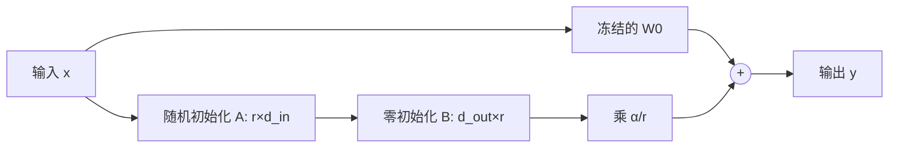

# 第 15 章 参数高效微调（PEFT）

## 本章导读

把一个 7B 模型全参数微调，AdamW 的权重、梯度与两个动量各占一份 fp32，单是这些状态就要 112 GB；24 GB 的消费级显卡连权重都放不下。于是有了一个诱人的说法：只训练 0.1% 的参数，就能达到全参数微调的效果。这个说法什么时候成立，什么时候只是把显存账单挪到了别处？本章从 LoRA 的低秩更新出发，算清参数、显存与精度三本账。

## 难度标签

⭐⭐⭐ 进阶。数学要求：矩阵乘法、秩与奇异值分解的基本性质。代码要求：理解 `nn.Module` 的模块替换、前向与反向传播，能读懂 PyTorch 的参数冻结与优化器状态。

## 学习目标

1. 写出 LoRA 的前向、参数量与合并公式，解释零初始化 $$B$$ 的作用。
2. 用 Eckart–Young 定理说明低秩假设的适用边界，区分「近似权重」与「近似更新」。
3. 拆开静态状态、优化器状态与激活显存，判断 PEFT 在什么条件下真正省显存。
4. 说明 QLoRA 的 NF4 码本、分块量化、双重量化与分页优化器各自解决什么问题。
5. 根据基座能力、任务差异与部署约束，在 LoRA、QLoRA、Adapter、Prefix 与 Prompt Tuning 之间做选择。

## 15.1 为什么全参数微调不划算

全参数微调的成本不只在权重。以 fp32 AdamW 为例，每个可训练参数需要 4 字节权重、4 字节梯度、4 字节一阶动量和 4 字节二阶动量，合计 16 字节；7B 模型仅这部分就是 112 GB，还没算前向保存的激活。即使用 ZeRO 分片或 CPU offload 把状态分散到多卡，通信与吞吐也会成为新的瓶颈。更麻烦的是部署：每个下游任务都要保存一份完整的 7B 权重，十个任务就是十份基座，存储与切换成本都随任务数线性增长。

参数高效微调（Parameter-Efficient Fine-Tuning, PEFT）换了一个思路：冻结基座 $$W_0$$，只学习一个很小的增量 $$\Delta W$$，让适配后的权重变成 $$W_0+\Delta W$$。这样一份基座可以服务多个任务，每个任务只存几 MB 到几百 MB 的增量；训练时优化器状态也只覆盖增量参数。LoRA、Adapter、Prefix-Tuning、Prompt Tuning 都属于这条路线，区别在于增量加在哪里、用什么形式参数化。

但 PEFT 不是免费的午餐。第一，冻结基座意味着模型容量被锁死：如果下游任务需要基座原本不具备的能力，小增量补不上。第二，省下的是权重与优化器状态，激活显存仍然随批大小、序列长度、层数与隐藏宽度增长；长上下文训练时激活往往才是大头。第三，适配器若不能合并进基座，推理会多出一条分支或一段前缀，带来延迟与吞吐损失。第四，低秩假设本身是一个经验判断，不是定理：任务更新若本来就是高秩的，LoRA 会欠拟合。

所以真正要回答的问题不是「PEFT 能不能用」，而是「在这个任务上，$$\Delta W$$ 的可学习自由度够不够，省下的显存是不是瓶颈」。本章用一个小模型把这三本账逐项算出来。

## 15.2 直觉：给冻结的权重加一个低秩补丁

想象一本已经写好的词典。全参数微调相当于重排、改写整本词典；LoRA 则是在旁边贴一张很小的修正表：查某个词时，先按原词典查一遍，再按修正表加一个偏移。修正表只记录「哪些方向需要调整、调整多少」，不重新定义整个词义空间。



这张图对应本章的核心公式：冻结分支给出 $$W_0x$$，低秩分支给出 $$\frac{\alpha}{r}BAx$$，两者相加。$$B$$ 初始化为零，所以训练开始时低秩分支输出恒为零，模型与基座逐位相同；随着训练推进，$$B$$ 先离开零，$$A$$ 随后获得非零梯度。这个设计保证了微调从一个已知可用的模型出发，而不是从随机扰动出发。

低秩的含义是：不直接学习 $$d_{out}\times d_{in}$$ 的完整增量，而是把它分解成「先压到 $$r$$ 维，再升回去」的两个小矩阵。若任务的适配主要是在已有特征之间重新加权，而不是引入大量新方向，那么 $$r$$ 远小于维度就够用。反过来，若适配需要改变很多互不相关的方向，低秩分解会丢失信息。


低秩不是把原权重压扁，而是假设「任务带来的改变」可以用少数方向描述。原权重仍然是完整的 $$W_0$$，精度不受影响；受影响的是增量能表达多少种调整。


推理时可以把 $$BA$$ 乘上缩放系数后加进 $$W_0$$，得到一个普通的线性层，不再有额外分支。这一步叫合并（merge）。合并后单条样本的延迟与基座相同，但同一份权重只能服务一个适配器；要在多个任务间切换，要么保留未合并的分支，要么为每个任务各存一份合并后的权重。

## 15.3 数学原理

### 15.3.1 LoRA 的定义与参数量

设某个线性层原权重为 $$W_0\in\mathbb{R}^{d_{out}\times d_{in}}$$，输入为 $$x\in\mathbb{R}^{d_{in}}$$。LoRA 把前向改为

$$
h = W_0 x + \frac{\alpha}{r} B A x
\qquad \text{(15.1)}
$$

其中 $$A\in\mathbb{R}^{r\times d_{in}}$$，$$B\in\mathbb{R}^{d_{out}\times r}$$，秩 $$r\ll\min(d_{in},d_{out})$$，$$\alpha$$ 是缩放超参数。只有 $$A$$、$$B$$ 可训练，$$W_0$$ 冻结。

训练完成后，可以把低秩分支写回基座，得到等价的普通线性层：

$$
W = W_0 + \frac{\alpha}{r}BA
\qquad \text{(15.2)}
$$

合并只改变权重的存储形式，不改变前向结果；它的代价是同一份权重只能绑定一个适配器。

单个目标模块的参数量是

$$
P_{\text{LoRA}} = r\,(d_{in}+d_{out})
\qquad \text{(15.3)}
$$

以 $$d_{in}=d_{out}=4096$$、$$r=8$$ 为例，每个模块 65,536 个参数，而完整权重是 16,777,216 个，比例约 0.39%。一个 32 层、每层四个注意力投影都加 LoRA 的 7B 模型，适配器总量约 840 万，只占 7B 的 0.12%。注意这个比例的分母是「基座加适配器」；若只按基座算，数值还会更小。

目标模块的选择比秩更影响结果。只适配 $$q$$、$$v$$ 投影时，每层只有两个模块获得新自由度；把 $$k$$、$$o$$ 与 MLP 的三个投影都纳入，容量显著增加。第 15.5 节的对照会看到，在相同秩下，全线性适配比只适配 $$q/v$$ 更接近全参数微调。这不是因为秩变大，而是因为可调整的模块变多。

### 15.3.2 低秩假设与近似误差

为什么低秩可能够用？从矩阵近似看，Eckart–Young 定理给出最优低秩逼近的误差：

$$
\min_{\operatorname{rank}(\hat W)\le r}\|W-\hat W\|_F^2
= \sum_{i=r+1}^{\min(d_{out},d_{in})}\sigma_i^2
\qquad \text{(15.4)}
$$

其中 $$\sigma_i$$ 是 $$W$$ 的奇异值。如果奇异值衰减很快，尾部能量小，秩 $$r$$ 的近似就足够好；如果谱很平，低秩会丢掉大量信息。

这里有一个容易混淆的地方：LoRA 并不用低秩矩阵去近似 $$W_0$$，而是用低秩矩阵去参数化增量 $$\Delta W$$。因此 (15.4) 不能直接保证 LoRA 有效；它只提供了一个判断框架——真正要问的是「任务所需的更新 $$\Delta W$$ 是否近似低秩」。LoRA 原论文的实证观察是：在 GPT-3 的适配中，很小的秩就能达到有竞争力的效果，且不同随机种子学到的子空间高度相似；这支持「适配更新集中在少数方向」的经验假设，但它仍是经验结论，不是对所有任务的保证。

如果更新需要覆盖很多方向，有两条路：提高秩，或扩大适配模块的范围。前者增加单个模块的自由度，后者增加可调整的位置。我们的实验里，只适配 $$q/v$$ 时把秩从 1 提到 8，精确匹配从 0.192 升到 0.775，提升明显但仍有差距；改为全线性 $$r=4$$ 后达到 0.911。这说明在该任务上，「在哪里适配」比「单个模块的秩多大」更关键。

### 15.3.3 缩放、初始化与学习率

缩放系数 $$\alpha/r$$ 决定了低秩分支的相对步长。若固定 $$\alpha$$ 而增大 $$r$$，每个方向上的有效步长会按 $$1/r$$ 缩小；为了让不同秩的对照更公平，常见做法是令 $$\alpha=2r$$，使缩放保持为 2。也有实现固定 $$\alpha$$、只调学习率。无论哪种，报告结果时必须同时给出 $$r$$ 与 $$\alpha$$，否则读者无法复现有效步长。

初始化上，$$A$$ 用 Kaiming 均匀或高斯，$$B$$ 置零。第一次反向传播时，

$$
\frac{\partial \mathcal{L}}{\partial B}
= \frac{\alpha}{r}\,\delta\,(Ax)^\top,\qquad
\frac{\partial \mathcal{L}}{\partial A}
= \frac{\alpha}{r}\,B^\top \delta\,x^\top = 0
$$

其中 $$\delta$$ 是损失对该层输出的梯度。因为 $$B=0$$，$$A$$ 在这一步没有梯度；训练先移动 $$B$$，再通过 $$B$$ 给 $$A$$ 传递信号。这不是缺陷，而是「从基座出发」的代价：低秩分支需要先找到有用的输出方向，才能反过来塑造输入投影。测试 `test_zero_init_b_blocks_first_step_on_a` 专门验证了这一点。

LoRA 常能用比全参数微调更大的学习率。全参数微调要小心破坏基座，学习率通常在 $$10^{-5}$$ 量级；LoRA 只更新小矩阵，常见设置高一个数量级。本章实验用 $$3\times10^{-3}$$ 训练全参数、$$10^{-2}$$ 训练适配器，二者不可直接互换。

### 15.3.4 显存账本

训练时的静态状态可以按参数逐项记账。以 fp32 AdamW 为例，每个可训练参数占 16 字节，每个冻结参数占 4 字节：

$$
M_{\text{state}} = 16\,P_{\text{train}} + 4\,P_{\text{frozen}}
\qquad \text{(15.5)}
$$

这里的单位是字节。若基座用 bf16 存储、优化器用 fp32 主副本，系数会变，但结构不变：可训练参数要付「权重 + 梯度 + 优化器状态」，冻结参数只付权重。QLoRA 把冻结权重压到约 4 比特，相当于把第二项的 4 改成 0.5 左右。

以本章的 TinyLM 为例，基座 33,952 个参数。全参数微调的状态约 530 KB；只适配 $$q/v$$、$$r=4$$ 时，可训练参数 1,024 个，状态约 149 KB；全线性 $$r=4$$ 时可训练 5,888 个，状态约 225 KB；QLoRA 全线性 $$r=4$$ 把冻结线性层压到 4 比特后约 113 KB。注意后两者可训练参数相同，差别只在冻结权重的存储精度。

静态状态只是一部分。激活显存随批大小 $$B$$、序列长度 $$T$$、隐藏宽度 $$d$$ 与层数 $$L$$ 增长，量级约为 $$B\cdot T\cdot d\cdot L$$ 乘以每层保存的张量数与字节数。我们在一批 32 条、长度 3–5 的样本上，用 `saved_tensors_hooks` 统计反向传播保存的张量：全参数微调约 3,355 KB，只适配 $$q/v$$ 约 2,473 KB，全线性适配约 3,289 KB，QLoRA 仍是 3,289 KB。两个结论值得记住：

- QLoRA 只压缩冻结权重，不改变激活；它的收益在权重存储，不在激活。
- 适配范围会影响激活：只适配 $$q/v$$ 时，MLP 冻结，不需要为 MLP 的权重梯度保存输入激活，所以激活下降约 26%；全线性适配几乎每个线性层都要保存输入，激活与全参数微调相差无几。

因此在单卡训练里，若瓶颈是激活而不是权重，换 PEFT 方法未必能救；缩小批、缩短序列、梯度检查点往往更直接。

### 15.3.5 QLoRA：NF4、双重量化与分页优化器

QLoRA 的目标是让大模型在单张显卡上可训：基座用 4 比特存储，梯度只流向 LoRA 适配器，计算时再把 4 比特权重反量化到 bf16。它由三个部件组成。

第一是 NF4（4-bit NormalFloat）量化。普通 4 比特整数量化把区间均匀切分，但预训练权重近似正态分布，均匀切分在均值附近浪费了码字。NF4 取标准正态分布的分位数作为 16 个码字，码字在零附近更密、两端更疏，使量化误差在分布意义下更小。每个权重先按所在块的绝对值最大值归一化，再投影到最近的码字：

$$
\hat w = s\cdot q\!\left(\arg\min_{c\in\mathcal{C}}\left|\frac{w}{s}-c\right|\right)
$$

其中 $$s$$ 是块内 absmax，$$\mathcal{C}$$ 是 16 级码本，$$q(\cdot)$$ 取码字值。块大小通常取 64 或 128；块越小，离群值影响越小，但尺度开销越大。

第二是双重量化（double quantization）。每个块要存一个 fp32 的 absmax，块大小为 64 时，这部分相当于每参数 32/64=0.5 比特，抵消了一部分 4 比特的收益。双重量化把第一层的块尺度再按 256 个块为一组量化到 8 比特，只保留极少量的 fp32 二级尺度。总存储为

$$
\text{bits/param} = 4 + \frac{8}{b} + \frac{32}{256b}
\qquad \text{(15.6)}
$$

块大小 $$b=64$$ 时约为 4.127 比特，与 QLoRA 论文报告的数字一致；不做双重量化则是 4.5 比特。对一个 7B 模型，4.127 比特约 3.6 GB，而 fp32 是 28 GB，bf16 是 14 GB。

第三是分页优化器（paged optimizer）。训练中偶尔会出现瞬时显存尖峰，普通优化器会直接 OOM；分页优化器借助统一内存，把暂时不用的优化器状态换出到 CPU，尖峰过去再换回。它不减少平均显存，只是把「峰值必炸」变成「峰值可容忍」。

需要强调：QLoRA 的 4 比特是存储格式，计算仍是 bf16 或 fp16。每次前向都要把权重反量化，带来额外计算与带宽开销；这也是为什么 QLoRA 的训练速度通常低于 bf16 LoRA，省的是显存而不是时间。

本章的 `quantize_lora_bases` 只做「量化—反量化」的数值模拟：它把基座权重替换成 NF4 反量化后的值，计算仍在 fp32 上完成，显存账本按 4 比特解析计算。这样可以在 CPU 上复现 QLoRA 的精度影响，但不会真的把张量压成 4 比特。实验里基座权重的相对误差约 9.7%，单条样本 logits 的相对偏差约 6.4%，而精确匹配率与 bf16 LoRA 的差距落在种子波动内。


本章的 NF4 模拟只复现数值误差，不减少真实显存；部署时需要使用 bitsandbytes 等实现的 4 比特张量。把模拟结果当作「精度影响」的证据，不要当作「显存已省下」的证据。


### 15.3.6 Adapter、Prefix 与 Prompt 的参数量

另外三条路线把增量放在不同的位置。Adapter 在 Transformer 块内插入一个瓶颈前馈网络：先降到 $$m$$ 维，再升回 $$d$$ 维，通常带残差与层归一化。每个适配器的参数量约为

$$
P_{\text{adapter}} = 2dm + m + d
\qquad \text{(15.7)}
$$

Prefix-Tuning 在每一层的注意力键、值前拼接一段可学习的「前缀」，长度为 $$\ell$$，每层参数量约 $$2\ell d$$，$$L$$ 层合计 $$2L\ell d$$。Prompt Tuning 只在输入嵌入前拼接一段软提示，参数量约 $$\ell d$$，所有层共享。

三者的共同优点是模块化：基座完全不动，适配器可以单独保存、插拔。代价也各不相同。Adapter 是串行的额外层，推理时无法精确合并回原权重，会增加延迟；Prefix 占用上下文长度，且需要每层维护额外的键值缓存；Prompt 最轻，但可表达的自由度最小，任务越复杂越容易欠拟合。选择时要把「省参数」与「推理开销」「上下文预算」一起算，而不能只看可训练参数的比例。

## 15.4 方案对比

| 方法 | 可训练参数（典型） | 推理额外开销 | 能否合并 | 权重显存 | 适用条件 |
| --- | --- | --- | --- | --- | --- |
| 全参数微调 | 100% | 无 | — | 最高 | 数据充足、任务与预训练分布差异大、需要改变基座能力 |
| LoRA | 0.01%–1% | 合并后为零；未合并多一条低秩分支 | 可以，精度损失在浮点误差内 | 基座 + 小增量 | 通用首选；基座已具备任务能力，只需行为适配 |
| QLoRA | 与 LoRA 相同 | 反量化开销；未合并时同 LoRA | 可以，但需先反量化 | 基座约 4 比特 + 小增量 | 单卡显存受限，需要微调 33B–65B 级模型 |
| Adapter | 1%–5% | 串行瓶颈层，增加延迟 | 不能精确合并 | 基座 + 适配器 | 多任务切换、研究模块化结构 |
| Prefix-Tuning | <1% | 占用上下文，需额外 KV 缓存 | 不能 | 基座 + 前缀 | 生成控制、多任务、对延迟不敏感 |
| Prompt Tuning | <0.1% | 占用上下文 | 不能 | 基座 + 软提示 | 极低资源、黑盒接口、任务简单 |

这张表是量级参考，不是硬性边界。实际选择可以先问四个问题：基座是否已经具备任务所需能力？显存瓶颈在权重还是激活？推理是否要求零额外延迟？是否需要一份基座服务多个任务？四个答案基本能定位到一两行。

若基座已能完成任务的「粗版」，只是格式、风格或少量边界行为不对，LoRA 通常足够；若任务要求新语言、新工具调用或大幅改变输出分布，先做全参数微调或继续预训练更稳。若显存只够放下 4 比特基座，QLoRA 是现实选择；若显存足够而吞吐敏感，bf16 LoRA 更简单。若需要在一张卡上同时服务几十个任务，未合并的多 LoRA 加批处理是常见方案，但要接受低秩分支的额外计算。

## 15.5 代码实现

### 15.5.1 实验设计

实验沿用第 14 章的对话管线与「逐 Token 加一模 8」任务，但把训练拆成两段，以贴近 PEFT 的真实用法：

1. **预训练基座**：在 1,024 条对话上学习「加二模 8」，全序列损失，1,200 步。基座因此掌握了对话格式、数字 Token 与一个偏移规则。
2. **下游 SFT**：在 256 条对话上学习「加一模 8」，只对回答计算损失，600 步。适配器要把「加二」改成「加一」，而不是从零学任务。

这样设计的原因是：真实 PEFT 几乎总是从一个有能力的基座出发。若直接用随机初始化模型做 LoRA，测到的是「低秩适配器能否从零学会任务」，而不是「PEFT 能否适配已有能力」。为了显示边界，表中仍保留两行随机基座对照。

所有方法使用 5 个模型种子，报告均值与标准差；预训练与 SFT 的数据种子、批采样种子固定。全参数微调学习率 $$3\times10^{-3}$$，LoRA/QLoRA 用 $$10^{-2}$$；LoRA 的 $$\alpha=2r$$。评测 200 条长度 3–5 的样本，指标为整条回答精确匹配与 Token 级命中率，随机水平分别为 0 与 0.125。

模型仍是 2 层、$$d_{model}=32$$、2 个头的 TinyLM。新增模块只有 `tinylm/posttrain/lora.py`；`TinyLM.forward`、`CausalLMOutput` 与 `ModelConfig` 的签名不变，适配器通过包装线性层实现，默认路径与第 14 章逐位一致。

### 15.5.2 完整代码

`tinylm/posttrain/lora.py`：

```python
"""第 15 章：LoRA、QLoRA 与参数账本（tinylm/posttrain/lora.py）。"""
import math
from dataclasses import dataclass

import torch
import torch.nn as nn
import torch.nn.functional as F

# QLoRA 使用的 16 级 NF4 码本（Dettmers et al., 2023，附录 E）
NF4_LEVELS = torch.tensor([
    -1.0, -0.6961928009986877, -0.5250730514526367, -0.39491748809814453,
    -0.28444138169288635, -0.18477343022823334, -0.09105003625154495,
    0.0, 0.07958029955625534, 0.16093020141124725, 0.24611230194568634,
    0.33791524171829224, 0.44070982933044434, 0.5626170039176941,
    0.7229568362236023, 1.0,
])


# ---------------------------------------------------------------- config
@dataclass(frozen=True)
class LoraConfig:
    r: int = 8
    alpha: int = 16
    dropout: float = 0.0
    target_modules: tuple[str, ...] = (
        "q_proj", "k_proj", "v_proj", "out_proj",
        "w_gate", "w_up", "w_down", "fc_in", "fc_out",
    )
    bias: str = "none"              # none | all | lora_only

    def __post_init__(self):
        assert self.r >= 1
        assert self.alpha > 0
        assert 0.0 <= self.dropout < 1.0
        assert self.bias in ("none", "all", "lora_only")


# ---------------------------------------------------------------- lora.py
class LoRALinear(nn.Module):
    """公式 (15.1)：y = W x + (α/r) B A x。"""

    def __init__(self, base: nn.Linear, cfg: LoraConfig):
        super().__init__()
        self.base = base
        for p in self.base.parameters():
            p.requires_grad_(False)
        if cfg.bias in ("all", "lora_only") and base.bias is not None:
            base.bias.requires_grad_(True)
        self.r = cfg.r
        self.scaling = cfg.alpha / cfg.r
        self.dropout = nn.Dropout(cfg.dropout)
        self.lora_A = nn.Parameter(torch.empty(cfg.r, base.in_features))
        self.lora_B = nn.Parameter(torch.zeros(base.out_features, cfg.r))
        nn.init.kaiming_uniform_(self.lora_A, a=math.sqrt(5))
        self.merged = False
        self._delta = None

    def forward(self, x):
        out = self.base(x)
        if self.merged:
            return out
        delta = F.linear(F.linear(self.dropout(x), self.lora_A), self.lora_B)
        return out + delta * self.scaling                       # (15.1)

    @torch.no_grad()
    def merge(self):
        """把 B A 写回基座权重，推理时不再计算低秩分支。"""
        if self.merged:
            return
        self._delta = (self.lora_B @ self.lora_A) * self.scaling  # (15.2)
        self.base.weight.add_(self._delta)
        self.merged = True

    @torch.no_grad()
    def unmerge(self):
        if not self.merged:
            return
        self.base.weight.sub_(self._delta)
        self.merged = False
        self._delta = None


def _resolve_target(name, cfg):
    return name in cfg.target_modules or name.split(".")[-1] in cfg.target_modules


def apply_lora(model, cfg: LoraConfig):
    """冻结全部参数，再把目标 nn.Linear 换成 LoRALinear。"""
    for p in model.parameters():
        p.requires_grad_(False)

    targets = [name for name, m in model.named_modules()
               if isinstance(m, nn.Linear) and _resolve_target(name, cfg)]
    for name in targets:
        parent = model.get_submodule(name.rsplit(".", 1)[0])
        leaf = name.rsplit(".", 1)[-1]
        setattr(parent, leaf, LoRALinear(getattr(parent, leaf), cfg))

    if cfg.bias == "all":
        for name, p in model.named_parameters():
            if name.endswith("bias"):
                p.requires_grad_(True)
    return model


def lora_parameters(model):
    for name, p in model.named_parameters():
        if name.rsplit(".", 1)[-1] in ("lora_A", "lora_B"):
            yield name, p


def lora_state_dict(model):
    """只保存适配器，支持同一基座挂多个任务适配器。"""
    return {name: p.detach().clone() for name, p in lora_parameters(model)}


def load_lora_state_dict(model, state):
    current = set(lora_state_dict(model))
    missing = current - set(state)
    extra = set(state) - current
    if missing or extra:
        raise KeyError(f"适配器键不匹配：缺 {sorted(missing)[:3]}，多 {sorted(extra)[:3]}")
    with torch.no_grad():
        for name, p in lora_parameters(model):
            p.copy_(state[name])


def trainable_stats(model):
    total = sum(p.numel() for p in model.parameters())
    trainable = sum(p.numel() for p in model.parameters() if p.requires_grad)
    return {"total": total, "trainable": trainable,
            "ratio": trainable / max(total, 1)}


def lora_module_params(model, cfg: LoraConfig):
    """公式 (15.3)：每个目标模块 r(d_in + d_out) 个参数。"""
    rows = []
    for name, m in model.named_modules():
        if isinstance(m, nn.Linear) and _resolve_target(name, cfg):
            rows.append((name, cfg.r * (m.in_features + m.out_features)))
    return rows


def state_bytes(model, *, param=4, grad=4, optim=8):
    """训练静态状态：可训练参数 (param+grad+optim)，冻结参数只有 param。

    若模型做过 NF4 量化，被量化的基座按 4 比特记账，其余冻结参数仍是 fp32。
    """
    trainable = sum(p.numel() for p in model.parameters() if p.requires_grad)
    frozen = sum(p.numel() for p in model.parameters() if not p.requires_grad)
    quant = getattr(model, "_nf4", None)
    q_numel = quant["numel"] if quant else 0
    q_bytes = quant["bytes"] if quant else 0
    train_b = trainable * (param + grad + optim)
    frozen_b = (frozen - q_numel) * param + q_bytes
    return {"trainable": trainable, "frozen": frozen,
            "train_bytes": train_b, "frozen_bytes": frozen_b,
            "total_bytes": train_b + frozen_b}


# ---------------------------------------------------------------- qlora.py
def _blocks(w, block_size):
    flat = w.reshape(-1)
    n = flat.numel()
    pad = (-n) % block_size
    flat = F.pad(flat, (0, pad))
    return flat.view(-1, block_size), n


def nf4_quantize(w, block_size=64):
    """按块 absmax 归一化后，投影到最近的 NF4 码字。"""
    levels = NF4_LEVELS.to(w.device)
    blocks, n = _blocks(w.detach().float(), block_size)
    absmax = blocks.abs().amax(dim=1).clamp_min(1e-8)
    norm = blocks / absmax[:, None]
    codes = (norm.unsqueeze(-1) - levels).abs().argmin(-1).to(torch.uint8)
    deq = levels[codes.long()] * absmax[:, None]
    return deq.reshape(-1)[:n].view(w.shape), codes, absmax


def nf4_dequantize(codes, absmax, shape):
    levels = NF4_LEVELS.to(codes.device)
    deq = levels[codes.long()] * absmax[:, None]
    return deq.reshape(-1)[:math.prod(shape)].view(shape)


def nf4_storage_bytes(numel, block_size=64, double_quant=True):
    """公式 (15.6)：4 比特权重 + 每块尺度（双层量化时再压到 8 比特）。"""
    weight_bytes = math.ceil(numel / 2)
    n_blocks = math.ceil(numel / block_size)
    if double_quant:
        const_bytes = n_blocks + math.ceil(n_blocks / 256) * 4
    else:
        const_bytes = n_blocks * 4
    total = weight_bytes + const_bytes
    return {"weight": weight_bytes, "constant": const_bytes,
            "total": total, "bits_per_param": 8 * total / numel}


@torch.no_grad()
def quantize_lora_bases(model, block_size=64, double_quant=True):
    """把 LoRALinear 的基座权重做 NF4 量化-反量化（模拟 QLoRA 的数值）。"""
    numel = total = 0
    for m in model.modules():
        if not isinstance(m, LoRALinear):
            continue
        w = m.base.weight
        deq, codes, absmax = nf4_quantize(w.data, block_size)
        w.data.copy_(deq)
        w.requires_grad_(False)
        m.nf4_codes = codes
        m.nf4_scales = absmax
        numel += w.numel()
        total += nf4_storage_bytes(w.numel(), block_size, double_quant)["total"]
    info = {"numel": numel, "bytes": total,
            "bits_per_param": 8 * total / max(numel, 1)}
    model._nf4 = info
    return info
```

`examples/ch15_peft.py`：

```python
"""第 15 章：LoRA、QLoRA 与参数账本（examples/ch15_peft.py）。"""
import copy
import random
import time

import torch

from ch08 import ModelConfig, TinyLM
from tinylm.posttrain import lora as L
from tinylm.posttrain import sft
from tinylm.tokenizer.chat import ChatTemplate, encode_conversation

D0 = 5
VOCAB = 16
TEMPLATE = ChatTemplate()
SEEDS = (0, 1, 2, 3, 4)


def plus2(x):
    return (x + 2) % 8


def plus1(x):
    return (x + 1) % 8


def make_turns(gen, length, rule):
    xs = [int(v) for v in torch.randint(0, 8, (length,), generator=gen)]
    ys = [rule(x) for x in xs]
    return [("user", [D0 + x for x in xs]),
            ("assistant", [D0 + y for y in ys])]


def make_data(seed, size, rule, answer_only, lo=3, hi=5):
    gen = torch.Generator().manual_seed(seed)
    rng = random.Random(seed)
    data = []
    for _ in range(size):
        length = rng.randint(lo, hi)
        turns = make_turns(gen, length, rule)
        data.append(encode_conversation(turns, TEMPLATE,
                                        answer_only=answer_only))
    return data


def make_model(seed):
    torch.manual_seed(seed)
    cfg = ModelConfig(vocab_size=VOCAB, d_model=32, n_layers=2, n_heads=2,
                      d_ff=128, max_seq_len=32, pos_encoding="rope",
                      norm="rmsnorm", ffn="swiglu", bias=False)
    return TinyLM(cfg)


def train(model, data, seed, steps, lr, batch_size=32):
    opt = torch.optim.AdamW([p for p in model.parameters() if p.requires_grad],
                            lr=lr, weight_decay=0.01)
    gen = torch.Generator().manual_seed(1000 + seed)
    model.train()
    for _ in range(steps):
        idx = torch.randint(0, len(data), (batch_size,), generator=gen)
        batch = sft.collate_examples([data[int(i)] for i in idx])
        out = model(batch["input_ids"], attention_mask=batch["attention_mask"],
                    labels=batch["labels"])
        opt.zero_grad()
        out.loss.backward()
        opt.step()
    return model


@torch.no_grad()
def evaluate(model, rule, n=200):
    model.eval()
    gen = torch.Generator().manual_seed(999)
    rng = random.Random(999)
    exact = tokens = correct = 0
    for _ in range(n):
        length = rng.randint(3, 5)
        r = encode_conversation(make_turns(gen, length, rule), TEMPLATE)
        out = model(r["input_ids"][None])
        keep = r["labels"] != -100
        pred = out.logits[0].argmax(-1)
        exact += int((pred[keep] == r["labels"][keep]).all())
        tokens += int(keep.sum())
        correct += int((pred[keep] == r["labels"][keep]).sum())
    return exact / n, correct / max(tokens, 1)


def build_bases(pretrain):
    bases = {}
    zero = []
    for seed in SEEDS:
        model = train(make_model(seed), pretrain, seed, 1200, 3e-3)
        bases[seed] = copy.deepcopy(model.state_dict())
        zero.append(evaluate(model, plus1))
    t = torch.tensor(zero)
    print(f"零样本基座（预训练学 +2，不微调）：ID 精确 {t[:, 0].mean():.3f}"
          f"±{t[:, 0].std():.3f}，Token {t[:, 1].mean():.3f}±{t[:, 1].std():.3f}")
    return bases


def run_one(bases, sft_data, seed, spec):
    kind, cfg, lr = spec
    model = make_model(seed)
    if bases is not None:
        model.load_state_dict(bases[seed])
    if cfg is not None:
        L.apply_lora(model, cfg)
        if kind == "qlora":
            L.quantize_lora_bases(model)
    train(model, sft_data, seed, 600, lr)
    return model


def method_table(bases, sft_data):
    specs = [
        ("全参数", ("full", None, 3e-3), None),
        ("LoRA q/v r=1", ("lora", L.LoraConfig(r=1, alpha=2,
         target_modules=("q_proj", "v_proj")), 1e-2), None),
        ("LoRA q/v r=2", ("lora", L.LoraConfig(r=2, alpha=4,
         target_modules=("q_proj", "v_proj")), 1e-2), None),
        ("LoRA q/v r=4", ("lora", L.LoraConfig(r=4, alpha=8,
         target_modules=("q_proj", "v_proj")), 1e-2), None),
        ("LoRA q/v r=8", ("lora", L.LoraConfig(r=8, alpha=16,
         target_modules=("q_proj", "v_proj")), 1e-2), None),
        ("LoRA 全线性 r=4", ("lora", L.LoraConfig(r=4, alpha=8), 1e-2), None),
        ("QLoRA 全线性 r=4", ("qlora", L.LoraConfig(r=4, alpha=8), 1e-2), None),
        ("随机基座+全参数", ("full", None, 3e-3), "random"),
        ("随机基座+LoRA r=4", ("lora", L.LoraConfig(r=4, alpha=8), 1e-2),
         "random"),
    ]
    print(f"\n{'方法':<18s}{'可训练':>8s}{'比例':>7s}{'状态KB':>8s}"
          f"{'ID 精确':>16s}{'ID Token':>16s}")
    for name, spec, base_kind in specs:
        rows = []
        for seed in SEEDS:
            used = None if base_kind == "random" else bases
            model = run_one(used, sft_data, seed, spec)
            rows.append(evaluate(model, plus1))
        t = torch.tensor(rows)
        stats = L.trainable_stats(model)
        mem = L.state_bytes(model)["total_bytes"]
        print(f"{name:<18s}{stats['trainable']:>8d}{stats['ratio']:>7.3f}"
              f"{mem/1024:>8.0f}{t[:, 0].mean():>10.3f}±{t[:, 0].std():.3f}"
              f"{t[:, 1].mean():>10.3f}±{t[:, 1].std():.3f}")


def saved_activation_bytes(model, batch):
    seen, total = set(), [0]

    def pack(t):
        if t.data_ptr() not in seen:
            seen.add(t.data_ptr())
            total[0] += t.numel() * t.element_size()
        return t

    def unpack(t):
        return t

    model.zero_grad(set_to_none=True)
    with torch.autograd.graph.saved_tensors_hooks(pack, unpack):
        out = model(batch["input_ids"], attention_mask=batch["attention_mask"],
                    labels=batch["labels"])
        out.loss.backward()
    return total[0]


def memory_demo(bases, sft_data):
    gen = torch.Generator().manual_seed(77)
    idx = torch.randint(0, len(sft_data), (32,), generator=gen)
    batch = sft.collate_examples([sft_data[int(i)] for i in idx])
    specs = (
        ("全参数", None, False),
        ("LoRA q/v r=4", L.LoraConfig(r=4, alpha=8,
         target_modules=("q_proj", "v_proj")), False),
        ("LoRA 全线性 r=4", L.LoraConfig(r=4, alpha=8), False),
        ("QLoRA 全线性 r=4", L.LoraConfig(r=4, alpha=8), True),
    )
    print(f"\n静态状态与单步激活（32 条、长度 3–5）")
    print(f"{'方法':<18s}{'静态KB':>9s}{'激活KB':>9s}")
    for name, cfg, quant in specs:
        model = make_model(0)
        model.load_state_dict(bases[0])
        if cfg is not None:
            L.apply_lora(model, cfg)
            if quant:
                L.quantize_lora_bases(model)
        static = L.state_bytes(model)["total_bytes"]
        active = saved_activation_bytes(model, batch)
        print(f"{name:<18s}{static/1024:>9.0f}{active/1024:>9.0f}")


def merge_demo(bases, sft_data):
    model = make_model(0)
    model.load_state_dict(bases[0])
    L.apply_lora(model, L.LoraConfig(r=4, alpha=8))
    train(model, sft_data, 0, 200, 1e-2)
    model.eval()
    gen = torch.Generator().manual_seed(31)
    x = encode_conversation(make_turns(gen, 5, plus1), TEMPLATE)["input_ids"]
    x = x[None]
    before = model(x).logits
    modules = [m for m in model.modules() if isinstance(m, L.LoRALinear)]
    for m in modules:
        m.merge()
    after = model(x).logits
    for m in modules:
        m.unmerge()
    restored = model(x).logits
    print(f"\n合并前后 logits 最大偏差 {(before-after).abs().max():.1e}；"
          f"撤销合并后 {(before-restored).abs().max():.1e}")
    print(f"被替换的线性层 {len(modules)} 个，适配器参数 "
          f"{sum(p.numel() for _, p in L.lora_parameters(model))}")


def qlora_demo(bases):
    model = make_model(0)
    model.load_state_dict(bases[0])
    cfg = L.LoraConfig(r=4, alpha=8)
    L.apply_lora(model, cfg)
    model.eval()
    gen = torch.Generator().manual_seed(41)
    x = encode_conversation(make_turns(gen, 5, plus1), TEMPLATE)["input_ids"]
    x = x[None]
    before = model(x).logits
    numer, denom = 0.0, 0.0
    for m in model.modules():
        if isinstance(m, L.LoRALinear):
            w = m.base.weight.detach()
            deq, _, _ = L.nf4_quantize(w)
            numer += (w - deq).pow(2).sum().item()
            denom += w.pow(2).sum().item()
    info = L.quantize_lora_bases(model)
    quant = model(x).logits
    print(f"\nNF4 量化：码本 16 级，块大小 64；基座权重相对误差 "
          f"{(numer/denom) ** 0.5:.4f}")
    print(f"量化后 logits 相对偏差 "
          f"{(quant-before).norm().item()/before.norm().item():.4f}；"
          f"存储 {info['bits_per_param']:.3f} 比特/参数")


def main():
    t0 = time.time()
    pretrain = make_data(100, 1024, plus2, answer_only=False)
    sft_data = make_data(10, 256, plus1, answer_only=True)
    bases = build_bases(pretrain)
    method_table(bases, sft_data)
    memory_demo(bases, sft_data)
    merge_demo(bases, sft_data)
    qlora_demo(bases)
    print(f"\n总耗时 {time.time() - t0:.1f} s")


if __name__ == "__main__":
    main()
```

`tests/test_lora.py`：

```python
"""第 15 章测试：LoRA 等价性、参数账本与 NF4 量化。"""
import pytest
import torch

from ch08 import ModelConfig, TinyLM
from tinylm.posttrain import lora as L

VOCAB = 16


def tiny_model(seed=0):
    torch.manual_seed(seed)
    cfg = ModelConfig(vocab_size=VOCAB, d_model=32, n_layers=2, n_heads=2,
                      d_ff=128, max_seq_len=32, pos_encoding="rope",
                      norm="rmsnorm", ffn="swiglu", bias=False)
    return TinyLM(cfg)


def ids(seed=0):
    g = torch.Generator().manual_seed(seed)
    return torch.randint(0, VOCAB, (2, 6), generator=g)


def test_initial_output_identity():
    model = tiny_model()
    x = ids()
    ref = model(x).logits
    L.apply_lora(model, L.LoraConfig(r=4))
    out = model(x).logits
    assert torch.equal(ref, out)


def test_merge_equivalence_and_unmerge():
    model = tiny_model()
    x = ids()
    L.apply_lora(model, L.LoraConfig(r=4, alpha=8))
    g = torch.Generator().manual_seed(3)
    for _, p in L.lora_parameters(model):
        p.data.normal_(0.0, 0.02, generator=g)
    model.eval()
    ref = model(x).logits
    linears = [m for m in model.modules() if isinstance(m, L.LoRALinear)]
    for m in linears:
        m.merge()
    merged = model(x).logits
    for m in linears:
        m.unmerge()
    back = model(x).logits
    assert torch.allclose(ref, merged, atol=1e-6)
    assert torch.allclose(ref, back, atol=1e-7)


def test_only_adapter_parameters_trainable():
    model = tiny_model()
    cfg = L.LoraConfig(r=4, alpha=8)
    expected = sum(n for _, n in L.lora_module_params(model, cfg))
    L.apply_lora(model, cfg)
    stats = L.trainable_stats(model)
    assert stats["trainable"] == expected
    assert stats["ratio"] < 0.25
    for name, p in model.named_parameters():
        leaf = name.rsplit(".", 1)[-1]
        assert p.requires_grad == (leaf in ("lora_A", "lora_B"))


def test_zero_init_b_blocks_first_step_on_a():
    model = tiny_model()
    L.apply_lora(model, L.LoraConfig(r=4))
    out = model(ids(), labels=ids(1))
    out.loss.backward()
    a_grads, b_grads = [], []
    for name, p in model.named_parameters():
        if name.endswith("lora_A"):
            a_grads.append(p.grad.abs().max())
        if name.endswith("lora_B"):
            b_grads.append(p.grad.abs().max())
    assert max(b_grads) > 0
    assert max(a_grads) == 0


def test_adapter_state_roundtrip():
    model = tiny_model()
    L.apply_lora(model, L.LoraConfig(r=4))
    g = torch.Generator().manual_seed(5)
    for _, p in L.lora_parameters(model):
        p.data.normal_(0.0, 0.02, generator=g)
    state = L.lora_state_dict(model)
    ref = model(ids()).logits
    for _, p in L.lora_parameters(model):
        p.data.zero_()
    assert not torch.allclose(ref, model(ids()).logits)
    L.load_lora_state_dict(model, state)
    assert torch.allclose(ref, model(ids()).logits)


def test_target_selection():
    model = tiny_model()
    L.apply_lora(model, L.LoraConfig(r=2, target_modules=("q_proj", "v_proj")))
    names = [n for n, m in model.named_modules() if isinstance(m, L.LoRALinear)]
    assert names and all(n.endswith(("q_proj", "v_proj")) for n in names)


def test_nf4_roundtrip_is_close():
    torch.manual_seed(0)
    w = torch.randn(64, 96)
    deq, codes, absmax = L.nf4_quantize(w, block_size=64)
    err = (w - deq).norm() / w.norm()
    assert codes.max() <= 15 and codes.numel() == w.numel()
    assert absmax.numel() == 96
    assert err < 0.2


def test_nf4_storage_bits():
    plain = L.nf4_storage_bytes(1 << 20, double_quant=False)
    double = L.nf4_storage_bytes(1 << 20, double_quant=True)
    assert 4.4 < plain["bits_per_param"] < 4.6
    assert 4.1 < double["bits_per_param"] < 4.2


def test_qlora_keeps_base_frozen():
    model = tiny_model()
    L.apply_lora(model, L.LoraConfig(r=4))
    info = L.quantize_lora_bases(model)
    assert info["bits_per_param"] < 4.3
    for m in model.modules():
        if isinstance(m, L.LoRALinear):
            assert not m.base.weight.requires_grad
            assert m.lora_A.requires_grad
    out = model(ids(), labels=ids(1))
    out.loss.backward()
    assert any(p.grad is not None for _, p in L.lora_parameters(model))


def test_bad_adapter_keys_raise():
    model = tiny_model()
    L.apply_lora(model, L.LoraConfig(r=2))
    with pytest.raises(KeyError):
        L.load_lora_state_dict(model, {})
```

### 15.5.3 运行结果

```text
零样本基座（预训练学 +2，不微调）：ID 精确 0.000±0.000，Token 0.209±0.010

方法                     可训练     比例    状态KB           ID 精确        ID Token
全参数                  33952  1.000     530     0.868±0.119     0.972±0.025
LoRA q/v r=1           256  0.007     137     0.192±0.222     0.655±0.192
LoRA q/v r=2           512  0.015     141     0.510±0.393     0.865±0.115
LoRA q/v r=4          1024  0.029     149     0.747±0.252     0.939±0.065
LoRA q/v r=8          2048  0.057     165     0.775±0.282     0.943±0.080
LoRA 全线性 r=4          5888  0.148     225     0.911±0.070     0.982±0.015
QLoRA 全线性 r=4         5888  0.148     113     0.869±0.120     0.972±0.025
随机基座+全参数             33952  1.000     530     0.632±0.104     0.916±0.027
随机基座+LoRA r=4         5888  0.148     225     0.226±0.042     0.751±0.028

静态状态与单步激活（32 条、长度 3–5）
方法                     静态KB     激活KB
全参数                     530     3355
LoRA q/v r=4            149     2473
LoRA 全线性 r=4            225     3289
QLoRA 全线性 r=4           113     3289

合并前后 logits 最大偏差 2.0e-06；撤销合并后 1.9e-06
被替换的线性层 14 个，适配器参数 5888

NF4 量化：码本 16 级，块大小 64；基座权重相对误差 0.0971
量化后 logits 相对偏差 0.0635；存储 4.139 比特/参数

总耗时 224.6 s
```

测试结果：

```text
10 passed in 1.20s
```

### 15.5.4 结果解读

**第一，PEFT 确实可以在基座能力之上完成适配。** 零样本基座学会的是「加二」，对「加一」的整条精确匹配为 0，Token 命中率 0.209 略高于随机水平 0.125。经过 600 步 SFT，全参数微调达到 0.868±0.119，LoRA 全线性 $$r=4$$ 达到 0.911±0.070，QLoRA 达到 0.869±0.120。三者在种子波动内相当，而 LoRA 只训练了 14.8% 的参数。这个比例在真实 7B 模型上通常只有 1% 左右；玩具模型层数少、宽度小，适配器占比被放大，不能直接把 14.8% 外推到工业模型。

**第二，秩的提升有收益，但很快饱和。** 只适配 $$q/v$$ 时，$$r=1,2,4,8$$ 的精确匹配依次为 0.192、0.510、0.747、0.775。从 1 到 4 提升明显，从 4 到 8 只多了 0.028，而参数翻倍。标准差普遍很大（0.22–0.39），说明单个种子的结果不可靠，必须看多种子分布。把适配范围扩到全线性后，$$r=4$$ 就达到 0.911，超过 $$q/v$$ 的 $$r=8$$。这支持前面的判断：在本任务上，可调整的模块数量比单个模块的秩更重要。

**第三，PEFT 不能替代预训练。** 随机基座上，全参数微调达到 0.632，LoRA 只有 0.226。同样的低秩结构、同样的数据和步数，差别来自基座是否已经具备任务所需特征。LoRA 的低秩假设成立的前提是「基座里有可复用的特征，适配只是重新组合它们」；若基座里根本没有这些特征，低秩分支没有东西可组合。真实工程中，这对应「先选一个足够强的基座，再谈 PEFT」，而不是用 PEFT 省掉预训练。

**第四，静态状态与激活是两笔不同的账。** 全参数微调的静态状态约 530 KB，LoRA 全线性约 225 KB，QLoRA 约 113 KB；但同一条样本的单步激活分别是 3,355 KB、3,289 KB 与 3,289 KB。QLoRA 把冻结权重压到 4.127 比特，几乎不影响激活；全线性 LoRA 也几乎不影响激活。只有缩小适配范围（例如只做 $$q/v$$）才会因为冻结 MLP 而少保存一部分输入激活，降到 2,473 KB。若训练瓶颈是激活，优先考虑批大小、序列长度、梯度检查点与并行策略，而不是换一种 PEFT。

全参数微调的标准差 0.119 大于 LoRA 全线性的 0.070，主要来自种子 0：该基座在预训练后对「加二」的掌握较弱，适配到「加一」时更不稳定。5 个种子仍不足以给出很窄的置信区间；工程上应把模型种子、数据顺序与初始化都纳入方差评估。

**第五，合并与量化的数值误差都在可控范围。** 合并前后 logits 最大偏差 $$2.0\times10^{-6}$$，撤销合并后 $$1.9\times10^{-6}$$，相当于 fp32 的舍入误差；这说明合并可以作为推理前的标准步骤。NF4 量化让基座权重产生约 9.7% 的相对误差，logits 相对偏差 6.4%，但适配后的精确匹配没有显著下降。量化误差不是零，只是在当前任务与模型规模下没有转化为可见的性能损失。

需要说明实验边界：模型只有 2 层、32 维，任务规则简单，基座与下游共享同一套对话格式，训练 600 步，评测 200 条。它能验证低秩、目标模块、显存账本与量化误差的方向，不能外推到真实 LLM 的多轮对话、工具调用、长上下文与复杂推理。真实 PEFT 还要处理数据配比、学习率调度、适配器初始化、多适配器合并冲突与评测污染，这些都不在玩具实验的覆盖范围内。

### 15.5.5 复现步骤

```bash
# 在 TinyLM 工作区根目录
PYTHONPATH=. python examples/ch15_peft.py
PYTHONPATH=. python -m pytest tests/test_lora.py -q
```

示例在 CPU 上约 3–5 分钟，主要耗时来自 5 个种子的预训练与 9 组适配实验。若只想验证正确性，先跑测试（约 1 秒）；若只想看精度表，可把 `SEEDS` 改为 `(0, 1, 2)`，但标准差会更粗。

## 15.6 工业实践

**LoRA 在 GPT-3 175B 上的原始结果。** LoRA 论文报告，在 GPT-3 175B 上把可训练参数减少约 10,000 倍，GPU 显存需求降低约 3 倍（从 1.2 TB 量级降到 350 GB 量级），训练速度提升约 25%，且在合并后不增加推理延迟。这组数字说明 LoRA 的主要收益来自优化器状态与梯度，而不是激活；与 15.3.4 的账本一致。

**QLoRA 把 65B 模型塞进单张 48 GB 显卡。** QLoRA 论文在单张 48 GB GPU 上微调 65B 模型，使用 NF4、双重量化与分页优化器，训练出的 Guanaco 65B 在论文的 Vicuna 基准上达到 ChatGPT 约 99.3% 的水平。需要注意这是论文特定评测下的结果，不代表所有任务都能追平；但它证明了「4 比特基座 + 小适配器」在工程上可行。QLoRA 的 4.127 比特/参数也与 (15.6) 在 $$b=64$$ 时的计算一致。

**多适配器服务。** 截至写作时，vLLM 等推理框架支持在一个基座上批量服务多个 LoRA 适配器：请求携带适配器 ID，框架把同一批中不同适配器的低秩分支拼接计算。这样一份基座权重可以服务多个租户或任务，显存只随适配器数量增加少量。代价是不同秩的适配器需要对齐或分组，且未合并分支带来额外计算；对延迟极敏感的场景仍倾向于合并后单独部署。

多适配器服务还有一个工程细节：不同任务的秩往往不同，批量计算时需要把低秩维度补齐到最大值，或按秩分组；秩差异越大，padding 浪费越多。这也是统一秩、按任务分组部署的一个理由。

**常见配置。** 对 7B–13B 的 Llama 系模型，社区常见的 LoRA 配置是 $$r=8$$ 或 $$16$$、$$\alpha=16$$ 或 $$32$$、目标模块取 $$q$$、$$v$$ 或全部线性层、学习率 $$10^{-4}$$ 到 $$2\times10^{-4}$$；QLoRA 常把秩提高到 64 以补偿量化损失。这些是经验起点，不是最优值；目标模块与学习率对结果的影响通常大于秩本身。具体配置应以自己的验证集为准，并固定随机种子报告方差。

## 15.7 论文导读

1. **Edward J. Hu, Yelong Shen, Phillip Wallis, Zeyuan Allen-Zhu, Yuanzhi Li, Shean Wang, Lu Wang, Weizhu Chen. LoRA: Low-Rank Adaptation of Large Language Models. 2021. arXiv:2106.09685.** 读第 3 节看低秩分解与合并，第 4 节看目标模块与秩的消融，第 7 节看与 Adapter、Prefix 的对照。重点不是公式，而是「小秩为什么够用」的实证证据与它的局限。

2. **Tim Dettmers, Artidoro Pagnoni, Ari Holtzman, Luke Zettlemoyer. QLoRA: Efficient Finetuning of Quantized LLMs. 2023. arXiv:2305.14314.** 读第 3 节看 NF4 与双重量化，第 4 节看分页优化器与训练配置，第 5 节看 Guanaco 的评测。附录 E 给出完整码本，可与本章 `NF4_LEVELS` 对照。

3. **Neil Houlsby, Andrei Giurgiu, Stanisław Jastrzębski, Bruna Morrone, Quentin de Laroussilhe, Andrea Gesmundo, Mona Attariyan, Sylvain Gelly. Parameter-Efficient Transfer Learning for NLP. 2019. arXiv:1902.00751.** 读第 3 节看 Adapter 的瓶颈结构与插入位置，第 4 节看与全参数微调的对照。它是「模块化适配」路线的起点。

4. **Xiang Lisa Li, Percy Liang. Prefix-Tuning: Optimizing Continuous Prompts for Generation. 2021. arXiv:2101.00190.** 读第 3 节看每层键值前缀的参数化，第 4 节看与全参数微调、Adapter 的对比。注意它占用上下文与 KV 缓存，与 LoRA 的成本结构不同。

5. **Shih-Yang Liu, Chien-Yi Wang, Hongxu Yin, Pavlo Molchanov, Yu-Chiang Frank Wang, Kwang-Ting Cheng, Min-Hung Chen. DoRA: Weight-Decomposed Low-Rank Adaptation. 2024. arXiv:2402.09353.** 读第 3 节看把权重分解为幅度与方向、只对方向做低秩更新，第 4 节看与 LoRA 的对照。它代表「在 LoRA 之上继续改进参数化」的一类工作。

## 15.8 常见误区

**误区一：秩越大越好。** 更大的秩增加容量，也增加参数、显存与过拟合风险；当任务所需更新接近低秩时，超过某个秩后收益迅速衰减。本章实验中 $$q/v$$ 从 $$r=4$$ 到 $$r=8$$ 只提升 0.028，参数却翻倍。正确做法是把秩当作容量旋钮，与目标模块、数据量一起做消融，而不是默认取大。

**误区二：LoRA 一定不增加推理延迟。** 只有合并后才是零额外延迟。未合并时每次前向都要算两条低秩矩阵乘法；在多适配器批处理里，这部分开销真实存在。合并还会带来两个限制：同一份权重只能服务一个适配器；若基座已被量化，合并前要先反量化，否则精度与数值类型都会出问题。

**误区三：PEFT 一定不会遗忘。** 基座权重冻结，确实避免了「改坏基座」意义上的灾难性遗忘，但适配器本身仍会过拟合下游数据，改变模型在该任务上的行为，并可能干扰同一基座上的其他适配器。多任务场景要做适配器隔离、路由或合并前的冲突评估；不能因为「基座没动」就认为遗忘问题消失。

**误区四：QLoRA 的精度损失可以忽略。** NF4 量化有误差，本章测得权重相对误差约 9.7%、logits 相对偏差 6.4%。在这个任务上没有转化为性能损失，不代表在敏感任务（数值推理、代码、长尾实体）上也没有。块大小、离群值、码本覆盖都会影响结果；上线前应在目标评测集上比较 bf16 LoRA 与 QLoRA，而不是假设 4 比特无损。

**误区五：可训练参数少就等于训练便宜。** 参数账本只覆盖权重、梯度与优化器状态；激活显存由批大小、序列长度、层数与宽度决定，QLoRA 与全线性 LoRA 在这部分几乎不省。本章的实测是：全参数 3,355 KB、全线性 LoRA 3,289 KB、QLoRA 3,289 KB。若瓶颈在激活，PEFT 带来的帮助远小于预期；训练时间还可能因为反量化而变长。

## 15.9 本章小结

- 参数高效微调的主线是“冻结基座 + 小增量”：LoRA 用低秩更新换显存与多任务适配，QLoRA 用 4 比特基座换单卡可训，Adapter、Prefix 与 Prompt 用不改基座换插拔。
- 核心边界是 PEFT 只做能力适配，不能替代预训练：同样的 LoRA，有能力基座达到 0.911，随机基座只有 0.226。
- QLoRA 用 4 比特基座加反量化前向换显存，代价是训练更慢、量化误差可能在敏感任务上显现；显存足够时 bf16 LoRA 更简单。
- 秩与适配模块范围是主要超参数；饱和现象说明先扩大适配模块范围，往往比单纯加秩更划算。
- Adapter 增加串行层，Prefix 与 Prompt 占用上下文与 KV 缓存；零额外延迟的部署优先合并式 LoRA。


**本章的取舍**：LoRA 用「冻结基座 + 低秩增量」换取 cheap 的多任务适配与稳定的基座行为。它放弃了完整权重的表达能力：当任务需要基座不具备的新能力，或更新本身是高秩的，低秩分支会欠拟合。这时应回到全参数微调或继续预训练，而不是继续加秩。秩的选择也是取舍：小秩省参数、抗过拟合，大秩容量足、成本高；本章的饱和现象说明，先扩大适配模块的范围，往往比单纯加秩更划算。

QLoRA 用 4 比特基座换取单卡可训的显存预算。它放弃了部分数值精度与训练速度：反量化有开销，量化误差在敏感任务上可能显现。若显存足够，bf16 LoRA 更简单、更快；只有当「放不下」是硬约束时，QLoRA 的取舍才成立。

Adapter、Prefix 与 Prompt 用「不改基座」换取模块化与插拔能力。它们放弃了推理的简洁性：Adapter 增加串行层，Prefix 与 Prompt 占用上下文与 KV 缓存。若部署要求零额外延迟、且任务数量不多，合并式 LoRA 通常更合适；若需要在一份基座上频繁切换大量任务，未合并的多适配器服务更灵活。

最后一条边界最重要：PEFT 是「在已有能力上做适配」，不是「用少量参数替代预训练」。本章随机基座的对照把这个边界量化了：同样的 LoRA，在有能力基座上达到 0.911，在随机基座上只有 0.226。选择 PEFT 之前，先确认基座已经具备任务所需的核心能力；否则再精巧的低秩结构也只是在空地上盖房子。



## 15.10 习题

**推导题.** 一个 7B 模型有 32 层，$$d_{model}=4096$$，$$d_{ff}=11008$$。对每层的 $$q,k,v,o$$ 与 MLP 的 gate、up、down 共 7 个线性层加 LoRA，秩 $$r=16$$，$$\alpha=32$$。(1) 用 (15.3) 计算适配器总参数量与占基座的比例；(2) 按 fp32 AdamW 用 (15.5) 估算全参数微调与 LoRA 的静态状态（基座按 fp32 计）；(3) 若基座改用 NF4 存储、块大小 64、双重量化，用 (15.6) 估算基座权重的比特数与字节数，并说明为什么 QLoRA 的静态状态下降幅度大于 LoRA 相对全参数的下降幅度。

<details>
<summary>参考答案</summary>

(1) 每层注意力四个投影的输入输出都是 4096，单个模块参数为 $$16\times(4096+4096)=131{,}072$$，四个共 524,288。MLP 的 gate 与 up 是 $$4096\to11008$$，每个 $$16\times(4096+11008)=241{,}664$$；down 是 $$11008\to4096$$，参数相同，三个共 724,992。每层合计 1,249,280，32 层共 39,976,960，约 4.0×10⁷。相对 7B 基座约 0.57%。若只算可训练参数与基座之和，比例略低。

(2) 全参数：$$7\times10^9\times16=1.12\times10^{11}$$ 字节，约 112 GB。LoRA：可训练约 $$4.0\times10^7$$ 个参数，静态状态 $$4.0\times10^7\times16\approx6.4\times10^8$$ 字节（约 0.64 GB）；冻结基座 $$7\times10^9\times4=2.8\times10^{10}$$ 字节（约 28 GB）；合计约 28.6 GB。可见 LoRA 省掉的是优化器状态，基座权重仍在。

(3) 由 (15.6)，$$b=64$$ 时约 4.127 比特/参数，7B 基座约 $$7\times10^9\times4.127/8\approx3.6\times10^9$$ 字节（3.6 GB）。QLoRA 静态状态约 3.6 GB + 0.64 GB ≈ 4.2 GB。相比全参数 112 GB，下降约 27 倍；而 LoRA 相比全参数只下降约 4 倍。原因是 LoRA 仍以 fp32 保存全部基座权重，QLoRA 把这块从 28 GB 压到 3.6 GB；但两者的适配器优化器状态相同，所以 QLoRA 的进一步收益来自基座存储，而不是可训练参数。

</details>

**编程题.** 在 `LoRALinear` 上实现 `merge_all(model)` 与 `unmerge_all(model)`，并补两个测试：(1) 连续调用两次 `merge_all` 不改变输出（幂等）；(2) 在 `dropout>0` 且训练模式下，合并前后的输出不相等，说明合并不适用于带 dropout 的训练前向。提示：遍历 `model.modules()`，只处理 `LoRALinear`；用 `torch.allclose` 比较。

**开放题.** 假设你要在一个 13B 模型上做三个下游任务：代码补全、客服问答、长文档摘要。显存只有一张 48 GB 显卡，推理需要在一份基座上切换任务，且对延迟有一定要求。请给出适配方案（方法、秩、目标模块、是否合并、服务方式），并设计一个能验证「PEFT 足够」或「必须全参数微调」的对照实验。答案应包含：基座能力评估、数据规模、评测指标、显存账本与失败判据。
