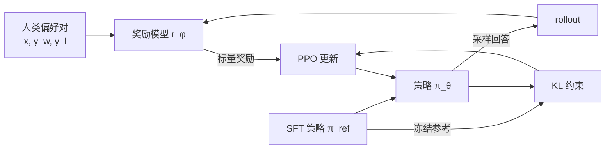

# 第 16 章 基于人类反馈的强化学习（RLHF）

## 本章导读

SFT 教模型「怎么答」，却没说「哪种答法更好」。同一个问题，十条回答都语法通顺，人类仍会偏好其中两三条：更简洁、更诚实、更少套话。想把这种排序信号变成训练目标，需要先学一个打分器，再让策略在它的高分区域里搜索——这正是 RLHF 的三个阶段。但打分器只是人类偏好的代理，策略会找到它的漏洞。本章用 2 层 TinyLM 复现这条流水线，并把「奖励作弊」在长度上的表现测成一个具体数字。

## 难度标签

⭐⭐⭐⭐ 研究向。数学要求：概率论、策略梯度、重要性采样与 KL 散度。代码要求：理解 PyTorch 自动求导、`no_grad`、参数冻结与多优化器训练。

## 学习目标

1. 从成对偏好写出 Bradley–Terry 似然，说明为什么奖励只能差到常数。
2. 推导 KL 正则目标的闭式最优策略，理解参考模型与 β 各自约束什么。
3. 写出 PPO 的重要性比、裁剪目标、GAE 与价值损失，并解释每一项防的是什么。
4. 实现奖励模型与 PPO，跑通 SFT→RM→PPO 三阶段，复现 3 个种子的对照。
5. 识别奖励作弊与长度偏置，设计能暴露它们的反事实探针。

## 16.1 为什么 SFT 不够：三个缺口

SFT 的损失是最大似然：给定人类示范 $$y$$，最大化 $$\log\pi_\theta(y\mid x)$$。它把每条示范都当成「正确答案」，但示范之间没有相对权重，也没有反例。于是留下三个缺口。

第一，**没有负信号**。模型只被告知「这样答可以」，没被告知「那样答更差」。当多条回答都合理时，SFT 无法表达偏好强度；它会把数据里出现的所有风格平均进去，包括冗长、套话与含糊其辞。

第二，**似然不等于偏好**。人类标注一条回答时，比较的是两条回答的相对质量；最大似然只关心示范的绝对概率。若数据里 70% 的回答偏长，SFT 会学到「长一点更安全」，这与「更长是否更好」是两件事。

第三，**错误会累积**。自回归生成时，模型每一步都在自己的分布上采样；SFT 只在示范前缀上训练，遇到自己的错误前缀就会偏离。RLHF 的在线采样让策略看到自己产生的完整回答，并按结果给整条轨迹打分，这弥补了曝光偏差（exposure bias）的一部分。

RLHF 的回答是：先用人类比较数据训练一个奖励模型（reward model, RM），把「哪种更好」压缩成一个标量；再用强化学习优化策略，让高奖励回答的概率上升。它不直接教「正确答案」，而是教「如何按人类偏好排序」。

偏好数据有三种常见来源。第一种是人类标注：给标注者同一提示的两条回答，让其选择更好的一条，必要时给出理由。第二种是 AI 反馈（RLAIF）：用更强的模型或同一模型的多条采样做比较，成本低、可扩展，但会继承评判模型的偏置。第三种是规则或环境反馈：代码执行结果、数学答案校验、工具调用是否成功，这类信号最可靠，但只覆盖可验证任务。工业系统常把三者混合：可验证任务用规则，开放域用人类或 AI 偏好，安全边界用专门的红队数据。本章用「手工奖励 + 噪声」模拟第一种来源，目的是把标注偏置显式地写进生成过程。

从逆强化学习（inverse reinforcement learning）的角度看，RLHF 假设人类的选择由一个隐式奖励驱动，先用比较数据把这个奖励恢复出来，再用它训练策略。奖励模型因此是「人类偏好的低维摘要」：它必须足够简单，才能从有限比较中估计；又必须足够准确，才能指导策略。这个张力贯穿全章。

工业上这条流水线通常写成三步：SFT 冷启动、奖励建模、PPO 微调。InstructGPT 是这套流程的代表作，Anthropic 的 HH 系列与 Llama 2 的迭代 RLHF 也都沿用同一骨架。

## 16.2 直觉：学一个裁判，再让选手围着裁判练

先看一个类比。SFT 像让学生临摹范文；奖励模型像请一位裁判，看两份答卷后判断哪份更好；PPO 像让选手反复比赛，裁判给分，选手调整策略。裁判不是全知全能的，他只看过有限场比赛，有自己的偏好，比如偏爱长答案。选手很快会发现：与其把题答对，不如把答案写长——这就是奖励作弊（reward hacking）。



图中两个细节决定成败。其一，参考模型 $$\pi_{\rm ref}$$ 冻结，它既是 KL 约束的锚点，也是「不许离 SFT 太远」的硬边界；没有它，策略会迅速钻奖励模型的空子，输出人类看不懂的高分乱码。其二，奖励只在整条回答结束时给一次，中间每一步的奖励来自 KL 塑形；这让 PPO 能把「序列级偏好」拆成「Token 级信用分配」。

为什么不能直接用奖励模型做 SFT？因为 RM 只见过有限数据，它的高分区域可能很窄、很怪；直接对 RM 做梯度上升会把策略推到分布外。PPO 的做法是「小步走、多次评估」：每批 rollout 后用旧策略的概率做重要性修正，裁剪更新幅度，并用 KL 把策略拴在参考模型附近。

四份模型的分工可以用一句话概括：策略负责「怎么答」，参考负责「原来怎么答」，奖励负责「答得好不好」，价值负责「现在这个前缀值多少」。策略与参考同构，价值与奖励同构，这是工程上能复用主干、节省显存的前提。训练时只有策略与价值有梯度；参考与奖励冻结，前者提供 KL 锚点，后者提供奖励信号。若把四者的角色混淆，比如用奖励模型同时充当价值网络，就会让「评估」与「基线估计」共享参数，梯度会污染奖励，训练信号不再可信。


RLHF 优化的不是「真实人类效用」，而是「奖励模型对真实效用的估计」。两者之间的差距，就是本章要量化的奖励作弊空间。


## 16.3 数学原理

### 16.3.1 偏好数据与 Bradley–Terry

设提示为 $$x$$，两条回答为 $$y_w$$（winner）与 $$y_l$$（loser）。Bradley–Terry 模型假设每条回答有一个潜在分数 $$r(x,y)$$，人类选择 $$y_w$$ 的概率由分数差的 sigmoid 给出：

$$
P(y_w \succ y_l \mid x) = \sigma\big(r(x,y_w)-r(x,y_l)\big),
\qquad \sigma(z)=\frac{1}{1+e^{-z}}
\qquad \text{(16.1)}
$$

给定偏好数据集 $$D_{\rm pref}=\{(x^{(i)},y_w^{(i)},y_l^{(i)})\}$$，奖励模型的负对数似然是

$$
\mathcal{L}_{\rm RM}(\phi)
= -\mathbb{E}_{(x,y_w,y_l)\sim D_{\rm pref}}
\left[\log\sigma\big(r_\phi(x,y_w)-r_\phi(x,y_l)\big)\right]
\qquad \text{(16.2)}
$$

这就是代码里的 `bradley_terry_loss`。它对奖励差做 logistic 回归：差值越大，损失越小；差值相同则损失相同。零差值时损失为 $$\log 2$$，测试 `test_bt_loss_zero_margin_is_log_two` 验证了这一点。

对 (16.2) 求梯度可以得到一个很直观的形式。记 $$\Delta=r_\phi(x,y_w)-r_\phi(x,y_l)$$，则

$$
\frac{\partial \mathcal{L}_{\rm RM}}{\partial r_\phi(x,y_w)}=-(1-\sigma(\Delta)),
\qquad
\frac{\partial \mathcal{L}_{\rm RM}}{\partial r_\phi(x,y_l)}=1-\sigma(\Delta)
$$

模型预测 $$y_w$$ 胜出的概率越低，把 $$r_w$$ 往上推、把 $$r_l$$ 往下推的力度越大；当预测概率接近 1 时，梯度趋于零。这与 logistic 回归的梯度完全一致，说明奖励模型本质上是在「奖励差」上做二分类。

奖励模型的结构也有设计空间。一种做法是在每个 Token 位置输出标量，再对响应 Token 取平均；另一种是只取最后一个 Token（通常是 EOS）的输出。本章用后者：它把整条回答压成一个「终止状态的价值」，与 PPO 在 EOS 处加奖励的实现一致，也避免平均池化让长回答的分数被更多 Token 稀释。代价是模型必须把信息汇聚到最后一个位置，长回答的早期内容可能被遗忘；第 13 章的长上下文问题在这里以「奖励模型看不全」的形式重现。工业实现有时用「EOS 位置 + 平均池化」的双头，或对长回答做分段打分再聚合。

(16.1) 有一个重要推论：**奖励的绝对尺度不可识别**。若给所有奖励加常数 $$c$$，差值不变，偏好概率不变；若把所有奖励乘正数 $$a$$，偏好概率变成 $$\sigma(a\Delta)$$，排序不变。因此 RM 的输出只有相对意义，不能拿不同 RM 的分数直接比较。工程上常把奖励标准化到零均值、单位方差，再交给 PPO；这不改变最优策略，只让价值网络的回归目标落在稳定区间。

Bradley–Terry 还假设「两两比较独立、无平局、传递性成立」。真实标注里存在平局、位置偏置与标注者差异；工业系统通常加入平局项、随机交换左右位置、按标注者校准。校准（calibration）在这里指「RM 预测的胜率是否与经验胜率一致」：成对准确率只关心排序，校准还关心概率是否可信。一个准确率 0.9 但严重过自信的 RM，在 PPO 里可能给出过大的奖励差。本章的玩具数据用带噪声的标量效用生成，满足 BT 假设，因此能把算法问题与标注问题分开。

真实偏好数据还违反 BT 的几条假设。平局很常见，尤其当两条回答质量接近时；处理方法是在损失里加一个平局区间，或把平局拆成两个方向的半权重。位置偏置指标注者倾向于选先出现的回答；标准做法是随机交换左右位置，并在训练时把交换后的样本一起加入。标注者差异则可以通过为每个标注者学一个偏置项、或按标注者一致性加权来缓解。这些工程细节不会出现在 (16.1) 里，但它们对最终 RM 的影响往往大于网络结构。

### 16.3.2 KL 正则目标与闭式最优

有了奖励模型，最直接的做法是最大化期望奖励：

$$
\max_{\pi_\theta}\ \mathbb{E}_{x\sim D,\,y\sim\pi_\theta(\cdot\mid x)}\big[r_\phi(x,y)\big]
$$

但这个目标没有约束，最优策略会把概率集中到 RM 的单个最高分输出上，哪怕它是胡言乱语。RLHF 加一个 KL 惩罚，把策略拴在参考模型附近：

$$
\max_{\pi_\theta}\ \mathbb{E}_{x\sim D}\Big[
\mathbb{E}_{y\sim\pi_\theta(\cdot\mid x)} r_\phi(x,y)
-\beta\,\mathrm{KL}\big(\pi_\theta(\cdot\mid x)\,\|\,\pi_{\rm ref}(\cdot\mid x)\big)
\Big]
\qquad \text{(16.3)}
$$

其中 $$\pi_{\rm ref}$$ 通常是 SFT 策略，参数冻结；$$\beta>0$$ 控制「追求奖励」与「保持原分布」的权衡。

(16.3) 有闭式解。对固定的 $$x$$，把期望写成求和，构造拉格朗日函数并对 $$\pi(y)$$ 求导，可得

$$
\pi^\star(y\mid x)
= \frac{1}{Z(x)}\,\pi_{\rm ref}(y\mid x)\,
\exp\!\left(\frac{r_\phi(x,y)}{\beta}\right),
\qquad
Z(x)=\sum_{y'}\pi_{\rm ref}(y'\mid x)\,
\exp\!\left(\frac{r_\phi(x,y')}{\beta}\right)
\qquad \text{(16.4)}
$$

也就是说，最优策略是参考策略按「奖励的指数」重新加权。$$\beta\to\infty$$ 时指数项趋于 1，$$\pi^\star\to\pi_{\rm ref}$$；$$\beta\to0$$ 时概率集中到奖励最高的输出。这个式子还有两个用途：一是解释 DPO——把 (16.4) 反解出 $$r_\phi=\beta\log(\pi^\star/\pi_{\rm ref})+\beta\log Z$$，代回 (16.2) 就能消掉奖励模型，直接在偏好对上优化策略；二是说明 PPO 的目标不是「找到全局最高分」，而是「在参考模型附近找到高分的倾斜分布」。把 $$\pi^\star$$ 代回 (16.3) 还能得到最优目标值：对固定的 $$x$$，

$$
\mathbb{E}_{y\sim\pi^\star}[r_\phi(x,y)]
-\beta\,\mathrm{KL}(\pi^\star\|\pi_{\rm ref})
=\beta\log Z(x)
$$

这个结果说明 KL 正则目标的「上限」由配分函数决定。$$Z(x)$$ 需要对所有可能回答求和，语言模型的回答空间是指数级的，因此无法精确计算。DPO 的技巧不是去算 $$Z$$，而是注意到 $$Z$$ 只依赖 $$x$$、不依赖策略参数；在比较两条回答时，$$\beta\log Z(x)$$ 会被抵消。这就是为什么 DPO 能绕开奖励模型与强化学习，直接用偏好对训练策略。

也可以用「完成平方」的方式理解 (16.4)。把 KL 展开可得

$$
\mathbb{E}_{\pi}[r]
-\beta\,\mathrm{KL}(\pi\|\pi_{\rm ref})
=-\beta\,\mathrm{KL}(\pi\|\pi^\star)+\beta\log Z(x)
$$

其中 $$\pi^\star$$ 由 (16.4) 定义。对任意 $$\pi$$，第一项小于等于零，等号仅在 $$\pi=\pi^\star$$ 时成立；因此最大化 (16.3) 等价于最小化与 $$\pi^\star$$ 的 KL。这个改写把「带约束的奖励最大化」变成了「向一个已知的倾斜分布投影」，也是 PPO 可以只用采样估计目标的依据：我们不需要知道 $$\pi^\star$$，只需要沿着它的方向移动。


(16.4) 只在「奖励模型完全可信」时才是我们想要的解。现实中 $$r_\phi$$ 有误差，$$\beta$$ 太小会让策略放大这些误差。KL 约束既是正则，也是安全绳。


### 16.3.3 逐 Token 的 KL 塑形奖励

(16.3) 的 KL 项定义在整条序列上，无法直接逐 Token 求期望。PPO 把它拆成逐 Token 的塑形奖励：

$$
r_t
= -\beta\big(\log\pi_\theta(a_t\mid s_t)-\log\pi_{\rm ref}(a_t\mid s_t)\big),
\qquad t<T
\qquad \text{(16.5)}
$$

序列末尾再加上奖励模型的分数 $$r_\phi(x,y)$$。这样每个 Token 都收到「别偏离参考模型」的惩罚，整条回答结束时再收到「答得好不好」的奖励。代码里用 `rewards = -beta * (logp - ref_logp) * mask`，再用 `scatter_add_` 把 RM 分数加到最后一个有效位置。这个拆法不是恒等变换，而是用逐 Token 的 KL 代理替代序列级 KL；当策略与参考模型在 Token 级差异不大时，两者近似相等。

还有一个实现细节：塑形奖励只加在响应 Token 上，提示 Token 的掩码为 0。若把提示也计入 KL，模型会被迫保持对提示的建模不变，这与「只约束回答分布」的目标不符，也会让不同长度的提示获得不同的惩罚。本章的 `response_mask` 明确规定「位于提示之后且不是 padding」，EOS 计入响应，因为 EOS 也是策略的一个动作。

### 16.3.4 策略梯度与 PPO 裁剪

语言模型的一次生成是一条轨迹 $$(s_0,a_0,\dots,s_T,a_T)$$，其中状态是已生成的前缀，动作是下一个 Token。策略梯度定理给出

$$
\nabla_\theta J(\theta)
= \mathbb{E}_{\tau\sim\pi_\theta}
\left[\sum_{t=0}^{T}\nabla_\theta\log\pi_\theta(a_t\mid s_t)\,A_t\right]
$$

其中 $$A_t$$ 是优势，衡量「在状态 $$s_t$$ 选动作 $$a_t$$ 比平均水平好多少」。直接用当前策略采样做一次梯度更新，方差大、步长难控；PPO 改为「用旧策略采样、对新策略做多次小步更新」。

设 $$\pi_{\theta_{\rm old}}$$ 是采样时的策略，重要性比定义为

$$
\rho_t(\theta)
= \frac{\pi_\theta(a_t\mid s_t)}{\pi_{\theta_{\rm old}}(a_t\mid s_t)}
= \exp\!\left(\log\pi_\theta(a_t\mid s_t)-\log\pi_{\theta_{\rm old}}(a_t\mid s_t)\right)
\qquad \text{(16.6)}
$$

重要性比来自「用旧策略的样本估计新策略的期望」这一恒等式：

$$
\mathbb{E}_{a\sim\pi_\theta}[f(a)]
=\mathbb{E}_{a\sim\pi_{\rm old}}
\left[\frac{\pi_\theta(a)}{\pi_{\rm old}(a)}f(a)\right]
$$

只要 $$\pi_{\rm old}$$ 在 $$\pi_\theta$$ 非零的地方也非零，这个等式就成立。PPO 每批数据只更新几步，正是为了让新旧策略足够接近，否则比值的方差会迅速增大、估计失效。这也是「旧策略」不是随便选的：它就是产生这批 rollout 的那个策略，log 概率在采样时已经记录好。

未裁剪的目标是 $$\rho_t A_t$$。当 $$\rho_t$$ 离 1 很远时，这个估计的方差会爆炸；PPO 把比值裁到 $$[1-\epsilon,1+\epsilon]$$，并取未裁剪与裁剪后的较小值：

$$
\mathcal{L}^{\rm CLIP}_t(\theta)
= \min\!\Big(\rho_t A_t,\ \mathrm{clip}(\rho_t,1-\epsilon,1+\epsilon)\,A_t\Big)
\qquad \text{(16.7)}
$$

为什么要取 min？分两种情况。若 $$A_t>0$$，策略想提高该动作概率；当 $$\rho_t>1+\epsilon$$ 时，裁剪项把收益封顶，防止一次更新走太远。若 $$A_t<0$$，策略想降低该动作概率；当 $$\rho_t<1-\epsilon$$ 时，裁剪项同样封顶，防止过度惩罚。取 min 保证目标始终是「悲观估计」：只有确实变好的方向才获得奖励。

裁剪有两个常见失效模式。其一是「比值塌缩」：若旧策略对某个 Token 的概率极低，而新策略把它抬高，比值会很大，裁剪后梯度被截断，策略学不到这个 Token；这在长尾 Token 上尤其明显。其二是「优势符号错误」：若价值网络严重高估或低估，$$A_t$$ 的符号可能反了，裁剪会把策略推向错误方向。实践中的对策是：用较小的学习率、多个 epoch 但每轮重新计算旧策略、对优势做批内归一化，并监控裁剪触发比例。若大部分 Token 都被裁剪，说明步长太大或旧策略太旧。

注意 (16.7) 是逐 Token 的。对数概率相加等于序列概率的对数，因此逐 Token 比值相乘就是序列比值；PPO 通常在 Token 级做裁剪，再对有效 Token 求平均。本章代码就是这样做的，测试 `test_clipped_surrogate_three_regions` 覆盖了比值小于下界、落在区间内、大于上界三个区域。

### 16.3.5 优势、GAE 与价值网络

优势的精确值需要知道状态价值 $$V^\pi(s_t)$$：

$$
A_t = Q^\pi(s_t,a_t)-V^\pi(s_t)
$$

我们用一个价值网络 $$V_\phi$$ 估计它。最简单的估计是单步时序差分：

$$
\delta_t = r_t + \gamma V_\phi(s_{t+1}) - V_\phi(s_t)
$$

$$\delta_t$$ 的偏差低、方差高；用多步回报能降方差、增偏差。GAE（generalized advantage estimation）用指数加权的 TD 残差在两者之间插值：

$$
A_t^{\rm GAE}
= \sum_{l=0}^{T-t}(\gamma\lambda)^l\,\delta_{t+l},
\qquad
\delta_t = r_t+\gamma V_\phi(s_{t+1})-V_\phi(s_t)
\qquad \text{(16.8)}
$$

$$\lambda=0$$ 退化为单步 TD，偏差低、方差高；$$\lambda=1$$ 退化为蒙特卡洛回报，方差低、偏差高。常见取 $$\lambda=0.95$$。语言模型的一轮对话是有限期，折扣常取 $$\gamma=1$$。

用本章测试里的例子可以手算 GAE。设奖励为 $$[0,0,1]$$、价值全为 0、$$\gamma=\lambda=1$$，则 $$\delta_2=1$$、$$\delta_1=0$$、$$\delta_0=0$$，从后往前累加得 $$A=[1,1,1]$$；若 $$\lambda=0$$，则 $$A=[0,0,1]$$，只有最后一个 Token 获得信用。这个对比说明 $$\lambda$$ 的作用：$$\lambda$$ 越大，奖励越向前传播，信用分配越广，但方差也越大。语言模型里，EOS 处的奖励需要传播到前面所有 Token，因此 $$\lambda$$ 常取接近 1 的值。

价值网络与策略一起训练，损失是回报的均方误差：

$$
\mathcal{L}(\theta,\phi)
= -\frac{1}{\sum_t m_t}\sum_t m_t\,\mathcal{L}^{\rm CLIP}_t(\theta)
+ c_1\,\frac{1}{\sum_t m_t}\sum_t m_t\,
\big(V_\phi(s_t)-\hat R_t\big)^2
\qquad \text{(16.9)}
$$

其中 $$m_t$$ 是响应 Token 的掩码，$$\hat R_t=A_t+V_\phi(s_t)$$ 是 GAE 给出的回报估计，$$c_1$$ 是价值损失系数。工程实现里策略与价值通常用两个优化器，避免共享 Adam 状态。

价值网络的训练有几个容易出错的细节。第一，价值的监督信号是回报 $$\hat R_t=A_t+V_\phi(s_t)$$，而 $$A_t$$ 又用 $$V_\phi$$ 计算，所以价值目标依赖当前价值估计；实现时通常把回报 detach，避免梯度穿过 GAE 递归。第二，padding 位置不参与损失，否则零填充会被当成真实状态。第三，价值只在响应 Token 上有意义，提示位置的价值不参与策略损失。第四，价值网络常从奖励模型初始化：两者都输出标量、共享 Transformer 主干，初始化后已经能给出「哪条回答更好」的粗略排序，比随机初始化稳定得多。

回报与优势的形状必须与奖励对齐。本章的实现里，`token_values` 把位置 $$t$$ 的价值对齐到「预测 Token $$t$$」，即 $$V(s_{t-1})$$；GAE 从后往前扫，padding 位置的下一状态价值置零。若对齐错一位，优势会系统性地偏移一个 Token，奖励被记到错误的前缀上，训练仍能跑但学到的信用分配是错的。这类 bug 不会报错，只能靠手算小例子发现——测试 `test_gae_hand_example` 就是为此写的。

### 16.3.6 KL 估计量：k1 与 k3

KL 的估计有两个常用版本。k1 直接用对数比：

$$
\widehat{\mathrm{KL}}_1
= \frac{1}{\sum_t m_t}\sum_t m_t\,
\big(\log\pi_\theta(a_t\mid s_t)-\log\pi_{\rm ref}(a_t\mid s_t)\big)
\qquad \text{(16.10)}
$$

它无偏，但逐 Token 的值可正可负，方差大；单个 Token 的负值不代表「KL 为负」，只有批平均才逼近真实 KL。

k3 估计量先取指数再减：

$$
\widehat{\mathrm{KL}}_3
= \frac{1}{\sum_t m_t}\sum_t m_t\,
\big(\rho_t^{\rm ref}-\log\rho_t^{\rm ref}-1\big),
\qquad
\rho_t^{\rm ref}=\frac{\pi_{\rm ref}(a_t\mid s_t)}{\pi_\theta(a_t\mid s_t)}
\qquad \text{(16.11)}
$$

由 $$x-\log x-1\ge0$$ 可知 k3 逐 Token 非负，方差显著小于 k1；代价是要对对数比取指数，数值上需要裁剪。本章用 k1 做塑形奖励（它直接来自 log 概率，不需要额外计算），用 k1 的批平均报告「逐 Token log 比」，并在测试里验证两个估计量在策略与参考相同时都为零。

两个估计量怎么选？若目标是「监控训练是否偏离参考模型」，k3 更适合：它逐 Token 非负，方差小，曲线平滑，便于设阈值。若目标是「把 KL 作为奖励塑形」，k1 更自然：它直接是 log 概率之差，已经在 rollout 中算好，不需要额外的指数与裁剪。代价是 k1 的逐 Token 噪声会进入优势估计，因此常配合优势归一化与较大的批大小。无论用哪个，报告时都要说明是「逐 Token 平均」还是「逐序列求和后再平均」，两者相差一个长度因子。


采样分布必须与计算 log 概率的分布严格一致。若采样时截断词表、强制 EOS 或限制最小长度，却用未截断的 softmax 计算 $$\log\pi$$，重要性比与 KL 都会有偏。本章的 `sample_responses` 特意不做任何词表截断，就是为了守住这条不变量。


## 16.4 方案对比

RLHF 不是唯一的选择。下表把四条常见路线放在同一张账本上。

| 方法 | 需要奖励模型 | 需要参考模型 | 在线采样 | 训练成本 | 主要风险 | 适用条件 |
| --- | --- | --- | --- | --- | --- | --- |
| PPO / RLHF | 是 | 是 | 是 | 最高：四份模型 + rollout | 奖励作弊、训练不稳定 | 有高质量偏好数据、追求超越 RM 的上限 |
| Best-of-N | 是 | 否 | 是（推理时） | 推理成本 ×N，无训练 | 受 RM 上限约束 | 无法训练、只想在现有策略上提分 |
| 拒绝采样微调 | 是 | 否 | 是（离线） | 采样 + SFT | 分布偏移、多样性下降 | 有强 RM、想复用 SFT 管线 |
| DPO | 否 | 是 | 否 | 最低：一次监督式训练 | 对偏好数据覆盖敏感、易过拟合 | 偏好数据充足、算力有限、追求稳定 |

这张表的关键不是「谁更强」，而是「成本花在哪里」。PPO 把成本花在在线 rollout 与四份模型上，换来的是策略可以探索 RM 训练分布之外的区域；Best-of-N 把成本花在推理时采样，训练为零，但只能从现有策略的样本里挑；拒绝采样介于两者之间；DPO 把偏好学习变成一次离线分类，最便宜，但它优化的是「固定偏好数据集上的相对概率」，无法像 PPO 那样在线纠错。

再算一笔粗账。设策略参数量为 $$N$$，一次 rollout 生成 $$L$$ 个 Token。PPO 每轮需要一次策略前向（采样）、一次参考前向、一次奖励前向、一次价值前向，反向还要再走策略与价值；Best-of-N 在推理时需要 $$N$$ 次完整生成，但训练成本为零；DPO 只需要策略与参考各一次前向，外加一次反向。若把「达到同一目标命中率所需的 GPU 小时」作为横轴，PPO 的优势来自样本复用：同一批 rollout 可以做多个 epoch 的更新，而 Best-of-N 的每条样本只用一次。反过来，若训练步数很少、或 RM 很不可靠，PPO 的固定开销（四份模型、调参、稳定性）可能永远收不回来。

选择可以先问三个问题：有没有可靠的 RM？能不能承受在线采样？是否需要在部署时零额外开销？若三者都是「是」，PPO 合理；若只有 RM 而没有训练预算，Best-of-N 是低风险基线；若连 RM 都没有但偏好对充足，DPO 更合适。本章的实验会同时给出 PPO 与 Best-of-8 的数字，方便对照。

拒绝采样微调与 Best-of-N 常被混为一谈，区别在「采样结果怎么用」。Best-of-N 只在推理时挑一条，不改变模型参数；拒绝采样把 RM 挑出的高分回答收集起来，作为新的 SFT 数据再训练模型。前者是推理时搜索，后者是离线蒸馏：它把 RM 的排序能力固化成策略的生成习惯，推理时不再需要 $$N$$ 倍采样。代价是训练数据只来自旧策略的高分尾部，分布会变窄；通常要混合原始 SFT 数据，或做多轮迭代。

## 16.5 代码实现

### 16.5.1 实验设计

玩具任务沿用第 14、15 章的对话格式，但把「算术」换成「主题匹配」，以便同时测量正确性、干扰项与长度。

- 词表 16：`PAD=0`、`BOS=1`、`USER=2`、`ASSISTANT=3`、`EOS=4`，主题 Token 5–8，回答 Token 8–15。
- 提示固定为 `[BOS, USER, topic, ASSISTANT]`；对主题 $$t$$，目标回答 Token 是 $$8+(t-5)$$，形近干扰 Token 是 $$12+(t-5)$$。
- SFT 行为策略：每个回答 Token 有 55% 概率取目标、10% 取干扰、35% 在 8 个回答 Token 上均匀采样；回答长度 3–5。
- 「人类」奖励：目标命中率 + 0.30×干扰命中率 + 0.35×(长度−3)/3 + 高斯噪声。也就是说，标注者会误把形近词当成正确答案，并偏好更长的回答；这两个偏置为后文的探针提供了可测量的目标——RM 能学到哪些、漏掉哪些，正是结果部分要回答的问题。
- 奖励模型：从 SFT 策略初始化主干，替换词表头为标量头；2,000 对训练偏好、400 对评测，BT 损失，400 步。
- PPO：策略与参考模型都从 SFT 初始化，价值模型从 RM 初始化；50 轮、每轮 48 条提示、2 个 epoch、minibatch 16；β 取 0.10、0.50、2.00 三档；3 个种子。
- 评测：256 条回答，报告目标命中率、干扰命中率、内容长度、RM 分数与逐 Token log 比；另跑 Best-of-8 作为推理时基线。

评测指标的定义需要写清楚，否则数字不可比。目标命中率是「响应内容中等于目标 Token 的比例」，分母是内容 Token 数；内容掩码去掉提示与 padding，并去掉最后一个有效 Token——它通常是 EOS，若把它算进分母，短回答会被系统性高估。干扰命中率同理。长度是内容 Token 数，不含 EOS 与 padding。RM 分数是奖励模型在整条序列上的标量输出，未做批内标准化；PPO 训练时的奖励做过标准化，因此表里的 RM 分数与训练信号不是同一尺度。逐 Token log 比是 k1 在响应掩码上的平均，用来近似策略与参考模型的 KL。

模型仍是 2 层、$$d_{model}=32$$、2 个头的 TinyLM，`TinyLM.forward`、`CausalLMOutput` 与 `ModelConfig` 的签名不变。新增的只有 `tinylm/posttrain/rm.py` 与 `tinylm/posttrain/ppo.py`；奖励头与价值头都通过替换 `lm_head` 实现，不改前向接口。

### 16.5.2 完整代码

`tinylm/posttrain/rm.py`：

```python
"""第 16 章：奖励模型与 Bradley-Terry 损失（tinylm/posttrain/rm.py）。"""
import torch
import torch.nn as nn
import torch.nn.functional as F

from ch08 import TinyLM


class ScalarModel(nn.Module):
    """把 TinyLM 的词表头换成标量头。

    奖励模型与价值模型都与策略共享同一套 Transformer 主干，只是输出维
    不同：策略输出 ``(B, T, n_vocab)``，这里输出 ``(B, T)``。替换
    ``lm_head`` 而不改 ``TinyLM.forward``，因此三份模型可以复用同一套
    位置编码、注意力与因果掩码。
    """

    def __init__(self, cfg):
        super().__init__()
        assert not cfg.tie_embeddings, "标量头无法与词表嵌入绑定"
        self.cfg = cfg
        self.backbone = TinyLM(cfg)
        self.backbone.lm_head = nn.Linear(cfg.d_model, 1, bias=False)
        nn.init.normal_(self.backbone.lm_head.weight, std=0.02)

    def forward(self, input_ids, attention_mask=None):
        return self.backbone(
            input_ids, attention_mask=attention_mask).logits.squeeze(-1)

    def score(self, input_ids, attention_mask):
        """取每条序列最后一个有效位置（EOS）的标量输出。"""
        values = self(input_ids, attention_mask=attention_mask)
        last = attention_mask.long().sum(-1) - 1
        return values.gather(1, last[:, None]).squeeze(1)


def init_scalar_from_lm(cfg, lm_state, seed=0):
    """用 SFT 策略初始化奖励/价值主干，标量头保持随机。

    ``lm_head`` 的形状从 ``(n_vocab, d_model)`` 变成 ``(1, d_model)``，
    不能直接加载；其余参数逐位复制。返回被丢弃的键，便于测试。
    """
    torch.manual_seed(seed)
    model = ScalarModel(cfg)
    dropped = [k for k in lm_state if k.startswith("lm_head.")]
    keep = {k: v for k, v in lm_state.items() if not k.startswith("lm_head.")}
    missing, unexpected = model.backbone.load_state_dict(keep, strict=False)
    assert not unexpected, unexpected
    # 主干之外只有被替换的 lm_head 应当缺失
    assert set(missing) <= {"lm_head.weight"}, missing
    nn.init.normal_(model.backbone.lm_head.weight, std=0.02)
    return model, dropped


def bradley_terry_loss(reward_win, reward_lose):
    """(16.1)：$$-\\log\\sigma(r_w-r_l)$$ 的批平均。

    只依赖奖励差，因此对全体奖励加常数不变；这是奖励尺度不可识别的
    来源，也是 DPO 能从同一目标出发消掉奖励的原因。
    """
    # (16.1)
    return -F.logsigmoid(reward_win - reward_lose).mean()


def pairwise_accuracy(reward_win, reward_lose):
    """偏好对上的排序准确率；平局按失败计。"""
    return (reward_win > reward_lose).float().mean()


def preference_probability(reward_win, reward_lose):
    """(16.1) 给出的 $$P(y_w\\succ y_l)$$。"""
    return torch.sigmoid(reward_win - reward_lose)


def reward_standardizer(rewards):
    """返回 $$(r-\\mu)/\\sigma$$ 所需的两个标量。

    奖励的零点与尺度都是任意的；PPO 只用奖励差与相对大小，标准化
    不改变最优策略，但能让价值网络的回归目标落在稳定区间。
    """
    mean = rewards.mean()
    std = rewards.std(unbiased=False).clamp_min(1e-6)
    return mean, std
```

`tinylm/posttrain/ppo.py`：

```python
"""第 16 章：rollout、GAE 与 PPO 裁剪目标（tinylm/posttrain/ppo.py）。"""
from dataclasses import dataclass

import torch
import torch.nn.functional as F


@dataclass(frozen=True)
class RLConfig:
    """PPO 训练脚本参数，不进入 ``ModelConfig``。"""

    lr: float = 1e-3
    beta: float = 0.5               # KL 正则系数
    clip: float = 0.2               # PPO 裁剪系数
    gamma: float = 1.0              # 语言模型回合是有限期，折扣取 1
    lam: float = 0.95               # GAE 的偏差—方差折中
    epochs: int = 2                 # 每批 rollout 重复更新次数
    minibatch: int = 16
    vf_coef: float = 0.5
    max_new: int = 6                # 响应最多生成多少个 Token（含 EOS）
    temperature: float = 1.0
    grad_clip: float = 1.0
    normalize_reward: bool = True
    pad_id: int = 0
    eos_id: int = 4

    def __post_init__(self):
        assert self.beta >= 0.0
        assert 0.0 < self.clip < 1.0
        assert self.epochs >= 1
        assert self.max_new >= 1


@dataclass
class Rollout:
    seqs: torch.Tensor        # (B, T)
    attn: torch.Tensor        # (B, T) bool
    mask: torch.Tensor        # (B, T) bool，响应 Token（含 EOS）
    logp: torch.Tensor        # (B, T) 旧策略 log π
    values: torch.Tensor      # (B, T)
    rewards: torch.Tensor     # (B, T)
    adv: torch.Tensor         # (B, T)
    returns: torch.Tensor     # (B, T)
    rm_score: torch.Tensor    # (B,)


@torch.no_grad()
def sample_responses(policy, prompts, cfg, generator):
    """从策略采样完整响应，返回 ``prompt + response`` 的 Token 序列。

    采样分布就是模型在全词表上的 softmax，不做词表截断，也不强制 EOS；
    这样记录的 log 概率与实际采样分布严格一致。到达 ``max_new`` 仍没有
    EOS 的序列按有限期回合截断，最后一个 Token 视为终止状态。
    """
    policy.eval()
    seqs = prompts
    done = torch.zeros(seqs.size(0), dtype=torch.bool)
    for _ in range(cfg.max_new):
        logits = policy(seqs).logits[:, -1]
        probs = torch.softmax(logits / cfg.temperature, dim=-1)
        nxt = torch.multinomial(probs, 1, generator=generator).squeeze(1)
        nxt = torch.where(done, torch.full_like(nxt, cfg.pad_id), nxt)
        seqs = torch.cat([seqs, nxt[:, None]], dim=1)
        done = done | (nxt == cfg.eos_id)
        if bool(done.all()):
            break
    return seqs


def response_mask(seqs, prompt_len, pad_id):
    """响应位置：位于提示之后且不是 padding；EOS 计入响应。"""
    positions = torch.arange(seqs.size(1), device=seqs.device)[None, :]
    return (seqs != pad_id) & (positions >= prompt_len)


def token_logprobs(model, seqs, attn):
    """返回每个位置预测*下一个* Token 的 log 概率，形状 ``(B, T)``。

    第 0 位没有前文，填 0；其余位置满足 logp[:, t] = log π(seqs[t] | seqs[:t])。
    padding 位置填 0，避免 ``-inf`` 与掩码相乘产生 NaN。
    """
    logits = model(seqs, attention_mask=attn).logits[:, :-1]
    logp = F.log_softmax(logits, dim=-1)
    target = seqs[:, 1:]
    out = logp.gather(-1, target[..., None]).squeeze(-1)
    out = torch.where(attn[:, 1:], out, torch.zeros_like(out))
    return F.pad(out, (1, 0))


def token_values(value, seqs, attn):
    """把位置 t 的价值对齐到「预测 Token t」：V(s_{t-1})。"""
    values = value(seqs, attention_mask=attn)
    return F.pad(values[:, :-1], (1, 0))


def compute_gae(rewards, values, mask, gamma=1.0, lam=0.95):
    """(16.8)：广义优势估计。

    $$\\delta_t=r_t+\\gamma V(s_{t+1})-V(s_t)$$，
    $$A_t=\\sum_l (\\gamma\\lambda)^l\\delta_{t+l}$$。响应结束后的
    padding 位置把优势与自举价值都置零。
    """
    batch, length = rewards.shape
    adv = torch.zeros_like(rewards)
    running = torch.zeros(batch, device=rewards.device)
    for t in reversed(range(length)):
        if t + 1 < length:
            next_value = torch.where(mask[:, t + 1], values[:, t + 1],
                                     torch.zeros_like(values[:, t + 1]))
        else:
            next_value = torch.zeros(batch, device=rewards.device)
        delta = rewards[:, t] + gamma * next_value - values[:, t]
        running = (delta + gamma * lam * running) * mask[:, t].to(running.dtype)
        adv[:, t] = running
    returns = adv + values
    return adv, returns


def normalize_advantage(adv, mask):
    """按批内有效位置做零均值、单位标准差；padding 位置保持 0。"""
    x = adv[mask]
    if x.numel() == 0:
        return torch.zeros_like(adv)
    norm = (adv - x.mean()) / (x.std(unbiased=False) + 1e-8)
    return norm * mask.to(norm.dtype)


def clipped_surrogate(ratio, adv, clip):
    """(16.7)：$$\\min(\\rho A,\\ \\mathrm{clip}(\\rho,1-\\epsilon,1+\\epsilon)A)$$。"""
    # (16.7)
    return torch.minimum(ratio * adv,
                         torch.clamp(ratio, 1.0 - clip, 1.0 + clip) * adv)


def kl_penalty(logp, ref_logp, mask):
    """(16.10)：k1 估计量 $$\\log\\pi-\\log\\pi_{\\mathrm{ref}}$$ 的批平均。

    在旧策略的样本上计算，不需要额外采样；逐 Token 的 log 比同时用作
    (16.5) 的塑形奖励。k1 无偏但方差大，单个 Token 可以为负，只有批
    平均才逼近 $$\\mathrm{KL}(\\pi\\|\\pi_{\\mathrm{ref}})$$。
    """
    # (16.10)
    return ((logp - ref_logp) * mask).sum() / mask.sum().clamp_min(1)


def kl_estimator_k3(logp, ref_logp, mask):
    """(16.11)：k3 估计量 $$r-\\log r-1$$，其中 $$r=\\pi_{\\mathrm{ref}}/\\pi$$。

    逐 Token 非负，方差显著小于 k1；代价是需要对 log 比取指数。
    """
    # (16.11)
    log_ratio = torch.clamp(ref_logp - logp, -20.0, 20.0)
    k3 = torch.exp(log_ratio) - log_ratio - 1.0
    return ((k3 * mask).sum() / mask.sum().clamp_min(1),
            (k3 * mask).sum(1) / mask.sum(1).clamp_min(1))


def collect_rollout(policy, ref, value, reward_model, prompts, cfg, generator):
    """采样一批响应并计算 log 概率、价值、KL 塑形奖励与 GAE 优势。"""
    prompt_len = prompts.size(1)
    seqs = sample_responses(policy, prompts, cfg, generator)
    attn = seqs != cfg.pad_id
    mask = response_mask(seqs, prompt_len, cfg.pad_id)

    with torch.no_grad():
        logp = token_logprobs(policy, seqs, attn)
        ref_logp = token_logprobs(ref, seqs, attn)
        values = token_values(value, seqs, attn)
        rm_score = reward_model.score(seqs, attn)

    if cfg.normalize_reward:
        rm_score = (rm_score - rm_score.mean()) / (
            rm_score.std(unbiased=False) + 1e-6)

    # (16.5)：逐 Token 奖励 = -β KL_t，序列末尾加奖励模型的分数
    rewards = -cfg.beta * (logp - ref_logp) * mask
    last = attn.long().sum(-1) - 1
    rewards.scatter_add_(1, last[:, None], rm_score[:, None])
    values = values * mask

    adv, returns = compute_gae(rewards, values, mask, cfg.gamma, cfg.lam)
    return Rollout(seqs=seqs, attn=attn, mask=mask, logp=logp.detach(),
                   values=values, rewards=rewards, adv=adv,
                   returns=returns, rm_score=rm_score)


def ppo_update(policy, value, opt_pi, opt_v, batch, cfg, generator):
    """(16.6)–(16.9)：在固定 rollout 上做若干轮 PPO 更新，返回诊断量。"""
    batch_size = batch.seqs.size(0)
    stats = []
    for _ in range(cfg.epochs):
        order = torch.randperm(batch_size, generator=generator)
        for start in range(0, batch_size, cfg.minibatch):
            idx = order[start:start + cfg.minibatch]
            seqs, attn, mask = batch.seqs[idx], batch.attn[idx], batch.mask[idx]
            logp = token_logprobs(policy, seqs, attn)
            values = token_values(value, seqs, attn)

            # (16.6)
            ratio = torch.exp(logp - batch.logp[idx])
            adv = normalize_advantage(batch.adv[idx], mask)
            # (16.9)：策略损失 + 价值回归
            pi_loss = -(clipped_surrogate(ratio, adv, cfg.clip) * mask).sum() \
                / mask.sum().clamp_min(1)
            v_loss = ((values - batch.returns[idx]) ** 2 * mask).sum() \
                / mask.sum().clamp_min(1)
            loss = pi_loss + cfg.vf_coef * v_loss

            opt_pi.zero_grad(set_to_none=True)
            opt_v.zero_grad(set_to_none=True)
            loss.backward()
            torch.nn.utils.clip_grad_norm_(policy.parameters(), cfg.grad_clip)
            torch.nn.utils.clip_grad_norm_(value.parameters(), cfg.grad_clip)
            opt_pi.step()
            opt_v.step()
            stats.append((float(pi_loss.detach()), float(v_loss.detach()),
                          float(ratio[mask].mean().detach())))
    return stats
```

`examples/ch16_rlhf.py`：

```python
"""第 16 章：奖励模型与 PPO（examples/ch16_rlhf.py）。"""
import copy
import random
import time

import torch

from ch08 import ModelConfig, TinyLM
from tinylm.posttrain import ppo as P
from tinylm.posttrain import rm as RM
from tinylm.posttrain import sft
from tinylm.tokenizer.chat import ChatTemplate

PAD, BOS, EOS, USER, ASSISTANT = 0, 1, 4, 2, 3
TOPICS = (5, 6, 7, 8)
RESP_IDS = tuple(range(8, 16))
TARGET = {t: 8 + (t - 5) for t in TOPICS}
DECOY = {t: 12 + (t - 5) for t in TOPICS}
VOCAB = 16
SEEDS = (0, 1, 2)
TEMPLATE = ChatTemplate()


def make_model(seed):
    torch.manual_seed(seed)
    cfg = ModelConfig(vocab_size=VOCAB, d_model=32, n_layers=2, n_heads=2,
                      d_ff=128, max_seq_len=32, pos_encoding="rope",
                      norm="rmsnorm", ffn="swiglu", bias=False)
    return TinyLM(cfg), cfg


def prompt_ids(topic):
    return [BOS, USER, int(topic), ASSISTANT]


def make_response(gen, topic, p_target=0.55, p_decoy=0.10, lo=3, hi=5):
    """行为策略：55% 目标词、10% 形近干扰词、其余从响应词表均匀采样。"""
    length = int(torch.randint(lo, hi + 1, (1,), generator=gen))
    out = []
    for _ in range(length):
        u = float(torch.rand(1, generator=gen))
        if u < p_target:
            out.append(TARGET[topic])
        elif u < p_target + p_decoy:
            out.append(DECOY[topic])
        else:
            out.append(RESP_IDS[int(torch.randint(0, len(RESP_IDS), (1,), generator=gen))])
    return out


def make_example(topic, ys):
    return TEMPLATE.render([("user", [int(topic)]), ("assistant", ys)])


def make_sft_data(seed, size):
    gen = torch.Generator().manual_seed(seed)
    data = []
    for _ in range(size):
        topic = TOPICS[int(torch.randint(0, len(TOPICS), (1,), generator=gen))]
        data.append(make_example(topic, make_response(gen, topic)))
    return data


def train_sft(model, data, seed, steps=500, lr=3e-3, batch_size=32):
    opt = torch.optim.AdamW([p for p in model.parameters() if p.requires_grad],
                            lr=lr, weight_decay=0.01)
    gen = torch.Generator().manual_seed(1000 + seed)
    model.train()
    for _ in range(steps):
        idx = torch.randint(0, len(data), (batch_size,), generator=gen)
        batch = sft.collate_examples([data[int(i)] for i in idx])
        out = model(batch["input_ids"], attention_mask=batch["attention_mask"],
                    labels=batch["labels"])
        opt.zero_grad()
        out.loss.backward()
        opt.step()
    return model


def human_reward(topic, ys, noise=0.0, rng=None):
    """偏好标签背后的“人类”奖励。

    标注者把形近干扰词误当成正确答案、又偏好更长的回答；这两项偏置
    会被奖励模型学走，而真实任务只认目标词。
    """
    correct = sum(y == TARGET[topic] for y in ys) / len(ys)
    decoy = sum(y == DECOY[topic] for y in ys) / len(ys)
    length_bonus = 0.35 * (len(ys) - 3) / 3.0
    noise = rng.gauss(0.0, noise) if (noise and rng) else 0.0
    return correct + 0.30 * decoy + length_bonus + noise


def make_pairs(seed, size, noise=0.03):
    gen = torch.Generator().manual_seed(seed + 77)
    rng = random.Random(seed + 77)
    pairs = []
    for _ in range(size):
        topic = TOPICS[int(torch.randint(0, len(TOPICS), (1,), generator=gen))]
        y1 = make_response(gen, topic)
        y2 = make_response(gen, topic)
        r1 = human_reward(topic, y1, noise, rng)
        r2 = human_reward(topic, y2, noise, rng)
        if abs(r1 - r2) < 1e-6:
            continue
        win, lose = (y1, y2) if r1 > r2 else (y2, y1)
        pairs.append({
            "win": make_example(topic, win)["input_ids"],
            "lose": make_example(topic, lose)["input_ids"],
        })
    return pairs


def pad_batch(rows, pad=PAD):
    length = max(r.numel() for r in rows)
    ids = torch.full((len(rows), length), pad, dtype=torch.long)
    mask = torch.zeros((len(rows), length), dtype=torch.bool)
    for i, r in enumerate(rows):
        ids[i, :r.numel()] = r
        mask[i, :r.numel()] = True
    return ids, mask


def train_reward(model, pairs, seed, steps=400, lr=1e-3, batch_size=64):
    opt = torch.optim.AdamW(model.parameters(), lr=lr, weight_decay=0.01)
    gen = torch.Generator().manual_seed(2000 + seed)
    model.train()
    for _ in range(steps):
        idx = torch.randint(0, len(pairs), (batch_size,), generator=gen)
        batch = [pairs[int(i)] for i in idx]
        win_ids, win_mask = pad_batch([b["win"] for b in batch])
        lose_ids, lose_mask = pad_batch([b["lose"] for b in batch])
        rw = model.score(win_ids, win_mask)
        rl = model.score(lose_ids, lose_mask)
        loss = RM.bradley_terry_loss(rw, rl)
        opt.zero_grad()
        loss.backward()
        opt.step()
    return model


@torch.no_grad()
def probe_reward_model(model):
    """探针：固定候选对，测量 RM 对长度与正确性的偏好。

    (1) 长度探针：两边全部命中目标，长度 3 vs 5；
    (2) 正确性探针：同为长度 4，4 个目标 vs 2 个目标；
    (3) 干扰词探针：同为长度 4，4 个目标 vs 2 个目标 + 2 个形近词。
    """
    long_win = correct_win = decoy_win = 0
    for topic in TOPICS:
        g, d = TARGET[topic], DECOY[topic]
        other = 8 + (TARGET[topic] - 8 + 4) % 8   # 同词表、非目标非干扰
        cases = (
            ("len", [g] * 3, [g] * 5),                 # 偏好更长的全对回答
            ("cor", [g] * 4, [g] * 3 + [other]),       # 偏好全对
            ("dec", [g] * 3 + [d], [g] * 3 + [other]), # 偏好形近词
        )
        for kind, a, b in cases:
            ids, mask = pad_batch([make_example(topic, a)["input_ids"],
                                   make_example(topic, b)["input_ids"]])
            score = model.score(ids, mask)
            win = int(score[1] > score[0]) if kind == "len" else int(score[0] > score[1])
            if kind == "len":
                long_win += win
            elif kind == "cor":
                correct_win += win
            else:
                decoy_win += win
    n = len(TOPICS)
    return {"len": long_win / n, "cor": correct_win / n, "dec": decoy_win / n}


@torch.no_grad()
def reward_accuracy(model, pairs):
    model.eval()
    win_ids, win_mask = pad_batch([p["win"] for p in pairs])
    lose_ids, lose_mask = pad_batch([p["lose"] for p in pairs])
    rw = model.score(win_ids, win_mask)
    rl = model.score(lose_ids, lose_mask)
    return float(RM.pairwise_accuracy(rw, rl))


@torch.no_grad()
def sample_for_topics(policy, topics, cfg, generator, batch=256):
    policy.eval()
    rows = []
    for start in range(0, len(topics), batch):
        chunk = topics[start:start + batch]
        prompts = torch.tensor([prompt_ids(t) for t in chunk], dtype=torch.long)
        rows.append(P.sample_responses(policy, prompts, cfg, generator))
    return torch.cat(rows)


def sequence_stats(policy, ref, reward_model, seqs, topics, prompt_len=4):
    """真实正确率、内容长度、RM 分数与逐 Token KL。"""
    attn = seqs != PAD
    mask = P.response_mask(seqs, prompt_len, PAD)
    last = attn.long().sum(-1) - 1
    content = mask.clone()
    content[torch.arange(seqs.size(0)), last] = False
    target = torch.tensor([TARGET[int(t)] for t in topics])
    decoy = torch.tensor([DECOY[int(t)] for t in topics])
    true = ((seqs == target[:, None]) & content).sum(1) / content.sum(1)
    fake = ((seqs == decoy[:, None]) & content).sum(1) / content.sum(1)
    length = content.sum(1).float()
    rm_score = reward_model.score(seqs, attn)
    logp = P.token_logprobs(policy, seqs, attn)
    ref_logp = P.token_logprobs(ref, seqs, attn)
    k1 = ((logp - ref_logp) * mask).sum(1) / mask.sum(1).clamp_min(1)
    return true, fake, length, rm_score, k1


def eval_topics(n=256):
    return [TOPICS[i % len(TOPICS)] for i in range(n)]


@torch.no_grad()
def evaluate(policy, ref, reward_model, seed, n=256):
    topics = eval_topics(n)
    gen = torch.Generator().manual_seed(5000 + seed)
    seqs = sample_for_topics(policy, topics, P.RLConfig(), gen)
    true, fake, length, rm_score, kl = sequence_stats(
        policy, ref, reward_model, seqs, topics)
    return {"true": true.mean().item(), "fake": fake.mean().item(),
            "len": length.mean().item(), "rm": rm_score.mean().item(),
            "kl": kl.mean().item()}


@torch.no_grad()
def evaluate_best_of_n(policy, ref, reward_model, n_best, seed, n=256):
    topics = eval_topics(n)
    gen = torch.Generator().manual_seed(6000 + seed)
    repeated = [t for t in topics for _ in range(n_best)]
    seqs = sample_for_topics(policy, repeated, P.RLConfig(), gen)
    true, fake, length, rm_score, kl = sequence_stats(
        policy, ref, reward_model, seqs, repeated)
    b = len(topics)
    pick = rm_score.view(b, n_best).argmax(1)
    idx = torch.arange(b) * n_best + pick
    return {"true": true[idx].mean().item(), "fake": fake[idx].mean().item(),
            "len": length[idx].mean().item(), "rm": rm_score[idx].mean().item(),
            "kl": kl[idx].mean().item()}


def run_ppo(sft_model, cfg_model, reward_model, beta, seed, iters=40,
            batch=48, log_every=0, eval_seed=None, **cfg_kwargs):
    cfg = P.RLConfig(beta=beta, **cfg_kwargs)
    policy = TinyLM(cfg_model)
    policy.load_state_dict(sft_model.state_dict())
    ref = TinyLM(cfg_model)
    ref.load_state_dict(sft_model.state_dict())
    for p in ref.parameters():
        p.requires_grad_(False)
    ref.eval()
    value = RM.ScalarModel(cfg_model)
    value.load_state_dict(reward_model.state_dict())

    opt_pi = torch.optim.AdamW(policy.parameters(), lr=cfg.lr, weight_decay=0.0)
    opt_v = torch.optim.AdamW(value.parameters(), lr=cfg.lr, weight_decay=0.0)
    gen = torch.Generator().manual_seed(3000 + seed)
    trajectory = []
    for it in range(iters):
        topic_idx = torch.randint(0, len(TOPICS), (batch,), generator=gen)
        topics = [TOPICS[int(i)] for i in topic_idx]
        prompts = torch.tensor([prompt_ids(t) for t in topics], dtype=torch.long)
        batch_data = P.collect_rollout(
            policy, ref, value, reward_model, prompts, cfg, generator=gen)
        P.ppo_update(policy, value, opt_pi, opt_v, batch_data, cfg, gen)
        if log_every and (it + 1) % log_every == 0:
            s = evaluate(policy, ref, reward_model,
                         seed if eval_seed is None else eval_seed)
            trajectory.append((it + 1, s))
    final = evaluate(policy, ref, reward_model,
                     seed if eval_seed is None else eval_seed)
    return policy, final, trajectory


def fmt(values):
    t = torch.tensor(values, dtype=torch.float64)
    return f"{t.mean():.3f}±{t.std(unbiased=False):.3f}"


def main():
    t0 = time.time()
    rows = {k: [] for k in ("sft", "ppo01", "ppo05", "ppo20", "bon8")}
    traj = None
    for seed in SEEDS:
        model, cfg = make_model(seed)
        sft_data = make_sft_data(seed, 512)
        train_sft(model, sft_data, seed)
        sft_state = copy.deepcopy(model.state_dict())

        rm_model, _ = RM.init_scalar_from_lm(cfg, sft_state, seed=seed + 50)
        train_pairs = make_pairs(seed + 100, 2000)
        eval_pairs = make_pairs(seed + 900, 400)
        train_reward(rm_model, train_pairs, seed)
        acc = reward_accuracy(rm_model, eval_pairs)
        probes = probe_reward_model(rm_model)

        ref = TinyLM(cfg)
        ref.load_state_dict(sft_state)
        for p in ref.parameters():
            p.requires_grad_(False)
        ref.eval()
        sft_eval = evaluate(model, ref, rm_model, seed)
        rows["sft"].append(sft_eval)
        rows["bon8"].append(evaluate_best_of_n(model, ref, rm_model, 8, seed))
        line = (f"seed {seed}: RM 偏好准确率 {acc:.3f}，长度探针 "
                f"{probes['len']:.3f}，正确性探针 {probes['cor']:.3f}，"
                f"干扰词探针 {probes['dec']:.3f}")
        for key, beta in (("ppo01", 0.10), ("ppo05", 0.50), ("ppo20", 2.00)):
            _, final, history = run_ppo(
                model, cfg, rm_model, beta, seed, iters=50,
                log_every=10 if (seed == 0 and abs(beta - 0.5) < 1e-9) else 0)
            rows[key].append(final)
            if history:
                traj = history
            line += f" | β={beta:.2f} 正确 {final['true']:.3f} 长度 {final['len']:.2f}"
        print(line)

    print("\nPPO 轨迹（seed 0，β=0.5，每 10 轮评测）")
    print("轮次   正确率   干扰词   长度   RM 分数   逐 Token log 比")
    for it, s in traj:
        print(f"{it:>3d}   {s['true']:.3f}   {s['fake']:.3f}   "
              f"{s['len']:.2f}   {s['rm']:.3f}    {s['kl']:.4f}")

    print("\n方法                 正确率              干扰词              长度                RM 分数")
    labels = (("sft", "SFT 策略"), ("ppo01", "PPO β=0.10"),
              ("ppo05", "PPO β=0.50"), ("ppo20", "PPO β=2.00"),
              ("bon8", "SFT + Best-of-8"))
    for key, name in labels:
        r = rows[key]
        print(f"{name:<18}   {fmt([x['true'] for x in r])}   "
              f"{fmt([x['fake'] for x in r])}   {fmt([x['len'] for x in r])}   "
              f"{fmt([x['rm'] for x in r])}")
    print("\nPPO 的逐 Token log 比（3 种子平均）")
    for key, name in labels[1:4]:
        print(f"{name:<12} {fmt([x['kl'] for x in rows[key]])}")
    print(f"\n总耗时 {time.time() - t0:.1f} s")


if __name__ == "__main__":
    main()
```

`tests/test_rlhf.py`：

```python
"""第 16 章测试：Bradley-Terry、GAE、PPO 裁剪与 KL 估计。"""
import math

import pytest
import torch

from ch08 import ModelConfig, TinyLM
from tinylm.posttrain import ppo as P
from tinylm.posttrain import rm as RM


def tiny_cfg():
    return ModelConfig(vocab_size=16, d_model=32, n_layers=2, n_heads=2,
                       d_ff=128, max_seq_len=32, pos_encoding="rope",
                       norm="rmsnorm", ffn="swiglu", bias=False)


def model(seed=0):
    torch.manual_seed(seed)
    return TinyLM(tiny_cfg())


def test_bt_loss_zero_margin_is_log_two():
    r = torch.zeros(4)
    loss = RM.bradley_terry_loss(r, r)
    assert torch.allclose(loss, torch.tensor(math.log(2.0)), atol=1e-6)


def test_bt_loss_decreases_with_margin():
    win = torch.tensor([0.0, 1.0, 2.0, 4.0])
    lose = torch.zeros(4)
    losses = [float(RM.bradley_terry_loss(win[:i + 1], lose[:i + 1]))
              for i in range(4)]
    assert losses[0] > losses[1] > losses[2] > losses[3]


def test_preference_probability_is_symmetric():
    a = torch.tensor([0.3, -1.2, 2.0])
    b = torch.tensor([-0.4, 0.5, 0.1])
    p = RM.preference_probability(a, b)
    q = RM.preference_probability(b, a)
    assert torch.allclose(p + q, torch.ones_like(p), atol=1e-6)


def test_scalar_model_shapes_and_score():
    cfg = tiny_cfg()
    reward = RM.ScalarModel(cfg)
    ids = torch.randint(0, 16, (3, 7))
    mask = torch.ones(3, 7, dtype=torch.bool)
    mask[2, 5:] = False
    assert reward(ids, mask).shape == (3, 7)
    assert reward.score(ids, mask).shape == (3,)
    # score 取最后一个有效位置
    values = reward(ids, mask)
    last = mask.long().sum(-1) - 1
    assert torch.allclose(reward.score(ids, mask),
                          values.gather(1, last[:, None]).squeeze(1))
    assert torch.allclose(reward.score(ids, mask)[2], values[2, 4])


def test_init_scalar_keeps_backbone_weights():
    cfg = tiny_cfg()
    lm = model()
    scalar, dropped = RM.init_scalar_from_lm(cfg, lm.state_dict(), seed=1)
    assert dropped == ["lm_head.weight"]
    for (name, p), q in zip(lm.named_parameters(), scalar.backbone.parameters()):
        if name.startswith("lm_head"):
            continue
        assert torch.equal(p, q), name


def test_gae_hand_example():
    rewards = torch.tensor([[0.0, 0.0, 1.0]])
    values = torch.zeros(1, 3)
    mask = torch.ones(1, 3, dtype=torch.bool)
    adv, ret = P.compute_gae(rewards, values, mask, gamma=1.0, lam=1.0)
    assert torch.allclose(adv, torch.ones(1, 3))
    assert torch.allclose(ret, torch.ones(1, 3))
    adv0, _ = P.compute_gae(rewards, values, mask, gamma=1.0, lam=0.0)
    assert torch.allclose(adv0, torch.tensor([[0.0, 0.0, 1.0]]))


def test_gae_ignores_padding():
    rewards = torch.tensor([[0.0, 1.0, 0.0]])
    values = torch.zeros(1, 3)
    mask = torch.tensor([[True, True, False]])
    adv, ret = P.compute_gae(rewards, values, mask, gamma=1.0, lam=1.0)
    assert adv[0, 2] == 0.0 and ret[0, 2] == 0.0
    assert torch.allclose(adv[0, :2], torch.ones(2))


def test_clipped_surrogate_three_regions():
    ratio = torch.tensor([0.5, 1.0, 2.0])
    adv = torch.tensor([-1.0, 1.0, 1.0])
    out = P.clipped_surrogate(ratio, adv, 0.2)
    assert torch.allclose(out, torch.tensor([-0.8, 1.0, 1.2]))


def test_ratio_is_one_when_policy_unchanged():
    m = model()
    ids = torch.randint(0, 16, (2, 9))
    mask = torch.ones(2, 9, dtype=torch.bool)
    logp = P.token_logprobs(m, ids, mask)
    ratio = torch.exp(logp - logp)
    assert torch.allclose(ratio, torch.ones_like(ratio))


def test_kl_estimators_zero_for_identical_models():
    m = model()
    ids = torch.randint(0, 16, (2, 9))
    mask = torch.ones(2, 9, dtype=torch.bool)
    with torch.no_grad():
        logp = P.token_logprobs(m, ids, mask)
        assert float(P.kl_penalty(logp, logp, mask)) == 0.0
        k3, per_seq = P.kl_estimator_k3(logp, logp, mask)
        assert float(k3) == 0.0 and torch.allclose(per_seq, torch.zeros(2))


def test_sampling_respects_horizon_and_pads_after_eos():
    cfg = P.RLConfig(max_new=4, temperature=1.0)
    m = model()
    prompts = torch.tensor([[1, 2, 5, 3], [1, 2, 6, 3]])
    gen = torch.Generator().manual_seed(0)
    seqs = P.sample_responses(m, prompts, cfg, gen)
    assert seqs.size(1) <= prompts.size(1) + cfg.max_new
    for row in seqs:
        body = row[prompts.size(1):]
        eos = (body == cfg.eos_id).nonzero()
        if eos.numel():
            first = int(eos[0])
            assert bool((body[first + 1:] == cfg.pad_id).all())
    mask = P.response_mask(seqs, prompts.size(1), cfg.pad_id)
    assert not bool(mask[:, :prompts.size(1)].any())
    assert bool(mask[:, prompts.size(1):].any())


def test_rollout_shapes_and_finite():
    cfg = P.RLConfig(max_new=5, epochs=1)
    policy = model(0)
    ref = model(0)
    value = RM.ScalarModel(tiny_cfg())
    reward = RM.ScalarModel(tiny_cfg())
    prompts = torch.tensor([[1, 2, 5, 3], [1, 2, 6, 3], [1, 2, 7, 3]])
    gen = torch.Generator().manual_seed(1)
    batch = P.collect_rollout(policy, ref, value, reward, prompts, cfg, gen)
    assert batch.seqs.shape == batch.attn.shape == batch.mask.shape
    for tensor in (batch.logp, batch.values, batch.rewards,
                   batch.adv, batch.returns):
        assert torch.isfinite(tensor).all()
    assert batch.rm_score.shape == (3,)
    # 策略与参考同权重时 k1 KL 应为 0
    with torch.no_grad():
        logp_pi = P.token_logprobs(policy, batch.seqs, batch.attn)
        logp_ref = P.token_logprobs(ref, batch.seqs, batch.attn)
        assert float(P.kl_penalty(logp_pi, logp_ref, batch.mask)) == 0.0


def test_rlconfig_validates_clip_and_beta():
    with pytest.raises(AssertionError):
        P.RLConfig(beta=-0.1)
    with pytest.raises(AssertionError):
        P.RLConfig(clip=1.0)
    with pytest.raises(AssertionError):
        P.RLConfig(max_new=0)
```

### 16.5.3 运行结果

```text
seed 0: RM 偏好准确率 0.897，长度探针 1.000，正确性探针 1.000，干扰词探针 0.000 | β=0.10 正确 0.946 长度 4.98 | β=0.50 正确 0.969 长度 4.51 | β=2.00 正确 0.674 长度 4.02
seed 1: RM 偏好准确率 0.890，长度探针 1.000，正确性探针 1.000，干扰词探针 0.000 | β=0.10 正确 0.977 长度 4.99 | β=0.50 正确 0.925 长度 4.31 | β=2.00 正确 0.684 长度 3.86
seed 2: RM 偏好准确率 0.915，长度探针 1.000，正确性探针 1.000，干扰词探针 0.000 | β=0.10 正确 0.994 长度 5.00 | β=0.50 正确 0.952 长度 4.50 | β=2.00 正确 0.693 长度 4.12

PPO 轨迹（seed 0，β=0.5，每 10 轮评测）
轮次   正确率   干扰词   长度   RM 分数   逐 Token log 比
 10   0.879   0.043   3.99   4.661    0.2312
 20   0.922   0.028   4.30   6.064    0.2986
 30   0.959   0.015   4.36   6.624    0.3698
 40   0.947   0.017   4.30   6.383    0.3754
 50   0.969   0.010   4.51   6.972    0.4357

方法                 正确率              干扰词              长度                RM 分数
SFT 策略               0.591±0.015   0.142±0.006   3.853±0.096   -0.442±0.880
PPO β=0.10           0.972±0.020   0.004±0.003   4.987±0.008   7.027±0.703
PPO β=0.50           0.949±0.018   0.022±0.008   4.438±0.091   6.591±0.833
PPO β=2.00           0.684±0.008   0.119±0.010   3.997±0.106   1.604±0.759
SFT + Best-of-8      0.905±0.001   0.049±0.005   4.181±0.102   5.777±0.757

PPO 的逐 Token log 比（3 种子平均）
PPO β=0.10   0.742±0.110
PPO β=0.50   0.372±0.051
PPO β=2.00   0.033±0.011

总耗时 65.2 s
```

测试：

```text
13 passed in 1.11s
```

### 16.5.4 结果解读

**第一，PPO 确实把策略推向了 RM 的高分区域。** SFT 的目标命中率是 0.591±0.015；β=0.10 时升到 0.972±0.020，β=0.50 时 0.949±0.018。RM 分数从 −0.442 升到 7 左右。这不是靠长度作弊单独实现的：干扰词比例同时从 0.142 降到 0.004/0.022，说明策略确实更常输出目标 Token。

SFT 的 RM 分数是负的，并不奇怪。奖励模型的输出没有绝对零点，训练数据里的平均奖励被标准化到零附近；SFT 策略是行为策略，它生成的回答包含较多干扰词与较短长度，落在 RM 分布的低分侧。PPO 把策略推向高分侧后，RM 分数自然上升。这个数字不能跨模型比较，也不能解释为「SFT 的回答质量是负的」；它只说明相对位置。

**第二，β 控制「奖励—KL」的前沿。** β 越小，允许的偏离越大：β=0.10 的逐 Token log 比是 0.742±0.110，β=0.50 是 0.372±0.051，β=2.00 只有 0.033±0.011。与之对应，长度从 3.853 升到 4.987（β=0.10）或 4.438（β=0.50）；β=2.00 把长度压在 3.997，目标命中率也回落到 0.684。这是一条清晰的权衡曲线：KL 约束越松，RM 分数越高，但分布离 SFT 越远；约束越紧，行为越保守，收益越小。

β=2.00 的目标命中率 0.684 仍高于 SFT 的 0.591，说明即使强 KL 约束，PPO 也能带来一些收益；但它同时把长度压回 3.997，接近 SFT 的 3.853。这说明高 β 下策略只能做「小修小补」：它提高了目标 Token 的相对概率，却没有余量去延长回答或探索新格式。若业务目标只是「少犯错、别跑偏」，高 β 是合理的；若要显著改变行为风格，必须接受更大的 KL 预算。

轨迹表还暴露了另一个现象：RM 分数与 KL 整体上升，但真实目标命中率并非每一步都涨——第 30 轮到第 40 轮从 0.959 降到 0.947，第 50 轮又回到 0.969。单次 256 条评测的波动约 ±0.02，这个下降在噪声范围内，不足以证明策略退化；但它提醒我们，RLHF 的训练曲线不能只看奖励。若奖励持续上升而独立指标停滞或下降，通常意味着策略开始利用 RM 的盲区。工程上应把「奖励」与「任务指标」画在同一张图上，并设置 KL 与长度的告警阈值。

**第三，奖励模型学到了长度偏置。** 探针用固定候选对测 RM 的偏好：两条回答都全对，长度 3 vs 5，3 个种子下 RM 都选了更长的（长度探针 1.000）；同为长度 4，4 个目标 vs 3 个目标 + 1 个非目标，RM 都选了全对的（正确性探针 1.000）。长度探针说明 RM 把「更长」当成了质量信号，与人类标注里的长度奖励一致。PPO 在 β=0.10 时把平均长度推到 4.987，几乎顶到任务允许的上限 5，这就是奖励作弊的直接证据。

**第四，并非所有标注偏置都能被 RM 学到。** 干扰词探针的结果是 0.000：同为长度 4，3 个目标 + 1 个干扰词 vs 3 个目标 + 1 个中性词，RM 反而更偏好后者。人类奖励明明给干扰词加了 0.30，为什么 RM 没学到？因为干扰词只占回答 Token 的 10%，成对比较里两条回答的差异主要由正确率和长度决定；在控制这两项后，干扰信号太稀疏，BT 损失没有足够证据把它分离出来。这是一个重要提醒：**RM 学到的是「在偏好对中可识别的差异」，不是标注者头脑里的全部偏好**。若某个偏置只在少数样本中出现，它在 RM 里可能被更强的信号淹没，也可能以相反方向过拟合；上线前必须用反事实探针检查，而不能只看成对准确率。

**第五，RM 的成对准确率不能替代行为评测。** 三个种子的 RM 在留出偏好对上达到 0.890–0.915，看起来不错；但同一个 RM 在长度探针上 100% 偏好长答案，说明它在「正确性」与「长度」两个维度上都拟合了标注，而后者是我们不想要的。成对准确率只问「能否复现人类的排序」，不问「排序依据是否合理」。这正是奖励作弊难以从训练曲线看出来的原因。

**第六，Best-of-8 是一个强基线。** 不训练策略，只从 SFT 采样 8 条、用 RM 挑最高分，目标命中率达到 0.905±0.001，长度 4.181，干扰词 0.049，已经接近 PPO β=0.50 的 0.949。它的代价是推理时 8 倍采样；PPO 在训练后每次只需 1 条。若线上有延迟预算、或 RM 不够可靠，Best-of-N 往往是更稳的起点；PPO 的优势要在「训练成本可摊销、且需要超越 RM 排序上限」时才明显。

**第七，KL 的估计要看清定义。** 表中「逐 Token log 比」是 k1 的批平均，不是逐 Token 的 KL 下界；单个 Token 的 log 比可以为负。k3 逐 Token 非负，方差更小，但在策略偏离较大时需要裁剪指数。报告 KL 时必须写清估计量、平均方式与掩码规则，否则不同实现之间不可比。

还有一个不显眼但致命的实现问题：采样分布与 log 概率必须一致。我们最初的版本为了缩短训练，在采样时把词表限制到回答 Token、并在达到最小长度前屏蔽 EOS；但 PPO 计算 log 概率时用的是未截断的 softmax。结果重要性比从一开始就不是 1，KL 估计出现大幅负值，训练在几十轮内崩溃。改成「全词表采样、任意位置可停、到 `max_new` 截断」后，KL 才回到正值并稳定。这个教训适用于所有 RLHF 实现：采样器与训练器的分布差异，会以奖励作弊或 KL 爆炸的形式出现，而且很难从损失曲线上定位。

需要说明实验边界：模型只有 2 层、32 维，任务规则简单，回答长度上限 5，偏好数据由手工奖励加噪声生成，3 个种子。它能验证 BT 损失、GAE、裁剪、KL 与奖励作弊的方向，不能外推到真实 LLM 的多轮对话、长上下文、工具调用与复杂推理。真实 RLHF 还要处理标注者一致性、位置偏置、奖励模型集成、分布式 rollout、训练不稳定与安全过滤，这些都不在玩具实验的覆盖范围内。

玩具实验有三条明确边界。第一，奖励由手工公式生成，RM 的偏置可被精确控制，真实人类偏好没有这种可分解性。第二，策略只有 2 层、词表 16，PPO 的稳定性问题被大幅弱化；真实 7B 模型需要梯度裁剪、奖励白名单、参考模型并行与断点恢复。第三，评测只有 256 条、3 个种子，标准差只能给出粗略的波动范围；真实上线需要分层评测、置信区间与在线 A/B。把本章的数字当作机制演示，而不是超参数推荐。

### 16.5.5 复现步骤

```bash
# 在 TinyLM 工作区根目录
PYTHONPATH=. python examples/ch16_rlhf.py
PYTHONPATH=. python -m pytest tests/test_rlhf.py -q
```

示例在 CPU 上约 65 秒（3 个种子、9 组 PPO 训练）；测试约 1 秒。若只想看趋势，可把 `SEEDS` 改为 `(0,)` 并把 `iters` 降到 30；若要观察 β 的连续变化，可在 `run_ppo` 外层加一层 β 扫描，但要注意每组都要重新初始化策略与价值网络。

## 16.6 工业实践

**InstructGPT：三阶段流水线的样板。** Ouyang 等（2022）用 13,000 条提示做 SFT，收集约 33,000 条成对比较训练 6B 奖励模型，再在约 31,000 条提示上做 PPO。论文报告 1.3B 的 InstructGPT 在人类评测中优于 175B 的 GPT-3；同时引入 PPO-ptx，把预训练梯度混入 PPO，以缓解对齐税（alignment tax）。这组数字说明两件事：奖励模型的参数量可以远小于策略；对齐效果不要求策略参数最多。

需要指出 InstructGPT 的一个边界：论文的人类评测主要衡量「是否遵循指令」与「是否更受偏好」，并不等价于事实正确性或推理能力；后续工作发现 RLHF 模型可能更善于生成「听起来正确」的回答。因此工业上线通常把 RLHF 与检索、工具调用、规则校验结合，而不是把全部质量责任交给奖励模型。

**Anthropic HH：把有用与无害分开。** Bai 等（2022）在十万量级的偏好比较上训练偏好模型（公开的 HH-RLHF 数据集约 17 万条比较），用在线迭代的方式同时优化 helpful 与 harmless 两个维度；他们发现偏好模型会随策略更新而过时，需要定期用新样本重训。这与本章的「RM 是固定裁判」形成对比：工业系统通常让裁判和选手一起进化，否则选手很快找到旧裁判的盲区。

**Llama 2：拒绝采样 + PPO 的迭代组合。** Touvron 等（2023）为 helpfulness 与 safety 各训练一个奖励模型，先做拒绝采样微调，再做 PPO，并多轮迭代；论文报告使用超过 100 万条人类偏好标注。两个 RM 的做法说明「单一标量奖励」不够：安全与有用经常冲突，分开建模才能在部署时调权重。代价是训练与推理成本上升，且两个 RM 的分数尺度需要对齐。

**无价值网络的变体。** 价值网络是四份模型里最容易被忽视的一份：它与策略同规模，却只用来估计基线。DeepSeekMath（Shao et al., 2024，arXiv:2402.03300）提出的 GRPO 用同一提示下的一组样本的平均奖励作为基线，省掉价值网络，把显存与计算让给更大的批。代价是组内奖励的方差估计更粗，且组大小成为新的超参数。这类方法说明：RLHF 的「标准四模型」不是唯一解，基线可以用采样换，也可以用规则奖励换；选择取决于奖励的可靠性、批大小与显存预算。

**工程账本。** RLHF 同时驻留四份模型：策略、参考、奖励、价值。以 7B 模型、bf16 为例，仅权重就约 56 GB；若策略用 LoRA（第 15 章），可训练部分与优化器状态能大幅缩小，但参考模型仍要完整驻留。rollout 是吞吐瓶颈，工业实现通常把生成放到 vLLM 等推理引擎，训练侧只保留 log 概率与梯度；这会引入「采样引擎与训练引擎的数值/分布不一致」问题，必须核对 log 概率。价值模型常从奖励模型初始化，因为两者都输出标量、共享主干，能减少冷启动的不稳定。

**超参数。** 奖励标准化、优势归一化、梯度裁剪与 KL 系数是四个最常调的量。β 的合适值强烈依赖奖励尺度：本章先对 RM 分数做批内标准化，β 才在 0.1–2.0 之间有可比性；若不标准化，同一个 β 在不同奖励模型上含义完全不同。工业实现还会用自适应 KL 控制器：KL 高于目标就增大 β，低于目标就减小 β，把「偏离程度」而不是「β 数值」当作控制目标。

**数据规模。** InstructGPT 的 33k 比较、Anthropic 的 170k、Llama 2 的 1M 量级并不是「越多越好」的线性关系。偏好数据的边际收益取决于覆盖度：同一提示下的多条比较，比大量重复提示更有价值；覆盖不同任务、不同长度、不同拒答边界的比较，比在单一分布上堆量更能防止奖励作弊。标注成本也要算：一条高质量比较的单价远高于一条 SFT 示范，而 RLHF 还需要多轮在线采样与重训。工业团队通常先做小规模偏好数据验证 RM 的可分性，再决定是否扩大到百万级。

## 16.7 论文导读

1. **Paul F. Christiano, Jan Leike, Tom B. Brown, Milad Elhage, Shane Legg, Dario Amodei. Deep Reinforcement Learning from Human Preferences. 2017. arXiv:1706.03741.** 读第 3 节看偏好模型与奖励预测，第 4 节看用人类比较训练 Atari 与机器人任务。它是「用比较代替手工奖励」的起点。

2. **Nisan Stiennon, Long Ouyang, Jeffrey Wu, Daniel M. Ziegler, Ryan Lowe, Chelsea Lowe, et al. Learning to Summarize from Human Feedback. 2020. arXiv:2009.01325.** 读第 3 节看奖励模型训练与 PPO，第 4 节看摘要任务的人类评测。它把 RLHF 从游戏带到语言生成，并展示了奖励模型规模扩展的收益。

3. **Long Ouyang, Jeffrey Wu, Xu Jiang, Diogo Almeida, Carroll L. Wainwright, Pamela Mishkin, et al. Training Language Models to Follow Instructions with Human Feedback. 2022. arXiv:2203.02155.** 读第 3 节看三阶段流程与数据规模，第 4 节看人类评测与 PPO-ptx，附录看超参数与标注指南。它是本章工业案例的主要来源。

4. **Yuntao Bai, Andy Jones, Kamal Ndousse, Amanda Askell, Anna Chen, Nova DasSarma, et al. Training a Helpful and Harmless Assistant with Reinforcement Learning from Human Feedback. 2022. arXiv:2204.05862.** 读第 3 节看偏好数据与在线迭代，第 4 节看 helpful/harmless 的权衡。注意它把「无害」作为独立目标，而不是奖励里的一个常数项。

5. **John Schulman, Filip Wolski, Prafulla Dhariwal, Alec Radford, Oleg Klimov. Proximal Policy Optimization Algorithms. 2017. arXiv:1707.06347.** 读第 3 节看裁剪目标与 GAE，第 4 节看与 TRPO、A2C 的对照。本章的 (16.6)–(16.9) 直接来自这篇。

延伸：Rafailov 等（2023，arXiv:2305.18290）的 DPO 从 (16.4) 出发消掉奖励模型，把偏好学习变成一次监督式训练；下一章会展开。阅读时把 (16.2) 与 DPO 的损失并排看，会发现两者只差一个「配分函数抵消」的步骤。

## 16.8 常见误区

**误区一：奖励模型分数越高，回答质量越好。** RM 是人类偏好的统计代理，不是质量本身。本章的 RM 在留出偏好对上准确率约 0.90，却在长度探针上 100% 偏好长答案；PPO 把长度推到上限，RM 分数继续上升，但这部分提升来自标注偏置，不是真实质量。正确做法是把 RM 分数与独立的行为指标（规则评测、人类抽检、反事实探针）一起看。

**误区二：β 越大越安全，所以应该尽量大。** β 大意味着策略更贴近参考模型，KL 小、分布稳，但也压制了奖励信号：本章 β=2.00 的目标命中率只有 0.684，低于 β=0.50 的 0.949。β 太小则策略放大 RM 误差，长度与分数一起飙升。β 的选择是「偏离预算」问题，应结合验证集上的真实指标与 KL 目标来定，而不是取一个固定常数。

**误区三：PPO 的 clip 能保证策略不会跑偏。** 裁剪限制的是「同一批旧策略样本上的逐 Token 重要性比」，它防的是单次更新的步子；多轮 epoch、跨批累积、采样分布变化仍会让策略整体漂移。真正约束全局偏离的是 KL 项与参考模型。只靠 clip、不加 KL，是常见的训练不稳定来源。

**误区四：偏好数据越多越好，标注质量可以后补。** 偏好数据里的系统性偏置会被 RM 学走，再被 PPO 放大。本章的人类奖励故意加入长度奖励，RM 的长度探针立刻变成 1.000；若真实标注者偏好长答案、套话或某种格式，模型也会照学。数据规模不能抵消系统性偏置；标注指南、位置随机化、标注者校准与反事实探针缺一不可。

**误区五：RLHF 让模型全面变强。** RLHF 主要改变的是「在多个可行回答之间如何选择」，即风格、格式、拒答与安全性；它不保证提升知识或推理能力，甚至可能带来对齐税。InstructGPT 用 PPO-ptx 混入预训练梯度来缓解这一点。评估时必须同时看能力基准与对齐指标，不能只看人类偏好胜率。

## 16.9 本章小结

- 奖励建模用 Bradley–Terry 把成对偏好压成标量奖励；KL 正则把策略拴在参考模型附近，GAE 与裁剪控制方差和更新幅度。
- RLHF 换来超越 SFT 的上限，代价是四份模型、rollout 吞吐与奖励作弊。
- KL 系数是核心取舍：本章 $$\beta=0.10/0.50/2.00$$ 三档的目标命中率 0.972/0.949/0.684，逐 Token log 比 0.742/0.372/0.033。
- 奖励模型把多维偏好压成一个标量；集成、规则约束与双 RM 能缓解盲区，但不能消除。
- 玩具实验把奖励作弊变成可测数字：长度探针 1.000，PPO 长度 4.987，上限 5。


**本章的取舍**：RLHF 用「在线探索 + 奖励模型」换取超越 SFT 的上限。它放弃了简单与稳定：四份模型、rollout 吞吐、奖励作弊、训练崩塌，都是这条路的代价。若只需要在现有策略上提分、且能接受推理时的额外采样，Best-of-N 更便宜、更稳；若偏好数据充足、算力有限，DPO 把问题变成离线监督学习，牺牲的是在线纠错能力。

既然 Best-of-N 与 DPO 更简单，为什么还要学 PPO？因为 PPO 是理解偏好优化的一座桥：DPO 的闭式解来自同一个 KL 目标，GRPO 只是换了一种基线估计，拒绝采样是 PPO 去掉梯度后的特例。把 PPO 的四个组件——策略、参考、奖励、价值——拆开看，才能判断一个新方法到底省掉了哪一份模型、用什么东西替代了它。工业选型时，先问「哪一份模型可以不要」，比问「哪个算法最强」更有用。

KL 约束是本章最重要的取舍。β 小，策略能充分利用奖励模型，收益高，但更容易钻空子；β 大，行为保守、KL 小，但奖励信号被压制，甚至不如 SFT 的针对性。本章的 β=0.10/0.50/2.00 三档给出了具体的前沿：目标命中率 0.972/0.949/0.684，逐 Token log 比 0.742/0.372/0.033。没有「正确」的 β，只有「在给定奖励可靠性下可接受的偏离预算」。

奖励模型是另一个取舍。它把复杂的人类判断压缩成一个标量，使强化学习可行；代价是丢掉了偏好的多维结构，并引入可被利用的盲区。工业上用集成、规则约束、双 RM（有用/安全）与在线重训来补，但都不能消除问题。本章的探针说明：即使成对准确率很高，RM 也可能在某个单维度上系统性偏向；评测必须针对「我们希望它学什么」设计，而不只是「它能否复现排序」。

工业上还常用奖励模型集成：训练多个 RM，取平均或较低分位数作为奖励。集成降低方差，也能缓解单个 RM 的盲区；取最小值是保守做法，避免策略专挑某个 RM 的漏洞。代价是训练与推理成本按 RM 数量线性增长。另一种做法是规则约束：把长度、格式、安全过滤写成硬约束或惩罚项，不交给 RM 学。规则牺牲了灵活性，但换来可解释与可审计，在客服、医疗等场景往往比纯 RLHF 更可靠。

最后是实验边界。2 层、32 维、长度上限 5 的玩具模型只能验证机制，不能给出真实 LLM 的超参数。它最大的价值是把「奖励作弊」从一句口号变成可测量的数字：长度探针 1.000，PPO 长度 4.987，上限 5。真实系统里，这个数字可能表现为冗长、谄媚、过度拒答或格式堆砌；测量方法相同——找一个反事实维度，看策略是否沿着它偏移。



## 16.10 习题

**推导题.** 从 (16.3) 出发，对固定的 $$x$$ 构造拉格朗日函数，证明最优策略满足 (16.4)，并说明 $$Z(x)$$ 为什么与策略无关、只依赖参考模型与奖励。

<details>
<summary>参考答案</summary>

固定 $$x$$，记 $$\pi(y)=\pi_\theta(y\mid x)$$，$$\pi_{\rm ref}(y)=\pi_{\rm ref}(y\mid x)$$，$$r(y)=r_\phi(x,y)$$。目标是

$$
\max_{\pi}\ \sum_y \pi(y)r(y)
-\beta\sum_y \pi(y)\log\frac{\pi(y)}{\pi_{\rm ref}(y)}
\quad \text{s.t.}\ \sum_y\pi(y)=1,\ \pi(y)\ge0
$$

引入拉格朗日乘子 $$\lambda$$，对 $$\pi(y)$$ 求偏导并令其为零：

$$
r(y)-\beta\left(\log\frac{\pi(y)}{\pi_{\rm ref}(y)}+1\right)+\lambda=0
$$

整理得 $$\pi(y)=\pi_{\rm ref}(y)\exp\big((r(y)+\lambda)/\beta-1\big)$$。令 $$Z(x)=\sum_{y'}\pi_{\rm ref}(y')\exp(r(y')/\beta)$$，则归一化后 $$\pi^\star(y)=\pi_{\rm ref}(y)\exp(r(y)/\beta)/Z(x)$$，常数因子 $$e^{\lambda/\beta-1}$$ 被吸收进 $$Z$$。$$Z$$ 只对 $$y'$$ 求和，不含待优化的 $$\pi$$，因此对策略而言是常数；它依赖参考模型与奖励，用来保证概率和为 1。把 $$\pi^\star$$ 代回目标，可得最优值 $$\beta\log Z(x)$$，这也说明 (16.3) 的最优目标等于「参考模型配分函数的对数」。

</details>

**编程题.** 给 PPO 加一个自适应 KL 控制器：每轮 rollout 后计算平均 KL（用 k1 或 k3），若高于目标值的 2 倍就把 β 乘以 1.5，若低于目标值的一半就除以 1.5，并限制 β 在 $$[10^{-4},10]$$。在 `run_ppo` 里接入控制器，固定目标 KL 为 0.3，比较固定 β=0.5 与自适应 β 在 3 个种子上的目标命中率、长度与 KL。提示：β 在 `collect_rollout` 之前更新；控制器只改变下一轮，不影响当前批的奖励计算；记得把 β 的历史一并打印。

**开放题.** 假设你要为一个客服模型上线 RLHF，奖励模型在留出偏好对上准确率 0.88，但上线后发现回答变长、套话变多、拒答率上升。请设计一套诊断与修复方案，要求包含：(1) 三个能区分「真实质量提升」与「奖励作弊」的评测；(2) 对偏好数据与标注指南的检查项；(3) 在 PPO、Best-of-N、DPO 之间的回退策略；(4) 一个可量化的上线判据。答案应说明每个指标的理论基线或随机水平，以及为什么单看 RM 分数或人类偏好胜率不够。
