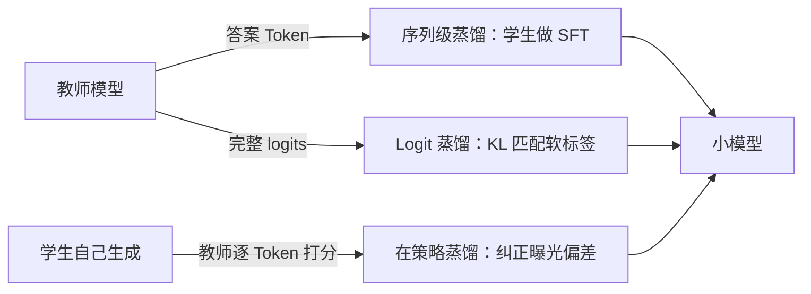

# 第 19 章 知识蒸馏与模型压缩

## 本章导读

一个 671B 的推理模型，能不能把“怎么想”教给一个 7B 的学生？如果能，教的是最终答案、完整的思维链，还是每一步的概率分布？知识蒸馏（Knowledge Distillation，KD）试图回答的正是这个问题：把大模型学到的函数关系压缩进小模型，同时尽量不丢失能力。本章从温度软标签出发，推导蒸馏损失与梯度，比较序列级与在策略蒸馏，再讨论剪枝为什么常常需要蒸馏来“恢复”。

## 难度标签

⭐⭐⭐ 进阶 ｜ 数学要求：Softmax、KL 散度、链式法则、泰勒展开 ｜ 代码要求：PyTorch 训练循环、模型参数遍历

## 学习目标

- 能写出温度软标签与蒸馏损失，并解释 $$\tau^2$$ 缩放的作用。
- 能推导蒸馏损失对学生 logits 的梯度，说明高温极限为什么等价于匹配 logit 差值。
- 能区分 logit 蒸馏、序列级蒸馏与在策略蒸馏的监督信号、成本和失败模式。
- 能实现全局幅度剪枝，并用蒸馏恢复剪枝后的精度。
- 能判断一个压缩任务该选蒸馏、剪枝还是量化，以及什么时候不该压缩。

## 19.1 直觉：把教师的“犹豫”一起教给学生

假设教师看到一道题，正确答案是 8。硬标签只告诉学生“8 是对的”；但教师的输出分布可能是“8 有 0.7，7 有 0.2，9 有 0.1”。这个分布说明：7 和 9 是容易混淆的近邻，8 与 2 则几乎不可能。学生如果只学硬标签，就丢掉了“哪些错误更像正确答案”的信息；如果学软标签，它同时学到了答案和答案周围的几何结构。Hinton 等人把这种藏在概率里的结构称为**暗知识（dark knowledge）**。

蒸馏的基本流程可以画成三条路：



三条路的区别不在“教师是谁”，而在**学生看到什么监督信号**：教师生成的硬 Token、教师在每个位置的完整分布，还是学生在自己生成的轨迹上得到的教师反馈。理解这一点，后面的公式和取舍就不会混在一起。

```info
直觉上，蒸馏是“函数压缩”而不是“数据压缩”。教师把输入到输出的映射学成了一个连续函数，软标签是这个函数在样本点附近的局部形状；学生用更少的参数去拟合这个形状。参数量减少不等于信息量按比例减少，因为任务本身的规律可能远少于参数容量。
```

## 19.2 数学原理

### 19.2.1 温度软标签

设教师在第 $$i$$ 个类别上的 logit 为 $$z_{t,i}$$，学生为 $$z_{s,i}$$，类别数为 $$V$$。温度 $$\tau>0$$ 下的软标签定义为

$$
p_{i}^{\tau}=\frac{\exp(z_i/\tau)}{\sum_{j=1}^{V}\exp(z_j/\tau)}
\qquad \text{(19.1)}
$$

当 $$\tau=1$$ 时就是普通 Softmax；$$\tau>1$$ 时分布被“抹平”，小概率类别的相对大小更容易被看到；$$\tau<1$$ 时分布更尖锐。把 $$\exp(z_i/\tau)$$ 在 $$\tau\to\infty$$ 时展开：

$$
p_i^{\tau}\approx \frac{1}{V}+\frac{z_i-\bar z}{V\tau},
\qquad \bar z=\frac1V\sum_j z_j
\qquad \text{(19.2)}
$$

推导只用一阶泰勒展开：$$\exp(z_i/\tau)\approx 1+z_i/\tau$$，分母约为 $$V+\sum_j z_j/\tau$$，再按 $$1/(1+x)\approx 1-x$$ 整理。式 (19.2) 说明，高温软标签保留了 logit 的相对差值；温度越高，差值被压得越小，但方向不变。这就是“高温看结构、低温看答案”的数学依据。

### 19.2.2 蒸馏损失与梯度

Logit 蒸馏最小化教师与学生在同一温度下的 KL 散度，并乘上 $$\tau^2$$：

$$
\mathcal L_{\rm KD}=\tau^2\,\mathrm{KL}\left(p_t^{\tau}\,\|\,p_s^{\tau}\right)
=\tau^2\sum_{i=1}^{V}p_{t,i}^{\tau}\log\frac{p_{t,i}^{\tau}}{p_{s,i}^{\tau}}
\qquad \text{(19.3)}
$$

实际训练常把它与硬标签交叉熵相加：

$$
\mathcal L=\alpha\,\mathcal L_{\rm CE}+(1-\alpha)\,\mathcal L_{\rm KD}
\qquad \text{(19.4)}
$$

其中 $$\alpha\in[0,1]$$ 控制“学答案”和“学分布”的比例。$$\alpha=1$$ 退化为普通 SFT，$$\alpha=0$$ 是纯蒸馏。下面求 $$\mathcal L_{\rm KD}$$ 对学生 logits 的梯度。对 Softmax 有

$$
\frac{\partial \log p_{s,j}^{\tau}}{\partial z_{s,i}}
=\frac{1}{\tau}\left(\delta_{ij}-p_{s,i}^{\tau}\right)
$$

把它代入 (19.3)，并利用 $$\sum_j p_{t,j}^{\tau}=1$$：

$$
\frac{\partial \mathcal L_{\rm KD}}{\partial z_{s,i}}
=-\tau^2\sum_j p_{t,j}^{\tau}\frac{\partial \log p_{s,j}^{\tau}}{\partial z_{s,i}}
=\tau\left(p_{s,i}^{\tau}-p_{t,i}^{\tau}\right)
\qquad \text{(19.5)}
$$

这个结果很干净：梯度就是“学生分布减教师分布”，再乘温度。教师认为某类概率高而学生给得低，梯度为负，梯度下降会把该类 logit 推高；反之压低。把 (19.2) 代入 (19.5)，在高温极限下有

$$
\frac{\partial \mathcal L_{\rm KD}}{\partial z_{s,i}}
\approx \frac{z_{s,i}-z_{t,i}}{V}
\qquad \text{(19.6)}
$$

式 (19.6) 说明：高温蒸馏近似于直接匹配 logit 差值，而且梯度幅度与温度无关。如果没有 $$\tau^2$$ 缩放，温度升高会让梯度按 $$1/\tau$$ 缩小，学习率就必须跟着调；乘上 $$\tau^2$$ 后，不同温度下的梯度尺度大致可比。这是 (19.3) 中那个看似多余的因子的真正作用。

KL 的方向也决定学生分布的形状。标准蒸馏使用 $$\mathrm{KL}(p_t\|p_s)$$，教师有概率质量的类别如果学生给得极低，就会被重罚，因此学生倾向于覆盖教师的全部支撑集，生成结果更“宽”；反过来使用 $$\mathrm{KL}(p_s\|p_t)$$ 时，学生只要抓住教师的高概率模式即可，容易忽略长尾，生成结果更“尖”。语言模型蒸馏通常选前者，因为教师的长尾里可能有合理的替代答案；但在需要确定性的任务上，反向 KL 或 JSD 可能更合适。GKD 用 Jensen–Shannon 散度在两者之间插值，就是在“覆盖长尾”和“聚焦模式”之间做取舍。

```warning
温度不是越高越好。温度太高时，所有类别的概率都接近 $$1/V$$，教师之间的差异被压进数值噪声；温度太低时，软标签退化成硬标签，暗知识消失。实践中常用 $$\tau\in[2,6]$$，并同时报告学习率与训练步数，因为 $$\tau$$ 改变的是梯度尺度，不只是“软硬程度”。
```

### 19.2.3 序列级蒸馏与曝光偏差

当教师只提供 API 输出、拿不到 logits 时，只能做**序列级蒸馏（sequence-level distillation）**：让教师对提示生成回答，把回答当作硬标签训练学生。

$$
\mathcal L_{\rm seq}
=-\sum_{t=1}^{|y|}\log \pi_s\left(y_t\mid x,y_{<t}\right),
\qquad y\sim\pi_t(\cdot\mid x)
\qquad \text{(19.7)}
$$

这里的 $$y$$ 可以是一条思维链。DeepSeek-R1 的蒸馏版本就是这样做的：用 671B 教师生成约 80 万条带推理过程的回答，再对 7B、14B、32B 的学生做 SFT。它的优点是实现简单、不需要教师 logits，还能把“长思维链的格式”一起教给学生；缺点是监督稀疏——每条回答只在每个位置提供一个 Token，教师的不确定性完全丢失。

序列级蒸馏还有一个结构性问题：**曝光偏差（exposure bias）**。训练时学生看到的前缀来自教师，推理时看到的前缀来自自己。一旦学生某一步走错，后面的上下文就进入教师从未见过的区域，错误会逐步累积。回答越长，这个缺口越大。长思维链把回答从几十个 Token 推到几千个 Token，曝光偏差也从“小问题”变成“主要误差来源”。

构造思维链蒸馏数据时，不能直接把教师的全部输出倒进学生。常见流程是：对每道题采样多条回答，用答案验证器筛出正确轨迹；对正确轨迹做去重与长度过滤，去掉重复、截断或格式错误的样本；再按题目难度分层，避免简单题淹没难例。若只保留最终答案正确的轨迹，学生学到的是“结果对的推理”，而不是“教师真实的推理分布”；若把错误轨迹也混进去，学生会模仿错误步骤。拒绝采样（rejection sampling）在这两者之间取一个折中：只保留可验证正确的轨迹，但保留同一题目的多种正确解法，以维持多样性。

### 19.2.4 在策略蒸馏

**在策略蒸馏（on-policy distillation）** 让学生的前缀来自学生自己，再用教师在这些前缀上的分布做监督：

$$
\mathcal L_{\rm on}
=\mathbb E_{x}\mathbb E_{y\sim\pi_s(\cdot\mid x)}
\sum_{t}\mathrm{KL}\left(
\pi_t(\cdot\mid x,y_{<t})\,\|\,
\pi_s(\cdot\mid x,y_{<t})
\right)
\qquad \text{(19.8)}
$$

与 (19.7) 相比，训练分布和推理分布一致了，曝光偏差被直接消掉；代价是每个学生 rollout 都要教师逐 Token 打分，教师前向的次数大幅增加。若教师只能通过 API 访问，成本可能无法接受。**广义知识蒸馏（Generalized Knowledge Distillation，GKD）** 在教师数据与学生数据之间做插值，用 Jensen–Shannon 散度统一前向与反向 KL，缓解“纯在策略数据质量低、纯教师数据分布窄”的两难。

```success
三种蒸馏的监督信号可以这样记：序列级蒸馏学“教师说了什么”，logit 蒸馏学“教师认为什么可能”，在策略蒸馏学“学生在自己的错误上该怎么改”。数据成本依次上升，纠正分布偏移的能力也依次上升。
```

### 19.2.5 剪枝的目标

剪枝直接减少参数或计算。设参数为 $$\theta$$，掩码为 $$m\in\{0,1\}^{d}$$，剪枝目标是

$$
\min_{m\in\{0,1\}^{d}}\ \mathcal L(\theta\odot m)
\quad\text{s.t.}\quad \|m\|_0\le k
\qquad \text{(19.9)}
$$

这是一个带基数约束的组合优化问题，精确求解不可行。最常用的近似是**幅度剪枝（magnitude pruning）**：保留绝对值最大的 $$k$$ 个权重，其余置零。它的依据是“小权重对输出的扰动小”，但这个依据只在局部成立；剪枝后损失通常会上升，需要**恢复微调（recovery fine-tuning）**，而蒸馏正是最常用的恢复信号——教师在原任务上的软标签比硬标签更能把学生拉回原来的函数。

剪枝分两类。**非结构化剪枝（unstructured pruning）** 把任意单个权重置零，稀疏率高，但参数张量形状不变，普通的稠密矩阵乘法不会因此变快；只有配合稀疏内核或稀疏存储，才能把零变成实际的延迟收益。**结构化剪枝（structured pruning）** 删除整个注意力头、FFN 神经元或通道，张量形状真的变小，稠密硬件也能加速；代价是粒度粗，精度下降更明显，通常需要逐层重要性评分与迭代恢复。

结构化剪枝的重要性评分通常来自三方面：权重的范数、该头/神经元在校准集上的激活统计、以及删除后损失的一阶近似。逐层独立评分会忽略层间补偿，因此更稳的做法是全局预算加迭代剪枝：每轮删除一小部分最不重要的结构，恢复若干步，再重新评分。一次剪到目标稀疏率再恢复，往往不如分四到八轮逐步剪。恢复阶段的学习率要低于原训练，否则被剪掉的结构会以另一种方式“长回来”，掩码也就失去意义。

### 19.2.6 参数量与压缩比

对标准 Transformer，参数量约为

$$
N\approx Vd+ L\left(4d^2+2d\,d_{\rm ff}\right)
\qquad \text{(19.10)}
$$

其中 $$V$$ 是词表大小、$$d$$ 是隐藏维度、$$L$$ 是层数、$$d_{\rm ff}$$ 是前馈宽度（忽略归一化与偏置）。压缩比定义为

$$
r=\frac{N_t}{N_s}
\qquad \text{(19.11)}
$$

但参数压缩比不等于速度提升。解码阶段是显存带宽受限的：每生成一个 Token 都要把权重读一遍，实际延迟更接近“权重字节数 ÷ 带宽”，而不是 FLOPs 之比。结构化剪枝、量化、减少层数能直接减少字节数；非结构化稀疏若没有专用内核，可能只省存储、不省时间。评估压缩方案时，必须同时报告参数量、显存占用、吞吐与延迟，不能只报一个压缩比。

## 19.3 方案对比

表 19-1 把本章讨论的几条路线放在一起。注意“教师访问”一列：很多方案在论文里效果很好，落到工程上却因为拿不到 logits 或无法离线生成而不可用。

| 方案 | 监督信号 | 教师访问 | 主要成本 | 优点 | 主要风险 |
| --- | --- | --- | --- | --- | --- |
| Logit 蒸馏 | 每个位置的完整分布 | 需要 logits | 教师前向 + 学生训练 | 信息密度高，收敛快 | 教师不确定时可能放大错误 |
| 序列级蒸馏 | 教师生成的 Token | 只需文本输出 | 教师自回归生成 | 实现简单，可迁移思维链格式 | 曝光偏差，监督稀疏 |
| 在策略蒸馏 | 学生前缀上的教师分布 | 需要逐 Token 打分 | rollout + 教师评分 | 纠正分布偏移 | 成本高，训练不稳定 |
| 幅度剪枝 + 恢复 | 稀疏掩码 + 蒸馏 | 恢复阶段需要教师 | 剪枝搜索 + 恢复训练 | 直接减参数/存储 | 非结构化稀疏未必加速 |
| 结构化剪枝 | 删除头/神经元 | 可选 | 重要性评估 + 恢复 | 稠密硬件可加速 | 精度下降更明显 |
| 量化 | 低比特权重/激活 | 不需要 | 校准/量化误差 | 显存与带宽收益直接 | 精度与内核支持（见第 23 章） |

选型可以先问三个问题：教师能否提供 logits？学生是否要生成很长的回答？部署瓶颈是显存、带宽还是算力？三个答案基本能定位到表 19-1 的某一行。

成本可以粗略分三层。Logit 蒸馏的教师成本是“每个训练批一次前向”，如果提前把教师 logits 缓存到磁盘，训练时只剩学生前向与反向；序列级蒸馏的教师成本是“每条样本一次自回归生成”，生成长度越长越贵，但生成可以离线完成；在策略蒸馏的教师成本是“每个 rollout 的每个位置一次前向”，它把教师变成了训练循环里的在线评分器，成本最高，也最依赖教师的吞吐。选型时先算清这三笔账，再比较算法在论文里的分数，通常能避免“方法很好但跑不起”的尴尬。

## 19.4 代码实现

### 19.4.1 模块与实验设计

第 19 章的增量代码放在 `tinylm/posttrain/distill.py`，配置类 `DistillConfig` 只作为训练脚本参数，不进入 `ModelConfig`；`TinyLM.forward` 与 `CausalLMOutput` 的签名保持不变。模块提供七组函数：

- `softmax_with_temperature`：实现 (19.1)；
- `distill_loss`：实现 (19.3)–(19.4)，返回损失与教师熵等诊断量；
- `sft_labels`：实现 (19.7) 的标签对齐，只监督提示之后的位置；
- `generate_greedy`：让教师贪心生成，供序列级蒸馏使用；
- `teacher_targets`：取教师在提示末位的 logits，作为软目标；
- `magnitude_prune_` 与 `apply_masks_`：实现 (19.9)，并在恢复阶段保持掩码；
- `parameter_count`、`compression_ratio`、`global_sparsity`：实现 (19.11) 与压缩诊断。

实验任务是两位数字的模 10 加法：提示为 `[BOS, Q, digit(a), digit(b), SEP]`，回答是 `(a+b) mod 10` 对应的数字，共 100 种组合。教师是 2 层、`d_model=64`、4 头、`d_ff=256` 的 TinyLM，共 133,440 个参数；学生是 2 层、`d_model=32`、4 头、`d_ff=128`，共 33,952 个参数，压缩比 3.93。学生只拿到 40 条带标签的提示（按 `i % 5 < 2` 抽取，覆盖全部十位数字），序列级蒸馏与 logit 蒸馏则可以使用全部 100 条**无标签**提示，从教师那里获得监督。这样设计是为了同时观察“数据覆盖”和“标签类型”两个因素，而不是把差距全部归因于软标签。

### 19.4.2 完整代码

`tinylm/posttrain/distill.py`：

```python
"""第 19 章：知识蒸馏与模型压缩（tinylm/posttrain/distill.py）。"""
from dataclasses import dataclass

import torch
import torch.nn.functional as F


@dataclass(frozen=True)
class DistillConfig:
    """蒸馏训练脚本参数，不进入 ``ModelConfig``。"""

    temperature: float = 2.0       # 软标签温度 T
    alpha: float = 0.5             # 硬标签权重；0 表示纯蒸馏
    lr: float = 1e-3
    max_new: int = 4               # 教师生成的最大 Token 数
    max_grad_norm: float = 1.0
    pad_id: int = 0
    eos_id: int = 4

    def __post_init__(self):
        assert self.temperature > 0.0
        assert 0.0 <= self.alpha <= 1.0
        assert self.lr > 0.0
        assert self.max_new >= 1
        assert self.max_grad_norm > 0.0


def softmax_with_temperature(logits, temperature):
    """(19.1)：温度缩放后的教师/学生分布。"""
    if temperature <= 0.0:
        raise ValueError("temperature 必须为正")
    return torch.softmax(logits / temperature, dim=-1)


def distill_loss(student_logits, teacher_logits, labels=None,
                 cfg=DistillConfig()):
    """(19.3)–(19.4)：T^2 缩放的 KL 蒸馏，可选叠加硬标签交叉熵。

    ``student_logits`` 与 ``teacher_logits`` 形状为 ``(N, V)``，对应同一个
    预测位置；``labels`` 形状为 ``(N,)``。返回损失与诊断量。
    """
    if student_logits.shape != teacher_logits.shape:
        raise ValueError("学生与教师 logits 形状必须一致")
    t = cfg.temperature
    student_log_prob = F.log_softmax(student_logits / t, dim=-1)
    teacher_prob = softmax_with_temperature(teacher_logits, t)
    kd = F.kl_div(student_log_prob, teacher_prob, reduction="batchmean")
    kd = kd * (t * t)                                  # (19.3)
    loss = (1.0 - cfg.alpha) * kd
    ce = torch.zeros((), device=student_logits.device)
    if labels is not None and cfg.alpha > 0.0:
        ce = F.cross_entropy(student_logits, labels, ignore_index=-100)
        loss = loss + cfg.alpha * ce                   # (19.4)
    diagnostics = {
        "kd": float(kd.detach()),
        "ce": float(ce.detach()),
        "teacher_entropy": float(
            -(teacher_prob * teacher_prob.clamp_min(1e-12).log()).sum(-1).mean()
        ),
    }
    return loss, diagnostics


def sft_labels(seqs, prompt_len, ignore_index=-100):
    """(19.7)：把完整序列转成下一 Token 标签，只监督提示之后的位置。

    标签在位置 ``t`` 上等于 ``seqs[t+1]``；提示最后一个位置的标签是回答的
    第一个 Token，因此监督从 ``prompt_len - 1`` 开始，而不是 ``prompt_len``。
    """
    labels = torch.full_like(seqs, ignore_index)
    labels[:, prompt_len - 1:-1] = seqs[:, prompt_len:]
    return labels


@torch.no_grad()
def generate_greedy(model, prompts, cfg=DistillConfig()):
    """(19.7)：教师贪心生成，返回 ``(B, T)`` 序列与布尔注意力掩码。"""
    model.eval()
    seqs = prompts
    done = torch.zeros(seqs.size(0), dtype=torch.bool,
                       device=seqs.device)
    for _ in range(cfg.max_new):
        logits = model(seqs).logits[:, -1]
        nxt = logits.argmax(dim=-1)
        nxt = torch.where(done, torch.full_like(nxt, cfg.pad_id), nxt)
        seqs = torch.cat([seqs, nxt[:, None]], dim=1)
        done = done | (nxt == cfg.eos_id)
        if bool(done.all()):
            break
    return seqs, seqs != cfg.pad_id


def teacher_targets(teacher, prompts):
    """教师提示末位的 logits，作为 (19.3) 的软目标。"""
    with torch.no_grad():
        teacher.eval()
        return teacher(prompts).logits[:, -1]


def magnitude_prune_(model, fraction, skip=("tok_emb", "lm_head")):
    """(19.9)：全局幅度剪枝，原地把最小的 ``fraction`` 比例权重置零。

    只处理二维以上参数，并跳过嵌入与输出头；返回实际阈值与可剪参数总数。
    非结构化剪枝不改变参数张量的形状，因此不会自动降低密集团计算量。
    """
    if not 0.0 <= fraction < 1.0:
        raise ValueError("fraction 必须在 [0, 1) 内")
    params = [(n, p) for n, p in model.named_parameters()
              if p.dim() >= 2 and not any(s in n for s in skip)]
    if not params:
        return 0.0, 0, []
    values = torch.cat([p.detach().abs().reshape(-1) for _, p in params])
    threshold = torch.quantile(values, fraction)
    masks = []
    with torch.no_grad():
        for _, p in params:
            mask = (p.abs() > threshold).to(p.dtype)
            p.mul_(mask)
            masks.append((p, mask))
    return float(threshold), int(values.numel()), masks


def apply_masks_(masks):
    """恢复阶段重新施加剪枝掩码，防止被置零的权重重新长出来。"""
    with torch.no_grad():
        for p, mask in masks:
            p.mul_(mask)


def global_sparsity(model, skip=("tok_emb", "lm_head")):
    """(19.9)：可剪参数中零元素的比例。"""
    params = [p for n, p in model.named_parameters()
              if p.dim() >= 2 and not any(s in n for s in skip)]
    if not params:
        return 0.0
    zeros = sum(int((p == 0).sum()) for p in params)
    total = sum(int(p.numel()) for p in params)
    return zeros / total


def parameter_count(model):
    """(19.11)：模型参数量。"""
    return sum(p.numel() for p in model.parameters())


def compression_ratio(teacher, student):
    """(19.11)：教师参数量除以学生参数量。"""
    return parameter_count(teacher) / parameter_count(student)
```

`examples/ch19_distill.py`：

```python
"""第 19 章：知识蒸馏与模型压缩（examples/ch19_distill.py）。"""
import time

import torch
import torch.nn.functional as F

from ch08 import ModelConfig, TinyLM
from tinylm.posttrain import distill as D

PAD, BOS, Q, SEP, EOS = 0, 1, 2, 3, 4
DIGIT0 = 5
PROMPT_LEN = 5
ALL_PROMPTS = [(a, b) for a in range(10) for b in range(10)]
LABELED = [p for i, p in enumerate(ALL_PROMPTS) if i % 5 < 2]
HELD_OUT = [p for i, p in enumerate(ALL_PROMPTS) if i % 5 >= 2]
SEEDS = (0, 1, 2)
PRUNE_FRACTION = 0.8


def prompt(a, b):
    return [BOS, Q, DIGIT0 + a, DIGIT0 + b, SEP]


def answer(a, b):
    return DIGIT0 + ((a + b) % 10)


def make_model(seed, d_model, n_layers, n_heads, d_ff):
    torch.manual_seed(seed)
    cfg = ModelConfig(vocab_size=16, d_model=d_model, n_layers=n_layers,
                      n_heads=n_heads, d_ff=d_ff, max_seq_len=32,
                      pos_encoding="rope", norm="rmsnorm", ffn="swiglu",
                      bias=False)
    return TinyLM(cfg), cfg


def labels_for_answer(prompts, answers):
    ids = torch.tensor([prompt(a, b) + [y, EOS]
                        for (a, b), y in zip(prompts, answers)])
    labels = torch.full_like(ids, -100)
    labels[:, PROMPT_LEN - 1] = torch.tensor(
        [int(y) for y in answers])          # 预测答案
    labels[:, PROMPT_LEN] = EOS             # 预测 EOS
    return ids, labels


@torch.no_grad()
def accuracy(model, prompts):
    model.eval()
    ids = torch.tensor([prompt(a, b) for a, b in prompts])
    pred = model(ids).logits[:, -1].argmax(-1)
    goals = torch.tensor([answer(a, b) for a, b in prompts])
    return float((pred == goals).float().mean())


def train_teacher(seed, steps=600, batch=64, lr=2e-3):
    model, _ = make_model(seed, 64, 2, 4, 256)
    gen = torch.Generator().manual_seed(1000 + seed)
    opt = torch.optim.AdamW(model.parameters(), lr=lr)
    model.train()
    for _ in range(steps):
        idx = torch.randint(0, len(ALL_PROMPTS), (batch,), generator=gen)
        prompts = [ALL_PROMPTS[int(i)] for i in idx]
        ids = torch.tensor([prompt(a, b) for a, b in prompts])
        labels = torch.full((len(prompts), PROMPT_LEN), -100, dtype=torch.long)
        labels[:, -1] = torch.tensor([answer(a, b) for a, b in prompts])
        out = model(ids, labels=labels)
        opt.zero_grad()
        out.loss.backward()
        opt.step()
    return model


def train_student(kind, teacher, seed, steps=800, batch=64, lr=1e-3):
    model, _ = make_model(seed, 32, 2, 4, 128)
    gen = torch.Generator().manual_seed(2000 + seed)
    opt = torch.optim.AdamW(model.parameters(), lr=lr)
    cfg = D.DistillConfig(temperature=2.0, alpha=0.0)
    model.train()
    for _ in range(steps):
        pool = LABELED if kind == "sft" else ALL_PROMPTS
        idx = torch.randint(0, len(pool), (batch,), generator=gen)
        prompts = [pool[int(i)] for i in idx]
        prompt_ids = torch.tensor([prompt(a, b) for a, b in prompts])
        if kind == "sft":
            goals = [answer(a, b) for a, b in prompts]
            ids, labels = labels_for_answer(prompts, goals)
            logits = model(ids).logits
            loss = F.cross_entropy(
                logits.reshape(-1, logits.size(-1)),
                labels.reshape(-1), ignore_index=-100)
        elif kind == "seq":
            seqs, _ = D.generate_greedy(teacher, prompt_ids, cfg)
            labels = D.sft_labels(seqs, PROMPT_LEN)
            logits = model(seqs).logits
            loss = F.cross_entropy(
                logits.reshape(-1, logits.size(-1)),
                labels.reshape(-1), ignore_index=-100)
        else:
            teacher_logits = D.teacher_targets(teacher, prompt_ids)
            student_logits = model(prompt_ids).logits[:, -1]
            loss, _ = D.distill_loss(student_logits, teacher_logits,
                                     labels=None, cfg=cfg)
        opt.zero_grad()
        loss.backward()
        torch.nn.utils.clip_grad_norm_(model.parameters(),
                                       cfg.max_grad_norm)
        opt.step()
    return model


def recover(teacher, model, masks, seed, steps=200, batch=64, lr=5e-4):
    gen = torch.Generator().manual_seed(3000 + seed)
    opt = torch.optim.AdamW(model.parameters(), lr=lr)
    cfg = D.DistillConfig(temperature=2.0, alpha=0.0)
    model.train()
    for _ in range(steps):
        idx = torch.randint(0, len(ALL_PROMPTS), (batch,), generator=gen)
        prompts = [ALL_PROMPTS[int(i)] for i in idx]
        ids = torch.tensor([prompt(a, b) for a, b in prompts])
        teacher_logits = D.teacher_targets(teacher, ids)
        student_logits = model(ids).logits[:, -1]
        loss, _ = D.distill_loss(student_logits, teacher_logits,
                                 labels=None, cfg=cfg)
        opt.zero_grad()
        loss.backward()
        opt.step()
        D.apply_masks_(masks)
    return model


@torch.no_grad()
def mean_entropy(teacher, temperature=1.0):
    ids = torch.tensor([prompt(a, b) for a, b in ALL_PROMPTS])
    logits = D.teacher_targets(teacher, ids) / temperature
    probs = torch.softmax(logits, dim=-1)
    return float(-(probs * probs.clamp_min(1e-12).log()).sum(-1).mean())


def main():
    t0 = time.time()
    rows = {k: ([], []) for k in ("SFT-40", "Seq-KD", "Logit-KD")}
    for seed in SEEDS:
        teacher = train_teacher(seed)
        params_t = D.parameter_count(teacher)
        print(f"seed {seed} teacher all {accuracy(teacher, ALL_PROMPTS):.2f} "
              f"entropy {mean_entropy(teacher):.2f} params {params_t}")
        results = {}
        for name, kind in (("SFT-40", "sft"), ("Seq-KD", "seq"),
                           ("Logit-KD", "kd")):
            student = train_student(kind, teacher, seed)
            acc_all = accuracy(student, ALL_PROMPTS)
            acc_held = accuracy(student, HELD_OUT)
            results[name] = student
            rows[name][0].append(acc_all)
            rows[name][1].append(acc_held)
            print(f"  {name:<9} all {acc_all:.2f} held {acc_held:.2f} "
                  f"params {D.parameter_count(student)}")

        student = results["Logit-KD"]
        _, _, masks = D.magnitude_prune_(student, PRUNE_FRACTION)
        before = accuracy(student, ALL_PROMPTS)
        sparsity = D.global_sparsity(student)
        recover(teacher, student, masks, seed)
        after = accuracy(student, ALL_PROMPTS)
        print(f"  prune {PRUNE_FRACTION:.0%} sparsity {sparsity:.2f} "
              f"acc {before:.2f} -> {after:.2f}")
        print(f"  compression {D.compression_ratio(teacher, student):.2f}x")

    print("\n3-seed means")
    print(f"{'':<10}{'all':>7}{'held':>7}")
    for name, (all_acc, held_acc) in rows.items():
        print(f"{name:<10}{sum(all_acc)/len(all_acc):>7.2f}"
              f"{sum(held_acc)/len(held_acc):>7.2f}")
    print(f"total {time.time() - t0:.1f}s")


if __name__ == "__main__":
    main()
```

### 19.4.3 运行结果

在 CPU 上运行 `python examples/ch19_distill.py`，3 个种子、每个种子训练一个教师和三个学生，结果如下（原样输出）：

```text
seed 0 teacher all 1.00 entropy 0.02 params 133440
  SFT-40    all 0.60 held 0.33 params 33952
  Seq-KD    all 1.00 held 1.00 params 33952
  Logit-KD  all 0.97 held 0.97 params 33952
  prune 80% sparsity 0.80 acc 0.19 -> 0.91
  compression 3.93x
seed 1 teacher all 1.00 entropy 0.01 params 133440
  SFT-40    all 0.64 held 0.40 params 33952
  Seq-KD    all 1.00 held 1.00 params 33952
  Logit-KD  all 1.00 held 1.00 params 33952
  prune 80% sparsity 0.80 acc 0.43 -> 1.00
  compression 3.93x
seed 2 teacher all 1.00 entropy 0.01 params 133440
  SFT-40    all 0.64 held 0.40 params 33952
  Seq-KD    all 1.00 held 1.00 params 33952
  Logit-KD  all 1.00 held 1.00 params 33952
  prune 80% sparsity 0.80 acc 0.32 -> 1.00
  compression 3.93x

3-seed means
              all   held
SFT-40       0.63   0.38
Seq-KD       1.00   1.00
Logit-KD     0.99   0.99
total 102.4s
```

### 19.4.4 结果解读

第一，教师在所有种子上都达到 1.00 的贪心正确率，平均熵只有 0.01–0.02 nats。这个数字很关键：教师几乎是一个确定性函数，软标签接近 one-hot，暗知识很少。因此在这个任务上，logit 蒸馏与序列级蒸馏的结果几乎相同（0.99 对 1.00），不能据此说“软标签没有价值”；它只说明当教师非常自信、回答只有一个 Token 时，硬标签已经携带了几乎全部可用信息。要观察软标签的优势，需要教师有不确定性、输出有多个位置，或者类别之间有可迁移的相似结构。

第二，SFT-40 的全集正确率是 0.63，留出集只有 0.38。学生并非完全没学到加法，它在见过的 40 条上拟合得很好，并把一部分规律迁移到了未见组合；但 40 条覆盖不足，留出集仍明显掉分。序列级蒸馏与 logit 蒸馏使用全部 100 条无标签提示，全集与留出集都接近 1.00。这个对比混合了两个因素：更多输入覆盖，以及教师监督；它说明的是“蒸馏可以把教师的泛化能力转移到学生”，而不是“KL 一定优于交叉熵”。

第三，剪枝实验把 logit 蒸馏学生的最小的 80% 权重置零。剪枝后正确率从接近 1.00 掉到 0.19、0.43、0.32，平均 0.31；用教师的软标签恢复 200 步，并每步重新施加掩码，正确率回到 0.91、1.00、1.00，平均 0.97，稀疏率保持 0.80。恢复有效，一部分原因是这个任务高度冗余：10 类输出的加法规则只需要少量有效连接；另一部分原因是蒸馏提供了比硬标签更平滑的恢复信号。换到更大的模型或更难的任务，80% 稀疏通常不会这么容易恢复。

第四，压缩比是 3.93，但实验没有报告速度提升。原因是这里的剪枝是非结构化的：参数张量形状不变，PyTorch 的稠密矩阵乘法仍然按全部元素计算，零只节省了存储，不节省时间。真正要在部署中拿到延迟收益，需要结构化剪枝（删头、删神经元）或支持稀疏格式的内核；第 23 章的量化则从另一个方向减少权重字节数。把“参数少了”直接说成“推理快了”，是压缩章节最常见的错误。

第五，三个学生共用相同的结构、批大小、步数与学习率，只有监督信号不同，这样比较才干净。Logit-KD 在种子 0 上只有 0.97，而序列级蒸馏是 1.00，说明软标签训练的优化速度略慢：KL 的梯度尺度比交叉熵小，达到同样精度需要更多步或更大的学习率。这不是“软标签更差”，而是“同样的优化预算下，两种损失的收敛速度不同”。报告蒸馏结果时，应把监督信号与优化预算分开看，否则很容易把学习率没调好误判成方法无效。

### 19.4.5 测试与复现

`tests/test_distill.py` 共 21 项测试，覆盖：温度 Softmax 归一化与熵单调性、温度非法值、学生与教师相同时 KL 为零、`alpha=1` 退化为交叉熵、`alpha=0` 退化为 $$\tau^2$$ 缩放 KL、logits 整体平移不变性、梯度方向、标签对齐、贪心生成形状、教师 logits 不建图、幅度剪枝的稀疏率与嵌入保护、掩码在稠密更新后仍生效、剪枝比例校验、参数量与压缩比、形状不匹配报错、配置校验。全部通过约 1.0 s。

复现步骤：

```bash
python -m pytest tests/test_distill.py -q     # 21 passed
python examples/ch19_distill.py               # CPU 约 100 s
```

```text
21 passed in 1.17s
```

## 19.5 工业实践

### 19.5.1 DistilBERT：把 BERT 压到 66M

DistilBERT（Sanh 等，2019）是早期最有影响力的语言模型蒸馏工作之一。它把 BERT-base 的 12 层减到 6 层，参数量从约 110M 降到 66M（少 40%），推理速度快约 60%，在 GLUE 上保留了约 97% 的分数。训练目标不是单一的 KL，而是三项相加：教师软标签的蒸馏损失、掩码语言建模损失、以及教师隐藏状态与学生的余弦相似度损失。后两项分别保证学生仍然会做填空题、并且中间表示不要偏离教师太远。

DistilBERT 的启示是：**蒸馏不只发生在输出层**。当学生容量明显小于教师时，仅匹配最终分布可能不够，隐藏层对齐、注意力图对齐、中间特征回归都能提供更密的监督。代价是实现复杂度上升，且需要教师和学生的隐藏维度可对齐；跨架构蒸馏通常要做投影。

### 19.5.2 DeepSeek-R1：把长思维链教给 7B 学生

DeepSeek-R1（DeepSeek-AI，2025）的蒸馏路线与 DistilBERT 不同：它不做 logit 蒸馏，而是先用 671B 的 R1 教师生成约 80 万条带推理过程的回答，再对 Qwen-7B/14B/32B 与 Llama-8B/70B 做序列级 SFT。论文报告，Distill-Qwen-7B 在 AIME 2024 上达到 55.5% pass@1、MATH-500 达到 92.8%；Distill-Qwen-32B 在 AIME 2024 上达到 72.6%、MATH-500 达到 94.3%（截至写作时，以论文表格为准）。

这个案例说明了两件事。第一，**思维链可以被当作数据蒸馏**：学生不需要访问教师的 logits，只需要高质量的“题目—推理过程—答案”三元组。第二，**教师的能力上限不等于学生的能力上限**：7B 学生能学到长推理的格式与部分策略，但在更难的分布外问题上仍会落后于教师；蒸馏是把教师已经发现的行为模式迁移过去，不是把教师的参数容量迁移过去。

### 19.5.3 Kimi k1.5 与在策略蒸馏

Kimi k1.5（Kimi Team，2025）把长上下文强化学习与“长到短”（long2short）蒸馏结合起来：先训练一个长思维链教师，再通过长度惩罚、拒绝采样与蒸馏，把推理能力压进输出更短的学生。论文报告 short-CoT 模型在数学与代码基准上接近 long-CoT 教师，同时显著缩短输出长度。这里的“短”不是简单截断，而是重新训练学生用更少的 Token 完成同样的推理；截断会破坏推理链，蒸馏不会。

在策略蒸馏在工业上更常见于“学生要生成很长、且教师可批量打分”的场景。它把训练分布从教师数据换成学生自己的 rollout，减少了曝光偏差；代价是教师前向次数从“每条训练样本一次”变成“每个 rollout 的每个位置一次”。当教师是 API 时，这笔账往往算不过来；当教师可以本地部署、且学生回答很长时，它才划算。

### 19.5.4 剪枝与稀疏化

SparseGPT（Frantar 与 Alistarh，2023）证明，百亿参数级的语言模型可以在**一次性**（one-shot）幅度剪枝下达到 50%–60% 稀疏率，而困惑度只有有限上升；Wanda 用“权重 × 激活”的重要性分数进一步简化了准则。这些方法的意义在于：不需要完整重训，只需要少量校准数据。但它们主要报告的是稀疏存储与稀疏内核下的收益；如果部署栈使用稠密矩阵乘法，50% 的零不会自动变成 2 倍加速。

结构化剪枝（删除注意力头、FFN 神经元、整层）更适合通用硬件，但精度下降更明显。常见做法是：先评估每层/每个头的重要性，按全局预算逐层删除，再用蒸馏或原任务数据恢复；恢复阶段冻结或保留掩码，避免“剪掉的权重又长回来”。本章代码中的 `apply_masks_` 就是这个小细节的实现。

### 19.5.5 小模型为什么也能很强

小模型强，通常不是单一原因。第一，**任务本身有低维结构**：数学、代码、分类等任务的输出规律可能远少于参数容量，蒸馏把这种结构显式地压进学生。第二，**数据质量**：Phi-3 等工作表明，高质量、经过筛选的“教科书式”数据可以让小模型在特定基准上接近大模型；蒸馏数据也是同样的逻辑。第三，**专用化**：一个 7B 模型只做数学推理，可能比一个通用 70B 模型在该任务上更好，因为它把容量集中在一个分布上。第四，**推理成本**：小模型可以用更大的批、更低的延迟，配合测试时计算（第 24 章）在总预算内取得更好的性价比。

但这些理由都不支持“小模型可以普遍替代大模型”。蒸馏学生通常只在教师覆盖的分布内接近教师；遇到分布外问题、长尾知识、需要世界知识的任务，容量和数据的限制会重新出现。判断一个压缩方案是否值得，不能只看同分布基准，还要看留出分布、长尾与安全行为。

### 19.5.6 蒸馏数据的构造与评测

蒸馏的收益上限由数据决定。构造数据时，第一步是选题：题目要覆盖目标能力的难度谱，既不能全是教师已经 100% 做对的简单题，也不能全是教师也做不对的题；前者没有新信息，后者会把教师的错误当成监督。第二步是采样与验证：同一题采样多条回答，用规则验证器或单元测试筛出正确轨迹；没有验证器的开放任务，需要奖励模型或人工抽检，成本会显著上升。第三步是去重与长度控制：去除模板化重复、异常长的轨迹和格式错误的样本；如果目标是短回答学生，还要用长度惩罚或 long2short 重新生成，而不是直接截断教师的思维链。

评测必须分三层。第一层是同分布任务指标，用来确认学生确实学到了教师的行为；第二层是留出分布与长尾，用来检查学生是否只记住了训练题；第三层是行为评测，包括长度、格式、拒答、语言一致性与安全边界。只报第一层，很容易得到“蒸馏成功”的结论，却在真实流量上暴露分布外崩溃。数据污染也要单独检查：如果教师生成的轨迹里包含测试题答案，学生的高分没有意义；蒸馏数据的去污染流程应与预训练数据同等严格。

## 19.6 论文导读

- **Hinton, Vinyals, Dean（2015）**，*Distilling the Knowledge in a Neural Network*，arXiv:1503.02531。蒸馏的开篇之作。重点读第 2 节温度 Softmax 与软目标，第 3 节在 MNIST 上的“暗知识”实验；注意它原本针对的是模型集成压缩，不是 LLM。
- **Sanh 等（2019）**，*DistilBERT, a distilled version of BERT: smaller, faster, cheaper and lighter*，arXiv:1910.01108。读第 3 节的三项损失与第 4 节消融；它是“输出蒸馏 + 隐藏层对齐”的经典组合。
- **Agarwal 等（2024）**，*On-Policy Distillation of Language Models: Learning from Self-Generated Mistakes*，arXiv:2306.13649。读第 3 节 GKD 目标与第 4 节的教师/学生数据插值；重点理解它如何用 JSD 统一前向与反向 KL。
- **DeepSeek-AI（2025）**，*DeepSeek-R1: Incentivizing Reasoning Capability in LLMs via Reinforcement Learning*，arXiv:2501.12948。读第 4 节蒸馏实验与表 5 附近的学生规模对比；注意它是序列级蒸馏，不是 logit 蒸馏。
- **Frantar, Alistarh（2023）**，*SparseGPT: Massive Language Models Can Be Accurately Pruned in One-Shot*，arXiv:2301.11093。读第 3 节逐层重建与第 4 节的稀疏率/困惑度曲线；重点看它如何处理校准数据与剩余权重更新。

## 19.7 常见误区

**误区一：蒸馏就是把教师的输出当标签。** 把教师生成的 Token 当硬标签只是序列级蒸馏，它丢掉了教师的不确定性；logit 蒸馏监督整个分布，在策略蒸馏还在学生自己的轨迹上监督。三者的成本、偏差和适用场景不同，不能用一个“蒸馏”概括。教师只能通过 API 访问时，序列级蒸馏往往是唯一选择；能拿到 logits 时，logit 蒸馏通常更省数据。

**误区二：学生一定不如教师。** 在同分布上，学生可以接近甚至偶尔超过教师，尤其是教师的软标签起到正则化作用、或学生训练数据覆盖更广时。但“超过”通常发生在教师本身有噪声、或评测分布与学生训练分布更接近的场合；在教师覆盖不足的分布外任务上，学生没有理由凭空获得教师没有的信息。本章实验里学生与教师持平，没有出现“学生超过教师”的现象，这是更常见的默认预期。

**误区三：非结构化剪枝能直接加速。** 把 80% 权重置零，参数张量仍然是稠密的，PyTorch 的矩阵乘法仍按全部元素计算。要拿到延迟收益，需要结构化剪枝、稀疏内核或专门的稀疏格式；否则只省存储，不省时间。报告剪枝结果时，必须同时给出硬件、内核与批大小，否则“稀疏率”无法换算成“加速比”。

**误区四：温度越高，蒸馏越好。** 高温能暴露暗知识，但也会把分布压平，教师之间的差异进入数值噪声；温度过低则退化成硬标签。温度还改变梯度尺度，必须与学习率、训练步数一起调。更稳妥的做法是做温度扫描，同时报告教师熵、KL 与学生任务指标，而不是只报一个“最佳温度”。

**误区五：蒸馏可以替代数据质量。** 学生会模仿教师的错误。教师在一个子分布上系统性出错，序列级蒸馏会把错误固化；logit 蒸馏会把错误分布也学过去。DeepSeek-R1 的蒸馏用了约 80 万条经过筛选的样本，而不是随便生成的数据；数据质量、去重与难度配比仍然是蒸馏效果的上限。

## 19.8 本章小结

本章把模型压缩拆成蒸馏、剪枝与量化三条线：logit 蒸馏信息密度最高，序列级蒸馏最通用，在策略蒸馏最能纠正分布偏移；幅度剪枝省存储不省时间，结构化剪枝才能兑现加速。量化的细节留给第 23 章。

### 本章的取舍

知识蒸馏与模型压缩的核心取舍是**能力与成本**。教师提供了函数形状，学生用更少的参数去拟合；拟合得越紧，压缩比越高，但学生越依赖教师的覆盖范围与数据质量。Logit 蒸馏信息密度最高，却要求教师可访问且愿意暴露 logits；序列级蒸馏最通用，却把不确定性压成硬标签，并把长回答的曝光偏差留给学生；在策略蒸馏最能纠正分布偏移，却要付出 rollout 与逐 Token 打分的成本。

剪枝与量化的取舍不同：剪枝改变**连接结构**，量化改变**数值精度**。非结构化剪枝省存储不省时间，结构化剪枝能加速但更容易掉精度，量化在内存受限的解码阶段收益直接但受内核与异常值影响（第 23 章）。实际系统常常组合使用：先蒸馏得到小模型，再结构化剪枝，最后量化；每一步都用蒸馏或原任务数据恢复，并分别报告参数量、显存、吞吐与任务指标。

如果必须给出一个默认顺序，可以按“先保能力、再降成本”来做。第一步，固定教师与评测集，确认教师在同分布和留出分布上都明显强于学生候选；如果教师本身只比学生高几个点，蒸馏的收益很可能被数据与调参成本吃掉。第二步，优先尝试 logit 蒸馏；拿不到 logits 时退到序列级蒸馏，并用验证器筛数据；只有在长回答的曝光偏差成为主要瓶颈时，才引入在策略蒸馏。第三步，在已经蒸馏好的学生上做结构化剪枝或量化，每次只改一个变量，改完立即用教师或原任务数据恢复，并记录精度、显存与延迟。把蒸馏、剪枝、量化同时上，出了问题无法判断是哪一步造成的；分步做虽然慢，但每一步的收益和代价都可归因。

什么时候不该压缩？当教师比学生强不了多少、当任务分布与教师训练分布差异很大、当部署瓶颈不是模型本身（而是网络、调度或批处理）、当压缩后的维护成本高于节省的算力时，训练一个同规模的小模型或直接扩大推理预算可能更划算。压缩是手段，不是目标；它的目标是让给定预算下的有效能力最大化。

## 19.9 习题

**推导题**：从 (19.3) 出发，推导 (19.5)，并利用 (19.2) 证明高温极限下梯度近似为 $$(z_s-z_t)/V$$。解释为什么需要 $$\tau^2$$ 缩放，以及如果不缩放会发生什么。

<details><summary>展开参考答案</summary>

对 (19.3) 求导。KL 中与 $$z_s$$ 有关的是 $$-\sum_j p_{t,j}^{\tau}\log p_{s,j}^{\tau}$$，因此

$$
\frac{\partial \mathcal L_{\rm KD}}{\partial z_{s,i}}
=-\tau^2\sum_j p_{t,j}^{\tau}
\frac{\partial \log p_{s,j}^{\tau}}{\partial z_{s,i}}.
$$

Softmax 的导数给出 $$\partial \log p_{s,j}^{\tau}/\partial z_{s,i}=(\delta_{ij}-p_{s,i}^{\tau})/\tau$$。代入：

$$
\frac{\partial \mathcal L_{\rm KD}}{\partial z_{s,i}}
=-\tau\sum_j p_{t,j}^{\tau}\left(\delta_{ij}-p_{s,i}^{\tau}\right)
=\tau\left(p_{s,i}^{\tau}-p_{t,i}^{\tau}\right),
$$

其中用了 $$\sum_j p_{t,j}^{\tau}=1$$。这就是 (19.5)。再由 (19.2)，把学生与教师的概率都展开到一阶：

$$
p_{s,i}^{\tau}-p_{t,i}^{\tau}
\approx \frac{(z_{s,i}-\bar z_s)-(z_{t,i}-\bar z_t)}{V\tau}.
$$

若只关心相对 logit（Softmax 对整体平移不变，可令 $$\bar z_s=\bar z_t=0$$），则差值约为 $$(z_{s,i}-z_{t,i})/(V\tau)$$，乘以 $$\tau$$ 得

$$
\frac{\partial \mathcal L_{\rm KD}}{\partial z_{s,i}}
\approx \frac{z_{s,i}-z_{t,i}}{V}.
$$

如果没有 $$\tau^2$$ 缩放，梯度会多出一个 $$1/\tau$$，高温时梯度变小，必须放大学习率才能保持同样的更新幅度；有了 $$\tau^2$$，高温极限下的梯度尺度与温度无关，温度只改变“看多远的结构”，不改变“走多大步”。这就是 (19.3) 中 $$\tau^2$$ 的来源。

</details>

**编程题**：在 `distill_loss` 中加入 Top-k 蒸馏：只保留教师概率最大的 $$k$$ 个类别，重新归一化后计算 KL，其余类别的教师概率置零。在两位加法实验上比较 $$k=1,3,10,16$$ 的学生正确率、训练时间与教师熵；解释 $$k=1$$ 与序列级蒸馏的关系，以及 $$k$$ 增大到什么程度后收益饱和。

**开放题**：假设你要把一个小型推理模型蒸馏到教师参数量的十分之一，教师只能通过 API 返回文本，且目标部署环境的回答长度上限是 1024 Token。请设计一套蒸馏方案，至少覆盖：数据如何筛选与去重、是否需要生成多条候选、如何控制思维链长度、如何评估分布外能力、以及如何判断“学生已经饱和、继续蒸馏无收益”。讨论你的方案在教师错误、长尾任务与评测污染三个方面的风险。
