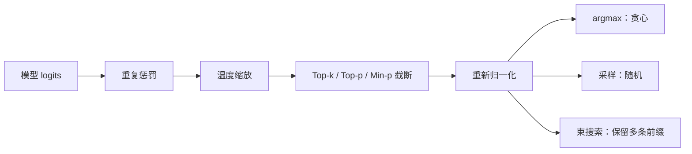

# 第 20 章 解码策略

## 本章导读

同一个模型，为什么 temperature 设成 0 时回答稳定却常常重复，设成 1 时又容易跑题？模型只输出一张概率表，真正决定文本长相的是从这张表里选 Token 的规则。本章把贪心、束搜索、温度、Top-k、Top-p、Min-p、重复惩罚与约束解码放到同一个框架下，回答三个问题：每种规则在优化什么、代价是什么、什么时候该换另一种。

## 难度标签

⭐⭐ 基础 ｜ 数学要求：Softmax、条件概率、组合计数 ｜ 代码要求：PyTorch 张量操作、随机采样与批处理

## 学习目标

- 能写出贪心、束搜索与温度采样的更新式，并说明它们分别在优化什么目标。
- 能解释 Top-k、Top-p、Min-p 的截断几何，以及为什么同样的阈值在不同分布上效果相反。
- 能推导 pass@k 的无偏估计，并说明温度、采样数与 k 如何共同影响读数。
- 能实现一个可复现的解码模块，比较不同策略的似然、多样性与通过率。
- 能针对代码、对话、结构化输出三类场景给出有依据的解码配置。

## 20.1 直觉：概率表上的几条路

语言模型在每一步只做一件事：给定前缀，输出词表上的一行概率。解码策略决定如何把这一行概率变成一个 Token，再把这个 Token 接回前缀，重复下去。可以把所有可能的续写想成一张巨大的树：根是提示，每个节点是一个前缀，每条边是一个 Token，边权是模型给出的条件概率。不同策略是在这棵树上走不同的路。



贪心每一步都走当前最粗的边，目光只有一步；束搜索同时保留几条最有希望的路径，试图找到整条路径概率最大的那条；采样按边的粗细抽签，偶尔走一条细边；截断则先把太细的边剪掉，再在剩下的边上抽签。理解这张图，后面的公式只是把“粗”“细”“最有希望”写成概率。

```info
训练时模型最大化的是数据分布的对数似然，也就是“让数据里出现的序列概率更高”。解码时我们却常常想要“一条典型的好序列”，这两件事并不等价。贪心与束搜索追求高概率路径，采样追求从分布中抽取，截断改变分布本身。解码策略的取舍，本质上是把这三种目标混在一起时如何取舍。
```

## 20.2 数学原理

### 20.2.1 解码是从 p 到 q 的重写

设词表大小为 $$V$$，模型在位置 $$t$$ 的 logits 为 $$\boldsymbol{\ell}_t\in\mathbb{R}^{V}$$。自回归条件分布是

$$
p_\theta(x_{t+1}\mid x_{\le t})=\operatorname{softmax}(\boldsymbol{\ell}_t)
\qquad \text{(20.1)}
$$

解码算法在每一步定义一个条件分布 $$q_t(\cdot\mid x_{\le t})$$，它可能等于 $$p_\theta$$，也可能是 $$p_\theta$$ 经过温度、截断、惩罚或语法掩码后的结果。整条序列的分布是 $$q(y\mid x)=\prod_{t=1}^{|y|}q_t(y_t\mid x,y_{<t})$$。不同策略的差别，全在 $$q_t$$ 与 $$p_\theta$$ 的关系：贪心把 $$q_t$$ 变成 argmax 的 one-hot；束搜索不定义单步分布，而是在序列级搜索；采样让 $$q_t=p_\theta$$；截断让 $$q_t$$ 只在一个子集上非零并重新归一化。训练目标用的是 $$p_\theta$$，一旦解码改成 $$q\ne p_\theta$$，评测读数就不再是“模型本来的概率”。这是后文许多陷阱的根源。

### 20.2.2 贪心与束搜索

贪心解码每一步取概率最大的 Token：

$$
x_{t+1}=\arg\max_{v\in\mathcal{V}}\;p_\theta(v\mid x_{\le t})
\qquad \text{(20.2)}
$$

它的计算量最小，每步只需一次前向加一次 argmax。但“每一步最大”不等于“整条序列最大”。考虑一个简化例子：第一步 A 的概率 0.51、B 的概率 0.49；选 A 之后，后续 6 个候选 Token 的单步概率都不超过 1/6；选 B 之后，有一个续写以概率 1 接上结束符。贪心第一步选 A，整条路径的概率约为 $$0.51\times 1/6\approx 0.085$$；而 B 结尾的路径概率是 0.49。贪心错过了全局更优的 B 路径。这个反例会在代码测试中使用一组相近但更细的 logits 复现。

束搜索（beam search）在序列级做近似搜索。设束宽为 $$W$$，第 $$t$$ 步保留 $$W$$ 条前缀，每条前缀的得分是它的对数似然

$$
S(y_{1:t})=\sum_{i=1}^{t}\log p_\theta(y_i\mid y_{<i})
\qquad \text{(20.3)}
$$

下一步把所有前缀各自扩展出得分最高的 $$W$$ 个 Token，再从 $$W^2$$ 个候选里保留总分最高的 $$W$$ 条：

$$
\mathcal{B}_t=\operatorname{top-}W_{y_{1:t-1},\,v}\;\big[S(y_{1:t-1})+\log p_\theta(v\mid y_{1:t-1})\big]
\qquad \text{(20.4)}
$$

$$W=1$$ 时束搜索退化为贪心。束搜索不是精确的序列最大化解：它在每一步剪枝，被剪掉的路径之后即使变得很好也回不来。它的代价是每步要对 $$W$$ 条前缀做前向，评分与显存都随 $$W$$ 线性增长。

直接按 (20.3) 排序还有长度偏置：每个 Token 都往总分里加一个负数，短序列占便宜；反过来，如果模型对某个循环模式非常自信，长循环的总分也可能超过正常结尾。常见的修正是长度归一化

$$
\tilde S(y)=\frac{S(y)}{|y|^{\alpha}}
\qquad \text{(20.5)}
$$

其中 $$\alpha>0$$ 是长度惩罚。机器翻译里常用的 GNMT 形式是 $$\frac{(5+|y|)^\alpha}{(5+1)^\alpha}$$，思想相同：让不同长度的候选可比。注意归一化只改变排序，不改变模型对“哪个 Token 更可能”的判断；如果循环本身的单 Token 概率更高，归一化也救不回来。

### 20.2.3 温度缩放

温度 $$\tau>0$$ 把 logits 除以 $$\tau$$ 再做 Softmax：

$$
p_i^{\tau}=\frac{\exp(\ell_i/\tau)}{\sum_{j=1}^{V}\exp(\ell_j/\tau)}
\qquad \text{(20.6)}
$$

温度不改变排序：$$\ell_i>\ell_j$$ 等价于 $$\ell_i/\tau>\ell_j/\tau$$，所以 argmax 不变。它改变的是分布的“陡峭程度”。$$\tau\to 0$$ 时，最大项之外的指数被压到 0，分布趋于 one-hot；$$\tau=1$$ 时是模型原始分布；$$\tau\to\infty$$ 时所有项趋于相等，分布趋于均匀。数学上，$$\tau$$ 越大，分布的熵越大；对任意固定 logits，温度升高只会让分布更平坦。

温度常被误称为“随机性参数”。更准确的说法是：它调节“在多大程度上相信模型的相对排序”。$$\tau<1$$ 时模型更自信，采样更接近贪心；$$\tau>1$$ 时模型更愿意尝试低概率 Token。温度也不改变截断的几何：截断通常在温度之后做，所以同样的 Top-p 在不同温度下会选中不同的 Token 集合。

### 20.2.4 截断采样：Top-k、Top-p 与 Min-p

纯采样从完整分布 $$p_\theta$$ 中抽 Token。词表的长尾里堆着大量低概率、语病或无关的 Token，抽中一次就可能把后续上下文带偏。截断采样的做法是先选一个子集 $$\mathcal{S}$$，只在 $$\mathcal{S}$$ 上采样，再把概率重新归一化。

Top-k 保留 logit 最大的 $$k$$ 个 Token：

$$
\mathcal{S}_k=\operatorname{TopK}_{v}\big(\ell_v,k\big)
\qquad \text{(20.7)}
$$

它的基数固定，实现最简单。问题是 $$k$$ 不随分布形状变化：分布很平的时候，$$k$$ 太小会砍掉合理选项；分布很尖的时候，$$k$$ 太大又会放进来一堆垃圾。

Top-p（nucleus sampling）按概率从大到小累加，保留累积概率首次达到 $$p$$ 的最小前缀：

$$
\mathcal{S}_p=\min\Big\{\mathcal{S}:\sum_{v\in\mathcal{S}}p_v\ge p,\ \mathcal{S}\text{ 是概率最高的前缀}\Big\}
\qquad \text{(20.8)}
$$

它的基数是自适应的：分布尖时集合小，分布平时集合大。但“自适应”不等于“安全”。如果某个 Token 的概率本身就超过 $$p$$，最小前缀只包含它，所有尾部 Token 都被剪掉，包括结束符。此时 Top-p 会把一个本来可以结束的分布变成“只能继续循环”。本章实验里 Top-p=0.9、温度 0.8 的情况正是如此。

Min-p 用一个相对于最大概率的阈值：

$$
\mathcal{S}_{\min p}=\{v:p_v\ge p_{\min}\cdot\max_{j}p_j\}
\qquad \text{(20.9)}
$$

$$p_{\min}=0$$ 时不过滤，$$p_{\min}=1$$ 时只留最大项。它同时适应分布的尖和平：最大概率是 0.9 时，阈值 0.045 还能留下 0.05 的尾部；最大概率是 0.3 时，阈值 0.015 会留下更多候选。Min-p 是较新的工程方案，理论上仍是对分布的硬截断，不是无偏采样。

无论用哪种截断，最终分布都是

$$
q_v=\frac{p_v}{\sum_{u\in\mathcal{S}}p_u}\,\mathbb{1}[v\in\mathcal{S}]
\qquad \text{(20.10)}
$$

被剪掉的概率质量 $$\sum_{v\notin\mathcal{S}}p_v$$ 被重新分配给头部。截断越强，$$q$$ 与 $$p$$ 的差距越大，模型原本的多样性被收窄得越多。工程上要区分“截断集合”和“温度”：温度是平滑地改变形状，截断是硬性地置零；两者叠加时，顺序会改变结果。Hugging Face 的 `generate` 与 vLLM 的采样管线通常按“重复惩罚 → 温度 → Top-k → Top-p → Min-p”处理，复现结果时要连顺序一起记录。

### 20.2.5 重复惩罚与约束解码

重复惩罚（repetition penalty）直接修改已出现 Token 的 logit。设上下文里出现过的 Token 集合为 $$\mathcal{C}$$，惩罚系数 $$\rho>1$$，则

$$
\ell_i\leftarrow
\begin{cases}
\ell_i/\rho, & i\in\mathcal{C}\ \text{且}\ \ell_i>0\\
\ell_i\cdot\rho, & i\in\mathcal{C}\ \text{且}\ \ell_i\le 0\\
\ell_i, & i\notin\mathcal{C}
\end{cases}
\qquad \text{(20.11)}
$$

正 logit 被压小，负 logit 被压得更负，因此重复 Token 的概率下降。它不是从数据或训练目标推出来的，而是一个推理时的启发式补丁。频率惩罚（frequency penalty）与存在惩罚（presence penalty）是另外两种常见形式：前者减去 $$\lambda_f\cdot\mathrm{cnt}_i$$，后者减去 $$\lambda_p\cdot\mathbb{1}[\mathrm{cnt}_i>0]$$，其中 $$\mathrm{cnt}_i$$ 是 Token $$i$$ 在上下文中出现的次数。两者都是加性惩罚，可能把 logit 推到负值。

重复惩罚有两个副作用。第一，它惩罚所有重复，而代码、表格、人名、列表里的重复往往是正确的；第二，它改变的是 $$q$$ 而不是 $$p$$，所以会破坏“采样得到的序列概率与模型概率一致”这一性质，给强化学习 rollout 或似然评测带来系统性偏差。遇到重复，优先检查数据和训练目标；只有在推理阶段需要临时缓解时，才把它当作最后手段，并记录系数。

约束解码（constrained decoding）用语法或模式给出一个允许集合，每个位置只允许特定 Token：

$$
q_v\propto p_v\,m_v,\qquad m_v\in\{0,1\}
\qquad \text{(20.12)}
$$

例如 JSON Schema 要求下一个 Token 必须是某个键、冒号或右括号，语法驱动的有限状态机就把其他 Token 的 $$m_v$$ 置零。实现上通常把不允许的 logit 设为 $$-\infty$$，再重新归一化。它保证的是“语法合法”，不是“内容正确”：模型仍可能填错字段值，或在合法但无意义的分支里打转。约束越强，$$q$$ 与 $$p$$ 的偏离越大，延迟也越高，因为每步都要推进语法状态。

### 20.2.6 似然最大化为什么产生退化文本

Holtzman 等人在 2019 年系统分析了这个问题：用束搜索最大化序列似然，生成的文本常常平淡、重复，甚至在长文本里陷入循环；而直接从完整分布采样，又容易因为长尾而跑题。原因不是模型“不会写”，而是**最大化联合概率**与**生成典型文本**是两个不同的目标。

高维序列的联合分布非常尖。一个重复的短语一旦开始，模型对下一个重复 Token 的条件概率往往很高，因为上下文已经把它“锁定”了；循环路径的联合概率可以高于任何一条自然、多样的路径。贪心每一步都选局部最可能的 Token，很容易走进这种锁定；束搜索在全局比较后，也可能选择同一条循环，因为它的总分确实更高。本章的玩具实验把这一点做得非常直接：数据生成过程有一个概率 0.9 的自循环，贪心与束搜索都生成 16 个 Token 的循环，从不输出结束符；纯采样有 56% 的概率在某一步抽到结束符，输出的序列似然低得多，却更接近数据的真实生成过程。

这也解释了为什么“提高温度”有时会让文本更自然，有时只会更混乱。温度升高让模型更愿意离开高概率循环，但也让长尾里的坏 Token 更容易被抽中；Top-p 与 Min-p 的作用是先把不可靠的长尾剪掉，再在剩下的头部里保留一点随机性。它们不是“让模型更聪明”，而是“在似然与多样性之间选一个工作点”。

```warning
“束搜索比采样更准”只在目标是唯一或可验证时成立，例如机器翻译、语音识别、代码补全的确定性补全。开放式写作、对话、头脑风暴没有唯一答案，序列 MAP 往往不是一个好答案。评测报告里必须写清楚用的是哪种解码，否则同一模型的两个分数可能根本不可比。
```

### 20.2.7 pass@k 与评测温度

代码生成常用 pass@k：对同一道题采样 $$n$$ 条回答，其中 $$c$$ 条通过单元测试，估计“随机取 $$k$$ 条，至少一条通过”的概率。无偏估计是

$$
\widehat{\mathrm{pass@}k}=1-\frac{\binom{n-c}{k}}{\binom{n}{k}}
\qquad \text{(20.13)}
$$

推导很直接：从 $$n$$ 条样本里等概率取一个大小为 $$k$$ 的子集，所有子集数是 $$\binom{n}{k}$$；一条正确样本都没取到的子集数是 $$\binom{n-c}{k}$$；两者相减就是至少取到一条正确样本的子集比例。这个估计量对“从这 $$n$$ 条里抽 $$k$$ 条”是无偏的。若把每条样本看成独立的成功概率 $$p_{\rm succ}$$ 的伯努利试验，则

$$
\mathbb{E}\big[\widehat{\mathrm{pass@}k}\big]=1-(1-p_{\rm succ})^k
\qquad \text{(20.14)}
$$

注意不要用 $$1-(1-c/n)^k$$ 代替 (20.13)：后者是 plug-in 估计，在有限 $$n$$ 下有偏，尤其是 $$c$$ 很小或 $$k$$ 接近 $$n$$ 时偏差明显。工程实现要检查 $$n\ge k$$，并报告 $$n$$、$$k$$、温度、Top-p 等全部配置。

温度对 pass@1 与 pass@k 的影响方向可以不同。温度升高让采样更分散，单条样本的正确率可能下降，但十条里出现一条正确的概率可能上升；因此“高温提升 pass@k”并不等于“高温让模型更强”。Codex 的评测使用 $$n=200$$ 条样本来估计 pass@1、pass@10 与 pass@100，并明确区分不同 $$k$$ 对应的采样温度（截至写作时，具体数值以论文与复现脚本为准）。跨论文比较时，如果 $$n$$、$$k$$、温度或截断策略不同，分数不可直接比较。

```success
本章的三个核心结论：（1）贪心优化单步众数，束搜索近似序列 MAP，采样从分布中抽取，三者目标不同；（2）温度改变分布形状但不改变排序，截断改变支撑集并重新归一化；（3）似然高的文本不一定自然，评测必须同时报告解码配置与 pass@k 的 $$n,k$$。
```

## 20.3 方案对比

表 20-1 从优化目标、随机性、多样性与适用场景比较本章讨论的策略。

| 策略 | 优化目标 | 随机性 | 多样性 | 典型场景 | 主要风险 |
| --- | --- | --- | --- | --- | --- |
| 贪心 | 单步概率最大 | 无 | 最低 | 结构化抽取、确定性补全 | 陷入循环、错过全局更优路径 |
| 束搜索 | 序列对数似然最大（近似） | 无 | 低 | 翻译、语音识别、有参考的生成 | 平淡、重复、长度偏置 |
| 纯采样 | 从 $$p_\theta$$ 抽样 | 有 | 高 | 头脑风暴、多样本生成 | 长尾跑题、事实错误 |
| 温度缩放 | 调整分布陡峭度 | 取决于采样 | 随 $$\tau$$ 变化 | 与采样组合 | 高温放大错误，低温退化 |
| Top-k | 固定基数截断 | 有 | 中 | 通用采样基线 | $$k$$ 不随分布自适应 |
| Top-p | 累积质量截断 | 有 | 中 | 对话、通用生成 | 尖分布下剪掉结束符 |
| Min-p | 相对最大值截断 | 有 | 中 | 高温度下的稳定采样 | 阈值仍需按模型调 |
| 重复惩罚 | 压低已出现 Token | 取决于采样 | 降低重复 | 临时缓解循环 | 破坏分布、误伤合法重复 |
| 约束解码 | 语法/模式合法 | 取决于采样 | 受语法限制 | JSON、函数调用、代码 | 只保证语法，不保证语义 |

从表中可以看出，没有一种策略在所有维度占优。贪心与束搜索把随机性降到零，换来可复现与高似然；采样与截断把多样性买回来，代价是可能抽到低质量内容；重复惩罚与约束解码是“外挂”，它们改变分布但不改变模型本身的能力。

## 20.4 代码实现

### 20.4.1 模块设计

第 20 章新增 `tinylm/inference/sample.py`，不修改 `TinyLM.forward`、`CausalLMOutput` 与 `ModelConfig`。`SamplingConfig` 只作为生成脚本参数，字段与附录 F 的冻结契约一致：`temperature`、`top_k`、`top_p`、`min_p`、`repetition_penalty`、`seed`。核心函数与公式的对应关系如下：

- `apply_repetition_penalty`：实现 (20.11)；
- `top_k_mask`、`top_p_mask`、`min_p_mask`：分别实现 (20.7)–(20.9)；
- `filtered_probs`：实现 (20.6) 与 (20.10)，按“惩罚 → 温度 → 截断 → 归一化”的顺序；
- `greedy_decode`：实现 (20.2)；
- `beam_search`：实现 (20.3)–(20.5)；
- `sequence_logprob`：实现 (20.3)，用于比较不同策略的似然；
- `pass_at_k`：实现 (20.13)；
- `generate`：附录 F 的冻结入口，`sampling=None` 表示贪心，`use_cache` 在本章被忽略，第 21 章才真正生效。附录 F 把它写成 `TinyLM` 的方法；本章以“`model` 作第一个参数”的模块级函数实现，调用约定等价，便于前面各章的模型直接复用。

实验任务是学习一条合成马尔可夫链：`BOS` 之后进入 A–B 或 C–D 循环，循环内以 0.9 的概率继续、0.05 的概率结束、0.05 的概率切换到另一条循环。模型是 2 层、`d_model=32`、4 头、`d_ff=128` 的 TinyLM，词表只有 8 个 Token，训练 700 步、批 64、3 个种子。这个分布故意让“继续循环”成为高概率路径，用来观察各策略是否会被似然锁死。它是玩具任务，结论只能用于说明机制，不能外推到真实 LLM 的超参数。

### 20.4.2 完整代码

`tinylm/inference/sample.py`：

```python
"""第 20 章：解码策略（tinylm/inference/sample.py）。"""
import math
import warnings
from dataclasses import dataclass

import torch
import torch.nn.functional as F


@dataclass(frozen=True)
class SamplingConfig:
    """生成脚本参数，不进入 ``ModelConfig``。"""

    temperature: float = 1.0
    top_k: int | None = None
    top_p: float | None = None
    min_p: float = 0.0
    repetition_penalty: float = 1.0
    seed: int | None = None

    def __post_init__(self):
        assert self.temperature > 0.0
        assert self.top_k is None or self.top_k >= 1
        assert self.top_p is None or 0.0 < self.top_p <= 1.0
        assert 0.0 <= self.min_p <= 1.0
        assert self.repetition_penalty > 0.0


def apply_repetition_penalty(logits, token_ids, penalty, pad_id=None):
    """(20.11)：对已出现 Token 的 logit 做分段缩放。"""
    if penalty == 1.0:
        return logits
    out = logits.clone()
    for b in range(out.size(0)):
        seen = torch.unique(token_ids[b])
        if pad_id is not None:
            seen = seen[seen != pad_id]
        values = out[b, seen]
        out[b, seen] = torch.where(values > 0, values / penalty,
                                   values * penalty)
    return out


def top_k_mask(logits, k):
    """(20.7)：保留 logit 最大的 k 个 Token。"""
    k = min(int(k), logits.size(-1))
    indices = logits.topk(k, dim=-1).indices
    mask = torch.zeros_like(logits, dtype=torch.bool)
    return mask.scatter_(-1, indices, True)


def top_p_mask(logits, p):
    """(20.8)：保留累积概率首次达到 p 的最小前缀。"""
    probs = torch.softmax(logits, dim=-1)
    sorted_probs, sorted_idx = torch.sort(probs, dim=-1, descending=True)
    cumulative = sorted_probs.cumsum(dim=-1)
    remove = cumulative > p
    remove[..., 1:] = remove[..., :-1].clone()
    remove[..., 0] = False
    keep_sorted = ~remove
    mask = torch.zeros_like(logits, dtype=torch.bool)
    return mask.scatter_(-1, sorted_idx, keep_sorted)


def min_p_mask(logits, min_p):
    """(20.9)：保留概率不低于最大概率 min_p 倍的 Token。"""
    probs = torch.softmax(logits, dim=-1)
    threshold = min_p * probs.max(dim=-1, keepdim=True).values
    return probs >= threshold


def decode_mask(logits, cfg):
    """依次叠加 top-k、top-p、min-p 的保留集合。"""
    mask = torch.ones_like(logits, dtype=torch.bool)
    if cfg.top_k is not None:
        mask &= top_k_mask(logits, cfg.top_k)           # (20.7)
    if cfg.top_p is not None:
        mask &= top_p_mask(logits, cfg.top_p)           # (20.8)
    if cfg.min_p > 0.0:
        mask &= min_p_mask(logits, cfg.min_p)           # (20.9)
    return mask


def filtered_probs(logits, cfg, token_ids=None, pad_id=None):
    """(20.6)–(20.10)：返回截断并重新归一化后的分布。"""
    adjusted = logits
    if token_ids is not None and cfg.repetition_penalty != 1.0:
        adjusted = apply_repetition_penalty(
            adjusted, token_ids, cfg.repetition_penalty, pad_id)  # (20.11)
    adjusted = adjusted / cfg.temperature               # (20.6)
    mask = decode_mask(adjusted, cfg)
    adjusted = adjusted.masked_fill(~mask, float("-inf"))
    probs = torch.softmax(adjusted, dim=-1)             # (20.10)
    return probs, mask


def _make_generator(seed, device):
    if seed is None:
        return None
    generator = torch.Generator(device=device)
    generator.manual_seed(int(seed))
    return generator


@torch.no_grad()
def sample_decode(model, input_ids, max_new_tokens, cfg=SamplingConfig(),
                  eos_token_id=None, pad_id=0):
    """逐 Token 采样，返回 ``(seqs, mask)``。"""
    model.eval()
    seqs = input_ids
    done = torch.zeros(seqs.size(0), dtype=torch.bool, device=seqs.device)
    generator = _make_generator(cfg.seed, seqs.device)
    for _ in range(max_new_tokens):
        logits = model(seqs).logits[:, -1]
        probs, _ = filtered_probs(logits, cfg, seqs, pad_id)
        nxt = torch.multinomial(probs, 1, generator=generator).squeeze(-1)
        if eos_token_id is not None:
            nxt = torch.where(done, torch.full_like(nxt, pad_id), nxt)
        seqs = torch.cat([seqs, nxt[:, None]], dim=1)
        if eos_token_id is not None:
            done = done | (nxt == eos_token_id)
            if bool(done.all()):
                break
    return seqs, seqs != pad_id


@torch.no_grad()
def greedy_decode(model, input_ids, max_new_tokens, eos_token_id=None,
                  pad_id=0):
    """(20.2)：逐 Token 取 argmax，返回 ``(seqs, mask)``。"""
    model.eval()
    seqs = input_ids
    done = torch.zeros(seqs.size(0), dtype=torch.bool, device=seqs.device)
    for _ in range(max_new_tokens):
        nxt = model(seqs).logits[:, -1].argmax(dim=-1)
        if eos_token_id is not None:
            nxt = torch.where(done, torch.full_like(nxt, pad_id), nxt)
        seqs = torch.cat([seqs, nxt[:, None]], dim=1)
        if eos_token_id is not None:
            done = done | (nxt == eos_token_id)
            if bool(done.all()):
                break
    return seqs, seqs != pad_id


@torch.no_grad()
def beam_search(model, prompt, beam_width=4, max_new_tokens=32,
                eos_token_id=None, length_penalty=0.0, pad_id=0):
    """(20.3)–(20.5)：单条提示的束搜索，返回得分最高的序列。"""
    model.eval()
    if prompt.dim() != 2 or prompt.size(0) != 1:
        raise ValueError("beam_search 只接受单条提示，形状为 (1, T)")
    beams = [(0.0, prompt)]
    completed = []
    for _ in range(max_new_tokens):
        pairs = []
        batch = torch.cat([seq for _, seq in beams], dim=0)
        log_probs = F.log_softmax(model(batch).logits[:, -1], dim=-1)
        for i, (score, seq) in enumerate(beams):
            values, indices = log_probs[i].topk(beam_width, dim=-1)
            for value, token in zip(values.tolist(), indices.tolist()):
                pairs.append((score + value, torch.cat(
                    [seq, torch.tensor([[token]], device=seq.device)], dim=1)))
        if eos_token_id is not None:
            unfinished = []
            for score, seq in pairs:
                if int(seq[0, -1]) == eos_token_id:
                    completed.append((score, seq))
                else:
                    unfinished.append((score, seq))
        else:
            unfinished = pairs
        if not unfinished:
            break
        beams = sorted(unfinished, key=lambda item: item[0], reverse=True)
        beams = beams[:beam_width]
    completed.extend(beams)
    if not completed:
        raise RuntimeError("束搜索没有产生任何候选")

    def rank(item):
        score, seq = item
        length = seq.size(1) ** length_penalty      # (20.5)
        return score / length if length else score

    return max(completed, key=rank)[1]


@torch.no_grad()
def sequence_logprob(model, seqs, prompt_len, pad_id=None):
    """(20.3)：给定序列在模型下的对数似然，跳过提示与 padding。"""
    logits = model(seqs[:, :-1]).logits
    log_probs = F.log_softmax(logits, dim=-1)
    targets = seqs[:, 1:]
    token_logp = log_probs.gather(-1, targets[..., None]).squeeze(-1)
    valid = torch.ones_like(targets, dtype=torch.bool)
    valid[:, :max(prompt_len - 1, 0)] = False
    if pad_id is not None:
        valid &= targets != pad_id
    return (token_logp * valid).sum(dim=-1)


def pass_at_k(n, c, k):
    """(20.13)：从 n 条样本中取 k 条，至少一条正确的无偏估计。"""
    if not 1 <= k <= n:
        raise ValueError("需要 1 <= k <= n")
    if c <= 0:
        return 0.0
    if n - c < k:
        return 1.0
    return 1.0 - math.comb(n - c, k) / math.comb(n, k)


@torch.no_grad()
def generate(model, input_ids, *, max_new_tokens=64, sampling=None,
             eos_token_id=None, use_cache=True):
    """F.2.4 冻结入口：``sampling=None`` 表示贪心。"""
    if use_cache:
        warnings.warn("第 20 章尚未实现 KV Cache，use_cache 被忽略")
    if sampling is None:
        seqs, _ = greedy_decode(model, input_ids, max_new_tokens,
                                eos_token_id=eos_token_id)
    else:
        seqs, _ = sample_decode(model, input_ids, max_new_tokens, sampling,
                                eos_token_id=eos_token_id)
    return seqs
```

`examples/ch20_decode.py`：

```python
"""第 20 章：解码策略（examples/ch20_decode.py）。"""
import random
import time

import torch

from ch08 import ModelConfig, TinyLM
from tinylm.inference import sample as S

PAD, BOS, EOS, A, B, C, D = 7, 0, 1, 2, 3, 4, 5
VOCAB = 8
MAX_NEW = 16
TRANSITIONS = {
    BOS: [(A, 0.5), (C, 0.5)],
    A: [(B, 0.9), (EOS, 0.05), (C, 0.05)],
    B: [(A, 0.9), (EOS, 0.05), (D, 0.05)],
    C: [(D, 0.9), (EOS, 0.05), (A, 0.05)],
    D: [(C, 0.9), (EOS, 0.05), (B, 0.05)],
}
SEEDS = (0, 1, 2)
N_SAMPLES = 128


def make_sequence(rng):
    seq = [BOS]
    current = BOS
    for _ in range(20):
        choices = TRANSITIONS[current]
        current = rng.choices([t for t, _ in choices],
                              [p for _, p in choices])[0]
        seq.append(current)
        if current == EOS:
            break
    else:
        seq.append(EOS)
    return seq


def make_batch(seqs, max_len=None):
    max_len = max_len or max(len(s) for s in seqs)
    ids = torch.full((len(seqs), max_len), PAD, dtype=torch.long)
    labels = torch.full((len(seqs), max_len), -100, dtype=torch.long)
    mask = torch.zeros((len(seqs), max_len), dtype=torch.bool)
    for i, seq in enumerate(seqs):
        ids[i, :len(seq)] = torch.tensor(seq)
        labels[i, :len(seq) - 1] = torch.tensor(seq[1:])
        mask[i, :len(seq)] = True
    return ids, labels, mask


def train_model(seed, steps=700, batch=64, lr=3e-3):
    torch.manual_seed(seed)
    cfg = ModelConfig(vocab_size=VOCAB, d_model=32, n_layers=2, n_heads=4,
                      d_ff=128, max_seq_len=24, pos_encoding="rope",
                      norm="rmsnorm", ffn="swiglu", bias=False)
    model = TinyLM(cfg)
    rng = random.Random(100 + seed)
    data = [make_sequence(rng) for _ in range(4000)]
    gen = torch.Generator().manual_seed(seed)
    opt = torch.optim.AdamW(model.parameters(), lr=lr)
    model.train()
    for _ in range(steps):
        idx = torch.randint(0, len(data), (batch,), generator=gen)
        ids, labels, mask = make_batch([data[int(i)] for i in idx])
        out = model(ids, attention_mask=mask, labels=labels)
        opt.zero_grad()
        out.loss.backward()
        torch.nn.utils.clip_grad_norm_(model.parameters(), 1.0)
        opt.step()
    return model


def truncate(seq):
    ids = seq.tolist()
    if EOS in ids[1:]:
        return ids[:ids.index(EOS, 1) + 1]
    return ids


def metrics(seqs, prompt_len=1):
    cut = [truncate(seq) for seq in seqs]
    lengths = [len(s) - prompt_len for s in cut]
    eos = sum(s[-1] == EOS for s in cut) / len(cut)
    grams, total = set(), 0
    for s in cut:
        body = s[prompt_len:]
        for i in range(len(body) - 1):
            grams.add((body[i], body[i + 1]))
            total += 1
    distinct2 = len(grams) / total if total else 0.0
    unique = len({tuple(s) for s in cut}) / len(cut)
    return eos, sum(lengths) / len(lengths), distinct2, unique


def report(name, seqs, model, prompt_len=1):
    eos, length, distinct2, unique = metrics(seqs)
    logp = S.sequence_logprob(model, seqs, prompt_len, PAD).mean().item()
    print(f"  {name:<16} eos {eos:.2f} len {length:5.2f} "
          f"distinct2 {distinct2:.2f} unique {unique:.2f} logp {logp:6.2f}")
    return eos, length, distinct2, unique, logp


def main():
    t0 = time.time()
    prompt = torch.tensor([[BOS]])
    rows = {}
    for seed in SEEDS:
        model = train_model(seed)
        print(f"seed {seed}")
        b = torch.full((N_SAMPLES, 1), BOS)
        greedy = torch.cat([S.greedy_decode(model, prompt, MAX_NEW, EOS, PAD)[0]]
                           * N_SAMPLES, dim=0)
        beam = S.beam_search(model, prompt, 4, MAX_NEW, EOS, pad_id=PAD)
        beam = beam.repeat(N_SAMPLES, 1)
        beam_norm = S.beam_search(model, prompt, 4, MAX_NEW, EOS,
                                  length_penalty=1.0, pad_id=PAD)
        beam_norm = beam_norm.repeat(N_SAMPLES, 1)
        pure, _ = S.sample_decode(model, b, MAX_NEW, S.SamplingConfig(seed=seed),
                                  EOS, PAD)
        top_p, _ = S.sample_decode(
            model, b, MAX_NEW,
            S.SamplingConfig(temperature=0.8, top_p=0.9, seed=seed), EOS, PAD)
        top_p95, _ = S.sample_decode(
            model, b, MAX_NEW,
            S.SamplingConfig(temperature=0.8, top_p=0.95, seed=seed), EOS, PAD)
        min_p, _ = S.sample_decode(
            model, b, MAX_NEW,
            S.SamplingConfig(temperature=1.0, min_p=0.05, seed=seed), EOS, PAD)
        strategies = {
            "greedy": greedy, "beam w=4": beam, "beam w=4 norm": beam_norm,
            "pure T=1": pure, "T=0.8 top_p=.9": top_p,
            "T=0.8 top_p=.95": top_p95, "T=1.0 min_p=.05": min_p,
        }
        for name, seqs in strategies.items():
            vals = report(name, seqs, model)
            rows.setdefault(name, []).append(vals)
        for name, seqs in strategies.items():
            cut = [truncate(s) for s in seqs]
            c = sum(s[-1] == EOS for s in cut)
            p1 = S.pass_at_k(len(cut), c, 1)
            p8 = S.pass_at_k(len(cut), c, 8)
            rows.setdefault(name + " pass", []).append((p1, p8))
        print()

    print("3-seed means")
    print(f"{'':<17}{'eos':>6}{'len':>7}{'dist2':>7}{'uniq':>7}{'logp':>7}"
          f"{'pass@1':>8}{'pass@8':>8}")
    for name in ("greedy", "beam w=4", "beam w=4 norm", "pure T=1",
                 "T=0.8 top_p=.9", "T=0.8 top_p=.95", "T=1.0 min_p=.05"):
        vals = rows[name]
        ps = rows[name + " pass"]
        eos = sum(v[0] for v in vals) / len(vals)
        length = sum(v[1] for v in vals) / len(vals)
        dist2 = sum(v[2] for v in vals) / len(vals)
        uniq = sum(v[3] for v in vals) / len(vals)
        logp = sum(v[4] for v in vals) / len(vals)
        p1 = sum(v[0] for v in ps) / len(ps)
        p8 = sum(v[1] for v in ps) / len(ps)
        print(f"{name:<17}{eos:6.2f}{length:7.2f}{dist2:7.2f}{uniq:7.2f}"
              f"{logp:7.2f}{p1:8.2f}{p8:8.2f}")
    print(f"total {time.time() - t0:.1f}s")


if __name__ == "__main__":
    main()
```

### 20.4.3 运行结果

在 CPU 上运行 `PYTHONPATH=. python examples/ch20_decode.py`，3 个种子、每个种子训练一个模型并比较 7 种策略，结果如下（一次实测的原样输出；实际耗时随机器而异）：

```text
seed 0
  greedy           eos 0.00 len 16.00 distinct2 0.00 unique 0.01 logp  -2.13
  beam w=4         eos 0.00 len 16.00 distinct2 0.00 unique 0.01 logp  -2.13
  beam w=4 norm    eos 0.00 len 16.00 distinct2 0.00 unique 0.01 logp  -2.13
  pure T=1         eos 0.43 len 12.26 distinct2 0.01 unique 0.52 logp  -4.59
  T=0.8 top_p=.9   eos 0.00 len 16.00 distinct2 0.00 unique 0.02 logp  -2.23
  T=0.8 top_p=.95  eos 0.08 len 15.27 distinct2 0.00 unique 0.07 logp  -2.53
  T=1.0 min_p=.05  eos 0.27 len 13.80 distinct2 0.01 unique 0.38 logp  -4.16

seed 1
  greedy           eos 0.00 len 16.00 distinct2 0.00 unique 0.01 logp  -2.55
  beam w=4         eos 0.00 len 16.00 distinct2 0.00 unique 0.01 logp  -2.14
  beam w=4 norm    eos 0.00 len 16.00 distinct2 0.00 unique 0.01 logp  -2.14
  pure T=1         eos 0.61 len 11.10 distinct2 0.01 unique 0.57 logp  -5.20
  T=0.8 top_p=.9   eos 0.00 len 16.00 distinct2 0.00 unique 0.02 logp  -2.33
  T=0.8 top_p=.95  eos 0.27 len 13.59 distinct2 0.00 unique 0.13 logp  -2.75
  T=1.0 min_p=.05  eos 0.46 len 12.33 distinct2 0.01 unique 0.36 logp  -4.10

seed 2
  greedy           eos 0.00 len 16.00 distinct2 0.00 unique 0.01 logp  -2.15
  beam w=4         eos 0.00 len 16.00 distinct2 0.00 unique 0.01 logp  -2.15
  beam w=4 norm    eos 0.00 len 16.00 distinct2 0.00 unique 0.01 logp  -2.15
  pure T=1         eos 0.63 len 10.98 distinct2 0.01 unique 0.55 logp  -5.32
  T=0.8 top_p=.9   eos 0.00 len 16.00 distinct2 0.00 unique 0.02 logp  -2.41
  T=0.8 top_p=.95  eos 0.17 len 14.85 distinct2 0.00 unique 0.13 logp  -3.06
  T=1.0 min_p=.05  eos 0.62 len 11.01 distinct2 0.01 unique 0.34 logp  -3.98

3-seed means
                    eos    len  dist2   uniq   logp  pass@1  pass@8
greedy             0.00  16.00   0.00   0.01  -2.28    0.00    0.00
beam w=4           0.00  16.00   0.00   0.01  -2.14    0.00    0.00
beam w=4 norm      0.00  16.00   0.00   0.01  -2.14    0.00    0.00
pure T=1           0.56  11.45   0.01   0.54  -5.04    0.56    1.00
T=0.8 top_p=.9     0.00  16.00   0.00   0.02  -2.32    0.00    0.00
T=0.8 top_p=.95    0.17  14.57   0.00   0.11  -2.78    0.17    0.74
T=1.0 min_p=.05    0.45  12.38   0.01   0.36  -4.08    0.45    0.97
total 42.0s
```

### 20.4.4 结果解读

第一，贪心与束搜索都被循环锁死。三种确定性策略的结束率都是 0，平均长度顶到 16 的上限，128 条样本里几乎只有一条唯一序列。束搜索在种子 1 上的平均对数似然更高（−2.14 对 −2.55），种子 2 上与贪心持平（均为 −2.15），说明它确实能找到更高概率的路径；但这条路径仍然是一条循环。长度归一化（`beam w=4 norm`）没有改变结果，因为循环的单 Token 概率本来就高于正常结束，归一化只改变排序尺度，不会改变模型对“哪个 Token 更可能”的判断。这个负结果很重要：长度惩罚不是万能药。

第二，纯采样用低得多的似然换来了覆盖。它的平均对数似然是 −5.04，比束搜索低约 2.9 nats，但 56% 的样本成功结束，128 条里有 54% 是不同序列，pass@8 达到 1.00。这不是说采样“更聪明”，而是它按数据生成过程的真实概率走，愿意在 0.05 的边上抽一次结束符。贪心与束搜索追求的是“最可能的那一条”，采样追求的是“分布本身”，两者优化的目标不同。

第三，Top-p 的绝对阈值在尖分布上会误伤。温度 0.8 把循环概率从 0.9 推到约 0.95，`top_p=0.9` 的最小前缀只包含循环 Token，结束符被剪掉，于是 0% 结束；把阈值放宽到 0.95，某条尾部的结束符才可能进入最小前缀，结束率升到 17%。这说明 Top-p 的 $$p$$ 不是“保留 90% 的候选”这么直观，而是“保留累积质量达到 90% 的最短前缀”；当单个 Token 就超过 90% 时，尾部会被整段砍掉。

第四，Min-p 的相对阈值更稳健。`T=1.0, min_p=0.05` 的阈值是最大概率的 5%，在循环概率 0.9 时等于 0.045，刚好低于结束符的 0.05，所以结束符被保留，结束率 45%，pass@8 为 0.97。它仍然不是无偏采样，但比固定累积质量更适应“分布很尖”的情况。换到最大概率只有 0.3 的平坦分布，同一阈值会保留更多候选，这正是相对阈值的意义。

第五，多样性指标只能作为代理。`distinct2` 在这个只有 4 个内容 Token 的玩具语言里几乎没有区分度；`unique`（唯一序列比例）更能反映差异。真实评测还需要看任务成功率、人工评分与安全性，不能只报一个多样性数字。三个种子的方差也不小，尤其是 Top-p 0.95 的结束率在 8%–27% 之间波动；只报一个种子会误导。

### 20.4.5 测试与复现

`tests/test_sample.py` 共 17 项测试，覆盖：配置校验；Top-k 的基数；Top-p 的最小前缀性质；Min-p 的相对阈值；温度升高时熵增大且 argmax 不变；重复惩罚对正负 logit 的分段处理与 padding 跳过；截断后分布归一化且支撑集之外为零；贪心路径；Top-k=1 与贪心一致；束搜索找到贪心错过的全局更优路径；束宽 1 退化为贪心；序列对数似然的手算值；提示与 padding 不计入似然；pass@k 的端点与组合数；固定种子的可复现性与 EOS 之后的填充；`generate(sampling=None)` 等于贪心。全部通过约 0.9 s。

复现步骤：

```bash
PYTHONPATH=. python -m pytest tests/test_sample.py -q   # 17 passed
PYTHONPATH=. python examples/ch20_decode.py            # CPU 约 42 s
```

```text
17 passed in 0.93s
```

## 20.5 工业实践

### 20.5.1 框架默认值不是通用答案

Hugging Face `generate` 在 `do_sample=False` 时是贪心；打开采样后，旧版本的默认值是 `temperature=1.0`、`top_k=50`、`top_p=1.0`，不同版本与不同模型仓库可能覆盖这些默认值。vLLM 的 `SamplingParams` 同时暴露 `temperature`、`top_p`、`top_k`、`min_p`、`repetition_penalty`、`presence_penalty`、`frequency_penalty` 与 `guided_decoding`，连续批处理要求每个请求携带自己的采样配置，服务端不能用一个全局默认值糊弄过去。

工程上最重要的一条是**记录完整配置**。同一个模型在 `temperature=0.6, top_p=0.9` 与 `temperature=1.0, top_k=50` 下的输出分布不同，pass@1 与人工评分都可能差出几个点。模型卡、评测报告与线上日志至少要记录温度、截断方式与阈值、重复惩罚、最大生成长度、是否使用约束解码；只写“温度 0.7”不足以复现。

### 20.5.2 对话模型的推荐配置

Meta 的 Llama 3 系列模型卡在通用对话场景建议 `temperature=0.6`、`top_p=0.9`（截至写作时；不同版本与任务会调整）。这个组合比纯采样更稳，又保留了一定多样性。代码与数学任务通常建议更低的温度，甚至贪心；创意写作会更高。OpenAI 的 API 暴露 `temperature`（0–2）与 `top_p`，官方建议通常只调其中一个，另一个保持默认，避免两个参数同时改变分布形状而难以归因。

这些数字是起点，不是定律。模型、分词器、任务分布与评测方式都会改变最优点；同一组参数在英语对话上合适，换到中文长文或代码补全就可能需要重调。稳妥的做法是固定评测集与解码配置，一次只改一个参数，同时报告 pass@1、人工偏好与失败样例。

### 20.5.3 束搜索仍在哪些地方使用

束搜索在机器翻译、语音识别、OCR 后处理等“有明确目标序列”的任务里仍然是主力。GNMT 用长度惩罚修正长句得分，束宽通常取 4–8；这些任务的输出可以被参考译文或声学模型评分，序列 MAP 与任务指标的方向更一致。开放域对话很少用束搜索，因为“最可能的回答”往往平淡、重复，甚至比贪心更无聊；本章实验里束搜索与贪心都陷入循环，就是一个缩影。

如果要用束搜索，至少要做三件事：加长度惩罚并报告 $$\alpha$$；限制最大长度，避免无条件延长；用任务指标而不是困惑度选束宽。束宽从 4 加到 8 的收益通常远小于把解码目标换对。

### 20.5.4 约束解码与结构化输出

结构化输出（JSON、函数调用、SQL、正则约束）是约束解码最成功的落地场景。vLLM 的 guided decoding 支持 JSON Schema、正则与语法，底层用有限状态机在每步计算允许的 Token 集合；OpenAI 的 Structured Outputs 与各家的 function calling 也属于同一类思路。它把“请输出合法 JSON”从提示词请求变成硬约束，显著降低解析失败率。

代价有三点。第一，语法合法不等于语义正确：模型仍可能把字段填错、把数字写成字符串，或在枚举里选一个不该选的值。第二，约束会扭曲分布：某些高概率 Token 被禁止后，模型被迫走低概率分支，输出可能更生硬。第三，每步推进语法状态有额外开销，复杂 schema 会拖慢解码。实践中要把“格式校验”和“内容校验”分开：前者交给约束解码，后者交给程序校验或第二次模型调用。

## 20.6 论文导读

- **Fan, Lewis, Dauphin（2018）**，*Hierarchical Neural Story Generation*，arXiv:1805.04833。Top-k 采样的早期代表。读第 3 节的采样方法与第 4 节的故事生成实验，重点看它如何用截断解决“纯采样跑题”和“束搜索无聊”的两难。
- **Holtzman 等（2019）**，*The Curious Case of Neural Text Degeneration*，arXiv:1904.09751。本章的核心参考。读第 3 节对束搜索退化的分析、第 4 节的 Top-p（nucleus）采样，以及第 5 节的人类评测；注意它讨论的是“似然最大化”与“典型文本”的目标错位。
- **Chen 等（2021）**，*Evaluating Large Language Models Trained on Code*，arXiv:2107.03374。pass@k 的出处。读第 2.3 节的无偏估计与附录 A 的实现细节，重点理解为什么用组合数而不是 plug-in 估计，以及 $$n=200$$ 的采样预算。
- **Meister 等（2022）**，*Locally Typical Sampling*，arXiv:2202.00666。读第 3 节的“局部典型性”定义与第 4 节的实验；它用信息论中的典型集替代高概率前缀，是 Top-p 之外的另一条思路。
- **Nguyen 等（2024）**，*Turning Up the Heat: Min-p Sampling for Creative and Coherent LLM Outputs*，arXiv:2407.01082。读算法定义与高温实验；重点看它如何用“相对最大概率”的阈值替代 Top-p 的绝对累积质量，以及作者报告的局限性。

## 20.7 常见误区

**误区一：`temperature=0` 是合法的采样温度。** 温度出现在 Softmax 的分母上，除以 0 会得到未定义的结果。框架里的“温度 0”通常是特判成贪心，而不是真的做了一次温度缩放。本书的 `SamplingConfig` 要求温度严格大于 0；需要贪心时用 `sampling=None`。把“温度 0”和“贪心”当成同一个数学操作，会在自己实现采样器时写出除零错误。

**误区二：Top-p 越小越安全。** Top-p 是“累积质量达到 p 的最短前缀”，不是“保留 p 比例的候选”。在尖分布上，单个 Token 就可能超过 p，最小前缀只包含它，结束符与其他合理选项一起被剪掉。本章实验中 `top_p=0.9`、温度 0.8 的结束率是 0，而 `top_p=0.95` 才恢复到 17%。调 Top-p 必须看分布形状与任务，不能把它当成“保守程度”的旋钮。

**误区三：束搜索比采样更准确。** 束搜索优化的是序列对数似然，只有在目标序列唯一或可验证时，这个目标才与任务指标一致。开放式生成里，最可能的序列常常平淡、重复，甚至像本章实验那样陷入循环。把束搜索当成“更高级的贪心”用在对话上，通常得到更差的人类评分。

**误区四：重复惩罚能根治重复。** 重复惩罚是推理时的启发式补丁，不是训练目标的一部分。它惩罚所有重复，包括代码、表格、人名里的合法重复；它还把 $$q$$ 推离 $$p$$，破坏似然一致性。遇到重复，先检查训练数据、SFT 目标与上下文长度；只有在无法重训时才用它，并把它当作“缓解”而不是“修复”。

**误区五：pass@k 提高就说明模型更强。** pass@k 依赖采样温度、$$n$$、$$k$$ 与截断配置。高温可以让 pass@k 上升而 pass@1 下降；增大 $$n$$ 也会改变估计值。比较两个模型时，必须使用相同的 $$n$$、$$k$$、温度与解码管线；只报一个 pass@k 数字，无法判断提升来自模型还是来自“多抽了几条”。

**误区六：解码温度与蒸馏温度是同一个参数。** 两者都缩放 logits，但蒸馏温度 $$\tau$$ 是训练损失的超参数，决定软标签有多软；解码温度是推理时的采样参数，决定输出分布有多平。第 19 章的 $$\tau$$ 不能直接搬来当本章的温度，反过来也不行。看到论文里的“temperature”时，先确认它出现在训练还是推理段落。

## 20.8 本章小结

本章把解码策略放在似然与多样性之间：贪心与束搜索追求高概率路径，温度与 Top-k/Top-p/Min-p 控制采样覆盖，重复惩罚与约束解码是外挂式修正。选型首先取决于任务是否有唯一答案。

### 本章的取舍

解码策略的核心取舍是**似然与自然性**。贪心与束搜索追求高概率路径，输出稳定、可复现，但容易重复、平淡，甚至在循环里出不来；采样从分布中抽取，文本更多样，却要承担长尾跑题与事实错误的风险；截断在两者之间画一条线，线画在哪里，取决于模型分布的尖平与任务对错误的容忍度。

具体到选型，可以按任务是否有唯一答案来分。代码、数学、结构化抽取这类任务，答案可以被单元测试、正则或 schema 验证：优先用贪心或低温采样提高 pass@1；如果需要多条候选再筛选，就提高温度并用验证器选，此时看的是 pass@k 与 Best-of-N（第 24 章），不是单条样本的似然。开放域对话、写作、头脑风暴没有唯一答案：优先用温度 0.6–1.0 加 Top-p 0.9–0.95 或 Min-p 作为起点，再用人工偏好与失败样例调；不要用困惑度选解码参数，因为困惑度奖励的正是“高概率”，而高概率不等于好文本。翻译、语音识别这类有参考序列的任务：束搜索仍然合理，记得加长度惩罚并报告束宽。

截断的取舍是**覆盖与稳定**。Top-k 简单但不自适应；Top-p 自适应但在尖分布上会剪掉尾部；Min-p 用相对阈值缓解这个问题，但仍需按模型调。重复惩罚的取舍是**短期缓解与分布一致性**：它能压住明显的循环，却会误伤合法重复并破坏似然，能不用就不用。约束解码的取舍是**格式正确与分布保真**：它保证语法，却可能逼模型走低概率分支，且不保证语义。

如果只能给一个默认流程：先确认模型与数据没有问题，再固定一个可复现的解码配置；对每个任务分别报告 pass@1（或任务成功率）、pass@k、平均长度与失败样例；一次只改一个解码参数；最后才考虑重复惩罚与约束解码这类“外挂”。解码不能凭空创造模型没有的能力；模型本身不行时，调温度只是换一种方式犯错。

## 20.9 习题

**推导题.** 设对同一道题采样 $$n$$ 条回答，其中 $$c$$ 条正确，且每条回答独立的成功概率为 $$p_{\rm succ}$$，即 $$c\sim\mathrm{Binomial}(n,p_{\rm succ})$$。证明 (20.13) 的估计量满足 (20.14)，即

$$
\mathbb{E}\Big[1-\frac{\binom{n-c}{k}}{\binom{n}{k}}\Big]=1-(1-p_{\rm succ})^k
$$

并说明为什么不能用 $$1-(1-c/n)^k$$ 代替它。

<details><summary>展开参考答案</summary>

把 $$c$$ 看成从 $$n$$ 条固定样本中“正确”的条数。对固定的 $$c$$，从 $$n$$ 条里等概率取 $$k$$ 条，取不到任何正确样本的概率是 $$\binom{n-c}{k}/\binom{n}{k}$$，所以至少取到一条正确的概率是 (20.13)。对 $$c$$ 取期望：

$$
\mathbb{E}\Big[\frac{\binom{n-c}{k}}{\binom{n}{k}}\Big]
=\sum_{c=0}^{n}\binom{n}{c}p_{\rm succ}^c(1-p_{\rm succ})^{n-c}\frac{\binom{n-c}{k}}{\binom{n}{k}}
$$

利用组合恒等式 $$\binom{n}{c}\binom{n-c}{k}=\binom{n}{k}\binom{n-k}{c}$$，上式变成

$$
\sum_{c=0}^{n-k}\binom{n-k}{c}p_{\rm succ}^c(1-p_{\rm succ})^{n-c}
=(1-p_{\rm succ})^k\sum_{c=0}^{n-k}\binom{n-k}{c}p_{\rm succ}^c(1-p_{\rm succ})^{n-k-c}
=(1-p_{\rm succ})^k
$$

因此期望为 $$1-(1-p_{\rm succ})^k$$。$$1-(1-c/n)^k$$ 是把观测频率 $$c/n$$ 直接代入 $$p_{\rm succ}$$ 的 plug-in 估计；由 Jensen 不等式或直接展开可知它与无偏估计在有限 $$n$$ 下不相等，尤其在 $$c=0$$ 或 $$k$$ 接近 $$n$$ 时偏差明显。工程实现应使用 (20.13) 的组合数形式。

</details>

**编程题.** 实现“局部典型采样”（locally typical sampling）：对每个位置的分布计算熵 $$H=-\sum_v p_v\log p_v$$，按 $$|-\log p_v-H|$$ 从小到大排序，保留累积概率首次达到给定阈值（例如 0.95）的最小前缀，再重新归一化采样。在本章的玩具模型上比较它与 Min-p 的结束率、唯一序列比例与 pass@8，并解释差异。

**开放题.** 为以下三个产品各选一套解码配置，并说明你会用什么指标验证： (1) 代码补全插件；(2) 创意写作助手；(3) 从用户自然语言生成 JSON 的接口。对每个产品，至少讨论温度、Top-p/Min-p、重复惩罚、约束解码与 pass@k 的作用，以及你会放弃什么。
