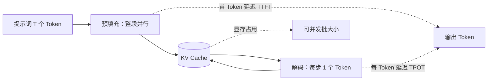

# 第 21 章 推理加速：KV Cache、FlashAttention 与调度

## 本章导读

把 H100 的 FP16 峰值算力（989 TFLOPS）与显存带宽（3.35 TB/s）相除，得到约 295 FLOP/Byte：GPU 每从显存搬 1 字节，至少要完成 295 次浮点运算才谈得上“用满算力”。可是 7B 模型每生成一个 Token 只做约 16.6 GFLOPs，却要把 14.5 GB 权重完整读一遍，算术强度接近 1。于是出现一个反直觉的现象：训练时能把算力吃到七成的卡，做在线生成时利用率常常只有个位数。本章沿着“数据复用、数据搬运、请求编排”三层，回答这笔账怎么算、哪些技术能把账做平、各自要付什么代价。

## 难度标签

⭐⭐⭐⭐ 研究向 ｜ 数学要求：Softmax、矩阵乘法复杂度、分块递推与极限分析 ｜ 代码要求：PyTorch 张量布局、GQA 形状变换、缓存读写与调度模拟

## 学习目标

- 能根据层数、KV 头数、头维度、序列长度与精度，写出 KV Cache 的显存公式，并估算单卡可并发的序列数。
- 能用算术强度与 roofline 模型判断预填充、解码各自受限于算力还是带宽，并解释“批处理为什么不能把解码变成算力密集型”。
- 能推导 FlashAttention 的在线 Softmax 更新式，说明它为什么不改变注意力结果，以及节省的到底是什么。
- 能解释 PagedAttention、连续批处理、分块预填充与预填充-解码分离各自解决什么问题，代价是什么。
- 能实现 KV Cache 增量解码、分块注意力与块表，并用 TTFT、TPOT、吞吐三个读数评估一套服务配置。

## 21.1 直觉：一次生成被拆成两段

自回归生成在工程上被拆成两个阶段。**预填充**（prefill）把整段提示词一次性送进模型，所有位置的矩阵乘可以并行，GPU 的 Tensor Core 被喂得很饱，是算力密集型；**解码**（decode）每次只处理一个新 Token，矩阵乘退化成矩阵向量乘，每个权重只用一次，绝大部分时间花在把权重和 KV Cache 从显存搬到片上，是带宽密集型。同一张卡、同一个模型，两个阶段的瓶颈截然不同，这是推理系统所有优化的出发点。



围绕这两个阶段，本章讨论三类技术。第一类是**数据复用**：KV Cache（键值缓存）让历史 Token 的 K/V 不必重算，前缀缓存让相同提示词的 KV 块跨请求共享。第二类是**数据搬运**：FlashAttention 用分块与在线 Softmax，把注意力中间矩阵留在片上，避免写入高带宽显存（HBM）；PagedAttention 用固定大小的块管理 KV，消除预留整段序列造成的碎片。第三类是**请求编排**：连续批处理让完成的序列立刻离场、新请求立刻入场；分块预填充把长提示词切成小块，避免它长时间堵住解码；预填充-解码分离（PD 分离）把两个阶段放到不同的卡上，各自按最合适的并行方式扩容。

把一次请求摊到时间轴上，两个阶段的区别更直观。假设提示词 2000 Token，预填充吞吐 2 万 Token/s，解码一步 25 ms，输出 256 Token。首 Token 在约 100 ms 后出现，这是 TTFT；随后每个 Token 间隔 25 ms，这是 TPOT；整条请求约 0.1+255×0.025≈6.5 s 完成。如果同时服务 32 条请求，解码一步能一起处理 32 个 Token，单步时间可能只从 25 ms 涨到 35 ms，聚合吞吐从 40 Token/s 升到约 900 Token/s，但每条请求的 TPOT 也变长了。吞吐与延迟的取舍，从这一刻起就已经写在批大小里。更麻烦的是排队：第 33 条请求到达时没有空位，只能等；如果它带着 8K 提示词，预填充又会把正在解码的 32 条一起卡住几十毫秒。缓存、kernel 与调度，分别对应“少算一点”“少搬一点”“少等一点”。

```info
解码时 GPU 利用率低，通常不是 kernel 写得差，而是这笔账本来就不划算：每读取 14.5 GB 权重只换来 16.6 GFLOPs 的计算。判断该优化哪里，先算算术强度，再看硬件的“算力/带宽”比值，而不是盯着利用率数字拍脑袋。
```

## 21.2 数学原理

### 21.2.1 KV Cache 的显存账

设模型有 $$n_l$$ 层，批大小为 $$B$$，当前序列长度为 $$T$$，KV 头数为 $$n_{kv}$$，每个头的维度为 $$d_h$$，每个元素占 $$b_{\mathrm{elem}}$$ 字节。每层每个 Token 要保存一份 K 和一份 V，因此 KV Cache 的字节数为

$$
M_{\mathrm{kv}}=2\,n_l\,B\,T\,n_{kv}\,d_h\,b_{\mathrm{elem}}
\qquad \text{(21.1)}
$$

公式里的因子 2 来自 K 与 V 两份张量；没有 $$n_h$$（查询头数），因为 GQA/MQA 让多个查询头共享同一组 K/V，缓存只按 $$n_{kv}$$ 存。以 Llama-3-8B 为例：$$n_l=32$$、$$n_{kv}=8$$、$$d_h=128$$、FP16 即 $$b_{\mathrm{elem}}=2$$，单条序列 8192 Token 的缓存为 $$2\times32\times8192\times8\times128\times2=1\ \mathrm{GiB}$$。若换成 32 个查询头全存（MHA），同样的上下文要 4 GiB，单卡能并发的请求数立刻降到四分之一。

MLA（多头潜在注意力）存的是压缩后的潜向量与解耦 RoPE 键，每 Token 每层的字节数从 $$2n_{kv}d_h$$ 降到 $$d_c+d_{\mathrm{rope}}$$，于是

$$
M_{\mathrm{kv}}^{\mathrm{MLA}}=n_l\,B\,T\,(d_c+d_{\mathrm{rope}})\,b_{\mathrm{elem}}
\qquad \text{(21.2)}
$$

第 6 章的 DeepSeek-V2 参数是 $$d_c=512$$、$$d_{\mathrm{rope}}=64$$、60 层，4K 上下文单序列约 270 MiB，只有 13B MHA 模型（3.1 GiB）的十二分之一。这也是长上下文服务优先选 GQA/MLA 的原因：省下的不是单步计算，而是显存和带宽。

从公式还能读出两个尺度关系。其一，缓存与上下文长度成正比：上下文从 4K 翻到 32K，单序列占用从 0.5 GiB 涨到 4 GiB，能并发的序列数直接除以 8；长上下文服务往往不是“模型跑不动”，而是“第二个请求放不下”。其二，缓存与精度成正比：FP16 换成 FP8、INT8，字节数减半或再减半，代价是 K/V 的数值误差。工程上常见的组合是 GQA/MLA 降头数与层内维度、KV 量化降精度、滑窗或驱逐降长度，三者叠加才能把长上下文的并发拉回可用区间。驱逐会丢掉远处的键，适合局部信息为主的对话；代码与文档问答需要远处的精确引用，通常宁可选 MLA 或量化，也不轻易丢 Token。

缓存不是免费的。没有缓存时，每生成一个 Token 都要把整段前缀重算一遍，注意力部分的总计算量随上下文平方增长；有了缓存，每步只投影新 Token，但要把历史 K/V 读一遍。它把“重算”换成了“读显存”，省的是计算，花的是容量与带宽。具体差多少？无缓存时，为一个新 Token 重算整段前缀，单层注意力约需 $$4T^2d_{\mathrm{model}}$$ FLOPs；有缓存时只需 $$4Td_{\mathrm{model}}$$，比值约为 $$T$$。4K 上下文下注意力计算省了约 4000 倍，但投影新 Token 的 $$2N$$ 仍在，所以端到端加速比取决于注意力在总计算中的占比。序列越长、模型越小，缓存的相对收益越大；序列很短时，缓存的读写与管理开销可能盖过节省。容量账还有一层：一张 24 GB 卡留给 KV 的余量通常按 16–20 GB 估，7B GQA 在 4K 上下文下每条序列 0.5 GiB，理论可并发 32–40 条；但这只是上限，实际还要给权重、激活、临时区和碎片留空间。

### 21.2.2 解码为什么是带宽瓶颈

解码一步的浮点运算量可以拆成权重矩阵乘与注意力两项。每个 Token 与全部权重相乘约需 $$2N$$ FLOPs（$$N$$ 为参数量），每层注意力里的 $$QK^\top$$ 与 $$AV$$ 各需约 $$2Td_{\mathrm{model}}$$，合计

$$
F_{\mathrm{dec}}=2N+4\,n_l\,T\,d_{\mathrm{model}}
\qquad \text{(21.3)}
$$

这里 $$4n_lTd_{\mathrm{model}}$$ 已经按 GQA 折算：查询头总维度是 $$d_{\mathrm{model}}$$，键值头共享并不减少查询侧的计算，只减少 K/V 的投影与读取。解码一步需要搬运的字节数，是权重加当前批的 KV Cache：

$$
M_{\mathrm{step}}=N\,b_{\mathrm{elem}}+M_{\mathrm{kv}}(B)
\qquad \text{(21.4)}
$$

权重每步读一次，但这次读取服务批内所有序列；KV 则每条序列各读一份。算术强度（arithmetic intensity）定义为

$$
I_{\mathrm{arith}}=\frac{B\,F_{\mathrm{dec}}}{N\,b_{\mathrm{elem}}+M_{\mathrm{kv}}(B)}
\qquad \text{(21.5)}
$$

在 roofline 模型下，一步的下界时间是算力时间与带宽时间的较大者：

$$
t_{\mathrm{step}}=\max\left(\frac{B\,F_{\mathrm{dec}}}{F_{\max}},\ \frac{M_{\mathrm{step}}}{B_{\mathrm{bw}}}\right)
\qquad \text{(21.6)}
$$

其中 $$F_{\max}$$ 是峰值算力，$$B_{\mathrm{bw}}$$ 是显存带宽。硬件是否“算力富余”，看峰值算力与带宽的比值；H100 的这个比值约为 295 FLOP/Byte，凡是 $$I_{\mathrm{arith}}<295$$ 的工作负载都受带宽限制。

同一套账也能解释预填充为什么是算力密集型。预填充一次处理 T 个 Token，矩阵乘是 $$T\times d$$ 乘 $$d\times d$$，权重读一次服务 T 个 Token，算术强度约为 $$2T/b_{\mathrm{elem}}$$；T=4096、FP16 时约 4096 FLOP/Byte，远高于 295，算力是瓶颈。解码则相反，T=1，权重读一次只服务一个 Token。两个阶段的算术强度相差约 T 倍，这正是把它们混在同一批里会互相拖累的原因：预填充要算力，解码要带宽，谁也不能按自己的最优方式跑。

把 7B（GQA，8 个 KV 头，$$d_h=128$$）在 4K 上下文、B=1 时代入：$$F_{\mathrm{dec}}\approx16.6$$ GFLOPs，权重约 14.5 GB，缓存 0.5 GiB，算术强度约 1.1。算力时间约 0.017 ms，带宽时间约 4.5 ms，相差约 270 倍。示例输出里的 roofline 下界第 1 行是 4.5 ms，与手算一致。

为什么批能摊薄权重却摊不薄 KV？因为权重矩阵对批内所有序列是同一份，读一次就能服务 B 个 Token；而每条序列的 KV 是自己的，批里每多一条就多读一份。粗略估计，当 $$B\times0.5\ \mathrm{GiB}$$ 超过 14.5 GB 时，KV 读取开始主导搬运量，这个交叉点大约在 B=29；此后再加序列，边际成本几乎全是 KV，吞吐增长明显放缓。把批从 1 加到 8，算术强度从 1.1 升到 7.1，吞吐从 223 Token/s 升到 1427 Token/s；从 32 加到 64，算术强度只从 16.8 升到 21.8，吞吐从 3386 升到 4390，收益已经递减。这正是“批越大越好”失效的地方：容量与带宽都在为每一条新序列付账。

批处理能把权重读取摊薄，但它**不能**把解码变成算力密集型。批大小趋于无穷时，权重项可以忽略，算术强度趋于

$$
I_\infty=\frac{F_{\mathrm{dec}}}{M_{\mathrm{kv}}(1)}
=\frac{2N+4n_lTd_{\mathrm{model}}}{2n_lTn_{kv}d_hb_{\mathrm{elem}}}
\qquad \text{(21.7)}
$$

对上面的 7B 配置，$$I_\infty\approx16.6\ \mathrm{GFLOPs}/0.537\ \mathrm{GB}\approx31$$ FLOP/Byte，仍比 295 低近一个数量级。要让 $$I_\infty$$ 达到 295，上下文必须短到约 380 Token，或者把 KV 压得更小、把每次权重读取的计算量做大（例如投机解码一次验证多个 Token）。这解释了一个常见误判：连续批处理提高的是吞吐，不是把解码变成算力瓶颈；吞吐的上限最终由 KV 的字节数决定。

### 21.2.3 FlashAttention：分块与在线 Softmax

标准注意力先算完整的分数矩阵 $$S=QK^\top/\sqrt{d}$$，再 Softmax 得到 $$P$$，最后乘 $$V$$。问题在于 $$S$$ 与 $$P$$ 都是 $$T\times T$$。以 8192 Token、64 个头、FP16 为例，单层单个矩阵就有 $$8192^2\times64\times2\approx8.6$$ GB；即使框架做了算子融合，长上下文也很容易把显存打爆，或者频繁在 HBM 与片上 SRAM 之间往返。A100 的 HBM 带宽约 1.55 TB/s，SRAM 带宽约 19 TB/s，差了一个数量级；把中间矩阵留在 SRAM，比“算得更少”更值钱。

FlashAttention 的做法是把查询按行分块、键值按列分块，每次只把一小块 $$Q$$、$$K$$、$$V$$ 读进 SRAM，算完立刻丢弃中间矩阵。难点是 Softmax 的归一化依赖整行所有分数，不能看完一块就归一化。解决办法是维护三个运行量：当前最大值 $$m$$、指数和 $$\ell$$、未归一化输出 $$\mathbf{O}$$。对某个查询块的分数块 $$s$$，更新为

$$
m_{\mathrm{new}}=\max\left(m,\ \max_j s_j\right)
\qquad \text{(21.8)}
$$

$$
\ell_{\mathrm{new}}=\alpha\,\ell+\sum_j \exp\left(s_j-m_{\mathrm{new}}\right),
\qquad \alpha=\exp\left(m-m_{\mathrm{new}}\right)
\qquad \text{(21.9)}
$$

$$
\mathbf{O}_{\mathrm{new}}=\alpha\,\mathbf{O}
+\sum_j \exp\left(s_j-m_{\mathrm{new}}\right)\mathbf{v}_j
\qquad \text{(21.10)}
$$

处理完所有键块后，再做一次归一化：

$$
\mathbf{O}=\frac{\mathbf{O}}{\ell}
\qquad \text{(21.11)}
$$

正确性来自一个不变量：处理到任意前缀时，$$\mathbf{O}=\sum_j e^{s_j-m}\mathbf{v}_j$$，$$\ell=\sum_j e^{s_j-m}$$，二者使用了同一个偏移 $$m$$。当新块带来更大的最大值时，把旧的 $$\mathbf{O}$$ 与 $$\ell$$ 同乘 $$\alpha=e^{m-m_{\mathrm{new}}}$$，等价于把旧分数统一改用新偏移表示；分子分母同时缩放，归一化结果不变。对块数做归纳即可得到全局 Softmax 的结果。代码里把初始 $$m$$ 设为 -1e30，避免整块被因果掩码遮住时出现 $$-\infty-(-\infty)$$ 的 NaN。

用两块的玩具例子走一遍。某个查询对四个键的分数依次是 $$[1,2]$$ 与 $$[3,0]$$，对应值向量 $$[1,0]$$、$$[0,1]$$、$$[1,1]$$、$$[2,0]$$。第一块算完：$$m=2$$，$$\ell=e^{-1}+1=1.3679$$，$$\mathbf{O}=e^{-1}[1,0]+[0,1]=[0.3679,1]$$。第二块的最大值是 3，于是 $$\alpha=e^{-1}=0.3679$$，$$\ell=0.3679\times1.3679+(1+e^{-3})=1.5531$$，$$\mathbf{O}=0.3679[0.3679,1]+[1,1]+e^{-3}[2,0]=[1.2350,1.3679]$$；归一化得 $$[0.7952,0.8808]$$。直接对四个分数做全局 Softmax，权重为 $$[0.0871,0.2369,0.6439,0.0321]$$，加权和同样是 $$[0.7952,0.8808]$$。第二块到来时并没有回头修改第一块的分数，只是把已累积的量整体缩放了 $$\alpha$$，这就是“在线”的含义：内存里始终只有运行量，没有 $$T\times T$$ 矩阵。

分块不改变渐近 FLOPs，注意力仍是 $$\Theta(T^2d)$$；它改变的是 HBM 访问与峰值显存。标准实现要把 $$T\times T$$ 的 $$S$$、$$P$$ 写入再读出，HBM 访问为 $$\Theta(T^2+Td)$$；分块实现只在 SRAM 中保留块，HBM 访问降到

$$
\Theta\!\left(\frac{T^2d^2}{M}+Td\right)
\qquad \text{(21.12)}
$$

其中 $$M$$ 是 SRAM 可容纳的元素数，论文的适用条件是 $$d\le M\le d^2$$。中间矩阵不再落 HBM，峰值显存从 $$\Theta(T^2)$$ 降到 $$\Theta(Td)$$，这是长上下文能跑起来的关键。A100 上注意力部分通常快 2–4 倍，训练时还能省掉为反向传播保存的 $$T\times T$$ 激活，改为重算。注意它是**精确**的：实数运算下与稠密注意力完全一致，差异只来自浮点累加顺序；本章实现在 T=256 时最大绝对误差为 $$4.77\times10^{-7}$$。

块大小是工程参数：块太大放不进 SRAM，会溢出；块太小则循环与调度开销上升，K/V 被重复读取的次数也变多。因果注意力还可以跳过对角线以上的键块，实际只算一半。FlashAttention-2 进一步把工作沿序列维切分、减少非矩阵乘 FLOPs 与线程间通信，把 A100 上的利用率从 25–40% 提到 50–73%。

这也是“IO 感知”的含义。单看 FLOPs，注意力对每个查询头做 $$4T^2d$$ 次运算，只需读 $$6Td$$ 字节的 Q/K/V，算术强度约为 $$2T/3$$，在 T=4096 时高达数千，本该是算力受限。可是一旦把 $$T\times T$$ 的分数矩阵与概率矩阵写入 HBM 再读回，额外搬运的字节数变成 $$\Theta(T^2)$$，算术强度被拉到 $$O(d)$$ 量级，反而低于硬件的算力/带宽比。FlashAttention 不改变 FLOPs，只是把这些中间量留在 SRAM，让注意力回到它“本该有”的算术强度。理解了这一点，就不会指望它在短序列、小头上带来数量级加速：T 很小时，循环与掩码的开销占比高，稠密实现反而可能更快。

```warning
分块大小、头维度与 GPU 架构共同决定 FlashAttention 的实际收益。论文里的 2–4 倍是特定形状与 A100 的结果；换到消费卡、小 batch 或短序列，收益可能缩水甚至为负。上线前用真实形状做基准，不要只按论文数字做容量规划。
```

### 21.2.4 PagedAttention：把 KV 当虚拟内存

连续分配要求每条请求按最大可能长度预留一段连续显存。请求实际长度往往远小于上限，于是产生两类浪费：**内部碎片**是预留了但没用到的槽位，**外部碎片**是不同长度请求释放后留下的、无法拼给新请求的空洞。vLLM 的测量显示，旧系统里只有 20.4%–38.2% 的 KV 显存真正存了 Token，其余 60%–80% 被浪费。

PagedAttention 借用操作系统虚拟内存：把 KV 切成固定大小的块（vLLM 默认每块 16 个 Token），每条序列维护一张**块表**，把逻辑块号映射到物理块号；物理块按需分配，释放后立刻回到空闲池。块内未用槽位的比例是

$$
w_{\mathrm{frag}}=1-\frac{\sum_i n_i}{\sum_i \lceil n_i/B_s\rceil B_s}
\qquad \text{(21.13)}
$$

其中 $$n_i$$ 是第 $$i$$ 条序列的 Token 数，$$B_s$$ 是块大小。以长度 $$[2048,17,4000,256,1,512]$$、块大小 16 为例：按最长序列 4000 给每条预留，需要 24000 个槽位，利用率只有 28.5%；分页分配只需要 6864 个槽位，利用率 99.6%，浪费不到 0.5%。这 4 倍左右的容量差，直接变成可并发的请求数，也就变成了吞吐。

块表的工作方式可以用一个短例子说明。长度 40 的序列需要 3 个块：逻辑块 0、1 装满 16 个 Token，逻辑块 2 只装 8 个；物理块可以不连续，例如映射到 7、1、9。序列长到 33 个 Token 时，系统再分配一个物理块，已有块原地保留，不需要把整段 KV 搬到新的连续区域。请求结束时，三个块一起回到空闲池，可以立刻分给新请求。连续分配做不到这一点：释放后留下的 40 Token 空洞，接不下一条 100 Token 的新请求，只能算作外部碎片；分页分配没有“整段连续”的要求，任何空闲块都能用。

碎片还有一个容易忽略的尺度：分页的浪费只发生在每条序列的最后一个块，期望约为 $$(B_s-1)/2$$ 个槽位。块大小 16 时，单序列平均浪费 7.5 个 Token；有一千条并发序列也不过七千多个 Token，相对总 KV 可以忽略。但如果负载以极短序列为主（例如十几 Token 的分类或改写），每条都占一个块，利用率可能只有 60%–70%，这时应减小块大小或为短请求单独设池。反过来，长序列占主导时，大块能减少块表项与寻址开销。vLLM 把 16 作为默认值，是在通用负载下的折中；真实系统应看长度分布再调。

块表还带来两个额外能力。其一，**写时复制**：并行采样或束搜索的多个分支共享提示词的物理块，只有新写入的块需要复制。其二，**前缀共享**：不同请求如果开头相同，可以指向同一批物理块，系统提示词和 few-shot 示例只存一份。块大小同样是取舍：块越大，块表越小、kernel 越容易做连续访存，但尾部浪费越多，前缀共享的粒度也越粗；块越小则相反。16 是 vLLM 在通用负载下的默认值，不是普适最优。

### 21.2.5 调度：从请求级到迭代级

静态批处理把一批请求凑齐后一起跑，直到最长的序列结束才释放整批。短请求结束后槽位空着，新请求只能等下一批，这叫队头阻塞。**连续批处理**（continuous batching，Orca 称为迭代级调度）把调度粒度降到每一步：每轮解码结束后，完成的序列立即离场，新请求立即入场，批的组成可以每步都变。Orca 在 GPT-3 175B 上报告，相同延迟约束下吞吐比 FasterTransformer 高 36.9 倍。代价是系统必须能按序列管理 KV（否则不同长度的序列无法拼批），这正是 PagedAttention 与连续批处理通常一起出现的原因。

假设批容量是 4，正在跑 A、B、C、D 四条序列。第 10 步 A 先结束，静态批处理必须等 B、C、D 都结束才能把 E 放进来，期间空出的一个槽位白白浪费；连续批处理在第 11 步就让 E 入场，批重新变成 E、B、C、D。如果 E 的预填充很长，它一进来就把第 11 步的时间拉长，B、C、D 的 TPOT 随之中断；这正是需要分块预填充的原因。

显存不够时，连续批处理还要处理**抢占**（preemption）：新请求需要 KV 块，但空闲池已空，系统必须选一条在途序列让位。两种做法各有权衡：把它的 KV 换出到 CPU 内存（swap），需要时再换回来，省计算但吃 PCIe 带宽；直接丢弃 KV（recompute），等它重新被调度时用前缀重算，省显存但重复做预填充。vLLM 默认优先重算，因为短序列的重算成本低于一次主机往返；长序列则可能选择换出。抢占策略会直接影响尾延迟（p99），因为它让某些请求的 TPOT 突然变成几百毫秒，调度器通常还要配合优先级与公平性策略，避免长请求饿死短请求。

连续批处理仍有一个干扰源：新请求的预填充很长时，这一轮迭代会被预填充占满，正在解码的序列被迫等待，TPOT 出现尖峰。**分块预填充**把长提示词切成若干块，每轮只放入一块，与解码 Token 混跑。给定每轮的时间预算 $$t_{\mathrm{budget}}$$、当前批的解码时间 $$t_{\mathrm{dec}}(B)$$ 与预填充速率 $$R_{\mathrm{pre}}$$，块大小应满足

$$
T_{\mathrm{chunk}}\le R_{\mathrm{pre}}\left(t_{\mathrm{budget}}-t_{\mathrm{dec}}(B)\right)
\qquad \text{(21.14)}
$$

这样每轮新增的预填充工作有上界，TPOT 不再被单个长请求拉爆；代价是该请求的 TTFT 变长，因为它的预填充被拆到多轮。代入一组具体数：每轮预算 50 ms，批内 32 条序列的解码已占 35 ms，预填充速率 2 万 Token/s，则每轮最多插入约 $$20000\times0.015=300$$ 个提示词 Token。一条 8K 提示词要拆成约 28 块，TTFT 至少增加 28 轮的调度间隔；但它不再让正在解码的 32 条序列停顿。Sarathi-Serve 把分块预填充与“无停顿调度”结合，在 Mistral-7B、单张 A100、满足尾延迟约束的条件下，报告了相对 vLLM 2.6 倍的服务容量。

**预填充-解码分离**（PD 分离）走得更远：既然预填充是算力密集型、解码是带宽密集型，就把它们放到不同的 GPU 池，各自选择并行策略与批大小。预填充池追求高吞吐，解码池追求低 TPOT；请求完成后，KV Cache 通过 NVLink 或 RDMA 从预填充池传到解码池。DistServe 报告，在满足 TTFT 与 TPOT 约束的前提下，有效吞吐最高提升 7.4 倍。代价是 KV 传输：Llama-3-8B 的 8K 请求有 1 GiB KV，走 600 GB/s 的 NVLink 约 1.7 ms，走 100 Gb/s 的以太网则要 80 ms 以上，后者会直接吃掉 TPOT 预算。因此 PD 分离通常要求高带宽互连、较高的请求到达率，以及成熟的传输与容错机制；低负载时两套池子都吃不饱，KV 传输与调度开销反而占主导。

**前缀缓存**（prefix caching）则利用请求之间的重复：系统提示词、工具说明、多轮对话的历史前缀经常完全一致。系统按 Token 前缀做哈希（SGLang 用基数树匹配最长前缀），命中后直接复用对应的 KV 块，只对新后缀做预填充。若共享前缀长 $$T_{\mathrm{shared}}$$、新后缀长 $$T_{\mathrm{new}}$$，预填充计算节省的比例是

$$
s_{\mathrm{prefix}}=\frac{T_{\mathrm{shared}}}{T_{\mathrm{shared}}+T_{\mathrm{new}}}
\qquad \text{(21.15)}
$$

它只对**完全相同的 Token 前缀**生效，改动一个 Token 就会让后缀全部失效；被缓存的块还要占显存，需要淘汰策略。对固定系统提示词、长文档问答、多轮对话，收益很大：4K 系统提示词加 200 Token 用户问题，命中后预填充只算 200 Token，节省约 95%；对每次提示都不同的开放写作，收益接近于零。多轮对话还要注意，历史每一轮都会改变前缀，缓存命中通常发生在“同一轮内的重试或分支”，而不是跨轮无限增长；系统提示词与工具定义才是命中率最高、最值得保留的部分。

### 21.2.6 延迟与吞吐账本

给定显存总量 $$M_{\mathrm{total}}$$、权重占用 $$M_{\mathrm{weights}}$$、激活与临时区 $$M_{\mathrm{act}}$$，以及每条序列的 KV 占用 $$M_{\mathrm{kv,seq}}$$，最大并发序列数为

$$
B_{\max}=\left\lfloor\frac{M_{\mathrm{total}}-M_{\mathrm{weights}}-M_{\mathrm{act}}}{M_{\mathrm{kv,seq}}}\right\rfloor
\qquad \text{(21.16)}
$$

这只是容量上限，实际批大小还要受延迟约束。首 Token 延迟由排队与预填充组成：

$$
\mathrm{TTFT}=W_q+\frac{T_{\mathrm{prompt}}}{R_{\mathrm{pre}}}
\qquad \text{(21.17)}
$$

其中 $$W_q$$ 是排队时间，$$R_{\mathrm{pre}}$$ 是预填充吞吐（Token/s）。解码阶段用 TPOT（time per output token，也叫 TBT）衡量，端到端延迟为

$$
\mathrm{TPOT}=t_{\mathrm{step}},\qquad
W=\mathrm{TTFT}+(n_{\mathrm{out}}-1)\,\mathrm{TPOT}
\qquad \text{(21.18)}
$$

稳态下每步服务 $$B$$ 条序列，每条约出一个 Token，Token 吞吐为

$$
R_{\mathrm{tok}}=\frac{B}{\mathrm{TPOT}},\qquad
N_{\mathrm{inflight}}=r_{\mathrm{arr}}\,\bar W
\qquad \text{(21.19)}
$$

后一式是利特尔法则：在途请求数等于到达率乘以平均停留时间。它解释了一个常被忽略的约束：如果到达率不变，想提高吞吐就必须让更多请求同时在途，也就必须占用更多 KV 显存；而显存不足时，系统只能排队，TTFT 上升。

把前面的例子代进账本：2000 Token 提示词、256 Token 输出、预填充 2 万 Token/s、批 32 时 TPOT 35 ms、排队 50 ms。TTFT=50+2000/20000=150 ms，端到端约 $$0.15+255\times0.035\approx9.1$$ s，Token 吞吐约 $$32/0.035\approx914$$ Token/s。若 SLO 是 TTFT≤1 s、TPOT≤50 ms，这组配置都满足；若把 TPOT 收紧到 30 ms，吞吐就得降到 $$32/0.03$$ 以下的可用批，或者改用更快的卡、更小的 KV、更激进的分块。用利特尔法则再看一层：如果请求以每秒 20 条到达，平均停留 9.1 s，则在途请求约 182 条，而单副本只能同时驻留 32 条，队列必然持续增长。这时提高单卡批大小只是杯水车薪，要么降低单请求停留时间，要么增加副本，要么用 PD 分离把预填充与解码分别扩容。

服务系统真正优化的是**有效吞吐**（goodput）：只有同时满足 TTFT 与 TPOT 约束的请求才计数。把大批、分块、PD 分离的收益放在同一张账上，会发现它们在“吞吐-延迟”曲线上移动同一个工作点：批越大吞吐越高但 TPOT 越长；分块预填充压低 TPOT 尖峰但拉长 TTFT；PD 分离让两条约束各自可调，却增加传输成本。没有一种配置在所有负载下都最优。

## 21.3 方案对比

表 21-1 把四种调度方案放在一起比较。它们不是互斥的：生产系统通常同时使用连续批处理、分页 KV 与分块预填充，PD 分离按负载决定是否开启。

| 方案 | 解决的问题 | 主要代价 | 适用条件 |
| --- | --- | --- | --- |
| 静态批处理 | 一次跑多条请求，摊薄权重读取 | 按最长序列补齐，短请求空转；队头阻塞 | 离线批量任务、长度整齐 |
| 连续批处理 | 完成的序列立即离场，新请求立即入场 | 需要按序列管理 KV 与每步重排批 | 在线服务、长度差异大 |
| 分块预填充 | 长提示词不再长时间堵住解码 | TTFT 变长，调度与 kernel 更复杂 | 长短请求混跑、TPOT 有硬约束 |
| PD 分离 | 预填充与解码各自扩容、互不干扰 | KV 传输、两套池子、低负载效率低 | 高负载、TTFT 与 TPOT 都要严格满足 |

表 21-2 比较 KV 的几条压缩路线。它们可以叠加：GQA 改结构，MLA 改投影，量化改精度，驱逐改保留策略。

| 路线 | 做法 | 节省 | 代价与风险 |
| --- | --- | --- | --- |
| GQA/MQA | 多个查询头共享 K/V 头 | 缓存降为 MHA 的 $$n_{kv}/n_h$$ | 表达能力略降，需训练时确定 |
| MLA | 低秩压缩 K/V，RoPE 解耦 | 每 Token 每层降到 $$d_c+d_{\mathrm{rope}}$$ | 结构复杂，训练与推理都要专门实现 |
| KV 量化 | FP16 存成 FP8/INT8 | 显存与带宽减半或更多 | 精度损失，长上下文更敏感 |
| 滑窗/驱逐 | 只保留最近或重要的 Token | 显存与单步带宽线性下降 | 丢失远处信息，任务相关 |
| 前缀共享 | 相同前缀指向同一批块 | 重复前缀的预填充与存储 | 只对完全相同前缀生效 |

两张表要合起来读。调度方案决定“请求怎么排队”，KV 压缩决定“每条请求占多少显存”；前者受延迟约束支配，后者受容量与精度约束支配。交互式对话通常先上连续批处理与分页 KV，再用分块预填充压住 TPOT 尖峰，最后才考虑 PD 分离；离线批量推理的 SLO 宽松，优先把批开大、用连续批处理吃满吞吐，PD 分离的收益往往抵不过两套池子的固定开销；长上下文场景先选 GQA/MLA 与分页，再考虑 KV 量化与前缀缓存，因为长度本身就是平方级的成本。不要把它们当成互斥的菜单：生产系统通常是“分页 KV + 连续批处理 + 分块预填充”作为底座，按负载再叠加 PD 分离与前缀缓存。

## 21.4 代码实现

本章在 TinyLM 上增加三个模块。为了不改动第 8 章冻结的 `TinyLM.forward` 签名，缓存版本实现为同包的 `cached_forward`：输入输出契约与 `forward` 一致，区别只在于读写 `KVCache`。服务层看到 `use_cache=True` 时走这条路径；`past_kv` 字段则承载缓存对象。模型结构、`CausalLMOutput` 与已有 `ModelConfig` 字段都不变。缓存实现只覆盖纯注意力块；SSM、线性注意力与混合架构有各自的状态更新方式，不能直接套用 KV Cache。

`tinylm/inference/kv_cache.py` 先定义按层预分配的缓冲区。所有层共享一个 `length` 计数器：`append` 把新 Token 写到当前位置但不推进，等所有层都写完，`cached_forward` 再统一 `advance(T)`，保证每一层看到的历史长度一致。

```python
"""第 21 章：KV Cache 与增量解码（tinylm/inference/kv_cache.py）。"""
import math

import torch

from ch06 import VariantAttention
from ch07 import TransformerBlock


class KVCache:
    """按层预分配的 K/V 缓冲区，形状 (B, n_kv_heads, max_len, d_head)。

    所有层共享一个 ``length`` 计数器：每层只写入新 Token 的 K/V，
    因此解码一步只做一次线性投影，不再重算历史 Token。
    """

    def __init__(self, cfg, batch_size=1, max_len=None, dtype=torch.float32,
                 device=None):
        self.n_layers = cfg.n_layers
        self.n_kv_heads = cfg.n_kv_heads
        self.d_head = cfg.d_model // cfg.n_heads
        self.batch_size = batch_size
        self.max_len = max_len or cfg.max_seq_len
        self.dtype = dtype
        self.device = device
        self.k = [None] * self.n_layers
        self.v = [None] * self.n_layers
        self.length = 0

    def _grow(self, layer, k):
        shape = (self.batch_size, self.n_kv_heads, self.max_len, self.d_head)
        self.k[layer] = torch.zeros(shape, dtype=self.dtype, device=k.device)
        self.v[layer] = torch.zeros(shape, dtype=self.dtype, device=k.device)

    def append(self, layer, k, v):
        """把新 Token 的 K/V 写到 ``length`` 处；不推进计数器。"""
        if self.k[layer] is None:
            self._grow(layer, k)
        start = self.length
        end = start + k.size(-2)
        assert end <= self.max_len, "KV Cache 溢出：增大 max_len"
        self.k[layer][:, :, start:end] = k
        self.v[layer][:, :, start:end] = v

    def advance(self, n):
        self.length += n

    def keys(self, layer):
        return self.k[layer][:, :, :self.length]

    def values(self, layer):
        return self.v[layer][:, :, :self.length]

    def reset(self):
        self.length = 0


def cache_bytes(cfg, batch_size, seq_len, b_elem=2):
    """(21.1)：KV Cache 显存；MLA 只存压缩潜向量与解耦 RoPE 键。"""
    if cfg.attention == "mla":
        per_token = cfg.d_c + cfg.d_head_rope
        return cfg.n_layers * batch_size * seq_len * per_token * b_elem
    per_token = 2 * cfg.n_kv_heads * (cfg.d_model // cfg.n_heads)
    n_attn = cfg.n_layers
    if cfg.block_type == "hybrid":
        n_attn = sum((i + 1) % cfg.hybrid_attn_every == 0
                     for i in range(cfg.n_layers))
    elif cfg.block_type != "attention":
        n_attn = 0
    return n_attn * batch_size * seq_len * per_token * b_elem


def cache_tokens_per_gib(cfg, b_elem=2):
    """反向计算：每 GiB 显存能缓存多少 Token。"""
    one = cache_bytes(cfg, 1, 1, b_elem)
    return (1 << 30) / one if one else float("inf")


def weight_bytes(cfg, b_elem=2):
    from ch08 import model_params

    return model_params(cfg) * b_elem


def arithmetic_intensity(cfg, batch_size, seq_len, b_elem=2):
    """公式 (21.5)：解码一步的 FLOPs / 搬运字节数；批越大越接近算力上限。"""
    from ch08 import decode_flops

    flops = batch_size * decode_flops(cfg, seq_len)
    moved = weight_bytes(cfg, b_elem) + cache_bytes(cfg, batch_size, seq_len,
                                                    b_elem)
    return flops / moved


def roofline_time(cfg, batch_size, seq_len, peak_flops, bandwidth,
                  b_elem=2):
    """公式 (21.6)：max(算力时间, 带宽时间)，返回 (秒, FLOPs, 字节)。"""
    from ch08 import decode_flops

    flops = batch_size * decode_flops(cfg, seq_len)
    moved = weight_bytes(cfg, b_elem) + cache_bytes(cfg, batch_size, seq_len,
                                                    b_elem)
    return max(flops / peak_flops, moved / bandwidth), flops, moved


def ttft(prefill_tokens, prefill_tps):
    """公式 (21.17)：首 Token 延迟。"""
    return prefill_tokens / prefill_tps


def tpot(decode_seconds, decode_tokens):
    """公式 (21.18)：平均每输出 Token 时间。"""
    return decode_seconds / decode_tokens


def throughput(batch_size, tpot_seconds):
    """公式 (21.19)：稳态吞吐，条/秒。"""
    return batch_size / tpot_seconds


def cached_attention(attn, x, cache, layer, attention_mask=None,
                     position_ids=None):
    """投影新 Token，拼接历史 K/V，再对全部键做注意力。"""
    assert isinstance(attn, VariantAttention), "缓存实现只覆盖 MHA/GQA/MQA"
    B, T, _ = x.shape
    q = attn.q_proj(x).view(B, T, attn.n_heads, attn.d_head).transpose(1, 2)
    k = attn.k_proj(x).view(B, T, attn.n_kv_heads, attn.d_head).transpose(1, 2)
    v = attn.v_proj(x).view(B, T, attn.n_kv_heads, attn.d_head).transpose(1, 2)

    if attn.pos_mode == "rope":
        q, k = attn.rope(q, k, position_ids)

    cache.append(layer, k, v)
    L = cache.length + T
    k_all = cache.k[layer][:, :, :L]
    v_all = cache.v[layer][:, :, :L]
    if attn.repeat > 1:
        k_all = k_all.repeat_interleave(attn.repeat, dim=1)
        v_all = v_all.repeat_interleave(attn.repeat, dim=1)

    scores = q @ k_all.transpose(-2, -1) / math.sqrt(attn.d_head)
    if attn.pos_mode == "rope" and attn.rope.temp != 1.0:
        scores = scores / math.sqrt(attn.rope.temp)
    if attn.pos_mode == "alibi":
        pos = position_ids.reshape(-1)
        key_pos = torch.arange(L, device=x.device)
        dist = (pos[:, None] - key_pos[None, :]).clamp(min=0)
        scores = scores - attn.alibi.slopes[:, None, None] * dist[None, None]

    pos = position_ids.reshape(-1)
    key_pos = torch.arange(L, device=x.device)
    visible = key_pos[None, :] <= pos[:, None]
    scores = scores.masked_fill(~visible[None, None], float("-inf"))

    if attention_mask is not None:
        assert attention_mask.dim() == 2
        pad = attention_mask[:, None, None, :L] == 0
        scores = scores.masked_fill(pad, float("-inf"))

    attn_w = scores.softmax(dim=-1)
    out = attn_w @ v_all
    out = out.transpose(1, 2).reshape(B, T, attn.n_heads * attn.d_head)
    return attn.out_proj(out)


def cached_forward(model, input_ids, cache, *, attention_mask=None,
                   position_ids=None, logits_to_keep=None):
    """与 ``TinyLM.forward`` 等价，但读写 Cache；返回 logits。"""
    cfg = model.cfg
    assert cfg.block_type == "attention", "缓存前向只支持纯注意力块"
    B, T = input_ids.shape
    if position_ids is None:
        position_ids = torch.arange(cache.length, cache.length + T,
                                    device=input_ids.device)
    if position_ids.dim() == 1:
        position_ids = position_ids.unsqueeze(0)
    if model.pos_mode in ("learned", "sine"):
        assert cache.length + T <= cfg.max_seq_len

    x = model.tok_emb(input_ids)
    if model.pos_mode == "learned":
        x = x + model.pos_emb(position_ids)
    elif model.pos_mode == "sine":
        x = x + model.sin_pe[position_ids]

    for layer, block in enumerate(model.blocks):
        assert isinstance(block, TransformerBlock)
        if block.parallel:
            h = block.norm1(x)
            mix = cached_attention(block.attn, h, cache, layer,
                                   attention_mask, position_ids)
            delta = block.mlp(h)
            if isinstance(delta, tuple):
                delta = delta[0]
            x = x + mix + delta
        else:
            x = x + cached_attention(block.attn, block.norm1(x), cache, layer,
                                     attention_mask, position_ids)
            out = block.mlp(block.norm2(x))
            x = x + (out[0] if isinstance(out, tuple) else out)

    cache.advance(T)
    x = model.ln_f(x)
    if logits_to_keep:
        x = x[:, -logits_to_keep:]
    return model.lm_head(x)


def cached_prefill(model, input_ids, cache, **kwargs):
    """整段提示词一次写入 Cache，返回最后位置的 logits。"""
    return cached_forward(model, input_ids, cache, logits_to_keep=1, **kwargs)


@torch.no_grad()
def cached_greedy_decode(model, input_ids, max_new_tokens, cache=None,
                         eos_token_id=None):
    """预填充一次，然后每步只喂 1 个 Token。"""
    if cache is None:
        cache = KVCache(model.cfg, batch_size=input_ids.size(0))
    tokens = input_ids
    logits = cached_prefill(model, tokens, cache)
    steps = 0
    for _ in range(max_new_tokens):
        nxt = logits[:, -1:].argmax(dim=-1)
        tokens = torch.cat([tokens, nxt], dim=1)
        steps += 1
        if eos_token_id is not None and bool((nxt == eos_token_id).all()):
            break
        if cache.length >= cache.max_len:
            break
        logits = cached_forward(model, nxt, cache, logits_to_keep=1)
    return tokens, steps
```

`cached_attention` 只投影新 Token 的 Q/K/V，然后与缓存拼接；GQA 在拼接后按 `repeat_interleave` 扩展 KV 头。因果掩码用绝对位置构造，因此整段预填充、分块预填充与单 Token 解码可以共用同一段代码。ALiBi 的距离也用绝对位置计算，避免缓存场景下把相对距离算错。

实现里有几个容易踩的坑。第一，缓存的形状按 $$(B,n_{kv},T_{\max},d_h)$$ 预分配，`max_len` 取模型上限会浪费显存；生产系统应像分页那样按需分配，或至少把上限设成业务真正需要的长度。第二，位置编号必须用绝对位置：分块预填充第二批的 `position_ids` 要从 `cache.length` 开始，否则 RoPE 会把新旧 Token 都当成从 0 开始。第三，GQA 的扩展要放在拼接之后，缓存里只存 $$n_{kv}$$ 份，避免多存 `repeat` 倍的 K/V。第四，`logits_to_keep` 只裁剪最后位置的输出，不能裁剪中间层，否则 KV 写入不完整。测试里最有价值的是“逐 Token 解码与全量重算对比”：它同时覆盖 RoPE、因果掩码、GQA 与缓存长度推进；只比对最后一位 logits 不够，因为错误可能只影响中间位置。

`tinylm/inference/flash.py` 用两层循环实现分块注意力。外层按查询块走，内层按键块走；每处理一个键块就更新运行最大值、指数和与输出累加器。`dense_attention` 是参考实现，测试里逐元素对比。

```python
"""第 21 章：分块注意力与在线 Softmax（tinylm/inference/flash.py）。"""
import math

import torch


def dense_attention(q, k, v, causal=True, q_start=None):
    """参考实现：一次算完整个注意力矩阵，形状 (B, H, Tq, Tk)。"""
    Tq, Tk = q.size(-2), k.size(-2)
    scale = 1.0 / math.sqrt(q.size(-1))
    scores = q @ k.transpose(-2, -1) * scale
    if causal:
        start = Tk - Tq if q_start is None else q_start
        qi = torch.arange(start, start + Tq, device=q.device)
        ki = torch.arange(Tk, device=q.device)
        scores = scores.masked_fill(ki[None, :] > qi[:, None], float("-inf"))
    return scores.softmax(dim=-1) @ v


def flash_attention(q, k, v, block_q=64, block_k=64, causal=True):
    """公式 (21.8)–(21.11)：分块读取 K/V，在线 Softmax 累积输出。"""
    B, H, Tq, D = q.shape
    Tk = k.size(-2)
    scale = 1.0 / math.sqrt(D)
    start = Tk - Tq
    out = torch.zeros_like(q)
    for i0 in range(0, Tq, block_q):
        i1 = min(i0 + block_q, Tq)
        q_blk = q[:, :, i0:i1]
        row_max = torch.full((B, H, i1 - i0, 1), -1e30,
                             device=q.device, dtype=q.dtype)
        row_sum = torch.zeros_like(row_max)
        acc = torch.zeros_like(q_blk)
        for j0 in range(0, Tk, block_k):
            j1 = min(j0 + block_k, Tk)
            if causal and j0 > start + i1 - 1:
                break
            s = q_blk @ k[:, :, j0:j1].transpose(-2, -1) * scale
            if causal:
                qi = torch.arange(start + i0, start + i1, device=q.device)
                ki = torch.arange(j0, j1, device=q.device)
                s = s.masked_fill(ki[None, :] > qi[:, None], float("-inf"))
            m_new = torch.maximum(row_max, s.max(dim=-1, keepdim=True).values)
            alpha = torch.exp(row_max - m_new)
            p = torch.exp(s - m_new)
            row_sum = row_sum * alpha + p.sum(dim=-1, keepdim=True)
            acc = acc * alpha + p @ v[:, :, j0:j1]
            row_max = m_new
        out[:, :, i0:i1] = acc / row_sum.clamp_min(1e-9)
    return out
```

`tinylm/inference/paged.py` 用块表模拟分页分配。`allocate` 按 Token 数向上取整分配物理块，`ensure_capacity` 在序列变长时只补差量，`free_sequence` 把块还回空闲池；`fragmentation_table` 同时算分页与朴素预分配的利用率，便于对照。

```python
"""第 21 章：分页 KV Cache 与碎片账本（tinylm/inference/paged.py）。"""
import math
from dataclasses import dataclass, field


@dataclass
class BlockTable:
    """逻辑块 → 物理块的映射；物理块在池中按需分配、释放后立即可复用。"""

    block_size: int
    num_blocks: int
    free: list = field(default_factory=list)
    mapping: dict = field(default_factory=dict)

    def __post_init__(self):
        if not self.free:
            self.free = list(range(self.num_blocks))

    def blocks_needed(self, n_tokens):
        return math.ceil(n_tokens / self.block_size)

    def allocate(self, seq_id, n_tokens):
        """按 Token 数向上取整分配物理块；返回逻辑→物理块表。"""
        need = self.blocks_needed(n_tokens)
        if len(self.free) < need:
            raise MemoryError("物理块不足")
        table = [self.free.pop(0) for _ in range(need)]
        self.mapping[seq_id] = table
        return table

    def ensure_capacity(self, seq_id, total_tokens):
        """序列变长时补分配；已有块保留，只追加差量。"""
        table = self.mapping[seq_id]
        need = self.blocks_needed(total_tokens)
        extra = need - len(table)
        if extra <= 0:
            return 0
        if len(self.free) < extra:
            raise MemoryError("物理块不足")
        table.extend(self.free.pop(0) for _ in range(extra))
        return extra

    def free_sequence(self, seq_id):
        blocks = self.mapping.pop(seq_id, [])
        self.free.extend(blocks)
        return len(blocks)

    def used(self):
        return self.num_blocks - len(self.free)


def internal_fragmentation(lengths, block_size):
    """公式 (21.13)：块内未用槽位 / 已预留槽位。"""
    reserved = sum(math.ceil(n / block_size) * block_size for n in lengths)
    used = sum(lengths)
    return 0.0 if reserved == 0 else 1.0 - used / reserved


def padded_fragmentation(lengths, block_size):
    """朴素预分配：每条序列按 batch 内最长序列预留。"""
    longest = max(lengths)
    reserved = math.ceil(longest / block_size) * block_size * len(lengths)
    used = sum(lengths)
    return 1.0 - used / reserved


def fragmentation_table(lengths, block_size):
    total = sum(lengths)
    paged_slots = sum(math.ceil(n / block_size) * block_size for n in lengths)
    naive_slots = math.ceil(max(lengths) / block_size) * block_size * len(lengths)
    return {
        "tokens": total,
        "paged_slots": paged_slots,
        "naive_slots": naive_slots,
        "paged_util": total / paged_slots,
        "naive_util": total / naive_slots,
        "paged_waste": 1 - total / paged_slots,
        "naive_waste": 1 - total / naive_slots,
    }


def batch_capacity(free_bytes, cfg, seq_len, b_elem=2):
    """公式 (21.16)：给定剩余显存能同时驻留多少条等长序列。"""
    from tinylm.inference.kv_cache import cache_bytes

    per_seq = cache_bytes(cfg, 1, seq_len, b_elem)
    return int(free_bytes // per_seq) if per_seq else 0
```

`examples/ch21_inference.py` 把四组实验串起来：缓存等价性、KV 显存账本、CPU 上的速度对比、FlashAttention 误差、分页碎片与 roofline 账本。运行方式如下。

```bash
PYTHONPATH=. python examples/ch21_inference.py
```

```python
"""第 21 章：推理加速（examples/ch21_inference.py）。"""

import time

import torch

from ch08 import ModelConfig, TinyLM
from tinylm.inference.flash import dense_attention, flash_attention
from tinylm.inference.kv_cache import (KVCache, arithmetic_intensity,
                                       cache_bytes, cached_forward,
                                       cached_prefill, roofline_time)
from tinylm.inference.paged import fragmentation_table


def human(nbytes):
    for unit in ("B", "KiB", "MiB", "GiB", "TiB"):
        if nbytes < 1024 or unit == "TiB":
            return f"{nbytes:.1f} {unit}" if unit != "B" else f"{nbytes:.0f} B"
        nbytes /= 1024


def check_equivalence():
    cfg = ModelConfig(vocab_size=64, d_model=64, n_layers=3, n_heads=8,
                      n_kv_heads=2, d_ff=128, max_seq_len=128,
                      norm="rmsnorm", ffn="swiglu", bias=False,
                      pos_encoding="rope", attention="gqa")
    torch.manual_seed(0)
    model = TinyLM(cfg).eval()
    prompt = torch.randint(0, 64, (1, 16))

    with torch.no_grad():
        full = model(prompt).logits
        prefill = cached_forward(model, prompt, KVCache(cfg))
        d_prefill = (full - prefill).abs().max().item()

        cache = KVCache(cfg)
        logits = cached_prefill(model, prompt, cache)
        ids = prompt
        d_decode = 0.0
        for _ in range(8):
            nxt = logits[:, -1:].argmax(-1)
            ids = torch.cat([ids, nxt], dim=1)
            logits = cached_forward(model, nxt, cache, logits_to_keep=1)
            ref = model(ids).logits[:, -1:]
            d_decode = max(d_decode, (logits - ref).abs().max().item())

        cache2 = KVCache(cfg)
        cached_forward(model, prompt[:, :7], cache2)
        chunked = cached_forward(model, prompt[:, 7:], cache2)
        d_chunk = (full[:, 7:] - chunked).abs().max().item()

    print("缓存等价性（最大绝对误差）")
    print(f"  整段预填充      {d_prefill:.2e}")
    print(f"  分块预填充      {d_chunk:.2e}")
    print(f"  逐 Token 解码    {d_decode:.2e}")


def kv_ledger():
    common = dict(vocab_size=32000, max_seq_len=32768, norm="rmsnorm",
                  ffn="swiglu", bias=False, pos_encoding="rope")
    cfgs = {
        "7B GQA (8 KV)": ModelConfig(d_model=4096, n_layers=32, n_heads=32,
                                     n_kv_heads=8, d_ff=14336,
                                     attention="gqa", **common),
        "13B MHA": ModelConfig(d_model=5120, n_layers=40, n_heads=40,
                               n_kv_heads=40, d_ff=13824,
                               attention="mha", **common),
        "MLA (V2 规模)": ModelConfig(d_model=5120, n_layers=60, n_heads=128,
                                    d_ff=12288, attention="mla", d_c=512,
                                    d_head_rope=64, **common),
    }
    print("\nKV Cache 账本（FP16，单序列）")
    print(f"{'配置':<16s}{'4K':>10s}{'32K':>10s}"
          f"{'每 GiB Token':>14s}{'24G 卡最大批':>12s}")
    for name, cfg in cfgs.items():
        b4 = cache_bytes(cfg, 1, 4096)
        b32 = cache_bytes(cfg, 1, 32768)
        per_gib = (1 << 30) / cache_bytes(cfg, 1, 1)
        max_b = int(20 * (1 << 30) // b4)
        print(f"{name:<16s}{human(b4):>10s}{human(b32):>10s}"
              f"{per_gib:>14,.0f}{max_b:>12d}")


@torch.no_grad()
def speed_compare():
    cfg = ModelConfig(vocab_size=256, d_model=128, n_layers=4, n_heads=8,
                      n_kv_heads=2, d_ff=256, max_seq_len=512,
                      norm="rmsnorm", ffn="swiglu", bias=False,
                      pos_encoding="rope", attention="gqa")
    torch.manual_seed(0)
    model = TinyLM(cfg).eval()
    prompt = torch.randint(0, 256, (1, 32))
    new = 96

    t0 = time.perf_counter()
    ids = prompt
    for _ in range(new):
        logits = model(ids).logits
        ids = torch.cat([ids, logits[:, -1:].argmax(-1)], dim=1)
    full_time = time.perf_counter() - t0

    t0 = time.perf_counter()
    cache = KVCache(cfg)
    logits = cached_prefill(model, prompt, cache)
    for _ in range(new):
        nxt = logits[:, -1:].argmax(-1)
        logits = cached_forward(model, nxt, cache, logits_to_keep=1)
    cache_time = time.perf_counter() - t0

    print(f"\n纯 PyTorch CPU 实测（提示 {prompt.size(1)}，生成 {new}）")
    print(f"  每步重算全序列  {full_time:8.3f} s")
    print(f"  KV Cache 增量   {cache_time:8.3f} s")
    print(f"  加速比          {full_time / cache_time:8.2f}×")


def flash_check():
    torch.manual_seed(0)
    q, k, v = (torch.randn(2, 8, 256, 64) for _ in range(3))
    dense = dense_attention(q, k, v)
    tiled = flash_attention(q, k, v, block_q=64, block_k=64)
    print("\nFlashAttention 与稠密注意力")
    print(f"  T=256 最大绝对误差 { (dense - tiled).abs().max().item():.2e}")
    print(f"  输出形状          {tuple(tiled.shape)}")


def paged_ledger():
    lengths = [2048, 17, 4000, 256, 1, 512]
    row = fragmentation_table(lengths, 16)
    print("\n分页分配 vs 朴素预分配（block=16）")
    print(f"  有效 Token          {row['tokens']}")
    print(f"  分页预留槽位        {row['paged_slots']}，利用率 "
          f"{row['paged_util']:.3%}")
    print(f"  朴素预留槽位        {row['naive_slots']}，利用率 "
          f"{row['naive_util']:.3%}")


def roofline_ledger():
    cfg = ModelConfig(vocab_size=32000, d_model=4096, n_layers=32,
                      n_heads=32, n_kv_heads=8, d_ff=14336,
                      max_seq_len=32768, norm="rmsnorm", ffn="swiglu",
                      bias=False, pos_encoding="rope", attention="gqa")
    peak, bw = 989e12, 3.35e12          # H100 SXM FP16 稠密算力与显存带宽
    print("\n解码 roofline（7B，T=4096，H100 峰值 989 TFLOPS / 3.35 TB/s）")
    print(f"{'批':>4s}{'算术强度':>12s}{'搬运':>10s}{'下界':>10s}{'吞吐':>12s}")
    for batch in (1, 8, 32, 64):
        ai = arithmetic_intensity(cfg, batch, 4096)
        sec, flops, moved = roofline_time(cfg, batch, 4096, peak, bw)
        print(f"{batch:>4d}{ai:>10.1f} F/B{moved / 2**30:>8.1f}G"
              f"{sec * 1e3:>8.1f}ms{batch / sec:>10.0f} tok/s")


if __name__ == "__main__":
    check_equivalence()
    kv_ledger()
    speed_compare()
    flash_check()
    paged_ledger()
    roofline_ledger()
```

一次实测输出如下。CPU 计时随机器与负载变化，等价性误差与账本数字是确定性的。

```text
缓存等价性（最大绝对误差）
  整段预填充      0.00e+00
  分块预填充      1.49e-07
  逐 Token 解码    1.49e-07

KV Cache 账本（FP16，单序列）
配置                      4K       32K   每 GiB Token    24G 卡最大批
7B GQA (8 KV)    512.0 MiB   4.0 GiB         8,192          40
13B MHA            3.1 GiB  25.0 GiB         1,311           6
MLA (V2 规模)      270.0 MiB   2.1 GiB        15,534          75

纯 PyTorch CPU 实测（提示 32，生成 96）
  每步重算全序列     0.186 s
  KV Cache 增量      0.101 s
  加速比              1.85×

FlashAttention 与稠密注意力
  T=256 最大绝对误差 4.77e-07
  输出形状          (2, 8, 256, 64)

分页分配 vs 朴素预分配（block=16）
  有效 Token          6834
  分页预留槽位        6864，利用率 99.563%
  朴素预留槽位        24000，利用率 28.475%

解码 roofline（7B，T=4096，H100 峰值 989 TFLOPS / 3.35 TB/s）
   批        算术强度        搬运        下界          吞吐
   1       1.1 F/B    14.0G     4.5ms       223 tok/s
   8       7.1 F/B    17.5G     5.6ms      1427 tok/s
  32      16.8 F/B    29.5G     9.5ms      3386 tok/s
  64      21.8 F/B    45.5G    14.6ms      4390 tok/s
```

第三行说明加速比只有 1.85 倍：这是纯 PyTorch、CPU、小模型的结果，固定开销占了大头；绝对秒数与加速比随机器负载波动，比值才是可比较的量。缓存的价值在长序列与大模型上才充分体现，因为省下的是随 $$T$$ 增长的重算；在第 8 章的账本里，128K 上下文的注意力计算已经远大于权重读取，缓存带来的差距会更明显。测试覆盖缓存公式、GQA 形状、整段/分块预填充、逐 Token 解码、填充掩码、缓存溢出、FlashAttention 与稠密结果一致、块表分配与扩容、碎片利用率、算术强度与 roofline 下界，共 20 项。

```bash
python -m pytest tests/test_kv_cache.py -q
```

```text
20 passed
```

## 21.5 工业实践

**vLLM** 是把 PagedAttention 工程化的代表系统。它按 16 个 Token 一块管理 KV，用块表做逻辑到物理的映射，把旧系统 60%–80% 的 KV 浪费压到 4% 以下，并在相同延迟下报告 2–4 倍吞吐；块表还支持并行采样与束搜索的写时复制。它同时实现连续批处理与前缀缓存，是当前开源服务栈的基线之一。

**FlashAttention 系列**解决的是注意力 kernel 的 IO。FlashAttention-2 在 A100 上报告约 2 倍于第一代的注意力速度，达到峰值算力的 50%–73%；FlashAttention-3 针对 Hopper 的异步拷贝与 WGMMA 继续优化。工程上要按 GPU 架构与头维度选 kernel，块大小与线程划分对性能影响很大，不能只看论文里的平均加速比。

**调度层**的代表数字来自前面提到的几篇系统论文：Orca 的迭代级调度在 GPT-3 175B 上相对 FasterTransformer 提升 36.9 倍；Sarathi-Serve 的分块预填充在 Mistral-7B、单 A100 上相对 vLLM 提升 2.6 倍服务容量；DistServe 的 PD 分离在满足双约束下报告最高 7.4 倍有效吞吐。这些数字都绑定特定模型、硬件与 SLO，迁移到自己的负载前必须复测。

工程栈的分工也值得看清。**TensorRT-LLM** 把 in-flight batching、分页 KV、FP8 KV 与融合 kernel 打包成一套推理引擎，优势在单卡/单机的极致性能与 NVIDIA 硬件特性，代价是编译与调优成本较高。**SGLang** 用基数树做前缀缓存（RadixAttention），把多轮对话与 few-shot 场景的共享前缀管理成树结构，配合连续批处理与前缀感知调度；它的收益高度依赖负载的重复度。**vLLM** 则以通用性与生态见长，分页 KV、连续批处理、前缀缓存与 PD 分离都有现成实现，适合作为基线再按瓶颈替换组件。

一个可落地的配置例子：Llama-3-8B（32 层、8 个 KV 头、头维 128）以 BF16 部署在单张 H100 80GB 上，权重约 16 GB，8K 上下文每序列 KV 为 1 GiB；给激活、kernel 工作区和碎片留 16–20 GB，KV 可用约 44–48 GB，理论上限约 44–48 条，实际按 70%–80% 利用率取 32–38 条。若上下文升到 32K，每序列 4 GiB，可并发数降到 11–12 条；改用 FP8 KV 可以把这个数字翻倍，但要验证精度。精度验证不能只看困惑度：长上下文任务要做“大海捞针”式的检索测试，比较 FP16 与 FP8 在远距离键上的注意力质量，并观察量化误差是否随上下文长度累积。

24 GB 消费级卡上的 7B 4-bit 模型权重约 4 GB，4K 上下文每序列 0.5 GiB，KV 可用约 16 GB，理论上限 32 条，实际取 20–24 条更稳；若把上下文拉到 8K，每序列 1 GiB，批只能降到 16 条左右。此时若 TTFT 主要花在 2K 提示词的预填充上，可以用 256–512 Token 的分块，把每轮迭代控制在 50 ms 内；若 TPOT 仍超标，再考虑 FP8 KV 或更小的批，而不是继续加 chunk。

## 21.6 论文导读

1. **Dao, Fu, Ermon, Rudra, Ré (2022). _FlashAttention: Fast and Memory-Efficient Exact Attention with IO-Awareness_. arXiv:2205.14135.** 读第 2.2–2.3 节看分块与在线 Softmax 的推导，第 3.2 节看 HBM 访问复杂度的证明，重点理解“精确”与“IO 感知”两个限定词。
2. **Dao (2023). _FlashAttention-2: Faster Attention with Better Parallelism and Work Partitioning_. arXiv:2307.08691.** 读第 2–3 节，看它如何沿序列维增加并行、减少非矩阵乘 FLOPs 与共享内存通信；对照第一代理解为什么同样的算法还能再快一倍。
3. **Kwon, Li, Zhuang, Sheng, Zheng, Yu, Gonzalez, Zhang, Stoica (2023). _Efficient Memory Management for Large Language Model Serving with PagedAttention_. arXiv:2309.06180.** 读第 4 节看块表、写时复制与碎片账本，第 5 节看调度与分布式执行；重点核对 20.4%–38.2% 的利用率测量口径。
4. **Agrawal, Kedia, Panwar, Mohan, Kwatra, Gulavani, Tumanov, Ramjee (2024). _Taming Throughput-Latency Tradeoff in LLM Inference with Sarathi-Serve_. arXiv:2403.02310.** 读第 3–4 节，看分块预填充与无停顿调度如何把迭代时间与提示长度解耦；注意 2.6 倍是在尾延迟 SLO 下相对 vLLM 的容量，不是无条件加速。
5. **Zhong, Liu, Chen, Hu, Zhu, Liu, Jin, Zhang (2024). _DistServe: Disaggregating Prefill and Decoding for Goodput-optimized Large Language Model Serving_. arXiv:2401.09670.** 读第 3–4 节，看 PD 分离的资源分配与放置策略，以及 goodput 的定义；7.4 倍对应 OSDI 版本的“更多请求”，不是单请求延迟。

这五篇可以按“单算子 → 显存管理 → 请求调度”串起来读。前两篇解决注意力内部的 IO，第三篇解决 KV 在请求之间的组织方式，后两篇解决请求在时间与机器之间的编排。它们共享同一个前提：解码受带宽与显存容量约束，而不是受算力约束。读的时候先问“它减少了哪一类字节的搬运”，再问“代价落在哪里”，就不容易被论文里的倍数带走。

## 21.7 常见误区

**误区一：KV Cache 能减少每一步的计算量。** 它减少的是“重复计算历史 Token”，不是当前步的注意力。每步仍要对全部历史键做 $$QK^\top$$ 与加权求和，计算量随 $$T$$ 线性增长；缓存用显存与带宽换掉了重算。上下文极长时，缓存读取本身就会成为新的瓶颈。是否该开缓存，要看序列长度与重算成本的乘积；短序列、单次请求，缓存的管理开销可能超过收益。

**误区二：FlashAttention 是近似注意力。** 它在实数运算下与标准注意力完全等价，只改变计算顺序与数据放置；误差来自浮点累加，量级在 $$10^{-6}$$。它也不是“更快的数学公式”，FLOPs 没变，省的是 HBM 访问与峰值显存。验证方法很直接：同一组输入下与稠密注意力逐元素对比，若误差保持在浮点量级且不随序列长度系统性放大，就是精确实现。

**误区三：GPU 利用率低说明 kernel 没优化好。** 解码的算术强度接近 1，远低于 H100 的 295 FLOP/Byte，带宽受限时算力单元本来就该闲着。先算 roofline，再决定是换 kernel、加批，还是压缩 KV；对着利用率盲目调参通常收效甚微。roofline 的横轴是算术强度、纵轴是可达性能，解码点落在带宽斜线上，优化方向是减少搬运字节，而不是增加 FLOPs。

**误区四：批越大吞吐越高，所以应把批开到显存上限。** 批增大会同时拉长 TPOT 并增加 KV 读取；在延迟约束下，最优点通常不是显存能容纳的最大批。连续批处理提高的是“批的填充率”，不是无限增大批；有效吞吐要按 SLO 统计，不能只看总 Token/s。实用做法是先用 (21.16) 算容量上限，再用 (21.18) 算延迟上限，取两者中较小的那个，并在真实流量下复测。

**误区五：PagedAttention 减少了计算量。** 它减少的是碎片与预留，FLOPs 一步没少；收益来自“同样显存能装下更多序列”，进而把批做大。块表本身也有元数据与访存开销，块太小或序列太短时，分页未必比连续分配快。若只测单请求的 token/s，分页甚至可能更慢；它的收益要在多请求、长尾长度分布下才显现。

**误区六：PD 分离在所有场景都更快。** 它把两个阶段的资源解耦，适合高负载、双约束严格、互连快的场景；低负载时两套池子都吃不饱，KV 传输与调度开销反而占主导。是否分离要按到达率与 SLO 算账：先估 KV 传输时间占 TPOT 的比例，超过 10% 就要谨慎；若单卡已经能满足 SLO，分离通常只会增加故障面。

## 21.8 本章小结

- 一次生成拆成预填充与解码：KV Cache 消掉历史重算，FlashAttention 省 IO，PagedAttention 与连续批处理把显存碎片变成并发。
- 核心账本是 roofline：先判断瓶颈在显存容量、带宽还是调度，再选择对应手段。
- GQA/MLA/KV 量化压缩 KV 容量，代价是表达能力或数值精度；PD 分离与分块预填充调节 TTFT 与 TPOT。
- 目标不是最大吞吐，而是 SLO 下的最大有效吞吐；TTFT、TPOT 应报告 p50 与 p99，而不是平均值。
- 场景决定配方：交互式优先 TPOT 稳定，离线批量优先吞吐，端侧先压权重精度。


**本章的取舍**：推理加速的核心取舍是**用显存与带宽换计算，再用调度把换来的容量变成有效吞吐**。KV Cache 用线性增长的显存消掉平方级的历史重算；GQA、MLA、KV 量化继续压缩这份显存，代价是表达能力或数值精度。FlashAttention 不改变数学结果，用更聪明的数据放置把 $$T\times T$$ 中间矩阵留在片上，代价是实现复杂、块大小依赖硬件。PagedAttention 与连续批处理不减少任何 FLOPs，只是把碎片和空转槽位变成可并发的序列，代价是块表、调度器与更复杂的 KV 生命周期管理。

第二组取舍是**吞吐与延迟**。加批、加大块、减少分块次数都能提高吞吐，却会拉长 TPOT；分块预填充、PD 分离、前缀缓存则分别用 TTFT、传输成本和显存占用换 TPOT 或吞吐。正确的目标不是最大吞吐，而是在给定 SLO 下的最大有效吞吐；离开 SLO 谈“快了多少倍”没有意义。

第三组取舍是**通用与专用**。vLLM 的 16 Token 块、FlashAttention 的 64/128 分块、Sarathi 的 chunk 大小都是默认值，不是定律。换模型、换卡、换负载，最优参数会变；工程上应先用账本估算，再用小流量 A/B 验证，而不是照搬论文配置。

读数的口径和方法同样决定结论。TTFT、TPOT 应报告 p50 与 p99，而不是平均值；平均值会把长尾掩盖掉，而 SLO 通常约束的是尾延迟。压测要按目标到达率发请求，而不是用固定并发数一口气打满；要固定输入/输出长度分布，先预热再采样，并分别统计纯解码与混合负载。比较两套配置时，应扫出“满足 SLO 的最大到达率”这条曲线，再看单位 GPU 的有效吞吐，而不是各取一个最有利的点比较总 Token/s。若只报告单请求 token/s，分页与连续批处理的收益几乎看不出来；若只报告总吞吐，低延迟配置又会被误判为“没有价值”。

按场景可以把取舍再收窄一些。交互式聊天最怕 TPOT 抖动，优先连续批处理加小分块，批大小宁小勿大，前缀缓存对固定系统提示词很划算；离线批量摘要、数据合成最怕总时长，优先把批开大、用分页 KV 吃满显存，PD 分离与低延迟 kernel 都可以放缓；长文档问答的瓶颈是 KV 容量，先上 GQA/MLA、分页与前缀缓存，再考虑 KV 量化；端侧或 24 GB 消费卡则先压权重精度（4-bit），再压 KV（FP8/INT4），通常不启用 PD 分离，调度也以单机单卡简单为先。每个场景的“最优”都不同，论文里的倍数不能直接搬。

如果只能给一条实践路线：先算 KV 与 roofline，确认瓶颈在显存容量、带宽还是调度；容量不够就上 GQA/MLA/量化/分页，带宽不够就上 FlashAttention 与更大批，TPOT 不稳就分块预填充，TTFT 与 TPOT 同时吃紧且负载高再考虑 PD 分离。每一步都用 TTFT、TPOT、有效吞吐三个读数验证，不要只看 GPU 利用率或总 Token/s。



## 21.9 习题

**推导题.** 证明 (21.8)–(21.11) 的在线 Softmax 与一次性 Softmax 等价。进一步，对 7B GQA（32 层、8 个 KV 头、头维 128、FP16）在 4K 上下文下，求批大小趋于无穷时的算术强度 $$I_\infty$$，并说明为什么仅靠增大批无法让解码达到 H100 的 295 FLOP/Byte；若要达到，需要把上下文缩到多短（忽略注意力项随 T 的变化）？

<details><summary>展开参考答案</summary>

设处理到某个键块后，运行量满足不变量

$$
\mathbf{O}=\sum_{j} e^{s_j-m}\mathbf{v}_j,\qquad
\ell=\sum_{j} e^{s_j-m}
$$

其中 $$m=\max_j s_j$$ 是已见分数的最大值。加入新块后令 $$m'=\max(m,\max_j s_j)$$，则对旧项有

$$
e^{s_j-m}=e^{s_j-m'}e^{m'-m}=\alpha\,e^{s_j-m'},\qquad \alpha=e^{m-m'}
$$

于是新的 $$\mathbf{O}'=\alpha\mathbf{O}+\sum_{\text{new}}e^{s_j-m'}\mathbf{v}_j$$、$$\ell'=\alpha\ell+\sum_{\text{new}}e^{s_j-m'}$$，正是 (21.9)、(21.10)。新不变量以 $$m'$$ 为偏移成立。处理完所有块后，$$\mathbf{O}/\ell=\sum_j e^{s_j-m^*}\mathbf{v}_j/\sum_j e^{s_j-m^*}$$，与 Softmax 定义一致，$$m^*$$ 被约掉，故 (21.11) 正确。

对 7B 配置，$$F_{\mathrm{dec}}\approx2N+4n_lTd_{\mathrm{model}}$$。取 $$N\approx7.24\times10^9$$，则 $$2N\approx14.5$$ GFLOPs；注意力项约 $$4\times32\times4096\times4096\approx2.1$$ GFLOPs，合计约 16.6 GFLOPs。每条序列的 KV 为 $$2\times32\times4096\times8\times128\times2\approx0.537$$ GB。批趋于无穷时权重项被摊薄，

$$
I_\infty\approx\frac{16.6\times10^9}{0.537\times10^9}\approx31\ \text{FLOP/Byte}
$$

仍远低于 295。原因是 KV 读取随批线性增长，分子分母中与批相关的项同阶。若近似忽略注意力项，要求 $$2N/(T\cdot 2n_ln_{kv}d_hb_{\mathrm{elem}})\ge295$$，代入数据得

$$
T\le\frac{14.5\times10^9}{295\times(2\times32\times8\times128\times2)}\approx375
$$

计入注意力项后阈值约 380 Token；上下文再短，$$I_\infty$$ 才可能超过 295。实际服务远长于此，所以解码本质上仍是带宽问题。要突破这个上限，需要减少每 Token 的 KV 字节（GQA/MLA/量化/驱逐），或提高每次权重读取的计算量（投机解码、更大矩阵乘）。

</details>

**编程题.** 实现一个前缀缓存：用 Token 元组到 `KVCache` 快照的映射保存已算过的前缀，命中时复制快照并只对新后缀做 `cached_forward`。构造两条共享 32 Token 前缀的提示词，验证命中后的最后位置 logits 与全量重算一致，统计节省的预填充 Token 数，并讨论缓存淘汰策略与显存占用。

**开放题.** 在单张 24 GB 显卡上部署 7B（4-bit 权重、GQA、8K 上下文），要求 TTFT ≤ 1 s、TPOT ≤ 50 ms、输入 2K/输出 256 Token。给出你的批大小、预填充分块大小、KV 精度与是否启用 PD 分离的方案，用 (21.1)、(21.16)–(21.19) 做账，并说明当到达率翻倍时哪条约束最先被打破、你会先调哪个参数。
