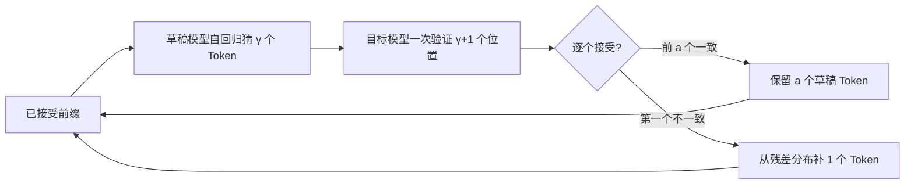

# 第 22 章 投机解码与多 Token 预测

## 本章导读

第 21 章算过一笔账：7B 模型解码一步只做约 16.6 GFLOPs，却要把 14.5 GB 权重完整读一遍，算术强度接近 1，远低于 H100 的 295 FLOP/Byte。也就是说，生成一个 Token 的时间主要花在“搬权重”，而不是“算矩阵”。一个自然的念头是：既然一次搬运可以服务多个 Token，能不能让便宜的小模型先猜几个 Token，再让大模型一次性验收？更反直觉的是，这种“先猜后验”可以做到输出分布与只用大模型逐 Token 采样**完全一致**。本章解释它为什么无损、加速比由什么决定，以及 Medusa、EAGLE 与多 Token 预测各自在赌什么。

## 难度标签

⭐⭐⭐ 进阶 ｜ 数学要求：条件概率、拒绝采样、期望与全变差距离 ｜ 代码要求：PyTorch 采样、KV Cache 截断、树状掩码与多头损失

## 学习目标

- 能写出投机解码的接受–拒绝规则与残差分布，并证明单步与序列输出分布都不变。
- 能根据接受率 $$\alpha$$、草稿长度 $$\gamma$$ 与草稿相对开销 $$c$$，估算期望产出 Token 数与加速比，并解释最优 $$\gamma$$ 为什么存在。
- 能说明树状草稿、Medusa、EAGLE 与多 Token 预测（MTP）的区别：哪些是推理算法，哪些是训练目标。
- 能实现拒绝采样、KV Cache 回滚、树状祖先掩码与简化 MTP 头，并用真实输出核对。

## 22.1 直觉：先起草，再签字

投机解码（speculative decoding）把一个强模型拆成两个角色。**草稿模型**（draft model）很小、很快，它自回归地猜出接下来 $$\gamma$$ 个 Token；**目标模型**（target model）很大、很准，它把这 $$\gamma$$ 个候选连同自己的下一步一起打分。目标模型一次前向就能验证整段候选，因为验证是并行的：所有候选位置的打分互不依赖，可以塞进同一个矩阵乘。随后从第一个 Token 开始逐个比对，接受与目标分布一致的候选，遇到第一个不一致就停下，并从修正分布里补一个 Token。



用律师事务所打比方：初级律师先起草一段合同，资深律师逐句审。前几句没问题就保留，遇到第一处错误就停下，自己改这一句，后面的草稿全部作废。初级律师写得快但不够准，资深律师写得慢但每句都可靠；只要“审”比“从头写”便宜，整体就更快。这个类比也点出了代价：草稿越长，后面越容易错；草稿模型越小，写得越快但越容易错。加速比就是这两股力量的乘积。

关键观察是**目标模型验证 $$\gamma+1$$ 个 Token 的成本，接近生成 1 个 Token 的成本**。解码一步的权重读取量不随序列长度线性增长，而验证时这 $$\gamma+1$$ 个位置共享同一次权重读取；多出来的只是注意力与激活的开销。第 21 章的 roofline 账本已经说明，解码的瓶颈是带宽而不是算力，所以“多算几个位置”往往比“多读一遍权重”便宜得多。这正是投机解码能成立的前提。

## 22.2 数学原理

### 22.2.1 无损拒绝采样

设当前前缀固定，目标模型对下一个 Token 的分布为 $$p$$，草稿模型的分布为 $$q$$。两者都定义在同一个词表上，且 $$q(x)>0$$ 时才有意义；若 $$q$$ 在某些位置为零而 $$p$$ 不为零，后面的残差分布会补上。最朴素的想法是“草稿猜什么就接受什么”，但那会输出草稿分布，显然不是 $$p$$。正确的做法是**拒绝采样**（rejection sampling）：从 $$q$$ 采样候选 $$x$$，以如下概率接受

$$
a(x)=\min\left(1,\frac{p(x)}{q(x)}\right)
\qquad \text{(22.1)}
$$

如果拒绝，则不重用 $$x$$，而从**残差分布**重新采样：

$$
r(y)=\frac{\max\left(0,p(y)-q(y)\right)}{Z},\qquad
Z=\sum_{y}\max\left(0,p(y)-q(y)\right)
\qquad \text{(22.2)}
$$

下面证明输出 $$Y$$ 的分布恰好是 $$p$$。接受分支贡献 $$q(y)a(y)=\min(q(y),p(y))$$；拒绝分支的概率是

$$
\Pr(\text{reject})=1-\sum_x q(x)a(x)
=\sum_x\max\left(0,q(x)-p(x)\right)=Z
\qquad \text{(22.3)}
$$

最后一步用了 $$\sum_x q(x)=\sum_x p(x)=1$$：正负差额相等，所以“草稿多出来的质量”正好等于“目标多出来的质量”。于是

$$
\Pr(Y=y)=\min\left(q(y),p(y)\right)+\max\left(0,p(y)-q(y)\right)=p(y)
\qquad \text{(22.4)}
$$

这就是无损性：无论草稿模型多差，只要按 (22.1)、(22.2) 修正，单步输出就是 $$p$$。草稿模型的质量只影响**接受率**，不影响**正确性**。

接受率有闭式表达。把 (22.1) 代入，得到

$$
\alpha=\sum_x q(x)\min\left(1,\frac{p(x)}{q(x)}\right)
=\sum_x\min\left(p(x),q(x)\right)=1-\mathrm{TV}(p,q)
\qquad \text{(22.5)}
$$

其中 $$\mathrm{TV}(p,q)=\frac12\sum_x|p(x)-q(x)|$$ 是全变差距离。草稿与目标越接近，接受率越高；完全相同时 $$\alpha=1$$，所有草稿都被接受；完全不相交时 $$\alpha=0$$，所有草稿都被拒绝，退化为只用目标模型采样。本章示例里 $$p=[0.05,0.10,0.15,0.20,0.50]$$、$$q=[0.40,0.25,0.15,0.10,0.10]$$，逐项取小得 $$\alpha=0.50$$；20 万次模拟的接受率为 0.5016，与理论值一致。

对序列也要证明一次。假设前 $$i-1$$ 个草稿 Token 已被接受，当前前缀就是目标模型与草稿模型共同看到的前缀；第 $$i$$ 个草稿 Token 从 $$q_i(\cdot\mid\text{前缀})$$ 采样，目标分布为 $$p_i(\cdot\mid\text{前缀})$$。由单步结论，这个位置的输出服从 $$p_i$$。如果它被拒绝，后面的草稿全部丢弃，修正 Token 由残差分布给出，仍然服从 $$p_i$$；如果它被接受，归纳假设继续成立。因此整段输出的联合分布等于目标模型逐 Token 采样的联合分布。这里有一个容易忽略的细节：草稿模型生成第 $$i$$ 个 Token 时，条件里包含前面尚未验证的草稿 Token；但只有前面全部被接受，程序才会走到第 $$i$$ 步，所以验证时的前缀与草稿时的前缀在“走到这一步”的条件下是一致的。

上面的证明假设草稿与验证都走随机采样。很多生产系统默认贪心解码，此时有一条更简单的无损规则：目标模型对每个草稿位置取 argmax，若草稿 Token 恰好等于 argmax 就接受，遇到第一个不等就停下，并用目标的 argmax 作为修正 Token。由于目标是确定性的，最终输出就是目标模型自己的贪心序列，分布不变；代价是无法利用概率质量，只要草稿与 argmax 不同就整段丢弃，接受率等于“草稿命中目标 argmax 的比例”。因此同一对模型在贪心与采样下的接受率不能混用，监控时必须把两条路径分开统计。

### 22.2.2 一次验证多个 Token 的收益

设草稿长度为 $$\gamma$$，每个位置的接受率近似为常数 $$\alpha$$。记 $$A$$ 为一次验证中接受的草稿数。第 $$i$$ 个草稿能被接受，要求前 $$i$$ 个位置都没有被拒绝，因此 $$\Pr(A\ge i)=\alpha^i$$。期望接受数为

$$
\mathbb{E}[A]=\sum_{i=1}^{\gamma}\alpha^i
=\frac{\alpha\left(1-\alpha^{\gamma}\right)}{1-\alpha}
\qquad \text{(22.6)}
$$

无论是否全部接受，验证结束后都会再产出一个 Token：全部接受时是目标模型给的奖励 Token，发生拒绝时是残差修正 Token。所以一次目标前向平均产出

$$
\mathbb{E}[K]=1+\mathbb{E}[A]
=\frac{1-\alpha^{\gamma+1}}{1-\alpha}
\qquad \text{(22.7)}
$$

个 Token。若草稿模型一次前向的成本是目标模型一次前向的 $$c$$ 倍，则一次“草稿加验证”的总成本约为 $$1+c\gamma$$，加速比为

$$
S(\alpha,\gamma,c)=\frac{1-\alpha^{\gamma+1}}{(1-\alpha)(1+c\gamma)}
\qquad \text{(22.8)}
$$

当 $$\alpha=1$$ 时，$$S=(\gamma+1)/(1+c\gamma)$$，理论上限由草稿开销决定；当 $$\alpha=0$$ 时，$$S=1/(1+c\gamma)<1$$，投机解码纯亏。示例中 $$\alpha=0.8$$、$$c=0.1$$ 时，$$\gamma=5$$ 给出约 2.46 倍，$$\gamma=6$$ 约 2.47 倍，再增大反而降到 2.41 倍。原因很直接：每多猜一个 Token，就多付一次草稿前向；而它可以被接受的概率只有 $$\alpha^{\gamma+1}$$，边际收益指数衰减。最优 $$\gamma$$ 满足“再多猜一个的期望收益 ≈ 草稿成本”，实际系统通常取 3–6，并根据在线接受率动态调整。

$$\gamma$$ 的最优值还取决于验证成本是否真的接近 1。前文说“验证 $$\gamma+1$$ 个与生成 1 个几乎同价”，严格说只在权重读取主导时成立。更细的成本是 $$\max(B_{\text{weight}}/\mathrm{BW},\;(\gamma+1)F_{\text{token}}/\mathrm{FLOPS})+T_{\text{attn}}(L+\gamma)$$：第一项是权重字节数除以带宽，第二项是 $$\gamma+1$$ 个位置的计算量除以算力，第三项是随上下文长度增长的注意力开销。短上下文、小批量时第一项主导，验证几乎免费；长上下文、大批量时后两项上升，$$c$$ 与验证成本都会被抬高，加速比随之缩水。所以 (22.8) 里的“1”也应是实测的验证相对成本，而不是常数。

上面的推导假设每个位置的接受率相同。真实草稿模型的准确率会随位置下降：猜得越远，条件越依赖自己前面不稳定的输出。把第 $$i$$ 个位置的条件接受率记为 $$\alpha_i$$，则

$$
\mathbb{E}[K]=1+\alpha_1+\alpha_1\alpha_2+\cdots+\prod_{i=1}^{\gamma}\alpha_i
\qquad \text{(22.9)}
$$

第 5 个草稿 Token 的接受概率是前四个位置都接受的联合概率，而不是孤立的 $$\alpha_5$$。工程上统计接受率时，要按位置分别统计并报告平均草稿长度，不能只报一个“总体接受率”。

### 22.2.3 树状草稿、Medusa 与 EAGLE

链式草稿只赌一条路径：第一个 Token 错了，后面全废。**树状草稿**（tree speculative decoding）同时保留多个候选分支，把候选组织成一棵树，目标模型用一次带树状掩码的前向给所有节点打分。每个节点只能注意自己的祖先，不能注意兄弟分支，否则会把不存在的上下文混进来。若节点 $$j$$ 的祖先集合为 $$\mathcal{A}(j)$$，掩码为

$$
M_{ij}=\begin{cases}0,& j\in\mathcal{A}(i)\\-\infty,&\text{否则}\end{cases}
\qquad \text{(22.10)}
$$

验证时从根出发，沿每条路径逐个接受，选最长的一条作为本轮输出；如果根的第一个 Token 就被拒绝，仍用残差分布补一个。树提高了“至少有一条路径被接受”的概率，代价是候选节点更多、注意力掩码更复杂、KV 显存更大。树越宽，单次验证的计算与显存越高，所以它不是免费的午餐。

树的形状通常由层数与每层分支数决定。深度 3、每层 4 个候选是一个常见起点：节点总数约 $$1+4+16+64=85$$，远多于链式的 3 个，但验证仍是一次前向。验证完得到每个节点的接受概率后，沿根到叶把条件概率累乘，取“逐位接受且联合概率最高”的最长路径。多条路径在同一位分叉时，只有一条能进入最终输出，其余分支的 K/V 必须在同一个回滚操作里丢弃；如果实现把不同分支的缓存混在一条连续序列里，就会读到不属于当前路径的上下文。树的价值不是“猜得更多”，而是用一次权重读取覆盖更多可能，把串行步数压得更低。

**Medusa** 在目标模型顶部接多个解码头，每个头直接预测未来第 $$i$$ 个 Token，再用这些头构造候选树。它不需要独立的草稿模型，省掉了一次模型加载与跨模型调度，但需要额外训练这些头；多个头并行预测，彼此之间没有显式建模依赖，因此远距离候选的联合概率只是近似。**EAGLE** 则把草稿放在特征层：它不直接预测 Token，而是基于目标模型的隐状态自回归地预测下一层特征，再从特征解码 Token。由于草稿模型看到的是目标的内部表示，分布通常更接近目标，接受率更高；代价是草稿模型与目标模型耦合更紧，训练与版本管理更复杂。两类方法都把“草稿”从外部小模型变成目标模型的附属结构，减少了跨模型开销，但没有改变接受–拒绝的正确性条件。

### 22.2.4 多 Token 预测：训练目标而不是推理算法

**多 Token 预测**（multi-token prediction，MTP）在训练时就要求模型一次预测未来多个 Token。设共享主干在位置 $$t$$ 的隐状态为 $$\mathbf{h}_t$$，第 $$i$$ 个预测头给出 $$p_i(\cdot\mid\mathbf{h}_t)$$，MTP 损失为

$$
\mathcal{L}_{\mathrm{MTP}}
=-\frac1k\sum_{i=1}^{k}\log p_i\left(x_{t+i}\mid \mathbf{h}_t\right)
\qquad \text{(22.11)}
$$

总损失通常是下一 Token 交叉熵与 MTP 损失的加权和：

$$
\mathcal{L}=\mathcal{L}_{\mathrm{CE}}+\lambda\,\mathcal{L}_{\mathrm{MTP}}
\qquad \text{(22.12)}
$$

MTP 首先是一个**训练目标**：它迫使隐状态编码更远的未来信息，给主干提供更密集的监督信号。DeepSeek-V3 在预训练中使用 MTP，并报告它同时改善了主模型质量与推理时的投机解码能力。推理时，这些头可以直接充当草稿，免去外部草稿模型；但它们仍是“一次前向给多个位置打分”，必须经过目标模型的接受–拒绝验证，才能保证输出分布不变。把 MTP 头直接当作生成结果、跳过验证，就会把近似联合分布当成真实分布，质量与无损性都不再成立。

TinyLM 的实现用一组独立的线性头做简化：每个头从同一个隐状态预测一个未来位置，不建模头与头之间的依赖。工业实现通常把第 $$i$$ 步的隐状态与第 $$i-1$$ 步的 Token 嵌入拼接，再过一个 Transformer 块，形成串行依赖。两种做法共享同一个损失形式，但串行版本能表达“先猜第一个、再根据第一个猜第二个”的条件结构，接受率通常更高。头数 $$k$$ 与步长权重也是超参数：$$k$$ 越大，监督伸得越远，但远处目标越不可靠；常见做法是让权重随步长衰减，或只对前一两步计算损失。

需要强调，MTP 的收益来自“更密的训练信号 + 推理时的草稿”，而不是“一次输出多个 Token 就自动更快”。如果跳过目标模型的接受–拒绝、直接把多个头的结果拼成输出，就绕过了自回归依赖，得到的只是近似联合分布；速度可能上升，质量与无损性都不再有保证。

### 22.2.5 KV Cache 回滚与位置对齐

验证时，目标模型会把 $$\gamma$$ 个草稿 Token 的 K/V 写进缓存；验证结束后只有前 $$a$$ 个被接受，后面的必须丢弃。若验证前缓存长度为 $$L$$，回滚后的长度应为

$$
L'=L+a
\qquad \text{(22.13)}
$$

实现上只需把缓存的 `length` 指针截到 $$L+a$$，后续写入会覆盖被拒绝的位置；不需要重算已接受前缀的 K/V。第 21 章的 `KVCache` 正是这样设计的：`append` 写入但不推进计数器，所有层写完后统一 `advance`，因此回滚只是改一个整数。分页 KV 还要把被拒绝的物理块归还空闲池；树状草稿的多个分支若共享前缀，则要用写时复制或按节点保存缓存，否分支之间会互相污染。

位置对齐同样重要。草稿 Token 在验证时占用绝对位置 $$L,\ldots,L+\gamma-1$$；回滚后，下一个 Token 必须从 $$L+a$$ 开始，而不是从 $$L+\gamma$$ 开始。使用 RoPE 时，位置错一位就会让所有后续注意力旋转错位；使用可学习绝对位置时，错位会直接查到错误的嵌入。工程上应把“缓存长度”“已接受 Token 数”“下一个位置”三个量显式分开，避免在分支与回滚中把三者混为一谈。连续批处理还会放大这个问题：不同请求的缓存长度不同，位置必须按请求单独维护；拼接批次里的回滚只能作用于各自的分段，不能整批截断。

## 22.3 方案对比

表 22-1 把四条常见路线放在一起。它们不是互斥的：生产系统可以用外部草稿模型，也可以在目标模型上挂 Medusa 头；MTP 既可以作为训练目标，也可以作为推理时的草稿来源。

| 路线 | 草稿来源 | 是否需要额外训练 | 接受率 | 额外开销 | 适用场景 |
| --- | --- | --- | --- | --- | --- |
| 外部草稿模型 | 独立小模型 | 否（可用现成小模型） | 中，取决于模型对 | 多一份权重与调度 | 已有同系列小模型、快速上线 |
| Medusa | 目标模型顶部的多个头 | 是 | 中高 | 多头参数与树验证 | 愿意训练、追求低调度开销 |
| EAGLE | 目标隐状态上的特征级草稿 | 是 | 高 | 耦合紧、训练复杂 | 追求高接受率、可控制系统版本 |
| MTP | 训练时附带的多步预测头 | 是（预训练阶段） | 中高 | 训练成本，推理几乎免费 | 新模型预训练、想同时提升质量 |

选择时先问三个问题：草稿从哪来、愿意付出多少训练成本、目标负载的接受率有多高。外部草稿模型最容易上线，但跨模型调度与显存占用是固定成本；Medusa/EAGLE 把草稿塞进目标模型，省掉跨模型开销，却要求重新训练并维护版本；MTP 把成本前移到预训练，推理时最干净，但只适用于自己训练的模型。对已有模型做服务优化，通常从外部草稿模型开始；训练新模型时，MTP 是更自然的选择。

## 22.4 代码实现

本章在 TinyLM 中新增 `tinylm/inference/speculative.py`。为了把算法讲清楚，代码把“概率分布”作为接口：`target_fn` 与 `draft_fn` 输入 Token 序列，返回逐位置的下一 Token 分布。这样测试可以用玩具马尔可夫链精确验证分布，示例可以独立于模型规模运行；真实系统只需把这两个函数替换成模型前向与 `softmax`。拒绝采样、接受率、期望收益、KV 回滚、树掩码与 MTP 头都在同一个模块里。

```python
"""第 22 章：投机解码与多 Token 预测（tinylm/inference/speculative.py）。"""
import math
from dataclasses import dataclass

import torch
import torch.nn as nn
import torch.nn.functional as F


@dataclass(frozen=True)
class SpecConfig:
    """投机解码参数，不进入 ``ModelConfig``。"""

    num_draft: int = 4
    seed: int | None = None

    def __post_init__(self):
        assert self.num_draft >= 1


def acceptance_rate(p, q):
    """(22.5)：α=Σ min(p,q)=1-TV(p,q)，批内逐行计算。"""
    return torch.minimum(p, q).sum(dim=-1)


def residual_probs(p, q):
    """(22.2)：r(x) ∝ max(0, p(x)-q(x))；p=q 时退回 p 以保持定义。"""
    r = (p - q).clamp_min(0.0)
    mass = r.sum(dim=-1, keepdim=True)
    return torch.where(mass > 0, r / mass.clamp_min(1e-12), p)


def rejection_sample(q, p, generator=None):
    """(22.1)–(22.3)：从草稿分布 q 提议，按 p 修正；返回 (token, accepted)。"""
    q = q / q.sum(dim=-1, keepdim=True)
    p = p / p.sum(dim=-1, keepdim=True)
    x = torch.multinomial(q, 1, generator=generator)
    u = torch.rand(q.size(0), 1, generator=generator)
    ratio = p.gather(1, x) / q.gather(1, x).clamp_min(1e-12)
    accepted = u < ratio.clamp(max=1.0)
    residual = residual_probs(p, q)
    fallback = torch.multinomial(residual, 1, generator=generator)
    token = torch.where(accepted, x, fallback)
    return token.squeeze(1), accepted.squeeze(1)


def speculative_sample(q_seq, p_seq, generator=None):
    """(22.1)–(22.3)：一次验证 γ 个草稿 Token，返回接受的草稿、前缀与修正 Token。

    ``q_seq`` 形状 ``(B, γ, V)``；``p_seq`` 形状 ``(B, γ+1, V)``，
    前 γ 个是目标模型对草稿 Token 的分布，最后一个是全部接受后的奖励 Token。
    """
    B, gamma, V = q_seq.shape
    assert p_seq.shape == (B, gamma + 1, V)
    q = q_seq / q_seq.sum(dim=-1, keepdim=True)
    p = p_seq / p_seq.sum(dim=-1, keepdim=True)

    drafts = torch.multinomial(q.reshape(B * gamma, V), 1,
                               generator=generator).reshape(B, gamma, 1)
    u = torch.rand(B, gamma, 1, generator=generator)
    ratio = p[:, :gamma].gather(-1, drafts) / q.gather(-1, drafts)
    accepted = u < ratio.clamp(max=1.0)
    prefix_ok = accepted.squeeze(-1).cumprod(dim=-1).bool()   # 首次拒绝后全为假
    n_accept = prefix_ok.sum(dim=-1)

    residual = residual_probs(p[:, :gamma], q)                # (B, γ, V)
    idx = n_accept.clamp(max=gamma - 1)
    fallback = residual.gather(
        1, idx[:, None, None].expand(B, 1, V)).squeeze(1)
    out_probs = torch.where((n_accept == gamma)[:, None],
                            p[:, gamma], fallback)
    correction = torch.multinomial(out_probs, 1, generator=generator)
    return drafts.squeeze(-1), n_accept, correction.squeeze(1)


def expected_output_tokens(alpha, gamma):
    """(22.7)：一次目标模型验证平均产出的 Token 数。"""
    if alpha >= 1.0:
        return float(gamma + 1)
    return (1.0 - alpha ** (gamma + 1)) / (1.0 - alpha)


def speculative_speedup(alpha, gamma, cost_ratio):
    """(22.8)：收益 = 期望产出 Token / (1 + γ·草稿相对开销)。"""
    return expected_output_tokens(alpha, gamma) / (1.0 + cost_ratio * gamma)


def truncate_cache(cache, length):
    """(22.13)：拒绝后把 KV Cache 回滚到已接受前缀。"""
    assert 0 <= length <= cache.length
    cache.length = int(length)
    return cache


class MTPHead(nn.Module):
    """(22.11)：共享主干隐状态上的多步预测头（简化版 MTP）。"""

    def __init__(self, d_model, vocab_size, num_steps=3):
        super().__init__()
        self.num_steps = num_steps
        self.heads = nn.ModuleList(
            [nn.Linear(d_model, vocab_size, bias=False)
             for _ in range(num_steps)])

    def forward(self, hidden):
        return [head(hidden) for head in self.heads]


def mtp_loss(logits_list, targets, weights=None, ignore_index=-100):
    """(22.11)–(22.12)：第 i 个头预测 t+i，按步加权。"""
    T = targets.size(1)
    losses = []
    for i, logits in enumerate(logits_list):
        if i >= T:
            break
        pred = logits[:, :T - i]
        target = targets[:, i:]
        losses.append(F.cross_entropy(
            pred.reshape(-1, pred.size(-1)), target.reshape(-1),
            ignore_index=ignore_index))
    losses = torch.stack(losses)
    if weights is None:
        return losses.mean()
    weights = torch.as_tensor(weights, dtype=losses.dtype,
                              device=losses.device)[:losses.numel()]
    return (losses * weights).sum() / weights.sum()


def tree_attention_mask(parents):
    """(22.10)：树状草稿的祖先可见掩码，True 表示可以注意。"""
    n = len(parents)
    mask = torch.zeros(n, n, dtype=torch.bool)
    for node in range(n):
        cur = node
        while cur != -1:
            mask[node, cur] = True
            cur = parents[cur]
    return mask


def _generator(seed, device):
    if seed is None:
        return None
    gen = torch.Generator(device=device)
    gen.manual_seed(int(seed))
    return gen


@torch.no_grad()
def speculative_decode(target_fn, draft_fn, prefix, max_new_tokens,
                       cfg=SpecConfig(), eos_token_id=None):
    """简化版投机解码：草稿自回归提议，目标模型一次验证。

    ``target_fn``/``draft_fn`` 输入 ``(1, T)``，返回 ``(1, T, V)`` 的
    逐位置下一 Token 分布。本实现每轮重算目标前向，只用于验证算法。
    """
    if prefix.dim() != 2 or prefix.size(0) != 1:
        raise ValueError("speculative_decode 只接受 (1, T) 的提示")
    device = prefix.device
    gen = _generator(cfg.seed, device)
    seq = prefix
    start = prefix.size(1)
    while seq.size(1) - start < max_new_tokens:
        remaining = max_new_tokens - (seq.size(1) - start)
        gamma = min(cfg.num_draft, remaining)
        draft_seq, qs, drafts = seq, [], []
        for _ in range(gamma):
            q = draft_fn(draft_seq)[:, -1]
            qs.append(q)
            x = torch.multinomial(q, 1, generator=gen)
            drafts.append(x)
            draft_seq = torch.cat([draft_seq, x], dim=1)
        q_seq = torch.stack(qs, dim=1)                     # (1, γ, V)
        L = seq.size(1)
        p_all = target_fn(torch.cat([seq] + drafts, dim=1))
        p_seq = torch.stack([p_all[:, L - 1 + i] for i in range(gamma + 1)],
                            dim=1)                         # (1, γ+1, V)
        _, n_accept, correction = speculative_sample(q_seq, p_seq, gen)
        a = int(n_accept.item())
        new_tokens = drafts[:a] + [correction[:, None]]
        seq = torch.cat([seq] + new_tokens, dim=1)
        if eos_token_id is not None and int(seq[0, -1]) == eos_token_id:
            break
    return seq[:, :start + max_new_tokens]
```

示例在玩具马尔可夫链上验证无损性，并给出接受率、草稿长度与加速比的账本。`Markov` 的每一行是一个状态的下一个 Token 分布；目标和草稿用不同的转移矩阵，接受率可以逐状态算出。

```python
"""第 22 章：投机解码与多 Token 预测（examples/ch22_speculative.py）。"""

import torch

from ch08 import ModelConfig, TinyLM
from tinylm.inference.kv_cache import KVCache, cached_forward, cached_prefill
from tinylm.inference.speculative import (MTPHead, SpecConfig,
                                          acceptance_rate,
                                          expected_output_tokens, mtp_loss,
                                          rejection_sample, speculative_sample,
                                          speculative_speedup,
                                          tree_attention_mask, truncate_cache)


def lossless_check():
    p = torch.tensor([0.05, 0.10, 0.15, 0.20, 0.50])
    q = torch.tensor([0.40, 0.25, 0.15, 0.10, 0.10])
    n = 200_000
    gen = torch.Generator().manual_seed(0)
    tokens, accepted = rejection_sample(
        q.expand(n, -1), p.expand(n, -1), gen)
    empirical = torch.bincount(tokens, minlength=5).float() / n
    print("单步拒绝采样的分布（20 万次）")
    print(f"{'Token':>6s}{'目标 p':>10s}{'实测':>10s}{'误差':>10s}")
    for i in range(5):
        print(f"{i:>6d}{p[i]:>10.3f}{empirical[i]:>10.3f}"
              f"{(empirical[i] - p[i]).abs():>10.3f}")
    print(f"  实测接受率       {accepted.float().mean():.4f}")
    print(f"  理论 α=Σmin(p,q) {acceptance_rate(p[None], q[None]).item():.4f}")


def acceptance_ledger():
    p = torch.tensor([0.05, 0.10, 0.15, 0.20, 0.50])
    r = torch.tensor([0.40, 0.30, 0.15, 0.10, 0.05])
    print("\n草稿质量与加速比（γ=4，草稿开销 c=0.1）")
    print(f"{'混合系数':>10s}{'α':>8s}{'期望 Token':>12s}{'加速比':>10s}")
    for beta in (0.2, 0.4, 0.6, 0.8):
        q = (1.0 - beta) * p + beta * r
        alpha = acceptance_rate(p[None], q[None]).item()
        tokens = expected_output_tokens(alpha, 4)
        speed = speculative_speedup(alpha, 4, 0.1)
        print(f"{beta:>10.1f}{alpha:>8.3f}{tokens:>12.3f}{speed:>10.3f}")
    print("\nγ 的边际收益（α=0.8，c=0.1）")
    print(f"{'γ':>4s}{'期望 Token':>12s}{'加速比':>10s}")
    for gamma in range(1, 9):
        print(f"{gamma:>4d}{expected_output_tokens(0.8, gamma):>12.3f}"
              f"{speculative_speedup(0.8, gamma, 0.1):>10.3f}")


def acceptance_simulation():
    p = torch.tensor([0.05, 0.10, 0.15, 0.20, 0.50])
    q = torch.tensor([0.40, 0.25, 0.15, 0.10, 0.10])
    n, gamma = 100_000, 4
    q_seq = q.expand(n, gamma, -1)
    p_seq = p.expand(n, gamma + 1, -1)
    _, n_accept, _ = speculative_sample(
        q_seq, p_seq, torch.Generator().manual_seed(1))
    alpha = acceptance_rate(p[None], q[None]).item()
    empirical = n_accept.float().mean().item()
    theory = alpha * (1 - alpha ** gamma) / (1 - alpha)
    print(f"\n接受数模拟（10 万轮，α={alpha:.2f}，γ={gamma}）")
    print(f"  实测平均接受草稿数 {empirical:.4f}")
    print(f"  理论 α(1-α^γ)/(1-α) {theory:.4f}")
    print(f"  每轮平均输出 Token   {1 + empirical:.4f}")


def rollback_check():
    torch.manual_seed(0)
    cfg = ModelConfig(vocab_size=32, d_model=64, n_layers=2, n_heads=8,
                      n_kv_heads=2, d_ff=128, max_seq_len=64,
                      norm="rmsnorm", ffn="swiglu", bias=False,
                      pos_encoding="rope", attention="gqa")
    model = TinyLM(cfg).eval()
    prompt = torch.randint(0, 32, (1, 8))
    draft = torch.randint(0, 32, (1, 4))
    accepted = 2

    cache = KVCache(cfg)
    cached_prefill(model, prompt, cache)
    cached_forward(model, draft, cache)
    truncate_cache(cache, prompt.size(1) + accepted)
    with torch.no_grad():
        nxt = torch.randint(0, 32, (1, 1))
        got = cached_forward(model, nxt, cache, logits_to_keep=1)

    ref = KVCache(cfg)
    cached_prefill(model, torch.cat([prompt, draft[:, :accepted]], dim=1), ref)
    with torch.no_grad():
        want = cached_forward(model, nxt, ref, logits_to_keep=1)
    print("\nKV Cache 回滚（接受 2/4 个草稿 Token）")
    print(f"  回滚后长度        {cache.length}")
    print(f"  与重算最大误差    {(got - want).abs().max().item():.2e}")


def mtp_check():
    torch.manual_seed(0)
    head = MTPHead(d_model=16, vocab_size=11, num_steps=3)
    hidden = torch.randn(1, 6, 16)
    targets = torch.randint(0, 11, (1, 6))
    logits = head(hidden)
    loss = mtp_loss(logits, targets)
    print("\n多 Token 预测头")
    print(f"  每步 logits 形状  {tuple(logits[0].shape)} × {len(logits)}")
    print(f"  三步平均损失      {loss.item():.4f}")
    print(f"  仅第一步损失      {mtp_loss(logits, targets, [1.0, 0.0, 0.0]).item():.4f}")


def tree_check():
    mask = tree_attention_mask([-1, 0, 0, 1, 2])
    print("\n树状草稿的祖先掩码（1 表示可见）")
    for row in mask:
        print("  " + " ".join("1" if x else "0" for x in row))


def markov_demo():
    target = torch.tensor([[0.7, 0.1, 0.1, 0.1],
                           [0.1, 0.7, 0.1, 0.1],
                           [0.1, 0.1, 0.7, 0.1],
                           [0.1, 0.1, 0.1, 0.7]])
    draft = torch.tensor([[0.4, 0.2, 0.2, 0.2],
                          [0.2, 0.4, 0.2, 0.2],
                          [0.2, 0.2, 0.4, 0.2],
                          [0.2, 0.2, 0.2, 0.4]])
    alpha = acceptance_rate(target, draft)
    print("\n玩具马尔可夫模型")
    print(f"  平均每步接受率    {alpha.mean().item():.3f}")
    print(f"  γ=4 的期望 Token  {expected_output_tokens(alpha.mean().item(), 4):.3f}")


if __name__ == "__main__":
    lossless_check()
    acceptance_ledger()
    acceptance_simulation()
    rollback_check()
    mtp_check()
    tree_check()
    markov_demo()
```

运行测试与示例。

```bash
python -m pytest tests/test_speculative.py -q
PYTHONPATH=. python examples/ch22_speculative.py
```

```text
14 passed
单步拒绝采样的分布（20 万次）
 Token      目标 p        实测        误差
     0     0.050     0.050     0.000
     1     0.100     0.100     0.000
     2     0.150     0.150     0.000
     3     0.200     0.199     0.001
     4     0.500     0.500     0.000
  实测接受率       0.5016
  理论 α=Σmin(p,q) 0.5000

草稿质量与加速比（γ=4，草稿开销 c=0.1）
      混合系数       α    期望 Token       加速比
       0.2   0.890       4.014     2.867
       0.4   0.780       3.233     2.309
       0.6   0.670       2.621     1.872
       0.8   0.560       2.148     1.534

γ 的边际收益（α=0.8，c=0.1）
   γ    期望 Token       加速比
   1       1.800     1.636
   2       2.440     2.033
   3       2.952     2.271
   4       3.362     2.401
   5       3.689     2.460
   6       3.951     2.470
   7       4.161     2.448
   8       4.329     2.405

接受数模拟（10 万轮，α=0.50，γ=4）
  实测平均接受草稿数 0.9365
  理论 α(1-α^γ)/(1-α) 0.9375
  每轮平均输出 Token   1.9365

KV Cache 回滚（接受 2/4 个草稿 Token）
  回滚后长度        11
  与重算最大误差    2.98e-08

多 Token 预测头
  每步 logits 形状  (1, 6, 11) × 3
  三步平均损失      2.7020
  仅第一步损失      2.3890

树状草稿的祖先掩码（1 表示可见）
  1 0 0 0 0
  1 1 0 0 0
  1 0 1 0 0
  1 1 0 1 0
  1 0 1 0 1

玩具马尔可夫模型
  平均每步接受率    0.700
  γ=4 的期望 Token  2.773
```

第一段输出验证了无损性：20 万次拒绝采样的经验分布与目标分布的最大误差为 0.001，接受率 0.5016 与理论值 0.5000 在蒙特卡洛误差内一致。第二段说明草稿质量的作用：混合系数从 0.2 升到 0.8，草稿越来越偏离目标，接受率从 0.890 降到 0.560，加速比从 2.87 降到 1.53。第三段显示 $$\gamma$$ 的边际收益：在 $$\alpha=0.8$$、$$c=0.1$$ 时，$$\gamma$$ 从 1 增到 6 一直有收益，6 之后开始下降。第四段用 10 万轮模拟验证 (22.6)。第五段验证 KV 回滚：截断缓存后继续解码，与用已接受前缀重新预填充的 logits 最大误差为 $$2.98\times10^{-8}$$，说明回滚没有改变计算结果。最后两段是树掩码与玩具马尔可夫链的账本。

测试有意避开了“固定种子下的具体数值”，改为验证可复算的性质：接受率等于 $$1-\mathrm{TV}$$、残差分布归一化且支撑集恰好是 $$p>q$$ 的位置、两万次采样的经验分布与 $$p$$ 的最大偏差小于 0.015、$$p=q$$ 时全部接受、KV 回滚与重新预填充的 logits 一致（容差 $$10^{-6}$$）。性质测试比“输出等于某串数字”更稳，换 PyTorch 版本或换机器不容易误报；具体数值留给示例脚本报告，用来展示量级而不是充当断言。读者复现时若看到最后几位不同，先检查随机数发生器与设备，再检查公式推导。

```warning
投机解码的无损性依赖“对目标分布做精确的接受–拒绝”。如果草稿阶段用了 Top-k/Top-p 截断，而验证阶段仍按未截断的 $$p$$ 计算，输出分布就会偏；如果为了加速把验证改成“只接受 argmax”，那已经是另一种近似算法，不能再声称无损。上线前要固定采样配置，并分别验证贪心与采样两条路径。
```

## 22.5 工业实践

**Leviathan 等（2022）** 与 **Chen 等（2023）** 独立提出了今天的基础算法。前者在 T5-XXL 上报告 2–3 倍加速，且输出分布与目标模型一致；后者给出了同样的拒绝采样规则，并强调它不改变结果。两篇论文都把草稿模型当成黑盒，工程上最容易复现，因此成为后续系统的基线。

**Medusa（2024）** 在目标模型顶部训练多个解码头，用树状候选替代独立草稿模型，报告 2.2–3.6 倍加速。它的优势是省掉跨模型调度与额外权重加载，劣势是需要训练、树越宽显存越高。**EAGLE（2024）** 在特征层做自回归草稿，报告约 2–3 倍加速；后续 EAGLE-2 通过动态草稿树进一步提高了接受率。两者都把“草稿”变成目标模型的附属结构，适合愿意训练、希望把推理栈做成单模型的团队。

**DeepSeek-V3（2024）** 在 671B 总参数、37B 激活参数的 MoE 模型上使用 MTP。训练时，每个 MTP 模块把上一层的隐状态与未来 Token 的嵌入结合，再经过一个 Transformer 块预测下一个 Token；推理时这些模块可以用于投机解码。MTP 的代价在预训练阶段，推理侧几乎没有额外模型；它同时给主干提供更密集的监督，属于“训练目标与推理加速”双用途的设计。

服务框架方面，vLLM 通过 `--speculative-model` 支持外部草稿模型，TensorRT-LLM 也提供类似的投机解码路径。工程上要监控三个量：**按位置统计的接受率**、**实际平均草稿长度**、**端到端有效吞吐**。接受率会随负载漂移：代码补全的重复结构多，接受率通常高于开放聊天；温度越高、Top-p 越宽，草稿与目标的分布越难对齐，接受率越低。生产系统常用“动态 $$\gamma$$”：接受率高时多猜，接受率低时少猜，避免在坏负载上倒贴草稿成本。

端到端延迟要拆开看：一轮的墙钟时间约为草稿时间、验证时间与调度开销之和。若草稿与验证串行，理论加速比还要乘以流水效率；若把草稿放在独立的 CUDA 流上与上一轮的验证重叠，收益更高，但会引入额外的同步与显存竞争。批处理也会改变结论：同一条草稿路径只对单个请求有效，连续批处理里不同请求的接受长度不同，调度器要按“本轮实际产出 Token 数”而不是“固定步数”推进，否则短请求会被长草稿拖慢。

一个具体的容量判断：70B 目标模型配 1B 同系列草稿模型，草稿相对开销 $$c$$ 约 0.05–0.1（参数量比只有 0.014，但小模型的 kernel 固定开销会把它抬高）。若线上统计到 $$\alpha=0.75$$、取 $$\gamma=4$$，由 (22.8) 得加速比约 2.3 倍；若长上下文让 $$\alpha$$ 掉到 0.5，同样配置只剩约 1.5 倍。此时应缩短 $$\gamma$$、换更强的草稿，或直接关闭投机解码。**投机解码不是无条件加速，它把“目标模型算得慢”换成了“草稿模型猜得准不准”**。

## 22.6 论文导读

1. **Leviathan, Kalman, Matias (2022). _Fast Inference from Transformers via Speculative Decoding_. arXiv:2211.17192.** 读第 3 节看接受–拒绝规则与无损性证明，第 4 节看 T5-XXL 的实测加速比与草稿长度消融。
2. **Chen, Borgeaud, Irving, Lespiau, Sifre, Jumper (2023). _Accelerating Large Language Model Decoding with Speculative Sampling_. arXiv:2302.01318.** 读第 2–3 节，重点看它如何用拒绝采样保持目标分布，以及分布式环境下的草稿–验证流水。
3. **Cai, Li, Geng, Peng, Lee, Chen, Dao (2024). _Medusa: Simple LLM Inference Acceleration Framework with Multiple Decoding Heads_. arXiv:2401.10774.** 读第 3 节看多头与树状候选的构造，第 4 节看训练目标与接受率；注意 2.2–3.6 倍依赖模型与负载。
4. **Li, Wei, Zhang, Zhang (2024). _EAGLE: Speculative Sampling Requires Rethinking Feature Uncertainty_. arXiv:2401.15077.** 读第 3–4 节，看特征级自回归草稿与树验证；对照 Medusa 理解“在 Token 层猜”和“在特征层猜”的差别。
5. **DeepSeek-AI (2024). _DeepSeek-V3 Technical Report_. arXiv:2412.19437.** 读第 2.2 节 MTP 结构与损失，第 5 节训练配置；注意 MTP 首先是训练目标，推理加速是它的附带收益。

这五篇可以按“算法证明 → 草稿结构 → 训练目标”串起来读。前两篇回答“为什么无损、加速比怎么算”；中间两篇回答“草稿从哪里来、树怎么验证”；最后一篇回答“能不能把草稿写进预训练”。读的时候始终抓住两个量：接受率与草稿成本。论文里的倍数都是这两个量在特定模型、硬件与数据分布下的乘积，换环境必须复测。

## 22.7 常见误区

**误区一：投机解码会改变输出分布。** 只要严格按 (22.1)、(22.2) 做接受–拒绝，输出分布与目标模型逐 Token 采样完全一致，这是可证明的，不是经验近似。会改变分布的是“简化版”：只接受 argmax、用草稿的截断分布替代目标分布、拒绝后不复用残差而是直接重采样。工程上要区分“无损投机解码”和“近似加速”，后者的评测必须报告分布偏移与质量变化。

**误区二：草稿越长越好。** 草稿长度每增加 1，就多付一次草稿前向；而它被接受的概率随位置指数衰减。示例中 $$\alpha=0.8$$、$$c=0.1$$ 时，$$\gamma=6$$ 之后加速比反而下降。最优 $$\gamma$$ 由接受率与草稿成本共同决定，通常 3–6；接受率低的负载上，更长的草稿只会浪费算力。

**误区三：草稿模型越小越好。** 小模型单步更便宜，但分布离目标更远，接受率更低。极端情况下草稿小到几乎全被拒绝，加速比小于 1。正确的选择是让“草稿成本 × 拒绝概率”与“接受带来的节省”平衡；参数量只是一个代理指标，真正要看的是目标负载上的实测接受率与端到端延迟。

**误区四：MTP 就是投机解码。** MTP 是训练目标，让模型在预训练时学习预测多个未来 Token；投机解码是推理算法，用草稿加验证来加速。MTP 头可以作为草稿来源，但仍需目标模型验证；把 MTP 头直接输出当成最终结果，就绕过了无损性证明，输出的是近似联合分布。

**误区五：接受率是模型对的固定属性。** 接受率依赖数据分布、温度、Top-p、上下文长度，甚至依赖草稿与目标的分词器是否一致。同一对模型在代码补全上可能有 0.85，在开放写作上只有 0.55。上线后要按业务分桶监控，不能用一个全局数字做容量规划。

**误区六：树状验证没有额外成本。** 树越宽，候选节点越多，目标模型一次前向要处理更多位置，KV 缓存与注意力掩码的开销也更大；如果树的形状与硬件不匹配，验证可能比链式更慢。树的价值在于用一次前向覆盖更多候选，前提是这些候选确实提高了“至少一条路径被接受”的概率。

## 22.8 本章的取舍

投机解码的核心取舍是**用草稿模型的猜想来换目标模型的串行步数**。它不减少目标模型的总计算量，而是把多次“读权重、生成一个 Token”合并成一次“读权重、验证多个 Token”。因此它的收益上限由目标模型的带宽瓶颈决定：在小批量、内存受限的解码场景收益最大；在大批量、目标模型已经接近算力受限时，验证多个位置的成本会上升，收益缩小甚至消失。这个边界与第 21 章的 roofline 账本完全一致。

第二组取舍是**草稿质量与草稿成本**。外部草稿模型最容易上线，但多一份权重、一次跨模型调度；Medusa/EAGLE 把草稿塞进目标模型，省掉调度却要训练；MTP 把成本前移到预训练，推理最干净但只适用于自己训练的模型。草稿越大，接受率越高但单步越贵；草稿越小，单步越便宜但拒绝越多。没有全局最优，只有针对特定模型对与负载的实测最优点。

第三组取舍是**链式与树式**。链式实现简单、缓存回滚容易，适合快速上线；树式在一次前向里覆盖更多候选，接受率更高，但掩码、显存与调度更复杂。树不是越宽越好：宽度增加会抬高验证成本，而边际接受收益递减。工程上通常先用链式测量接受率，再决定是否值得引入树。

第四组取舍是**无损与近似**。严格拒绝采样保证分布不变，但需要随机数、残差采样与额外的控制流；近似方法可以更快，却改变输出分布，必须重新评测质量。对代码、数学、结构化输出等容错低的场景，应坚持无损；对创意写作等容错高的场景，可以在明确标注的前提下尝试近似。

最后是**何时不用**。如果输出很短、目标模型本身已经很快、草稿模型不可得、或者批量大到目标模型算力受限，投机解码的收益可能抵不过调度与显存开销。一个实用的决策顺序是：先在真实流量上测接受率与草稿成本，再用 (22.8) 估算加速比，最后用小流量 A/B 验证端到端有效吞吐；任何一步不达标，就关掉它。

## 22.9 习题

**推导题.** 证明序列级投机解码的输出分布等于目标模型的自回归分布。进一步，设每个位置的条件接受率为 $$\alpha_i$$，草稿长度为 $$\gamma$$，草稿相对开销为 $$c$$，写出期望产出 Token 数与加速比；代入 $$\alpha_i=0.9,0.8,0.7,0.6$$、$$\gamma=4$$、$$c=0.1$$，求加速比，并与常数 $$\alpha=0.75$$ 的近似比较。

<details><summary>展开参考答案</summary>

单步证明已在 (22.1)–(22.4) 给出：接受分支贡献 $$\min(p,q)$$，拒绝分支以概率 $$Z=\sum\max(0,q-p)$$ 从残差 $$r(y)\propto\max(0,p-q)$$ 采样，两项相加恰好是 $$p$$。对序列做归纳：假设前 $$i-1$$ 个 Token 已被接受，且它们的联合分布与目标模型一致；第 $$i$$ 个草稿 Token 从 $$q_i(\cdot\mid\text{当前前缀})$$ 采样，目标分布为 $$p_i$$。由单步结论，这个位置的输出服从 $$p_i$$。若拒绝，后续草稿全部丢弃，修正 Token 仍服从 $$p_i$$；若接受，归纳继续。因此每个位置的条件分布都等于目标模型，联合分布自然相等。这里的前提是“只有前面全部接受才走到第 $$i$$ 步”，所以验证前缀与草稿前缀在条件下一致。

期望产出 Token 数为

$$
\mathbb{E}[K]=1+\alpha_1+\alpha_1\alpha_2+\cdots+\prod_{i=1}^{\gamma}\alpha_i
$$

加速比为

$$
S=\frac{\mathbb{E}[K]}{1+c\gamma}
$$

代入 $$\alpha=(0.9,0.8,0.7,0.6)$$、$$\gamma=4$$、$$c=0.1$$：$$\mathbb{E}[K]=1+0.9+0.72+0.504+0.3024=3.4264$$，$$S=3.4264/1.4\approx2.447$$。若用常数 $$\alpha=0.75$$ 近似，则 $$\mathbb{E}[K]=(1-0.75^5)/0.25\approx3.0508$$，$$S\approx2.179$$。常数近似低估了前几个位置的高接受率，高估了后几个位置；真实系统应按位置统计，而不是只报一个平均接受率。

</details>

**编程题.** 在 `speculative_sample` 的基础上实现树状验证：给定一棵候选树（每个节点存父节点与 Token），用 `tree_attention_mask` 构造掩码，让目标模型一次给所有节点打分；沿每条根到叶路径做接受–拒绝，选最长接受路径。比较链式与树式在相同草稿预算下的期望产出 Token 数，并讨论树的宽度、深度与显存占用的关系。

**开放题.** 你要在一张 24 GB 显卡上为 7B 目标模型配置投机解码，候选草稿包括 0.5B 同系列模型、1B 同系列模型与目标模型自带的 MTP 头。给定输入 2K、输出 256 Token、TTFT ≤ 1 s、TPOT ≤ 50 ms，请给出草稿选择、$$\gamma$$、KV 精度与是否启用树式验证的方案；用 (22.8) 估算加速比，并说明当业务从代码补全切到开放聊天时，哪个参数最先需要调整、为什么。
