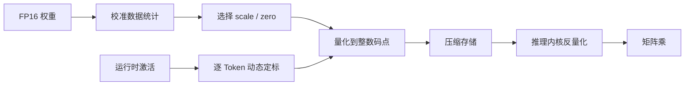

# 第 23 章 量化

## 本章导读

把 7B 模型从 FP16 压到 4 比特，权重显存从约 14 GB 降到 3.5 GB，困惑度通常只涨几个百分点；但同样把 4 比特用在激活上，模型可能直接崩掉。为什么权重这么抗压，激活却不行？KV Cache 又更像哪一边？本章从两类张量的分布差异出发，回答三个问题：量化误差从哪里来，GPTQ、AWQ 与 SmoothQuant 各自在修正什么，以及压缩率什么时候能变成真正的延迟收益。

## 难度标签

⭐⭐⭐ 进阶 ｜ 数学要求：舍入误差、方差、最小二乘与 Hessian ｜ 代码要求：PyTorch 张量操作、分块量化、GPTQ 误差补偿

## 学习目标

- 能写出对称/非对称、逐张量/逐通道/逐组量化的参数与反量化公式，并估算误差、存储开销与压缩比。
- 能解释权重、激活与 KV Cache 三类张量的误差来源差异，尤其是离群通道为什么让逐张量量化失效。
- 能说明 PTQ 与 QAT、GPTQ、AWQ、SmoothQuant 的机制、代价与适用条件。
- 能实现假量化、INT4 打包、GPTQ 误差补偿与 KV 量化，并用真实输出核对误差界。
- 能判断一次量化在什么负载下真能加速，什么情况下只省显存、不省时间。

## 23.1 直觉：把实数装进有限的格子

量化（quantization）就是用有限个离散码点近似连续的实数。最常用的是均匀量化：在实数轴上按固定间距放一组格子，每个数落到最近的格点。两个参数决定格子：**缩放因子**（scale）$$s$$ 是格子间距，**零点**（zero point）$$z$$ 是格子的偏移。把实数 $$x$$ 换成整数码点 $$x_{\mathrm{int}}$$，再还原成近似值 $$\hat{x}$$，就是一次量化—反量化。

有限格子带来两种误差。第一种是**舍入误差**：数落在两个格点之间，只能取最近的一个，误差不超过半个格子。第二种是**截断误差**：数超出格子范围，被夹到边界上，误差可能远大于半个格子。量化方案的大部分设计，都是在“格子够密”和“范围够宽”之间做取舍：格子越密，舍入误差越小，但可表示的范围越窄；范围越宽，离群值保住了，普通值的格子却变粗了。

权重相对好量化。它们训练完就固定，可以离线校准；分布大致以零为中心、近似高斯；模型本身高度冗余，单个权重的扰动会被大量其他项平均掉。因此 4 比特、甚至 3 比特的权重通常只带来很小的质量损失。真正困难的是**粒度**：如果整个矩阵共用一个缩放因子，一个极端的权重会把所有普通值的格子撑粗，误差被全局放大。举一个具体数字：一组权重的最大绝对值是 1，4 比特对称量化只有 15 个正负码点，步长约 0.067，单值误差最多 0.033；若组里混进一个幅值 20 的离群值，步长变成 1.33，普通值的误差上限跟着放大 20 倍。解决办法是把矩阵切成通道或小组，各用各的缩放因子。

激活则麻烦得多。激活是每个 Token 在运行时产生的，分布随输入变化；更关键的是，大模型激活里存在**系统性离群通道**（outlier channel）：少数特征维度的数值可以比其余维度大几十倍，而且在许多 Token 上反复出现。LLM.int8() 的测量显示，这类极端特征大约只占特征维度的 0.1%，却主导了张量的最大值。逐张量量化会让这些离群值决定缩放因子，普通通道只剩一两个有效比特，信息几乎全丢。权重可以“离线慢慢调”，激活必须在每次前向时快速处理，于是有了逐 Token 动态缩放、通道搬移等专门技术。

离群通道不是偶然现象。残差连接把每一层的输出直接加到主路上，少数方向上的分量会随着层数累积而变大；RMSNorm 只按整条向量的均方根缩放，不会单独压住某一维。于是到了深层，某些通道的绝对值可以稳定地比同层其他通道大一个数量级。它们往往承载着对模型行为重要的信息，简单地“裁掉”或“全局缩小”都会伤害质量，这也是激活量化比权重量化更难的根本原因。

KV Cache 介于两者之间。它只在生成时写入一次，之后被反复读取，因此适合低精度存储；但键（key）参与注意力打分，误差会直接改变 Softmax 权重。经验上键的通道离群比值的更明显，键通常需要更细的粒度或更高的精度。



还要区分两件事：**存储低比特**与**计算低比特**。W4A16 把权重存成 4 比特，计算前反量化回 FP16，矩阵乘仍然是 FP16；显存和带宽省了，FLOPs 一个没少。只有硬件提供 INT4/FP4 的张量核心，并且内核直接在低精度上累加，才可能减少计算时间。本章后面的账本会把这两条线分开算。

## 23.2 数学原理

### 23.2.1 仿射量化与误差

设一个张量的元素为 $$x$$，量化位数为 $$b_q$$。对称量化把整数范围取成关于零对称：

$$
q_{\min}=-\left(2^{b_q-1}-1\right),\qquad
q_{\max}=2^{b_q-1}-1
\qquad \text{(23.1)}
$$

为什么不取到 $$-2^{b_q-1}$$？因为正负对称、且零必须精确表示；少用一个负数码点换来 $$z=0$$，可以省掉零点存储与减法。非对称量化则用满 $$2^{b_q}$$ 个码点，范围为 $$[0,2^{b_q}-1]$$。量化与反量化写成

$$
x_{\mathrm{int}}=\mathrm{clamp}\left(\mathrm{round}\left(\frac{x}{s}+z\right),q_{\min},q_{\max}\right)
\qquad \text{(23.2)}
$$

$$
\hat{x}=s\left(x_{\mathrm{int}}-z\right)
\qquad \text{(23.3)}
$$

对称量化取

$$
s=\frac{\max|x|}{q_{\max}},\qquad z=0
\qquad \text{(23.4)}
$$

非对称量化取

$$
s=\frac{x_{\max}-x_{\min}}{q_{\max}-q_{\min}},\qquad
z=\mathrm{round}\left(q_{\min}-\frac{x_{\min}}{s}\right)
\qquad \text{(23.5)}
$$

非对称的好处是能紧凑表示单边分布，例如经过 ReLU 或 GELU 后的激活全为非负；代价是多存一个零点，且反量化多一次减法。权重通常以零为中心，用对称量化；激活根据分布选择。举个数值例子：若一组激活落在 $$[0,6]$$，对称量化把范围定成 $$[-6,6]$$，只有一半码点表示有效数据；非对称量化让 16 个码点全部覆盖 $$[0,6]$$，等效步长减半，SQNR 提高约 6 dB。零点本身的舍入还会带来最多半个码点的偏移，因此零点通常也要参与后续校准，而不是简单四舍五入后就不管。

不溢出时，舍入误差有确定上界：

$$
|x-\hat{x}|\le \frac{s}{2}
\qquad \text{(23.6)}
$$

这个界很直观：最近的格点不会超过半个间距。溢出时误差由截断决定，可能远大于 $$s/2$$，所以定标时要为分布的尾部留余量。

假设误差在 $$[-s/2,s/2]$$ 内均匀分布，且与信号独立，量化噪声的方差为

$$
\mathbb{E}\left[(x-\hat{x})^2\right]
=\frac{1}{s}\int_{-s/2}^{s/2}e^2\,\mathrm{d}e
=\frac{s^2}{12}
\qquad \text{(23.7)}
$$

信噪比（signal-to-quantization-noise ratio，SQNR）定义为信号功率与噪声功率之比：

$$
\mathrm{SQNR}=10\log_{10}\frac{\mathbb{E}[x^2]}{\mathbb{E}[(x-\hat{x})^2]}
\qquad \text{(23.8)}
$$

对满量程正弦波，幅度为 $$A$$、信号功率为 $$A^2/2$$，量化步长为 $$s=2A/2^{b_q}$$，代入 (23.7) 得噪声功率 $$A^2/(3\cdot 4^{b_q})$$，于是

$$
\mathrm{SQNR}=6.02\,b_q+1.76\ \text{dB}
\qquad \text{(23.9)}
$$

这就是常说的“每多一个比特，信噪比提高约 6 dB”。注意它的前提是满量程、误差均匀、无截断。高斯的权重分布尾部会超出量程，实际 SQNR 通常低于这个上界；按组最大值定标时，普通组又用不满量程，实际值也会偏离。本章比特扫描里 4 比特、组大小 64 的权重只有 19.35 dB，明显低于 $$6.02\times4+1.76=25.8$$ dB，原因正是高斯尾部、离群值与按组最大值定标三者的叠加。但趋势仍然成立：从 3 比特升到 4 比特，实测提高 7.35 dB；从 4 比特升到 6 比特，平均每比特提高约 6.5 dB。

截断的取舍可以更定量地看。若数据近似高斯、标准差为 $$\sigma$$，把量程设为 $$A$$，则总误差由两部分组成：量程内的均匀舍入噪声，以及 $$|x|>A$$ 的截断误差。$$A$$ 太小，尾部被硬切，误差随尾部质量迅速上升；$$A$$ 太大，步长 $$s=2A/2^{b_q}$$ 变粗，舍入噪声上升。二者的和通常在 $$A\approx3\sigma$$ 附近取到较小值；对 4 比特，这个最优点对应的实际 SQNR 会比 (23.9) 低约 4–5 dB。工程上用 99.9% 分位数或小网格搜索来近似这个最优点，比机械地取最大值更稳。

最后看矩阵乘。若只量化权重，输出误差为 $$\sum_j x_j e_j$$，其中 $$e_j=w_j-\hat{w}_j$$。若各维误差近似独立、均值为零，误差方差约为 $$\sum_j x_j^2\mathrm{Var}(e_j)$$；它不会随维度 $$d$$ 自动消失，但也不会像最坏情况那样线性放大。模型之所以能承受 4 比特权重，靠的不是“误差被平均掉”这一条，而是参数冗余、每层误差被后续层部分吸收，以及逐通道/逐组定标把最坏情况压住。

### 23.2.2 粒度：逐张量、逐通道、逐组

同一个缩放因子适用的范围叫**粒度**（granularity）。逐张量（per-tensor）整个矩阵共用一个 $$(s,z)$$；逐通道（per-channel）每个输出通道一行共用一个；逐组（per-group）把每行再切成大小为 $$G$$ 的小组，每组一个。逐通道可以看成 $$G$$ 等于输入维度的逐组。

存储开销可以精确记账。每个组要存一个 FP16 缩放因子，非对称量化还要存零点：

$$
b_{\mathrm{eff}}=b_q+\frac{16+8\cdot\mathbf{1}[\text{非对称}]}{\min(G,d_{\mathrm{in}})}
\qquad \text{(23.10)}
$$

相对 FP16 的压缩比为

$$
\rho=\frac{16}{b_{\mathrm{eff}}}
\qquad \text{(23.11)}
$$

例如 4 比特、$$G=64$$、对称量化：每个权重平均 $$4+16/64=4.25$$ 比特，压缩比 $$16/4.25\approx3.76$$。一个 $$4096\times4096$$ 的线性层，FP16 占 32 MiB，INT4 码点只占 8 MiB，加上缩放因子约 8.5 MiB。组越小，误差越低，但缩放因子的相对开销越大；$$G=32$$ 时是 4.5 比特，$$G=128$$ 时是 4.125 比特。工业实现常在 32–128 之间选。

组大小与误差的关系不是线性的。高斯数据的组内最大值随组大小只按约 $$\sqrt{2\ln G}$$ 增长：组从 32 增到 128，元素多了 4 倍，最大值只涨约 1.1 倍。因此放大组带来的误差增加很慢，而元数据开销减半很快；反过来，缩小组的误差收益也递减。真正的拐点由离群值决定：当组小到能把离群值单独隔开时，继续缩小几乎不再改善普通元素的误差；当组大到同时容下多个离群值时，误差会突然跳升。选组大小应当在目标模型的真实权重上扫描，而不是只看理论公式。

为什么粒度有效？由 (23.4)，缩放因子正比于所在组的最大绝对值。若一个组里混进一个比其他元素大 20 倍的离群值，整组的格子都被撑粗，普通元素的误差随之上一个数量级；把离群值单独关进小组，其余组就能用自己的尺度。示例中同一个 $$64\times128$$ 矩阵，逐张量只有 8.92 dB，逐通道升到 11.45 dB，逐组 64 升到 13.84 dB，逐组 32 升到 16.73 dB；逐组 128 与逐通道相同，因为输入维度恰好是 128。这个单调趋势就是“离群值隔离”的直接效果。

<div align="center">

表 23-1 三种粒度的对照

| 粒度 | 每组元素数 | 元数据开销 | 误差 | 适用场景 |
| --- | --- | --- | --- | --- |
| 逐张量 | 整个矩阵 | 可忽略 | 最高，受全局离群值支配 | 激活范围稳定的简单网络 |
| 逐通道 | 一行（输入维度） | $$16/d_{\mathrm{in}}$$ 比特/权重 | 中 | 权重量化的默认选择 |
| 逐组 | $$G=32\sim128$$ | $$16/G$$ 比特/权重 | 最低 | 4 比特及以下、离群值明显 |

</div>

逐通道还有一个实现上的好处：线性层的输出通道天然按行排列，缩放因子可以沿行广播，反量化时不需要重排内存。逐组则需要把一行切成连续的小段，内核按段取缩放因子；段长最好与向量化宽度对齐，否则访存效率会下降。INT4 还要把两个码点打进一个字节，组大小通常是 2 的倍数；若输入维度不能被组大小整除，末尾要补齐并在反量化后截掉。这些填充不改变数值，却会影响吞吐，做内核时要与存储布局一起设计。

### 23.2.3 权重量化：GPTQ 与 AWQ

训练后量化（post-training quantization，PTQ）不更新模型，只用一小批校准数据估计量化误差。对一层线性层，设输入为 $$\mathbf{X}\in\mathbb{R}^{n\times d_{\mathrm{in}}}$$，权重为 $$\mathbf{W}\in\mathbb{R}^{d_{\mathrm{out}}\times d_{\mathrm{in}}}$$，逐层重建目标是

$$
\mathcal{L}(\widehat{\mathbf{W}})
=\left\|\mathbf{W}\mathbf{X}^{\top}-\widehat{\mathbf{W}}\mathbf{X}^{\top}\right\|_F^2
=\mathrm{tr}\left((\mathbf{W}-\widehat{\mathbf{W}})\mathbf{H}(\mathbf{W}-\widehat{\mathbf{W}})^{\top}\right),
\qquad \mathbf{H}=\mathbf{X}^{\top}\mathbf{X}
\qquad \text{(23.12)}
$$

其中 $$\mathbf{H}$$ 是输入的二阶统计量。最简单的方法是**最近舍入**（round-to-nearest，RTN）：每个权重独立舍入到最近格点。它完全不看 $$\mathbf{H}$$，因此在输入维度高度相关时不是最优。

GPTQ 逐列量化，并在量化一列后，用其余列补偿它造成的输出误差。设第 $$i$$ 列量化误差为 $$\mathbf{w}_i-\hat{\mathbf{w}}_i$$，把尚未量化的列按 $$\mathbf{H}^{-1}$$ 的比例反向调整：

$$
\mathbf{W}_{:,i+1:}\leftarrow
\mathbf{W}_{:,i+1:}
-\frac{\mathbf{w}_i-\hat{\mathbf{w}}_i}{[\mathbf{H}^{-1}]_{ii}}
[\mathbf{H}^{-1}]_{i,i+1:}
\qquad \text{(23.13)}
$$

直观解释：$$\mathbf{H}^{-1}$$ 描述了“改动一列会对其他列的输出的最小二乘影响”；按它的比例把误差摊到剩余列，可以让整层输出误差最小。实现时要给 $$\mathbf{H}$$ 加阻尼（对角线均值的一个小比例），避免奇异；按块更新可以降低复杂度；还可以先量化对输出影响大的列（act-order），进一步减少误差。复杂度上，构造与求逆 $$\mathbf{H}$$ 是 $$O(d_{\mathrm{in}}^3)$$，逐列更新是 $$O(d_{\mathrm{in}}^2)$$；对 $$d_{\mathrm{in}}=4096$$ 的层，直接求逆很贵，工业实现用 Cholesky 分解、分块与惰性更新把常数压下来。校准集通常取 128–1024 条代表性样本，太少会让 $$\mathbf{H}$$ 估计不稳，太多则收益递减。示例用 1024 条相关输入校准一个 $$64\times128$$ 的 4 比特线性层：RTN 的输出信噪比是 18.67 dB，GPTQ 是 27.21 dB，输出均方误差从 0.0129 降到 0.0018，约 7 倍。

AWQ（activation-aware weight quantization）换了一个角度：不是所有权重都一样重要，少数与大幅值激活相连的通道更关键。它先统计每个输入通道的激活幅值，再对权重做逐通道缩放，把显著通道放大，使其在量化后保留更多有效比特：

$$
s_j=\left(\frac{1}{n}\sum_{t=1}^{n}|X_{t,j}|\right)^{\alpha},\qquad
\mathbf{W}\leftarrow\mathbf{W}\,\mathrm{diag}(\mathbf{s})
\qquad \text{(23.14)}
$$

其中 $$\alpha\in[0,1]$$ 通过小规模网格搜索选取。因为 W4A16 只量化权重、激活保持 FP16，缩放不需要在推理时真的除以 $$s$$：它被折进相邻层的权重里，等价于对权重做了一次重参数化。AWQ 不需要反向传播，校准成本低，在端侧和单卡部署中很流行。它的关键假设是“激活幅值大的通道更重要”，这个假设在大多数 LLM 上成立，但并非定理；对激活分布异常平坦的层，缩放搜索可能找不到明显收益，此时应回退到 GPTQ 或逐组 RTN。

SmoothQuant 针对的是 W8A8（权重和激活都量化到 8 比特）。它利用一个恒等变换：$$\mathbf{X}\mathbf{W}^{\top}=(\mathbf{X}\,\mathrm{diag}(\mathbf{s})^{-1})(\mathrm{diag}(\mathbf{s})\mathbf{W}^{\top})$$。把激活的离群值按通道“搬”到权重上：

$$
s_j=\frac{\max_t|X_{t,j}|^{\alpha}}{\max_i|W_{i,j}|^{1-\alpha}},\qquad
\mathbf{X}\leftarrow\mathbf{X}\,\mathrm{diag}(\mathbf{s})^{-1},\quad
\mathbf{W}\leftarrow\mathrm{diag}(\mathbf{s})\mathbf{W}
\qquad \text{(23.15)}
$$

$$\alpha=0.5$$ 时两边难度大致平衡；$$\alpha=1$$ 只搬激活、不搬权重，$$\alpha=0$$ 不搬。变换在浮点下严格等价，量化后才产生差异。示例中激活有 4 个通道放大 30 倍，不做平滑时 W8A8 的输出信噪比是 34.29 dB；取 $$\alpha=0.5$$ 后升到 43.76 dB，均方误差降到约十分之一。$$\alpha$$ 太大又会把权重压坏，实测 0.7 时回落到 41.82 dB，说明平衡点是存在的。

三者的分工可以这样记：GPTQ 用二阶信息补偿权重量化误差，适合 3–4 比特权重；AWQ 用激活统计保护显著通道，适合端侧 W4A16；SmoothQuant 把激活难度迁移到权重，适合服务器上的 W8A8。

### 23.2.4 激活量化与量化感知训练

激活量化的第一个难点是定标。权重可以在离线阶段统计全局最大值；激活随输入变化，用校准集得到的固定逐张量尺度，遇到分布外样本就会大量截断。逐 Token 动态量化在每次前向时按 Token 计算尺度：

$$
s_t=\frac{\max_j |X_{t,j}|}{q_{\max}}
\qquad \text{(23.16)}
$$

它把每个 Token 当成独立张量，代价是多一次归约和一组逐 Token 缩放因子；相对于矩阵乘的访存，这点开销通常可以接受，但需要内核支持动态尺度，否则会退回“先算最大、再量化”的两趟访存。逐 Token 与逐通道并不互斥：矩阵乘的一个操作数按 Token 定标、另一个按通道定标，是 W8A8 内核的常见组合；选择哪一种，取决于离群值是沿 Token 聚集还是沿通道聚集。

第二个难点是截断。按最大值定标能保证不溢出，但会让普通值用不满量程；反过来，按分位数截断能提高分辨率，却把尾部值夹掉。可以显式最小化量化均方误差来选尺度：

$$
s^{\star}=\arg\min_{s}\ \mathbb{E}\left[\left(x-\mathrm{clamp}\left(\mathrm{round}(x/s)\,s\right)\right)^2\right]
\qquad \text{(23.17)}
$$

实践中在 $$[0.5,1.0]\times\max|x|$$ 上做小网格搜索，或直接取 99.9% 分位数。对重尾激活，适度截断往往比“保住最大值”更优。

如果 8 比特 PTQ 还不够，就要用**量化感知训练**（quantization-aware training，QAT）：在训练的前向里插入假量化（fake quantization），反向传播时用直通估计器（straight-through estimator，STE）绕过不可导的舍入：

$$
\frac{\partial \mathcal{L}}{\partial x}\approx
\frac{\partial \mathcal{L}}{\partial \hat{x}}
\qquad \text{(23.18)}
$$

前向是“量化—反量化”，权重和激活都带着量化误差；反向把梯度原样传回浮点参数，让模型学会在量化噪声下仍能工作。QAT 通常能把可用比特数再降 1–2 位，代价是要重新训练或至少做一轮微调，且需要与部署内核一致的量化模拟。对 4 比特权重，PTQ 往往已经够用；对 4 比特激活或更激进的 2–3 比特，QAT 才显出价值。

激活误差会沿网络传播，而不只是影响当前层。一个线性层的输出误差经过非线性、归一化与残差相加，可能被放大也可能被抑制；归一化层会把整条向量的尺度重新拉回，使相对误差重新分配；残差连接则让未被量化的主路信息直接通过，部分抵消分支上的误差。这种“有放大、有衰减”的传播使得逐层误差分析只能给出上界，真实质量必须端到端测量。QAT 的优势正在于此：它不是在每一层独立最小化误差，而是让整个网络在量化噪声下联合适应。

### 23.2.5 KV Cache 量化

第 21 章把 KV Cache 的显存写成 $$M_{\mathrm{kv}}=2n_lBTn_{kv}d_hb_{\mathrm{elem}}$$。把每元素字节数换成量化后的 $$b_{\mathrm{kv}}$$，得到

$$
M_{\mathrm{kv}}=2n_lBTn_{kv}d_hb_{\mathrm{kv}}
\qquad \text{(23.19)}
$$

FP16 时 $$b_{\mathrm{kv}}=2$$，INT8 时减半，INT4 时再减半。7B GQA 模型在 4K 上下文下单序列的 KV 从 512 MiB 降到 256 MiB（INT8）与 128 MiB（INT4）；在 24 GB 卡上，这直接把可并发序列数翻倍或翻四倍。缩放因子本身也有开销：若每个头、每个 Token 都存一对 FP16 尺度，量化的净收益会被吃掉一部分；因此 KV 量化通常按头、按块或按页共享尺度，并在内核里与分页表一起管理。

键和值需要区别对待。键参与打分 $$s_{ij}=\mathbf{q}_i^{\top}\mathbf{k}_j/\sqrt{d_h}$$，键的误差会改变 Softmax 权重；值的误差只是被权重加权平均。更要紧的是，键的离群值通常按**通道**聚集：某些头维度在所有 Token 上都偏大。因此键适合逐通道量化（沿序列维统计每个通道的尺度），值适合逐 Token 量化（每个 Token 的 $$d_h$$ 维共用一个尺度）。示例在同一份合成 KV 上比较：INT8 逐 Token 的注意力输出信噪比是 28.00 dB，逐通道升到 34.74 dB；INT4 逐 Token 只有 11.55 dB，逐通道 16.42 dB。差距不是实现细节，而是离群结构决定的。

长上下文会放大 KV 量化误差。解码第 $$t$$ 个 Token 时，要读入全部历史键；单个键的误差会进入 Softmax 的分母，影响所有历史位置的权重。量化误差还会与位置编码、注意力温度相互作用：RoPE 旋转后的键在通道间的幅值分布会随位置变化，按通道统计的尺度若只在短序列上校准，到了长序列可能失配。工程上通常给键更高精度（例如 K 用 INT8、V 用 INT4），或对键使用更小的组；上线前必须在真实长上下文负载上测困惑度与任务指标，不能只看短序列。

实现上，KV 量化要与第 21 章的分页缓存兼容：缩放因子按块或按 Token 存放，内核在读取时反量化，写时复制与块回收不能破坏尺度表。连续批处理里不同请求的 KV 长度不同，尺度也按请求维护；不能用一个全局尺度覆盖整批。

### 23.2.6 低比特格式：INT4、FP8、NF4 与 FP4

整数网格的格距均匀，适合近似高斯或均匀分布；浮点网格的格距随指数变化，适合动态范围大的数据。FP8 有两种常见格式：E4M3（4 位指数、3 位尾数）与 E5M2（5 位指数、2 位尾数）。一个规格化浮点数的值为

$$
x=(-1)^{\sigma}\,2^{e-\mathrm{bias}}\left(1+\frac{m}{2^{M_{\mathrm{fp}}}}\right)
\qquad \text{(23.20)}
$$

其中 $$\sigma$$ 是符号位，$$e$$ 是指数，$$m$$ 是尾数，$$M_{\mathrm{fp}}$$ 是尾数位数。E4M3 的最大值约 448，E5M2 约 57344；前者精度高、范围窄，后者范围宽、精度低。FP8 的尾数只有 2–3 位，E4M3 的相对精度约 $$2^{-4}=6.25\%$$，比 INT8 的 $$1/256\approx0.4\%$$ 粗得多，但它不需要为动态范围做精细校准，配合逐张量或逐块缩放就足以覆盖大模型的权重与激活。这也是 H100 之后 FP8 成为训练与推理主流格式的原因之一。

FP8 的实际精度高度依赖缩放粒度。逐张量缩放虽然便宜，但一张量里若混有离群通道，尾数会被浪费；逐块缩放让每个块有自己的指数，能显著降低误差。DeepSeek-V3 的做法是权重按 $$128\times128$$ 块、激活按 $$1\times128$$ 的 tile 计算缩放因子，并在 MMA 之间用高精度累加，避免长归约上的误差积累。这类“块缩放 + 高精度累加”的组合，是把 FP8 从“能存”变成“能训、能推”的关键，而不是单纯换一个数据类型。

NF4（4-bit NormalFloat）走了另一条路：不用均匀网格，而是按标准正态分布的分位数放 16 个码点，使每个码点覆盖的概率质量相同。权重近似高斯时，这种**码本**（codebook）在相同比特数下比均匀量化更接近最优。第 15 章的 QLoRA 用 NF4 存基座权重，再用双重量化把缩放因子压到 8 比特，计算时反量化到 BF16。它说明“4 比特存储、16 比特计算”是一条完整可行的路线。

更激进的 FP4 采用**块浮点**（block floating point）：每 32 个元素共享一个 8 位指数（E8M0），每个元素只存 4 位尾数，平均 4.25 比特。OCP 的 MXFP4 等微缩放格式把这种结构标准化，新一代 GPU 与加速器开始提供原生支持。截至写作时，FP4 的软件生态与精度评估仍在快速变化，选型时要确认推理框架、内核与硬件是否同时支持，不能只看纸面比特数。

<div align="center">

表 23-2 常见低比特格式

| 格式 | 比特/元素 | 网格 | 动态范围 | 典型用途 | 主要风险 |
| --- | --- | --- | --- | --- | --- |
| INT8 | 8 | 均匀 | 由缩放因子决定 | W8A8、KV Cache | 激活离群值 |
| INT4 | 4 | 均匀 | 由缩放因子决定 | W4A16、KV Cache | 低比特误差累积 |
| FP8 E4M3 | 8 | 浮点 | 约 $$[-448,448]$$ | 权重、激活、训练 | 尾数太短、溢出 |
| FP8 E5M2 | 8 | 浮点 | 约 $$[-57344,57344]$$ | 梯度、宽动态范围 | 精度更低 |
| NF4 | 4 | 正态分位码本 | 由缩放因子决定 | QLoRA 基座 | 依赖高斯假设 |
| MXFP4 | 4.25 | 块浮点 | 每 32 元素共享指数 | 新一代硬件推理 | 生态与内核支持 |

</div>


FP8 的数值细节很容易踩坑。E4M3 没有无穷大，超出最大值的数会变成 NaN 或被饱和；E5M2 有 Inf/NaN，但尾数只有 2 位。做缩放时要显式处理上溢与下溢，并在内核里使用高精度累加；否则一次溢出就会污染整层的输出。训练时还要区分前向、反向与梯度所用的格式，不能一律套用同一个缩放策略。


### 23.2.7 量化与推理性能：带宽账本

第 21 章已经说明，解码一步的时间下界由搬运字节数除以带宽决定。量化同时缩小权重与 KV 的字节数：

$$
S=\frac{2N+2M_{\mathrm{kv}}}{b_wN+b_{\mathrm{kv}}M_{\mathrm{kv}}}
\qquad \text{(23.21)}
$$

其中 $$N$$ 是参数量，$$b_w$$、$$b_{\mathrm{kv}}$$ 是量化后每元素字节数，分子是 FP16 下的总字节。若权重与 KV 都压到 INT8（$$b_w=b_{\mathrm{kv}}=1$$），理想加速比是 2；都压到 INT4（0.5 字节）是 4。但这只是下界：反量化指令、内核启动、激活读写、注意力计算都没有消失。W4A16 在实际硬件上通常只能拿到 1.5–3 倍解码加速，具体取决于内核质量与批大小。

更关键的是，加速比会随负载变化。示例用 7B 模型、4K 上下文、H100 的 3.35 TB/s 带宽做账本：批大小为 1 时，FP16 的理想吞吐是 239 Token/s，INT8 是 478，INT4 是 956；但批大小为 32、KV 仍为 FP16 时，权重只占总量的一部分，W4 相对 FP16 的理想加速从 4 倍降到约 1.5 倍；只有把 KV 也压到 INT4，才恢复到约 4 倍。换句话说，**长上下文与大批量会把瓶颈从权重搬到 KV**，只量化权重是不够的。

显存容量也要一起算。把 (23.19) 代入第 21 章的容量公式：

$$
B_{\max}=\left\lfloor
\frac{M_{\mathrm{total}}-Nb_w-M_{\mathrm{act}}}
{2n_lTn_{kv}d_hb_{\mathrm{kv}}}
\right\rfloor
\qquad \text{(23.22)}
$$

4 比特权重让分子里的 $$Nb_w$$ 降到四分之一，INT4 KV 让分母降到四分之一，二者叠加才能在一张 24 GB 卡上同时容纳更长的上下文与更多并发。

最后是质量—速度的帕累托前沿。量化不是“比特越低越好”：每降一位，困惑度、长尾任务准确率、推理链稳定性都可能变差，且不同任务对误差的敏感度不同。评测至少要报告三组数：困惑度或验证损失、目标任务准确率、端到端延迟与吞吐。只报压缩率会掩盖质量损失，只报困惑度会掩盖延迟没有改善。


量化与投机解码会相互影响。第 22 章的接受率 $$\alpha=\sum\min(p,q)$$ 依赖草稿分布 $$q$$ 与目标分布 $$p$$；量化草稿会改变 $$q$$，量化目标会改变 $$p$$，接受率因此可能下降。即便两者单独看都“无损”或“几乎无损”，叠加后的实际加速也要用真实负载重测。把量化后的模型直接代入第 22 章的 (22.8) 而不重测 $$\alpha$$，会高估收益。


## 23.3 方案对比

表 23-3 把五条常见路线放在一起。它们量化的对象不同，不能只按“比特数”比较。

<div align="center">

表 23-3 五条量化路线

| 方法 | 量化对象 | 是否需要校准/训练 | 典型比特 | 主要优点 | 主要局限 |
| --- | --- | --- | --- | --- | --- |
| RTN | 权重 | 不需要 | 8、4 | 最简单、无数据 | 忽略输入相关性，4 比特误差大 |
| GPTQ | 权重 | 需要校准集与 Hessian | 3–4 | 二阶补偿，精度高 | 校准与逆矩阵开销 |
| AWQ | 权重 | 需要激活统计 | 4 | 保护显著通道，端侧友好 | 需要搜索缩放指数 |
| SmoothQuant | 权重 + 激活 | 需要校准集 | 8 | 把激活离群值搬到权重 | 主要面向 W8A8 |
| QAT | 权重 + 激活 | 需要训练/微调 | 2–8 | 精度最好，可压得更低 | 成本高、需模拟内核 |

</div>

选择顺序通常是：先确定量化对象。只省显存、保留 FP16 计算，选 W4A16 的 GPTQ/AWQ；要同时降带宽与算力，选 W8A8 的 SmoothQuant 或 FP8；要压到 4 比特激活或更低，才考虑 QAT。再看部署环境：端侧 CPU/移动 GPU 更偏好 AWQ、GGUF 这类无需复杂内核的方案；数据中心 GPU 有 FP8/INT8 张量核心，优先用硬件原生格式。最后看质量预算：用领域校准集跑一遍困惑度与任务指标，不达标就提高比特、缩小分组，或换方法。

## 23.4 代码实现

本章在 TinyLM 中新增 `tinylm/inference/quant.py`。模块把量化参数放在独立的 `QuantConfig` 里，不进入 `ModelConfig`；所有函数只操作张量，不修改 `TinyLM.forward`。为了同时支持权重与 KV，量化器把任意形状的最后两维整理成“行 × 组”，逐组计算缩放因子与零点，再还原原形状。`fake_quant` 在浮点里完成“量化—反量化”，用于误差分析；`quantized_linear` 模拟 W-only 量化；`gptq_quantize` 实现逐列误差补偿；`kv_quantize` 支持逐 Token 与逐通道两种 KV 粒度。

```python
"""第 23 章：量化（tinylm/inference/quant.py）。"""
import math
from dataclasses import dataclass

import torch
import torch.nn.functional as F

@dataclass(frozen=True)
class QuantConfig:
    """量化参数，不进入 ``ModelConfig``。"""

    bits: int = 8
    granularity: str = "channel"       # tensor | channel | group
    group_size: int = 64
    symmetric: bool = True
    eps: float = 1e-8

    def __post_init__(self):
        assert self.bits in (2, 3, 4, 5, 6, 7, 8)
        assert self.granularity in ("tensor", "channel", "group")
        assert self.group_size >= 1
        if self.granularity == "group":
            assert self.group_size >= 2

@dataclass
class QuantizedTensor:
    q: torch.Tensor
    scale: torch.Tensor
    zero: torch.Tensor
    cfg: QuantConfig
    shape: tuple

    def dequantize(self):
        return dequantize(self.q, self.scale, self.zero, self.cfg, self.shape)

def qrange(cfg):
    """(23.1)：对称量化的整数范围，或非对称量化的无符号范围。"""
    if cfg.symmetric:
        qmax = 2 ** (cfg.bits - 1) - 1
        return -qmax, qmax
    return 0, 2 ** cfg.bits - 1

def _group_view(x, cfg):
    """把最后两维整理成 (行, 组, 组内元素)，并记录还原信息。"""
    orig = x.shape
    x2 = x.reshape(-1, orig[-1])
    n = x2.size(1)
    if cfg.granularity == "tensor":
        return x2.reshape(1, 1, -1), (orig, n, 0)
    if cfg.granularity == "channel":
        return x2.unsqueeze(1), (orig, n, 0)
    pad = (-n) % cfg.group_size
    if pad:
        x2 = F.pad(x2, (0, pad))
    return x2.reshape(x2.size(0), -1, cfg.group_size), (orig, n, pad)

def _ungroup(g, meta):
    """把分组结果还原成原始形状。"""
    orig, n, pad = meta
    x2 = g.reshape(-1, n + pad)
    if pad:
        x2 = x2[..., :n]
    return x2.reshape(orig)

def quant_params(x, cfg):
    """(23.4)–(23.5)：按粒度计算缩放因子与零点。"""
    g, _ = _group_view(x.detach().float(), cfg)
    qmin, qmax = qrange(cfg)
    if cfg.symmetric:
        amax = g.abs().amax(dim=-1, keepdim=True).clamp_min(cfg.eps)
        scale = amax / qmax
        zero = torch.zeros_like(scale)
    else:
        lo = g.amin(dim=-1, keepdim=True)
        hi = g.amax(dim=-1, keepdim=True)
        scale = ((hi - lo) / (qmax - qmin)).clamp_min(cfg.eps)
        zero = torch.round(qmin - lo / scale).clamp(qmin, qmax)
    return scale.squeeze(-1), zero.squeeze(-1)

def quantize(x, cfg):
    """(23.2)：量化到整数网格，返回 (q, scale, zero)。"""
    scale, zero = quant_params(x, cfg)
    g, meta = _group_view(x.detach().float(), cfg)
    qmin, qmax = qrange(cfg)
    q = torch.round(g / scale.unsqueeze(-1) + zero.unsqueeze(-1))
    q = q.clamp(qmin, qmax)
    dtype = torch.int8 if cfg.symmetric else torch.uint8
    q = _ungroup(q, meta).to(dtype)
    return q, scale, zero

def dequantize(q, scale, zero, cfg, shape):
    """(23.3)：把整数码点还原成实数。"""
    orig = tuple(shape)
    x2 = q.float().reshape(-1, orig[-1])
    n = x2.size(1)
    if cfg.granularity == "tensor":
        out = (x2 - zero.reshape(1)) * scale.reshape(1)
    elif cfg.granularity == "channel":
        out = (x2 - zero.reshape(-1, 1)) * scale.reshape(-1, 1)
    else:
        pad = (-n) % cfg.group_size
        if pad:
            x2 = F.pad(x2, (0, pad))
        g = x2.reshape(x2.size(0), -1, cfg.group_size)
        out = (g - zero.unsqueeze(-1)) * scale.unsqueeze(-1)
        out = out.reshape(x2.size(0), -1)
        if pad:
            out = out[:, :n]
    return out.reshape(orig)

def fake_quant(x, cfg):
    """模拟量化：在浮点里做“量化—反量化”，用于误差分析与 QAT。"""
    q, scale, zero = quantize(x, cfg)
    return dequantize(q, scale, zero, cfg, x.shape)

def sqnr_db(x, x_hat):
    """(23.8)：信号功率与量化噪声功率之比，单位 dB。"""
    signal = x.float().pow(2).mean()
    noise = (x.float() - x_hat.float()).pow(2).mean()
    if noise <= 0:
        return float("inf")
    return float(10.0 * torch.log10(signal / noise))

def theoretical_sqnr(bits):
    """(23.9)：满量程正弦波下的 6.02b+1.76 dB 上界。"""
    return 6.0206 * bits + 1.7609

def quantization_error(x, x_hat):
    x = x.float()
    x_hat = x_hat.float()
    diff = x - x_hat
    cos = F.cosine_similarity(x.flatten(), x_hat.flatten(), dim=0)
    return {
        "mse": float(diff.pow(2).mean()),
        "max_abs": float(diff.abs().max()),
        "cosine": float(cos),
        "sqnr_db": sqnr_db(x, x_hat),
    }

def storage_bits(cfg, n_cols):
    """(23.10)：每个权重的平均比特数，含缩放因子与零点开销。"""
    assert n_cols >= 1
    per_scale = 16 + (0 if cfg.symmetric else 8)
    if cfg.granularity in ("tensor", "channel"):
        return cfg.bits + per_scale / n_cols
    return cfg.bits + per_scale / min(cfg.group_size, n_cols)

def compression_ratio(cfg, n_cols):
    """(23.11)：相对 FP16 的存储压缩比。"""
    return 16.0 / storage_bits(cfg, n_cols)

def pack_int4(q):
    """把 [-8,7] 的 int4 码点两两打包进一个 uint8。"""
    flat = q.to(torch.int32).reshape(-1)
    if flat.numel() % 2:
        flat = F.pad(flat, (0, 1))
    lo = flat[0::2] & 0x0F
    hi = (flat[1::2] & 0x0F) << 4
    return (lo | hi).to(torch.uint8)

def unpack_int4(packed, numel):
    """还原 int4 码点；超过 ``numel`` 的填充被截掉。"""
    p = packed.to(torch.int32).reshape(-1)
    lo = (p & 0x0F)
    hi = (p >> 4) & 0x0F
    out = torch.empty(p.numel() * 2, dtype=torch.int32)
    out[0::2] = lo
    out[1::2] = hi
    out = torch.where(out >= 8, out - 16, out)
    return out[:numel].to(torch.int8)

def quantized_linear(x, weight, cfg, bias=None):
    """W-only 量化：权重反量化后与浮点激活做矩阵乘。"""
    return F.linear(x, fake_quant(weight, cfg), bias)

def gptq_quantize(weight, hessian, cfg, damp=0.01):
    """(23.13)：逐列量化并用 Hessian 逆补偿尚未处理的列。"""
    assert cfg.granularity == "channel" and cfg.symmetric
    W = weight.detach().float().clone()
    out_f, in_f = W.shape
    H = hessian.detach().float().clone()
    assert H.shape == (in_f, in_f)
    dead = torch.diag(H) == 0
    H[dead, dead] = 1.0
    W[:, dead] = 0.0
    H += damp * torch.diag(H).mean() * torch.eye(in_f, dtype=H.dtype)
    Hinv = torch.cholesky_inverse(torch.linalg.cholesky(H))
    Hinv = torch.linalg.cholesky(Hinv, upper=True)

    qmin, qmax = qrange(cfg)
    scale = W.abs().amax(dim=1, keepdim=True).clamp_min(cfg.eps) / qmax
    Q = torch.zeros_like(W)
    for i in range(in_f):
        w = W[:, i:i + 1]
        q = torch.round(w / scale).clamp(qmin, qmax) * scale
        Q[:, i:i + 1] = q
        if i + 1 < in_f:
            err = (w - q) / Hinv[i, i]          # (23.13)
            W[:, i + 1:] -= err @ Hinv[i, i + 1:].unsqueeze(0)
    return Q, scale.squeeze(1)

def smooth_scale(x, weight, alpha=0.5):
    """(23.15)：把激活离群值迁移到权重上的逐通道缩放。"""
    assert 0.0 <= alpha <= 1.0
    ax = x.detach().float().abs().amax(dim=0).clamp_min(1e-8)
    aw = weight.detach().float().abs().amax(dim=0).clamp_min(1e-8)
    return (ax.pow(alpha) / aw.pow(1.0 - alpha)).clamp(1e-2, 1e2)

def smooth_quant(x, weight, alpha=0.5):
    """(23.15)：返回等价变换后的 (x/s, W·diag(s))。"""
    s = smooth_scale(x, weight, alpha)
    return x / s, weight * s

def kv_quantize(tensor, cfg, per_channel=False):
    """KV 量化：K 按通道（沿 T），V 按 Token（沿 D）。"""
    if per_channel:
        t = tensor.transpose(-1, -2)
        q, scale, zero = quantize(t, cfg)
        return dequantize(q, scale, zero, cfg, t.shape).transpose(-1, -2)
    q, scale, zero = quantize(tensor, cfg)
    return dequantize(q, scale, zero, cfg, tensor.shape)

def attention_sqnr(q, k, v, k_cfg, v_cfg, per_channel_k=True):
    """端到端注意力输出的信噪比，用于比较 KV 量化方案。"""
    def attend(kk, vv):
        s = q @ kk.transpose(-1, -2) / math.sqrt(q.size(-1))
        p = torch.softmax(s, dim=-1)
        return p @ vv

    ref = attend(k, v)
    k_hat = kv_quantize(k, k_cfg, per_channel=per_channel_k)
    v_hat = kv_quantize(v, v_cfg)
    return sqnr_db(ref, attend(k_hat, v_hat))
```

下面用示例把六组实验串起来：粒度与比特扫描、INT4 打包、GPTQ 对比 RTN、SmoothQuant、KV 量化，以及 TinyLM 的端到端权重仅量化与 7B 带宽账本。

```bash
PYTHONPATH=. python examples/ch23_quant.py
```

```python
"""第 23 章：量化（examples/ch23_quant.py）。"""

import math
import time

import torch

from ch08 import ModelConfig, TinyLM
from tinylm.inference.kv_cache import cache_bytes
from tinylm.inference.quant import (QuantConfig, attention_sqnr,
                                    compression_ratio, fake_quant,
                                    gptq_quantize, pack_int4,
                                    quantization_error, quantized_linear,
                                    smooth_quant, sqnr_db, storage_bits)

def granularity_demo():
    torch.manual_seed(0)
    w = torch.randn(64, 128)
    w *= torch.logspace(-1, 1.5, 64)[:, None]       # 行尺度差异
    idx = torch.randint(0, 128, (64, 2))
    w[torch.arange(64)[:, None], idx] *= 20.0       # 行内离群值
    print("粒度与权重量化误差（4 比特，64×128）")
    print(f"{'粒度':>10s}{'信噪比 dB':>12s}{'最大误差':>12s}{'比特/权重':>12s}")
    for name, cfg in (("逐张量", QuantConfig(bits=4, granularity="tensor")),
                      ("逐通道", QuantConfig(bits=4, granularity="channel")),
                      ("逐组 128", QuantConfig(bits=4, granularity="group", group_size=128)),
                      ("逐组 64", QuantConfig(bits=4, granularity="group", group_size=64)),
                      ("逐组 32", QuantConfig(bits=4, granularity="group", group_size=32))):
        err = quantization_error(w, fake_quant(w, cfg))
        print(f"{name:>10s}{err['sqnr_db']:>12.2f}{err['max_abs']:>12.4f}"
              f"{storage_bits(cfg, 128):>12.3f}")

def bit_demo():
    torch.manual_seed(0)
    w = torch.randn(256, 1024)
    print("\n比特宽度与信噪比（逐组 64，256×1024）")
    print(f"{'比特':>6s}{'信噪比 dB':>12s}{'压缩比':>10s}")
    for bits in (2, 3, 4, 6, 8):
        cfg = QuantConfig(bits=bits, granularity="group", group_size=64)
        err = quantization_error(w, fake_quant(w, cfg))
        print(f"{bits:>6d}{err['sqnr_db']:>12.2f}"
              f"{compression_ratio(cfg, 1024):>10.2f}")

def packing_demo():
    q = (torch.randint(0, 256, (4096 * 4096,), dtype=torch.int32)
         % 16 - 8).to(torch.int8)
    packed = pack_int4(q)
    fp16 = q.numel() * 2
    int4 = packed.numel()
    cfg = QuantConfig(bits=4, granularity="group", group_size=64)
    print("\nINT4 打包（4096×4096 的单层权重）")
    print(f"  FP16 字节        {fp16 / 2**20:>10.1f} MiB")
    print(f"  INT4 码点字节    {int4 / 2**20:>10.1f} MiB")
    print(f"  含缩放因子       {storage_bits(cfg, 4096):>10.3f} 比特/权重")
    print(f"  理论压缩比       {compression_ratio(cfg, 4096):>10.2f}×")

def gptq_demo():
    torch.manual_seed(0)
    n, in_f, out_f = 1024, 128, 64
    z = torch.randn(n, 32)
    a = torch.randn(32, in_f) * 0.3
    x = z @ a + 0.1 * torch.randn(n, in_f)
    w = torch.randn(out_f, in_f) * 0.05
    h = x.t() @ x / n
    cfg = QuantConfig(bits=4, granularity="channel")
    ref = x @ w.t()
    w_rtn = fake_quant(w, cfg)
    w_gptq, _ = gptq_quantize(w, h, cfg)
    print("\nGPTQ 与 RTN（4 比特，线性层 64×128，1024 条校准输入）")
    print(f"{'方案':>8s}{'输出 MSE':>14s}{'输出信噪比 dB':>16s}")
    for name, wq in (("FP16", w), ("RTN", w_rtn), ("GPTQ", w_gptq)):
        y = x @ wq.t()
        print(f"{name:>8s}{(ref - y).pow(2).mean():>14.6f}"
              f"{sqnr_db(ref, y):>16.2f}")

def smooth_demo():
    torch.manual_seed(0)
    n, in_f, out_f = 2048, 128, 64
    x = torch.randn(n, in_f)
    x[:, :4] *= 30.0
    w = torch.randn(out_f, in_f) * 0.05
    ref = x @ w.t()
    cfg = QuantConfig(bits=8, granularity="channel")
    print("\nSmoothQuant（W8A8，激活有 4 个离群通道）")
    print(f"  激活最大绝对值 {x.abs().max():.2f}")
    base = (ref - quantized_linear(fake_quant(x, cfg), w, cfg)).pow(2).mean()
    print(f"{'α':>6s}{'激活最大绝对值':>16s}{'输出 MSE':>14s}{'信噪比 dB':>12s}")
    for alpha in (0.0, 0.3, 0.5, 0.7):
        xs, ws = smooth_quant(x, w, alpha)
        y = quantized_linear(fake_quant(xs, cfg), ws, cfg)
        print(f"{alpha:>6.1f}{xs.abs().max():>16.2f}"
              f"{(ref - y).pow(2).mean():>14.6f}{sqnr_db(ref, y):>12.2f}")
    print(f"  不平滑的输出 MSE {base:.6f}")

def kv_demo():
    torch.manual_seed(1)
    b, h, t, d = 2, 4, 64, 16
    q = torch.randn(b, h, t, d)
    k = torch.randn(b, h, t, d)
    k[..., :2] *= 20.0
    v = torch.randn(b, h, t, d)
    print("\nKV Cache 量化（K 有两个通道离群）")
    print(f"{'精度':>10s}{'粒度':>10s}{'注意力输出信噪比 dB':>22s}")
    for bits, gran, gs in ((8, "channel", 64), (4, "group", 8)):
        cfg = QuantConfig(bits=bits, granularity=gran, group_size=gs)
        token = attention_sqnr(q, k, v, cfg, cfg, per_channel_k=False)
        channel = attention_sqnr(q, k, v, cfg, cfg, per_channel_k=True)
        tag = f"INT{bits}"
        print(f"{tag:>10s}{'逐 Token':>10s}{token:>22.2f}")
        print(f"{'':>10s}{'逐通道':>10s}{channel:>22.2f}")

def make_data(n, length, gen, prob=0.55, vocab=128):
    seq = torch.zeros(n, length, dtype=torch.long)
    seq[:, 0] = torch.randint(0, vocab, (n,), generator=gen)
    seq[:, 1] = torch.randint(0, vocab, (n,), generator=gen)
    for t in range(2, length):
        nxt = (seq[:, t - 1] * 7 + seq[:, t - 2] * 3 + 1) % vocab
        mask = torch.rand(n, generator=gen) < prob
        noise = torch.randint(0, vocab, (n,), generator=gen)
        seq[:, t] = torch.where(mask, nxt, noise)
    return seq

def model_demo():
    torch.manual_seed(0)
    gen = torch.Generator().manual_seed(0)
    vocab = 128
    train = make_data(512, 48, gen)
    val = make_data(128, 48, gen)
    cfg = ModelConfig(vocab_size=vocab, d_model=64, n_layers=2, n_heads=4,
                      n_kv_heads=2, d_ff=128, max_seq_len=64, norm="rmsnorm",
                      ffn="swiglu", bias=False, pos_encoding="rope",
                      attention="gqa")
    model = TinyLM(cfg)
    opt = torch.optim.AdamW(model.parameters(), lr=1e-3)
    start = time.time()
    for _ in range(400):
        idx = train[torch.randint(0, 512, (32,), generator=gen)]
        opt.zero_grad()
        loss = model(idx[:, :-1], labels=idx[:, 1:]).loss
        loss.backward()
        opt.step()

    def evaluate():
        with torch.no_grad():
            return model(val[:, :-1], labels=val[:, 1:]).loss.item()

    base = evaluate()
    saved = [(p, p.detach().clone()) for p in model.parameters() if p.dim() >= 2]
    print(f"\nTinyLM 权重仅量化（{sum(p.numel() for p in model.parameters()):,} 参数，"
          f"训练 {time.time() - start:.1f} s）")
    print(f"{'配置':>16s}{'验证损失':>12s}{'Δ损失':>10s}{'困惑度倍数':>12s}")
    print(f"{'FP16':>16s}{base:>12.4f}{0.0:>10.4f}{1.000:>12.3f}")
    for name, quant_cfg in (
            ("W8 逐通道", QuantConfig(bits=8, granularity="channel")),
            ("W4 逐通道", QuantConfig(bits=4, granularity="channel")),
            ("W4 逐组 32", QuantConfig(bits=4, granularity="group", group_size=32)),
            ("W2 逐通道", QuantConfig(bits=2, granularity="channel"))):
        for p, orig in saved:
            p.data.copy_(orig)
        for p, _ in saved:
            p.data.copy_(fake_quant(p, quant_cfg))
        loss = evaluate()
        print(f"{name:>16s}{loss:>12.4f}{loss - base:>10.4f}"
              f"{math.exp(loss - base):>12.3f}")
    for p, orig in saved:
        p.data.copy_(orig)

def ledger():
    cfg = ModelConfig(vocab_size=32000, d_model=4096, n_layers=32, n_heads=32,
                      n_kv_heads=8, d_ff=11008, max_seq_len=4096,
                      norm="rmsnorm", ffn="swiglu", bias=False,
                      pos_encoding="rope", attention="gqa")
    params = 6_738_415_616
    bw = 3.35e12
    print("\n7B 模型解码带宽账本（T=4096，H100 3.35 TB/s，理想下界）")
    print(f"{'方案':>10s}{'权重 GB':>10s}{'KV GB':>10s}{'总 GB':>10s}"
          f"{'ms/token':>10s}{'Token/s':>10s}")
    kv16 = cache_bytes(cfg, 1, 4096, b_elem=2)
    for name, wb, kbb in (("FP16", 2.0, 2.0), ("INT8", 1.0, 1.0),
                          ("INT4", 0.5, 0.5)):
        total = params * wb + kv16 * (kbb / 2.0)
        ms = total / bw * 1e3
        print(f"{name:>10s}{params * wb / 1e9:>10.2f}{kv16 * (kbb / 2.0) / 1e9:>10.2f}"
              f"{total / 1e9:>10.2f}{ms:>10.3f}{1e3 / ms:>10.1f}")
    print("批 32、长上下文时只量化权重（KV 仍 FP16）")
    kv32 = cache_bytes(cfg, 32, 4096, b_elem=2)
    for name, wb, kbb in (("FP16", 2.0, 2.0), ("W4", 0.5, 2.0), ("W4+KV4", 0.5, 0.5)):
        total = params * wb + kv32 * (kbb / 2.0)
        print(f"{name:>10s}{params * wb / 1e9:>10.2f}{kv32 * (kbb / 2.0) / 1e9:>10.2f}"
              f"{total / 1e9:>10.2f}{total / bw * 1e3:>10.3f}{bw / total:>10.1f}")

if __name__ == "__main__":
    granularity_demo()
    bit_demo()
    packing_demo()
    gptq_demo()
    smooth_demo()
    kv_demo()
    model_demo()
    ledger()
```

运行输出如下（训练耗时随机器波动，其余数字由固定种子复现）。

```text
粒度与权重量化误差（4 比特，64×128）
        粒度      信噪比 dB        最大误差       比特/权重
       逐张量        8.92     97.7077       4.125
       逐通道       11.45     70.1647       4.125
    逐组 128       11.45     70.1647       4.125
     逐组 64       13.84     69.5786       4.250
     逐组 32       16.73     60.4573       4.500

比特宽度与信噪比（逐组 64，256×1024）
    比特      信噪比 dB       压缩比
     2        2.88      7.11
     3       12.00      4.92
     4       19.35      3.76
     6       32.30      2.56
     8       44.53      1.94

INT4 打包（4096×4096 的单层权重）
  FP16 字节              32.0 MiB
  INT4 码点字节           8.0 MiB
  含缩放因子            4.250 比特/权重
  理论压缩比             3.76×

GPTQ 与 RTN（4 比特，线性层 64×128，1024 条校准输入）
      方案        输出 MSE        输出信噪比 dB
    FP16      0.000000             inf
     RTN      0.012894           18.67
    GPTQ      0.001805           27.21

SmoothQuant（W8A8，激活有 4 个离群通道）
  激活最大绝对值 108.87
     α         激活最大绝对值        输出 MSE      信噪比 dB
   0.0           12.99      0.003405       34.29
   0.3            6.02      0.000629       41.62
   0.5            3.60      0.000385       43.76
   0.7            2.16      0.000601       41.82
  不平滑的输出 MSE 0.004089

KV Cache 量化（K 有两个通道离群）
        精度        粒度           注意力输出信噪比 dB
      INT8   逐 Token                 28.00
                 逐通道                 34.74
      INT4   逐 Token                 11.55
                 逐通道                 16.42

TinyLM 权重仅量化（90,432 参数，训练 8.7 s）
              配置        验证损失       Δ损失       困惑度倍数
            FP16      6.2076    0.0000       1.000
          W8 逐通道      6.2082    0.0007       1.001
          W4 逐通道      6.2096    0.0021       1.002
        W4 逐组 32      6.2180    0.0105       1.011
          W2 逐通道      6.3988    0.1913       1.211

7B 模型解码带宽账本（T=4096，H100 3.35 TB/s，理想下界）
        方案     权重 GB     KV GB      总 GB  ms/token   Token/s
      FP16     13.48      0.54     14.01     4.183     239.1
      INT8      6.74      0.27      7.01     2.092     478.1
      INT4      3.37      0.13      3.50     1.046     956.2
批 32、长上下文时只量化权重（KV 仍 FP16）
      FP16     13.48     17.18     30.66     9.151     109.3
        W4      3.37     17.18     20.55     6.134     163.0
    W4+KV4      3.37      4.29      7.66     2.288     437.1
```

第一段说明粒度：同一个 4 比特矩阵，逐张量只有 8.92 dB，逐组 32 能到 16.73 dB，差距来自离群值的隔离。第二段给出比特扫描：2 比特只有 2.88 dB，4 比特 19.35 dB，8 比特 44.53 dB；趋势接近每比特 6 dB，但低比特处受截断与分组定标影响，并不严格等于 (23.9)。第三段是存储账：$$4096\times4096$$ 的权重从 32 MiB 降到 8 MiB 码点，加上缩放因子后平均 4.25 比特，压缩 3.76 倍。第四段验证 GPTQ：在相关输入上，4 比特 GPTQ 的输出均方误差比 RTN 低约 7 倍，信噪比高 8.5 dB。第五段验证 SmoothQuant：激活有 4 个 30 倍离群通道时，不平滑的 W8A8 只有 34.29 dB，$$\alpha=0.5$$ 升到 43.76 dB，$$\alpha$$ 过大又回落，说明平衡点真实存在。第六段是 KV：键的离群值按通道聚集时，逐通道量化明显优于逐 Token，INT8 高 6.7 dB，INT4 高 4.9 dB。第七段在 90,432 参数的 TinyLM 上只量化权重：W8 与 FP16 几乎重合，W4 逐通道的验证损失只增加 0.0021，W2 则增加 0.1913。最后一段是 7B 的带宽账本：FP16 理想 239 Token/s，INT8 478，INT4 956；批 32、长上下文时只量化权重只能从 109 升到 163 Token/s，权重与 KV 同时压到 4 比特才到 437 Token/s。

需要诚实说明实验边界。TinyLM 只有两层、64 维、128 词表，合成任务的可约损失很低，所以 4 比特权重的退化看起来很小；这不代表真实 7B 模型在代码、数学、长上下文任务上也同样稳健。带宽账本只算理想下界，没有计入反量化、内核启动与访存效率，不能当作实测加速比。表里的“困惑度倍数”是验证损失差值的指数，只在同一验证集上可比。

测试用性质而不是固定数值来避免机器相关误差：量化范围与类型、舍入误差上界、非对称端点、逐组优于逐通道优于逐张量、任意形状与填充、INT4 往返、每比特约 6 dB、存储公式、量化线性层与手算一致、GPTQ 优于 RTN、SmoothQuant 降低误差、KV 逐通道优于逐 Token、零张量不产生 NaN。

```bash
python -m pytest tests/test_quant.py -q
```

```text
16 passed in 0.75s
```


本章的代码只做“数值模拟”，不提供高性能内核。`fake_quant` 与 `quantized_linear` 的能量化都在 PyTorch 里完成，适合验证公式与误差；真实部署要用 `llama.cpp`、`vLLM`、`TensorRT-LLM` 等框架的量化内核，直接存整数码点并按块反量化。两者应当在同一校准集与同一评测集上对齐，不能拿模拟误差代替实测延迟。


## 23.5 工业实践

**llama.cpp 与 GGUF** 是端侧最常用的量化路径。它用 k-quant 系列把权重分成超块，每块内再分小组，缩放因子本身也做二次量化；Q4_K_M 对 Llama-2-7B 的文件大小约 4.1 GB，平均每权重约 4.7 比特（含元数据），在 CPU 与 Apple Silicon 上可直接运行。它证明了“非均匀分组 + 元数据压缩”能在消费级硬件上把 7B 压进 8 GB 内存，代价是内核与格式耦合较深，跨框架迁移不如标准 INT4 方便。

**GPTQ 与 AWQ** 是 GPU 上 W4A16 的两条主线。GPTQ 论文报告 OPT-175B 与 BLOOM-176B 在 3–4 比特下困惑度损失很小，3 比特内核在 A100 上相对 FP16 约 3.25 倍加速；AWQ 论文报告在桌面与移动 GPU 上相对 FP16 约 3 倍加速，并让 70B 模型能在 Jetson Orin 这类边缘设备上运行。这些倍数都依赖模型、硬件与内核版本，不能直接搬到别的组合。vLLM 与 TensorRT-LLM 都提供 GPTQ/AWQ 的加载与内核；实际选型时要比“同精度下的质量”和“同延迟下的显存”，而不是只看论文标题里的倍数。

**SmoothQuant 与 FP8** 是服务器 W8A8 的两条路线。SmoothQuant 把激活离群值迁移到权重，使 INT8 的逐张量或逐通道量化可行；它在 TensorRT-LLM 等框架中有对应实现。FP8 则利用硬件的浮点张量核心，H100 之后成为训练与推理的默认低精度格式之一。DeepSeek-V3 的技术报告给出了一个大规模 FP8 混合精度训练案例：权重按 $$128\times128$$ 块、激活按 $$1\times128$$ 的 tile 计算缩放因子，GEMM 在 FP8 中执行并配合高精度累加；报告称训练稳定，损失曲线与 BF16 基线接近。这类方案的关键不在格式本身，而在逐块缩放、累加精度与异常值处理。

**LLM.int8()** 提供了另一个重要视角：它不追求 8 比特全部参与计算，而是把约 0.1% 的离群特征抽出来，用 FP16 做混合精度分解，其余部分用 INT8。这样既保住了质量，又把大部分矩阵乘降到 8 比特；论文报告 175B 模型在 INT8 下没有明显性能退化。它说明“混合精度”不一定是训练技巧，也可以是推理时对离群值的结构化处理。

**QLoRA 与 NF4** 连接了第 15 章：4 比特 NF4 存基座、双重量化压缩放因子、计算时反量化到 BF16，使 65B 模型能在 48 GB 显卡上微调、33B 能在 24 GB 上微调。它和本章的 W4A16 是同一类取舍：存储用 4 比特，计算仍用高精度；区别在于 NF4 的码本按正态分位数设计，更适合权重分布。

一个实用的部署判断：如果目标是“同一张卡装下更大模型或更长上下文”，优先 W4A16 + INT8/INT4 KV；如果目标是“降低单 Token 延迟”，先确认解码是否带宽受限，再选与硬件匹配的 W8A8/FP8 内核；如果目标是“训练加速”，则要用 FP8 的逐块缩放与高精度累加，并重新验证稳定性。三条路的收益来源不同，不能用一个“量化到 4 比特”概括。

## 23.6 论文导读

**1. Jacob, Kligys, Chen, Zhu, Tang, Howard, Adam, Kalenichenko (2018). _Quantization and Training of Neural Networks for Efficient Integer-Arithmetic-Only Inference_. arXiv:1712.05877.** 读第 3 节看仿射量化、零点与整数-only 推理的公式；它是本章 (23.2)–(23.5) 的标准出处。

**2. Dettmers, Lewis, Belkada, Zettlemoyer (2022). _LLM.int8(): 8-bit Matrix Multiplication for Transformers at Scale_. arXiv:2208.07339.** 读第 3–4 节，重点看离群特征的统计与混合精度分解；理解“为什么激活比权重难量化”。

**3. Frantar, Ashkboos, Hoefler, Alistarh (2023). _GPTQ: Accurate Post-Training Quantization for Generative Pre-trained Transformers_. arXiv:2210.17323.** 读第 3 节看逐列量化与 Hessian 补偿，第 4 节看 175B 模型的 3–4 比特结果与内核加速。

**4. Xiao, Lin, Seznec, Wu, Demouth, Han (2023). _SmoothQuant: Accurate and Efficient Post-Training Quantization for Large Language Models_. arXiv:2211.10438.** 读第 3 节看通道缩放公式与 $$\alpha$$ 的平衡，第 4 节看 W8A8 在 Llama 等模型上的结果。

**5. Lin, Tang, Tang, Yang, Chen, Wang, Xiao, Dang, Gan, Han (2024). _AWQ: Activation-aware Weight Quantization for On-Device LLM Compression and Acceleration_. arXiv:2306.00978.** 读第 3 节看显著通道的识别与缩放搜索，第 4 节看端侧部署与加速数据。

这五篇可以按“格式与误差 → 激活难点 → 权重 PTQ → 激活搬移 → 端侧部署”串起来读。前两篇建立量化语言与离群值直觉；中间两篇是本章两类代表方法；最后一篇把算法落到设备上。读的时候始终问三个量：量化对象是谁、误差被什么统计量支配、加速来自显存还是算力。

## 23.7 常见误区

**误区一：量化等于加速。** 量化首先省的是显存与带宽。W4A16 在计算前要反量化回 FP16，FLOPs 不变；预填充阶段是算力受限，低比特权重不会让矩阵乘更快。只有在解码这种带宽受限、且内核支持低精度读取的场景，压缩率才会转成延迟收益。上线前要分别测预填充与解码，不能用一个端到端数字下结论。

**误区二：只看困惑度就够了。** 困惑度是平均的下一 Token 损失，对长尾事实、代码语法、数学推理的退化不敏感。4 比特模型可能困惑度只涨 1%，但在多步推理、结构化输出上错误率明显上升。评测至少要覆盖目标任务、长上下文与分布外输入，并报告方差；对推理模型还要看思维链长度与答案一致性。

**误区三：4 比特权重可以无脑用逐张量量化。** 逐张量尺度由全局最大值决定，一个离群权重就能毁掉整层。示例中逐张量与逐组 32 的信噪比差了近 8 dB。权重至少要用逐通道；4 比特及以下优先逐组 32–128。元数据开销只有 0.125–0.5 比特/权重，远小于误差带来的质量损失。

**误区四：激活和权重一样好量化。** 权重静态、近似高斯；激活动态、重尾、且存在系统性离群通道。把权重的 4 比特方案直接套到激活上，通常会在少数通道上产生巨大误差。W8A8 需要 SmoothQuant 或逐 Token 动态缩放；4 比特激活通常需要 QAT 或混合精度分解。

**误区五：KV Cache 量化是免费的。** KV 只写一次、读很多次，确实适合低精度；但键的误差会改变 Softmax 权重，长上下文下会累积。键与值的最优粒度不同，键通常需要逐通道或更高精度。把 KV 一律压到 INT4 而不测长上下文，可能在“大海捞针”类任务上悄悄失效。

**误区六：QAT 一定优于 PTQ。** QAT 的精度上限更高，但需要训练数据、算力与和部署内核一致的量化模拟；在小数据上还可能过拟合校准集。8 比特 PTQ 往往已经无损，4 比特权重 PTQ 也常够用；只有在激活比特很低、或质量预算极紧时，QAT 的成本才值得。

## 23.8 本章小结

- 量化是在误差与范围之间放格子：对称/非对称决定零点，粒度决定离群值影响多少邻居。
- 舍入误差有 $$s/2$$ 上界，均匀噪声方差为 $$s^2/12$$，每多一比特约提高 6 dB；实际值受分布尾部与定标方式影响。
- 权重量化靠逐通道/逐组隔离离群值；GPTQ 用 Hessian 补偿，AWQ 用激活统计保护显著通道，SmoothQuant 把激活难度搬到权重。
- 激活量化的核心是动态定标、截断与 QAT；KV 量化要区分键与值，并与长上下文和分页缓存一起评估。
- 压缩率只在带宽受限的解码路径上转化为延迟收益；长上下文与大批量会把瓶颈搬到 KV。
- 评测必须同时报告质量、显存与延迟，并重测量化对投机解码接受率的影响。


**本章的取舍**：量化的第一组取舍是**比特与粒度**。比特越低，显存与带宽收益越大，但舍入误差按 $$s/2$$ 增长；粒度越细，离群值越难污染邻居，但缩放因子与索引开销上升。4 比特权重配 32–128 的分组，通常处在“误差可接受、开销可忽略”的拐点；再往下就必须引入 QAT 或更复杂的码本。

第二组取舍是**量化对象与工程复杂度**。只量化权重最安全，校准简单、内核成熟，适合 W4A16 与端侧部署；量化激活能进一步降低带宽与算力，但要处理动态范围、离群值与内核支持，通常停在 W8A8；量化 KV 能显著提高并发与长上下文容量，但键的误差会进入 Softmax，必须按通道处理并单独评测。三者可以叠加，但每加一层都要重新做质量与延迟的联合验证。

第三组取舍是**PTQ 与 QAT**。PTQ 不需要训练，部署周期短，8 比特通常无损、4 比特权重常可用；QAT 能把比特压得更低、把激活也压到 4 比特，但需要训练数据、算力与和内核一致的模拟，且存在过拟合校准集的风险。多数生产系统先用 PTQ 拿到大部分收益，只有在质量预算逼到极限时才上 QAT。

第四组取舍是**存储低比特与计算低比特**。W4A16 省显存与带宽，但 FLOPs 不变；真正的计算加速依赖硬件的 INT4/FP4 张量核心与配套内核。判断是否值得量化，先看负载是带宽受限还是算力受限：解码、小批量、长上下文更可能受益；预填充、大批量、算力受限时收益会缩水甚至消失。

最后是**何时不该量化**。如果模型已经能装进目标显存、延迟也满足 SLO，量化只增加质量风险与工程复杂度；如果任务对长尾事实、数值精度或多步推理极其敏感，低比特的隐性退化可能比显存收益更贵。一个稳妥的顺序是：先测 FP16 的显存与延迟瓶颈，再用 PTQ 做 8 比特或 W4A16，接着在真实负载上测质量与端到端吞吐，最后才考虑 KV 量化、QAT 或 FP4。任何一步不达标，就退回上一档，而不是继续压比特。


## 23.9 习题

### 习题 1（推导）

从均匀量化误差在 $$[-s/2,s/2]$$ 上均匀分布的假设出发，推导噪声方差 (23.7) 与满量程正弦波的 SQNR (23.9)。再计算 4 比特、8 比特的理论 SQNR，并与本章示例中逐组 64 的实测值 19.35 dB、44.53 dB 比较，解释差距来自哪里。

<details><summary>展开参考答案</summary>

噪声方差为

$$
\mathbb{E}[e^2]=\frac{1}{s}\int_{-s/2}^{s/2}e^2\,\mathrm{d}e
=\frac{1}{s}\left[\frac{e^3}{3}\right]_{-s/2}^{s/2}
=\frac{s^2}{12}
$$

满量程正弦波幅度为 $$A$$，信号功率为 $$A^2/2$$；量化步长 $$s=2A/2^{b_q}$$，所以噪声功率为

$$
\frac{s^2}{12}=\frac{4A^2}{12\cdot 4^{b_q}}=\frac{A^2}{3\cdot 4^{b_q}}
$$

信噪比为

$$
\mathrm{SQNR}=10\log_{10}\frac{A^2/2}{A^2/(3\cdot4^{b_q})}
=10\log_{10}\left(1.5\cdot4^{b_q}\right)
=6.02b_q+1.76\ \text{dB}
$$

代入 $$b_q=4$$ 得 25.84 dB，$$b_q=8$$ 得 49.93 dB。实测 19.35 dB 与 44.53 dB 分别低约 6.5 dB 与 5.4 dB，原因有三：一是权重是高斯的，尾部超出按组最大值设定的量程，产生截断；二是按组最大值定标时普通值用不满量程，等效步长偏大；三是组内仍可能存在小幅离群值，拉高了尺度。若按标准差或分位数定标、并允许适度截断，(23.17) 可以把差距缩小，但不可能超过满量程上界。

</details>

### 习题 2（编程）

在 `quantize` 的基础上实现非对称、逐组 32 的权重量化，并在一个含离群值的矩阵上比较对称与非对称的 SQNR；再给 `gptq_quantize` 加上分块更新（每 128 列一组），验证分块与逐列的结果在容差内一致，并报告耗时变化。

### 习题 3（开放思考）

你要在一张 24 GB 显卡上部署 7B 模型，上下文 8K、并发 32、要求首 Token 延迟不超过 1 s、每 Token 不超过 50 ms，同时保持代码补全质量。请给出权重、激活与 KV 的精度方案（W4A16、W8A8、FP8、KV INT8/INT4 的组合），用 (23.19)–(23.22) 估算显存与带宽下界，说明你会如何验证质量，以及如果叠加第 22 章的投机解码，哪个量最先需要重测。
