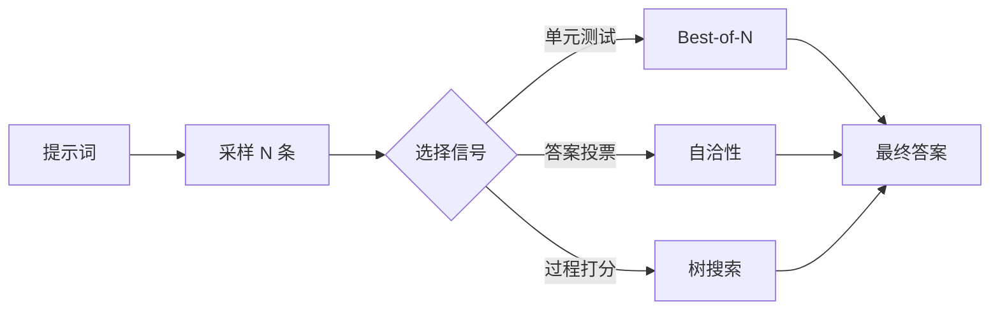

# 第 24 章 测试时计算扩展

## 本章导读

同一道数学题，模型一次答对的概率只有 10%。如果允许它独立答 64 次，至少答对一次的概率是 99.9%——但如果你不知道哪一次是对的，这个数字毫无用处。测试时计算扩展（test-time scaling）研究的正是这件事：把额外的推理算力花在采样、打分或搜索上，能不能把“会做”变成“答对”。本章区分覆盖率与选择两个瓶颈，讨论 Best-of-N、自洽性、树搜索与预算控制，并回答一个更实际的问题：这笔算力应该加在采样次数上，还是加在模型规模上。

## 难度标签

⭐⭐⭐ 进阶 ｜ 数学要求：二项分布、组合计数、期望与边际分析 ｜ 代码要求：采样循环、投票、Best-of-N、PUCT 树搜索

## 学习目标

- 能区分覆盖率（coverage）与选择（selection），写出 (24.1)–(24.6)，并判断一个任务的主要瓶颈在哪一侧。
- 能说明自洽性在什么条件下有效、什么条件下反而降低准确率，并解释错误相关性为何破坏二项公式。
- 能比较 Best-of-N、过程奖励模型、树搜索的收益与代价，识别验证器偏差与奖励作弊。
- 能实现投票、Best-of-N、PUCT 与提前停止，并用实验核对覆盖率、选择率与预算消耗。
- 能给出一次测试时扩展的预算分配建议，说明它与模型规模、量化与延迟约束的关系。

## 24.1 直觉：先覆盖，再选择

测试时扩展有两个独立的瓶颈。**覆盖率**（coverage）问的是：在 $$N$$ 条独立样本里，至少有一条正确答案的概率有多大。它只取决于单次成功率 $$p$$ 和样本数 $$N$$，随 $$N$$ 增大迅速趋向 1。**选择**（selection）问的是：拿到这 $$N$$ 条样本后，你能否把正确的那条挑出来。覆盖率再高，选择错了，最终准确率仍然是零。很多关于“采样扩展”的讨论只报告覆盖率，却把选择问题悄悄留给了读者；工程上真正决定服务质量的，是两者相乘。

选择靠什么信号，决定了方法的分野。代码题有单元测试，验证器几乎完美，于是可以生成很多条、跑测试、取通过者，这就是 **Best-of-N**。数学题没有可执行验证器，但最终答案通常是一个数或一个短表达式，可以按答案分组投票，这就是**自洽性**（self-consistency）。推理题既没有现成验证器，答案又由多步中间状态组成，如果中间状态能被部分打分，就可以把生成组织成一棵树，优先扩展有希望的分支，这就是**树搜索**（tree search）。三种方法对应三种信号强度：答案可验证、答案可比较、过程可打分。

代价也分三笔。第一笔是**采样**：每条样本都要完整解码，成本随 $$N$$ 线性增长；第二笔是**打分**：验证器或过程奖励模型前向一次也要算力，若用大模型当裁判，打分可能比采样还贵；第三笔是**搜索开销**：树搜索要维护分支、重复前向、管理缓存，单位算力换来的有效样本比随机采样少。测试时扩展的工程问题，本质上是在这三笔开销之间分配一个固定的 Token 或延迟预算。

预算还有三条可以加码的轴：**样本数**、**每条样本的思考长度**、**模型规模**。前两条属于测试时计算，第三条属于训练时计算。三者的成本结构不同：样本数可以并行，吞吐高但显存随批增大；思考长度串行增加延迟，且受训练长度限制；模型规模改变单次前向的成本，却能在所有查询上复用。把三者放在同一张“等成本”前沿上比较，才能回答加码在哪一侧。本章的公式主要处理前两条轴，第三条只在预算分配 (24.10) 中出现。



还要注意采样策略的耦合。第 20 章的温度、Top-k 与 Top-p 直接决定单次成功率 $$p$$ 和样本之间的独立性。温度太低，$$N$$ 条样本大量重复，覆盖率并不随 $$N$$ 增长；温度太高，单次 $$p$$ 下降，覆盖率的指数增长被更小的底数抵消。存在一个任务相关的最优温度，它通常不是 0，也不是 1，而要在验证集上扫描。量化的影响同理：第 23 章的低比特模型会同时改变 $$p$$、样本多样性和验证器分数，FP16 上测出的曲线不能直接搬到 INT4 模型上。

## 24.2 数学原理

### 24.2.1 覆盖率与 pass@k

设单次采样得到正确答案的概率为 $$p$$，各次采样独立同分布。$$N$$ 次采样至少一次正确的概率是

$$
P_{\mathrm{cov}}(N)=1-(1-p)^N
\qquad \text{(24.1)}
$$

若要把覆盖率达到 $$1-\delta$$，需要

$$
N\ge\frac{\ln\delta}{\ln(1-p)}\approx-\frac{\ln\delta}{p}
\qquad \text{(24.2)}
$$

最后一步用了 $$p$$ 较小时的近似 $$\ln(1-p)\approx-p$$。它说明一件很重要的事：**困难任务的采样成本按 $$1/p$$ 放大**。单次成功率 10% 时，想把覆盖率做到 99.9% 需要约 66 条样本；单次成功率 1% 时，同样目标需要约 690 条。覆盖率的增长是对数级的，样本成本却是线性级的，这就是“多采样”在难题上很快变得昂贵的原因。

实践中常用 **pass@k** 作为覆盖率的无偏估计。给定 $$n$$ 条样本中有 $$c$$ 条正确，随机取 $$k$$ 条，至少一条正确的概率为

$$
\mathrm{pass@}k=1-\frac{\binom{n-c}{k}}{\binom{n}{k}}
\qquad \text{(24.3)}
$$

因为 $$n$$ 条样本可交换，随机 $$k$$ 子集里没有正确答案的比例恰好是 $$\binom{n-c}{k}/\binom{n}{k}$$。这个估计量不要求知道 $$p$$，只要求样本独立；但它衡量的是“从 $$n$$ 条里抽 $$k$$ 条”的 oracle 上限，不是部署时的准确率。把 pass@k 当作模型能力可以，把它当作服务指标会高估几十倍。

估计量本身也有方差。用 $$n$$ 条样本估计 pass@k 时，$$k$$ 越接近 $$n$$，估计越依赖少数几条正确样本，方差越大；实践中常取 $$n\ge 2k$$ 甚至更大。当 $$k=n$$ 时，(24.3) 退化为 (24.1) 的经验版本：只要有一条正确就是 1。报告 pass@k 时必须同时写清 $$n$$、$$k$$ 与采样温度，否则不同论文的数字不可比。

本章示例的第一张表把 (24.1) 算了出来：$$p=0.10$$ 时，$$N=1,4,16,64$$ 的覆盖率分别是 0.100、0.344、0.815、0.999；$$p=0.05$$ 时，$$N=64$$ 也只有 0.962。数字与公式一致，说明覆盖率确实可以仅靠采样数买到——前提是样本独立。若样本高度相关，比如都沿着同一条错误思路展开，有效样本数远小于 $$N$$，实际覆盖率的增长会明显慢于 (24.1)。

### 24.2.2 自洽性：多数投票的适用边界

拿到 $$N$$ 条答案后，最朴素的选择是多数投票。设 $$N$$ 为奇数，每条样本独立地以概率 $$p$$ 正确，则多数投票正确的概率为二项分布的右尾：

$$
A_{\mathrm{vote}}(p,N)=\sum_{i=\lfloor N/2\rfloor+1}^{N}\binom{N}{i}p^i(1-p)^{N-i}
\qquad \text{(24.4)}
$$

这就是孔多塞陪审团定理（Condorcet jury theorem）的语言版：当 $$p>0.5$$ 时，$$A_{\mathrm{vote}}$$ 随 $$N$$ 单调上升并趋向 1；当 $$p<0.5$$ 时，多数投票反而放大错误，准确率随 $$N$$ 下降；$$p=0.5$$ 时对任何 $$N$$ 都停在 0.5。示例表给出了三组数字：$$p=0.65$$、$$N=15$$ 时准确率 0.887；$$p=0.35$$、$$N=15$$ 时只有 0.113；$$p=0.50$$ 时恒为 0.500。第二组常被忽略：如果模型的单次准确率低于随机猜测，投票是加速失败，不是提升。

公式还依赖一个更强的假设：**错误答案可交换**。推导 (24.4) 时，我们把“不正确”当成一个整体，只看对/错两种结果。现实中错误答案往往有多个，而且分布不均。示例用 5000 次模拟比较了两种情形：$$p=0.65$$、$$N=15$$，若所有错误都落在同一个答案上，投票准确率 0.891，与理论 0.887 几乎一致；若错误分散到 9 个不同答案上，准确率升到 0.999。也就是说，(24.4) 给出的是“错误越集中越保守”的下界式估计；错误越分散，多数投票越有效，因为它实际上在利用“错误答案不会重复”这一额外信息。

加权投票把“票数”换成“分数”。设第 $$i$$ 条样本的权重为 $$w_i$$，可以是序列对数似然的长度归一化值，也可以是验证器给出的分数，则

$$
\hat a=\arg\max_{a}\sum_{i=1}^{N}w_i\,\mathbf{1}[a_i=a]
\qquad \text{(24.5)}
$$

平分时取最早出现的答案，保证结果确定。加权投票的风险是权重与正确性不相关时，它比等权投票更差；权重来自模型自身似然时，还会偏向更短、更常见的答案。只有当权重确实携带“这条更可能对”的信息时，加权才有意义。

投票之前还有一步常被低估：**答案归一化**。同一个数可能写成 `1/2`、`0.5` 或 `\frac{1}{2}`，同一个选项可能带标点或解释。若不先把答案抽取成规范形式，票数会被同义写法拆散，自洽性直接失效。归一化规则要与任务绑定：数学题做符号化简，选择题抽选项字母，代码题取函数返回值。规则越激进，越可能把不同答案错误合并；越保守，越可能错过本应合并的票。这个工程细节往往比换一个更大的模型更能决定自洽性的成败。

自洽性在小模型上未必赢过贪心。本章 TinyLM 的链式算术实验里，训练 1000 步的模型贪心准确率 0.918，而温度 1.0 采样 16 条再投票只有 0.901；训练 600 步时，贪心 0.848，投票 16 条 0.775。投票相对它自己的单样本（0.799 和 0.559）确实有提升，但没有超过贪心。原因有两条：采样温度降低了单次 $$p$$，而两跳算术里“提示词选错”会让后续答案成片地错，样本之间的错误高度相关，二项公式假设的独立性不成立。这个负结果很重要：**测试时扩展的基线应当是强贪心，而不是单条随机采样**。如果贪心已经答对，采样加投票只会引入方差。

### 24.2.3 验证器与 Best-of-N

Best-of-N 的流程是：采样 $$N$$ 条候选，用验证器给每条打分，取最高分。设验证器在“一条正确、一条错误”的两两比较中判对的概率为 $$q$$。把候选按对/错分成两类，假设同类候选可交换、类间比较由 $$q$$ 主导，则给定 $$N$$ 条中有 $$k$$ 条正确时，最高分候选正确的概率近似为

$$
A_{\mathrm{sel}}(p,N,q)=\sum_{k=0}^{N}\binom{N}{k}p^k(1-p)^{N-k}\frac{kq}{kq+(N-k)(1-q)}
\qquad \text{(24.6)}
$$

$$k=0$$ 时该项为 0。这个式子有两个可检验的端点：$$q=1$$ 时退化为覆盖率 (24.1)，$$q=0.5$$ 时退化为单次成功率 $$p$$。示例取 $$p=0.10$$、$$N=64$$：$$q=1.0$$ 时选择成功率 0.999，$$q=0.9$$ 时降到 0.482，$$q=0.7$$ 时 0.203，$$q=0.5$$ 时回到 0.100。覆盖率明明是 0.999，验证器只要在 10% 的两两比较中判错，最终成功率就掉到一半以下。**选择瓶颈经常比生成瓶颈更紧**，这是 Best-of-N 最反直觉的结论。

验证器有四种常见形态。结果奖励模型（outcome reward model，ORM）只看最终答案，训练信号容易获得，但无法区分“碰巧答对”和“推理正确”。过程奖励模型（process reward model，PRM）给每一步打分，能更早发现错误，但标注成本高，且步与步之间的分数需要校准。可执行验证器（单元测试、符号求解器、编译器）在代码和数学题上接近 $$q=1$$，是最可靠的信号。模型裁判（LLM-as-judge）最通用，却最容易受长度、格式和措辞影响。选择哪一种，取决于任务能否提供可验证的中间或最终信号，而不是取决于哪种方法更新。

验证器的 $$q$$ 不能靠感觉设定，要在留出集上测。做法是采样若干条候选，用人工或可执行测试标注对错，再统计“验证器把正确候选排在错误候选之上”的频率；若候选来自不同难度或不同长度，还要分层统计。过程模型的 $$q$$ 更麻烦，因为它的打分单位是步骤而不是整条答案，需要把步骤分数聚合（最小值、乘积或末步分数）后再比较。聚合方式不同，$$q$$ 与最优预算都会变。

验证器还会被“奖励作弊”（reward hacking）攻击。示例给错误候选的分数加 1.5，正确候选与错误候选的分数分布从均值 3 对 0 变成 3 对 1.5，选择成功率从 0.984 掉到 0.705。真实系统里，这种偏移可能来自验证器偏好长答案、偏好与参考答案措辞相似的答案，或者候选本身在训练分布外。防御手段不是把验证器调得更“严格”，而是让分数在留出集上校准，并监控 Best-of-N 的收益随 $$N$$ 的变化；如果收益很快饱和甚至下降，通常说明验证器已经在奖励捷径。

### 24.2.4 树搜索与 PUCT

树搜索把生成看成状态空间搜索。根是提示词，节点是一个部分解，边是一次扩展（继续生成一段），叶是完整答案。每个节点用验证器或 PRM 得到一个价值，搜索的目标是在固定预算内找到价值最高的叶。

语言生成的“节点”没有唯一答案。可以按 Token 扩展，分支因子等于词表大小，树几乎不可控；可以按句子、段落或一次工具调用扩展，分支因子小，但每次扩展的生成成本高；也可以让模型一次提出 $$K$$ 个候选续写，把 $$K$$ 当作分支因子。节点越粗，搜索越省，但中间状态越难比较；节点越细，信号越密，但树越大、缓存越碎。工程上通常选“一步推理”或“一行代码”作为节点，并在节点上附加一个可比较的摘要，而不是让搜索直接操作原始 Token。

**PUCT**（predictor upper confidence bound applied to trees）是 AlphaZero 风格的常用选择规则：

$$
U(s,a)=Q(s,a)+c_{\mathrm{puct}}P(s,a)\frac{\sqrt{N(s)+1}}{1+N(s,a)}
\qquad \text{(24.7)}
$$

其中 $$P(s,a)$$ 是先验概率（来自策略模型或均匀分布），$$N(s)$$ 是父节点访问次数，$$N(s,a)$$ 是子节点访问次数，$$Q(s,a)$$ 是该子节点的平均价值：

$$
Q(s,a)=\frac{1}{N(s,a)}\sum_{i=1}^{N(s,a)}v_i
\qquad \text{(24.8)}
$$

第一项利用已知的好分支，第二项按先验和访问次数探索少去的分支。预算按价值函数调用次数计；每调用一次，路径上所有节点的访问计数与价值之和都更新。与随机采样相比，树搜索多做了两件事：为内部节点付出扩展与打分成本，以及用价值估计决定去哪采样。这两件事只有在“中间状态可比较”且“预算足够大”时才有回报。

示例的陷阱树把这一点量化了。树根有 A、B 两个分支：A 下面三个叶都是 0.8；B 下面两个叶是 0.2，但第三个叶 B3 还能展开出 C1=1.0 和 C2=0.2。贪心只走先验最高的分支，停在 0.8；随机采 8 个叶，平均最佳值 0.942，找到最优的概率 0.716；PUCT 预算 4 和 8 都停在 0.800，直到预算 12 才稳定找到 1.0。原因很直接：PUCT 每展开一个内部节点就消耗一次预算，预算 8 时大部分调用花在 A 分支的重复评估上，还没轮到 B3。**在小预算下，结构化的搜索可能不如无偏的随机采样**；树搜索的收益要到预算超过“探索树结构所需的最小开销”之后才出现。


树搜索的“更强”有前提。示例里 PUCT 在预算 8 时不如随机采样，因为它把预算花在展开内部节点上；只有当价值信号可靠、分支可分开、预算超过树结构开销时，搜索才占优。把 MCTS 当成默认方案，往往得到更高的延迟而不是更高的准确率。


树搜索的适用条件比 Best-of-N 苛刻得多。第一，中间状态必须能被可靠打分，否则 PUCT 会被错误的 $$Q$$ 带偏；第二，分支要能真正分开，若所有分支共享同一条错误前缀，扩展只是重复；第三，必须有缓存与回滚机制。复用 KV Cache 时，树的不同分支需要树形注意力掩码，兄弟分支互相不可见；第 22 章的 `truncate_cache` 可以回滚到分叉点，第 21 章的分页缓存要为每个活跃分支保留块。这些开销会进一步压缩树搜索的净收益。

思维树（Tree of Thoughts，ToT）与 MCTS 是这条路线上的两个代表。ToT 用广度或深度优先展开少量“思维”，靠人工设定的评估与剪枝；MCTS 用随机回放或价值网络估计节点价值，按 PUCT 平衡探索。两者都把“生成”变成“搜索”，但都需要一个比最终答案更细粒度的信号。没有这样的信号，树搜索就退化成昂贵的随机采样。

### 24.2.5 预算、停止与过度思考

一次测试时扩展的总成本可以写成

$$
C=N\left(T_{\mathrm{prompt}}+T_{\mathrm{out}}\right)+N_{\mathrm{verify}}T_{\mathrm{verify}}
\qquad \text{(24.9)}
$$

第一项是采样 Token，第二项是验证开销。若验证器是单元测试或符号检查，$$T_{\mathrm{verify}}$$ 很小；若用大模型当裁判，第二项可能占主导。

成本还要分成延迟与吞吐两个视角。单请求视角关心首 Token 时间与总完成时间：$$N$$ 条样本可以并行，总延迟大致由最慢的一条决定，而不是 $$N$$ 倍；服务视角关心吞吐与显存：$$N$$ 条样本同时驻留，KV 占用按 $$N$$ 倍增长，超过显存就只能排队。第 21 章的利特尔法则在这里同样适用：并发数等于到达率乘以停留时间，采样扩展把停留时间拉长，必须同步增加缓存容量或降低并发，否则吞吐会被换页拖垮。

预算分配应当看边际收益：

$$
a^\star=\arg\max_{a\in\{\text{采样},\text{验证},\text{训练},\text{长思维链}\}}\frac{\Delta A_a}{\Delta C_a}
\qquad \text{(24.10)}
$$

也就是把下一单位算力投给“每单位成本带来准确率提升最大”的那一项。这个式子解释了为什么“测试时算力能否替代训练算力”没有统一答案。训练成本是一次性的，会在所有查询上摊销；采样成本按查询重复支付。对一个每天百万次查询的服务，多训练 10% 的算力可能比每次多采 8 条便宜得多；对一个离线、只跑一次的难题，多采 64 条可能比重新训练更现实。比较时要把摊销周期写进分母，否则会得出相反结论。

提前停止是预算控制最直接的手段。设当前最高票与次高票之差为 $$D_n$$，样本数为 $$n$$，规则是

$$
D_n\ge\delta\quad\text{且}\quad n\ge n_{\min}
\qquad \text{(24.11)}
$$

示例用二选一、单次正确率 0.65 的模型跑 1000 题：不停止时平均 32 条样本、准确率 0.965；$$\delta=2$$ 时平均 5.0 条、准确率 0.811；$$\delta=3$$ 时 7.9 条、0.879；$$\delta=5$$ 时 14.6 条、0.942。停止阈值越高，越晚停、越准、也越贵。注意这个实验的错误只有一个固定答案，领先优势的含义很清楚；若错误答案分散，票数领先可能只是噪声，阈值需要按任务重新校准。

“想得更久”不等于“想得更好”。把长度或 Token 数当成计算量，会忽略无效的重复、绕圈与自我怀疑。定义效用

$$
U(n)=A(n)-\lambda C(n)
\qquad \text{(24.12)}
$$

其中 $$\lambda$$ 把 Token 折算成准确率等价单位。最优样本数满足“下一条样本的边际准确率增益等于边际成本”。当模型开始在答案之间来回摇摆、或者生成长度超过训练分布时，$$A(n)$$ 可能不升反降，这就是**过度思考**（overthinking）。经验上，过度思考在简单题上最明显：模型本可以一步给出答案，却被提示“逐步思考”后引入不必要的中间步骤。解决办法不是一律缩短，而是让停止规则同时看置信度和题目难度，必要时对简单题直接贪心。

### 24.2.6 假设失效时

上面所有公式都建立在几个强假设上，工程落地时要逐条检查。**独立性**：样本共享前缀或同一错误思路时，有效样本数小于 $$N$$，覆盖率被高估。**可交换性**：错误答案集中在少数几个时，多数投票的收益低于 (24.4) 的预测。**验证器校准**：$$q$$ 不是常数，会随题目难度、长度和分布漂移而变化；在训练集上测得的 $$q$$ 不能直接用于线上。**平稳性**：模型、提示词模板、采样参数或量化精度一变，$$p$$ 与 $$q$$ 都会变，旧曲线失效。四者中任何一条不成立，都应当重新测量，而不是套用公式。

## 24.3 方案对比

<div align="center">

表 24-1 测试时扩展的六条路线

| 方法 | 需要的信号 | 适合的任务 | 主要成本 | 典型失效 |
| --- | --- | --- | --- | --- |
| 贪心 / 低温度采样 | 无 | 有明确最优解、延迟敏感 | 最低 | 多样性不足，错过其他解 |
| 自洽性投票 | 答案可归一化 | 数学、短答案问答 | $$N$$ 次采样 | $$p<0.5$$ 或错误高度相关 |
| 加权投票 | 答案 + 权重 | 有似然或轻量打分器 | 采样 + 权重计算 | 权重与正确性不相关 |
| Best-of-N | 结果验证器 | 代码、可验证数学 | 采样 + 验证 | 验证器 $$q$$ 低、奖励作弊 |
| PRM 重排 / 搜索 | 过程打分 | 多步推理、证明 | 采样 + 逐步打分 | 过程标注贵、分数漂移 |
| 树搜索 | 过程打分 + 扩展 | 解空间可分解 | 采样 + 搜索 + 缓存 | 小预算下不如随机采样 |

</div>

选择顺序可以很朴素：先问答案能否验证，能就 Best-of-N；不能验证但能归一化，就自洽性；两者都不行，再考虑过程模型与树搜索。树搜索放在最后，不是因为它弱，而是因为它的前置条件最多、单位算力的有效样本最少。

## 24.4 代码实现

本章新增 `tinylm/inference/search.py`，把覆盖率、pass@k、投票、Best-of-N、选择率、PUCT 与提前停止实现为纯函数，不依赖模型结构，也不改动 `TinyLM.forward`、`CausalLMOutput` 与 `ModelConfig`。`SearchConfig` 只作为推理侧参数，控制样本数、Token 上限、温度、投票方式与停止阈值。

```python
"""第 24 章：测试时计算扩展（tinylm/inference/search.py）。"""
import math
from collections import Counter
from dataclasses import dataclass, field

@dataclass(frozen=True)
class SearchConfig:
    """测试时搜索参数，不进入 ``ModelConfig``。"""

    max_samples: int = 16
    max_tokens: int = 512
    temperature: float = 1.0
    vote: str = "majority"          # majority | weighted
    min_samples: int = 2
    stop_margin: float = 0.0        # 0 表示不提前停止
    c_puct: float = 1.0

    def __post_init__(self):
        assert self.max_samples >= 1
        assert self.max_tokens >= 1
        assert self.temperature > 0.0
        assert self.vote in ("majority", "weighted")
        assert self.min_samples >= 2
        assert self.stop_margin >= 0.0
        assert self.c_puct > 0.0

@dataclass
class SearchResult:
    answer: object
    counts: dict
    scores: dict
    n_samples: int
    stopped_early: bool = False

    @property
    def margin(self):
        """最高分与次高分之差；只有一个候选时返回其票数。"""
        if len(self.scores) == 1:
            return float(next(iter(self.scores.values())))
        ordered = sorted(self.scores.values(), reverse=True)
        return float(ordered[0] - ordered[1])

def coverage_probability(p, n):
    """(24.1)：至少一次采样正确的概率。"""
    assert 0.0 <= p <= 1.0 and n >= 1
    return 1.0 - (1.0 - p) ** n

def pass_at_k(n, c, k):
    """(24.3)：从 n 条样本中取 k 条、至少一条正确的无偏估计。"""
    assert n >= 1 and 0 <= c <= n and k >= 1
    if k > n:
        raise ValueError("k 不能大于 n")
    if n - c < k:
        return 1.0
    prod = 1.0
    for i in range(k):
        prod *= (n - c - i) / (n - i)
    return 1.0 - prod

def majority_accuracy(p, n):
    """(24.4)：独立同分布、n 为奇数时的多数投票准确率。"""
    assert 0.0 <= p <= 1.0 and n >= 1 and n % 2 == 1
    return sum(
        math.comb(n, i) * p ** i * (1.0 - p) ** (n - i)
        for i in range(n // 2 + 1, n + 1)
    )

def majority_vote(answers, weights=None):
    """(24.5)：按出现次数或权重求和投票；平分时取最早出现的答案。"""
    assert len(answers) > 0
    if weights is not None:
        assert len(weights) == len(answers)
    order = {}
    counts = Counter(answers)
    scores = {}
    for i, ans in enumerate(answers):
        order.setdefault(ans, i)
        scores[ans] = scores.get(ans, 0.0) + (
            1.0 if weights is None else float(weights[i])
        )
    best = max(scores, key=lambda a: (scores[a], -order[a]))
    return SearchResult(answer=best, counts=dict(counts), scores=scores,
                        n_samples=len(answers))

def best_of_n(candidates, scores):
    """选择验证器分数最高的候选；平分时取第一个。"""
    assert len(candidates) == len(scores) and len(candidates) > 0
    idx = max(range(len(candidates)), key=lambda i: (scores[i], -i))
    return candidates[idx], idx

def selection_accuracy(p, n, q):
    """(24.6)：验证器两两判别正确率为 q 时的选择成功率（成对判别近似）。"""
    assert 0.0 <= p <= 1.0 and n >= 1 and 0.0 <= q <= 1.0
    total = 0.0
    for k in range(1, n + 1):
        if k * q + (n - k) * (1.0 - q) == 0.0:
            continue
        mass = math.comb(n, k) * p ** k * (1.0 - p) ** (n - k)
        total += mass * (k * q) / (k * q + (n - k) * (1.0 - q))
    return total

def should_stop(result, cfg):
    """(24.11)：领先优势足够大且样本数达到下限时提前停止。"""
    if cfg.stop_margin <= 0.0 or result.n_samples < cfg.min_samples:
        return False
    return result.margin >= cfg.stop_margin

def self_consistency(sample_fn, cfg):
    """重复采样并投票，直到样本预算用尽或满足提前停止条件。"""
    answers, weights = [], []
    for i in range(cfg.max_samples):
        ans, weight = sample_fn(i)
        answers.append(ans)
        weights.append(weight)
        result = majority_vote(
            answers, weights if cfg.vote == "weighted" else None
        )
        if should_stop(result, cfg):
            result.stopped_early = True
            return result
    return result

def token_cost(cfg, prompt_tokens=0):
    """(24.9)：按样本数记账的总 Token 预算。"""
    assert prompt_tokens >= 0
    return cfg.max_samples * (prompt_tokens + cfg.max_tokens)

def puct_score(q, prior, total_visits, visits, c_puct):
    """(24.7)：PUCT 的选择分数。"""
    assert 0.0 <= prior <= 1.0 and total_visits >= 0 and visits >= 0
    explore = c_puct * prior * math.sqrt(total_visits + 1) / (1 + visits)
    return q + explore

@dataclass
class TreeNode:
    state: object
    prior: float = 1.0
    parent: "TreeNode | None" = None
    children: list = field(default_factory=list)
    visits: int = 0
    value_sum: float = 0.0
    expanded: bool = False

    @property
    def q(self):
        """(24.8)：节点价值的访问平均。"""
        return self.value_sum / self.visits if self.visits else 0.0

def tree_search(root_state, expand_fn, value_fn, budget, c_puct=1.0):
    """PUCT 搜索：用价值函数代替随机回放，返回最佳状态与统计。

    ``expand_fn(state)`` 返回 ``[(child_state, prior), ...]``，叶子返回空表；
    ``value_fn(state)`` 返回 ``[0, 1]`` 内的价值。预算按价值函数调用次数计。
    """
    assert budget >= 0 and c_puct > 0.0
    root = TreeNode(root_state)
    evaluations = 0
    best_state, best_value = root_state, None
    while evaluations < budget:
        node = root
        path = [node]
        while True:
            if not node.expanded:
                node.expanded = True
                for state, prior in expand_fn(node.state):
                    node.children.append(TreeNode(state, prior, node))
                if not node.children:
                    break
                node = max(node.children, key=lambda c: c.prior)
                path.append(node)
                continue
            if not node.children:
                break
            total = sum(c.visits for c in node.children)
            node = max(
                node.children,
                key=lambda c: puct_score(c.q, c.prior, total, c.visits, c_puct),
            )
            path.append(node)
        value = value_fn(node.state)
        evaluations += 1
        if best_value is None or value > best_value:
            best_state, best_value = node.state, value
        for item in path:
            item.visits += 1
            item.value_sum += value
    stats = {
        "evaluations": evaluations,
        "root_visits": root.visits,
        "best_value": best_value if best_value is not None
        else value_fn(root_state),
    }
    return best_state, stats
```

代码里有几处刻意的选择。`pass_at_k` 用连乘而不是组合数，避免 $$n$$ 较大时阶乘溢出；`majority_vote` 用“分数相同取最早出现”打破平局，保证同一输入两次运行结果一致；`self_consistency` 每采一条就重新计票，因此提前停止只需要看当前 `margin`；`tree_search` 在展开内部节点后立刻按先验下探一个子节点，展开本身不计入预算，只有价值函数调用计数——这对应“生成便宜、打分贵”的常见设定。若实际场景中生成也贵，应当把 `expand_fn` 的调用也计入预算。

示例 `examples/ch24_search.py` 把六组实验串起来：覆盖率、投票、验证器、陷阱树、TinyLM 链式算术与提前停止。TinyLM 部分用 29 个符号做两跳算术：给定 $$a,b$$，先算提示值 $$(3b+1)\bmod 29$$，再算 $$(a+\text{提示值})\bmod 29$$，共 841 道题；模型是 `d_model=64`、2 层、4 查询头、2 KV 头、SwiGLU、RMSNorm、RoPE 与 GQA。

```python
"""第 24 章：测试时计算扩展（examples/ch24_search.py）。"""

import math
import time

import torch
import torch.nn.functional as F
from ch08 import ModelConfig, TinyLM

from tinylm.inference.search import (SearchConfig, best_of_n,
                                     coverage_probability, majority_accuracy,
                                     majority_vote, selection_accuracy,
                                     self_consistency, tree_search)

def coverage_demo():
    print("覆盖概率：N 次独立采样至少一次正确")
    print(f"{'p':>6s}" + "".join(f"{'N=' + str(n):>10s}" for n in (1, 4, 16, 64)))
    for p in (0.05, 0.10, 0.20, 0.30):
        print(f"{p:>6.2f}" + "".join(
            f"{coverage_probability(p, n):>10.3f}" for n in (1, 4, 16, 64)))

def voting_demo():
    print("\n多数投票准确率：独立同分布、错误可交换")
    print(f"{'p':>6s}" + "".join(f"{'N=' + str(n):>10s}" for n in (1, 3, 5, 9, 15)))
    for p in (0.35, 0.50, 0.65):
        print(f"{p:>6.2f}" + "".join(
            f"{majority_accuracy(p, n):>10.3f}" for n in (1, 3, 5, 9, 15)))

    gen = torch.Generator().manual_seed(0)
    trials, n, p = 5000, 15, 0.65
    single = diverse = 0
    for _ in range(trials):
        correct = torch.rand(n, generator=gen) < p
        one_wrong = torch.where(correct, torch.zeros(n, dtype=torch.long),
                                torch.ones(n, dtype=torch.long)).tolist()
        many_wrong = torch.where(
            correct, torch.zeros(n, dtype=torch.long),
            torch.randint(1, 10, (n,), generator=gen),
        ).tolist()
        single += int(majority_vote(one_wrong).answer == 0)
        diverse += int(majority_vote(many_wrong).answer == 0)
    print(f"  模拟 p=0.65, N=15：单一错误答案 {single / trials:.3f}"
          f"（理论 {majority_accuracy(p, n):.3f}），"
          f"多个错误答案 {diverse / trials:.3f}")

def verifier_demo():
    p, trials, n = 0.10, 20000, 64
    print(f"\n验证器选择（p={p:.2f}，N={n}，按 (24.6) 计算）")
    print(f"{'两两判别正确率 q':>18s}{'选择成功率':>12s}")
    for q in (1.0, 0.9, 0.7, 0.5):
        print(f"{q:>18.1f}{selection_accuracy(p, n, q):>12.3f}")

    gen = torch.Generator().manual_seed(0)
    correct = torch.rand(trials, n, generator=gen) < p
    scores = correct.float() * 3.0 + torch.randn(trials, n, generator=gen)
    clean = correct[torch.arange(trials), scores.argmax(1)].float().mean().item()
    biased = correct[
        torch.arange(trials),
        (scores + (~correct).float() * 1.5).argmax(1),
    ].float().mean().item()
    print(f"  分数模拟（正确 N(3,1)、错误 N(0,1)，等效 q≈0.98）："
          f"干净 {clean:.3f}")
    print(f"  给错误候选加 1.5 分后：{biased:.3f}（奖励作弊）")

def _trap_tree():
    children = {
        "root": [("A", 0.5), ("B", 0.5)],
        "A": [("A1", 1 / 3), ("A2", 1 / 3), ("A3", 1 / 3)],
        "B": [("B1", 1 / 3), ("B2", 1 / 3), ("B3", 1 / 3)],
        "B3": [("C1", 0.5), ("C2", 0.5)],
    }
    values = {"A1": 0.8, "A2": 0.8, "A3": 0.8, "B1": 0.2, "B2": 0.2,
              "C1": 1.0, "C2": 0.2}
    return (lambda s: children.get(s, [])), (lambda s: values.get(s, 0.0))

def tree_demo():
    expand, value = _trap_tree()
    leaves = ["A1", "A2", "A3", "B1", "B2", "C1", "C2"]
    gen = torch.Generator().manual_seed(0)
    trials, budget = 2000, 8
    best = 0.0
    success = 0
    for _ in range(trials):
        idx = torch.randint(0, len(leaves), (budget,), generator=gen)
        picked = [leaves[i] for i in idx.tolist()]
        vals = [value(s) for s in picked]
        best += max(vals)
        success += int(1.0 in vals)
    print("\n陷阱树：贪心停在局部最优，搜索用预算换取覆盖")
    print(f"{'策略':>12s}{'平均最佳值':>14s}{'找到最优':>12s}")
    print(f"{'贪心':>12s}{0.800:>14.3f}{0.000:>12.3f}")
    print(f"{'随机 8 叶':>12s}{best / trials:>14.3f}{success / trials:>12.3f}")
    for b in (4, 8, 12, 16):
        state, stats = tree_search("root", expand, value, budget=b, c_puct=2.0)
        print(f"{'PUCT 预算 ' + str(b):>12s}{stats['best_value']:>14.3f}"
              f"{float(stats['best_value'] == 1.0):>12.3f}")

def make_chain_data(vocab):
    pairs = torch.cartesian_prod(torch.arange(vocab), torch.arange(vocab))
    a, b = pairs[:, 0], pairs[:, 1]
    hint = (3 * b + 1) % vocab
    answer = (a + hint) % vocab
    sep = torch.full_like(a, vocab)
    eq = torch.full_like(a, vocab + 1)
    prompt = torch.stack([a, b, eq], dim=1)
    train = torch.stack([a, b, eq, hint], dim=1)
    labels = torch.stack([b, eq, hint, answer], dim=1)
    return prompt, train, labels, answer

def train_chain(steps, vocab, seed=0):
    prompt, train, labels, answer = make_chain_data(vocab)
    cfg = ModelConfig(vocab_size=vocab + 2, d_model=64, n_layers=2,
                      n_heads=4, n_kv_heads=2, d_ff=128, max_seq_len=8,
                      norm="rmsnorm", ffn="swiglu", bias=False,
                      pos_encoding="rope", attention="gqa")
    gen = torch.Generator().manual_seed(seed)
    torch.manual_seed(seed)
    model = TinyLM(cfg)
    opt = torch.optim.AdamW(model.parameters(), lr=2e-3)
    for _ in range(steps):
        j = torch.randint(0, len(prompt), (128,), generator=gen)
        loss = model(train[j], labels=labels[j]).loss
        opt.zero_grad()
        loss.backward()
        opt.step()
    return model, prompt, answer

@torch.no_grad()
def chain_accuracy(model, prompt, answer, n_samples, temperature=1.0, seed=1234):
    B = len(prompt)
    gen = torch.Generator().manual_seed(seed)
    hint_logits = model(prompt).logits[:, -1] / temperature
    hints = torch.multinomial(
        F.softmax(hint_logits, dim=-1), n_samples,
        replacement=True, generator=gen,
    ).t()                                   # (n_samples, B)
    expanded = prompt.unsqueeze(0).expand(n_samples, -1, -1).reshape(
        n_samples * B, prompt.size(1))
    full = torch.cat([expanded, hints.reshape(-1, 1)], dim=1)
    ans_logits = model(full).logits[:, -1] / temperature
    answers = torch.multinomial(
        F.softmax(ans_logits, dim=-1), 1, generator=gen,
    ).reshape(n_samples, B)
    results = {}
    for n in (1, 4, 8, 16):
        ok = sum(
            int(majority_vote(answers[:n, q].tolist()).answer == answer[q].item())
            for q in range(B)
        )
        results[n] = ok / B
    return results

def tiny_lm_demo():
    vocab = 29
    print("\nTinyLM 链式算术：训练更久，还是采样更多？")
    print(f"{'训练步数':>10s}{'贪心':>10s}" + "".join(
        f"{'投票@' + str(n):>12s}" for n in (1, 4, 8, 16)))
    times = {}
    for steps in (600, 1000):
        start = time.time()
        model, prompt, answer = train_chain(steps, vocab)
        results = chain_accuracy(model, prompt, answer, 16)
        with torch.no_grad():
            hint = model(prompt).logits[:, -1].argmax(-1)
            full = torch.cat([prompt, hint[:, None]], dim=1)
            greedy = (model(full).logits[:, -1].argmax(-1) == answer).float().mean()
        print(f"{steps:>10d}{greedy.item():>10.3f}" + "".join(
            f"{results[n]:>12.3f}" for n in (1, 4, 8, 16)))
        times[steps] = time.time() - start
    print(f"  训练耗时：600 步 {times[600]:.1f} s，1000 步 {times[1000]:.1f} s；"
          f"每样本 5 个 Token")

def stopping_demo():
    p, trials, max_samples = 0.65, 1000, 32
    print(f"\n提前停止（p={p:.2f}，最多 {max_samples} 样本，{trials} 题）")
    print(f"{'停止阈值':>10s}{'平均样本':>12s}{'准确率':>10s}")
    for margin in (0.0, 2.0, 3.0, 5.0):
        gen = torch.Generator().manual_seed(0)
        cfg = SearchConfig(max_samples=max_samples, min_samples=4,
                           stop_margin=margin)
        used = 0
        hits = 0
        for _ in range(trials):
            def sample(i, gen=gen):
                hit = torch.rand((), generator=gen).item() < p
                return (0 if hit else 1), 1.0
            result = self_consistency(sample, cfg)
            used += result.n_samples
            hits += int(result.answer == 0)
        label = "不停止" if margin == 0.0 else f"δ={margin:.0f}"
        print(f"{label:>10s}{used / trials:>12.1f}{hits / trials:>10.3f}")

if __name__ == "__main__":
    coverage_demo()
    voting_demo()
    verifier_demo()
    tree_demo()
    tiny_lm_demo()
    stopping_demo()
```

在 `/tmp/ch24final` 下运行：

```text
PYTHONPATH=. python examples/ch24_search.py
```

真实输出如下（最后一行的训练耗时随机器负载变化，其余数字由固定种子决定）：

```text
覆盖概率：N 次独立采样至少一次正确
     p       N=1       N=4      N=16      N=64
  0.05     0.050     0.185     0.560     0.962
  0.10     0.100     0.344     0.815     0.999
  0.20     0.200     0.590     0.972     1.000
  0.30     0.300     0.760     0.997     1.000

多数投票准确率：独立同分布、错误可交换
     p       N=1       N=3       N=5       N=9      N=15
  0.35     0.350     0.282     0.235     0.172     0.113
  0.50     0.500     0.500     0.500     0.500     0.500
  0.65     0.650     0.718     0.765     0.828     0.887
  模拟 p=0.65, N=15：单一错误答案 0.891（理论 0.887），多个错误答案 0.999

验证器选择（p=0.10，N=64，按 (24.6) 计算）
         两两判别正确率 q       选择成功率
               1.0       0.999
               0.9       0.482
               0.7       0.203
               0.5       0.100
  分数模拟（正确 N(3,1)、错误 N(0,1)，等效 q≈0.98）：干净 0.984
  给错误候选加 1.5 分后：0.705（奖励作弊）

陷阱树：贪心停在局部最优，搜索用预算换取覆盖
          策略         平均最佳值        找到最优
          贪心         0.800       0.000
      随机 8 叶         0.942       0.716
   PUCT 预算 4         0.800       0.000
   PUCT 预算 8         0.800       0.000
  PUCT 预算 12         1.000       1.000
  PUCT 预算 16         1.000       1.000

TinyLM 链式算术：训练更久，还是采样更多？
      训练步数        贪心        投票@1        投票@4        投票@8       投票@16
       600     0.848       0.559       0.654       0.731       0.775
      1000     0.918       0.799       0.851       0.888       0.901
  训练耗时：600 步 5.4 s，1000 步 9.0 s；每样本 5 个 Token

提前停止（p=0.65，最多 32 样本，1000 题）
      停止阈值        平均样本       准确率
       不停止        32.0     0.965
       δ=2         5.0     0.811
       δ=3         7.9     0.879
       δ=5        14.6     0.942
```

对应的 18 项测试覆盖配置校验、覆盖率边界与蒙特卡洛、pass@k 端点、多数投票的单调方向、平局处理、加权投票、Best-of-N 平局、选择率端点、提前停止、预算耗尽、PUCT 公式、预算为 0、陷阱树与终止节点：

```text
$ PYTHONPATH=. python -m pytest -q tests/test_search.py
18 passed in 0.92s
```

## 24.5 工业实践

**大规模采样加过滤。** AlphaCode 是这条路线最著名的案例：对每道竞赛题生成约 100 万条候选，先用示例测试过滤到约 5%，再按行为聚类选出 10 个提交，在 Codeforces 上达到前 54.3% 的人类选手水平。它的算力几乎全花在采样和过滤上，验证器就是题目自带的测试用例；一旦测试信号变弱，同样的流程会迅速退化。

**覆盖率不是部署准确率。** Brown 等人 2024 年的“Large Language Monkeys”系统测量了重复采样的扩展曲线：在 SWE-bench Lite 上，单次采样的覆盖率约 16%，250 次采样升到约 56%；覆盖率随样本数近似对数增长，但如何从大量候选里选出正确补丁仍是瓶颈。他们用单元测试作为选择器，并指出没有可靠验证器时，覆盖率的提升无法转化为最终准确率。这与 (24.6) 的预测一致：$$q$$ 不够高时，$$N$$ 再大也会被选择率卡住。

**把长思考训练进模型。** OpenAI o1 与 DeepSeek-R1 代表另一条路线：不是只在推理时多采样，而是在强化学习中让模型学会生成更长的推理链，并用可验证奖励（数学答案、单元测试）优化“想得久”这件事。OpenAI 报告 o1 在 AIME 2024 上从 GPT-4o 的 12% 提升到 74%，并展示准确率随测试时计算增加而上升；DeepSeek-R1 则公开了以规则奖励驱动的长链推理训练细节。这类系统的测试时扩展曲线一部分来自训练，不能简单归因于“采样更多”。

**过程监督与大模型裁判。** Lightman 等人的 PRM800K 用人工标注的每一步正确性训练过程奖励模型，在 MATH 的 500 题子集上，过程监督的最终准确率约 78%，结果监督约 72%。过程模型的价值在于能对未完成的解答打分，从而支持搜索与早停；代价是标注成本高、跨分布漂移快。工业系统通常把可执行验证器放在第一位，把 PRM 放在第二位，把模型裁判放在最后。

**服务侧配置。** 截至写作时，主流推理框架（vLLM、SGLang 等）都支持一次请求生成多条样本，并把 `n`、温度与最大 Token 作为请求参数。工程上要同时看三个数：单请求延迟、批量吞吐与 KV 显存。$$N$$ 条样本的 KV 占用近似按 $$N$$ 倍增长，第 21 章的分页缓存与连续批处理决定了能否把多出来的样本塞进同一张卡；第 23 章的 KV 量化可以把容量换回来，但量化误差会改变 $$p$$ 与验证器分数。常见的保守配置是 $$N=16\sim64$$、温度 0.7–1.0、Top-p 0.95、最大输出 512–2048 Token，再用提前停止把平均样本数压到 10 以内；具体数值必须按任务和模型重测。

做成本估算时，把采样、验证与失败重试分开记账。一次请求的期望成本不是 $$N$$ 乘以单条价格，而是 $$N$$ 条采样加上验证器调用，再加上“全部失败后回退到贪心或人工”的概率乘以后续成本。若验证器本身要调用大模型，它的输入是整条候选，成本可能与采样同量级；若验证器是单元测试，成本主要在沙箱启动与超时控制。把这三项写进同一张账单，才能判断增加 $$N$$ 是否仍然划算。

**与量化的叠加。** 低比特模型的采样分布更尖或更平、重复率更高，验证器在低比特输出上的校准也会漂移。第 23 章给出的结论在这里再次适用：压缩改变的是分布，而测试时扩展的所有公式都以分布为输入。任何“INT4 模型 + 64 次采样”的方案，都应当重新测覆盖率、$$q$$ 与最优温度，不能把 FP16 的曲线按比例缩放。

## 24.6 论文导读

**1. Wang 等，2022，Self-Consistency Improves Chain of Thought Reasoning in Language Models，arXiv:2203.11171。** 自洽性的原始论文；读第 3–4 节，重点看答案归一化、采样温度与投票规则，以及论文报告的提升幅度依赖哪些任务条件。

**2. Lightman 等，2023，Let's Verify Step by Step，arXiv:2305.20050。** 过程监督与 PRM800K；读第 2–4 节，重点比较过程监督与结果监督的实验设计、标注成本与跨分布表现。

**3. Yao 等，2023，Tree of Thoughts: Deliberate Problem Solving with Large Language Models，arXiv:2305.10601。** 思维树；读第 3–5 节，重点看节点如何定义、评估函数如何工作，以及 Game of 24 上从链式思考到树搜索的跃升。

**4. Snell 等，2024，Scaling LLM Test-Time Compute Optimally can be More Effective than Scaling Model Parameters，arXiv:2408.03314。** 测试时算力与参数量的等 FLOPs 比较；读第 2–5 节，重点看按题目难度分配预算的策略，以及“简单题靠测试时算力、难题靠更大模型”的分界。

**5. Brown 等，2024，Large Language Monkeys: Scaling Inference Compute with Repeated Sampling，arXiv:2407.21787。** 大规模重复采样；读第 2–5 节，重点看覆盖率随样本数的对数增长、选择瓶颈与验证器的作用。

## 24.7 常见误区

**误区一：采样越多，准确率一定越高。** 覆盖率高不等于最终准确率高，选择信号才是上限。示例中 $$p=0.10$$、$$N=64$$ 的覆盖率是 0.999，但 $$q=0.9$$ 的验证器只能把选择成功率做到 0.482。没有可靠选择器时，多采样只是在制造更多错误候选。

**误区二：自洽性总能提升准确率。** 多数投票只在单次成功率高于 0.5、且错误可交换时有效；$$p<0.5$$ 时它会放大错误，错误高度相关时它会重复同一个错误。TinyLM 实验里投票 16 条仍低于强贪心，就是相关错误与采样温度共同作用的结果。

**误区三：Best-of-N 的瓶颈在生成。** 生成可以并行，真正贵的是验证；真正稀缺的是校准良好的验证信号。用大模型当裁判时，打分成本可能超过采样，而且裁判偏差会把选择率拉低。

**误区四：树搜索一定优于随机采样。** 树搜索要为先验、扩展和内部节点打分付费。陷阱树实验里，PUCT 预算 8 的收益不如随机采 8 个叶；预算 12 才稳定找到最优。树搜索适合“中间状态可打分、分支可分开、预算充足”的场景，不适合当作默认选项。

**误区五：测试时算力可以替代训练算力。** 两者是不同轴：训练改变模型的能力分布，测试时扩展只在这个分布里挑答案。难题上单次成功率太低，采样成本按 $$1/p$$ 爆炸；此时更大的模型或更好的训练目标通常更划算。训练成本还是一次性摊销，测试成本按查询重复支付。

**误区六：更长的思维链等于更多有效计算。** 长度只是计算量的代理指标。重复、绕圈、自我怀疑都会拉长输出却不提升准确率；简单题上的过度思考甚至会降低准确率。判断标准应是“边际准确率增益是否大于边际成本”，而不是 Token 数。

## 24.8 本章小结

- 测试时扩展拆成覆盖率与选择两件事：覆盖率由 (24.1) 描述，随样本数对数增长，难题成本按 $$1/p$$ 放大。
- pass@k 是覆盖率的无偏估计，但不是部署指标；部署要看选择之后的实际正确率。
- 多数投票只在 $$p>0.5$$ 且错误可交换时有效；验证器的两两判别率 $$q$$ 决定 Best-of-N 的上限。
- 树搜索用结构换样本，前提是中间状态可打分且预算足够；小预算下它甚至不如随机采样。
- 预算控制的核心是边际分配 (24.10) 与提前停止 (24.11)；“想得更久”是否值得，要看 (24.12) 的效用而不是长度。


**本章的取舍**：为了更高的覆盖率，我们放弃了单次延迟：$$N$$ 条样本可以并行，但 KV 显存与总 Token 成本按 $$N$$ 增长。为了提高选择率，我们放弃了“无验证器也能扩展”的幻想：没有可靠信号时，多采样只会放大候选集。树搜索用结构换样本，代价是扩展开销、缓存复杂度和对中间打分的依赖；小预算下它甚至不如随机采样。提前停止用少量准确率换成本，阈值越高越准也越贵。最后，测试时算力与训练算力之间没有免费的替代关系：训练成本一次性摊销，测试成本按查询重复支付，难题更依赖模型本身的能力。若只能记住一句话：**先确认瓶颈在覆盖还是在选择，再把算力加到边际收益最高的那一侧。**

先量覆盖率，再量选择率，最后才算预算。覆盖率告诉你“多采样有没有用”，选择率告诉你“挑不挑得出来”，预算告诉你“值不值得”。三者缺一，测试时扩展的结论都不可靠。


## 24.9 习题

### 习题 1（推导）

对 $$N=3$$ 的多数投票，写出 $$A_{\mathrm{vote}}(p,3)$$ 的显式表达式，证明它在 $$p=0.5$$ 处等于 0.5、在 $$p>0.5$$ 时大于 $$p$$、在 $$p<0.5$$ 时小于 $$p$$，并用它解释示例表中 $$p=0.35$$、$$N=3$$ 的 0.282。

### 习题 2（编程）

修改 `chain_accuracy`，让温度在 0.5、0.8、1.0、1.2 上扫描，分别报告贪心、单样本、投票 4/8/16 的准确率。观察“单次 $$p$$ 随温度下降”与“样本多样性随温度上升”如何共同决定投票收益，并找出该任务上的最优温度。

### 习题 3（开放思考）

为一个带单元测试的代码生成服务设计测试时扩展方案：给定每次查询的延迟上限与预算，说明如何选择 $$N$$、验证器、停止阈值与缓存策略；讨论测试覆盖不足时 $$q$$ 会如何下降、奖励作弊如何出现，以及你会用什么线上指标监控收益是否饱和。

<details>
<summary>习题答案与提示</summary>

**推导题答案.** 三项中至少两项正确：

$$
A_{\mathrm{vote}}(p,3)=\binom{3}{2}p^2(1-p)+\binom{3}{3}p^3=3p^2-2p^3
$$

在 $$p=0.5$$ 处，$$3(0.25)-2(0.125)=0.75-0.25=0.5$$。与 $$p$$ 的差为

$$
A_{\mathrm{vote}}(p,3)-p=3p^2-2p^3-p=p(1-p)(2p-1)
$$

因为 $$p(1-p)>0$$，差的符号由 $$2p-1$$ 决定：$$p>0.5$$ 时为正，$$p<0.5$$ 时为负。代入 $$p=0.35$$ 得 $$3(0.1225)-2(0.042875)=0.3675-0.08575=0.28175$$，与表中的 0.282 一致。这也说明 $$N=3$$ 的投票在 $$p$$ 接近 0.5 时几乎不改变准确率，只有 $$p$$ 明显偏离 0.5 时收益或损失才显现。

**编程题提示.** 把 `chain_accuracy` 的 `temperature` 参数暴露出来，对每个温度重复采样 16 条，再按前缀取 1/4/8/16 条投票。注意贪心基线不随温度变化；报告时同时给出“投票@1”作为该温度下的单样本成功率。预期会看到：温度从 0.5 升到 1.0 时，单样本成功率下降、多样性上升，投票收益先增后减；温度过高时，错误分布更分散，但单次 $$p$$ 太低，投票也救不回来。具体拐点依赖模型与任务，不应外推。

**开放题提示.** 先测单元测试的覆盖率与误判率，把 $$q$$ 写成“测试通过但答案错误”和“测试失败但答案正确”两类错误的函数；$$N$$ 从 8 或 16 起步，按边际收益增加；停止规则用“通过测试且领先优势足够大”，但要对“所有候选都失败”预留回退路径。监控指标至少包括：候选通过率、Best-of-N 相对单样本的增益、平均样本数、验证器在留出集上的 $$q$$、以及人工抽检的奖励作弊率。若增益随 $$N$$ 很快饱和，说明瓶颈已从覆盖转到选择，应优先改进测试或验证器，而不是继续加样本。

</details>
