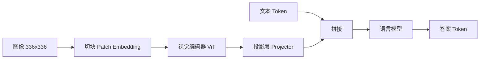

# 第 25 章 多模态大模型

## 本章导读

一张 336×336 的 RGB 图片有 33.9 万个数值。LLaVA 没有把这 33.9 万个数直接塞进语言模型，而是把它切成 576 个图像 Token，再翻译成语言模型已经认识的向量。奇怪的地方在于：视觉编码器只占模型参数的百分之几，真正决定“能不能看懂”的，往往是中间那个只有几百万参数的投影层，以及图文数据怎么配。本章回答三个问题：图像如何变成 Token，视觉特征如何对齐到语言空间，理解与生成能否放进同一个模型。

## 难度标签

⭐⭐⭐ 进阶 ｜ 数学要求：线性代数、注意力机制、对比学习与向量量化 ｜ 代码要求：Patch Embedding、ViT、投影层、图文拼接

## 学习目标

- 能写出图像 Token 数 (25.1) 与注意力算力倍数 (25.3)，并据此估算一张图片的预填充与 KV Cache 成本。
- 能说明视觉编码器、投影层与语言模型各自解决什么问题，以及“模态对齐”为什么常是瓶颈。
- 能比较线性投影、MLP、重采样器与原生多模态四条路线，说明它们在 Token 数、分辨率与生成能力上的取舍。
- 能实现一个 LLaVA 式的最小多模态模型，并用手工合成数据核对“去掉图像会退化”这一基本事实。
- 能解释离散图像 Token 化 (25.9)–(25.10) 与连续投影的区别，以及它为什么影响统一生成。

## 25.1 直觉：把图像翻译成模型已经懂的语言

多模态大模型（multimodal large language model）的最小结构可以拆成三件东西：**视觉编码器**（vision encoder）负责“看”，**投影层**（projector）负责“翻译”，**语言模型**负责“想和说”。视觉编码器把图片变成一串视觉特征；投影层把这些特征的维度与尺度映射到语言模型的隐藏空间；语言模型把图像 Token 与文本 Token 拼成一条序列，照常做下一 Token 预测。



关键的一步是**把图像当成一种外语**。语言模型的词表里没有“像素”，但它有“向量”。只要投影层能把每个图像块映射成与词嵌入同维度、同尺度的向量，语言模型就可以像处理普通 Token 一样处理它。这个思路被称为**晚期融合**（late fusion）：视觉与文本各自编码，最后在语言模型的输入层拼接。LLaVA、Qwen-VL、InternVL 都属于这一路线。

另一条路线是**早期融合**（early fusion）：从预训练开始就把图像与文本放进同一个 Token 序列、同一个目标函数，甚至同一个词表。Chameleon、Emu3 把图像离散化成词表里的“视觉词”，用统一的下一 Token 预测训练；Transfusion 则在同一个 Transformer 里对文本用自回归损失、对图像用扩散损失。早期融合的野心是“一个模型同时理解与生成”，代价是训练更贵、图像 Token 化会损失细节、两种模态容易互相干扰。

还有一条常被忽略的轴：**分辨率与 Token 数**。图像切得越细，Token 越多，细节越清楚，但预填充成本和注意力成本都按序列长度增长。336×336、切块 14 的 LLaVA 产生 576 个图像 Token；448×448 产生 1024 个；若再用 2×2 合并，才压回 256 个。第 21 章的 roofline 与 KV Cache 账本在这里直接适用：图像 Token 不是免费的，它们和文本 Token 共享同一条上下文窗口和同一份缓存。


把多模态模型想成“三个翻译环节”：视觉编码器把像素翻译成视觉特征，投影层把视觉特征翻译成语言向量，语言模型把语言向量翻译成答案。任何一个环节的表示尺度不匹配，后面的语言模型都只能看到“噪声”。


## 25.2 数学原理

### 25.2.1 图像如何变成 Token

设图像高为 $$H$$、宽为 $$W$$，切块边长为 $$p$$。不重叠切块把图像分成

$$
N_p=\frac{H}{p}\cdot\frac{W}{p}=\frac{HW}{p^2}
\qquad \text{(25.1)}
$$

个图像块。每个块展平成 $$p^2\cdot C$$ 维向量（$$C$$ 为通道数），再经过一个线性层映射到视觉维度 $$d_v$$。这一步等价于一个核大小为 $$p$$、步长为 $$p$$ 的卷积：卷积核在每个不重叠窗口上做一次点积，恰好就是“展平后乘矩阵”。代码里的 `PatchEmbed` 用的就是卷积，测试中验证了它与手工 `unfold` 加线性层的输出逐元素一致。

若文本部分有 $$T_{\text{text}}$$ 个 Token，拼好的序列长度为

$$
L=N_p+T_{\text{text}}
\qquad \text{(25.2)}
$$

注意力矩阵有 $$L^2$$ 个元素，因此含图像的序列相对纯文本序列的注意力算力倍数为

$$
R_{\text{attn}}=\left(\frac{L}{T_{\text{text}}}\right)^2
=\left(1+\frac{N_p}{T_{\text{text}}}\right)^2
\qquad \text{(25.3)}
$$

这个式子只算注意力，不含前馈网络；后者与序列长度线性相关。以 $$T_{\text{text}}=128$$ 为例：576 个图像 Token 让注意力变成 $$(704/128)^2\approx 30.25$$ 倍；2×2 合并到 144 个 Token 后是 4.52 倍；448×448 未合并的 1024 个 Token 是 81 倍。图像 Token 数对成本的放大是平方级的，这就是“高分辨率很贵”的数学来源。

还要区分预填充与解码。预填充阶段要处理全部 $$L$$ 个 Token，成本按 (25.3) 放大；解码阶段每步只新增一个 Token，但 KV Cache 要为每个图像 Token 常驻。按第 21 章的账本，每层每个 Token 的 KV 占用是 $$2d_{kv}b_{\text{elem}}$$ 字节，图像 Token 与文本 Token 一样计费。一张 576 Token 的图片，在 32 层、GQA 8 个 KV 头、每头 128 维、FP16 的模型里，仅 KV Cache 就是 $$2\times576\times32\times8\times128\times2\approx 75.5$$ MB，约 72 MiB；并发 16 路就是 1.125 GiB。

图像 Token 的顺序同样携带信息。切块按行优先展开时，相邻 Token 在二维空间上也相邻；若把长宽比不同的图片强行 resize 成正方形，细长文字会被压扁，OCR 误差会显著上升。工程上常用 padding 到固定尺寸、保留原始长宽比，或按长边切块再拼接；这三种做法改变了 Token 的二维布局，也改变了位置编码要表达的内容。

### 25.2.2 视觉编码器与对比预训练

现代多模态模型几乎都用 **ViT**（Vision Transformer）作为视觉编码器。它把图像块当成 Token，在块序列前面加一个可学习的 `[CLS]`，再加位置嵌入：

$$
\mathbf{z}_0=\left[\mathbf{x}_{\text{cls}};\ \mathbf{E}\mathbf{x}_p^1;\ \dots;\ \mathbf{E}\mathbf{x}_p^{N_p}\right]+\mathbf{E}_{\text{pos}}
\qquad \text{(25.4)}
$$

之后是标准的 Pre-LN Transformer 块，只是没有因果掩码，所有图像块互相可见。第 $$l$$ 层的更新可以写成

$$
\begin{aligned}
\mathbf{z}'_l &= \mathbf{z}_{l-1}+\mathrm{MSA}\left(\mathrm{LN}\left(\mathbf{z}_{l-1}\right)\right),\\
\mathbf{z}_l &= \mathbf{z}'_l+\mathrm{MLP}\left(\mathrm{LN}\left(\mathbf{z}'_l\right)\right).
\end{aligned}
$$

输出可以取 `[CLS]` 的向量做整图分类，也可以保留全部块特征供语言模型做空间定位。LLaVA 选择后者：它把 24×24 个块特征全部投影后送进语言模型，因此模型能知道“左上角有什么”，而不是只得到一个整图摘要。

ViT 与卷积网络的区别在于归纳偏置。卷积自带局部性与平移等变性，小数据下更容易训练；ViT 把图像当块序列，缺少这些先验，需要更多数据或更强的增广。多模态模型通常直接用大规模预训练的 ViT，而不是从头训练，就是因为这个数据门槛。另一个选择是池化方式：取 `[CLS]` 适合整图分类，保留全部块特征适合定位与 OCR；LLaVA 选后者，BLIP-2 的 Q-Former 则用查询把块特征压成固定数量。SigLIP 把 (25.5) 的 softmax 对比改成逐对 sigmoid，避免了 batch 内全局归一化，batch 很小时更稳，这也是后来不少视觉塔的选择。

视觉编码器通常先用图文对比学习预训练。给定一个 batch 的 $$B$$ 对图文，图像编码器输出 $$\mathbf{z}_i$$，文本编码器输出 $$\mathbf{t}_i$$，**InfoNCE** 损失为

$$
\mathcal{L}_{\text{CLIP}}
=-\frac{1}{2B}\sum_{i=1}^{B}\left[
\log\frac{\exp\left(\mathbf{z}_i^{\top}\mathbf{t}_i/\tau\right)}
{\sum_{j=1}^{B}\exp\left(\mathbf{z}_i^{\top}\mathbf{t}_j/\tau\right)}
+\log\frac{\exp\left(\mathbf{t}_i^{\top}\mathbf{z}_i/\tau\right)}
{\sum_{j=1}^{B}\exp\left(\mathbf{t}_i^{\top}\mathbf{z}_j/\tau\right)}
\right]
\qquad \text{(25.5)}
$$

其中 $$\tau$$ 是温度。第一项让第 $$i$$ 张图在 batch 内所有文本中挑出自己的配对文本，第二项方向相反。CLIP 用约 4 亿对图文训练，图像塔与文本塔各自独立，最后只共享一个对比空间。它的价值不在于分类头，而在于提供了一个“图像特征与语言语义已经大致对齐”的起点；后续的投影层只需要做一次小幅度换空间，而不是从零学习视觉语义。

对比学习的损失值可以直观核对。示例中 batch 为 64 时，独立随机配对的损失是 4.184，接近 $$\ln 64=4.159$$；把图与文本对齐后，损失降到 0.001；把配对打乱、温度降到 0.07 后，损失升到 14.148。这说明 (25.5) 的两个极端：完全对齐时接近零，完全错位时被温度放大。

### 25.2.3 投影层与模态对齐

投影层做的事很朴素：把 $$d_v$$ 维视觉特征映射到 $$d_{\text{model}}$$ 维语言隐藏空间。最简形式是一个线性层；LLaVA-1.5 用两层 MLP 加 GELU；BLIP-2 用 **Q-Former**，Flamingo 用 **Perceiver Resampler**。后两者的共同点是用一组可学习的查询向量做交叉注意力，把可变数量的视觉 Token 压成固定数量：

$$
\begin{aligned}
\mathbf{Q}&=\mathbf{W}_q\mathbf{X},\qquad
\mathbf{K}=\mathbf{W}_k\mathbf{Z}_v,\qquad
\mathbf{V}=\mathbf{W}_v\mathbf{Z}_v,\\
\mathbf{H}&=\mathrm{softmax}\left(\frac{\mathbf{Q}\mathbf{K}^{\top}}{\sqrt{d}}\right)\mathbf{V}.
\end{aligned}
\qquad \text{(25.6)}
$$

这里 $$\mathbf{X}\in\mathbb{R}^{K\times d}$$ 是 $$K$$ 个查询，$$\mathbf{Z}_v\in\mathbb{R}^{N_p\times d_v}$$ 是视觉特征，输出 $$\mathbf{H}\in\mathbb{R}^{K\times d}$$。压缩比为

$$
\rho_{\text{vis}}=\frac{N_p}{M}
=\begin{cases}
m^2, & \text{2×2 合并},\\
N_p/K, & \text{重采样器},
\end{cases}
\qquad \text{(25.7)}
$$

其中 $$M$$ 是压缩后的 Token 数，$$m$$ 是合并边长。BLIP-2 取 $$K=32$$，一张图只占 32 个 Token；代价是查询数量固定，细粒度信息（小字、表格线）容易被压掉。

对齐的训练目标仍是语言建模。设文本答案为 $$y_{1:T}$$，图像为 $$\mathbf{X}$$，则

$$
\mathcal{L}_{\text{VLM}}
=-\sum_{t=1}^{T}\log p_\theta\left(y_t\mid y_{<t},\ \mathrm{Proj}\left(\mathrm{ViT}\left(\mathbf{X}\right)\right)\right)
\qquad \text{(25.8)}
$$

注意梯度可以流向三个地方：语言模型、投影层、视觉编码器。工业训练通常分阶段控制这个流向。LLaVA 的第一阶段冻结视觉塔与语言模型，只训练投影层，让视觉特征先落到语言空间；第二阶段解冻语言模型（LLaVA-1.5 还解冻视觉塔），用指令数据联合微调。这样做的原因是：随机初始化的投影层如果一开始就把梯度传进语言模型，会破坏预训练好的文本能力；先让投影层“学会说语言”，再让语言模型“学会看图”，训练更稳。

数据配比与指令质量往往比结构更决定上限。LLaVA 的第二阶段只有 15.8 万条指令，但这些问题覆盖了描述、计数、位置、常识与对话；若只喂“这张图里有什么”一类短问答，模型会学会模板化回答，遇到需要多步推理的问题就退化。工业数据管线通常分三层：图文对做对齐预训练，人工或模型生成的多轮问答做指令微调，纯文本数据按比例混入以防语言能力回退。合成数据能快速扩充规模，但会放大生成模型的偏差，必须用留出集与人工抽检过滤。

**模态对齐**是这条路线最脆弱的一环。视觉特征与词嵌入即使维度相同，分布也可能差很远：均值、方差、范数、局部几何都不同。若投影层输出尺度过大，语言模型的 LayerNorm 与残差流会被冲击；过小，图像信息又会被文本先验淹没。实践中常用 LayerNorm、较小的初始化、以及先训投影层再解冻的策略来稳住这一步。很多人把多模态能力归功于“更大的视觉编码器”，但在固定语言模型与数据的情况下，换投影层结构往往比换视觉塔更能改变效果。

### 25.2.4 图文拼接、位置与高分辨率

拼接方式决定了模型能否定位。LLaVA 式做法是在对话模板里放一个 `<image>` 占位符，分词后把它展开成 $$N_p$$ 个图像 Token；图像 Token 与文本 Token 共享同一条因果序列，位置编号连续。这样文本可以 attend 到图像，图像块之间也能互相 attend（在视觉塔内部已完成），但图像 Token 不需要看到它之后的文本，因此因果掩码仍然成立。

位置编码有几种处理。低分辨率下，直接沿用一维位置编号就够了；高分辨率或动态分辨率下，一维编号会丢失二维结构，Qwen2-VL 改用 **M-RoPE**，把位置拆成时间、高度、宽度三个分量；Qwen-VL 则在视觉侧加一个位置感知的 adapter，把二维位置信息注入视觉特征。动态分辨率（NaViT 式）允许每张图产生不同数量的 Token，代价是 batch 内序列长度不齐，需要 padding 或打包，调度更复杂。

标签掩码在多模态里更容易出错。图像 Token 与 `<image>` 占位符都不应计入语言建模损失，只有助手回答的 Token 需要监督；若把图像 Token 也当成预测目标，模型会去重建视觉特征，反而挤占回答能力。对话模板还要保证图像占位符只出现一次、展开数量与视觉塔输出一致。训练时通常给图像 Token 的位置编号连续分配，但损失掩码把它们全部置为 `-100`；这一点在第 14 章的 SFT 模板上只多了一条规则，却经常被实现忽略。

高分辨率还有一条工程路线：**切块加缩略图**。InternVL 把大图切成最多 12 个 448×448 的块，再加一张整图缩略图，每块产生 256 个 Token，总计可达 3328 个 Token。这样文档里的小字能看清，但预填充成本随块数线性增长，KV Cache 也按块数增长。是否值得，取决于任务：DocVQA 这类任务需要高分辨率，普通图像描述则不需要。


图像占位符的数量必须与视觉 Token 数严格一致。少一个，投影后的特征会错位；多一个，语言模型会把文本位置当成图像。代码里用断言检查每行的占位符数量，生产系统还应在 tokenizer 层保证 `<image>` 展开规则与视觉塔输出一致。位置编号错位不会报错，只会让模型悄悄变差。


### 25.2.5 统一理解与生成

前面的路线只能“看懂图、说文字”，不能“画图”。要生成图像，有两种主流做法。第一种是**离散图像 Token 化**：用 VQ-VAE 或 VQGAN 把图像编码成离散码字，码本大小为 $$K$$，每个位置选最近的码字：

$$
k^{\star}=\arg\min_{k}\left\|\mathbf{z}-\mathbf{e}_k\right\|_2^2,
\qquad \mathbf{z}_q=\mathbf{e}_{k^{\star}}
\qquad \text{(25.9)}
$$

训练时的量化损失包含码本项与承诺项：

$$
\mathcal{L}_{\text{VQ}}
=\left\|\mathbf{z}-\mathrm{sg}\left[\mathbf{z}_q\right]\right\|_2^2
+\beta\left\|\mathrm{sg}\left[\mathbf{z}\right]-\mathbf{z}_q\right\|_2^2
\qquad \text{(25.10)}
$$

其中 $$\mathrm{sg}[\cdot]$$ 表示停止梯度，$$\beta$$ 控制编码器向码本靠拢的强度。得到离散 Token 后，图像与文本就可以共享一个词表，用同一个下一 Token 预测目标训练。Chameleon 用 8192 个码字，把 512×512 的图编码成 1024 个 Token，文本与图像走同一条自回归路径；Emu3 把图像、视频、文本都离散化，训练目标只有一个“预测下一个 Token”。

离散化还有两个工程难点。其一是码本坍塌（codebook collapse）：大部分 Token 都落到少数码字上，码本容量被浪费；常用 EMA 更新、码字重启与承诺损失来缓解。其二是训练稳定性：图像 Token 与文本 Token 共享自回归目标，图像序列很长，梯度尺度与文本差异大，Chameleon 报告需要 QK-norm、dropout 与精心调参才能稳住。这些细节说明“统一词表”不是免费的，它把多模态的难点从对齐转移到了优化。

第二种是**混合生成**：文本仍用自回归，图像用扩散。Transfusion 在一个 Transformer 里同时优化两种损失，图像块走扩散去噪，文本 Token 走交叉熵。它避免了离散化带来的细节损失，但训练目标更复杂，推理时也要同时管理两种采样过程。

离散化的取舍很清楚：统一词表让“理解与生成”共享参数与目标，训练和推理管线简单；但量化会丢细节，码本容量有限，图像 Token 数又很多，高分辨率下序列长度会爆炸。连续投影的取舍相反：细节保留得好，理解任务强，但生成需要额外的扩散头或解码器，不是单一自回归模型。哪条路线更好，截至写作时仍无定论；理解任务的主流仍是连续投影，统一生成则是离散 Token 与混合扩散两条路线并存。

### 25.2.6 误差来源与能力边界

多模态模型的错误不只来自“看不清”。第一类是**幻觉**（hallucination）：图像里没有的物体被说成有，或者数量、属性、关系说错。原因包括语言先验过强、视觉 Token 被文本淹没、训练数据里存在虚假关联。第二类是**细粒度识别**：小字、表格、仪表盘、密集文本需要高分辨率与足够的 Token，低分辨率模型即使参数很大也读不出来。第三类是**空间与计数**：模型常能说出“左边有一个人”，却数错人数或搞反左右关系，因为图像 Token 的二维结构在投影后被压平。第四类是**分布偏移**：训练数据以自然照片为主，医学影像、遥感、截图、图表的表现会明显下降。第五类是**文本能力回退**：在多模态指令数据上微调太久，纯文本基准会掉分，需要在训练中混入文本数据。

评测要同时覆盖这些维度。VQAv2、GQA 测通用视觉问答，TextVQA、DocVQA 测文字与文档，MMMU、MathVista 测专家级推理，POPE 专门测物体幻觉。报告分数时必须写清分辨率、图像 Token 数、是否使用 OCR 辅助，以及评测集的版本；只报一个总分，无法判断模型到底强在“看”还是强在“语言先验”。

## 25.3 方案对比

<div align="center">

表 25-1 多模态连接方式的五条路线

| 路线 | 代表模型 | 图像 Token 数 | 对齐方式 | 高分辨率 | 生成能力 | 主要代价 |
| --- | --- | --- | --- | --- | --- | --- |
| 线性投影 | LLaVA | 576（336px） | 单层线性 | 弱 | 无 | 最简单，空间信息靠 Token 保留 |
| MLP 投影 | LLaVA-1.5 | 576（336px） | 两层 MLP | 中 | 无 | 表达力略强，参数仍很少 |
| 重采样器 | BLIP-2、Flamingo | 32–64 | 交叉注意力查询 | 弱 | 无 | Token 少，细节易丢 |
| 动态切块 | InternVL、Qwen2-VL | 256/块，可到数千 | 合并 + 位置编码 | 强 | 无 | 预填充与缓存成本高 |
| 原生离散 | Chameleon、Emu3 | 1024（512px） | 统一词表 | 中 | 有 | 量化损失细节，训练难 |
| 混合扩散 | Transfusion | 连续块 | 连续表示 | 中 | 有 | 双目标，推理复杂 |

</div>

选择路线时可以按三个问题决策。第一，任务是理解还是生成？只做理解，连续投影加 MLP 最省事；要生成，才需要离散 Token 或扩散头。第二，细节有多重要？文档、表格、截图需要高分辨率与动态切块；自然图像描述用 336px、576 Token 通常够。第三，延迟与显存预算是多少？图像 Token 数直接进入 (25.3) 的平方项与 KV 账本，高分辨率不是免费的。

## 25.4 代码实现

本章新增 `tinylm/multimodal.py`，包含视觉配置、Patch Embedding、极简 ViT、三种投影层、LLaVA 式图文拼接，以及对比损失与 VQ 量化函数。`TinyLM.forward`、`CausalLMOutput` 与 `ModelConfig` 不改；拼接通过一个临时的 forward hook 替换 `tok_emb` 的输出实现。这是教学用的最小改动，生产实现应把 `inputs_embeds` 作为一等的输入参数，并显式传入位置编号。

```python
"""第 25 章：多模态大模型的最小实现（tinylm/multimodal.py）。

只依赖 PyTorch。视觉塔、投影层与图文拼接都在这里；
``TinyLM.forward``、``CausalLMOutput`` 与 ``ModelConfig`` 不改。
"""
from dataclasses import dataclass

import torch
import torch.nn as nn
import torch.nn.functional as F

@dataclass(frozen=True)
class VisionConfig:
    image_size: int = 12
    patch_size: int = 3
    in_channels: int = 3
    d_vision: int = 32
    n_layers: int = 2
    n_heads: int = 4
    mlp_ratio: float = 2.0
    pool: str = "tokens"          # tokens | cls
    projector: str = "mlp"        # linear | mlp | resampler
    n_queries: int = 8            # resampler 专用

    def __post_init__(self):
        assert self.image_size % self.patch_size == 0
        assert self.d_vision % self.n_heads == 0
        assert self.pool in {"tokens", "cls"}
        assert self.projector in {"linear", "mlp", "resampler"}
        if self.projector == "resampler":
            assert self.n_queries >= 1

def image_token_count(image_size, patch_size, merge=1):
    """(25.1) 与 (25.7)：切块并可选地做 ``merge x merge`` 合并。"""
    assert image_size % patch_size == 0
    n = (image_size // patch_size) ** 2
    assert n % (merge * merge) == 0
    return n // (merge * merge)

def attention_multiplier(n_image, n_text):
    """(25.3)：含图像 Token 的序列相对纯文本序列的注意力算力倍数。"""
    assert n_image >= 0 and n_text > 0
    return ((n_image + n_text) / n_text) ** 2

class PatchEmbed(nn.Module):
    """(25.4)：不重叠卷积等价于线性分块投影。"""

    def __init__(self, cfg: VisionConfig):
        super().__init__()
        self.proj = nn.Conv2d(cfg.in_channels, cfg.d_vision,
                              kernel_size=cfg.patch_size,
                              stride=cfg.patch_size)
        self.n_patches = (cfg.image_size // cfg.patch_size) ** 2

    def forward(self, pixel_values):
        z = self.proj(pixel_values)                 # (B, d_v, H/p, W/p)
        return z.flatten(2).transpose(1, 2)         # (B, N_p, d_v)

class VisionEncoder(nn.Module):
    """极简 ViT：分块嵌入 + CLS + 位置嵌入 + 若干 Pre-LN 块。"""

    def __init__(self, cfg: VisionConfig):
        super().__init__()
        self.cfg = cfg
        self.patch = PatchEmbed(cfg)
        self.cls = nn.Parameter(torch.zeros(1, 1, cfg.d_vision))
        self.pos = nn.Parameter(torch.zeros(1, self.patch.n_patches + 1, cfg.d_vision))
        h = cfg.n_heads
        self.blocks = nn.ModuleList([
            nn.TransformerEncoderLayer(
                d_model=cfg.d_vision, nhead=h,
                dim_feedforward=int(cfg.d_vision * cfg.mlp_ratio),
                dropout=0.0, activation="gelu", batch_first=True, norm_first=True)
            for _ in range(cfg.n_layers)
        ])
        self.norm = nn.LayerNorm(cfg.d_vision)
        nn.init.trunc_normal_(self.cls, std=0.02)
        nn.init.trunc_normal_(self.pos, std=0.02)

    def forward(self, pixel_values):
        z = self.patch(pixel_values)
        B = z.shape[0]
        z = torch.cat([self.cls.expand(B, -1, -1), z], dim=1)
        z = z + self.pos
        for block in self.blocks:
            z = block(z)
        z = self.norm(z)
        return z[:, 0] if self.cfg.pool == "cls" else z[:, 1:]

class TokenResampler(nn.Module):
    """(25.6)：用可学习的 K 个查询做交叉注意力，把 N_p 个视觉 Token 压到 K 个。"""

    def __init__(self, d_vision, d_model, n_queries, n_heads=4):
        super().__init__()
        self.queries = nn.Parameter(torch.randn(1, n_queries, d_model) * 0.02)
        self.q_proj = nn.Linear(d_model, d_model, bias=False)
        self.kv_proj = nn.Linear(d_vision, d_model, bias=False)
        self.attn = nn.MultiheadAttention(d_model, n_heads, batch_first=True)
        self.ln_q = nn.LayerNorm(d_model)
        self.ln_kv = nn.LayerNorm(d_model)
        self.ff = nn.Sequential(
            nn.Linear(d_model, 2 * d_model), nn.GELU(),
            nn.Linear(2 * d_model, d_model))
        self.ln_ff = nn.LayerNorm(d_model)

    def forward(self, z):
        B = z.shape[0]
        q = self.q_proj(self.queries).expand(B, -1, -1)
        kv = self.kv_proj(z)
        out, _ = self.attn(self.ln_q(q), self.ln_kv(kv), self.ln_kv(kv),
                           need_weights=False)
        q = q + out
        return q + self.ff(self.ln_ff(q))

class Projector(nn.Module):
    """把视觉特征映射到语言模型的隐藏空间。"""

    def __init__(self, cfg: VisionConfig, d_model):
        super().__init__()
        if cfg.projector == "linear":
            self.net = nn.Linear(cfg.d_vision, d_model)
        elif cfg.projector == "mlp":
            self.net = nn.Sequential(
                nn.Linear(cfg.d_vision, 2 * cfg.d_vision), nn.GELU(),
                nn.Linear(2 * cfg.d_vision, d_model))
        else:
            self.net = TokenResampler(cfg.d_vision, d_model, cfg.n_queries,
                                      cfg.n_heads)

    def forward(self, z):
        if z.dim() == 2:
            z = z[:, None, :]
        return self.net(z)

class MultimodalTinyLM(nn.Module):
    """LLaVA 式拼接：图像 Token 占据文本中的占位位置，共用同一条因果序列。

    不改 ``TinyLM.forward``：用一个临时 forward hook 替换 ``tok_emb`` 的输出。
    """

    def __init__(self, lm, vision_cfg: VisionConfig, image_token_id: int):
        super().__init__()
        self.lm = lm
        self.vision_cfg = vision_cfg
        self.vision = VisionEncoder(vision_cfg)
        self.projector = Projector(vision_cfg, lm.cfg.d_model)
        self.image_token_id = image_token_id

    def encode_image(self, pixel_values):
        return self.projector(self.vision(pixel_values))   # (B, M, d_model)

    def forward(self, input_ids, pixel_values=None, *, labels=None,
                attention_mask=None):
        if pixel_values is None:
            return self.lm(input_ids, labels=labels, attention_mask=attention_mask)

        visual = self.encode_image(pixel_values)
        mask = input_ids == self.image_token_id
        if not torch.all(mask.sum(dim=1) == visual.shape[1]):
            raise ValueError("每行的图像占位符数量必须等于视觉 Token 数")
        emb = self.lm.tok_emb(input_ids).clone()
        emb[mask] = visual.reshape(-1, emb.shape[-1])      # (25.8)

        handle = self.lm.tok_emb.register_forward_hook(lambda m, i, o: emb)
        try:
            return self.lm(input_ids, labels=labels,
                           attention_mask=attention_mask)
        finally:
            handle.remove()

def contrastive_loss(image_emb, text_emb, temperature=0.07):
    """(25.5)：对称 InfoNCE，batch 内第 i 对为正样本。"""
    assert temperature > 0
    z_i = F.normalize(image_emb, dim=-1)
    z_t = F.normalize(text_emb, dim=-1)
    logits = z_i @ z_t.t() / temperature
    target = torch.arange(z_i.shape[0], device=z_i.device)
    return 0.5 * (F.cross_entropy(logits, target) +
                  F.cross_entropy(logits.t(), target))

def vq_quantize(z, codebook):
    """(25.9)：最近邻查表。``z`` 形状 (..., D)，``codebook`` 形状 (K, D)。"""
    flat = z.reshape(-1, z.shape[-1])
    dist = (flat.pow(2).sum(1, keepdim=True)
            - 2 * flat @ codebook.t()
            + codebook.pow(2).sum(1).unsqueeze(0))
    idx = dist.argmin(dim=1)
    zq = codebook[idx].reshape_as(z)
    return zq, idx.reshape(z.shape[:-1])

def vq_loss(z, zq, beta=0.25):
    """(25.10)：码本损失 + 承诺损失。"""
    codebook_loss = F.mse_loss(zq, z.detach())
    commitment = F.mse_loss(z, zq.detach())
    return codebook_loss + beta * commitment
```

实验用 12×12 的合成图像：三种形状、三种颜色、随机位置，问题只有“形状”或“颜色”，答案共六类。输入序列是 `[BOS, 问题, 图像 Token × M]`，只在最后一位监督答案。训练 4096 张、测试 800 张，300 步、批 64、每个配置跑 3 个种子。

```python
"""第 25 章：多模态大模型（examples/ch25_multimodal.py）。"""
import math
import sys
import time

import torch
import torch.nn.functional as F

sys.path.insert(0, ".")
from ch08 import ModelConfig, TinyLM
from tinylm.multimodal import (MultimodalTinyLM, VisionConfig, attention_multiplier,
                               contrastive_loss, image_token_count,
                               vq_loss, vq_quantize)

PAD, BOS, IMG = 0, 1, 2
Q_SHAPE, Q_COLOR = 3, 4
ANS0 = 5
VOCAB = 11
PALETTE = torch.tensor([[1.0, 0.15, 0.15],
                        [0.15, 1.0, 0.15],
                        [0.15, 0.15, 1.0]])

def render(shape, color, center, gen):
    n = shape.shape[0]
    yy, xx = torch.meshgrid(torch.arange(12), torch.arange(12), indexing="ij")
    x = xx.float().view(1, 12, 12)
    y = yy.float().view(1, 12, 12)
    cx = center[:, 0].float().view(-1, 1, 1)
    cy = center[:, 1].float().view(-1, 1, 1)
    r = 2.6
    circle = (x - cx) ** 2 + (y - cy) ** 2 <= r ** 2
    square = (x - cx).abs().le(r * 0.8) & (y - cy).abs().le(r * 0.8)
    tri = (y >= cy - r) & (y <= cy + r) & \
          ((x - cx).abs() <= (y - (cy - r)) * 0.55)
    s = shape.view(-1, 1, 1)
    mask = torch.where(s == 0, circle, torch.where(s == 1, square, tri))
    img = 0.15 + 0.04 * torch.randn(n, 1, 12, 12, generator=gen)
    img = img + mask.float().unsqueeze(1) * PALETTE[color].view(-1, 3, 1, 1)
    return img.clamp(0, 1)

def make_data(n, seed, max_img_tokens):
    g = torch.Generator().manual_seed(seed)
    shape = torch.randint(0, 3, (n,), generator=g)
    color = torch.randint(0, 3, (n,), generator=g)
    q = torch.randint(0, 2, (n,), generator=g)
    center = torch.randint(4, 9, (n, 2), generator=g)
    images = render(shape, color, center, g)
    answers = torch.where(q == 0, shape, 3 + color) + ANS0
    T = 2 + max_img_tokens
    ids = torch.empty(n, T, dtype=torch.long)
    ids[:, 0] = BOS
    ids[:, 1] = torch.where(q == 0, Q_SHAPE, Q_COLOR)
    ids[:, 2:] = IMG
    labels = torch.full((n, T), -100, dtype=torch.long)
    labels[:, -1] = answers
    return ids, images, labels

def build(patch, projector, frozen, seed=0):
    torch.manual_seed(seed)
    vcfg = VisionConfig(image_size=12, patch_size=patch, projector=projector)
    lm = TinyLM(ModelConfig(vocab_size=VOCAB, d_model=32, n_layers=2,
                            n_heads=4, d_ff=64, max_seq_len=64))
    model = MultimodalTinyLM(lm, vcfg, image_token_id=IMG)
    if frozen:
        for p in model.vision.parameters():
            p.requires_grad_(False)
    return model

def evaluate(model, ids, images, labels):
    model.eval()
    with torch.no_grad():
        logits = model(ids, images).logits[:, -1]
        pred = logits.argmax(-1)
        return (pred == labels[:, -1]).float().mean().item()

def train_variant(name, patch, projector, frozen=False, steps=300, seeds=(0, 1, 2)):
    n_img = image_token_count(12, patch)
    n_train = 4096
    accs = []
    t0 = time.time()
    for seed in seeds:
        ids, images, labels = make_data(n_train, 100 + seed, n_img)
        tids, timages, tlabels = make_data(800, 999, n_img)
        model = build(patch, projector, frozen, seed)
        params = [p for p in model.parameters() if p.requires_grad]
        opt = torch.optim.AdamW(params, lr=2e-3, weight_decay=0.01)
        model.train()
        for step in range(steps):
            idx = torch.randint(0, n_train, (64,))
            out = model(ids[idx], images[idx], labels=labels[idx])
            opt.zero_grad()
            out.loss.backward()
            opt.step()
        accs.append(evaluate(model, tids, timages, tlabels))
    n_par = sum(p.numel() for p in model.parameters())
    acc = torch.tensor(accs)
    return dict(name=name, n_img=n_img, acc=acc.mean().item(), std=acc.std().item(),
                params=n_par, secs=time.time() - t0)

def token_budget_demo():
    rows = [(336, 14, 1), (336, 14, 2), (448, 14, 1), (448, 14, 2),
            (896, 14, 2), (12, 3, 1)]
    print("图像 Token 预算：N_p = (H/p)(W/p) / m^2，文本按 128 Token 计")
    print(f"{'分辨率':>10} {'切块':>5} {'合并':>4} {'图像Token':>9} "
          f"{'序列长':>7} {'注意力倍数':>9}")
    for size, patch, merge in rows:
        n = image_token_count(size, patch, merge)
        print(f"{size:>6}x{size:<3} {patch:>5} {merge:>4}x{merge:<2} "
              f"{n:>9} {n + 128:>7} {attention_multiplier(n, 128):>9.2f}")

def loss_demo():
    g = torch.Generator().manual_seed(0)
    text = torch.randn(64, 32, generator=g)
    image = 0.8 * text + 0.2 * torch.randn(64, 32, generator=g)
    perm = torch.randperm(64, generator=g)
    rand = torch.randn(64, 32, generator=g)
    print("对称 InfoNCE（batch=64）")
    print(f"  独立随机配对（τ=1.0）：{contrastive_loss(image, rand, 1.0):.3f}")
    print(f"  对齐配对（τ=0.07）：{contrastive_loss(image, text):.3f}")
    print(f"  错位配对（τ=0.07）：{contrastive_loss(image, text[perm]):.3f}")
    print(f"  随机水平 ln(64)：{math.log(64):.3f}")

def kmeans_codebook(z, k, iters=25, seed=0):
    g = torch.Generator().manual_seed(seed)
    cb = z[torch.randperm(z.shape[0], generator=g)[:k]].clone()
    for _ in range(iters):
        _, idx = vq_quantize(z, cb)
        for j in range(k):
            members = z[idx == j]
            if members.numel():
                cb[j] = members.mean(0)
    zq, _ = vq_quantize(z, cb)
    return F.mse_loss(zq, z).item()

def vq_demo():
    g = torch.Generator().manual_seed(0)
    centers = torch.randn(16, 8, generator=g) * 2
    z = centers[torch.randint(0, 16, (2048,), generator=g)]
    z = z + 0.3 * torch.randn(2048, 8, generator=g)
    print("VQ 码本大小与重建误差（2048 个 8 维特征，16 个真实簇）")
    print(f"{'码本大小':>8} {'MSE':>8}")
    for k in (4, 8, 16, 32):
        print(f"{k:>8} {kmeans_codebook(z, k, seed=k):>8.4f}")
    _, idx = vq_quantize(z[:4], torch.randn(16, 8, generator=torch.Generator().manual_seed(1)))
    print(f"  码字范围检查：min={idx.min().item()}, max={idx.max().item()}")

def main():
    torch.set_num_threads(1)
    token_budget_demo()
    print()
    loss_demo()
    print()
    vq_demo()
    print()
    runs = [
        ("线性投影", 3, "linear", False),
        ("MLP 投影", 3, "mlp", False),
        ("MLP + 大块（4 Token）", 6, "mlp", False),
        ("MLP + 小块（36 Token）", 2, "mlp", False),
        ("MLP + 冻结视觉塔", 3, "mlp", True),
    ]
    print("合成视觉问答：3 种形状 × 3 种颜色，问形状或颜色")
    print(f"{'配置':<24} {'图像Token':>8} {'参数量':>10} {'测试准确率（3 种子）':>18} {'训练秒':>7}")
    for name, patch, proj, frozen in runs:
        r = train_variant(name, patch, proj, frozen)
        print(f"{name:<24} {r['n_img']:>8} {r['params']:>10,} "
              f"{r['acc']:>11.3f} ± {r['std']:.3f} {r['secs']:>7.1f}")

    ids, images, labels = make_data(800, 999, image_token_count(12, 3))
    model = build(3, "mlp", False)
    with torch.no_grad():
        no_img = model(ids).logits[:, -1]
        acc_no = (no_img.argmax(-1) == labels[:, -1]).float().mean().item()
    print(f"{'去掉图像（对照）':<24} {0:>8} {'—':>10} {acc_no:>11.3f}       {'—':>7}")

if __name__ == "__main__":
    main()
```

在 `/tmp/ch25` 下运行：

```text
PYTHONPATH=. python examples/ch25_multimodal.py
```

真实输出如下。训练秒数随机器负载变化，其余数字由固定种子决定：

```text
图像 Token 预算：N_p = (H/p)(W/p) / m^2，文本按 128 Token 计
       分辨率    切块   合并   图像Token     序列长     注意力倍数
   336x336    14    1x1        576     704     30.25
   336x336    14    2x2        144     272      4.52
   448x448    14    1x1       1024    1152     81.00
   448x448    14    2x2        256     384      9.00
   896x896    14    2x2       1024    1152     81.00
    12x12      3    1x1         16     144      1.27

对称 InfoNCE（batch=64）
  独立随机配对（τ=1.0）：4.184
  对齐配对（τ=0.07）：0.001
  错位配对（τ=0.07）：14.148
  随机水平 ln(64)：4.159

VQ 码本大小与重建误差（2048 个 8 维特征，16 个真实簇）
    码本大小      MSE
       4   2.3056
       8   1.5658
      16   0.5973
      32   0.0816
  码字范围检查：min=0, max=14

合成视觉问答：3 种形状 × 3 种颜色，问形状或颜色
配置                        图像Token        参数量        测试准确率（3 种子）     训练秒
线性投影                           16     39,584       0.842 ± 0.075    18.5
MLP 投影                         16     42,720       0.845 ± 0.038    19.0
MLP + 大块（4 Token）               4     44,928       0.770 ± 0.096     7.8
MLP + 小块（36 Token）             36     42,880       0.780 ± 0.162    39.8
MLP + 冻结视觉塔                    16     42,720       0.846 ± 0.052    15.1
去掉图像（对照）                        0          —       0.172             —
```

结果有两层含义。第一，去掉图像后准确率 0.172，接近六分类的随机水平 1/6；有图像时各配置在 0.77–0.85 之间，明显高于随机水平，说明模型确实在用图像信息，而不是靠问题类型猜答案。第二，Token 数与投影层结构在这个玩具任务上没有单调关系：16 Token 的线性投影 0.842，4 Token 的大块 0.770，36 Token 的小块 0.780，后两者的差距在一个标准差以内；MLP 投影 0.845 也不比线性投影高。这不是“MLP 没用”，而是 4096 张样本、12×12 的分辨率不足以体现容量差异。36 Token 的训练时间从约 19 秒涨到约 40 秒，方差也更大，说明多出来的 Token 在这个任务上主要是成本。

“冻结视觉塔”一行的 0.846 需要正确解读：这里的视觉塔是**随机初始化**的，冻结它等于固定一组随机特征，只让投影层和语言模型适配。它的准确率与可训练的 MLP 投影（0.845）几乎相同，说明在这个任务上冻结没有带来明显损失，但也**不能**反推“预训练视觉塔应该冻结”——要回答后者，必须用预训练权重做对照。

对应的 12 项测试覆盖 Token 计数与合并、注意力倍数、卷积与线性切块等价、两种池化、三种投影输出形状、占位符数量校验、梯度是否到达视觉塔与投影层、冻结参数无梯度、损失只取答案位、对比损失的有序性与对称性、VQ 最近邻与零误差：

```text
$ PYTHONPATH=. python -m pytest -q tests/test_multimodal.py 2>&1 | sed -E 's/ in [0-9.]+s//' | tail -1
12 passed
```

## 25.5 工业实践

**CLIP：先把图文对齐。** OpenAI 的 CLIP（Radford 等，2021）用约 4 亿对图文做对比学习，ViT-L/14 在 ImageNet 上零样本准确率约 76.2%。它的图像塔后来成为大量多模态模型的视觉骨干。CLIP 的局限是只对齐整图与整句，不提供细粒度定位，也不直接生成文本；它的价值是给下游一个“语义已经大致对齐”的起点。

**Flamingo 与 BLIP-2：用查询压缩视觉 Token。** Flamingo（Alayrac 等，2022）在冻结的语言模型层之间插入门控交叉注意力，并用 Perceiver Resampler 把可变数量的视觉特征压成固定数量；BLIP-2（Li 等，2023）用 Q-Former 的 32 个查询做两阶段训练，先学视觉-语言表示，再学生成。两者都把图像 Token 数压到几十个，预填充便宜，但细粒度信息容易在压缩中丢失。

**LLaVA：把简单做到极致。** LLaVA（Liu 等，2023）用 CLIP ViT-L/14-336 产生 576 个 Token，接一个线性投影，再喂给 LLaMA；第一阶段用 59.5 万图文对只训投影层，第二阶段用 15.8 万条 GPT-4 生成的指令数据联合微调。LLaVA-1.5 把线性投影换成两层 MLP，并解冻更多参数。它的成功说明：视觉编码器与语言模型都可以是现成的，真正决定效果的是**连接方式与指令数据**。

数据管线的规模也决定了评测的含义。图文对来自网页，常带噪声与重复；指令数据由强模型生成，会继承生成模型的偏好与错误；评测集若与训练数据重叠，分数会被污染。报告多模态结果时，至少要说明图像来源、分辨率、是否使用 OCR、指令数据规模与评测集版本。一个在 VQAv2 上很高的模型，可能在文档、图表或计数任务上远低于人类，这不是“模型不行”，而是评测维度没有覆盖真实使用场景。

**高分辨率路线。** Qwen-VL（Bai 等，2023）用 448×448 输入，ViT 切块后做 2×2 合并，把 1024 个块压到 256 个 Token，并加位置感知的 adapter；Qwen2-VL 进一步采用动态分辨率与 M-RoPE，让不同长宽比的图片产生不同数量的 Token。InternVL 用动态切块，最多 12 个 448×448 块加一张缩略图，每块 256 Token。这条路线的收益在文档、表格、截图任务上最明显，代价是预填充与 KV Cache 按块数增长。

**原生多模态。** Chameleon（Meta，2024）用 8192 个码字的 VQ 分词器把 512×512 图像编码成 1024 个离散 Token，与文本共享词表，从预训练起就用统一的下一 Token 预测；Emu3 把图像、视频、文本都离散化。Transfusion（Zhou 等，2024）走混合路线：文本用自回归，图像块用扩散损失，在同一个 Transformer 里训练。GPT-4V 与 Gemini 的早期融合细节没有公开，外界只能从行为推测其图像 Token 化与分辨率策略；本书不对未公开的实现下结论。

**服务侧。** 多模态请求的成本要把三笔账分开：视觉塔前向、语言模型预填充、KV Cache。视觉塔只跑一次，可以按图像哈希缓存；预填充随图像 Token 数增长，受 (25.3) 的平方项影响；KV Cache 按 Token 数线性增长，高并发时是主要瓶颈。常见做法是限制单图 Token 上限、对长图做切块与合并、对重复图片缓存视觉特征，并在请求层设置分辨率与 Token 预算。截至写作时，主流推理框架都已支持多模态输入，但图像预处理、动态分辨率与批内长度不齐仍会显著影响吞吐，具体数字必须按模型与硬件实测。

## 25.6 论文导读

**1. Radford 等，2021，Learning Transferable Visual Models From Natural Language Supervision，arXiv:2103.00020。** CLIP 原始论文；读第 2–3 节，重点看对比目标、batch 内负样本与零样本迁移的实验设计。

**2. Li 等，2023，BLIP-2: Bootstrapping Language-Image Pre-training with Frozen Image Encoders and Large Language Models，arXiv:2301.12597。** Q-Former 与两阶段训练；读第 3–4 节，重点看 32 个查询如何压缩视觉信息、以及冻结两侧模型时的对齐策略。

**3. Liu 等，2023，Visual Instruction Tuning，arXiv:2304.08485。** LLaVA 原始论文；读第 3–4 节，重点看 595K 预训练数据与 158K 指令数据的构造，以及线性投影的消融。其续作 LLaVA-1.5（arXiv:2310.03744）给出了 MLP 投影与更高分辨率的对照。

**4. Chameleon Team，2024，Chameleon: Mixed-Modal Early-Fusion Foundation Models，arXiv:2405.09818。** 原生离散多模态；读第 3–5 节，重点看统一词表、图像 Token 化与训练稳定性技巧。

**5. Zhou 等，2024，Transfusion: Predict the Next Token and Diffuse Images with One Multi-Modal Model，arXiv:2408.11039。** 混合生成路线；读第 3–4 节，重点看自回归与扩散损失如何在同一个 Transformer 中共存。

## 25.7 常见误区

**误区一：视觉编码器越强，多模态模型就越强。** 视觉塔只提供特征，投影层与语言模型决定这些特征能不能被用起来。固定语言模型时，换投影层结构、改图文数据配比、调分辨率，往往比换更大的视觉塔更有效。LLaVA 用线性投影就能工作，说明“对齐”比“编码”更接近瓶颈。

**误区二：图像 Token 越多越好。** Token 数增加会改善细节，但注意力成本按 (25.3) 平方增长，KV Cache 线性增长。示例里 36 Token 的训练时间约为 16 Token 的 2.1 倍，准确率却没有提高；真实系统中，超过任务所需的分辨率只是在为噪声付费。正确做法是先确定任务需要多细的细节，再选分辨率与合并倍率。

**误区三：原生多模态就是把图像拼进文本序列。** 拼接只是形式。原生多模态要求统一的表示、统一的训练目标与统一的数据配比；离散 Token 化会引入量化损失，早期融合还要处理两种模态的梯度尺度与训练稳定性。把图像特征直接接到文本序列上，得到的是晚期融合，不是原生多模态。

**误区四：模型能看图就等于会 OCR、会数数、会看空间关系。** 通用视觉问答与细粒度感知是不同能力。小字需要高分辨率，计数与左右关系需要保留二维结构，图表需要专门的文档数据。很多模型在 VQAv2 上很高，在 DocVQA 或计数题上却明显下降；评测必须分维度报告。

**误区五：冻结视觉塔总是更稳、更省。** 冻结预训练视觉塔能保护特征、减少显存，但当目标域与预训练域差异大（医学、遥感、截图）时，冻结会限制适配。示例中冻结随机视觉塔的准确率 0.846，与可训练的 MLP 投影 0.845 基本持平；这既没有证明冻结更差，也没有证明它更稳。是否冻结要用留出集对照，而不是照搬配置。

## 25.8 本章小结

- 多模态大模型拆成视觉编码、模态对齐与语言建模三段：图像先按 (25.1) 切成 Token，序列长度与注意力成本由 (25.2)–(25.3) 决定。
- ViT 用 (25.4) 的块序列编码图像，CLIP 用 (25.5) 的对比损失把图文拉到同一空间。
- 投影层用线性层、MLP 或 (25.6) 的重采样器完成维度与尺度的翻译，压缩比由 (25.7) 给出。
- 语言模型在 (25.8) 的下一 Token 目标下联合训练。
- 要生成图像，则需要 (25.9)–(25.10) 的离散 Token 化，或 Transfusion 式的混合扩散。


**本章的取舍**：为了让图像进入语言模型，我们放弃了像素级的连续表示，把它压成几百个 Token；这让预填充可行，却也让小字与空间关系变难。为了细节，我们增加分辨率与 Token 数，代价是 (25.3) 的平方级注意力成本与线性增长的 KV Cache。为了统一理解与生成，离散 Token 化把图像变成词表里的词，代价是量化损失与训练难度；连续投影保留细节，却需要额外的生成头。为了稳定，我们分阶段冻结与解冻，代价是训练流程更长、超参数更多。若只能记住一句话：**多模态的瓶颈通常不在“看不看得见”，而在“翻译得准不准、Token 花得值不值”。**

先算图像 Token 预算，再选连接方式，最后才调视觉塔。Token 预算决定成本上限，连接方式决定对齐质量，视觉塔只决定特征的上限。顺序反了，就会在错误的地方加算力。


## 25.9 习题

### 习题 1（推导）

一张 336×336 的图片，切块 14、做 2×2 合并，文本长度为 512。求图像 Token 数、序列长度与注意力倍数；若把分辨率提高到 672×672、不做合并，再求一遍，并说明预填充成本大约变成多少倍。

### 习题 2（编程）

在 `VisionEncoder` 中实现 2×2 合并：把相邻四个块的特征求平均（或拼接后线性投影），使同一视觉塔可以输出 16、4、1 个 Token。固定切块为 3，扫描合并倍率 1、2、4，报告测试准确率、Token 数与训练时间，并解释结果是否支持“Token 越多越好”。

### 习题 3（开放思考）

为一个文档问答服务设计多模态方案：输入是 A4 扫描件，要求 2 秒内返回答案，上下文上限 8K Token。说明你会选择的分辨率、切块与合并策略、连接方式、是否使用 OCR，以及如何评测小字识别、表格理解与幻觉；讨论在延迟超标时先砍哪一项，以及为什么。

<details>
<summary>习题答案与提示</summary>

**推导题答案.** 336/14=24，未合并时 $$24^2=576$$ 个 Token；2×2 合并后 $$576/4=144$$。序列长度 $$144+512=656$$，注意力倍数 $$(656/512)^2\approx 1.64$$。672/14=48，未合并时 $$48^2=2304$$ 个 Token，序列长度 $$2304+512=2816$$，注意力倍数 $$(2816/512)^2=30.25$$。相对 336 的 1.64 倍，预填充的注意力部分约变成 18.4 倍；若只看图像 Token 数，则是 4 倍。这说明分辨率翻倍会让 Token 数变 4 倍、注意力变 16 倍左右，成本增长远快于分辨率。

**编程题提示.** 在 `VisionEncoder.forward` 返回块特征之前，把 $$N_p$$ 个块按二维顺序 reshape 成 $$\sqrt{N_p}\times\sqrt{N_p}$$，再用 `F.avg_pool2d` 或分组求平均；也可以拼接四个块后过一个线性层。固定切块 3 时，合并 1、2、4 分别得到 16、4、1 个 Token。预期结果是：Token 减少会显著降低训练时间，但准确率不一定下降；在 12×12 的粗粒度形状任务上，4 个 Token 已经足够，1 个 Token 可能丢失位置信息而变差。结论应写成“该任务上的最优 Token 数”，不能外推为“所有任务都该合并”。

**开放题提示.** 先算预算：8K 上下文、2 秒延迟，图像 Token 应控制在数百到一千。A4 扫描件建议用 448×448 切块加缩略图，或 2×2 合并后每块 256 Token；文档任务通常需要 OCR 辅助或高分辨率切块，否则小字读不出。连接方式选 MLP 投影即可，视觉塔可用预训练的文档/图表模型。评测要分小字、表格、跨页引用与幻觉四组；延迟超标时先降分辨率或减少切块数，再考虑压缩视觉 Token，最后才换更小的语言模型，因为语言模型通常同时影响所有任务。

</details>
