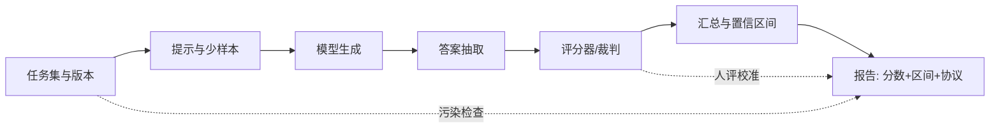

# 第 27 章 评测方法论

## 本章导读

某模型在 MMLU 上比对手高 0.8 分，媒体标题写“全面超越”。可如果评测集只有 1000 题、准确率在 70% 附近，一次抽样的标准误就有 1.45 个百分点；0.8 分连一个标准误都不到。更麻烦的是，提示模板、少样本示例、答案抽取规则、甚至裁判模型换一个版本，都可能让分数移动好几个点。本章要回答的不是“哪个模型最强”，而是：**一个分数在什么条件下才能被当作能力差异的证据。**

## 难度标签

⭐⭐ 基础 ｜ 数学要求：二项分布、置信区间、假设检验与 bootstrap ｜ 代码要求：Python 数值计算，不需要训练模型

## 学习目标

1. 区分真实能力、观测分数与测量误差，能计算标准误、置信区间与配对检验。
2. 解释准确率、macro-F1、pass@k、ECE 等指标各自回答什么问题，以及何时会误导。
3. 识别数据污染、提示敏感性、裁判偏差与多重比较四类系统性误差。
4. 设计可复现的评测协议，并写出最小报告字段。
5. 对智能体与长程任务，能用轨迹级指标与聚类 bootstrap 报告结果。

## 27.1 直觉：分数是带噪声的测量

把评测想成称重。真实能力是体重，观测分数是秤上的读数；秤本身有随机抖动，还可能没校准。一次读数偏高，不等于人真的变重了。评测里的“抖动”至少有四个来源：

- **抽样噪声**：评测集只是任务总体的一个样本，换一批题，分数会变。
- **协议偏差**：提示模板、少样本数量、解码参数、答案抽取规则不同，分数不可比。
- **数据污染**：训练语料里出现过评测题或其改写，分数被记忆抬高。
- **测量对象错位**：基准测的是多项选择，产品要的是长程任务完成率；分数高不代表目标能力高。

因此，一个完整的评测结论至少要说清三件事：**测的是什么构念**（construct validity）、**用什么协议测**（protocol validity）、**噪声有多大**（statistical uncertainty）。只报一个裸分，这三件事一件都没回答。

主流基准大致覆盖七类路线，如表 27-1 所示。它们不是越多越好：每个基准都有自己的饱和点与污染风险，选错基准比不评测更危险，因为错误的数字会带来虚假的确定感。



评测流水线的每一环都会引入方差或偏差。模型生成有采样随机性；答案抽取可能把“答案是 42。”和“42”判成不同；评分器可能是字符串匹配、单元测试或另一个模型。任何一个环节换版本，历史分数就不再可比。

协议敏感性可以用受控实验说明：同一模型、同一批题，0-shot 改 5-shot、直接作答改思维链、字符串匹配改正则抽取，分数可能相差数个点。这不是模型变了，而是测量条件变了。因此比较两个模型时必须固定协议；若不得不改协议，应报告新旧协议的对照实验，而不是把两个不同条件下的数字直接相减。更隐蔽的是选项顺序：多项选择基准里，把正确选项从 A 挪到 D，某些模型的准确率会明显变化，说明它依赖位置线索而非知识。


基准分数不是模型的固有属性，而是“模型 + 提示 + 解码 + 抽取 + 评分 + 数据版本”这个六元组的输出。报告分数时，六元组缺一项，别人就无法复现。


## 27.2 数学原理

### 27.2.1 从逐样本结果到指标

设评测集有 $$n$$ 个样本，第 $$i$$ 个样本的预测为 $$\hat y_i$$，标签为 $$y_i$$。最常用的准确率是

$$
\mathrm{Acc}=\frac{1}{n}\sum_{i=1}^{n}\mathbf{1}[\hat y_i=y_i]
\qquad \text{(27.1)}
$$

准确率把每个样本等权看待，类别不平衡时会掩盖少数类的失败。宏平均 F1 先对每个类别算 F1，再对类别等权平均：

$$
\mathrm{F1}_{\mathrm{macro}}=\frac{1}{C}\sum_{c=1}^{C}\frac{2\,\mathrm{TP}_c}{2\,\mathrm{TP}_c+\mathrm{FP}_c+\mathrm{FN}_c}
\qquad \text{(27.2)}
$$

其中 $$C$$ 是类别数，$$\mathrm{TP}_c$$、$$\mathrm{FP}_c$$、$$\mathrm{FN}_c$$ 分别是类别 $$c$$ 的真阳性、假阳性、假阴性。宏平均会让“少数类全错”的模型付出代价；微平均则按样本数加权，接近准确率。报告分类结果时，至少要说清用的是哪一种。

生成任务常用 pass@k：对每道题采样 $$n$$ 个解，其中 $$c$$ 个正确，从 $$n$$ 个里抽 $$k$$ 个，至少一个正确的无偏估计是

$$
\mathrm{pass@}k=1-\frac{\binom{n-c}{k}}{\binom{n}{k}}
\qquad \text{(27.3)}
$$

这个式子是“无放回抽样”的精确概率。若把每个解看作独立同分布、单次正确率为 $$p$$，常见近似是 $$1-(1-p)^k$$；它假设有放回，和 (27.3) 在 $$n$$ 很大时接近，但小样本下 (27.3) 才是无偏的。注意 pass@k 会随 $$k$$ 单调上升，比较两个模型时必须固定 $$k$$ 与采样数 $$n$$，否则数字没有意义。

BLEU、ROUGE、chrF 这类 n-gram 重叠指标也有类似问题：它们奖励与参考文本的字面重合，对语义等价但措辞不同的答案不友好。生成任务更稳妥的做法是“可执行验证优先，人评或模型评补充，字面指标只作辅助”。

指标聚合方式同样会改变结论。micro-F1 按样本数加权，类别极不平衡时接近准确率；macro-F1 对类别等权，少数类的错误会被放大。困惑度依赖分词器：同一模型换一套词表，每 Token 困惑度就变了，跨分词器比较应改用每字节比特数（bits-per-byte）。pass@k 衡量探索能力，maj@k（多数投票）衡量稳定性，两者回答不同问题；一个模型可能 pass@5 很高但 maj@5 不高，说明它会做对但答案分散。报告时要把“选了哪个聚合方式”写清楚，否则同一组原始结果可以得出相反结论。

### 27.2.2 抽样误差、置信区间与显著性

把每个样本的对错看作伯努利试验，准确率的标准误为

$$
\mathrm{SE}(\hat p)=\sqrt{\frac{\hat p(1-\hat p)}{n}}
\qquad \text{(27.4)}
$$

当 $$\hat p=0.5$$、$$n=1000$$ 时，标准误约 1.58%；95% 正态近似区间约为 $$\pm 3.1$$ 个百分点。报告“70.0%”而不报区间，读者无法判断 0.8 分的差距是否真实。比例接近 0 或 1 时，正态近似会给出越界区间，Wilson 区间更稳：

$$
\frac{\hat p+\frac{z^2}{2n}\pm z\sqrt{\frac{\hat p(1-\hat p)}{n}+\frac{z^2}{4n^2}}}{1+\frac{z^2}{n}}
\qquad \text{(27.5)}
$$

其中 $$z=1.96$$ 对应 95% 置信水平。实验中的 700/1000 得到 Wilson 区间 [0.671, 0.728]，宽约 5.7 个百分点；这意味着单模型分数的两位小数没有统计意义。

比较两个模型时，**配对设计**比独立两样本敏感得多。让两个模型答同一批题，逐样本作差，用 bootstrap 重采样题目并计算差的分布：

$$
\Delta^{*}=\frac{1}{n}\sum_{i=1}^{n}\left(s_i^{A*}-s_i^{B*}\right)
\qquad \text{(27.6)}
$$

重复几千次后取 2.5% 与 97.5% 分位，得到差值区间。配对的好处是消掉了题目难度带来的共同方差；真正决定灵敏度的是两个模型判断不一致的样本数。

对二分类结果，还可以用 McNemar 检验。记 $$b$$ 为“A 对、B 错”的样本数，$$c$$ 为“A 错、B 对”的样本数；原假设下不一致对服从 $$\mathrm{Binomial}(b+c,1/2)$$。精确双侧 p 值为

$$
p=2\sum_{i=0}^{\min(b,c)}\binom{b+c}{i}\left(\frac{1}{2}\right)^{b+c}
\qquad \text{(27.7)}
$$

样本量大时可用带连续性修正的卡方近似 $$\chi^2=(\lvert b-c\rvert-1)^2/(b+c)$$。实验中 $$b=20$$、$$c=40$$，精确 p≈0.0135：2 个百分点的差距在 1000 题上刚好显著。注意显著不等于重要：如果产品只关心是否提升 5 个百分点，2 个点的统计显著并没有决策价值。

同时比较 $$m$$ 个模型或 $$m$$ 个基准时，假阳性会累积。Bonferroni 校正把每个检验的阈值降到

$$
\alpha'=\frac{\alpha}{m}
\qquad \text{(27.8)}
$$

它保守但简单；$$m$$ 很大时更常用 FDR 控制。无论如何，先看预注册的主指标，再看探索性的次要指标，比事后从几十个数字里挑最大的那个可靠得多。

样本量可以在评测前估算。对两个独立比例，若希望以显著性水平 $$\alpha$$、功效 $$1-\beta$$ 检测到差值 $$\Delta$$，每组约需

$$
n\approx\frac{2\left(z_{1-\alpha/2}+z_{1-\beta}\right)^2 p(1-p)}{\Delta^2}
\qquad \text{(27.9)}
$$

在 $$p=0.5$$、$$\Delta=0.02$$、95% 置信、80% 功效下，每组约 9800 题。配对设计的方差取决于不一致对，同样 1000 题、60 个不一致对时，差值标准误约 0.77 个百分点，远小于非配对的 2.2 个百分点。这解释了为什么“同题对比”比“各自跑分”更能分辨小差距。

多重比较的处理也有讲究。Bonferroni 控制的是“至少一次假阳性”的概率，适合少量事先指定的比较；比较几十个模型时它过于保守，Benjamini–Hochberg 之类的 FDR 方法更常用：把 p 值排序后，找到最大的 $$k$$ 使 $$p_{(k)}\le k\alpha/m$$，拒绝前 $$k$$ 个。无论用哪种校正，都应该把主指标与探索性指标分开：主指标在评测前固定，探索性指标只用于生成假设，不能直接写进发布结论。另一个常见错误是用“置信区间是否重叠”判断差异；对配对数据，两个区间重叠但差值显著完全可能，必须直接对差值做检验。

### 27.2.3 数据污染

污染指评测样本或其近似改写出现在训练数据中。一个常用的检测量是 n-gram 重叠率：

$$
r_n=\frac{1}{M}\sum_{i=1}^{M}\mathbf{1}\left[\mathcal{G}_n(x_i^{\mathrm{eval}})\cap\mathcal{G}_n(\mathcal{D}_{\mathrm{train}})\neq\varnothing\right]
\qquad \text{(27.10)}
$$

其中 $$\mathcal{G}_n(\cdot)$$ 是文档的 n-gram 集合，$$M$$ 是评测文档数。$$n$$ 越大越保守：13-gram 是常见阈值（GPT-3 技术报告使用过），5-gram 会把常见短语也算作命中。实验中三条评测文档在 $$n=13$$ 时命中 1/3，在 $$n=5$$ 时命中 2/3，说明阈值本身会改变结论，报告时必须写清 $$n$$。

n-gram 只能抓字面复制，抓不到翻译、改写或题目换数字。更强的检查包括：MinHash/LSH 近似去重（第 10 章）、嵌入相似度、训练数据成员推断、以及把评测题做“扰动对照”——改人名、改数字、改单位后分数是否大幅下降。若扰动后掉分明显，说明模型依赖了记忆而非推理。

污染不是二值的。即使没有逐字重叠，训练分布与评测分布高度相似也会高估泛化。防污染的手段包括：私有留出集、时间切分（只用模型训练截止日之后发布的题）、定期刷新基准（如 LiveBench）、以及公开 canary 字符串。排行榜上的历史分数如果跨越了基准版本，就不应直接比较。

比污染更普遍的是基准饱和与“为基准而优化”。当头部模型在某项基准上接近上限，剩余差距可能只反映少量偏题、标注噪声或选项猜测；继续在这个基准上加训练数据、调提示，收益越来越小，却可能损害真实任务。Goodhart 定律在这里很贴切：一旦指标成为目标，它就不再是好的度量。健康的做法是同时保留一个“未被针对性优化”的私有集，并在基准饱和时主动换代，而不是把饱和分数当作能力上限。

### 27.2.4 校准与选择性预测

一个模型可能“答对 70%，但置信度平均 90%”。校准衡量置信度与实际正确率是否一致。把置信度分成 $$B$$ 个区间，第 $$b$$ 个区间的样本数为 $$n_b$$、平均置信度为 $$\mathrm{conf}(b)$$、实际准确率为 $$\mathrm{acc}(b)$$，期望校准误差为

$$
\mathrm{ECE}=\sum_{b=1}^{B}\frac{n_b}{n}\left|\mathrm{acc}(b)-\mathrm{conf}(b)\right|
\qquad \text{(27.11)}
$$

ECE 越小越校准。它依赖分箱方式，等宽分箱与等频分箱会给出不同数值，报告时要写明。校准对“允许拒答”的系统尤其重要：模型可以只在低风险样本上作答，用覆盖率—风险曲线描述取舍；只看准确率会奖励“全都答”的模型，而忽略它在高置信区域的可靠性。

选择性预测把这件事量化：按置信度从高到低排序，只回答前 $$c$$ 比例的样本，得到覆盖率 $$c$$ 与在该覆盖率下的错误率 $$\mathrm{risk}(c)$$。一个校准良好的系统，覆盖率从 100% 降到 70% 时风险应明显下降；如果风险几乎不变，说明置信度排序没有信息量。报告时应给整条曲线或几个关键点（如 coverage=0.5/0.7/0.9），而不是只挑一个覆盖率。对高风险场景，还可以设定风险上限，反推可接受的覆盖率，这比“尽量多答”更符合业务约束。

### 27.2.5 人评、模型评与排名

成对比较（pairwise comparison）让人或裁判模型在两条回答中选一条。Bradley–Terry 模型假设每个模型有 latent 实力 $$R_i$$，$$i$$ 胜过 $$j$$ 的概率为

$$
P(i\succ j)=\frac{1}{1+10^{-(R_i-R_j)/400}}
\qquad \text{(27.12)}
$$

Elo 是它的在线近似。若 $$i$$ 战胜 $$j$$，更新规则为

$$
R_i'=R_i+K\left(1-E_i\right),\qquad E_i=\frac{1}{1+10^{(R_j-R_i)/400}}
\qquad \text{(27.13)}
$$

$$K$$ 控制单场更新的幅度。Elo 分数不是绝对能力，只在同一选手池、同一时间段内有相对意义；新模型加入会改变旧分数的解释。

模型裁判有系统性偏差。Zheng 等（2023）报告了三类：**位置偏差**（更偏好先出现的回答）、**冗长偏差**（更偏好长回答）、**自我偏好**（更偏好同族模型的输出）。实验中让两个真实质量相同的模型对决，裁判以 0.6 的概率选第一个；只按一种顺序评测时，A 的胜率被抬到 0.603，交换顺序后回落到 0.503。工程上的基本操作是：交换 A/B 位置各评一次、控制长度、隐藏模型身份、用参考答案校准、并定期用人评抽检。

验证一个裁判不能只看它与人类的一致率，还要看三类稳定性。第一是**顺序一致性**：同一对回答交换位置后，判决应该翻转或至少不系统性偏向某一侧；若交换后仍偏向同一模型，说明有身份泄漏。第二是**长度分层一致性**：把回答按长度分桶，检查裁判是否在长回答上给出不成比例的高分。第三是**版本回归**：裁判模型升级后，用同一批固定样本重跑，分数漂移超过阈值就应重新校准。对抗样本也有用：故意放入“更长但更错”的回答，观察裁判是否被长度带偏。通过这些检查，模型裁判可以作为大规模初筛工具，但发布结论仍应有人评锚点。

人评本身也有噪声。两名标注者的一致率 80% 听起来不错，但如果两人各自的正例率都是 50%，随机一致率就是 50%，扣除机会一致后的 Cohen kappa 为

$$
\kappa=\frac{p_o-p_e}{1-p_e}
\qquad \text{(27.14)}
$$

其中 $$p_o$$ 是观测一致率，$$p_e$$ 是机会一致率。$$\kappa=0.6$$ 只能算中等一致；报告人评结果时，应该同时给一致率与 kappa，而不是只给“多数投票后的准确率”。

人评流程本身也需要设计。先写标注指南并试标一批，确认大家对“正确”“部分正确”“拒答”的边界一致；正式标注时让标注者独立判断，分歧样本进入仲裁；每隔一段时间插入重复项，估计标注者自身的一致性（intra-annotator agreement）。如果 kappa 低于 0.4，通常说明指南有歧义或任务本身主观，此时应修改指南或拆分维度，而不是靠增加标注者数量硬压噪声。人评的成本高，适合用来校准自动指标，而不是逐条评测全量数据。

最后，质量不是唯一目标。若模型 A 的分数高 2 个点但成本是 B 的 3 倍，是否值得取决于业务。一个简单的成本感知效用是

$$
U=\mathrm{score}-\lambda\cdot\mathrm{cost}
\qquad \text{(27.15)}
$$

$$\lambda$$ 把 Token、延迟或金额折算成分数单位。它的作用不是给出唯一答案，而是把“更贵但略好”的取舍显式化。

### 27.2.6 智能体与长程任务的评测

第 26 章的智能体输出不是一条回答，而是一条轨迹。只看最终答案会丢掉过程信息；更完整的指标包括：任务成功率、平均步数、上下文 Token、轨迹成本、工具错误率、重复调用率与副作用次数。若每个任务跑 $$k$$ 次且各次独立，关心的往往不是 pass@k（至少一次成功），而是 pass^k（每次都成功）：

$$
\mathrm{pass}^k=p_{\mathrm{task}}^{\,k}
\qquad \text{(27.16)}
$$

其中 $$p_{\mathrm{task}}$$ 是单次任务成功率。$$p_{\mathrm{task}}=0.9$$、$$k=5$$ 时 pass^5≈0.59；高单次成功率不等于可重复的可靠性。

长程任务的样本还按任务聚集：同一任务的多次尝试高度相关，不能当作独立样本。聚类 bootstrap 先重采样任务、再在任务内重采样轨迹；有效样本量近似为

$$
n_{\mathrm{eff}}=\frac{n}{\mathrm{DEFF}},\qquad \mathrm{DEFF}=1+(m-1)\rho
\qquad \text{(27.17)}
$$

其中 $$m$$ 是每任务尝试数，$$\rho$$ 是任务内相关系数。忽略聚类会低估标准误，把“任务间差异”误当成“方法差异”。

智能体评测的样本量问题比静态基准更尖锐。50 个任务、成功率 0.5 时，单次评估的标准误约 7 个百分点；要分辨 5 个点的差距，靠独立任务需要数百个，靠同任务配对与多次尝试才现实。因此报告不能只给一个成功率，还要给任务数、每任务尝试数、步数与成本分布。失败样本应按原因分类：模型选错工具、参数错误、工具超时、上下文超限、权限拒绝、验证器误判。分类统计能告诉你该改模型、改接口还是改环境；只报“失败了 30%”无法指导下一步。对需要部分完成的任务，还可以报告里程碑完成率，但必须说明部分分如何折算，避免用“看起来合理”的中间步骤掩盖最终失败。

## 27.3 方案对比

表 27-1 把常见评测路线放在一起比较。没有一条路线能同时满足“便宜、可复现、防污染、贴近产品”；选择取决于你要回答的问题。

| 路线 | 代表基准 | 测什么 | 主要偏差 | 成本 | 适用场景 |
| --- | --- | --- | --- | --- | --- |
| 静态知识 | MMLU、MMLU-Pro | 学科知识与推理 | 污染、饱和、选项猜测 | 低 | 快速横向筛查 |
| 数学与代码 | GSM8K、MATH、HumanEval、MBPP | 多步推理与程序正确性 | 答案抽取、测试覆盖、污染 | 中 | 可执行验证优先 |
| 指令跟随 | MT-Bench、IFEval | 多轮指令与格式遵循 | 裁判偏差、提示敏感 | 中 | 对话产品迭代 |
| 成对竞技场 | Chatbot Arena | 人类偏好排序 | 选手池变化、风格偏差 | 高 | 相对偏好与排名 |
| 长上下文 | NIAH、RULER | 检索与长程利用 | 任务过窄、位置偏差 | 中 | 上下文窗口验收 |
| 智能体环境 | SWE-bench、AgentBench、WebArena | 多步任务完成 | 环境版本、副作用、方差大 | 很高 | 端到端能力评估 |
| 动态基准 | LiveBench、LiveCodeBench | 月度新题上的能力 | 题量小、更新成本 | 高 | 防污染与时效性 |

选择时先问三个问题：第一，基准的任务分布与产品分布差多远？第二，分数的主要误差源是抽样、协议还是污染？第三，这个分数能否在两周后复现？三个问题有一个答不上来，就不该把它写进发布材料。

## 27.4 代码实现

### 27.4.1 核心模块

下面的模块只依赖标准库，所有随机过程使用固定种子。指标函数接收逐样本结果，统计函数返回区间或 p 值，便于在上层组合。

```python
"""第 27 章：评测指标与统计工具（tinylm/eval/metrics.py）。

只依赖 Python 标准库。指标函数接收逐样本结果，统计函数用固定种子，
便于在 CPU 上复现实验。
"""
from __future__ import annotations

import math
import random
from collections import Counter
from typing import Hashable, Sequence

def _check_scores(preds: Sequence, labels: Sequence) -> None:
    if len(preds) != len(labels) or len(preds) == 0:
        raise ValueError("preds and labels must be non-empty and aligned")

def accuracy(preds: Sequence, labels: Sequence) -> float:
    """(27.1)：逐样本正确率的算术平均。"""
    _check_scores(preds, labels)
    return sum(1 for p, y in zip(preds, labels) if p == y) / len(labels)

def macro_f1(preds: Sequence, labels: Sequence) -> float:
    """(27.2)：先算每类 F1，再对类别等权平均。"""
    _check_scores(preds, labels)
    classes = sorted(set(labels) | set(preds), key=repr)
    scores: list[float] = []
    for c in classes:
        tp = sum(1 for p, y in zip(preds, labels) if p == c and y == c)
        fp = sum(1 for p, y in zip(preds, labels) if p == c and y != c)
        fn = sum(1 for p, y in zip(preds, labels) if p != c and y == c)
        denom = 2 * tp + fp + fn
        scores.append(0.0 if denom == 0 else 2 * tp / denom)
    return sum(scores) / len(scores)

def pass_at_k(n: int, c: int, k: int) -> float:
    """(27.3)：从 n 个样本中抽 k 个，至少一个正确的无偏估计。"""
    if not 1 <= k <= n:
        raise ValueError("need 1 <= k <= n")
    if not 0 <= c <= n:
        raise ValueError("need 0 <= c <= n")
    if n - c < k:
        return 1.0
    return 1.0 - math.comb(n - c, k) / math.comb(n, k)

def binomial_se(p: float, n: int) -> float:
    """(27.4)：二项比例的标准误。"""
    if n < 1 or not 0.0 <= p <= 1.0:
        raise ValueError("invalid p or n")
    return math.sqrt(p * (1.0 - p) / n)

def wilson_interval(successes: int, n: int, z: float = 1.96) -> tuple[float, float]:
    """(27.5)：二项比例的 Wilson 置信区间，小样本比正态近似稳。"""
    if n < 1 or not 0 <= successes <= n or z <= 0:
        raise ValueError("invalid counts or z")
    p = successes / n
    denom = 1.0 + z * z / n
    center = (p + z * z / (2.0 * n)) / denom
    half = z * math.sqrt(p * (1.0 - p) / n + z * z / (4.0 * n * n)) / denom
    return max(0.0, center - half), min(1.0, center + half)

def paired_bootstrap_diff(a: Sequence[float], b: Sequence[float],
                          n_boot: int = 4000, level: float = 0.95,
                          seed: int = 0) -> tuple[float, float, float]:
    """(27.6)：逐样本配对差的 bootstrap 均值与百分位区间。"""
    if len(a) != len(b) or len(a) == 0:
        raise ValueError("a and b must be non-empty and aligned")
    if n_boot < 1 or not 0.0 < level < 1.0:
        raise ValueError("invalid n_boot or level")
    diffs = [float(x) - float(y) for x, y in zip(a, b)]
    observed = sum(diffs) / len(diffs)
    rng = random.Random(seed)
    boots = []
    for _ in range(n_boot):
        total = 0.0
        for _ in range(len(diffs)):
            total += diffs[rng.randrange(len(diffs))]
        boots.append(total / len(diffs))
    boots.sort()
    lo_index = int((1.0 - level) / 2.0 * n_boot)
    hi_index = min(n_boot - 1, int((1.0 + level) / 2.0 * n_boot) - 1)
    return observed, boots[lo_index], boots[hi_index]

def mcnemar_test(b: int, c: int) -> float:
    """(27.7)：配对二分类的精确 McNemar 双侧 p 值。

    b 是“A 对、B 错”的样本数，c 是“A 错、B 对”的样本数。
    """
    if b < 0 or c < 0:
        raise ValueError("discordant counts must be non-negative")
    total = b + c
    if total == 0:
        return 1.0
    tail = sum(math.comb(total, i) for i in range(min(b, c) + 1)) / 2.0 ** total
    return min(1.0, 2.0 * tail)

def expected_calibration_error(confidences: Sequence[float],
                               correct: Sequence[bool | int],
                               n_bins: int = 10) -> float:
    """(27.11)：按置信度分箱，累加 |准确率 - 平均置信度|。"""
    if len(confidences) != len(correct) or len(confidences) == 0:
        raise ValueError("confidences and correct must be non-empty and aligned")
    if n_bins < 1:
        raise ValueError("n_bins must be positive")
    buckets: list[list[tuple[float, float]]] = [[] for _ in range(n_bins)]
    for conf, ok in zip(confidences, correct):
        if not 0.0 <= conf <= 1.0:
            raise ValueError("confidence must be in [0, 1]")
        index = min(int(conf * n_bins), n_bins - 1)
        buckets[index].append((conf, float(bool(ok))))
    total = len(confidences)
    return sum(len(bucket) / total * abs(
        sum(ok for _, ok in bucket) / len(bucket) - sum(c for c, _ in bucket) / len(bucket)
    ) for bucket in buckets if bucket)

def ngrams(tokens: Sequence[Hashable], n: int) -> set[tuple]:
    if n < 1:
        raise ValueError("n must be positive")
    return {tuple(tokens[i:i + n]) for i in range(len(tokens) - n + 1)}

def contamination_rate(eval_docs: Sequence[Sequence[Hashable]],
                       train_docs: Sequence[Sequence[Hashable]],
                       n: int = 13) -> float:
    """(27.10)：评测文档中至少命中一个训练 n-gram 的比例。"""
    if not eval_docs:
        raise ValueError("eval_docs must be non-empty")
    train_ngrams: set[tuple] = set()
    for doc in train_docs:
        train_ngrams |= ngrams(doc, n)
    hit = sum(1 for doc in eval_docs if ngrams(doc, n) & train_ngrams)
    return hit / len(eval_docs)

def bradley_terry_prob(score_i: float, score_j: float) -> float:
    """(27.12)：Elo 尺度下 Bradley–Terry 模型中 i 胜过 j 的概率。"""
    return 1.0 / (1.0 + 10.0 ** (-(score_i - score_j) / 400.0))

def elo_update(rating_w: float, rating_l: float,
               k: float = 32.0) -> tuple[float, float]:
    """(27.13)：按胜负更新双方 Elo 分。"""
    if k <= 0:
        raise ValueError("k must be positive")
    expected_w = 1.0 / (1.0 + 10.0 ** ((rating_l - rating_w) / 400.0))
    delta = k * (1.0 - expected_w)
    return rating_w + delta, rating_l - delta

def cohen_kappa(a: Sequence, b: Sequence) -> float:
    """(27.14)：两名标注者的 Cohen kappa。"""
    if len(a) != len(b) or len(a) == 0:
        raise ValueError("ratings must be non-empty and aligned")
    n = len(a)
    observed = sum(1 for x, y in zip(a, b) if x == y) / n
    ca, cb = Counter(a), Counter(b)
    expected = sum(ca[key] * cb[key] for key in ca) / (n * n)
    if expected >= 1.0:
        return 1.0
    return (observed - expected) / (1.0 - expected)

def cost_aware_utility(score: float, cost: float, lam: float) -> float:
    """(27.15)：把分数与成本折算到同一尺度。"""
    if cost < 0 or lam < 0:
        raise ValueError("cost and lam must be non-negative")
    return score - lam * cost
```

几个设计点值得说明。`_check_scores` 统一拒绝空输入与长度不一致，避免“空集准确率”这类未定义行为。`pass_at_k` 用组合数直接实现 (27.3)，不做 $$1-(1-p)^k$$ 近似，因此小样本下仍然无偏。`wilson_interval` 把区间截断到 $$[0,1]$$，比例接近边界时不会出现负下界。`paired_bootstrap_diff` 对**差值**重采样，而不是分别对两个模型重采样，这正是配对设计的关键。`mcnemar_test` 用精确二项尾概率，样本少时比卡方近似可靠。`contamination_rate` 接受任意可哈希 Token 序列，示例用空格分词，真实中文语料应改用字级或子词级 n-gram。

这些函数刻意不做“自动选指标”或“自动判显著”。指标选择是研究判断，不是库能替代的；库只负责把定义算对、把不确定性算出来。

### 27.4.2 运行实验

示例用一组确定性的逐样本结果演示配对比较，再用固定种子模拟 pass@k、位置偏差与 n-gram 命中。

```python
"""第 27 章：评测方法论（examples/ch27_eval.py）。"""
import random
import sys

sys.path.insert(0, ".")
from tinylm.eval.metrics import (accuracy, binomial_se, bradley_terry_prob, cohen_kappa,
                                 contamination_rate, cost_aware_utility,
                                 elo_update, expected_calibration_error,
                                 macro_f1, mcnemar_test, paired_bootstrap_diff,
                                 pass_at_k, wilson_interval)

def comparison_demo():
    n = 1000
    both_ok, a_only, b_only = 680, 20, 40
    both_bad = n - both_ok - a_only - b_only
    a = [1] * both_ok + [1] * a_only + [0] * b_only + [0] * both_bad
    b = [1] * both_ok + [0] * a_only + [1] * b_only + [0] * both_bad
    acc_a, acc_b = accuracy(a, [1] * n), accuracy(b, [1] * n)
    diff, lo, hi = paired_bootstrap_diff(a, b, n_boot=4000, seed=0)
    p_value = mcnemar_test(a_only, b_only)
    lo_a, hi_a = wilson_interval(sum(a), n)
    lo_b, hi_b = wilson_interval(sum(b), n)
    print("两个模型的配对比较（n=1000）")
    print(f"  A 准确率 {acc_a:.3f}，标准误 {binomial_se(acc_a, n):.4f}，"
          f"Wilson 95% 区间 [{lo_a:.3f}, {hi_a:.3f}]")
    print(f"  B 准确率 {acc_b:.3f}，Wilson 95% 区间 [{lo_b:.3f}, {hi_b:.3f}]")
    print(f"  配对差 B-A {diff:+.3f}，bootstrap 95% 区间 [{lo:+.3f}, {hi:+.3f}]")
    print(f"  不一致对 b={a_only}, c={b_only}，McNemar 精确 p={p_value:.4f}")

def passk_demo():
    n, c = 10, 2
    rng = random.Random(0)
    correct = set(range(c))
    print(f"pass@k 的公式与抽样核对（n={n}, c={c}, 20000 次）")
    print(f"{'k':>2} {'公式':>8} {'模拟':>8}")
    for k in range(1, 6):
        hits = sum(1 for _ in range(20000)
                   if correct & set(rng.sample(range(n), k)))
        print(f"{k:>2} {pass_at_k(n, c, k):>8.4f} {hits / 20000:>8.4f}")

def contamination_demo():
    train = "the quick brown fox jumps over the lazy dog and then it sleeps all day".split()
    copied = list(train)
    paraphrase = train[:6] + "while the crowd watches quietly".split()
    novel = "a completely different sentence about evaluation protocol".split()
    docs = [copied, paraphrase, novel]
    print("训练—评测 n-gram 重叠（3 条评测文档）")
    for n in (5, 13):
        print(f"  n={n:>2}: 命中比例 {contamination_rate(docs, [train], n):.3f}")

def judge_demo():
    rng = random.Random(1)
    trials = 2000
    a_first = sum(1 for _ in range(trials) if rng.random() < 0.6)
    swapped = sum(1 for _ in range(trials) if rng.random() < 0.6)
    print("裁判的位置偏差（两模型真实质量相同）")
    print(f"  只按 A 在前：A 胜率 {a_first / trials:.3f}")
    print(f"  交换顺序后：A 胜率 {(a_first + (trials - swapped)) / (2 * trials):.3f}")
    print("Bradley–Terry 胜率与 Elo 更新")
    for gap in (0, 100, 200):
        print(f"  分差 {gap:>3}: P(i 胜 j)={bradley_terry_prob(gap, 0):.3f}")
    w, l = elo_update(1500, 1700)
    print(f"  1500 战胜 1700 后：{w:.1f} / {l:.1f}")

def calibration_demo():
    confidences, correct = [], []
    for bucket in range(10):
        confidences += [(bucket + 0.5) / 10] * 10
        correct += [1] * bucket + [0] * (10 - bucket)
    ece = expected_calibration_error(confidences, correct, n_bins=10)
    print(f"校准：ECE = {ece:.3f}（每箱 10 个样本，准确率比置信度低 0.05）")

def agreement_demo():
    a = [1] * 50 + [0] * 50
    b = [1] * 40 + [0] * 10 + [1] * 10 + [0] * 40
    print(f"标注一致性：一致率 0.800，Cohen kappa = {cohen_kappa(a, b):.3f}")
    preds, labels = [0, 0, 1, 2], [0, 1, 1, 2]
    print(f"macro-F1（3 类，两类各错一个）= {macro_f1(preds, labels):.3f}"
          f"（准确率 {accuracy(preds, labels):.3f}）")

def utility_demo():
    u_a = cost_aware_utility(0.72, 1.0, 0.02)
    u_b = cost_aware_utility(0.74, 3.0, 0.02)
    print("成本感知效用（lambda=0.02，成本按相对单位）")
    print(f"  A: 0.72 - 0.02*1 = {u_a:.2f}")
    print(f"  B: 0.74 - 0.02*3 = {u_b:.2f}")

def main():
    comparison_demo()
    print()
    passk_demo()
    print()
    contamination_demo()
    print()
    judge_demo()
    print()
    calibration_demo()
    print()
    agreement_demo()
    print()
    utility_demo()

if __name__ == "__main__":
    main()
```

运行方式与真实输出如下：

```text
PYTHONPATH=. python examples/ch27_eval.py
```

```text
两个模型的配对比较（n=1000）
  A 准确率 0.700，标准误 0.0145，Wilson 95% 区间 [0.671, 0.728]
  B 准确率 0.720，Wilson 95% 区间 [0.691, 0.747]
  配对差 B-A -0.020，bootstrap 95% 区间 [-0.035, -0.005]
  不一致对 b=20, c=40，McNemar 精确 p=0.0135

pass@k 的公式与抽样核对（n=10, c=2, 20000 次）
 k       公式       模拟
 1   0.2000   0.2034
 2   0.3778   0.3735
 3   0.5333   0.5332
 4   0.6667   0.6679
 5   0.7778   0.7790

训练—评测 n-gram 重叠（3 条评测文档）
  n= 5: 命中比例 0.667
  n=13: 命中比例 0.333

裁判的位置偏差（两模型真实质量相同）
  只按 A 在前：A 胜率 0.603
  交换顺序后：A 胜率 0.503
Bradley–Terry 胜率与 Elo 更新
  分差   0: P(i 胜 j)=0.500
  分差 100: P(i 胜 j)=0.640
  分差 200: P(i 胜 j)=0.760
  1500 战胜 1700 后：1524.3 / 1675.7

校准：ECE = 0.050（每箱 10 个样本，准确率比置信度低 0.05）

标注一致性：一致率 0.800，Cohen kappa = 0.600
macro-F1（3 类，两类各错一个）= 0.778（准确率 0.750）

成本感知效用（lambda=0.02，成本按相对单位）
  A: 0.72 - 0.02*1 = 0.70
  B: 0.74 - 0.02*3 = 0.68
```

输出里有几处值得对照。第一，A 与 B 的 Wilson 区间大幅重叠，但配对差区间 [-0.035, -0.005] 不含 0，McNemar p≈0.0135；这说明“区间重叠”不能直接用来判断配对差异，必须看逐样本的联合结果。第二，pass@k 的公式与 2 万次抽样在第三位小数内一致，验证了 (27.3) 的实现。第三，位置偏差把 0.5 的真实胜率抬到 0.603，交换顺序后回到 0.503；只评一种顺序的排行榜会系统性高估先手模型。第四，ECE 被构造成每箱都差 0.05，因此恰好等于 0.050，便于核对分箱逻辑。

### 27.4.3 测试

```text
PYTHONPATH=. python -m pytest -q tests/test_eval.py 2>&1 | sed -E 's/ in [0-9.]+s//'
```

```text
12 passed
```

测试覆盖了每个公式的端点与边界：准确率拒绝空输入与长度不一致；macro-F1 在各类全对时为 1、在少数类全错时下降；pass@k 在 $$c=0$$ 时为 0、在 $$n-c<k$$ 时为 1；Wilson 区间在 0/10 与 10/10 时贴住边界；配对 bootstrap 在全正差时区间退化为 1；McNemar 在 $$b=c$$ 时 p=1、在 $$b=0,c=10$$ 时等于精确二项尾概率；ECE 在完美校准时为 0；n-gram 检测在 13-gram 与 5-gram 下给出不同命中率；Elo 在等分对局时各变动 16 分；kappa 在 80% 一致、50% 机会一致时为 0.6。

## 27.5 工业实践

**HELM**（Liang 等，2022）是最早系统化“多场景 × 多指标”的评测框架之一，强调同一组场景上同时报告准确率、校准、鲁棒性、公平性与效率，而不是压成一个综合分。它的价值在于把“评测什么”变成显式选择：不同场景的权重会改变排名，因此 HELM 公开原始矩阵，让读者自己加权。

**MMLU**（Hendrycks 等，2020）覆盖 57 个学科、约 1.6 万道多项选择题，长期作为通用知识基线；**MMLU-Pro** 把选项扩到 10 个、加入更多推理题，缓解“四选一靠猜”的天花板。多项选择基准的常见问题是污染与饱和：当头部模型都接近 90% 时，剩余差距可能只反映少量难题与猜测，不再反映通用能力。

**GSM8K**（Cobbe 等，2021）有约 8500 道小学应用题，**MATH** 有约 1.25 万道竞赛题；**HumanEval**（Chen 等，2021）只有 164 道函数题，**MBPP** 约 974 道。代码基准的核心不是“生成文本像不像”，而是隐藏单元测试是否通过；这让它比 BLEU 可靠，但也带来测试覆盖、执行环境与污染问题。HumanEval 题量小，pass@1 的标准误很大，报告时应给置信区间并固定采样数。

**MT-Bench**（Zheng 等，2023）用 80 道多轮问题、让强模型按 1–10 打分；论文报告 GPT-4 与人类偏好的一致率超过 80%，与人类之间的一致率相近，但同时指出位置、冗长与自我偏好三类偏差。**Chatbot Arena**（Chiang 等，2024）用真实用户的成对投票拟合 Bradley–Terry/Elo，并给出 bootstrap 置信区间与风格控制；它的优势是生态效度高，劣势是选手池随时间变化、投票者分布不可控。

**SWE-bench** 用真实 GitHub issue 与仓库测试验证补丁，**AgentBench** 覆盖 8 类交互环境，**WebArena** 提供可复现的网页任务。这类基准最接近产品，但方差也最大：同一模型换一个环境版本、工具接口或重试策略，成功率就会变。第 26 章的轨迹日志在这里是必需品——没有逐步记录，就无法区分“模型不会”与“环境坏了”。


截至写作时，各家排行榜、基准版本与裁判模型仍在更新；同一模型在不同榜单上的分数不可直接比较。引用分数时必须同时给出基准版本、评测日期、提示与少样本设置、解码参数、答案抽取规则与评分器版本；缺一项就应视为不可复现。


主流厂商的系统卡（system card）与模型卡（model card）通常会把评测协议、样本量、已知局限与风险场景放在显眼位置，而不是只列一个排行榜名次。这不是公关格式，而是让读者能判断分数是否适用于自己的任务。开源模型还应给出评测脚本与数据版本，否则社区复现的分数会不断漂移。

一个可复现的评测报告至少包含：模型与权重版本、评测日期、基准与版本、提示模板与少样本数、解码参数（温度、Top-p、最大长度）、答案抽取与评分脚本、样本量与置信区间、污染检查结果、以及失败样本的分类统计。系统卡之所以长，不是因为作者啰嗦，而是因为这些字段缺一不可。

## 27.6 论文导读

**1. Liang 等，2022，Holistic Evaluation of Language Models，arXiv:2211.09110。** 多场景、多指标评测框架；读第 2–4 节，重点看场景分类、指标定义与“不压成单一分数”的理由。

**2. Hendrycks 等，2020，Measuring Massive Multitask Language Understanding，arXiv:2009.03300。** MMLU 的构造与 57 学科划分；读第 2–3 节，重点看题目来源、少样本设置与当时的模型差距。

**3. Chen 等，2021，Evaluating Large Language Models Trained on Code，arXiv:2107.03374。** HumanEval 与 pass@k 估计量；读第 2 节与附录，重点看 (27.3) 的无偏估计与执行式评分。

**4. Zheng 等，2023，Judging LLM-as-a-Judge with MT-Bench and Chatbot Arena，arXiv:2306.05685。** 模型裁判的能力与偏差；读第 3–5 节，重点看位置偏差、冗长偏差、自我偏好与人类一致率。

**5. Chiang 等，2024，Chatbot Arena: An Open Platform for Evaluating LLMs by Human Preference，arXiv:2403.04132。** 成对投票与 Bradley–Terry/Elo；读第 3–4 节，重点看采样、置信区间与风格控制。

## 27.7 常见误区

**误区一：分数高就是能力强。** 分数是“模型 + 协议 + 数据”的输出。没有置信区间、没有协议说明、没有污染检查的分数，只能当作传闻。正确做法是先问“这个基准测什么、噪声多大、训练集见过没有”，再看数字。

**误区二：评测集越大越好。** 规模能降低抽样噪声，但不能消除污染与分布错位。一个 1 万题的污染集，比一个 1000 题的干净集更糟。优先保证题目质量、难度分层与防污染，再考虑扩规模；同时报告标准误，让读者知道规模买到了多少确定性。

**误区三：只看平均分。** 平均分会把最差组、长尾任务与高成本样本藏起来。产品上线前至少要看分任务、分难度、分群体的结果，以及分数的方差与最差 10% 样本。一个平均分高但某些群体灾难性失败的模型，不能算“全面更好”。

**误区四：LLM-as-Judge 可以完全替代人评。** 模型裁判便宜、可扩展，但有位置、长度、自我偏好与提示敏感等偏差，而且会随裁判版本漂移。它适合做大规模初筛与回归监控，不适合单独作为发布依据；关键结论应有人评抽检与一致性统计（如 kappa）。

**误区五：pass@k 高就代表可靠。** pass@k 衡量“至少一次成功”，产品往往需要“每次都成功”。$$p=0.9$$ 时 pass@1=0.9，但 pass^5≈0.59；对高风险任务，应报告 pass^k、失败率与副作用次数，而不是只报一个好看的 pass@k。

## 27.8 本章小结

本章把评测拆成测量问题：指标定义回答“算什么”，抽样误差回答“差多少算真”，协议与污染回答“这个数能不能信”。准确率、macro-F1 与 pass@k 分别对应逐样本、按类别与多次采样三种视角；标准误、Wilson 区间、配对 bootstrap 与 McNemar 给出不确定性；n-gram 重叠、扰动对照与时间切分用于污染检查；ECE 与覆盖率—风险曲线描述校准；Bradley–Terry/Elo 与 kappa 处理偏好排名与标注一致性；成本感知效用把质量与代价放在同一尺度。代码实现了这些量的最小版本，并用确定性数据核对了公式与实现。

### 本章的取舍

为了让分数可比较，我们固定提示、解码与评分协议，代价是评测结果离真实产品的多样性更远。为了防污染，我们使用私有集、时间切分与定期刷新，代价是历史分数不可比、复现成本上升。为了降低噪声，我们扩大样本量与重复次数，代价是算力与时间；为了贴近产品，我们转向智能体环境与人工偏好，代价是方差更大、审计更难。若只能记住一句话：**评测的目标不是给出一个分数，而是给出一个带误差条、可复现、能指导决策的证据。**


发布任何评测结论前，先补齐三件事：协议六元组、置信区间、污染检查。三者缺一，分数就只是轶事。


## 27.9 习题

### 习题 1（推导）

某评测集有 $$n=1000$$ 题，模型答对 700 题。请计算准确率的标准误与 95% Wilson 区间；若另一个模型答对 720 题，且不一致对为 $$b=20$$、$$c=40$$，用 McNemar 检验判断差异是否显著。再解释：为什么在同样样本量下，配对设计比两个独立样本更容易检测出小差异？

### 习题 2（编程）

实现聚类 bootstrap：输入“任务 ID + 每次尝试的成败”，先按任务重采样，再在任务内重采样，输出任务成功率的 95% 区间。用第 26 章的 `AgentResult` 构造至少 20 个任务、每任务 5 次尝试的模拟数据，比较朴素 bootstrap 与聚类 bootstrap 的区间宽度。

### 习题 3（开放思考）

为一个代码生成产品设计评测协议，要求覆盖：防污染的题源、隐藏测试、执行环境版本、pass@k 与 pass^k、成本与延迟、失败分类。说明哪些指标用于发布、哪些用于内部回归，以及如何避免“只优化评测集”。

<details>
<summary>习题答案</summary>

**推导题答案.** 由 (27.4)，标准误为

$$
\mathrm{SE}=\sqrt{\frac{0.7\times0.3}{1000}}\approx0.0145
\qquad \text{(27.18)}
$$

即约 1.45 个百分点。95% Wilson 区间为 [0.671, 0.728]（与实验输出一致）。McNemar 的 $$b+c=60$$，精确双侧 p 值由 (27.7) 得约 0.0135；在 0.05 水平下拒绝“两模型无差异”，但 2 个百分点的实际幅度是否重要，要由产品阈值决定。

配对更敏感，是因为两个模型共享题目难度：难题两者都错、易题两者都对，这些样本对差值没有贡献；真正提供信息的是不一致对。非配对比较把题目难度算进方差，标准误约 $$\sqrt{2\hat p(1-\hat p)/n}\approx0.0205$$；配对差值在零假设下的标准误约 $$\sqrt{b+c}/n=60^{1/2}/1000\approx0.0077$$，小了近三倍。

**编程题答案.** 关键是重采样单位必须是任务，而不是单次尝试。伪代码：

```python
rng = random.Random(0)
tasks = list(range(20))
boots = []
for _ in range(4000):
    picked = [rng.choice(tasks) for _ in tasks]
    attempts = [rng.choice(per_task[t]) for t in picked for _ in range(5)]
    boots.append(sum(attempts) / len(attempts))
boots.sort()
ci = (boots[100], boots[3899])
```

朴素 bootstrap 把 100 条尝试当独立样本，区间会明显偏窄；聚类 bootstrap 先抽任务，保留了任务内相关，区间更宽。若任务间成功率差异大，两种区间可能相差数倍。

**开放题答案.** 要点：题源按发布时间切分，训练截止日之后的新题进入私有留出集；每道题配多组隐藏测试，避免只过样例；固定容器镜像与依赖版本；同时报告 pass@1/5（探索能力）与 pass^5（可靠性）；记录每任务 Token、墙钟时间与工具调用次数；失败按“语法错、逻辑错、超时、环境错”分类。发布指标用私有集上的 pass^k 与成本，内部回归用公开集上的 pass@k 与单元测试通过率；定期用新题刷新，防止针对评测集过拟合。

</details>
