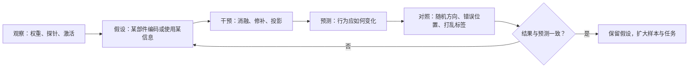

# 第 28 章 可解释性

## 本章导读

把最后一层的注意力权重画成热力图，某个头几乎把全部注意力压在前面的一个词上，报告于是写：“模型靠这个头答对。”可把这个头单独剪掉，准确率一点没降。问题不在于图画得不好，而在于**权重、探针准确率与消融效果回答的是三个不同的问题**。本章要问：什么样证据，才能支撑“某个内部部件负责某个行为”这句话？

## 难度标签

⭐⭐⭐⭐ 研究向 ｜ 数学要求：线性分类、softmax、向量投影与基础统计 ｜ 代码要求：PyTorch forward hook、训练小型 Transformer。建议先读第 3、6、27 章。

## 学习目标

1. 区分“信息能被读出”与“信息被下游使用”，并设计控制实验。
2. 用线性探针评估表示，解释选择性、对照任务与泄漏风险。
3. 说明注意力权重为何不是因果贡献，并能用消融与修补量化影响。
4. 设计激活修补实验，正确选择干预位点、损坏方式与评价指标。
5. 理解稀疏自编码器的重构—稀疏权衡，以及其特征解释的使用边界。

## 28.1 直觉：解释是假设，不是故事

把模型想成一块电路板。你可以用万用表测某个节点的电压，也可以剪断一根线看整机是否失灵。前者告诉你“这里有信号”，后者才告诉你“这条线参与了这个功能”。可解释性研究里最常见的错误，是把前者当成后者：看到一个探针能解码某个属性、一个注意力头盯着某个词，就宣布找到了机制。

一个完整的解释至少要回答三个层次的问题：

- **表征**：某个属性在哪个位置、哪一层、以什么方向编码？
- **因果**：下游的哪一部分读取了这个表征？去掉它会怎样？
- **机制**：这些部件按什么顺序组合，完成了从输入到输出的计算？

三者缺一不可。只回答表征，得到的是“相关性地图”；只回答因果，可能只是一个黑箱式的输入—输出表；只有机制，才接近“算法”。而机制解释的可信度，取决于它能否给出**可证伪的预测**：如果“头 7 负责把主语复制到输出”，那么消融头 7 应当让主语相关任务下降，而在无关任务上影响很小；如果实际结果不是这样，假设就要修改。



解释还有粒度问题。神经元、注意力头、特征、回路、算法，是五种不同的描述层级。一个头可能同时参与多个回路，一个特征也可能由多个神经元叠加而成；因此“某个头是某个功能的唯一实现”通常过强。更稳妥的说法是：在当前模型、当前任务分布与当前干预方式下，这个部件对这项行为有可测的因果贡献。


读得出不等于用得上。探针、注意力权重与 SAE 特征都只是“可读性”证据；要谈“使用”，必须做干预。把这句话贴在每一张解释图旁边，能避免大部分过度解读。


## 28.2 数学原理

### 28.2.1 探针：信息在哪里

设第 $$l$$ 层、第 $$t$$ 个位置的隐藏状态为 $$h_i\in\mathbb{R}^{d}$$，第 $$i$$ 个样本的标签为 $$y_i$$。线性探针训练一个线性分类器 $$W\in\mathbb{R}^{C\times d}$$，最小化带权重衰减的交叉熵：

$$
\min_{W}\ \frac{1}{n}\sum_{i=1}^{n}\mathrm{CE}\left(\mathrm{softmax}(Wh_i),y_i\right)+\lambda\lVert W\rVert_2^2
\qquad \text{(28.1)}
$$

在留出集上报告准确率。若标签有 $$C$$ 类，随机水平约为 $$1/C$$；但随机水平不是唯一对照。更可靠的做法是同时训练一个**对照探针**：打乱标签、使用随机特征，或在同样容量下从原始输入直接预测。探针的选择性定义为

$$
\mathrm{Sel}=\mathrm{Acc}_{\mathrm{probe}}-\mathrm{Acc}_{\mathrm{control}}
\qquad \text{(28.2)}
$$

只有当选择性显著大于零，才能说“该表示包含了这个属性的信息”，而不是“分类器自己学会了任务”。

探针有几个常见陷阱。第一，**容量不匹配**：线性探针失败，可能只是属性以非线性方式编码；换成 MLP 探针成功，说明码是非线性的，但不说明模型下游用了它。第二，**数据泄漏**：同一段文本的多个 Token 被分到训练集与测试集，探针可能记住上下文而不是属性；应按样本或文档切分。第三，**标签定义偏差**：用“词是否出现”当属性标签，探针学到的可能只是词频。第四，**探针方向不等于因果方向**：即使线性可分，投影掉探针方向也未必改变模型输出，因为下游可能根本不读这个方向。

在我们的玩具实验里，位置 2 与位置 5 的 Token 都能被线性探针以 97.5% 与 100% 的准确率解码，但只改位置 5 的填充词，模型输出完全不变；只有改位置 1 的被复制词，输出才跟着变。这正是“可读”与“被使用”的分离：探针证明信息在残差流里，因果实验才证明它被读取。

### 28.2.2 注意力：权重是混合系数，不是贡献

对第 $$l$$ 层第 $$h$$ 个头，查询位置 $$t$$ 的输出是

$$
\mathrm{Attn}_h(x)_t=\sum_{j\le t}\alpha_{tj}^{(h)}v_j^{(h)},\qquad
\alpha_{tj}^{(h)}=\mathrm{softmax}_j\left(\frac{q_t^\top k_j}{\sqrt{d_h}}\right)
\qquad \text{(28.3)}
$$

其中 $$q_t$$、$$k_j$$、$$v_j$$ 分别是查询、键、值向量，$$d_h$$ 是每个头的维度。注意力权重归一化为 1，看起来像“分配比例”，但一个位置对输出的实际贡献还取决于值向量的模长、方向，以及输出投影 $$W_O$$ 如何把各头拼接后的结果映回残差流。两个头可以写入相反方向而相互抵消；某个头也可能把大量权重给了一个值向量，而该向量恰好落在输出投影的零空间附近。

因此，消融实验比权重图更接近因果。把第 $$h$$ 个头的输出置零，定义平均 logit margin 的变化为

$$
\Delta_h=\mathcal{L}(x)-\mathcal{L}\left(x;\ \text{head }h\leftarrow 0\right)
\qquad \text{(28.4)}
$$

$$\mathcal{L}$$ 可以是目标 Token 的对数概率，也可以是第 28.2.3 节定义的对数几率差。单头消融没影响，可能意味着这个头真的不重要，也可能意味着其他头补偿了它；要区分两者，需要做**组消融**：一次去掉一组头，观察效果是否超线性增长。

玩具实验给出了一个清晰例子。复制任务里，层 0 的四个头对位置 1 的平均注意力都是 1.000，看上去每个头都在“看”被复制的词；单独消融任意一个头，平均 margin 只变化约 0.001，几乎可忽略。可四个头同时消融，准确率从 1.000 掉到 0.136，margin 下降 4.1。注意力权重告诉我们“信息流向了哪里”，但没有告诉我们“哪个头不可替代”：这里四个头高度冗余，任何一个都能独自完成任务。

这也是“注意力不是解释”争论的核心。Jain 与 Wallace（2019）指出，不同的注意力分布可以给出相同预测，因此注意力不能唯一解释输出；Wiegreffe 与 Pinter（2019）反驳说，在受控条件下注意力仍可作为有用的解释信号。双方其实在说不同的事：注意力是计算图中的一个中间量，它能提示信息流向，但单凭它无法建立因果重要性。

### 28.2.3 激活修补：用干预建立因果

激活修补（activation patching）把“如果这个部件负责这个行为”变成一次反事实实验。给定干净输入 $$x$$ 与损坏输入 $$x'$$，先分别前向，缓存某个位点（某层、某位置、某个模块输出）的激活；然后把干净激活写回损坏运行，观察行为恢复多少。先定义评价指标，常用目标 Token 与干扰 Token 的对数几率差：

$$
\mathrm{LD}(x)=\log p(y_{\mathrm{target}}\mid x)-\log p(y_{\mathrm{distractor}}\mid x)
\qquad \text{(28.5)}
$$

它比准确率平滑，能在模型已经答对时仍反映内部证据的强弱。记干净、损坏与修补后的指标分别为 $$S_{\mathrm{clean}}$$、$$S_{\mathrm{corrupt}}$$、$$S_{\mathrm{patch}}$$，恢复率为

$$
R=\frac{S_{\mathrm{patch}}-S_{\mathrm{corrupt}}}{S_{\mathrm{clean}}-S_{\mathrm{corrupt}}}
\qquad \text{(28.6)}
$$

$$R=1$$ 表示修补完全恢复了干净行为，$$R=0$$ 表示毫无影响，负值表示修补让结果比损坏输入更糟。单次修补噪声很大，应在大量样本上取平均，并用第 27 章的 bootstrap 给出区间。

修补实验的设计比公式更重要，至少有四个选择会改变结论：

- **损坏方式**：替换关键 Token、加噪声、置零、换成均值。不同损坏定义的是不同的反事实问题。
- **干预位点**：残差流、注意力输出、MLP 输出、单个头。位点选错会得到假阴性。
- **干预位置**：只在目标位置修补，还是所有位置一起修补。前者定位“读”，后者定位“写”。
- **评价指标**：准确率、概率、logit margin 或 KL。指标不同，恢复率的数值也不同。

玩具实验把这四个选择暴露得很清楚。把干净激活写回损坏输入，在词嵌入的位置 1 修补，恢复率是 1.000；在层 0 注意力输出、最后位置修补，恢复率是 0.999；但在层 0 的残差流位置 1 修补，恢复率只有 0.019。原因不是“位置 1 不重要”，而是层 0 的注意力读取的是**嵌入层输出**，不是层 0 之后的残差流；把修补放在错误位点，就会得到一个看似“无关”的零结果。同一层、不同位置的修补也能给出 0.019 与 0.999 的差别。这说明：**没有效应的修补，不能直接解释为“这里没有信息”，也可能只是没打中计算路径。**

更强的因果工具包括路径修补（path patching）与自动回路发现（ACDC）：前者只替换特定边上的信息流，后者在计算图上搜索对指标影响最大的子图。它们能减少“修补把整层激活都换掉”带来的分布外问题，但代价是假设更多、实现更复杂。因果擦除（causal scrubbing）则要求研究者先写出一个可执行的解释假设，再检验“按假设保留的信息”是否足以复现行为；它更严格，也更难做。


修补会制造模型在训练中从未见过的激活组合。“恢复率高”只说明这个位点在当前损坏分布下携带了足够信息，不说明模型在自然输入上也这样计算。报告时必须写清损坏方式、位点与指标；换一种损坏，结论可能翻转。


### 28.2.4 稀疏自编码器：把叠加拆成特征

神经元层面常常不可解释，是因为**叠加**（superposition）：模型用 $$d$$ 维空间表示远多于 $$d$$ 个概念，单个神经元因此混合了多个特征。稀疏自编码器（sparse autoencoder，SAE）假设激活可以写成少量稀疏基的线性组合，目标是最小化

$$
\mathcal{L}_{\mathrm{SAE}}=\left\lVert x-\left(fW_d+b_d\right)\right\rVert_2^2+\lambda\lVert f\rVert_1,
\qquad f=\mathrm{ReLU}\left(W_e x+b_e\right)
\qquad \text{(28.7)}
$$

其中 $$W_e\in\mathbb{R}^{K\times d}$$ 是编码器，$$W_d\in\mathbb{R}^{d\times K}$$ 是解码器，$$K>d$$ 是字典大小。第一项要求重构，第二项要求稀疏；$$\lambda$$ 控制两者的权衡。训练时通常把解码器每一列归一化为单位长度，否则模型可以通过放大特征、缩小解码器来逃避稀疏惩罚。

评价 SAE 至少要看三类量。第一是重构误差与稀疏度：

$$
\mathrm{L0}=\frac{1}{n}\sum_{i=1}^{n}\left\lVert f_i\right\rVert_0
\qquad \text{(28.8)}
$$

即每个样本平均有多少个非零特征。第二是特征纯度：对每个特征 $$k$$，看它在哪些样本上激活最强，这些样本的标签有多一致：

$$
P_k=\frac{\max_c\left|\{i:\arg\max_j f_{ij}=k,\ y_i=c\}\right|}{\left|\{i:\arg\max_j f_{ij}=k\}\right|}
\qquad \text{(28.9)}
$$

再对所有活特征等权平均。第三是因果性：把某个特征的方向从激活中投影掉，或把特征值钳制到某个水平，观察模型行为是否按预期改变；这一步不能省。

玩具实验的结果有意暴露了 SAE 的边界。由于复制任务的末位激活几乎就是答案 Token 的嵌入，SAE 在 $$\lambda=0.02$$ 时用平均 43.6 个非零特征就能把重构误差压到 $$1.56\times10^{-4}$$，特征纯度达到 1.000。这看起来非常漂亮，但它只说明 SAE 能恢复一个本来就很干净的基，不说明真实 LLM 的叠加结构也能这样被拆开。更关键的是，把 Token 4 最强的那个特征方向投影掉，Token 4 的平均 margin 只从 -8.598 变成 -7.853，准确率从 1.000 降到 0.984，和随机方向的 -8.466 差别很小。**特征可读、甚至高度选择性，不等于它就是模型写输出的那条因果通路。**

真实模型上的 SAE 还有几个已知问题：特征吸收（一个特征被另一个更一般的特征“吃掉”）、特征分裂（同一概念被拆成多个特征）、字典大小与训练种子带来的不稳定性、以及大量死特征。评价 SAE 不能只看重构损失，还要看特征在不同种子、不同模型间的稳定性，以及特征是否真的能预测和干预行为。

### 28.2.5 统计与可复现性

可解释性结论对随机性非常敏感，而单个头的效应通常很小。至少要报告：模型与检查点版本、分词器、提示模板、损坏分布、干预位点、随机种子、样本量与置信区间。对每个头的效应做区间估计，而不是只报一个点；比较多个头或多个特征时，要做多重比较校正，否则“最显著的那个头”很可能只是噪声。

效应量也要有单位。margin 的变化可以用 nats 或 bits 表示；恢复率是无量纲比例，但必须同时给出干净与损坏两端的绝对值，否则读者无法判断 0.5 的恢复率是“恢复了一半”还是“两端差距本来就只有 0.01”。最后，负结果与不确定结果要保留：某个头修补无效、某个 SAE 特征无法干预行为，这些信息和方法本身一样重要。

## 28.3 方案对比

表 28-1 把常见路线放在一起。它们不是互斥的；可靠的结论通常来自多种证据的交汇。

| 方法 | 回答的问题 | 因果强度 | 成本 | 主要陷阱 | 适用场景 |
| --- | --- | --- | --- | --- | --- |
| 线性探针 | 某属性是否可线性解码 | 弱 | 低 | 容量、泄漏、可读≠可用 | 表示筛查、分层比较 |
| 注意力可视化 | 信息流向了哪里 | 很弱 | 低 | 权重≠贡献、头冗余 | 生成假设、教学 |
| 单头/神经元消融 | 去掉该部件是否影响行为 | 中 | 低 | 补偿、分布外、指标不敏感 | 快速定位候选部件 |
| 激活修补 | 某位点的信息是否足够 | 中强 | 中 | 位点/损坏方式敏感、分布外 | 定位读写路径 |
| 路径修补/回路发现 | 哪些边组成回路 | 强 | 高 | 假设多、搜索偏差、跨分布不稳 | 机制解释、精细验证 |
| SAE | 激活能否分解为稀疏特征 | 弱到中 | 高 | 吸收、分裂、特征≠因果 | 特征发现、 steering |
| 因果擦除 | 解释假设是否充分 | 强 | 很高 | 需要可执行假设、难以规模化 | 严格检验小回路 |

选择方法时先问：你要的是“哪里有信息”“哪个部件被读取”，还是“完整算法”？前两个问题可以用便宜的方法快速迭代，第三个问题需要组合干预与统计，并且通常只能在小模型或小回路上做到可靠。

## 28.4 代码实现

### 28.4.1 任务与模型

实验用一个刻意简单的复制任务：序列以 `BOS` 开头，位置 1 放一个内容 Token，其后是随机填充词，位置 9 是分隔符，模型要在位置 10 输出位置 1 的 Token。任务只有一个因果关系，便于验证每种工具是否能把它找出来；正因为简单，结论不能外推到真实 LLM。

TinyLM 用 2 层、4 头、$$d_{model}=64$$、$$d_{ff}=128$$，在 200 步内达到留出集 1.000 的准确率。所有随机过程固定种子，CPU 单线程可跑。

### 28.4.2 工具模块

下面的模块只依赖 PyTorch，提供探针、注意力、消融、修补与 SAE 的最小实现。所有 hook 都是临时的，退出上下文后立即移除，不改变模型定义。

```python
"""第 28 章：可解释性工具（tinylm/interpret/core.py）。

探针、注意力分析、激活修补与稀疏自编码器的最小实现。
所有函数只读或临时挂 hook，不修改模型定义。
"""
from __future__ import annotations

import math
from contextlib import contextmanager

import torch
import torch.nn as nn
import torch.nn.functional as F

def logit_margin(logits: torch.Tensor, targets: torch.Tensor) -> torch.Tensor:
    """(28.5)：目标 Token 的 logit 减去 log-sum-exp。"""
    if logits.dim() != 2 or targets.dim() != 1 or logits.size(0) != targets.size(0):
        raise ValueError("logits must be (B, V) and targets (B,)")
    rows = torch.arange(logits.size(0), device=logits.device)
    return (logits[rows, targets] - logits.logsumexp(dim=-1)).mean()

def linear_probe_accuracy(X_train: torch.Tensor, y_train: torch.Tensor,
                          X_test: torch.Tensor, y_test: torch.Tensor,
                          n_classes: int, steps: int = 300,
                          lr: float = 1e-2, seed: int = 0) -> float:
    """(28.1)：线性探针在留出集上的准确率。"""
    if X_train.size(0) != y_train.size(0) or X_test.size(0) != y_test.size(0):
        raise ValueError("features and labels must be aligned")
    if n_classes < 2 or steps < 1:
        raise ValueError("need n_classes >= 2 and steps >= 1")
    torch.manual_seed(seed)
    probe = nn.Linear(X_train.size(1), n_classes)
    opt = torch.optim.AdamW(probe.parameters(), lr=lr, weight_decay=0.01)
    for _ in range(steps):
        loss = F.cross_entropy(probe(X_train), y_train)
        opt.zero_grad()
        loss.backward()
        opt.step()
    with torch.no_grad():
        return float((probe(X_test).argmax(dim=-1) == y_test).float().mean())

def probe_selectivity(acc_probe: float, acc_control: float) -> float:
    """(28.2)：探针准确率减去对照任务准确率。"""
    return acc_probe - acc_control

@torch.no_grad()
def attention_maps(model: nn.Module, input_ids: torch.Tensor,
                   layer: int) -> torch.Tensor:
    """(28.3)：返回第 layer 层每个头的注意力矩阵 (B, H, T, T)。

    只支持 MHA/MQA/GQA 与 learned/sine/rope/alibi 位置编码；
    不处理 padding mask 与 MLA。
    """
    attn = model.blocks[layer].attn
    if not all(hasattr(attn, name) for name in
               ("q_proj", "k_proj", "n_heads", "n_kv_heads", "d_head")):
        raise NotImplementedError("attention_maps 只支持 MHA/MQA/GQA")
    store: dict[str, torch.Tensor] = {}

    def pre_hook(_module, inputs):
        store["h"] = inputs[0]

    handle = attn.register_forward_pre_hook(pre_hook)
    try:
        model(input_ids)
    finally:
        handle.remove()
    h = store["h"]
    B, T, _ = h.shape
    q = attn.q_proj(h).view(B, T, attn.n_heads, attn.d_head).transpose(1, 2)
    k = attn.k_proj(h).view(B, T, attn.n_kv_heads, attn.d_head).transpose(1, 2)
    if attn.pos_mode == "rope":
        pos = torch.arange(T, device=h.device)
        q, k = attn.rope(q, k, pos)
    if getattr(attn, "repeat", 1) > 1:
        k = k.repeat_interleave(attn.repeat, dim=1)
    scores = q @ k.transpose(-2, -1) / math.sqrt(attn.d_head)
    if attn.pos_mode == "alibi":
        scores = scores + attn.alibi(T, h.device)
    mask = torch.triu(torch.full((T, T), float("-inf"), device=h.device), diagonal=1)
    return (scores + mask).softmax(dim=-1)

@contextmanager
def ablate_heads(model: nn.Module, layer: int, heads: list[int] | tuple[int, ...]):
    """(28.4)：在前向时把指定注意力头的输出置零。"""
    attn = model.blocks[layer].attn
    d_head = attn.d_head

    def pre_hook(_module, inputs):
        x = inputs[0].clone()
        for head in heads:
            x[..., head * d_head:(head + 1) * d_head] = 0
        return (x,)

    handle = attn.out_proj.register_forward_pre_hook(pre_hook)
    try:
        yield
    finally:
        handle.remove()

@torch.no_grad()
def activation_at(model: nn.Module, module: nn.Module, position: int,
                  input_ids: torch.Tensor) -> torch.Tensor:
    """抓取 module 输出在 position 处的激活 (B, d)。"""
    store: dict[str, torch.Tensor] = {}

    def hook(_module, _inputs, output):
        z = output[0] if isinstance(output, tuple) else output
        store["z"] = z[:, position].detach().clone()

    handle = module.register_forward_hook(hook)
    try:
        model(input_ids)
    finally:
        handle.remove()
    return store["z"]

@contextmanager
def patched_output(module: nn.Module, position: int, value: torch.Tensor):
    """把 module 输出在 position 处替换为 value，作激活修补。"""
    def hook(_module, _inputs, output):
        z = output[0] if isinstance(output, tuple) else output
        z = z.clone()
        z[:, position] = value.to(dtype=z.dtype, device=z.device)
        return (z, *output[1:]) if isinstance(output, tuple) else z

    handle = module.register_forward_hook(hook)
    try:
        yield
    finally:
        handle.remove()

def recovery(patched: float, clean: float, corrupt: float) -> float:
    """(28.6)：修补后指标相对干净/损坏两端的恢复比例。"""
    denom = clean - corrupt
    if abs(denom) < 1e-12:
        raise ValueError("clean and corrupt scores are indistinguishable")
    return (patched - corrupt) / denom

class SparseAutoencoder(nn.Module):
    """(28.7)：ReLU 编码器 + 线性解码器的字典学习模型。"""

    def __init__(self, d_model: int, dict_size: int):
        super().__init__()
        if d_model < 1 or dict_size < 1:
            raise ValueError("d_model and dict_size must be positive")
        self.encoder = nn.Linear(d_model, dict_size)
        self.decoder = nn.Linear(dict_size, d_model)
        with torch.no_grad():
            self.decoder.weight.copy_(self.encoder.weight.T)

    def forward(self, x: torch.Tensor) -> tuple[torch.Tensor, torch.Tensor]:
        features = F.relu(self.encoder(x))
        return features, self.decoder(features)

def train_sae(X: torch.Tensor, dict_size: int = 128, l1: float = 0.02,
              steps: int = 1200, batch_size: int = 256,
              lr: float = 2e-3, seed: int = 0) -> SparseAutoencoder:
    """(28.7)：训练 SAE，并在每步后把解码器列归一化。"""
    if X.dim() != 2 or X.size(0) < 1:
        raise ValueError("X must be (N, d)")
    if l1 < 0 or steps < 1 or batch_size < 1:
        raise ValueError("invalid l1, steps or batch_size")
    torch.manual_seed(seed)
    sae = SparseAutoencoder(X.size(1), dict_size)
    opt = torch.optim.AdamW(sae.parameters(), lr=lr)
    gen = torch.Generator().manual_seed(seed)
    for _ in range(steps):
        index = torch.randint(0, X.size(0), (min(batch_size, X.size(0)),), generator=gen)
        features, recon = sae(X[index])
        loss = F.mse_loss(recon, X[index]) + l1 * features.abs().mean()
        opt.zero_grad()
        loss.backward()
        opt.step()
        with torch.no_grad():
            norm = sae.decoder.weight.data.norm(dim=0, keepdim=True).clamp_min(1e-8)
            sae.decoder.weight.data /= norm
    return sae

@torch.no_grad()
def sae_metrics(sae: SparseAutoencoder, X: torch.Tensor,
                eps: float = 1e-6) -> dict[str, float]:
    """(28.8)：重构误差、平均 L0 与死特征数。"""
    features, recon = sae(X)
    return {
        "mse": float(F.mse_loss(recon, X)),
        "l0": float((features > eps).float().sum(dim=-1).mean()),
        "dead": int(((features > eps).sum(dim=0) == 0).sum()),
    }

@torch.no_grad()
def feature_purity(sae: SparseAutoencoder, X: torch.Tensor,
                   labels: torch.Tensor, n_classes: int) -> tuple[float, list[float]]:
    """(28.9)：每个特征最大激活样本的标签纯度，再对特征等权平均。"""
    if X.size(0) != labels.size(0):
        raise ValueError("X and labels must be aligned")
    features, _ = sae(X)
    assigned = features.argmax(dim=-1)
    purities: list[float] = []
    for k in range(features.size(1)):
        mask = assigned == k
        support = int(mask.sum())
        if support == 0:
            continue
        counts = torch.bincount(labels[mask], minlength=n_classes)
        purities.append(float(counts.max()) / support)
    return (sum(purities) / len(purities) if purities else 0.0), purities

def project_out(x: torch.Tensor, direction: torch.Tensor) -> torch.Tensor:
    """把 direction 方向从 x 中投影掉。"""
    unit = direction / direction.norm().clamp_min(1e-12)
    return x - (x @ unit).unsqueeze(-1) * unit

@contextmanager
def ablated_direction(module: nn.Module, position: int, direction: torch.Tensor):
    """在 module 输入的 position 处投影掉 direction，用于特征消融。"""
    def pre_hook(_module, inputs):
        x = inputs[0].clone()
        x[:, position] = project_out(x[:, position], direction)
        return (x,)

    handle = module.register_forward_pre_hook(pre_hook)
    try:
        yield
    finally:
        handle.remove()
```

几个设计点值得说明。`linear_probe_accuracy` 只训练线性层，并在内部固定种子，保证同一份特征得到同一个结果；`attention_maps` 重新计算 QK 分数，而不是从模型里读缓存，因此不会改变前向；`ablate_heads` 在 `out_proj` 的输入上把对应头切片置零，等价于“这个头不写入残差流”；`patched_output` 同时支持普通张量与 `(x, aux)` 元组，适配 TinyLM 的块输出；`train_sae` 每步把解码器列归一化，防止稀疏惩罚被尺度抵消。

### 28.4.3 运行实验

```python
"""第 28 章：可解释性（examples/ch28_interpret.py）。"""
import sys

import torch
import torch.nn.functional as F

sys.path.insert(0, ".")
from ch08 import ModelConfig, TinyLM
from tinylm.interpret.core import (ablate_heads, ablated_direction,
                                   activation_at, attention_maps,
                                   feature_purity, linear_probe_accuracy,
                                   logit_margin, patched_output,
                                   probe_selectivity, recovery, sae_metrics,
                                   train_sae)

V, T = 16, 11
BOS, SEP, LO, HI = 0, 1, 4, 16
N_CLASSES = HI - LO

def make_batch(n, gen):
    ids = torch.randint(LO, HI, (n, T), generator=gen)
    ids[:, 0] = BOS
    ids[:, 9] = SEP
    answer = ids[:, 1].clone()
    labels = torch.full((n, T), -100, dtype=torch.long)
    labels[:, 10] = answer
    return ids, labels, answer

def train_model(steps=200):
    torch.manual_seed(0)
    gen = torch.Generator().manual_seed(0)
    cfg = ModelConfig(vocab_size=V, d_model=64, n_layers=2, n_heads=4,
                      d_ff=128, max_seq_len=T)
    model = TinyLM(cfg)
    opt = torch.optim.AdamW(model.parameters(), lr=3e-3, weight_decay=0.01)
    for _ in range(steps):
        ids, labels, _ = make_batch(128, gen)
        out = model(ids, labels=labels)
        opt.zero_grad()
        out.loss.backward()
        torch.nn.utils.clip_grad_norm_(model.parameters(), 1.0)
        opt.step()
    model.eval()
    return model

def predict(model, ids):
    with torch.no_grad():
        return model(ids).logits[:, -1].argmax(dim=-1)

def probe_demo(model, ids, answer):
    print("线性探针（层 1，训练 800 / 测试 200）")
    train, test = slice(0, 800), slice(800, 1000)
    for pos in (1, 2, 5):
        hidden = activation_at(model, model.blocks[1], pos, ids)
        acc = linear_probe_accuracy(
            hidden[train], ids[train, pos] - LO,
            hidden[test], ids[test, pos] - LO, N_CLASSES)
        print(f"  位置 {pos:>2} 的 Token：准确率 {acc:.3f}")
    hidden = activation_at(model, model.blocks[1], 10, ids)
    perm = torch.randperm(1000, generator=torch.Generator().manual_seed(3))
    control = linear_probe_accuracy(
        hidden[train], (answer[perm] - LO)[train],
        hidden[test], (answer[perm] - LO)[test], N_CLASSES)
    print(f"  打乱标签对照（位置 10）：{control:.3f}，"
          f"选择性 {probe_selectivity(1.0, control):+.3f}")

def causal_demo(model, ids, answer):
    gen = torch.Generator().manual_seed(7)
    other = torch.randint(LO, HI, (1000,), generator=gen)
    ids_filler = ids.clone()
    ids_filler[:, 5] = other
    keep_old = float((predict(model, ids_filler) == answer).float().mean())
    ids_answer = ids.clone()
    ids_answer[:, 1] = other
    follow_new = float((predict(model, ids_answer) == other).float().mean())
    print("只改输入的一个位置，观察输出是否跟随")
    print(f"  改位置 5（填充词）：仍复制原答案 {keep_old:.3f}")
    print(f"  改位置 1（被复制词）：改为复制新词 {follow_new:.3f}")

def attention_demo(model, ids, answer):
    print("最后一层位置对位置 1 的平均注意力")
    for layer in range(2):
        attn = attention_maps(model, ids, layer)
        weights = attn[:, :, -1, 1].mean(dim=0)
        shown = ", ".join(f"{float(w):.3f}" for w in weights)
        print(f"  层 {layer}：{shown}")
    with torch.no_grad():
        base = logit_margin(model(ids).logits[:, -1], answer)
    print("单头消融后的平均 logit margin 变化")
    for layer in range(2):
        drops = []
        for head in range(4):
            with ablate_heads(model, layer, [head]):
                with torch.no_grad():
                    lo = model(ids).logits[:, -1]
            drops.append(float(logit_margin(lo, answer) - base))
        shown = ", ".join(f"{d:+.3f}" for d in drops)
        print(f"  层 {layer}：{shown}")
    with ablate_heads(model, 0, [0, 1, 2, 3]):
        with torch.no_grad():
            lo = model(ids).logits[:, -1]
    acc = float((lo.argmax(-1) == answer).float().mean())
    print(f"  层 0 四头同时消融：准确率 {acc:.3f}，"
          f"margin {float(logit_margin(lo, answer)):+.3f}")

def patch_demo(model, ids, answer):
    gen = torch.Generator().manual_seed(11)
    corrupt = ids.clone()
    corrupt[:, 1] = torch.randint(LO, HI, (1000,), generator=gen)
    with torch.no_grad():
        clean_lo = model(ids).logits[:, -1]
        bad_lo = model(corrupt).logits[:, -1]
    clean = float(logit_margin(clean_lo, answer))
    bad = float(logit_margin(bad_lo, answer))
    plan = [
        ("tok_emb", model.tok_emb, 1),
        ("attn[0]", model.blocks[0].attn, 10),
        ("attn[0]", model.blocks[0].attn, 1),
        ("block[0]", model.blocks[0], 1),
        ("block[0]", model.blocks[0], 2),
        ("block[0]", model.blocks[0], 10),
        ("block[1]", model.blocks[1], 10),
    ]
    print("激活修补：把干净激活写回损坏输入，恢复率")
    for name, module, pos in plan:
        src = activation_at(model, module, pos, ids)
        with patched_output(module, pos, src):
            with torch.no_grad():
                lo = model(corrupt).logits[:, -1]
        rec = recovery(float(logit_margin(lo, answer)), clean, bad)
        print(f"  {name:<9} @ pos {pos:>2}：{rec:+.3f}")

def collect(model, position=10, n=4000, seed=123):
    gen = torch.Generator().manual_seed(seed)
    xs, ys = [], []
    for _ in range(n // 500):
        ids, _, answer = make_batch(500, gen)
        xs.append(activation_at(model, model.blocks[1], position, ids))
        ys.append(answer)
    return torch.cat(xs), torch.cat(ys)

def sae_demo(model):
    X, answer = collect(model)
    print("SAE 的稀疏—重构权衡（4000 条末位激活，字典 128）")
    print(f"{'λ':>6} {'MSE':>10} {'L0':>7} {'dead':>5}")
    best = None
    for lam in (0.0, 0.005, 0.02, 0.05):
        sae = train_sae(X, dict_size=128, l1=lam, steps=1200, seed=0)
        metrics = sae_metrics(sae, X)
        print(f"{lam:>6.3f} {metrics['mse']:>10.2e} {metrics['l0']:>7.2f} "
              f"{metrics['dead']:>5d}")
        if lam == 0.02:
            best = (sae, metrics)
    sae, _ = best
    purity, _ = feature_purity(sae, X, answer - LO, N_CLASSES)
    print(f"λ=0.020 的特征纯度（按最大激活样本的答案 Token）：{purity:.3f}")

    with torch.no_grad():
        mean_act = sae(X)[0][answer == 4].mean(dim=0)
    feature = int(mean_act.argmax())
    direction = sae.decoder.weight[:, feature].detach()
    target = torch.full((1000,), 4, dtype=torch.long)
    ids, _, _ = make_batch(1000, torch.Generator().manual_seed(99))
    with torch.no_grad():
        base = float(logit_margin(model(ids).logits[:, -1], target))
    with ablated_direction(model.ln_f, 10, direction):
        with torch.no_grad():
            lo = model(ids).logits[:, -1]
    ablated = float(logit_margin(lo, target))
    acc = float((lo.argmax(-1) == ids[:, 1]).float().mean())
    rand = torch.randn(64, generator=torch.Generator().manual_seed(5))
    with ablated_direction(model.ln_f, 10, rand):
        with torch.no_grad():
            lo_rand = model(ids).logits[:, -1]
    random_margin = float(logit_margin(lo_rand, target))
    acc_rand = float((lo_rand.argmax(-1) == ids[:, 1]).float().mean())
    print(f"Token 4 的最强特征 #{feature}：平均激活 {float(mean_act[feature]):.3f}")
    print(f"  投影掉后 margin {ablated:+.3f}（原 {base:+.3f}，随机方向 {random_margin:+.3f}）")
    print(f"  准确率 {acc:.3f}（随机方向 {acc_rand:.3f}）")

def main():
    model = train_model()
    ids, _, answer = make_batch(1000, torch.Generator().manual_seed(99))
    acc = float((predict(model, ids) == answer).float().mean())
    print(f"复制任务：1000 条留出样本，准确率 {acc:.3f}")
    print()
    probe_demo(model, ids, answer)
    print()
    causal_demo(model, ids, answer)
    print()
    attention_demo(model, ids, answer)
    print()
    patch_demo(model, ids, answer)
    print()
    sae_demo(model)

if __name__ == "__main__":
    main()
```

运行方式与真实输出如下：

```text
PYTHONPATH=. python examples/ch28_interpret.py
```

```text
复制任务：1000 条留出样本，准确率 1.000

线性探针（层 1，训练 800 / 测试 200）
  位置  1 的 Token：准确率 1.000
  位置  2 的 Token：准确率 0.975
  位置  5 的 Token：准确率 1.000
  打乱标签对照（位置 10）：0.060，选择性 +0.940

只改输入的一个位置，观察输出是否跟随
  改位置 5（填充词）：仍复制原答案 1.000
  改位置 1（被复制词）：改为复制新词 1.000

最后一层位置对位置 1 的平均注意力
  层 0：1.000, 1.000, 1.000, 1.000
  层 1：0.103, 0.162, 0.120, 0.128
单头消融后的平均 logit margin 变化
  层 0：-0.002, -0.001, -0.001, -0.001
  层 1：-0.000, -0.000, -0.000, -0.000
  层 0 四头同时消融：准确率 0.136，margin -4.103

激活修补：把干净激活写回损坏输入，恢复率
  tok_emb   @ pos  1：+1.000
  attn[0]   @ pos 10：+0.999
  attn[0]   @ pos  1：+0.017
  block[0]  @ pos  1：+0.019
  block[0]  @ pos  2：+0.032
  block[0]  @ pos 10：+0.999
  block[1]  @ pos 10：+1.000

SAE 的稀疏—重构权衡（4000 条末位激活，字典 128）
     λ        MSE      L0  dead
 0.000   1.73e-04   56.05     0
 0.005   1.43e-04   55.89     0
 0.020   1.56e-04   43.60     0
 0.050   2.22e-04   27.24     1
λ=0.020 的特征纯度（按最大激活样本的答案 Token）：1.000
Token 4 的最强特征 #57：平均激活 2.951
  投影掉后 margin -7.853（原 -8.598，随机方向 -8.466）
  准确率 0.984（随机方向 1.000）
```

输出里有五组值得对照的结果。

第一，**探针与因果分离**。位置 1、2、5 的 Token 都能以 1.000、0.975、1.000 的准确率解码，打乱标签的对照只有 0.060；但只改位置 5 的填充词，模型仍以 1.000 的比例复制原答案，只改位置 1 时才改为复制新词。位置 5 的信息确实在表示里，却没有被这条计算路径使用。

第二，**注意力权重与头重要性分离**。层 0 四个头对位置 1 的注意力都是 1.000，单头消融的 margin 变化却只有约 0.001；四个头一起消融，准确率掉到 0.136。这里没有“关键头”，只有一组冗余的复制头。如果只看热力图，会错误地给每个头都写一段故事。

第三，**修补位点决定结论**。在嵌入层位置 1 修补，恢复率 1.000；在层 0 注意力输出、最后位置修补，恢复率 0.999；但在层 0 残差流位置 1 修补，只有 0.019。后者不是因为位置 1 无关，而是层 0 注意力读的是嵌入层输出，修补打在了下游。这个负结果本身就是一个重要教训：**零效应可能只是位点错误。**

第四，**SAE 的稀疏—重构权衡**。$$\lambda$$ 从 0 增到 0.05，平均 L0 从 56.05 降到 27.24，重构误差从 $$1.73\times10^{-4}$$ 升到 $$2.22\times10^{-4}$$，并出现 1 个死特征。这个曲线符合预期，但它只说明优化目标在起作用，不说明特征“有意义”。特征纯度 1.000 同样是因为玩具任务的激活接近 one-hot，不能当作真实模型上的证据。

第五，**特征消融的负结果**。Token 4 的最强特征方向被投影掉后，准确率只从 1.000 降到 0.984，margin 反而略有改善，和随机方向的效果接近。这说明“这个特征能区分 Token 4”与“模型通过这个方向写出 Token 4”是两件事。SAE 特征更适合作为假设生成器，真正的因果结论仍要回到修补与消融。

### 28.4.4 测试

```text
PYTHONPATH=. python -m pytest -q tests/test_interpret.py 2>&1 | sed -E 's/ in [0-9.]+s//'
```

```text
15 passed
```

测试覆盖：`logit_margin` 与手算一致；探针在可分数据上达到 95% 以上、在打乱标签上接近随机；注意力每行和为 1 且上三角为零；MLA 路径明确拒绝；单头消融与激活修补在退出上下文后恢复原输出；`activation_at` 的形状与位置差异；恢复率端点；SAE 的非负性、解码器列范数与重构损失下降；手工构造聚类上的特征纯度；投影的正交性与方向消融的上下文恢复。

## 28.5 工业实践

**回路分析。** Elhage 等（2021）把 Transformer 的残差流看作一条共享通信通道，把注意力头分解为 QK 与 OV 两个线性电路，为“头之间如何组合”提供了统一语言。Olsson 等（2022）在两层注意力模型中发现了**归纳头**（induction head）：它先在前一层匹配当前 Token 的历史出现位置，再把该位置之后的 Token 复制到输出，并在训练中出现明显的相变。Wang 等（2022）在 GPT-2 small 上手工分析了间接宾语识别（IOI）任务，给出由 26 个注意力头、7 类功能组成的回路。这些工作证明了“回路”可以作为可检验的解释单元，但也依赖大量人工假设与特定任务。

**SAE 与特征。** Bricken 等（2023）在单层 Transformer 上用字典学习把激活分解为稀疏特征，展示了比单个神经元更单义的方向；Templeton 等（2024）把方法扩展到 Claude 3 Sonnet，训练出数千万级特征，并用特征钳制做 steering，发现与安全、代码、人物、地点等概念相关的特征。Gao 等（2024）系统比较了 L1 与 TopK 等 SAE 变体，给出了重构—稀疏的缩放规律。工程上的共识是：SAE 能提供可操作的审计线索，但“特征可解释”与“特征因果有效”之间还隔着干预实验；特征吸收、分裂与跨模型迁移仍是开放问题。

**安全相关方向。** Arditi 等（2024）在 13 个开源对话模型上发现，拒绝行为可以由一个方向中介：把该方向从权重中正交化，可以显著降低拒答率，而通用能力下降有限。这类结果对安全审计很有吸引力，但也要谨慎：单一方向是否在所有模型、所有拒答类型上都成立，仍需独立复现；把“找到方向”直接等同于“理解拒答机制”会重蹈过度解释的覆辙。

**定位与编辑的落差。** Meng 等（2022）用因果追踪把事实回忆定位到中层 MLP，并据此做 ROME 编辑；Hase 等（2023）随后发现，因果定位强的位置并不一定能预测编辑成功。这提醒我们：**因果定位回答“哪里重要”，不自动回答“改哪里最有效”**；解释与可控性是两个目标。


截至写作时，机制可解释性仍缺少统一的基准与评价标准；同一个回路结论在不同检查点、不同损坏分布下可能不成立。引用解释结论时，必须同时给模型版本、任务分布、干预方式与对照实验，不能只贴一张特征或注意力图。


## 28.6 论文导读

**1. Elhage 等，2021，A Mathematical Framework for Transformer Circuits。** Transformer Circuits Thread。读第 2–3 节，重点看残差流、QK/OV 分解与头组合的定义；这是后续回路分析的语法基础。

**2. Olsson 等，2022，In-context Learning and Induction Heads，arXiv:2209.11895。** 读第 2–4 节，重点看归纳头的构造、相变现象与上下文学习的关系。

**3. Wang 等，2022，Interpretability in the Wild: a Circuit for Indirect Object Identification in GPT-2 small，arXiv:2211.00593。** 读第 2–4 节，重点看 26 个头如何分工、作者如何用消融与修补排除替代解释。

**4. Templeton 等，2024，Scaling Monosemanticity: Extracting Interpretable Features from Claude 3 Sonnet。** Transformer Circuits Thread。读第 2–5 节，重点看 SAE 训练规模、特征示例与 steering 实验，以及作者对局限的讨论。

**5. Gao 等，2024，Scaling and Evaluating Sparse Autoencoders，arXiv:2406.04093。** 读第 2–4 节，重点看 L1 与 TopK 的取舍、重构—稀疏缩放规律与评价指标。

## 28.7 常见误区

**误区一：注意力权重就是解释。** 权重只是混合系数，值向量与输出投影同样决定贡献；头之间还会冗余与抵消。正确做法是把注意力图当假设生成器，再用消融或修补验证。

**误区二：探针准确率高，说明模型使用了这个信息。** 探针只证明信息可解码。位置 5 的填充词在玩具实验里能被 100% 解码，改动它却不影响输出。必须做因果干预，并设置打乱标签等对照。

**误区三：消融一个头没影响，说明这个头没用。** 其他头可能补偿；单头消融的零效应也可能来自指标不敏感。要做组消融、换更细的指标（如 margin），并在不同样本上重复。

**误区四：找到一个回路，就找到了唯一真实机制。** 同一行为可能有多种实现，回路结论依赖任务分布、损坏方式与模型检查点；跨分布或跨模型不一定复现。解释应写成“在当前条件下可检验的近似”，而不是模型的终极真相。

**误区五：SAE 特征是单义的、可直接用于控制。** 特征吸收、分裂与死特征普遍存在；特征可读不等于因果有效。我们的玩具实验里，投影掉最强特征几乎不改变准确率。把 SAE 特征用于 steering 前，必须做剂量—反应与对照实验。

## 28.8 本章小结

本章把可解释性写成“带干预的假设检验”。探针回答信息在哪里，注意力图提示信息流向，消融与激活修补回答部件是否被使用，SAE 尝试把叠加的激活拆成稀疏特征，回路分析则把这些部件组织成算法。四类证据的因果强度依次增强，但没有一种方法能单独给出完整解释。玩具实验用复制任务展示了三个关键现象：可解码的信息可能不被使用；注意力权重高的头可能完全冗余；修补位点选错会产生假阴性。代码实现了最小工具链，并用固定种子核对了每个数字。

### 本章的取舍

为了让因果结论可检验，我们选择受控的合成任务与简单的损坏方式，代价是结论离真实 LLM 的复杂回路很远。为了覆盖更多现象，我们同时使用探针、消融、修补与 SAE，代价是每一类证据都只能做到最小版本，统计功效有限。为了可复现，我们固定模型、种子与数据分布，代价是无法回答“换个检查点还成立吗”。若只能记住一句话：**解释的价值不在于讲出一个动听的故事，而在于它能否给出一个被干预实验检验、并可能被证伪的预测。**


评估任何解释结论，先问三件事：干预了什么？对照是什么？换一个位点、损坏方式或检查点，结论还在吗？


## 28.9 习题

### 习题 1（推导）

某激活修补实验在干净输入上得到 $$\mathrm{LD}_{\mathrm{clean}}=4.0$$，损坏输入上 $$\mathrm{LD}_{\mathrm{corrupt}}=-2.0$$。在位置 A 修补后 $$\mathrm{LD}=1.0$$，在位置 B 修补后 $$\mathrm{LD}=-1.9$$。分别计算恢复率，并解释为什么不能由 B 的结果直接断言“位置 B 不含相关信息”。若把评价指标从 logit margin 换成准确率，恢复率一定会保持不变吗？

### 习题 2（编程）

实现组消融与路径修补的比较：在复制任务上，分别消融层 0 的单个头、任意两个头、全部四个头，记录准确率与平均 margin；再实现“只修补注意力输出中的特定头切片”，比较它与整层修补的恢复率。要求固定种子、报告至少 3 个种子的均值与标准差，并说明两种干预的分布外风险。

### 习题 3（开放思考）

某团队声称“头 7 是模型拒答的原因”，并给出注意力热力图与单头消融后拒答率下降 3 个百分点的结果。请设计一个审计方案，覆盖：损坏/干预方式、对照组、样本量与置信区间、多重比较、跨检查点复现、以及“拒答率下降但能力也下降”的权衡。说明哪些结论可以写进发布材料，哪些只能作为待验证假设。

<details>
<summary>习题答案</summary>

**推导题答案.** 由 (28.6)，位置 A 的恢复率为

$$
R_A=\frac{1.0-(-2.0)}{4.0-(-2.0)}=\frac{3.0}{6.0}=0.5
\qquad \text{(28.10)}
$$

位置 B 的恢复率为 $$R_B=(-1.9+2.0)/6.0\approx0.017$$。B 的恢复率接近 0，只说明“把干净激活写到这个位点没有恢复行为”，可能因为该位点不在计算路径上，也可能因为修补被下游重新归一化、或被其他通路补偿；要排除“位点错误”，需要在同一层的其他位点、以及该位点的输入/输出边上重复实验。换成准确率后恢复率通常不会保持不变：准确率是阈值化的非线性指标，margin 的小幅恢复可能不足以跨过决策边界；报告时应同时给出两者。

**编程题答案.** 关键是把“头”作为干预单位，而不是整层。伪代码：

```python
for heads in ([0], [0, 1], [0, 1, 2, 3]):
    with ablate_heads(model, 0, heads):
        logits = model(ids).logits[:, -1]
    acc = (logits.argmax(-1) == answer).float().mean()
    margin = logit_margin(logits, answer)
```

单头消融应看到接近零的 margin 变化；组消融应出现超线性下降，说明冗余被逐步耗尽。路径修补需要把 `attn.out_proj` 的输入按头切片缓存，只替换目标头对应的切片，而不是替换整个注意力输出；这样能减少分布外激活。报告时给 3 个种子的均值与标准差，并注明两种干预都可能制造训练分布外的激活组合，恢复率高不等于自然计算路径如此。

**开放题答案.** 要点：先预注册主指标（拒答率与能力指标）和停止条件；用多种损坏方式（替换指令、加噪、换语言）重复单头消融，并设置随机头、错误层、打乱样本三类对照；报告置信区间与效应量，不只报 3 个百分点；对同时检验的多个头做 FDR 校正；在至少 3 个检查点与 2 个模型族上复现；检查拒答率下降是否伴随安全能力或通用能力下降；用激活修补区分“头 7 读取了拒答方向”与“头 7 只是众多写入者之一”。可写进发布材料的只有“在指定模型、检查点与干预协议下，头 7 对拒答率有可测影响”；“头 7 是拒答的原因”只能作为待验证假设。

</details>
