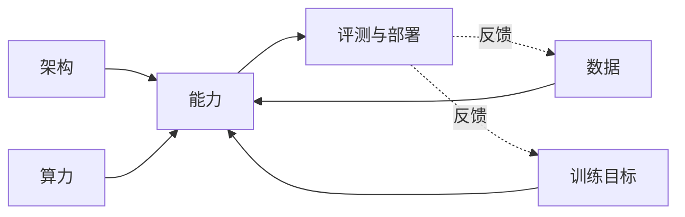

# 第 29 章 前沿与开放问题

## 本章导读

一个模型在 MMLU 上超过 90%，却在同一道题换一种问法后答错；我们能把缩放定律拟合到小数点后三位，却说不清哪项能力会在哪个规模出现。走到全书末尾，前沿问题不再是“把模型做得更大”，而是“哪些进展可以外推，哪些只是当前基准、当前数据与当前训练目标下的局部最优”。

## 难度标签

⭐⭐⭐⭐ 研究向 ｜ 数学要求：概率、期望、KL 散度、缩放定律与基础线性代数 ｜ 代码要求：PyTorch 基础。建议先读第 9、16–19、26–28 章。

## 学习目标

1. 说明长程稀疏奖励为什么让信用分配的方差与采样成本急剧上升，并比较终端奖励、过程奖励与势函数塑形。
2. 解释持续学习中的稳定性—可塑性权衡，说明 EWC、回放与参数隔离各自解决什么问题。
3. 分析合成数据自举的退化机制，说明真实数据锚定与验证器过滤的作用与边界。
4. 用算力与内存账本比较全注意力、线性注意力、SSM、混合架构与 MoE 的适用区间。
5. 识别“涌现”“损失—能力分离”“基准饱和”等理论争议中的测量问题，并给出可复现的审计方案。

## 29.1 直觉：前沿是四条曲线的交汇

全书反复使用一个框架：**能力 = 架构 × 数据 × 算力 × 训练目标**。前二十八章分别拆解了这四项，本章要看的则是它们同时逼近边界时会发生什么。所谓前沿，不是一份“还有哪些热门方向”的清单，而是四条曲线互相牵制、无法再单独靠一项改进获得收益的区域。

- **智能体强化学习**把训练目标从“下一个 Token”拉长到“整条轨迹”，信用分配因此变难；同时它依赖可验证环境，数据侧的成本随之上升。
- **持续学习**要求模型在不遗忘旧知识的前提下更新，冲突发生在数据与训练目标之间：新数据带来的梯度会覆盖旧任务所需的参数。
- **合成数据**试图用模型自身扩充数据，直接作用于数据项；但生成分布会反过来塑造下一轮训练目标，形成自举回路。
- **高效架构**在算力与内存约束下重新分配注意力、状态与稀疏激活，试图用架构换效率。
- **理论问题**则追问：我们用来衡量能力的指标，是否真的在衡量能力。



这张图里有两条反馈边：部署后的失败案例会变成新数据，评测结果会变成新的训练目标。反馈让系统看起来在“自我改进”，也让偏差有机会被放大。前沿研究的困难，往往不在于提出一个新模块，而在于判断某条反馈边是否在把系统推向更真实的能力，还是只在把指标推向更高的分数。

## 29.2 数学原理

### 29.2.1 智能体强化学习：长程信用分配

把一条长度为 $$T$$ 的轨迹记为 $$\tau=(s_0,a_0,r_0,\dots,s_T)$$。策略梯度优化的仍是回报的期望，只是回报现在要跨很多步累加：

$$
G_t=\sum_{k=t}^{T}\gamma^{k-t}r_k
\qquad \text{(29.1)}
$$

当奖励只在轨迹结束时给出，且每一步独立的成功概率为 $$p$$，整条轨迹的成功概率是

$$
P(\mathrm{success})=\prod_{t=1}^{K}p_t=p^{K}
\qquad \text{(29.2)}
$$

这个乘法是长程信用分配的第一道墙。若 $$p=0.9$$、$$K=20$$，成功率约 0.122，平均约 8.2 条轨迹才能看到一次成功；若 $$K=100$$，成功率约 $$2.66\times10^{-5}$$，平均要采样约 3.8 万条轨迹。要在概率 $$1-\delta$$ 下至少看到一次成功，所需轨迹数满足 $$1-(1-p^K)^n\ge1-\delta$$，即

$$
n\ \ge\ \frac{\log\delta}{\log(1-p^{K})}\ \approx\ \frac{\log(1/\delta)}{p^{K}}
\qquad \text{(29.3)}
$$

右侧的近似来自 $$\log(1-x)\approx-x$$。它说明：**稀疏奖励的采样成本随轨迹长度指数增长**，而不是线性增长。一个 8 步任务看起来只比 5 步多 3 步，但成功样本数可能少一个数量级。

缓解办法有两类。第一类是让奖励变密：过程奖励模型（process reward model）对中间步骤打分，或让验证器对每一步给出可验证的部分反馈。第二类是让估计变稳：用基线、优势估计与 GAE 降低方差。第 16 章已经推导过 GAE 的偏差—方差权衡，这里只强调一点：**基线不能无中生有地创造信号**。如果成功样本太少，再好的基线也只能把“几乎没有信号”估计得更稳。

密集奖励并非没有代价。任意设计的过程奖励都可能改变最优策略，把模型推向“讨好验证器”而不是“完成任务”。势函数塑形（potential-based reward shaping）给出了一个安全条件：若额外奖励可以写成

$$
r'_t=r_t+\gamma\Phi(s_{t+1})-\Phi(s_t)
\qquad \text{(29.4)}
$$

那么对任意势函数 $$\Phi$$，最优策略不变。把 (29.4) 代入 (29.1)，塑形后的回报为

$$
\begin{aligned}
G'_t
&=\sum_{k=t}^{T}\gamma^{k-t}r_k
+\sum_{k=t}^{T}\gamma^{k-t}\bigl(\gamma\Phi(s_{k+1})-\Phi(s_k)\bigr)\\
&=G_t-\Phi(s_t)+\gamma^{T-t+1}\Phi(s_{T+1})
\end{aligned}
$$

末项与动作无关，因此只改变回报的常数偏移。这个结论只保证“最优策略不变”，不保证“样本效率一定提高”：势函数选得不好，塑形后的信号可能仍然很弱。第 29.4 节的 8 步链实验会看到，终端奖励几乎学不动，而逐步验证器与势函数塑形都能把成功率从 0.013 拉到 0.92 左右。

工业上的智能体 RL 还多一层风险：验证器本身是学出来的，或者只覆盖了任务的一部分。策略会找到验证器的漏洞，这种现象就是奖励作弊（reward hacking）。常见防线包括：留出验证集、多个验证器投票、对验证器做对抗测试、限制策略的捷径，以及把最终判定交给人或可执行环境。**验证器的质量决定了智能体 RL 的上限**，而不是策略网络的大小。

### 29.2.2 持续学习：稳定性—可塑性的拉锯

持续学习（continual learning）要求模型按任务序列 $$\mathcal{T}_1,\dots,\mathcal{T}_T$$ 依次更新，并在更新后仍能完成旧任务。最直接的失败是灾难性遗忘（catastrophic forgetting）：在任务 B 上做梯度下降，会改动任务 A 依赖的参数，使 A 的损失迅速上升。

弹性权重固化（elastic weight consolidation，EWC）用二次惩罚保护旧参数：

$$
\mathcal{L}_{\mathrm{EWC}}(\theta)
=\mathcal{L}_{B}(\theta)
+\frac{\lambda}{2}\sum_i F_i\bigl(\theta_i-\theta_{A,i}^{*}\bigr)^2,
\qquad
F_i=\mathbb{E}\left[\left(\frac{\partial\log p_\theta(y\mid x)}{\partial\theta_i}\right)^2\right]
\qquad \text{(29.5)}
$$

其中 $$F_i$$ 是 Fisher 信息矩阵的对角元素，衡量参数 $$i$$ 对旧任务预测的敏感度；$$\theta_{A,i}^{*}$$ 是任务 A 结束时的参数。直观上，EWC 把“对旧任务重要”的方向变硬，把“不重要”的方向留给新任务。$$\lambda$$ 控制稳定性与可塑性：太大，模型学不动 B；太小，A 仍会被遗忘。

回放（replay）走另一条路：训练 B 时混入一部分 A 的样本，

$$
\mathcal{L}_{\mathrm{replay}}(\theta)
=(1-\rho)\mathcal{L}_{B}(\theta)+\rho\mathcal{L}_{A}(\theta)
\qquad \text{(29.6)}
$$

$$\rho$$ 是回放比例。回放通常比 EWC 更稳，因为它直接约束旧任务的输入—输出关系，而不是只约束参数距离；代价是要保存旧数据，涉及存储、隐私与合规。参数隔离则把不同任务的更新放进不同的适配器或专家，例如为每个任务挂一组 LoRA，推理时按任务选择。它避免了参数冲突，但增加了路由与组合的复杂度。

评价持续学习不能只看新任务准确率。常用指标是平均准确率与后向迁移（backward transfer）：

$$
\mathrm{ACC}=\frac{1}{T}\sum_{i=1}^{T}R_{T,i},
\qquad
\mathrm{BWT}=\frac{1}{T-1}\sum_{i=1}^{T-1}\left(R_{T,i}-R_{i,i}\right)
\qquad \text{(29.7)}
$$

其中 $$R_{t,i}$$ 是学完任务 $$t$$ 后在任务 $$i$$ 上的表现。BWT 为负表示遗忘，为正表示旧任务反而变好。报告时必须同时给出任务顺序、每任务样本量、允许的存储预算与是否使用任务标识，否则不同论文的数字不可比。

### 29.2.3 合成数据：自举的极限

合成数据（synthetic data）的典型流程是：用当前模型生成样本，经过滤或验证后加入训练集，再训练下一代模型。它看起来是一个可以自我加速的飞轮，但每一次生成都会引入估计误差，误差又会在下一轮被当作真值。

先看一个最小模型。设真实分布为一维高斯 $$\mathcal{N}(\mu,\sigma^2)$$，每代采样 $$N$$ 个点，用最大似然估计均值和方差，再从估计出的高斯采样下一代。样本方差（除以 $$N$$）的期望是 $$\mathbb{E}\left[\frac{1}{N}\sum_{i=1}^{N}(x_i-\bar x)^2\right]=\frac{N-1}{N}\sigma^2$$，因此方差的递推为

$$
\sigma_{t+1}^{2}=\frac{N-1}{N}\sigma_{t}^{2},
\qquad
\sigma_{t}^{2}=\sigma_{0}^{2}\left(\frac{N-1}{N}\right)^{t}
\qquad \text{(29.8)}
$$

方差每代缩小一个固定比例，最终趋于零。均值则做随机游走，尾部样本最先消失。这就是“模型崩溃”（model collapse）的最小机制：**不是模型突然变笨，而是训练分布的长尾被逐代削掉**。

加入真实数据可以改变不动点。若每代有比例 $$\alpha$$ 的样本来自真实分布，且暂假设各分量均值相同，则

$$
\sigma_{t+1}^{2}=(1-\alpha)\sigma_{t}^{2}+\alpha\sigma_{\mathrm{real}}^{2}
\qquad \text{(29.9)}
$$

其不动点为 $$\sigma^{2}=\sigma_{\mathrm{real}}^{2}$$。真实数据像一根锚，把方差拉回真实水平；锚的比例越小，收敛越慢，但只要有非零锚，纯合成的收缩就不会无限进行。若各分量均值不同，还要加上分量间均值差的项，但“锚定防止方差归零”的定性结论不变。

验证器过滤是另一条常见路径：只保留验证器认为正确的样本。设保留概率为 $$q(x)$$，过滤后的分布为

$$
p_{\mathrm{filter}}(x)=\frac{p(x)q(x)}{Z},
\qquad
Z=\mathbb{E}_{p}[q(x)]
\qquad \text{(29.10)}
$$

$$Z$$ 同时是接受率，也是有效样本量的折扣因子。问题在于 $$q$$ 很少完美：它可能偏好短答案、常见格式或表面正确的推理。此时过滤会把分布推向验证器的偏好，而不是真实任务分布。**验证器越强，过滤越有效；验证器有偏，过滤会把偏差放大。**

合成数据并非无用。拒绝采样、蒸馏、自博弈与可验证奖励都能在特定任务上带来真实提升；第 14、18、19 章已经给出多条路径。它的边界在于：生成分布是否保留了真实分布的长尾、因果结构与多样性，以及验证器是否独立于被训练的模型。只报告“合成数据把分数提高了”，而不报告多样性、污染与验证器偏差，结论不可外推。

### 29.2.4 高效架构：算力、内存与质量的三角

第 8 章比较过全注意力、线性注意力与状态空间模型（SSM）。从账本角度看，差异主要在两项：序列长度的二次项，以及推理时是否要保存随长度增长的 KV Cache。全注意力的每层前向算力约为 $$F_{\mathrm{attn}}(T)\approx 4T^{2}d+8Td^{2}$$，线性注意力或 SSM 的状态更新则近似为 $$F_{\mathrm{state}}(T)\approx c_{s}Tdd_{s}$$，其中 $$c_s$$ 是与实现有关的常数，$$d_s$$ 是状态维度。若模型有比例 $$a$$ 的层使用注意力、其余使用状态模型，混合架构的算力为

$$
F_{\mathrm{hybrid}}(T)=aF_{\mathrm{attn}}(T)+(1-a)F_{\mathrm{state}}(T)
\qquad \text{(29.11)}
$$

当 $$T$$ 较小时，$$8Td^{2}$$ 主导，两者差距不大；当 $$T$$ 很大时，$$4T^{2}d$$ 主导，注意力变成瓶颈。交叉长度由 $$F_{\mathrm{attn}}(T)=F_{\mathrm{state}}(T)$$ 解出，量级为 $$T^{\star}\sim c_sd_s$$，与状态维度同阶。注意它与第 13 章式 (13.3) 的 $$T^{\star}=4d_{\mathrm{model}}+3d_{\mathrm{ff}}-1$$ 不是同一个量：后者比较的是稠密 Transformer 内部的二次注意力项与线性投影项，前者比较的是注意力与状态模型两条路线。这不是说“超过交叉长度就该换架构”：状态模型在精确复制、长程检索与训练稳定性上仍有明显短板，混合比例要按任务需求调，而不是按长度一刀切。

表 29-1 把几条路线的账本放在一起。注意表中的“强/弱”是相对任务分布而言的，不是绝对结论。

| 架构 | 训练算力 | 推理状态 | 长程检索 | 主要风险 |
| --- | --- | --- | --- | --- |
| 全注意力 | $$O(T^{2}d+Td^{2})$$ | KV Cache 随 $$T$$ 线性增长 | 强 | 长上下文算力与显存 |
| 线性注意力 | $$O(Td^{2})$$ | 固定大小状态 | 中到弱 | 精确召回退化 |
| SSM | $$O(Tdd_{s})$$ | 固定大小状态 | 中到弱 | 复制与检索任务弱 |
| 混合架构 | 介于两者之间 | 部分 KV + 状态 | 可调 | 层分配与调参复杂 |
| MoE | 稀疏激活 | KV 仍随 $$T$$ 增长 | 取决于注意力子层 | 路由、通信与负载均衡 |

架构还会改变缩放定律的常数与指数。第 9 章的经验形式是

$$
L(N,D)=L_{\infty}+\frac{A}{N^{\alpha}}+\frac{B}{D^{\beta}}
\qquad \text{(29.12)}
$$

替换架构后，$$L_{\infty}$$、$$A$$、$$B$$、$$\alpha$$、$$\beta$$ 都可能变化。比较两个架构时，必须在相同算力、相同显存与相同评测协议下比较；只比参数量或只比平均损失，都会把“架构更省算力”误读成“架构更强”。

### 29.2.5 尚未解决的理论问题

**涌现是否真实。** 一个常见的观察是：模型在某个规模之前几乎不会做某类题，超过某个规模后准确率突然上升。若把能力指标写成损失的阈值函数，这种“突然”可以完全由指标的非线性造成。一个理想化的写法是

$$
M(L)=\sigma\left(\frac{L^{\star}-L}{\tau}\right)
=\frac{1}{1+\exp\left((L-L^{\star})/\tau\right)}
\qquad \text{(29.13)}
$$

当 $$\tau$$ 很小时，$$M(L)$$ 接近阶跃函数：损失只下降一点点，指标就可能从 0 跳到 1。Schaeffer 等（2023）据此认为，部分“涌现”是度量选择造成的幻觉；Wei 等（2022）则给出了在连续指标上也能观察到的能力跃迁。双方证据并不完全矛盾：**有些能力确实随规模出现，但“看起来突然”不等于“机制上突然”**。审计时必须同时报告连续指标（损失、校准、Token 级准确率）与任务指标，并检查阈值是否被人为设定。

**损失与能力的分离。** 语言模型的训练损失是平均对数似然，而部署关心的是任务成功率。二者没有单调的一一对应。一个模型可能平均损失更低，却在某个需要精确推理的任务上更差；也可能在基准上更高，却因为校准变差而更不可靠。把能力定义成

$$
C(\theta)=\mathbb{E}_{x\sim\mathcal{D}}\left[\mathbf{1}\left[m(x,\theta)\ge\tau\right]\right]
\qquad \text{(29.14)}
$$

其中 $$m$$ 是任务指标、$$\tau$$ 是判定阈值，就能看清问题：$$C$$ 依赖数据分布、阈值与判定规则，而 $$L$$ 只是这些量的一个代理。**损失预测的是压缩，不是能力**；这也是第 27 章强调“报告必须带评测协议”的原因。

**可解释性与可控性的边界。** 第 28 章说明，解释是带干预的假设检验。即使我们找到了某个回路或特征，也不等于能稳定地控制模型；因果定位回答“哪里重要”，不自动回答“改哪里最有效”。在持续学习与智能体 RL 中，这个问题更尖锐：模型的行为会随训练分布变化，昨天的解释可能明天就失效。

**基准饱和与古德哈特定律。** 当前沿模型在某项基准上接近满分，分数差异会被噪声、提示词与评测集版本主导；当基准成为优化目标，它就不再是好的度量。第 27 章的 Wilson 区间、配对比较与污染检测，在这里不是可选项，而是判断“前沿进展”是否真实的最低要求。

## 29.3 方案对比

表 29-2 把五个方向的核心问题、主流路线、代价与开放问题放在一起。它们不是互斥的选项；一个真实的系统通常会同时使用多种方法。

| 方向 | 核心问题 | 主流路线 | 主要代价 | 尚未解决 |
| --- | --- | --- | --- | --- |
| 智能体 RL | 长程稀疏奖励下的信用分配 | 结果奖励 + 验证器、过程奖励、搜索、GRPO/PPO | rollout 成本、验证器偏差、奖励作弊 | 长轨迹稳定性、跨环境泛化、安全边界 |
| 持续学习 | 学新不忘旧 | EWC/正则、回放、参数隔离、在线更新 | 旧数据存储、容量冲突、隐私与合规 | 长期在线更新、跨模态遗忘、可验证的遗忘度量 |
| 合成数据 | 无新增真实数据时提升能力 | 自举、拒绝采样、验证器过滤、蒸馏、自博弈 | 多样性坍塌、验证器偏差、污染 | 自举上限、质量—多样性权衡、可证明的防坍塌 |
| 高效架构 | 在算力与内存约束下保住能力 | 线性注意力、SSM、混合层、MoE、稀疏化 | 检索退化、实现复杂、硬件适配 | 长程检索、训练稳定性、统一评价 |
| 理论问题 | 解释能力从何而来、何时可外推 | 缩放定律、涌现研究、机制可解释性、评测理论 | 结论依赖指标与模型版本 | 损失—能力映射、涌现真实性、可控性边界 |

选择方法时，先问“当前最紧的约束是哪一项”。如果算力充足但数据有限，优先看合成数据与数据质量；如果部署成本是瓶颈，优先看架构与量化；如果模型需要持续更新，优先看回放与参数隔离；如果任务是多步决策，优先看验证器与信用分配。**没有一种方法能同时解决四个因子**，前沿工作的价值往往在于说清楚自己在哪一项上做了交换。

## 29.4 代码实现

本节不新增 TinyLM 模块。原因很简单：这一章讨论的是开放问题，任何一个小模块都不足以代表它们；更重要的是，`TinyLM.forward`、`CausalLMOutput` 与 `ModelConfig` 的接口应当保持冻结，避免为了演示而破坏前二十八章的可复现性。下面的脚本是独立的数值实验，只依赖 PyTorch，用来把三个机制显式地跑出来：

1. **持续学习**：先学任务 A（$$\sin$$），再学任务 B（$$\cos$$），比较顺序训练、EWC 与回放。
2. **合成数据自举**：用一维高斯做递归最大似然，比较纯合成与 10% 真实数据锚定。
3. **稀疏奖励信用分配**：8 步链，比较终端奖励、逐步验证器与势函数塑形。

```python
"""第 29 章配套实验：持续学习、合成数据自举与稀疏奖励。

只依赖 PyTorch，不修改 TinyLM 的任何接口。所有随机性由固定种子控制。
"""

import math

import torch
import torch.nn as nn

def set_seed(seed: int) -> None:
    torch.manual_seed(seed)

# ---------------------------------------------------------------- 实验 1
def task_data(n: int, task: int, seed: int):
    g = torch.Generator().manual_seed(seed)
    x = torch.rand(n, 1, generator=g) * 2 - 1
    y = torch.sin(2 * math.pi * x) if task == 0 else torch.cos(2 * math.pi * x)
    flag = torch.full_like(x, float(task))
    return torch.cat([x, flag], dim=1), y

class MLP(nn.Module):
    def __init__(self):
        super().__init__()
        self.net = nn.Sequential(
            nn.Linear(2, 64), nn.Tanh(),
            nn.Linear(64, 64), nn.Tanh(),
            nn.Linear(64, 1),
        )

    def forward(self, x):
        return self.net(x)

def mse(model, x, y):
    with torch.no_grad():
        return ((model(x) - y) ** 2).mean().item()

def train(model, x, y, steps, *, ewc=None, lam=0.0, replay=None, rho=0.5, seed=0):
    g = torch.Generator().manual_seed(seed)
    opt = torch.optim.Adam(model.parameters(), lr=1e-2)
    for _ in range(steps):
        if replay is not None and torch.rand(1, generator=g).item() < rho:  # (29.6)
            xb, yb = replay
        else:
            xb, yb = x, y
        loss = ((model(xb) - yb) ** 2).mean()
        if ewc is not None:  # (29.5)
            penalty = sum(
                (f * (p - star) ** 2).sum()
                for p, star, f in zip(model.parameters(), ewc["star"], ewc["fisher"])
            )
            loss = loss + 0.5 * lam * penalty
        opt.zero_grad()
        loss.backward()
        opt.step()
    return model

def fisher_diag(model, x, y):
    fisher = [torch.zeros_like(p) for p in model.parameters()]
    for i in range(x.shape[0]):
        model.zero_grad()
        ((model(x[i:i + 1]) - y[i:i + 1]) ** 2).mean().backward()
        for f, p in zip(fisher, model.parameters()):
            f += p.grad.detach() ** 2
    return [f / x.shape[0] for f in fisher]

def continual_run(seed: int, steps: int = 500, lam: float = 10_000.0):
    xa, ya = task_data(200, 0, seed * 10 + 1)
    xb, yb = task_data(200, 1, seed * 10 + 2)
    result = {}
    for mode in ("naive", "ewc", "replay"):
        set_seed(seed + 100)
        model = MLP()
        train(model, xa, ya, steps, seed=seed)
        before = mse(model, xa, ya)
        if mode == "naive":
            train(model, xb, yb, steps, seed=seed + 1)
        elif mode == "ewc":
            star = [p.detach().clone() for p in model.parameters()]
            fisher = fisher_diag(model, xa, ya)
            train(model, xb, yb, steps,
                  ewc={"star": star, "fisher": fisher}, lam=lam, seed=seed + 1)
        else:
            train(model, xb, yb, steps, replay=(xa, ya), rho=0.5, seed=seed + 1)
        result[mode] = (before, mse(model, xa, ya), mse(model, xb, yb))
    return result

# ---------------------------------------------------------------- 实验 2
def collapse_trace(seed: int, n: int = 100, generations: int = 200, alpha: float = 0.0):
    g = torch.Generator().manual_seed(seed)
    mu, var = 0.0, 1.0
    trace = {}
    for t in range(generations + 1):
        if t in (0, 50, 100, 200):
            trace[t] = var
        if t == generations:
            break
        n_real = int(round(n * alpha))
        n_syn = n - n_real
        synthetic = mu + math.sqrt(var) * torch.randn(n_syn, generator=g)
        if n_real:
            data = torch.cat([synthetic, torch.randn(n_real, generator=g)])
        else:
            data = synthetic
        mu = data.mean().item()
        var = ((data - mu) ** 2).mean().item()  # (29.8)-(29.9)
    return trace

# ---------------------------------------------------------------- 实验 3
def sparse_rl(seed: int, steps: int = 8, batch: int = 4000,
              updates: int = 200, lr: float = 0.5, mode: str = "terminal"):
    g = torch.Generator().manual_seed(seed)
    theta = torch.zeros(steps)
    for _ in range(updates):
        p = torch.sigmoid(theta)
        actions = (torch.rand(batch, steps, generator=g) < p).float()
        if mode == "terminal":  # (29.1)-(29.2)
            reward = (actions.prod(dim=1) > 0).float()
            baseline = reward.mean()
            grad = ((reward - baseline).unsqueeze(1) * (actions - p)).mean(dim=0)
        elif mode == "step":
            dense = actions.clone()
            dense[:, -1] += 1.0
            returns = torch.flip(torch.cumsum(torch.flip(dense, [1]), dim=1), [1])
            baseline = returns.mean(dim=0, keepdim=True)
            grad = ((returns - baseline) * (actions - p)).mean(dim=0)
        else:  # (29.4): Phi(s_t) = 累计正确步数，gamma = 1
            phi = torch.cumsum(actions, dim=1)
            dense = torch.zeros_like(actions)
            dense[:, 0] = phi[:, 0]
            dense[:, 1:] = phi[:, 1:] - phi[:, :-1]
            dense[:, -1] += 1.0
            returns = torch.flip(torch.cumsum(torch.flip(dense, [1]), dim=1), [1])
            baseline = returns.mean(dim=0, keepdim=True)
            grad = ((returns - baseline) * (actions - p)).mean(dim=0)
        theta = theta + lr * grad
    p = torch.sigmoid(theta)
    sample = (torch.rand(20_000, steps, generator=g) < p).float()
    empirical = (sample.prod(dim=1) > 0).float().mean().item()
    return p.prod().item(), empirical

def mean_std(values):
    mu = sum(values) / len(values)
    sd = (sum((v - mu) ** 2 for v in values) / len(values)) ** 0.5
    return mu, sd

def main():
    print("持续学习：先学任务 A（sin），再学任务 B（cos），3 个种子")
    results = [continual_run(s) for s in range(3)]
    print("方法\tA 前\tA 后\tB\t遗忘")
    for mode, name in (("naive", "顺序训练"), ("ewc", "EWC λ=1e4"), ("replay", "回放 ρ=0.5")):
        before = mean_std([r[mode][0] for r in results])
        after = mean_std([r[mode][1] for r in results])
        b = mean_std([r[mode][2] for r in results])
        forget = (after[0] - before[0], (after[1] ** 2 + before[1] ** 2) ** 0.5)
        print(f"{name}\t{before[0]:.4f}±{before[1]:.4f}\t{after[0]:.4f}±{after[1]:.4f}"
              f"\t{b[0]:.4f}±{b[1]:.4f}\t{forget[0]:.4f}±{forget[1]:.4f}")

    print("\n合成数据自举：1 维高斯，N=100，200 代，200 次模拟")
    print("代数\t纯合成\t10% 真实数据\t理论期望")
    pure = [collapse_trace(s, alpha=0.0) for s in range(200)]
    anchor = [collapse_trace(s, alpha=0.1) for s in range(200)]
    for t in (0, 50, 100, 200):
        pure_mean = math.sqrt(sum(r[t] for r in pure) / len(pure))
        anchor_mean = math.sqrt(sum(r[t] for r in anchor) / len(anchor))
        theory = (0.99) ** (t / 2)
        print(f"{t}\t{pure_mean:.4f}\t{anchor_mean:.4f}\t{theory:.4f}")

    print("\n稀疏奖励信用分配：8 步链，4000 条轨迹/次，200 次更新，3 个种子")
    print("信号\t成功概率（解析）\t成功率（2 万次采样）")
    for mode, name in (("terminal", "终端奖励"), ("step", "逐步验证器"), ("potential", "势函数塑形")):
        vals = [sparse_rl(s, mode=mode) for s in range(3)]
        p = mean_std([v[0] for v in vals])
        e = mean_std([v[1] for v in vals])
        print(f"{name}\t{p[0]:.4f}±{p[1]:.4f}\t{e[0]:.4f}±{e[1]:.4f}")

if __name__ == "__main__":
    main()
```

在 CPU 上运行约 8 秒，输出如下（时间随机器变化，数值由固定种子决定）：

```text
持续学习：先学任务 A（sin），再学任务 B（cos），3 个种子
方法	A 前	A 后	B	遗忘
顺序训练	0.0018±0.0025	0.8741±0.1535	0.0001±0.0000	0.8722±0.1535
EWC λ=1e4	0.0018±0.0025	0.1010±0.0868	0.0004±0.0003	0.0991±0.0869
回放 ρ=0.5	0.0018±0.0025	0.0004±0.0003	0.0004±0.0002	-0.0014±0.0025

合成数据自举：1 维高斯，N=100，200 代，200 次模拟
代数	纯合成	10% 真实数据	理论期望
0	1.0000	1.0000	1.0000
50	0.8068	0.9640	0.7778
100	0.6416	0.9843	0.6050
200	0.3682	0.9594	0.3660

稀疏奖励信用分配：8 步链，4000 条轨迹/次，200 次更新，3 个种子
信号	成功概率（解析）	成功率（2 万次采样）
终端奖励	0.0129±0.0000	0.0129±0.0005
逐步验证器	0.9171±0.0000	0.9181±0.0017
势函数塑形	0.9171±0.0000	0.9181±0.0017
```

三个结果值得逐条解读。

第一，顺序训练把任务 A 的 MSE 从 0.0018 推到 0.8741，几乎等于“完全忘记”；EWC 把它压到 0.1010，回放压到 0.0004。EWC 的方差较大（±0.0868），说明它对 Fisher 估计与 $$\lambda$$ 很敏感；回放在这个玩具任务上几乎无损，但它需要保存旧数据。**稳定性与可塑性没有免费的解，只有不同的代价。**

第二，纯合成高斯的方差确实按 (29.8) 收缩：第 200 代的标准差为 0.3682，理论值为 0.3660；加入 10% 真实数据后，方差稳定在 0.96 左右。注意经验值在中间代数有波动，因为每次采样只有 100 个点，方差估计本身有噪声；表格报告的是 200 次模拟的方差均值开方，而不是单条路径。**单条路径可能崩溃得更快或更慢，但趋势由递推式决定。**

第三，8 步链上终端奖励的成功率只有 0.0129，几乎没学动；逐步验证器与势函数塑形都达到 0.9171。逐步验证器与势函数塑形在这里几乎完全重合，因为“每步正确得 1 分”的密集奖励，正好等于以“累计正确步数”为势函数的塑形结果（相差一个与动作无关的常数）。这个巧合不是普遍规律：换一个任务，任意设计的逐步奖励可能改变最优策略，而势函数塑形只在 (29.4) 的形式下保证策略不变。

复现命令：

```text
python examples/ch29_frontier.py
```

实验的边界必须写清楚：2 层 64 维 MLP、两个一维回归任务、3 个种子；一维高斯、200 代、200 次模拟；8 步独立伯努利链、4000 条轨迹、200 次更新。这些数字用来展示机制，不能外推为真实 LLM 的遗忘率、数据退化速度或 RL 样本效率。

## 29.5 工业实践

**智能体强化学习。** DeepSeek-R1（DeepSeek-AI，2025）把 RLVR 与 GRPO 推到推理模型的主线：用规则可验证的答案、格式奖励与组内相对优势训练长思维链，R1-Zero 在 AIME 2024 上的 pass@1 从 15.6% 提升到 71.0%（数字来自公开论文，训练细节以论文为准）。过程奖励模型则试图把终端奖励拆到中间步骤，Lightman 等（2023）在数学推理上比较了结果监督与过程监督，发现过程监督能用更少的采样获得更好的验证效果。工程上的共识是：**验证器要独立于策略，且要持续用新任务做对抗测试**；否则策略会把验证器的漏洞当成能力。

**持续学习。** 生产系统很少做“真正的在线持续学习”，更常见的是定期全量重训、按任务挂 LoRA 适配器、或用回放缓冲更新。全量重训避免了参数冲突，但成本高、旧数据可能已不可用；适配器隔离降低了干扰，却带来路由与版本管理问题。一个可落地的折中是：主模型冻结，任务适配器增量更新，评测同时覆盖新任务与一组固定的旧任务回归集。**没有回归集的持续学习，无法证明“没有遗忘”。**

**合成数据。** Phi-3（Abdin 等，2024）等技术报告把大量经过筛选的合成教科书数据与网页数据混合，用小模型取得超出参数规模的推理表现；Constitutional AI（Bai 等，2022）用模型反馈构造偏好数据。这些案例说明合成数据可以显著提高数据效率，但也共同依赖两个条件：真实数据锚定与严格过滤。Shumailov 等（2024）在 Nature 上给出的递归训练实验则展示了反面：当真实数据被逐代替换，分布尾部会消失。**合成数据的工程问题不是“能不能生成”，而是“生成分布是否被真实分布约束”。**

**高效架构。** Mamba（Gu & Dao，2023）与 Mamba-2（Dao & Gu，2024）用选择性状态空间把序列建模压到线性复杂度；Jamba（Lieber 等，2024）把 Transformer 层、Mamba 层与 MoE 组合成 52B 总参数、12B 激活参数的混合模型，支持 256K 上下文；Griffin（De 等，2024）比较了循环层与注意力层的混合；DeepSeek-V3（DeepSeek-AI，2024）用 671B 总参数、37B 激活参数的 MoE 把训练与推理成本压到稠密模型之下。它们的共同点是：**没有一项架构在所有任务上占优，工程选择取决于上下文长度、检索需求、吞吐与硬件。**

**理论争议。** 涌现能力的争论、损失与能力的分离、基准饱和与古德哈特定律，正在从“哲学讨论”变成“评测工程问题”。一个负责任的发布材料，至少应同时给出：连续指标与任务指标、样本量与置信区间、数据污染检查、模型版本与提示模板。第 27 章的工具在这里不是附录，而是判断前沿结论是否成立的必需条件。


截至写作时，智能体 RL 的训练配方、合成数据的配比与高效架构的基准仍在快速变化；本节引用的模型规模、上下文长度与分数只代表论文发布时的配置。引用这些数字时，必须同时注明模型版本、评测协议与时间。


## 29.6 论文导读

**1. Kirkpatrick 等，2017，Overcoming Catastrophic Forgetting in Neural Networks。** PNAS 114(13):3521–3526；arXiv:1612.00796。读第 2–3 节，重点看 Fisher 信息、二次惩罚与任务序列实验；这是 EWC 的原始出处。

**2. Shumailov 等，2024，AI Models Collapse When Trained on Recursively Generated Data。** Nature 631:755–759；早期版本 arXiv:2305.17493。读主文与 Methods，重点看分布尾部如何逐代消失，以及真实数据锚定的作用。

**3. DeepSeek-AI，2025，DeepSeek-R1: Incentivizing Reasoning Capability in LLMs via Reinforcement Learning。** arXiv:2501.12948。读第 2–3 节，重点看 RLVR、GRPO、冷启动与规则奖励的设计，以及作者对失败模式的讨论。

**4. Gu 与 Dao，2023，Mamba: Linear-Time Sequence Modeling with Selective State Spaces。** arXiv:2312.00752。读第 2–4 节，重点看选择性状态空间、扫描实现与长序列实验；Mamba-2（arXiv:2405.21060）可接着读。

**5. Schaeffer 等，2023，Are Emergent Abilities of Large Language Models a Mirage?** arXiv:2304.15004。读第 2–4 节，重点看指标非线性如何制造“涌现”，以及作者对评测设计的建议；与 Wei 等（2022，arXiv:2206.07682）对照阅读。

## 29.7 常见误区

**误区一：只要模型更大、数据更多，前沿问题都会自动解决。** 缩放定律描述的是平均损失随算力与数据的下降，不保证每一项能力都按同样速度提升；数据质量、训练目标与评测协议会改变结论。更大的模型也可能在长尾任务上更差。

**误区二：合成数据可以无限自举。** 递归训练会削掉分布尾部，验证器偏差会被放大，多样性会逐代收缩。没有真实数据锚定与独立验证，合成数据的收益不可持续。

**误区三：持续学习就是定期全量重训。** 全量重训能避免参数冲突，但成本高、旧数据未必可用，也无法保证在线更新；回放、参数隔离与 EWC 各自解决不同约束。没有旧任务回归集的“持续学习”无法证明没有遗忘。

**误区四：线性注意力或 SSM 会全面替代 Transformer。** 它们在长序列算力与固定状态上有优势，但在精确复制、长程检索与训练稳定性上仍有短板；混合架构正是为了按任务分配这两种能力。架构选择要按算力、内存、检索需求与硬件综合判断。

**误区五：涌现能力证明能力是突现的。** 指标的非线性、阈值选择与评测协议都能制造“突然上升”；部分涌现是真实的，部分可能是度量幻觉。必须同时报告连续指标与任务指标，并做跨规模、跨指标的对照。

## 29.8 本章小结

- 智能体 RL 的难点是长程信用分配：稀疏奖励让成功样本指数级稀少，终端奖励、过程奖励与势函数塑形在信号密度与策略不变性之间交换。
- 持续学习的难点是稳定性与可塑性：EWC 用 Fisher 曲率保护旧参数，回放直接约束旧任务，参数隔离把冲突移到模块边界。
- 合成数据的难点是分布：递归训练会削掉方差与尾部，真实数据锚定改变不动点，验证器过滤会把分布推向验证器的偏好。
- 高效架构的难点是三角约束：算力、内存与质量不能同时最优，混合架构与 MoE 是在给定硬件下的折中。
- 理论问题提醒我们：损失不是能力，指标不是机制，基准不是现实。
- 全书核心观点：**能力 = 架构 × 数据 × 算力 × 训练目标**；前沿不是第五个因子，而是四个因子同时逼近边界时必须回答的取舍问题。


**本章的取舍**：作为收束章，本章选择了“广度优先”：每个方向只保留最核心的机制、一条公式链与一个最小实验，代价是无法像核心章那样给出完整推导与大规模实证。为了让机制可复现，我们使用玩具任务与固定种子，代价是结论不能直接外推到真实 LLM。为了不破坏前二十八章的接口，本章没有新增 TinyLM 模块，代价是代码与全书主线的耦合较弱。若只能记住一句话：**前沿判断的价值，不在于预言下一个热点，而在于说清楚一个进展在哪个分布、哪个预算、哪个评测协议下成立，以及它为此放弃了什么。**

评估任何“前沿突破”，先问四个问题：它改变了架构、数据、算力还是训练目标？它在什么分布与预算下成立？它的对照与置信区间是什么？换一个模型版本或评测协议，结论还在吗？


## 29.9 习题

### 习题 1（推导）

一条 8 步链，每步独立成功概率为 $$p=0.8$$。求整条链的成功率、平均需要多少条轨迹才能看到一次成功；若要求以 95% 的概率至少看到一次成功，至少需要多少条轨迹？再把终端奖励改为势函数 $$\Phi(s_t)=$$ 前 $$t$$ 步中正确的步数，证明塑形后的回报与原始回报只差一个与动作无关的常数。最后说明：为什么这个结论不意味着“任何逐步奖励都安全”？

### 习题 2（编程）

在 29.4 节的持续学习实验上，扫描 EWC 的 $$\lambda\in\{10^2,10^3,10^4,10^5\}$$ 与回放比例 $$\rho\in\{0.1,0.3,0.5,0.9\}$$，记录任务 A 的遗忘与任务 B 的最终 MSE，并画出稳定性—可塑性曲线。要求固定 3 个种子、报告均值与标准差，并解释为什么某个设置会在“记住 A”和“学会 B”之间失败。

### 习题 3（开放思考）

某团队声称“用 90% 合成数据、10% 真实数据就能把模型能力提升一个档次”，并给出基准分数上涨的结果。请设计一个审计方案，覆盖：合成数据的生成与过滤流程、真实数据锚定的比例、验证器偏差、多样性/长尾覆盖、数据污染、跨规模复现、以及“分数上涨但能力下降”的可能。说明哪些结论可以写进发布材料，哪些只能作为待验证假设。

<details>
<summary>习题答案</summary>

**推导题答案.** 整条链的成功率为 $$0.8^8\approx0.1678$$，平均需要 $$1/0.1678\approx5.96$$ 条轨迹才能看到一次成功。要以 95% 概率至少看到一次，需 $$1-(1-0.1678)^n\ge0.95$$，即 $$n\ge\log(0.05)/\log(1-0.1678)\approx16.31$$，取整为 17 条。势函数取 $$\Phi(s_t)=c_t$$（前 $$t$$ 步正确数），$$\gamma=1$$，则

$$
\begin{aligned}
G'_t
&=\sum_{k=t}^{T}\left[r_k+\Phi(s_{k+1})-\Phi(s_k)\right]\\
&=G_t-\Phi(s_t)+\Phi(s_{T+1})
\end{aligned}
$$

末项与动作无关，所以最优策略不变。这个结论只对“由某个势函数差分得到”的奖励成立；任意的逐步奖励（例如给“看起来合理”的中间步骤加分）不一定能写成势函数差分，可能改变最优策略，把模型推向验证器的偏好。因此，“密集奖励”本身不是安全保证，势函数形式才是。

**编程题答案.** 关键是把两个指标同时记录下来：任务 A 的遗忘 $$R_{2,1}-R_{1,1}$$ 与任务 B 的最终 MSE。$$\lambda$$ 增大时，A 的遗忘通常下降，但 B 的 MSE 可能上升；$$\rho$$ 增大时，A 的遗忘下降，但旧数据的存储与采样成本上升。若某个设置出现“A 几乎不忘、B 完全学不会”，说明惩罚或回放比例过大，模型被钉在旧任务附近；若出现“B 很好、A 完全忘记”，说明约束太弱。报告时要给 3 个种子的均值与标准差，并注明任务顺序与数据量。

**开放题答案.** 要点：先要求团队给出合成数据的生成模型、过滤规则、验证器来源与真实数据配比；检查验证器是否与训练模型独立，是否在留出任务上评估；统计合成数据的多样性（去重率、n-gram 覆盖、嵌入距离）与长尾覆盖；做污染检测，确认基准样本没有进入合成数据；在不同模型规模上复现，排除“只在小模型上有效”；同时报告连续指标（损失、校准）与任务指标，检查是否存在“基准涨、能力降”。可以写进发布材料的只有“在指定数据配比、模型版本与评测协议下，基准分数有可测提升”；“能力提升一个档次”只能作为待验证假设，除非有跨分布、跨规模与独立验证器的证据。

</details>
